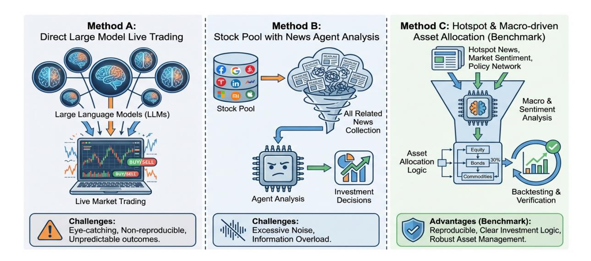

# CN-Buzz2Portfolio: A Chinese-Market Dataset and Benchmark for LLM-Based Macro and Sector Asset Allocation from Daily Trending Financial News

Liyuan Chen1,2, Shilong Li2 , Jiangpeng Yan2 , Shuoling Liu2 , Qiang Yang3 , Xiu Li1

1Tsinghua Shenzhen International Graduate School 2E Fund Management Co., Ltd. 3Hong Kong Polytechnic University

E-Mails:{lishilong, yanjiangpeng}@efunds.com.cn

# Abstract

Large Language Models (LLMs) are rapidly transitioning from static Natural Language Processing (NLP) tasks including sentiment analysis and event extraction to acting as dynamic decision-making agents in complex financial environments. However, the evolution of LLMs into autonomous financial agents faces a significant dilemma in evaluation paradigms. Direct live trading is irreproducible and prone to outcome bias by confounding luck with skill, whereas existing static benchmarks are often confined to entity-level stock picking and ignore broader market attention. To facilitate the rigorous analysis of these challenges, we introduce CN-Buzz2Portfolio, a reproducible benchmark grounded in the Chinese market that maps daily trending news to macro and sector asset allocation. Spanning a rolling horizon from 2024 to mid-2025, our dataset simulates a realistic public attention stream, requiring agents to distill investment logic from highexposure narratives instead of pre-filtered entity news. We propose a Tri-Stage CPA Agent Workflow involving Compression, Perception, and Allocation to evaluate LLMs on broad asset classes such as Exchange Traded Funds (ETFs) rather than individual stocks, thereby reducing idiosyncratic volatility. Extensive experiments on nine LLMs reveal significant disparities in how models translate macro-level narratives into portfolio weights. This work provides new insights into the alignment between general reasoning and financial decision-making, and all data, codes, and experiments are released to promote sustainable financial agent research.

### 1 Introduction

Risk Reminder: *"This work is for academic research only. All experiments are conducted under simulated market environments with simplified assumptions. The content herein does not constitute investment advice, and any reliance thereon for actual trading is at your own risk."*

The integration of Large Language Models (LLMs) into the financial domain is shifting the research frontier from passive text analysis to active Financial Generalist Agents [\(Chen et al.,](#page-9-0) [2025a;](#page-9-0) [Guo and Shum,](#page-9-1) [2025;](#page-9-1) [Huang et al.,](#page-9-2) [2025\)](#page-9-2). However, evaluating these agents in high-noise, nonstationary markets remains an open challenge.

As illustrated in Figure [1,](#page-1-0) current evaluation methodologies are polarized. On the one hand, Direct Live Trading platforms such as *AI-Trader* [\(HKU Data Science Lab,](#page-9-3) [2025\)](#page-9-3), *RockFlow AI Arena* [\(RockFlow Team,](#page-9-4) [2025\)](#page-9-4) and *nof1.ai* [\(NoF1](#page-9-5) [Team,](#page-9-5) [2025\)](#page-9-5) offer maximum realism but are scientifically limited by irreproducibility. Specifically, it is often impossible to distinguish whether profitable outcomes come from sound reasoning or market luck. On the other hand, Static Benchmarks like *InvestorBench* [\(Li et al.,](#page-9-6) [2025b\)](#page-9-6) and *FinMem* [\(Yu et al.,](#page-10-0) [2025b\)](#page-10-0) provide standardization but typically focus on narrow tasks or historical stock picking that fails to capture the complexity of open-world information flows.

We argue that a robust evaluation framework must serve as a diagnostic tool to bridge the Dual-Layer Evaluation Bottleneck that hinders the systematic development of financial agents:

- 1. Reasoning Alignment (Semantic → Logic): High performance in general NLP tasks such as summarization does not inherently translate into valid investment logic. Agents must demonstrate the ability to map narratives to actionable financial hypotheses, a process often obscured in end-to-end evaluations.
- 2. Attributional Noise (Logic → Outcome): In high-variance environments like individual stock markets, price movements are often dominated by idiosyncratic noise. This creates an attribution gap where even a logically sound agent may suffer from bad luck, while a flawed agent might profit by chance, complicating the verification of decision-making.

Figure 1: Comparison of Financial Agent Research Paradigms. (a) Direct Live Trading: Agents interact with real-time markets. While offering maximum realism, this approach poses scientific challenges regarding reproducibility and attribution, making it difficult to isolate valid reasoning from market randomness. (b) Entity-Centric Benchmarks (e.g., StockBench): The standard paradigm mapping news to pre-defined target stocks. This overlooks the "Public Attention Filtering" process and often suffers from high idiosyncratic volatility at the individual stock level, complicating the verification of logical consistency. (c) CN-Buzz2Portfolio (Ours): A rolling-horizon benchmark simulating the pipeline from *Daily Trending News* (Public Attention) to *Macro & Sector Allocation*. By targeting diversified asset classes to reduce noise, this framework serves as a diagnostic tool to rigorously evaluate the alignment between semantic understanding and verifiable portfolio logic.

The inability of existing paradigms to address this bottleneck comes from two critical limitations in current dataset designs:

Limitation 1: Scope Misalignment (Entity-Centric vs. Market-Narrative-Driven). Mainstream benchmarks [\(Li et al.,](#page-9-6) [2025b\)](#page-9-6) typically follow an *Entity-Centric* paradigm where the system retrieves news for a pre-defined target stock pool. However, real-world trading is strongly driven by Public Attention and Information Exposure [\(Bar](#page-9-7)[ber and Odean,](#page-9-7) [2008\)](#page-9-7). Traders operate within a "Trending Topic" stream, such as policy shifts or global macro-events, and must autonomously identify relevant sectors. Existing works bypass this "Narrative Sifting" mechanism by pre-filtering news for specific entities, thereby failing to test an agent's ability to discover opportunities from raw market-wide information.

Limitation 2: Scarcity of Macro-Semantic Reasoning in Emerging Markets. Current benchmarks are predominantly centered on mature American markets and micro-level stock prediction. However, in the Chinese market, which is highly sensitive to policy narratives and sector-wide sentiment, steady returns are often generated through Asset Allocation and Sector Rotation rather than

idiosyncratic stock picking. There is a lack of highquality benchmarks that evaluate cross-layer reasoning: the ability to map market narratives and public sentiment to broad asset baskets (e.g., ETFs) without explicit mentions of stock entities in the source text.

To address these challenges, we introduce CN-Buzz2Portfolio, a rolling-horizon benchmark tailored for macro-semantic financial reasoning. Our contributions are summarized as follows:

- Benchmark (2024–2025 Rolling Horizon): We curate a dataset derived from multiplatform *Daily Trending News*, simulating the real-world "Public Attention Stream". We open-source the full dataset, evaluation code, and experiment results. [1](#page-1-1) .
- Task (Market Attention-to-Allocation): We propose a novel task requiring agents to construct portfolios using diversified ETFs (Macro and Sector) based on trending narratives, shifting the focus from noisy stock-level prediction to logic-driven asset allocation.
- Evaluation: Using a standardized Tri-Stage CPA Agent Workflow, we provide a comparative analysis of top-tier LLMs, revealing dis-

1Link will be updated to the official GitHub repository upon publication.

tinct behavioral patterns in a policy-sensitive financial environment.

# 2 Related Work

Research on Large Language Models (LLMs) in finance has expanded rapidly. We categorize existing works into three streams: financial evaluation benchmarks, autonomous agent frameworks, and semantic alignment studies.

# 2.1 Financial LLM Benchmarks and Prediction Tasks

Early works like FinBERT [\(Araci,](#page-9-8) [2019\)](#page-9-8) focused on static sentiment classification. With the advent of foundational models like FinGPT series [\(Yang](#page-9-9) [et al.,](#page-9-9) [2023;](#page-9-9) [Zhang et al.,](#page-10-1) [2023a,](#page-10-1)[b;](#page-10-2) [Wang et al.,](#page-9-10) [2023;](#page-9-10) [Liu et al.,](#page-9-11) [2023\)](#page-9-11) and BloombergGPT [\(Wu](#page-9-12) [et al.,](#page-9-12) [2023\)](#page-9-12), the focus shifted to generative capabilities. Recent benchmarks have standardized the evaluation of financial decision-making. Stock-Bench [\(Chen et al.,](#page-9-13) [2025b\)](#page-9-13) provides a comprehensive testbed for stock movement prediction. InvestorBench [\(Li et al.,](#page-9-6) [2025b\)](#page-9-6) evaluates agents on diverse financial tasks including behavioral analysis and trading. AlphaFin [\(Li et al.,](#page-9-14) [2024b\)](#page-9-14) and LiveTradeBench [\(Yu et al.,](#page-10-3) [2025a\)](#page-10-3) integrate realworld news retrieval to seek trading alpha, pushing models to process time-series information.

A predominant methodology in these benchmarks follows an Entity-Centric Information Gathering paradigm: the system starts with a predefined pool of target stocks, retrieves news specific to those entities, and feeds them to the LLM for prediction. While effective for verifying entitylevel reasoning, this approach simplifies the "Public Attention Filtering" challenge inherent in real markets, where investors must autonomously identify which assets are relevant from an open-world stream of trending topics without pre-set targets.

# 2.2 Autonomous Trading Agents and Live Systems

Moving beyond prediction to execution, researchers have developed agentic frameworks. Fin-Robot [\(Yang et al.,](#page-9-15) [2024\)](#page-9-15) and TradingAgents [\(Xiao et al.,](#page-9-16) [2024\)](#page-9-16) decompose trading into perception, reasoning, and execution modules. Deep-Fund [\(Li et al.,](#page-9-17) [2025a\)](#page-9-17) applies Deep Reinforcement Learning to continuous portfolio management, while FinMem [\(Yu et al.,](#page-10-0) [2025b\)](#page-10-0) enhances agents with layered memory to adapt to evolving market conditions.

The years 2024–2025 have also seen the rise of Live Trading Systems and competitions. Platforms like AI-Trader (HKUDS) [\(HKU Data Sci](#page-9-3)[ence Lab,](#page-9-3) [2025\)](#page-9-3) and RockFlow AI [\(RockFlow](#page-9-4) [Team,](#page-9-4) [2025\)](#page-9-4) allow diverse LLMs (e.g., GPT-4, DeepSeek) to compete in real-time US stock markets. In the crypto domain, autonomous agents like Truth Terminal [\(Ayrey,](#page-9-18) [2024\)](#page-9-18) and nof1.ai [\(NoF1](#page-9-5) [Team,](#page-9-5) [2025\)](#page-9-5) operate as autonomous investment DAOs, driving asset prices via social narratives. Our work complements these high-agency systems by providing a reproducible, rolling-horizon testbed that isolates the reasoning logic from the stochastic variance (luck) often present in live trading environments.

# 2.3 Cross-Cultural and Macro-Semantic Alignment

While general Chinese benchmarks like C-Eval [\(Huang et al.,](#page-9-19) [2023\)](#page-9-19) and CMMLU [\(Li et al.,](#page-9-20) [2024a\)](#page-9-20) assess linguistic proficiency, they rarely cover domain-specific financial logic. In the Ashare market, policy narratives (e.g., "Countercyclical Adjustment") drive distinct asset behaviors compared to Western markets.

There is a lack of benchmarks that evaluate Macro-Semantic Reasoning—the ability to map abstract policy and sentiment shifts to broad asset allocation strategies (e.g., Sector/Macro ETFs) rather than individual stock picking.

# 3 The CN-Buzz2Portfolio Benchmark

#### 3.1 Task Formalization

We formulate the investment decision-making process as a sequential mapping task under uncertainty. Instead of a Reinforcement Learning objective, we focus on the agent's ability to derive actionable decisions from incomplete observations. At each time step t, the agent operates based on the following components:

• Observation (Ot): Within a rolling time window, the agent observes a tuple ⟨Nt , Phist, Thist, Ht⟩. Here, Nt represents the unstructured Buzz Feed (open-world trending news), Phist and Thist denote historical market prices and trading records, and Ht is the current portfolio state. The "Buzz" contains a mix of financial policies, social events, and platform-specific clickbait, without pre-defined entity mappings, requiring the agent to autonomously identify

relevance.

• Action Space (At): The action is defined as a rebalancing instruction wt+1 for the next period. To ensure reproducibility and focus on reasoning, the action space is constrained to a programmatic execution interface, allowing the agent to focus on high-level strategic decisions, as detailed in Section [3.5.](#page-3-0)

#### 3.2 Data Construction: The "Buzz" Stream

We aggregate daily Top-20 trending topics from 4 major Chinese financial platforms, using the full trending list as the input. We enforce strict timestamp filtering: only news published *before* market close on Day T is used to decide the allocation for Day T (executed at Close), preventing the "Look-Ahead Bias". Detailed dataset statistics are provided in Appendix [A.](#page-10-4)

## 3.3 Asset Universes: Macro and Sector Perspectives

To evaluate macro-to-sector reasoning, we construct two distinct asset pools using Exchange Traded Fund (ETF) Feeder Funds. These funds serve as a granular canvas to map semantic logic to market segments:

- Task A (Macro and Thematic Allocation): This task assesses the interpretation of economic cycles. The universe consists of 11 broad-based indices covering major asset classes including Equities, Bonds, and Gold, as well as distinct market styles such as Largecap and Small-cap indices.
- Task B (Sector Rotation): This task requires a fine-grained understanding of industrial policies. We select 14 sector-specific ETFs representing key nodes in the Chinese industrial chain, such as New Energy and TMT (Technology, Media, and Telecom).

Detailed selection criteria regarding liquidity and assets under management are provided in Appendix [B](#page-10-5).

# 3.4 Unified Trading Protocol: The Tri-Stage CPA Multi-Agent Framework

To provide a standardized evaluation protocol, we establish a Tri-Stage CPA Multi-Agent Framework. This structure is designed to extract market sentiment and policy inclinations from hot news, and generate investment logic and portfolio rebalancing instructions.

#### Stage 1: Compression (Summarizer Asum). Raw trending lists often contain noise such as clickbait or non-financial social events. Asum functions as an information filter, distilling the noisy Nt into a structured list of financially relevant events. This

process significantly improves the signal-to-noise ratio before intensive analysis.

Stage 2: Perception (Analyst Aana). Aana operates as an analytical engine. By processing the distilled events alongside asset definitions, this module evaluates how different news narratives might influence various sectors and indices. It assesses the overall market sentiment and identifies potential opportunities through logical inference, focusing purely on the narrative impact without relying on technical price data.

Stage 3: Allocation (Trader Atrade). Atrade functions as the execution controller. It integrates the qualitative insights from Aana with historical data (Phist, Thist) and current holdings (Ht). The final output includes both the investment logic and specific rebalancing commands.

# 3.5 Execution Layer and Action Constraints

To minimize arithmetic errors in LLMs, we offload numerical calculations to a deterministic execution engine. We design a structured command-based action space that translates qualitative intent into precise trades inspired by retail investor behavior:

- Budget-Based Allocation (Buy): The agent specifies a monetary value for purchases (e.g., "Allocate 5,000 RMB to Asset X"). This prevents the model from failing at share-price multiplication.
- Ratio-Based Position Management (Sell): The agent specifies a percentage of the current holding to liquidate (e.g., "Sell 50% of Asset Y"). This approach mitigates short-selling errors and mimics logical risk management strategies like profit-taking.

### 4 Experimental Setup

# 4.1 Evaluation Period

We select challenging time windows to test robustness across market regimes:

• Phase 1 (2024 Full Year): A "Bear-to-Bull" transition period characterized by high volatility and intensive policy shifts (e.g., the "National Nine Articles" reform). This tests the agent's adaptability to regime changes.

• Phase 2 (2025 H1): A "High-Volatility Oscillation" period. During this phase, the market index (CSI 300) exhibited significant fluctuations but low net value change (sideways movement). This tests the agent's ability to generate alpha through precise timing and rotation in a market lacking a clear directional beta.

### 4.2 Simulation Environment

We construct a Retail Simulation Environment (individual retail investors). This choice is deliberate to ensure the results are attainable by ordinary investors, rather than theoretical institutional backtests.

- Capital Constraints: 100,000 RMB initial funding.
- Asset Proxy: We use ETF Feeder Funds for accessibility. Execution assumes the Closing Price of the underlying ETF, ensuring high data fidelity and liquidity matching.
- Transaction Cost: We apply a realistic fee of 0.01% (1 basis point). This reflects the competitive low-commission structure for ETFs in China. While low, it serves as a penalty for excessive turnover, discouraging the agent from random churning and over frequent trading.
- Frequency: Daily rebalancing at Market Close. This aligns with the daily frequency of the "Buzz" list.

#### 4.3 Model Zoo and Selection Logic

We evaluate a diverse array of nine state-of-the-art LLMs, categorized by their underlying reasoning paradigms and architectural scales. The selection is designed to compare specialized reasoning models against general-purpose instruction models in the context of policy-sensitive financial decisionmaking.

- Reasoning-Oriented Models: This category includes DeepSeek-R1 [\(DeepSeek-AI,](#page-9-21) [2025\)](#page-9-21), Qwen-3-Max-Think [\(Qwen Team,](#page-9-22) [2025\)](#page-9-22), and Qwen-3-32B-Think [\(Qwen Team,](#page-9-22) [2025\)](#page-9-22). These models utilize integrated chainof-thought (CoT) processes, making them ideal for testing the extended reasoning required to analyze the complex implications of trending narratives and map them to coherent investment logic.
- General Instruction Models: We include global frontiers such as GPT-5 [\(OpenAI,](#page-9-23) [2025\)](#page-9-23) and Gemini-2.5-Pro [\(Google Gemini](#page-9-24)

[Team,](#page-9-24) [2025\)](#page-9-24), alongside leading domestic models including DeepSeek-V3 [\(DeepSeek-AI,](#page-9-25) [2024\)](#page-9-25), GLM-4.6 [\(AI,](#page-9-26) [2025\)](#page-9-26), Qwen-3-Max, and Qwen-3-32B. These models represent the baseline for instruction-following and semantic compression in zero-shot financial contexts.

#### 4.4 Evaluation Metrics

To provide a multi-dimensional assessment of agent performance, we utilize the following financial and operational metrics:

- Cumulative Return: The total percentage change in portfolio value over the evaluation horizon. This serves as the primary indicator of the agent's ultimate profit-generating capability.
- Sharpe Ratio: A measure of risk-adjusted return, calculated as the ratio of the excess return to the standard deviation of returns. A higher SR indicates that the agent's logic effectively balances gains against volatility.
- Maximum Drawdown (MaxDD): The largest peak-to-trough decline in the portfolio's value. This metric assesses the agent's risk-control capabilities and its resilience during unfavorable market shifts.
- Volatility: The standard deviation of the portfolio's daily returns, reflecting the intensity of price fluctuations. This metric evaluates the agent's exposure to market risk and its ability to maintain a stable equity curve under high-uncertainty environments.

### 5 Experimental Results and Analysis

We provide a multi-dimensional analysis of agent behavior, covering financial performance, decisionmaking consistency, and qualitative study. Detailed case studies of successful strategic reasoning and typical failure modes are provided in Appendix [C.](#page-10-6)

#### 5.1 Baseline Validity and Market Context

Table [1](#page-5-0) reveals a comprehensive picture of model capabilities across the full rolling horizon (2024–2025).

- General Effectiveness: Across both periods, the Tri-Agent pipeline successfully generated positive absolute returns for most large-scale models, validating that the "Buzz" stream contains extractable financial signals.
- The "Beta Trap" in 2024 Task A (Macro): In 2024 Task A, we observe that several mod-

|                                    | 2024 Task A: Macro Allocation |              |                                        |                | 2024 Task B: Sector Rotation |              |                                       |                |
|------------------------------------|-------------------------------|--------------|----------------------------------------|----------------|------------------------------|--------------|---------------------------------------|----------------|
| Model                              | Return                        | Sharpe       | MaxDD                                  | Volatility     | Return                       | Sharpe       | MaxDD                                 | Volatility     |
| Reasoning Models                   |                               |              |                                        |                |                              |              |                                       |                |
| DeepSeek-R1                        | 7.47%                         | 0.51         | -10.71%                                | 0.177          | 28.37%                       | 1.14         | -12.93%                               | 0.255          |
| Qwen3-32B-Think                    | 5.56%                         | 0.50         | -7.66%                                 | 0.128          | 21.67%                       | 0.94         | -16.21%                               | 0.249          |
| Qwen3-Max-Think                    | 8.98%                         | 0.62         | -10.95%                                | 0.167          | 40.11%                       | 1.52         | -15.84%                               | 0.251          |
| Standard Models                    |                               |              |                                        |                |                              |              |                                       |                |
| DeepSeek-V3                        | 9.28%                         | 0.62         | -11.48%                                | 0.174          | 6.97%                        | 0.42         | -19.51%                               | 0.224          |
| Gemini-2.5-Pro                     | 10.67%                        | 0.67         | -10.89%                                | 0.181          | 18.10%                       | 0.80         | -17.10%                               | 0.255          |
| GPT-5                              | 7.31%                         | 0.53         | -10.79%                                | 0.164          | 24.42%                       | 1.07         | -16.35%                               | 0.239          |
| GLM-4.6                            | 6.25%                         | 0.47         | -12.01%                                | 0.159          | 31.58%                       | 1.25         | -14.11%                               | 0.254          |
| Qwen3-32B                          | 5.59%                         | 0.44         | -11.80%                                | 0.158          | 13.26%                       | 0.63         | -17.31%                               | 0.257          |
| Qwen3-Max                          | 8.03%                         | 0.60         | -10.31%                                | 0.155          | 26.50%                       | 1.03         | -16.02%                               | 0.273          |
| Quantitative Baselines             |                               |              |                                        |                |                              |              |                                       |                |
| Momentum                           | 5.46%                         | 0.40         | -13.55%                                | 0.143          | 11.35%                       | 0.48         | -17.68%                               | 0.250          |
| MVO                                | 16.99%                        | 1.73         | -8.64%                                 | 0.103          | 17.76%                       | 0.87         | -14.39%                               | 0.214          |
| Market Baselines                   |                               |              |                                        |                |                              |              |                                       |                |
|                                    |                               | 0.84         | -14.41%                                | 0.214          | 16.20%                       | 0.84         | -14.41%                               | 0.214          |
|                                    |                               |              |                                        |                |                              |              |                                       |                |
| CSI 300 Naive EW Portfolio      | 16.20% 9.21%               | 0.53         | -15.60%                                | 0.218          | 9.80%                        | 0.50         | -18.05%                               | 0.263          |
|                                    |                               |              |                                        |                |                              |              |                                       |                |
| Model                              | Return                        | Sharpe       | 2025 Task A: Macro Allocation MaxDD | Volatility     | Return                       | Sharpe       | 2025 Task B: Sector Rotation MaxDD | Volatility     |
|                                    |                               |              |                                        |                |                              |              |                                       |                |
| Reasoning Models                   |                               |              |                                        |                |                              |              |                                       |                |
| DeepSeek-R1                        | 11.21%                        | 1.81         | -4.17%                                 | 0.130          | 6.08%                        | 0.70         | -16.19%                               | 0.215          |
| Qwen3-32B-Think Qwen3-Max-Think | 10.49% 6.37%               | 1.98 1.08 | -4.36% -8.04%                       | 0.111 0.131 | 5.78% 2.84%               | 0.83 0.45 | -10.79% -11.14%                    | 0.160 0.165 |
|                                    |                               |              |                                        |                |                              |              |                                       |                |
| Standard Models                    |                               |              |                                        |                |                              |              |                                       |                |
| DeepSeek-V3                        | 7.41%                         | 1.16         | -6.20%                                 | 0.140          | 5.58%                        | 0.69         | -13.40%                               | 0.198          |
| Gemini-2.5-Pro                     | 7.76%                         | 1.24         | -7.69%                                 | 0.137          | 7.38%                        | 0.88         | -13.16%                               | 0.195          |
| GPT-5                              | 3.84%                         | 0.69         | -8.38%                                 | 0.128          | 5.12%                        | 0.70         | -12.13%                               | 0.176          |
| GLM-4.6                            | 11.06%                        | 1.72         | -5.40%                                 | 0.136          | 5.03%                        | 0.63         | -14.47%                               | 0.198          |
| Qwen3-32B Qwen3-Max             | 8.99% 9.48%                | 1.46 1.58 | -5.56% -6.90%                       | 0.133 0.129 | 1.44% 8.81%               | 0.27 1.04 | -11.61% -13.01%                    | 0.166 0.192 |
|                                    |                               |              |                                        |                |                              |              |                                       |                |
| Quantitative Baselines             |                               |              |                                        |                |                              |              |                                       |                |
| Momentum MVO                    | 2.08% 3.78%                | 0.20 0.98 | -16.56% -3.56%                      | 0.230 0.086 | 1.79% 4.36%               | 0.16 0.67 | -17.83% -9.12%                     | 0.247 0.146 |
|                                    |                               |              |                                        |                |                              |              |                                       |                |
| Market Baselines CSI 300        | 3.03%                         | 0.50         | -10.49%                                | 0.156          | 3.03%                        | 0.50         | -10.49%                               | 0.156          |

Table 1: Comparative performance across two distinct market regimes: the high-volatility momentum environment of 2024 and the low-yield range-bound environment of 2025. Reasoning-oriented models demonstrate superior alpha generation in complex sector rotation tasks during volatile regimes, while general instruction models maintain robustness in stable macro allocation. *Quantitative Baselines* denote classic algorithmic strategies: Momentum and MVO. *Market Baselines* denote broader indices (CSI 300), and *Naive EW Portfolio* represents an equally-weighted allocation of all candidate assets. 2025 returns represent cumulative period returns (non-annualized).

els (e.g., DeepSeek-V3, GLM-4.6) trailed the market benchmark (CSI 300 Return: 16.20%). This underperformance is attributable to the specific market regime of 2024, which featured a prolonged bearish phase followed by a violent, policy-induced rally (Systematic Beta explosion) in the late stages. The CSI 300, being a 100% equity index, captured this volatility fully. In contrast, our Agents—acting as rational active man-

- agers—often maintained defensive positions (Gold/Bonds/Cash) during the bearish phase to control drawdowns. Consequently, while they reduced risk, they naturally lagged the raw index during the sudden liquidity-driven spike. This reflects realistic "Active Management" behavior rather than model failure.
- Structural Alpha in Task B (Sector): Conversely, in Task B (Sector Rotation), models significantly crushed the benchmark. This

indicates while Agents might be conservative on broad asset exposure (Task A), they excel at identifying **Structural Opportunities**—allocating capital to specific leading sectors identified from the news, thereby generating significant Alpha beyond market Beta.

• The Necessity of Rolling Updates: The performance variance between 2024 (Trend) and 2025 (Oscillation) underscores the critical value of our rolling-update design. Static benchmarks risk allowing models to "memorize" history (e.g., Qwen's high 2024 performance might involve implicit knowledge leakage). By continuously introducing unseen data, CN-Buzz2Portfolio can actively mitigate "look-ahead" issue, ensuring evaluations focus on True Temporal Generalization.

# 5.2 Variance Decomposition: Model Capability vs. Stochasticity

To verify that the observed performance gaps are statistically significant rather than artifacts of random initialization, we perform a variance decomposition analysis (Table 2).

| Variance Statistic (Scaled by $10^{-3}$ )                 | 2024  | 2024   | 2025  | 2025   |
|-----------------------------------------------------------|-------|--------|-------|--------|
|                                                           | Macro | Sector | Macro | Sector |
| Total Variance                                            | 1.57  | 9.14   | 0.48  | 0.50   |
| <b>Between-Model Var.</b> $(\sigma^2_{model})$            | 1.26  | 6.43   | 0.25  | 0.33   |
| Within-Model Var. $(\sigma^2_{stochastic})$               | 0.32  | 2.71   | 0.23  | 0.17   |
| Efficacy Ratio $(\sigma_{model}^2/\sigma_{stochastic}^2)$ | 3.98  | 2.37   | 1.09  | 1.98   |
| Avg. Reasoning Stability $(\bar{\sigma})$                 | 1.27  | 1.58   | 0.83  | 1.14   |

Table 2: Variance Decomposition Analysis. The Efficacy Ratio quantifies the dominance of model's narrative-processing consistency over stochastic noise. A ratio significantly greater than 1.0 suggests that performance is driven by algorithmic logic rather than random variance.

The **Between-Model Variance** significantly outweighs the stochastic component in 2024 (Ratio > 2.3), confirming that the performance hierarchy is structurally robust and reflects divergent model reasoning capabilities. However, in **2025 Task A**, the ratio converges toward parity (**1.09**). This phenomenon implies that in low-volatility regimes characterized by mean-reverting dynamics, the signal-to-noise ratio for current LLMs diminishes, rendering their decision-making processes nearly indistinguishable from **stochastic permutations**. These results highlight a critical boundary: contemporary Agents function primarily as **regime-dependent decision-makers**, demonstrating high efficacy in trend-following environ-

ments but exhibiting diminished predictive power in mean-reversion or sideways market regimes.

#### 6 Ablation Studies

We further explore the mechanism of how agents process information intensity, revealing a nonlinear relationship between context quantity and decision quality.

#### **6.1** The Information Utility Curve

The results across different Top-N (i.e. How many top news are used in the framework) settings (Table 3) challenge the assumption that "more information is better." Instead, we observe distinct regimes of information utility:

1. The "Sweet Spot" vs. Filter Failure. For most high-performing models (e.g., Gemini-2.5-Pro, Qwen3-Max), performance peaks at Top-5 or Top-10. This density provides sufficient signal to identify the dominant market theme. However, as context expands to Top-20, performance often degrades (e.g., DeepSeek-V3 drops significantly). Qualitative inspection suggests a "Filter Failure": Top-20 lists inevitably contain entertainment gossip and non-financial noise.

#### 2. The Top-0 Paradox: When News Misleads.

A striking observation in the 2025 Oscillation Phase (Panel B) is that the **Top-0** setting (Pure Price History) frequently outperforms news-augmented settings (e.g., GLM-4.6 in Task B). This indicates a regime-dependent value of information. In a trendless market, financial news often consists of contradictory analyst opinions or "noise." Agents fed with this conflicting stream may "hallucinate" a narrative that doesn't exist, leading to over-trading. In such regimes, a "blind" agent relying solely on price momentum (Top-0) proves more robust than one attempting to force a narrative fit.

#### 6.2 The "Scaling Law" Paradox

Our dataset reveals a compelling anomaly regarding Model Scale. While general NLP tasks typically follow a strict Scaling Law (Performance  $\propto$  Parameters), financial decision-making exhibits a non-trivial, regime-dependent behavior.

**1. The "Knowledge Advantage".** In the 2024 phase (Panel A), we observe the expected hierarchy: larger models significantly outperform smaller ones. For instance, in Task B, **Qwen3-Max-Think** (44.98%) dominates **Qwen3-32B-Think** (19.27%).

| Panel A: 2024 Full Year (High Volatility / Policy Shift) |                          |       |        |        |                         |       |        |        |
|----------------------------------------------------------|--------------------------|-------|--------|--------|-------------------------|-------|--------|--------|
| Model                                                    | Task A: Macro Allocation |       |        |        | Task B: Sector Rotation |       |        |        |
|                                                          | Top-0                    | Top-5 | Top-10 | Top-20 | Top-0                   | Top-5 | Top-10 | Top-20 |
| Reasoning Models                                         |                          |       |        |        |                         |       |        |        |
| DeepSeek-R1                                              | 5.93                     | 7.38  | 7.47   | 8.56   | 26.32                   | 21.66 | 28.37  | 23.90  |
| Qwen3-Max-Think                                          | 10.27                    | 11.46 | 8.98   | 10.03  | 29.10                   | 44.98 | 40.11  | 36.25  |
| Qwen3-32B-Think                                          | 10.34                    | 2.77  | 5.56   | 6.99   | 28.82                   | 19.27 | 21.67  | 24.02  |
| Standard Models                                          |                          |       |        |        |                         |       |        |        |
| DeepSeek-V3                                              | 5.47                     | 10.37 | 9.28   | 3.93   | 13.91                   | 14.16 | 6.97   | 15.41  |
| Gemini-2.5-Pro                                           | 12.77                    | 15.35 | 10.67  | 11.93  | 19.25                   | 24.09 | 18.10  | 18.34  |
| GPT-5                                                    | 10.96                    | 11.40 | 7.31   | 15.75  | 15.73                   | 19.06 | 24.42  | 25.94  |
| GLM-4.6                                                  | 7.04                     | 3.31  | 6.25   | 14.65  | 19.99                   | 20.69 | 31.58  | 15.95  |
| Qwen3-Max                                                | 16.50                    | 12.77 | 8.03   | 14.20  | 34.61                   | 33.85 | 26.50  | 32.03  |
| Qwen3-32B                                                | 10.38                    | 11.15 | 5.59   | 5.14   | 35.88                   | 21.56 | 13.26  | 22.78  |

Panel B: 2025 H1 (Oscillation / Low Net Value Change)

|                  | Task A: Macro Allocation |       |        |        | Task B: Sector Rotation |       |        |        |
|------------------|--------------------------|-------|--------|--------|-------------------------|-------|--------|--------|
| Model            | Top-0                    | Top-5 | Top-10 | Top-20 | Top-0                   | Top-5 | Top-10 | Top-20 |
| Reasoning Models |                          |       |        |        |                         |       |        |        |
| DeepSeek-R1      | 7.47                     | 11.94 | 11.21  | 6.20   | 7.51                    | 5.55  | 6.08   | 5.32   |
| Qwen3-Max-Think  | 4.32                     | 8.36  | 6.37   | 6.99   | 10.42                   | 3.90  | 2.84   | 6.17   |
| Qwen3-32B-Think  | 6.16                     | 9.28  | 10.49  | 7.07   | 7.20                    | 6.72  | 5.78   | 7.71   |
| Standard Models  |                          |       |        |        |                         |       |        |        |
| DeepSeek-V3      | 5.34                     | 7.86  | 7.41   | 6.00   | 7.79                    | 4.21  | 5.58   | 2.52   |
| Gemini-2.5-Pro   | 6.50                     | 11.10 | 7.76   | 9.53   | 9.45                    | 8.44  | 7.38   | 10.21  |
| GPT-5            | 5.39                     | 6.24  | 3.84   | 4.79   | 6.74                    | 5.83  | 5.12   | 6.00   |
| GLM-4.6          | 4.16                     | 9.13  | 11.06  | 7.88   | 16.86                   | 7.58  | 5.03   | 18.00  |
| Qwen3-Max        | 6.47                     | 7.14  | 9.48   | 8.13   | 9.09                    | 10.00 | 8.81   | 10.01  |
| Qwen3-32B        | 13.64                    | 7.43  | 8.99   | 10.74  | 2.33                    | 4.06  | 1.44   | 6.09   |

Table 3: Ablation Results on Top-N News (Cumulative Return %). Bold indicates the best model within the same Top-K setting (column best). Underline indicates the best Top-K setting for a specific model (row best).

We attribute this to Knowledge Density and potential Implicit Leakage. The "Max" model likely retains a higher fidelity of world knowledge within its parameters. The 32B model, likely compressed via distillation, suffers from "Knowledge Compression Loss", missing the granular policy cues (e.g., specific dates of reforms) present in the training corpus. Here, "Memory" aids "Reasoning." To rigorously disentangle these effects, we provide an empirical memory probe analysis in Appendix [D.](#page-11-0)

2. The "Capability Trap". Crucially, in the 2025 H1 phase (Panel B), this hierarchy inverts or collapses. In Task A (Top-0), the smaller Qwen3- 32B (13.64%) surprisingly outperforms the massive Qwen3-Max (6.47%). This suggests that Investment Performance is not strictly proportional to Model Capability. In an unseen, highnoise oscillating market, massive models with ultra-

long context windows and deep reasoning capabilities may fall into an "Over-react to Noise" trap—hallucinating complex narratives from random fluctuations. In contrast, smaller models may rely on simpler, robust heuristics (e.g., straightforward momentum) that generalize better in uncertain regimes. This finding challenges the "Bigger is Better" doctrine in FinLLM. It implies that financial reasoning requires not just raw model capability, highlighting the necessity of our benchmark for testing robustness beyond mere ablity.

### 7 Conclusion

We introduce CN-Buzz2Portfolio, a rollinghorizon benchmark that evaluates the alignment between semantic understanding and macro-level financial decision-making by mapping trending news to asset allocation. This open-sourced dataset and framework will serve as a diagnostic instrument for

the research community to develop more reliable, logic-driven, and interpretable financial agents.

# 8 Limitations

Regime-Dependent Efficacy and Capability Alignment. A primary limitation identified in this study is the observed divergence between general reasoning capability and financial robustness under varying market conditions. Current Large Language Models (LLMs) demonstrate significant regime-dependent performance, whereby they excel in identifying structural opportunities during trend-following periods but struggle to distinguish meaningful signals from random fluctuations in low-yield, sideways regimes. This suggests that achieving financial alignment requires more than the injection of domain-specific knowledge; it necessitates the development of adaptive mechanisms for regime recognition to prevent models from overreact to noise in low-signal contexts.

#### Temporal Granularity and Information Latency.

Our methodology focuses on macro-level and sector-level asset allocation based on daily public attention, which inherently operates on a lower temporal frequency compared to High-Frequency Trading (HFT) systems. While we validate that aggregated "Buzz" signals serve as reliable indicators for medium-term capital flows, this approach cannot capture intraday price dynamics or microstructure alpha. Consequently, there remains a significant challenge in bridging the latency gap between slowreasoning semantic analysis and the millisecondlevel execution required for comprehensive market arbitrage.

#### Market Frictions and Scalability Constraints.

The simulation environment utilized in this benchmark prioritizes strategic reasoning over execution complexity. By assuming perfect liquidity at closing prices, the current framework omits critical market frictions such as slippage, bid-ask spreads, and market impact. While these assumptions are generally acceptable for small-scale retail simulations, they limit the direct scalability of the observed strategies to institutional portfolios. CN-Buzz2Portfolio is intended as a diagnostic instrument for evaluating logical consistency rather than a high-fidelity engine for professional liquidity management.

# Portfolio Constraints and Market Completeness. The asset universe in this study is restricted to

long-only ETF instruments, thereby precluding the use of short-selling or derivative-based hedging strategies. Although this configuration accurately reflects the regulatory and pragmatic constraints faced by the majority of retail investors in the Chinese market, it limits the agent's ability to generate absolute returns during sustained bearish cycles. Future iterations of this benchmark could incorporate more complex instruments to evaluate agent performance in multi-dimensional and complete market environments.

# Ethics Statement

Research Purpose and Financial Risk. The datasets, benchmarks, and baseline models presented in this work are intended solely for academic research purposes. The simulation results reported in this paper rely on simplified assumptions (e.g., daily closing prices, infinite liquidity) and do not account for real-world market frictions such as slippage, market impact, or extreme tail risks. Consequently, high performance on *CN-Buzz2Portfolio* does not guarantee profitability in live trading. This work does not constitute financial advice, and the authors assume no liability for any financial losses incurred by parties attempting to deploy these methods in real markets.

Intended Use: AI as a Copilot. We advocate for the deployment of Financial Agents as auxiliary tools for human investment advisors ("AI Copilot") rather than fully autonomous "Black Box" traders. The primary value of our proposed framework lies in its ability to process massive information streams and propose logical allocation hypotheses, which should always be subject to human oversight and professional scrutiny. We caution against the unsupervised use of LLMs for capital management, especially given the potential for hallucinations and "Capability Traps" identified in our analysis.

Data and Regulatory Compliance. All data used in this benchmark is derived from publicly available "Trending Lists" and public market data. No private user information or proprietary insider data was involved. Researchers and practitioners adapting this work must ensure strict compliance with local financial regulations (e.g., securities laws regarding algorithmic trading and investment consulting) in their respective jurisdictions.

# References

- Zhipu AI. 2025. Glm-4.6: Advanced text generation foundation model. [https://huggingface.co/](https://huggingface.co/zai-org/GLM-4.6) [zai-org/GLM-4.6](https://huggingface.co/zai-org/GLM-4.6).
- Dogu Araci. 2019. Finbert: Financial sentiment analysis with pre-trained language models. *arXiv preprint arXiv:1908.10063*.
- Andy Ayrey. 2024. Truth terminal: An autonomous ai agent for memetic engineering. X (formerly Twitter) Profile: [https://x.com/truth\\_terminal](https://x.com/truth_terminal). Accessed: 2025-02-15.
- Brad M Barber and Terrance Odean. 2008. All that glitters: The effect of attention and news on the buying behavior of individual and institutional investors. *The Review of Financial Studies*, 21(2):785–818.
- Liyuan Chen, Shuoling Liu, Jiangpeng Yan, Xiaoyu Wang, Henglin Liu, Chuang Li, Kecheng Jiao, Jixuan Ying, Yang Veronica Liu, Qiang Yang, and 1 others. 2025a. Advancing financial engineering with foundation models: progress, applications, and challenges. *Engineering*.
- Yanxu Chen, Zijun Yao, Yantao Liu, Jin Ye, Jianing Yu, Lei Hou, and Juanzi Li. 2025b. [Stockbench: Can llm](https://arxiv.org/abs/2510.02209) [agents trade stocks profitably in real-world markets?](https://arxiv.org/abs/2510.02209)
- DeepSeek-AI. 2024. Deepseek-v3 technical report. *arXiv preprint arXiv:2412.19437*.
- DeepSeek-AI. 2025. Deepseek-r1: Incentivizing reasoning capability in llms via reinforcement learning. *arXiv preprint arXiv:2501.12948*.
- Google Gemini Team. 2025. Gemini 2.5: Pushing the frontier with advanced reasoning, multimodality, long context, and next generation agentic capabilities.
- Jian Guo and Heung-Yeung Shum. 2025. Large investment model. *Frontiers of Information Technology & Electronic Engineering*, 26(10):1771–1792.
- HKU Data Science Lab. 2025. Ai-trader: A multimodel live trading competition platform. Platform/Competition. Accessed: 2025-02-15.
- Jincai Huang, Yongjun Xu, Qi Wang, Qi Cheems Wang, Xingxing Liang, Fei Wang, Zhao Zhang, Wei Wei, Boxuan Zhang, Libo Huang, and 1 others. 2025. Foundation models and intelligent decision-making: Progress, challenges, and perspectives. *The Innovation*.
- Yuzhen Huang, Yuzhuo Bai, Zhihao Zhu, Junlei Zhang, Jinghan Zhang, Tangjun Su, Junteng Liu, Chuancheng Lv, Yikai Zhang, Yao Fu, and 1 others. 2023. C-eval: A multi-level multi-discipline chinese evaluation suite for foundation models. *Advances in Neural Information Processing Systems*, 36:62991–63010.
- Changlun Li, Yao Shi, Yuyu Luo, and Nan Tang. 2025a. [Deepfund: Will llm be professional at fund invest](https://arxiv.org/abs/2503.18313)[ment? a live arena perspective.](https://arxiv.org/abs/2503.18313)

- Haohang Li, Yupeng Cao, Yangyang Yu, Shashidhar Reddy Javaji, Zhiyang Deng, Yueru He, Yuechen Jiang, Zining Zhu, Kp Subbalakshmi, Jimin Huang, and 1 others. 2025b. Investorbench: A benchmark for financial decision-making tasks with llm-based agent. pages 2509–2525.
- Haonan Li, Yixuan Zhang, Fajri Koto, Yifei Yang, Hai Zhao, Yeyun Gong, Nan Duan, and Timothy Baldwin. 2024a. Cmmlu: Measuring massive multitask language understanding in chinese. In *Findings of the Association for Computational Linguistics: ACL 2024*, pages 11260–11285.
- Xiang Li, Zhenyu Li, Chen Shi, Yong Xu, Qing Du, Mingkui Tan, and Jun Huang. 2024b. Alphafin: Benchmarking financial analysis with retrievalaugmented stock-chain framework. In *Proceedings of the 2024 joint international conference on computational linguistics, language resources and evaluation (LREC-COLING 2024)*, pages 773–783.
- Xiao-Yang Liu, Guoxuan Wang, Hongyang Yang, and Daochen Zha. 2023. Data-centric fingpt: Democratizing internet-scale data for financial large language models. *NeurIPS Workshop on Instruction Tuning and Instruction Following*.
- NoF1 Team. 2025. nof1.ai: Autonomous hedge funds and ai battles. Online Platform. Accessed: 2025.
- OpenAI. 2025. Gpt-5 technical report: Advancing general intelligence. [https://openai.com/index/](https://openai.com/index/introducing-gpt-5/) [introducing-gpt-5/](https://openai.com/index/introducing-gpt-5/).
- Qwen Team. 2025. Qwen-3 technical report: Scaling intelligence and reasoning. Alibaba Group.
- RockFlow Team. 2025. Rockflow ai arena: Autonomous agents for us stock trading. Online Platform. Accessed: 2025-02-15.
- Neng Wang, Hongyang Yang, and Christina Dan Wang. 2023. Fingpt: Instruction tuning benchmark for opensource large language models in financial datasets. *NeurIPS Workshop on Instruction Tuning and Instruction Following*.
- Shijie Wu, Ozan Irsoy, Steven Lu, Vadim Dabravolski, Mark Dredze, Sebastian Gehrmann, Prabhanjan Kambadur, David Rosenberg, and Gideon Mann. 2023. Bloomberggpt: A large language model for finance. *arXiv preprint arXiv:2303.17564*.
- Yijia Xiao, Edward Sun, Di Luo, and Wei Wang. 2024. Tradingagents: Multi-agents llm financial trading framework. *arXiv preprint arXiv:2412.20138*.
- Hongyang Yang, Xiao-Yang Liu, and Christina Dan Wang. 2023. Fingpt: Open-source financial large language models. *FinLLM Symposium at IJCAI 2023*.
- Hongyang Yang, Boyu Zhang, Neng Wang, Cheng Guo, Xiaoli Zhang, Likun Lin, Junlin Wang, Tianyu Zhou, Mao Guan, Runjia Zhang, and 1 others. 2024. Finrobot: An open-source ai agent platform for financial applications using large language models. *arXiv preprint arXiv:2405.14767*.

Haofei Yu, Fenghai Li, and Jiaxuan You. 2025a. Livetradebench: Seeking real-world alpha with large language models.

Yangyang Yu, Haohang Li, Zhi Chen, Yuechen Jiang, Yang Li, Jordan W Suchow, Denghui Zhang, and Khaldoun Khashanah. 2025b. Finmem: A performance-enhanced llm trading agent with layered memory and character design. *IEEE Transactions on Big Data*.

Boyu Zhang, Hongyang Yang, and Xiao-Yang Liu. 2023a. Instruct-fingpt: Financial sentiment analysis by instruction tuning of general-purpose large language models. *FinLLM Symposium at IJCAI 2023*.

Boyu Zhang, Hongyang Yang, tianyu Zhou, Ali Babar, and Xiao-Yang Liu. 2023b. Enhancing financial sentiment analysis via retrieval augmented large language models. *ACM International Conference on AI in Finance (ICAIF)*.

#### **A** Dataset Statistics

Table 4 provides a comprehensive breakdown of the CN-Buzz2Portfolio dataset. To capture the dynamic evolution of public attention, our system performs multiple crawls daily across major financial platforms. We report statistics under two settings: **Intra-day Deduplication** (reflecting unique news items captured across multiple daily crawls) and **Global Deduplication** (reflecting the entry of entirely new narratives into the trending stream). The varying text lengths across channels (ranging from approximately 900 to 1,900 characters per entry) reflect the diversity of information density, from concise headlines to detailed policy interpretations, providing a rich semantic canvas for LLM reasoning.

| Channel       | Intra-da | y Deduplicated | Global | Deduplicated |
|---------------|----------|----------------|--------|--------------|
|               | Count    | Avg. Length    | Count  | Avg. Length  |
| Caixin        | 13,365   | 926.71         | 9,813  | 967.08       |
| Sina Finance  | 35,595   | 1,890.82       | 32,187 | 1,878.74     |
| Tencent Stock | 29,284   | 1,720.21       | 25,104 | 1,699.11     |
| Tiantian Fund | 28,573   | 1,653.94       | 25,195 | 1,643.44     |

Table 4: Dataset statistics across different financial news channels. "Count" refers to the number of Top-20 news entries. Length is measured in characters.

#### **B** Asset Universe Details

To ensure representativeness and sufficient liquidity for the simulated retail environment, we apply a strict selection rule: For each target index or sector, we select the single largest ETF Feeder Fund by Assets Under Management (AUM). This minimizes tracking error and reflects the most probable choice of a rational retail investor looking for liquidity and safety. Table 5 and Table 6 list the specific assets used in our experiments.

# C Case Study: Reasoning Traces and Failure Analysis

To evaluate the alignment between qualitative narratives and investment logic, we analyze the reasoning traces of DeepSeek-R1. These cases illustrate the agent's capability and limitations in a highnoise trending environment.

# C.1 Success Case: Strategic Hedging (Apr 2025)

**Context:** Global markets reacted to unexpected tariff announcements, triggering widespread risk aversion.

| Category | Code                                                          | Asset Name                                               | Economic Proxy Role & Semantic Scope                                                                                                                                                                                                                                                                                                                                                                                                                                                     |
|----------|---------------------------------------------------------------|----------------------------------------------------------|------------------------------------------------------------------------------------------------------------------------------------------------------------------------------------------------------------------------------------------------------------------------------------------------------------------------------------------------------------------------------------------------------------------------------------------------------------------------------------------|
| Equity   | 000300.SH 000905.SH 399006.SZ 000688.SH              | CSI 300 CSI 500 ChiNext STAR 50                 | Blue Chips: Represents China's core economy (Financials, Consumption). Proxy for "General Market Beta." Mid-Cap Growth: Representative of manufacturing and secondary growth drivers. Innovation: Focuses on high-tech startups in Shenzhen (Healthcare, New Energy). High volatility. Hard Tech: Proxy for "National Strategic Tech" (Semiconductors, Biotech) and R&D intensity.                                                                                                       |
| Cyclical | 000932.SH 000941.SH 399971.SZ 000819.SH 000928.SH | Consumer New Energy Media Non-ferrous Energy | Domestic Demand: Tracks essential and optional consumption. Proxy for "Retail Recovery" narratives.  Green Transition: Covers PV, Wind, EV batteries. Sensitive to "Carbon Neutrality" policies.  Digital Economy: Covers Gaming, AI applications, and IP. Highly sensitive to regulation and AI trends.  Industrial Commodities: Copper, Aluminum, Lithium. Correlated with global manufacturing cycles.  Old Energy: Coal, Oil, Gas. Proxy for "Energy Security" and inflation trades. |
| Safe     | 000012.SH 518880.SH                                        | Gov Bond Gold ETF                                     | Risk-Free Anchor: 10Y Treasury. Defensive asset during economic downturns.  Inflation Hedge: Physical gold. Proxy for "Global Uncertainty" and currency hedging.                                                                                                                                                                                                                                                                                                                         |

Table 5: Asset Universe for Task A (Macro/Thematic). These assets allow the agent to express views on economic growth, inflation, and strategic policy directions.

| Category | Code                                                          | Asset Name                                               | Economic Proxy Role & Semantic Scope                                                                                                                                                                                                                                                                                                              |  |
|----------|---------------------------------------------------------------|----------------------------------------------------------|---------------------------------------------------------------------------------------------------------------------------------------------------------------------------------------------------------------------------------------------------------------------------------------------------------------------------------------------------|--|
| Finance  | 512880.SH 512800.SH 512070.SH                           | Securities Banks Insurance                         | Market Beta: High elasticity to market sentiment. "Bull Market Flagbearer."  Value Defense: High dividend yield. Proxy for "Systemic Stability" and SOE reform.  Long-Term Rates: Beneficiary of rising yields and demographic trends.                                                                                                            |  |
| Tech     | 159995.SZ 159819.SZ 515880.SH 159852.SZ              | Semi-cond AI Comm. Eq. Software                 | Tech Sovereignty: Chips, ICs. Key to "Self-Reliance" narratives.  Trend: Computing power, Algorithms. Proxy for the global "AI Boom."  Infrastructure: 5G/6G, Data Centers. Proxy for "New Infrastructure" spending.  Digitalization: SaaS, OS. Proxy for "Data as a Factor of Production."                                                       |  |
| Health   | 512010.SH 512170.SH 159992.SZ                           | Bio-Pharma Healthcare Innov. Drug                  | Innovation: Innovative drugs, CXO. Sensitive to "Aging Population" policies.  Services: Hospitals, Consumer healthcare.  R&D Focus: Pure-play innovative pharmaceuticals. High risk/reward profile.                                                                                                                                               |  |
| Cyclical | 515170.SH 512690.SH 515220.SH 512200.SH 159870.SZ | Food & Bev Liquor Coal Real Estate Chemicals | Staples: Processed food, dairy. Defensive consumption with stable cash flows.  High-End: Baijiu. Proxy for business activity and wealth effect.  Dividend: Cash cow energy. Defensive during volatility.  Policy Pivot: Developers. Highly sensitive to "Easing/Tightening" credit policies.  Upstream: Raw material prices. Correlated with PPI. |  |

Table 6: Asset Universe for Task B (Sector Rotation). This granular selection tests the agent's ability to differentiate between similar sectors (e.g., Pharma vs. Healthcare) based on news nuances.

Reasoning Excerpt: "Market risk aversion increased due to the tariff policy. Global equities are declining, especially in tech and growth sectors. Sentiment is negative for CSI 300 and STAR 50. Gold ETFs and bonds act as safe havens. Our current portfolio has high equity exposure (~\fomega37,000), facing systemic risk. Decision: Reduce CSI 300; increase Gold ETF for hedging."

Outcome: The model successfully reduced drawdown by rotating capital into safe-haven assets before the trend intensified.

# C.2 Failure Case: Policy Timing Bias (Sep-Oct 2024)

**Context:** The "924" stimulus policy triggered a historic rally followed by a sharp post-holiday correction.

Reasoning Excerpt (Sep 30): "ChiNext shows high attention and overbought signals. Action: HOLD. STAR 50 represents hard-tech with strong policy support. Action: BUY ¥5,000. Overall sentiment is extremely bullish due to stimulus narratives."

**Analysis:** While the model recognized technical "overbought" signals, it allowed policy-driven optimism (narrative bias) to override risk caution. It failed to anticipate the speed of the post-holiday correction on Oct 8, leading to a significant drawdown.

**Key Insight:** LLM agents exhibit a "**Persistence Bias**", where they over-rely on current strong narratives and under-estimate mean-reversion risks. Future designs could benefit from a hybrid architecture: using LLMs for qualitative sector selection (Alpha) and statistical modules (e.g., Mean-Variance Optimization) for risk-controlled exposure sizing (Beta).

# D A Diagnostic Approach to Systemic Data Leakage

# D.1 Motivation: Benchmarking in the Age of Pervasive Pre-training

In the era of large-scale pre-training, data leakage (historical contamination) has become a systemic challenge for all static benchmarks. Rather than

treating potential leakage as a fatal flaw, we argue that a robust financial benchmark can serve as an Analytic Tool to disentangle *historical memorization* from *active semantic reasoning*.

#### D.2 Memory Probe Methodology

To quantify the boundary of model memory, we designed a memory probe experiment using two edge cases: (1) CSI 300, representing high-exposure "Consensus Memory"; and (2) ETF 159852.SZ, a niche asset representing "Unseen Data." We evaluated models on 100 random dates in 2024 without news context using two metrics:

- Trend Acc.: Binary accuracy in predicting the relative price movement (up/down) between two consecutive trading dates.
- Price Acc. (±1%/3%/10%): The percentage of model predictions falling within the specified tolerance windows of the actual market closing price.
- D.3 Results: Memory is Not a Silver Bullet

As shown in Table [7,](#page-12-0) models indeed show moderate memory for the popular CSI 300 index. However, this "pre-knowledge" does not lead to perfect performance in our main tasks.

- 1. Rolling Update as Mitigation: Our rolling horizon from 2024 to 2025 ensures that models encounter a mix of "memorized" and "unseen" regimes, forcing them to rely on the generalizable logic distilled through our *Tri-Stage CPA Workflow*.
- 2. Benchmark as a Diagnostic Tool: By analyzing where models with potential leakage still fail, researchers can identify specific reasoning bottlenecks that memory cannot fix.

In conclusion, *CN-Buzz2Portfolio* provides a methodological shift from "black-box testing" to "diagnostic analysis," offering a viable path for evaluating financial agents in a world of pervasive data contamination.

| Model       | Trend Acc.                             | Price Acc. (±1%/3%/10%) |
|-------------|----------------------------------------|-------------------------|
|             | Panel A: Popular Asset (CSI 300 Index) |                         |
| GPT-5       | 0.46                                   | 0.24 / 0.57 / 0.76      |
| DeepSeek-R1 | 0.74                                   | 0.20 / 0.44 / 0.73      |
| Qwen3-Max   | 0.32                                   | 0.06 / 0.13 / 0.67      |
| Qwen3-32B   | 0.60                                   | 0.05 / 0.13 / 0.37      |
|             | Panel B: Obscure Asset (ETF 159852.SZ) |                         |
| GPT-5       | 0.20                                   | – / – / 0.10            |
| DeepSeek-R1 | 0.64                                   | – / – / 0.00            |
| Qwen3-Max   | 0.36                                   | – / – / 0.00            |
| Qwen3-32B   | 0.54                                   | – / – / 0.00            |

Table 7: Memory Probe Results. ETF 159852 represents assets unlikely to be present in pre-training data.

# D.4 Analysis: The Primacy of Semantic Reasoning

Our analysis reveals a crucial "Logic-Outcome Mismatch": even models with high trend memory for CSI 300 frequently fail our Task B (Sector Rotation). This suggests that knowing the "result" (price went up) does not help the model solve the "process" (why this news justifies this sector allocation).

#### Strategic Value of our Framework: