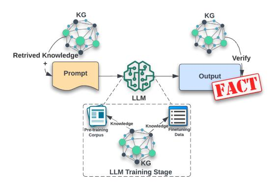
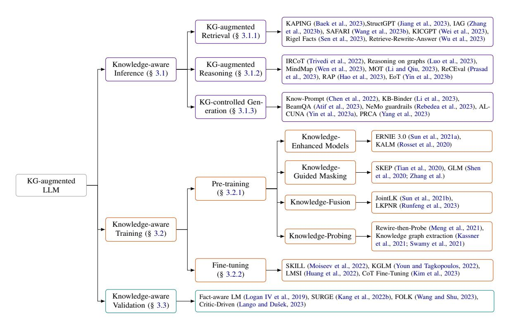
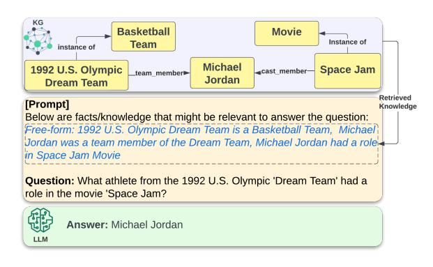
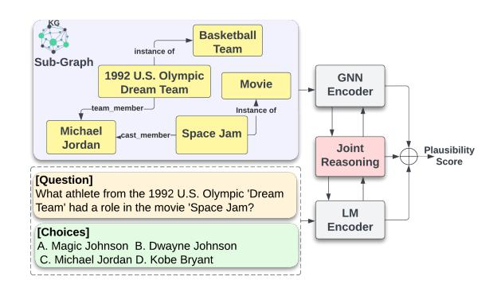
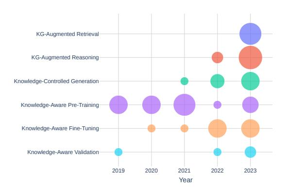

# Can Knowledge Graphs Reduce Hallucinations in LLMs? : A Survey

## Garima Agrawal Tharindu Kumarage Zeyad Alghamdi Huan Liu

Arizona State University

{garima.agrawal, kskumara, zalgham1, huanliu}@asu.edu

### Abstract

The contemporary LLMs are prone to producing hallucinations, stemming mainly from the knowledge gaps within the models. To address this critical limitation, researchers employ diverse strategies to augment the LLMs by incorporating external knowledge, aiming to reduce hallucinations and enhance reasoning accuracy. Among these strategies, leveraging knowledge graphs as a source of external information has demonstrated promising results. In this survey, we comprehensively review these knowledgegraph-based augmentation techniques in LLMs, focusing on their efficacy in mitigating hallucinations. We systematically categorize these methods into three overarching groups, offering methodological comparisons and performance evaluations. Lastly, this survey explores the current trends and challenges associated with these techniques and outlines potential avenues for future research in this emerging field.

### 1 Introduction

Large language models (LLMs) seek to emulate human intelligence through statistical training on extensive datasets (Huang and Chang, 2022). LLMs operate on input text to predict the subsequent token or word in the sequence while identifying patterns and connections between words and phrases, aiming to comprehend and generate human-like text. Due to their stochastic decoding processes, i.e., sampling the next token in the sequence, these models exhibit probabilistic behavior, potentially yielding varied outputs or predictions for the same input across different instances. Additionally, if the training data includes misinformation, biases, or inaccuracies, these flaws may be mirrored or amplified in the content produced by these models. LLMs also face challenges in accurately interpreting phrases or terms when the context is vague and resides in a knowledge gap region of the model, leading to outputs that may sound plausible but

Figure 1: Knowledge Graphs (KG) employed to reduce hallucinations in LLMs at different stages.

are often irrelevant or incorrect (Ji et al., 2023; Lenat and Marcus, 2023). This phenomenon, often termed "hallucinations," undermines the reliability of these models (Mallen et al., 2023).

Addressing the issue of hallucinations in these models is challenging due to their inherent probabilistic nature. To effectively tackle this issue, there have been continuous research efforts in making knowledge updates and model tuning (Zhang et al., 2023c; Mialon et al., 2023; Petroni et al., 2019). However, adding random information does not improve the model's interpretation and reasoning capabilities. Instead, providing more granular and contextually relevant, precise external knowledge can significantly aid the model in recalling essential information (Jiang et al., 2020).

One emerging research trend is enhancing LLMs through integrating knowledge representation tools such as knowledge graphs (KGs) (Mruthyunjaya et al., 2023). Zheng et al. (Zheng et al., 2023) demonstrate that augmenting these models with comprehensive external knowledge from KGs can boost their performance and facilitate a more robust reasoning process. The strategies for enhancing LLMs with KGs can be grouped into three main categories, each uniquely contributing to the refinement of the model as shown in Figure 1: enhanc-

Figure 2: Taxonomy of Knowledge Graph-Augmented Large Language Models

ing the inference process, improving the learning mechanism, and establishing robust methods for validating the model's decisions.

In this survey, we critically review KG augmentation methods used in specific stages to reduce hallucinations in LLMs and improve their performance and reliability. In Section 3, we classify these methods into three overarching categories: (1) *Knowledge-Aware Inference*, (2) *Knowledge-Aware Learning*, and (3) *Knowledge-Aware Validation*. Additionally, in Section 4, we evaluate the empirical efficacy of these methods and discuss current research trends, followed by suggestions for potential future research directions.

Related Works: There are several related surveys which discuss LLM augmentation using external knowledge (Hu et al., 2023; Yin et al., 2022; AlKhamissi et al., 2022; Ye et al., 2022; Wei et al., 2021; Liang et al., 2022; Zhang et al., 2023c; Mialon et al., 2023). However, to our knowledge, this is the first survey to exclusively focus on critically reviewing LLM augmentation methods utilizing structured knowledge from knowledge graphs. Specifically, our emphasis is on addressing hallucinations in LLMs through KG integration.

## 2 Preliminaries

We now introduce the preliminaries and definitions that will be used throughout the survey.

#### 2.1 Large Language Models

Language modeling, a key task in natural language processing (NLP), focuses on understanding language's structure and generating text. It has gained importance over recent years. Specifically, in neural probabilistic language models (Bengio et al., 2000), the goal is to estimate the likelihood of a text sequence. It involves computing the probability of each token xi in the sequence, considering preceding tokens, using the chain rule to simplify the process.

$$p(x) = \prod_{i=1}^{N} p(x_i|x_1, x_1...x_{i-1})$$
 (1)

The introduction of the transformer architecture (Vaswani et al., 2017) significantly advanced neural probabilistic language models, enabling efficient parallel processing and recognition of long-range dependencies in text. Coupled with training advancements like instruction tuning and Reinforcement Learning from Human Feedback (RLHF) (Ouyang et al., 2022), these neural probabilistic language models led to the creation of advanced Large Language Models (LLMs) like GPT- 3 (Brown et al., 2020), GPT-4 (OpenAI, 2023), and PaLM (Chowdhery et al., 2022), notable for their exceptional language capabilities.

### 2.2 Knowledge Graphs

Knowledge graphs (KGs) organize information into a structured format, capturing relationships between real-world entities, making it comprehensible to both humans and machines (Hogan et al., 2021). They store data as triples in a graph, with nodes representing entities (like people or places) and edges depicting relationships. Their capacity to represent complex interrelations makes them applicable in various domains (Fensel et al., 2020). KGs are used in a semantic search to enhance search engines semantic understanding (Singhal, 2012), enterprise knowledge management (Deng et al., 2023b), supply chain optimization (Deng et al., 2023a), education (Agrawal et al., 2022), financial fraud detection (Mao et al., 2022), cybersecurity (Agrawal et al., 2023b), recommendation systems (Guo et al., 2020), and QA systems (Agrawal et al., 2023a; Omar et al., 2023; Jiang et al., 2021).

## 3 Knowledge Graph-Enhanced LLMs

The LLMs primarily have three points of failure: a failure to comprehend the question due to lack of context, insufficient knowledge to respond accurately, or an inability to recall specific facts. Improving the cognitive capabilities of these models involves refining their inference-making process, optimizing learning mechanisms, and establishing a mechanism to validate results. This survey comprehensively reviews existing methodologies aimed at mitigating hallucinations and enhancing the reasoning capabilities of LLMs through the augmentation of KGs using these three techniques. We classify them as *Knowledge-Aware Inference*, *Knowledge-Aware Learning*, and *Knowledge-Aware Validation*. Figure 2 details key works from each of these categories.

#### 3.1 Knowledge-Aware Inference

In LLMs, *"inference"* means generating text or predictions from a pre-trained model based on an input context. Challenges include incorrect or suboptimal outputs due to ambiguous inputs, unclear context, knowledge gaps, training data biases, or inability to generalize to unseen scenarios. LLMs often struggle with multi-step reasoning and, unlike humans, can not seek extra information to

clarify ambiguous queries. To improve LLMs' inference and reasoning, researchers integrate KGs for structured symbolic knowledge, primarily by incorporating them at the input level to enhance contextual understanding. These methods, are further categorized into 'KG-Augmented Retrieval,' 'KG-Augmented Reasoning,' and 'KG-Controlled Generation.'

#### 3.1.1 KG-Augmented Retrieval

Retrieval-augmented generation models like RAG (Lewis et al., 2020) and RALM (Ram et al., 2023) enhance LLMs' contextual awareness for knowledge-intensive tasks by providing relevant documents during generation, reducing hallucination without altering the LLM architecture. These methods, which are helpful for tasks needing external knowledge, augment top-k relevant documents to inputs. However, as shown in Figure 3, using well-organized, curated knowledge from structured sources or knowledge graphs, aligns more closely with factual accuracy. Baek et al. (Baek et al., 2023) introduced KAPING, which matches entities in questions to retrieve related triples from knowledge graphs for zero-shot question answering. Wu et al. (Wu et al., 2023) found that converting these triples into textualized statements enhances LLM performance. Sen et al. (Sen et al., 2023) developed a retriever module trained on a KGQA model, addressing the inadequacy of similarity-based retrieval for complex questions. StructGPT (Jiang et al., 2023) augments LLMs with data from knowledge graphs, tables, and databases, utilizing structured queries for information extraction. Other notable works include IAG(Zhang et al., 2023b), KICGPT (Wei et al., 2023), and SAFARI (Wang et al., 2023b).

LLMs serve as natural language interfaces, ex-

Figure 3: Knowledge-aware inference by incorporating KG-augmented retrieval (Baek et al., 2023).

tracting and generating information without relying on their internal knowledge. Tools like the ChatGPT plugin use Langchain (Chase, 2022) and LlamaIndex (Liu, 2022) to integrate external data, prompting LLMs for context-retrieved, knowledgeaugmented outputs. However, relying solely on internal databases can limit performance due to restricted knowledge bases. Mallen et al. (Mallen et al., 2023) investigated LLMs' factual knowledge retention, finding that augmenting with retrieved data improves performance. However, these models perform well with popular entities and relations but face challenges with less popular subjects, and increasing model size doesn't improve their performance in such cases.

#### 3.1.2 KG-Augmented Reasoning

KG-augmented retrieval methods effectively answer factual questions. However, questions that require reasoning call for more proficient approaches, such as decomposing complex, multi-step tasks into manageable sub-queries, as detailed by (Qiao et al., 2022; Liu et al., 2023). These techniques are referred to as KG-augmented reasoning methods in our study. Following the intuition behind the human reasoning process, the Chain of Thought (CoT) (Wei et al., 2022a), Chain of Thought with Self-Consistency (CoT-SC) (Wang et al., 2022), Program-Aided Language Model (PAL) (Gao et al., 2023), and Reason and Act (ReAct) (Yao et al., 2022), Reflexion (Shinn et al., 2023) methods used a series of intermediate reasoning steps to improve the complex reasoning ability of LLMs. These methods mimic human step-by-step reasoning, aiding in understanding and debugging the model's reasoning process. They are useful for math problems, commonsense reasoning, and symbolic tasks solvable through language-explained steps. Tree of Thoughts(ToT) (Yao et al., 2023) method enhances this by exploring coherent text units as intermediate steps, enabling LLMs to consider multiple paths, self-evaluate, and make informed decisions.

Different knowledge augmentation techniques using knowledge graphs, inspired by CoT and ToT prompting, enhance reasoning in domainspecific and open-domain tasks. "Rethinking with Retrieval" (He et al., 2022) model uses decomposed reasoning steps from chain-of-thought prompting to retrieve external knowledge, leading to more accurate and faithful explanations. IR-CoT (Trivedi et al., 2022) interleaves generating chain-of-thoughts (CoT) and retrieving knowledge

from graphs, iteratively guiding retrieval and reasoning for multi-step questions. MindMap (Wen et al., 2023) introduces a plug-and-play approach to evoke graph-of-thoughts reasoning in LLMs. Reasoning on Graphs (RoG) (Luo et al., 2023) uses knowledge graphs to create faithful reasoning paths based on various relations, enabling interpretable and accurate reasoning in LLMs. Complementary advancements include MoT (Li and Qiu, 2023), Democratizing Reasoning (Wang et al., 2023c), Re-CEval (Prasad et al., 2023), RAP (Hao et al., 2023), EoT (Yin et al., 2023b) and Tree Prompting (Singh et al., 2023), each contributing uniquely to the development of reasoning capabilities in LLMs.

Exploring the interaction between prompts and large language models in the context of reasoning tasks is an exciting research avenue (Liu et al., 2023). A crucial aspect is the design of prompts tailored to the specific use case. However, the fundamental question of whether neural networks genuinely engage in "reasoning" remains unanswered, and it is uncertain whether following the correct reasoning path always leads to accurate answers (Qiao et al., 2022; Jiang et al., 2020).

#### 3.1.3 Knowledge-Controlled Generation

These methods generate knowledge using a language model and then use probing or API calls for tasks. Liu et al. (Liu et al., 2021) used a second model to produce question-related knowledge statements for deductions. Binder (Cheng et al., 2022) uses Codex to parse context and generate task API calls. KB-Binder (Li et al., 2023) also employs Codex to create logical drafts for questions, integrating knowledge graphs for complete answers. Brate et al. (Brate et al., 2022) create cloze-style prompts for entities in knowledge graphs, enhancing them with auxiliary data via SPARQL queries, improving recall and accuracy. KnowPrompt (Chen et al., 2022) generates prompts from a pre-trained model and tunes them for relation extraction in cloze-style tasks. BeamQA (Atif et al., 2023) uses a language model to generate inference paths for knowledge graph embeddingbased search in link prediction. ALCUNA (Yin et al., 2023a) and PRCA (Yang et al., 2023) are other significant methods in controlled generation.

Guardrails in generative AI set operational boundaries for models, ensuring safe and secure output generation. NeMo guardrails (Rebedea et al., 2023) by Nvidia guide conversational flows in enterprise applications to meet safety and security standards. Knowledge-controlled generation ensures alignment with facts and prevents misinformation. Knowledge graph ontologies can provide specific domain constraints, aiding LLMs in defining output generation boundaries.

#### 3.2 Knowledge-Aware Training

Another stage where we can address hallucination issues in LLMs is to utilize KGs to optimize their learning either by improving the quality of training data at the model pre-training stage or by finetuning the pre-trained language model (PLM) to adapt to specific tasks or domains. We classify these methods as *Knowledge-Aware Pre-Training* and *Knowledge-Aware Fine-Tuning*.

#### 3.2.1 Knowledge-Aware Pre-Training

Training data quality and diversity are crucial for reducing hallucinations in LLMs. Integrating knowledge graphs, which provide structured information about entities and their interconnections, improves the comprehension abilities of LLMs and aids in generating text that more accurately reflects the complexities of real-world entities. However, training from scratch is highly resource-heavy and expensive. Different approaches were proposed by researchers (Yu et al., 2023; Fu et al., 2023; Deng et al., 2023b; Liu et al., 2020; Poerner et al., 2019; Peters et al., 2019) for pre-training models by augmenting knowledge graphs in training data. We further categorize them as follows:

- 1. *Knowledge-Enhanced Models*: These methods enriched the large-scale text corpora with KGs for improved language representation. ERNIE (Zhang et al., 2019) used masked language modeling (MLM) and next sentence prediction (NSP) in pre-training to capture the text's lexical and syntactical elements, combining context with knowledge facts for predictions. ERNIE 3.0 (Sun et al., 2021a) further evolved by integrating an auto-regressive model with an auto-encoding network, addressing the limitations of a single autoregressive framework in exploring enhanced knowledge. Meanwhile, Rosset et al. (Rosset et al., 2020) introduced a knowledge-aware input through an entity tokenizer dictionary, enhancing semantic understanding without altering the transformer architecture.
- 2. *Knowledge-Guided Masking*: Knowledge graph-guided entity masking schemes (Shen

Figure 4: Knowledge-aware Pre-training by Knowledge Fusion (Sun et al., 2021b).

et al., 2020; Zhang et al.) utilized linked knowledge graphs to mask key entities in texts, enhancing question-answering and knowledge-base completion tasks by leveraging relational knowledge. Similarly, Sentiment Knowledge Enhanced Pre-training (SKEP) (Tian et al., 2020) employed sentiment masking to develop unified sentiment representations, improving performance across various sentiment analysis tasks.

- 3. *Knowledge-Fusion*: These methods integrates the KGs into LLMs using graph query encoders (Wang et al., 2021; Ke et al., 2021; He et al., 2019). As shown in Figure 4, JointLK (Sun et al., 2021b) employed knowledge fusion and joint reasoning for commonsense question answering, selectively using relevant KG nodes and synchronizing updates between text and graph encoders. LKPNR (Runfeng et al., 2023) combined LLMs with KGs, enhancing semantic understanding in complex news texts to create a personalized news recommendation framework through a KG-augmented encoder.
- 4. *Knowledge-Probing*: Knowledge probing involves examining language models to assess their factual and commonsense knowledge (Petroni et al., 2019). This process aids in evaluating and enhancing the models (Kassner et al., 2021; Swamy et al., 2021). Rewirethen-Probe (Meng et al., 2021) introduced a self-supervised contrastive-probing approach, utilizing biomedical knowledge graphs to learn language representations.

## 3.2.2 Knowledge-Aware Fine-Tuning

Fine-tuning adapts LLMs to specific domains by training them on relevant datasets, using selected architectures and hyper-parameters to modify the model's weights for improved task performance (Guu et al., 2020; Hu et al., 2021; Lu et al., 2022; Dettmers et al., 2023). KGs can further tune these models to update and expand their internal knowledge for domain-specific tasks like custom named-entity recognition (Agrawal et al., 2023b), and text summarization (Kang et al., 2022a).

SKILL (Moiseev et al., 2022) used synthetic sentences converted from WikiData (Seminar et al., 2019) and KELM (Agarwal et al., 2020) used KGs to fine-tune the pre-trained model checkpoints. KGLM (Youn and Tagkopoulos, 2022) employed an entity-relation embedding layer with KG triples for link prediction tasks. Cross-lingual reasoning (Foroutan et al., 2023) improved by fine-tuning MultiLM, mBERT, and mT5 models with logical datasets using a self-attention network. LLMs improve more with additional training using datasets with few-shot CoT reasoning prompts and finetuning (Kim et al., 2023; Huang et al., 2022).

Fine-tuning language models like ChatGPT, limited by their last knowledge update in 2021, is more efficient than training from scratch. It handles queries beyond this cutoff using a curated, domainspecific knowledge graph. The extent to which updated knowledge is integrated into the model remains to be determined. Onoe et al.'s (Onoe et al., 2023) evaluation framework indicate that while models can recall facts about new entities, inferring based on these is harder. The effect of updating knowledge on existing entities is still an open research question.

#### 3.3 Knowledge-Aware Validation

The third category type uses structured data as a fact-checking mechanism and provides a reference for the model to verify information. Knowledge graphs can provide comprehensive explanations and can be used to justify the models' decisions. These methods also help enforce consistency across the facts, obviating the necessity for laborious human-annotated data and enhancing the reliability of generated content.

The fact-aware language model, KGLM (Logan IV et al., 2019), referred to a knowledge graph to generate entities and facts relevant to the context. SURGE (Kang et al., 2022b) retrieves high simi-

larity context-relevant triples as a sub-graph from a knowledge graph. "Text critic" classifier (Lango and Dušek, 2023) was proposed to guide the generation by assessing the match between the input data and the generated text. FOLK (Wang and Shu, 2023) used first-order-logic (FOL) predicates for claim verification in online misinformation. Beyond verification, FOLK generates explicit explanations, providing valuable assistance to human fact-checkers in understanding and interpreting the model's decisions. This approach contributes to the accuracy and interpretability of the model's outputs in the context of misinformation detection.

## 4 Discussion, Challenges and Future

In this section, we examine the effectiveness of KGenhanced LLM techniques in reducing hallucinations and enhancing performance and reliability in LLMs. We also identify key challenges associated with each method and propose potential research avenues in this evolving field.

#### 4.1 Resources

Table 1 details the key features of different KGenhanced LLM methods, emphasizing their application in specific industries using domain-specific knowledge graphs. The inference methods used general knowledge and commonsense reasoning datasets for QA tasks without requiring LLM retraining. Mindmap (Wen et al., 2023) demonstrated an application in healthcare, augmenting clinical datasets with GPT-4. Meng et al. (Meng et al., 2021) pre-trained T5 and BART models using a biomedical knowledge graph, Unified Medical Language System (UMLS) Metathesaurus. LKPNR (Runfeng et al., 2023) pre-trained LM and graph encoders on MIND-200K user click logs to provide personalized news recommendations. Martino et al. (Martino et al., 2023) used knowledge injection to reduce hallucinations when responding to online customer reviews for a retail store. Dong et al. (Dong et al., 2022) showed improvement in the faithfulness of text summarization tasks to the source documents by linking external source knowledge bases from the source. Baldazzi (Baldazzi et al., 2023) fine-tuned T5-large on financial customer-service enterprise KG.

## 4.2 Evaluation Metrics

Various criteria were applied to assess the effectiveness of knowledge graph augmentation in reducing hallucinations in LLMs.

|                                        | Representative Method                                                      | Comparison Attributes                          |                                                        |                                      |                                                       |
|----------------------------------------|----------------------------------------------------------------------------|------------------------------------------------|--------------------------------------------------------|--------------------------------------|-------------------------------------------------------|
| Category                               |                                                                            | Downstream Task                             | KG Dataset                                             | LLM                                  | Training                                              |
| KG- Augmented Retrieval          | KAPING (Baek et al., 2023)                                                 | Question-Answering                             | Mintaka, WebQSP                                        | T5, T0, OPT, GPT-3                |                                                       |
|                                        | Rigel Facts (Sen et al., 2023)                                             | Question-Answering                             | WebQuestions, ComplexWebQuestions, Mintaka, LC-QuAD | Flan-T5, T0, OPT, AlexaTM         | •                                                     |
|                                        | Retrieve-Rewrite-Answer (Wu et al., 2023)                               | Question-Answering                             | MetaQA, WebQSP, WebQ, ZJQA                             | ChatGPT, Llama 2, Flan-T5, T0, T5 | ⊗                                                     |
| KG- Augmented Reasoning          | IRCoT (Trivedi et al., 2022)                                               | Multi-step Reasoning QA                        | HotpotQA, 2WikiMultihopQA, MusiQue, IIRC            | GPT3, Flan-T5                        |                                                       |
|                                        | MindMap (Wen et al., 2023)                                                 | Medical Diagnosis                              | GenMedGPT-5k, CMCQA, ExplainCPE                     | GPT-3.5, GPT-4                       | (%)                                                   |
|                                        | RoG (Luo et al., 2023)                                                     | Reasoning                                      | WebQSP, Complex WebQuestions (CWQ)                  | Llama 2-Chat-7B                      | 49                                                    |
| Knowledge- Controlled Generation | KnowPrompt (Chen et al., 2022)                                             | Relation Extraction and Labeling               | SemEval, DialogRE, TACRED                              | RoBERTa_large                        | Few-shot training                                     |
|                                        | BINDER (Cheng et al., 2022)                                                | Information extraction, Commonsense QA      | WikiTableQuestions, TabFact                            | Codex                                | API calls / Few-shot In-context learning           |
|                                        | BeamQA (Atif et al., 2023)                                                 | Generate Questions                             | MetaQA, WebQSP,                                        | T5, BART                             | Fine-tuned for 4 epochs                               |
| Knowledge- Aware Pre-Training    | SKEP (Tian et al., 2020)                                                   | Sentiment Analysis                             | SST, Amazon, Sem, MPQA                              | BERT, RoBERTa                        | Encoder trained on 3.2m train data                 |
|                                        | JointLK (Sun et al., 2021b)                                                | Commonsense Question Answering              | CommonSenseQA, OpenBookQA                           | RoBERTa-Large                        | LM/graph encoder trained jointly for 20 GPU hours  |
|                                        | LKPNR (Runfeng et al., 2023)                                               | Personalized News Recommendation            | MIND                                                   | ChatGLM2, Llama 2, RWKV           | LK-Encoders trained on GPU for 200K user click logs   |
| Knowledge- Aware Fine-Tuning     | SKILL (Moiseev et al., 2022)                                               | Closed-book QA tasks                           | Wikidata, KELM, MetaQA                                 | T5-base, L, XXL models            | T5 fine-tuned for 50k steps                           |
|                                        | KGLM (Youn and Tagkopoulos, 2022) Neurosymbolic (Baldazzi et al., 2023) | Link Prediction Banking Customer Query      | WN18RR, FB15k-237, UMLS Chase EKG                   | RoBERTa Large T5-large            | Model tuned for 5 epochs Model tuned for 10 epochs |
| Knowledge- Aware Validation      | Fact-aware LM (Logan IV et al., 2019)                                      | Fact Generation                                | Linked WikiText-2                                      | TransE                               | Transformer trained on 256-dim KG embeddings       |
|                                        | SURGE (Kang et al., 2022b)                                                 | Dialogue Generation                            | OpenDialKG                                             | T5-small                             | <b>(X)</b>                                            |
|                                        | FOLK (Wang and Shu, 2023)                                                  | Claim Verification in Online Misinformation | HoVER, FEVEROUS, SciFact-Open                       | Llama(7B), Llama(13B), Llama(30B) | ⊗                                                     |

Table 1: Comparison attributes of Knowledge Graph-enhanced LLM methods

**Accuracy:** Accuracy comparison with and without augmented knowledge from KGs (Baek et al., 2023; Zhang et al., 2023b).

Top-K and MRR: Retrieval performance was measured by the relevance of retrieved triples for generating answers. Mean Reciprocal Rank (MRR) and Top-K accuracy determined the ranks of correctly retrieved answer-containing triples (Baek et al., 2023; Sen et al., 2023). The effectiveness of KG triples was assessed as either "Helpful" or "Harmful" and compared against scenarios where "no knowledge" was provided (Wu et al., 2023).

*Hits*@1: Evaluates answer accuracy and examines the coverage of multi-choice question answers (Luo et al., 2023; Wu et al., 2023; Wei et al., 2023).

Execution Accuracy (EA): The controlled generation method, such as Binder (Cheng et al., 2022), uses Execution Accuracy (EA) as a metrics to measure the accuracy in semantic parsing, API call generation, and the success rate of code execution. Exact Match (EM): Model's performance after fine-tuning was evaluated using EM (Exact Match) scores on test sets (Moiseev et al., 2022).

Human Evaluation: Validation methods were manually evaluated to assess the explanation quality, coverage, logical soundness, fluency, and factual accuracy of sentence completion (Wang and Shu, 2023; Kang et al., 2022b). It is pertinent to consider evaluating factuality from different aspects, first verifying the presence of accurate and reliable information and second identifying any instances

of fabricated or "hallucinated" information.

#### 4.3 Performance Analysis

Retrieved facts enhance small LLMs: Smaller models, due to their limited parameter spaces, struggle to incorporate extensive knowledge in pretraining. Augmenting facts from knowledge graphs, rather than increasing model size, enhanced answer correctness by over 80% for question-answering tasks (Baek et al., 2023; Sen et al., 2023; Wu et al., 2023). However, the success of these methods with complex queries heavily relies on the retriever modules, whose capabilities are limited to the knowledge graph (BehnamGhader et al., 2022).

Step-wise reasoning more effective in larger models: Variations of CoT methods offer cost-effective control and task-specific tuning, enhancing model performance. For instance, RoG (Luo et al., 2023) reported an increase in ChatGPT's accuracy from 66.8% to 85.7% in reasoning tasks with knowledge graph augmentation. Similarly, Mindmap (Wen et al., 2023) boosted accuracy in disease diagnosis and drug recommendation to 88.2% using a clinical reasoning graph.

#### **Controlled generation boosts the performance:**

Knowledge-controlled generation methods surpass baseline models in accuracy and contextual relevance, enhancing their ability to handle diverse queries (Chen et al., 2022; Cheng et al., 2022; Atif et al., 2023). However, these methods can vary in quality and are sometimes prone to generating

incorrect or irrelevant information.

Pre-training and fine-tuning are costly: Pretraining and fine-tuning significantly enhance domain-specific task performance. However, these improvements require substantial computational resources, as shown in Table 1. Additionally, finetuning's data-dependency makes it task-specific and limits its transferability and generalizability (Gueta et al., 2023; Wang and Shu, 2023).

Fact-checking ensures reliability: Knowledge validation through fact-checking reduces hallucinations by checking model-generated data against a knowledge graph, but it increases computational load and may miss some inaccuracies (Kang et al., 2022b; Lango and Dušek, 2023).

The effectiveness of knowledge augmentation is also influenced by the size of the knowledge graph and its impact on query responses. Standard approaches include fine-tuning pre-trained models for reliability but at a higher cost, and examplebased prompting, less effective in certain reasoning tasks (Brown et al., 2020; Rae et al., 2021). Zhang et al. (Zhang et al., 2023a) noted that language model inconsistencies often arise from incorrect context usage. Method selection depends on the specific use case and available resources. Wang et al. (Wang et al., 2023a) showed that pre-training decoder-only LLMs with retrieval can improve factual accuracy in knowledge-intensive tasks, while Shi et al. (Shi et al., 2023) developed GraphNarrative, a dataset aimed at reducing hallucinations, beneficial for fine-tuning LLMs.

## 4.4 Trend Analysis

Figure 5 shows the research trends using different knowledge-graph augmentation techniques from 2019 to 2023. The bubble size here represents the number of papers for each knowledge-graph augmentation category, ranging from one to eight. Pre-training methods by adding knowledge graphs to the training corpus were predominant in the early years of language model development. After the extensive GPT series of LLMs, retraining the huge model with billions of parameters became impractical and resource-intensive. More efforts were made to fine-tune the models with task-specific data without training from scratch. Very recently, there has been a shift towards using knowledgeaugmented retrieval, reasoning, generation, and validation methods without incurring additional training costs.

Figure 5: Research trend over years- The bubble size represents number of papers we observed for each knowledge-graph augmentation categories: smallest size (#papers=1), largest size (#papers=8)

#### 4.5 Future Directions

Here are some potential future research directions for further investigation:

Improve Quality of KG: ⃝a Context-Aware: Dynamic KGs that continuously adapt to changing contexts and new information can improve LLMs effectively. ⃝b Addressing Biases:Fairness-aware algorithms in KGs can ensure bias or misinformation is not perpetuated by KGs. ⃝c Cross-Domain Knowledge: Integrating knowledge from diverse domains like science, art, and history into a single graph could enhance the depth and nuance of LLM responses.⃝d Multi-Modal: Adding multi-modal data such as images, videos, and audio to KGs can enrich the data pool and improve LLMs' contextual responses.

Mixture of Experts (MoE) LLMs: Efforts are underway to optimize the MoE architecture to scale LLMs and increase their capacity without increasing computation (Zhou et al., 2022). Integrating MoE with knowledge graphs (Yu et al., 2022) can develop adaptive learning strategies for context-based expert utilization and improve the interpretability and transparency of MoE-LLMs.

Symbolic-Subsymbolic Unification: Knowledge fabrics, such as symbolic KGs and sub-symbolic vectors, enables versatile reasoning in LLMs, mimicking human mind's capacity to reconcile structured theories (Núñez-Molina et al., 2023).

Synergizing LLM and KG: LLMs are being used for link prediction and knowledge graph completion (Xiao et al., 2023; Veseli et al., 2023). Synergizing the LLM and KGs is a potential direction where both components can mutually enhance each other's capabilities through a bidirectional reasoning process driven by a harmonious blend of data and knowledge (Pan et al., 2023).

Causality-Awareness: Incorporating causality into knowledge graphs, (Wei et al., 2022b), will enhance Large Language Models' (LLMs) capability to grasp causation rather than merely identifying correlations. This advancement will equip LLMs with a better understanding of the causal relationships between events or entities, significantly improving their reasoning and predictive capabilities.

The progress of KGs promises to greatly enhance LLMs, making them more relevant, responsive, and accurate. This aims to create more reliable and trustworthy language models, advancing robust and responsible AI systems.

## 5 Conclusion

In this survey, we systematically investigate the integration of KGs into LLMs to mitigate hallucinations and improve reasoning accuracy. We emphasize the benefits of using KGs to enhance LLM performance across various phases at inference, model training, and output verification stages. While substantial progress has been made, we emphasize the need for continuous innovation and propose future directions to facilitate the development of more advanced KG-augmented LLMs.

## 6 Limitations

In this paper, we conduct a comprehensive review of knowledge-graph-based augmentation techniques in LLMs, with a specific focus on their ability to address hallucinations. We identify commonalities among these techniques and categorize them into three distinct groups based on their mechanisms and approaches. Furthermore, we systematically assess the performance of these methods. In Section 1, we compare our work with existing related surveys and we will continue adding more related approaches. However, it's important to acknowledge that despite our diligent efforts, there may be certain limitations that still exist in this paper.

References and Methods. Due to page limitations, we may not include all relevant references and

detailed technical information. Our study primarily focuses on state-of-the-art methods developed between 2019 and 2023, sourced primarily from reputable conferences and platforms such as ACL, EMNLP, NAACL, ICLR, ICML, and arXiv. We remain committed to keeping our work up-to-date.

Taxonomy and Comparison. We primarily categorized the methods based on their primary augmentation approach. In some cases, hybrid studies incorporating multiple approaches may be categorized differently, depending on specific criteria. It's essential to note that our analysis is based on the performance of existing works using the current experiments and datasets. Given the rapid evolution in this field, benchmarks and baseline models may change, potentially leading to variations in these evaluations.

### Acknowledgements

This material is based upon work supported by the National Science Foundation under Grant No. 2114789.

## References

Oshin Agarwal, Heming Ge, Siamak Shakeri, and Rami Al-Rfou. 2020. Knowledge graph based synthetic corpus generation for knowledge-enhanced language model pre-training. *arXiv preprint arXiv:2010.12688*.

Garima Agrawal, Dimitri Bertsekas, and Huan Liu. 2023a. Auction-based learning for question answering over knowledge graphs. *Information*, 14(6):336.

Garima Agrawal, Yuli Deng, Jongchan Park, Huan Liu, and Ying-Chih Chen. 2022. Building knowledge graphs from unstructured texts: Applications and impact analyses in cybersecurity education. *Information*, 13(11):526.

Garima Agrawal, Kuntal Pal, Yuli Deng, Huan Liu, and Chitta Baral. 2023b. Aiseckg: Knowledge graph dataset for cybersecurity education. *AAAI-MAKE 2023: Challenges Requiring the Combination of Machine Learning 2023*.

Badr AlKhamissi, Millicent Li, Asli Celikyilmaz, Mona Diab, and Marjan Ghazvininejad. 2022. A review on language models as knowledge bases. *arXiv preprint arXiv:2204.06031*.

Farah Atif, Ola El Khatib, and Djellel Difallah. 2023. Beamqa: Multi-hop knowledge graph question answering with sequence-to-sequence prediction and beam search. In *Proceedings of the 46th International ACM SIGIR Conference on Research and Development in Information Retrieval*, pages 781–790.

- Jinheon Baek, Alham Fikri Aji, and Amir Saffari. 2023. Knowledge-augmented language model prompting for zero-shot knowledge graph question answering. *arXiv preprint arXiv:2306.04136*.
- Teodoro Baldazzi, Luigi Bellomarini, Stefano Ceri, Andrea Colombo, Andrea Gentili, and Emanuel Sallinger. 2023. Fine-tuning large enterprise language models via ontological reasoning. *arXiv preprint arXiv:2306.10723*.
- Parishad BehnamGhader, Santiago Miret, and Siva Reddy. 2022. Can retriever-augmented language models reason? the blame game between the retriever and the language model. *arXiv preprint arXiv:2212.09146*.
- Yoshua Bengio, Réjean Ducharme, and Pascal Vincent. 2000. A neural probabilistic language model. *Advances in neural information processing systems*, 13.
- Ryan Brate, Minh-Hoang Dang, Fabian Hoppe, Yuan He, Albert Meroño-Peñuela, and Vijay Sadashivaiah. 2022. Improving language model predictions via prompts enriched with knowledge graphs. In *DL4KG@ ISWC2022*.
- Tom Brown, Benjamin Mann, Nick Ryder, Melanie Subbiah, Jared D Kaplan, Prafulla Dhariwal, Arvind Neelakantan, Pranav Shyam, Girish Sastry, Amanda Askell, et al. 2020. Language models are few-shot learners. *Advances in neural information processing systems*, 33:1877–1901.
- Harrison Chase. 2022. [LangChain.](https://github.com/langchain-ai/langchain)
- Xiang Chen, Ningyu Zhang, Xin Xie, Shumin Deng, Yunzhi Yao, Chuanqi Tan, Fei Huang, Luo Si, and Huajun Chen. 2022. Knowprompt: Knowledgeaware prompt-tuning with synergistic optimization for relation extraction. In *Proceedings of the ACM Web conference 2022*, pages 2778–2788.
- Zhoujun Cheng, Tianbao Xie, Peng Shi, Chengzu Li, Rahul Nadkarni, Yushi Hu, Caiming Xiong, Dragomir Radev, Mari Ostendorf, Luke Zettlemoyer, et al. 2022. Binding language models in symbolic languages. *arXiv preprint arXiv:2210.02875*.
- Aakanksha Chowdhery, Sharan Narang, Jacob Devlin, Maarten Bosma, Gaurav Mishra, Adam Roberts, Paul Barham, Hyung Won Chung, Charles Sutton, Sebastian Gehrmann, et al. 2022. Palm: Scaling language modeling with pathways. *arXiv preprint arXiv:2204.02311*.
- Jianfeng Deng, Chong Chen, Xinyi Huang, Wenyan Chen, and Lianglun Cheng. 2023a. Research on the construction of event logic knowledge graph of supply chain management. *Advanced Engineering Informatics*, 56:101921.
- Shumin Deng, Chengming Wang, Zhoubo Li, Ningyu Zhang, Zelin Dai, Hehong Chen, Feiyu Xiong, Ming Yan, Qiang Chen, Mosha Chen, et al. 2023b. Construction and applications of billion-scale pre-trained

- multimodal business knowledge graph. In *2023 IEEE 39th International Conference on Data Engineering (ICDE)*, pages 2988–3002. IEEE.
- Tim Dettmers, Artidoro Pagnoni, Ari Holtzman, and Luke Zettlemoyer. 2023. Qlora: Efficient finetuning of quantized llms. *arXiv preprint arXiv:2305.14314*.
- Yue Dong, John Wieting, and Pat Verga. 2022. Faithful to the document or to the world? mitigating hallucinations via entity-linked knowledge in abstractive summarization. *arXiv preprint arXiv:2204.13761*.
- Dieter Fensel, Umutcan ¸Sim¸sek, Kevin Angele, Elwin Huaman, Elias Kärle, Oleksandra Panasiuk, Ioan Toma, Jürgen Umbrich, Alexander Wahler, Dieter Fensel, et al. 2020. Why we need knowledge graphs: Applications. *Knowledge Graphs: Methodology, Tools and Selected Use Cases*, pages 95–112.
- Negar Foroutan, Mohammadreza Banaei, Karl Aberer, and Antoine Bosselut. 2023. Breaking the language barrier: Improving cross-lingual reasoning with structured self-attention. In *Findings of the Association for Computational Linguistics: EMNLP 2023*, pages 9422–9442.
- Peng Fu, Yiming Zhang, Haobo Wang, Weikang Qiu, and Junbo Zhao. 2023. Revisiting the knowledge injection frameworks. In *Proceedings of the 2023 Conference on Empirical Methods in Natural Language Processing*, pages 10983–10997.
- Luyu Gao, Aman Madaan, Shuyan Zhou, Uri Alon, Pengfei Liu, Yiming Yang, Jamie Callan, and Graham Neubig. 2023. Pal: Program-aided language models. In *International Conference on Machine Learning*, pages 10764–10799. PMLR.
- Almog Gueta, Elad Venezian, Colin Raffel, Noam Slonim, Yoav Katz, and Leshem Choshen. 2023. Knowledge is a region in weight space for fine-tuned language models. *arXiv preprint arXiv:2302.04863*.
- Qingyu Guo, Fuzhen Zhuang, Chuan Qin, Hengshu Zhu, Xing Xie, Hui Xiong, and Qing He. 2020. A survey on knowledge graph-based recommender systems. *IEEE Transactions on Knowledge and Data Engineering*, 34(8):3549–3568.
- Kelvin Guu, Kenton Lee, Zora Tung, Panupong Pasupat, and Mingwei Chang. 2020. Retrieval augmented language model pre-training. In *International conference on machine learning*, pages 3929–3938. PMLR.
- Shibo Hao, Yi Gu, Haodi Ma, Joshua Jiahua Hong, Zhen Wang, Daisy Zhe Wang, and Zhiting Hu. 2023. Reasoning with language model is planning with world model. *arXiv preprint arXiv:2305.14992*.
- Bin He, Di Zhou, Jinghui Xiao, Qun Liu, Nicholas Jing Yuan, Tong Xu, et al. 2019. Integrating graph contextualized knowledge into pre-trained language models. *arXiv preprint arXiv:1912.00147*.

- Hangfeng He, Hongming Zhang, and Dan Roth. 2022. Rethinking with retrieval: Faithful large language model inference. *arXiv preprint arXiv:2301.00303*.
- Aidan Hogan, Eva Blomqvist, Michael Cochez, Claudia d'Amato, Gerard De Melo, Claudio Gutierrez, Sabrina Kirrane, José Emilio Labra Gayo, Roberto Navigli, Sebastian Neumaier, et al. 2021. Knowledge graphs. *ACM Computing Surveys (CSUR)*, 54(4):1– 37.
- Edward J Hu, Yelong Shen, Phillip Wallis, Zeyuan Allen-Zhu, Yuanzhi Li, Shean Wang, Lu Wang, and Weizhu Chen. 2021. Lora: Low-rank adaptation of large language models. *arXiv preprint arXiv:2106.09685*.
- Linmei Hu, Zeyi Liu, Ziwang Zhao, Lei Hou, Liqiang Nie, and Juanzi Li. 2023. A survey of knowledge enhanced pre-trained language models. *IEEE Transactions on Knowledge and Data Engineering*.
- Jiaxin Huang, Shixiang Shane Gu, Le Hou, Yuexin Wu, Xuezhi Wang, Hongkun Yu, and Jiawei Han. 2022. Large language models can self-improve. *arXiv preprint arXiv:2210.11610*.
- Jie Huang and Kevin Chen-Chuan Chang. 2022. Towards reasoning in large language models: A survey. *arXiv preprint arXiv:2212.10403*.
- Ziwei Ji, Nayeon Lee, Rita Frieske, Tiezheng Yu, Dan Su, Yan Xu, Etsuko Ishii, Ye Jin Bang, Andrea Madotto, and Pascale Fung. 2023. Survey of hallucination in natural language generation. *ACM Computing Surveys*, 55(12):1–38.
- Jinhao Jiang, Kun Zhou, Zican Dong, Keming Ye, Wayne Xin Zhao, and Ji-Rong Wen. 2023. Structgpt: A general framework for large language model to reason over structured data. *arXiv preprint arXiv:2305.09645*.
- Zhengbao Jiang, Frank F Xu, Jun Araki, and Graham Neubig. 2020. How can we know what language models know? *Transactions of the Association for Computational Linguistics*, 8:423–438.
- Zhixue Jiang, Chengying Chi, and Yunyun Zhan. 2021. Research on medical question answering system based on knowledge graph. *IEEE Access*, 9:21094– 21101.
- Minki Kang, Jinheon Baek, and Sung Ju Hwang. 2022a. Kala: knowledge-augmented language model adaptation. *arXiv preprint arXiv:2204.10555*.
- Minki Kang, Jin Myung Kwak, Jinheon Baek, and Sung Ju Hwang. 2022b. Knowledge-consistent dialogue generation with knowledge graphs. In *ICML 2022 Workshop on Knowledge Retrieval and Language Models*.
- Nora Kassner, Philipp Dufter, and Hinrich Schütze. 2021. Multilingual lama: Investigating knowledge in multilingual pretrained language models. *arXiv preprint arXiv:2102.00894*.

- Pei Ke, Haozhe Ji, Yu Ran, Xin Cui, Liwei Wang, Linfeng Song, Xiaoyan Zhu, and Minlie Huang. 2021. Jointgt: Graph-text joint representation learning for text generation from knowledge graphs. *arXiv preprint arXiv:2106.10502*.
- Seungone Kim, Se June Joo, Doyoung Kim, Joel Jang, Seonghyeon Ye, Jamin Shin, and Minjoon Seo. 2023. The cot collection: Improving zero-shot and few-shot learning of language models via chain-of-thought fine-tuning. *arXiv preprint arXiv:2305.14045*.
- Mateusz Lango and Ondˇrej Dušek. 2023. Critic-driven decoding for mitigating hallucinations in data-to-text generation. In *Proceedings of the 2023 Conference on Empirical Methods in Natural Language Processing*, pages 2853–2862.
- Doug Lenat and Gary Marcus. 2023. Getting from generative ai to trustworthy ai: What llms might learn from cyc. *arXiv preprint arXiv:2308.04445*.
- Patrick Lewis, Ethan Perez, Aleksandra Piktus, Fabio Petroni, Vladimir Karpukhin, Naman Goyal, Heinrich Küttler, Mike Lewis, Wen-tau Yih, Tim Rocktäschel, et al. 2020. Retrieval-augmented generation for knowledge-intensive nlp tasks. *Advances in Neural Information Processing Systems*, 33:9459–9474.
- Tianle Li, Xueguang Ma, Alex Zhuang, Yu Gu, Yu Su, and Wenhu Chen. 2023. Few-shot in-context learning for knowledge base question answering. *arXiv preprint arXiv:2305.01750*.
- Xiaonan Li and Xipeng Qiu. 2023. Mot: Memory-ofthought enables chatgpt to self-improve. In *Proceedings of the 2023 Conference on Empirical Methods in Natural Language Processing*, pages 6354–6374.
- Ke Liang, Lingyuan Meng, Meng Liu, Yue Liu, Wenxuan Tu, Siwei Wang, Sihang Zhou, Xinwang Liu, and Fuchun Sun. 2022. Reasoning over different types of knowledge graphs: Static, temporal and multi-modal. *arXiv preprint arXiv:2212.05767*.
- Jerry Liu. 2022. [LlamaIndex.](https://doi.org/10.5281/zenodo.1234)
- Jiacheng Liu, Alisa Liu, Ximing Lu, Sean Welleck, Peter West, Ronan Le Bras, Yejin Choi, and Hannaneh Hajishirzi. 2021. Generated knowledge prompting for commonsense reasoning. *arXiv preprint arXiv:2110.08387*.
- Pengfei Liu, Weizhe Yuan, Jinlan Fu, Zhengbao Jiang, Hiroaki Hayashi, and Graham Neubig. 2023. Pretrain, prompt, and predict: A systematic survey of prompting methods in natural language processing. *ACM Computing Surveys*, 55(9):1–35.
- Weijie Liu, Peng Zhou, Zhe Zhao, Zhiruo Wang, Qi Ju, Haotang Deng, and Ping Wang. 2020. K-bert: Enabling language representation with knowledge graph. In *Proceedings of the AAAI Conference on Artificial Intelligence*, volume 34, pages 2901–2908.

- Robert L Logan IV, Nelson F Liu, Matthew E Peters, Matt Gardner, and Sameer Singh. 2019. Barack's wife hillary: Using knowledge-graphs for fact-aware language modeling. *arXiv preprint arXiv:1906.07241*.
- Pan Lu, Liang Qiu, Kai-Wei Chang, Ying Nian Wu, Song-Chun Zhu, Tanmay Rajpurohit, Peter Clark, and Ashwin Kalyan. 2022. Dynamic prompt learning via policy gradient for semi-structured mathematical reasoning. *arXiv preprint arXiv:2209.14610*.
- Linhao Luo, Yuan-Fang Li, Gholamreza Haffari, and Shirui Pan. 2023. Reasoning on graphs: Faithful and interpretable large language model reasoning. *arXiv preprint arXiv:2310.01061*.
- Alex Mallen, Akari Asai, Victor Zhong, Rajarshi Das, Daniel Khashabi, and Hannaneh Hajishirzi. 2023. When not to trust language models: Investigating effectiveness of parametric and non-parametric memories. In *Proceedings of the 61st Annual Meeting of the Association for Computational Linguistics (Volume 1: Long Papers)*, pages 9802–9822.
- Xuting Mao, Hao Sun, Xiaoqian Zhu, and Jianping Li. 2022. Financial fraud detection using the relatedparty transaction knowledge graph. *Procedia Computer Science*, 199:733–740.
- Ariana Martino, Michael Iannelli, and Coleen Truong. 2023. Knowledge injection to counter large language model (llm) hallucination. In *European Semantic Web Conference*, pages 182–185. Springer.
- Zaiqiao Meng, Fangyu Liu, Ehsan Shareghi, Yixuan Su, Charlotte Collins, and Nigel Collier. 2021. Rewirethen-probe: A contrastive recipe for probing biomedical knowledge of pre-trained language models. *arXiv preprint arXiv:2110.08173*.
- Grégoire Mialon, Roberto Dessì, Maria Lomeli, Christoforos Nalmpantis, Ram Pasunuru, Roberta Raileanu, Baptiste Rozière, Timo Schick, Jane Dwivedi-Yu, Asli Celikyilmaz, et al. 2023. Augmented language models: a survey. *arXiv preprint arXiv:2302.07842*.
- Fedor Moiseev, Zhe Dong, Enrique Alfonseca, and Martin Jaggi. 2022. Skill: structured knowledge infusion for large language models. *arXiv preprint arXiv:2205.08184*.
- Vishwas Mruthyunjaya, Pouya Pezeshkpour, Estevam Hruschka, and Nikita Bhutani. 2023. Rethinking language models as symbolic knowledge graphs. *arXiv preprint arXiv:2308.13676*.
- Carlos Núñez-Molina, Pablo Mesejo, and Juan Fernández-Olivares. 2023. A review of symbolic, subsymbolic and hybrid methods for sequential decision making. *arXiv preprint arXiv:2304.10590*.
- Reham Omar, Ishika Dhall, Panos Kalnis, and Essam Mansour. 2023. A universal question-answering platform for knowledge graphs. *Proceedings of the ACM on Management of Data*, 1(1):1–25.

- Yasumasa Onoe, Michael JQ Zhang, Shankar Padmanabhan, Greg Durrett, and Eunsol Choi. 2023. Can lms learn new entities from descriptions? challenges in propagating injected knowledge. *arXiv preprint arXiv:2305.01651*.
- OpenAI. 2023. [Gpt-4 technical report.](http://arxiv.org/abs/2303.08774)
- Long Ouyang, Jeffrey Wu, Xu Jiang, Diogo Almeida, Carroll Wainwright, Pamela Mishkin, Chong Zhang, Sandhini Agarwal, Katarina Slama, Alex Ray, et al. 2022. Training language models to follow instructions with human feedback. *Advances in Neural Information Processing Systems*, 35:27730–27744.
- Shirui Pan, Linhao Luo, Yufei Wang, Chen Chen, Jiapu Wang, and Xindong Wu. 2023. Unifying large language models and knowledge graphs: A roadmap. *arXiv preprint arXiv:2306.08302*.
- Matthew E Peters, Mark Neumann, Robert L Logan IV, Roy Schwartz, Vidur Joshi, Sameer Singh, and Noah A Smith. 2019. Knowledge enhanced contextual word representations. *arXiv preprint arXiv:1909.04164*.
- Fabio Petroni, Tim Rocktäschel, Patrick Lewis, Anton Bakhtin, Yuxiang Wu, Alexander H Miller, and Sebastian Riedel. 2019. Language models as knowledge bases? *arXiv preprint arXiv:1909.01066*.
- Nina Poerner, Ulli Waltinger, and Hinrich Schütze. 2019. E-bert: Efficient-yet-effective entity embeddings for bert. *arXiv preprint arXiv:1911.03681*.
- Archiki Prasad, Swarnadeep Saha, Xiang Zhou, and Mohit Bansal. 2023. Receval: Evaluating reasoning chains via correctness and informativeness. *arXiv preprint arXiv:2304.10703*.
- Shuofei Qiao, Yixin Ou, Ningyu Zhang, Xiang Chen, Yunzhi Yao, Shumin Deng, Chuanqi Tan, Fei Huang, and Huajun Chen. 2022. Reasoning with language model prompting: A survey. *arXiv preprint arXiv:2212.09597*.
- Jack W Rae, Sebastian Borgeaud, Trevor Cai, Katie Millican, Jordan Hoffmann, Francis Song, John Aslanides, Sarah Henderson, Roman Ring, Susannah Young, et al. 2021. Scaling language models: Methods, analysis & insights from training gopher. *arXiv preprint arXiv:2112.11446*.
- Ori Ram, Yoav Levine, Itay Dalmedigos, Dor Muhlgay, Amnon Shashua, Kevin Leyton-Brown, and Yoav Shoham. 2023. In-context retrieval-augmented language models. *arXiv preprint arXiv:2302.00083*.
- Traian Rebedea, Razvan Dinu, Makesh Sreedhar, Christopher Parisien, and Jonathan Cohen. 2023. Nemo guardrails: A toolkit for controllable and safe llm applications with programmable rails. *arXiv preprint arXiv:2310.10501*.

- Corby Rosset, Chenyan Xiong, Minh Phan, Xia Song, Paul Bennett, and Saurabh Tiwary. 2020. Knowledgeaware language model pretraining. *arXiv preprint arXiv:2007.00655*.
- Xie Runfeng, Cui Xiangyang, Yan Zhou, Wang Xin, Xuan Zhanwei, Zhang Kai, et al. 2023. Lkpnr: Llm and kg for personalized news recommendation framework. *arXiv preprint arXiv:2308.12028*.
- Knowledge Graphs Seminar, Nahor Gebretensae, and Heiko Paulheim. 2019. Wikidata: A free collaborative knowledge graph.
- Priyanka Sen, Sandeep Mavadia, and Amir Saffari. 2023. Knowledge graph-augmented language models for complex question answering.
- Tao Shen, Yi Mao, Pengcheng He, Guodong Long, Adam Trischler, and Weizhu Chen. 2020. Exploiting structured knowledge in text via graph-guided representation learning. *arXiv preprint arXiv:2004.14224*.
- Xiao Shi, Zhengyuan Zhu, Zeyu Zhang, and Chengkai Li. 2023. Hallucination mitigation in natural language generation from large-scale open-domain knowledge graphs. In *Proceedings of the 2023 Conference on Empirical Methods in Natural Language Processing*, pages 12506–12521.
- Noah Shinn, Beck Labash, and Ashwin Gopinath. 2023. Reflexion: an autonomous agent with dynamic memory and self-reflection. *arXiv preprint arXiv:2303.11366*.
- Chandan Singh, John Morris, Alexander M Rush, Jianfeng Gao, and Yuntian Deng. 2023. Tree prompting: Efficient task adaptation without fine-tuning. In *Proceedings of the 2023 Conference on Empirical Methods in Natural Language Processing*, pages 6253–6267.
- Amit Singhal. 2012. Introducing the knowledge graph: things, not strings, may 2012. *URL http://googleblog. blogspot. ie/2012/05/introducing-knowledgegraphthings-not. html*.
- Yu Sun, Shuohuan Wang, Shikun Feng, Siyu Ding, Chao Pang, Junyuan Shang, Jiaxiang Liu, Xuyi Chen, Yanbin Zhao, Yuxiang Lu, et al. 2021a. Ernie 3.0: Large-scale knowledge enhanced pre-training for language understanding and generation. *arXiv preprint arXiv:2107.02137*.
- Yueqing Sun, Qi Shi, Le Qi, and Yu Zhang. 2021b. Jointlk: Joint reasoning with language models and knowledge graphs for commonsense question answering. *arXiv preprint arXiv:2112.02732*.
- Vinitra Swamy, Angelika Romanou, and Martin Jaggi. 2021. Interpreting language models through knowledge graph extraction. *arXiv preprint arXiv:2111.08546*.

- Hao Tian, Can Gao, Xinyan Xiao, Hao Liu, Bolei He, Hua Wu, Haifeng Wang, and Feng Wu. 2020. Skep: Sentiment knowledge enhanced pre-training for sentiment analysis. *arXiv preprint arXiv:2005.05635*.
- Harsh Trivedi, Niranjan Balasubramanian, Tushar Khot, and Ashish Sabharwal. 2022. Interleaving retrieval with chain-of-thought reasoning for knowledge-intensive multi-step questions. *arXiv preprint arXiv:2212.10509*.
- Ashish Vaswani, Noam Shazeer, Niki Parmar, Jakob Uszkoreit, Llion Jones, Aidan N Gomez, Łukasz Kaiser, and Illia Polosukhin. 2017. Attention is all you need. *Advances in neural information processing systems*, 30.
- Blerta Veseli, Simon Razniewski, Jan-Christoph Kalo, and Gerhard Weikum. 2023. Evaluating the knowledge base completion potential of gpt. *Findings of EMNLP 2023*.
- Boxin Wang, Wei Ping, Peng Xu, Lawrence McAfee, Zihan Liu, Mohammad Shoeybi, Yi Dong, Oleksii Kuchaiev, Bo Li, Chaowei Xiao, et al. 2023a. Shall we pretrain autoregressive language models with retrieval? a comprehensive study. *arXiv preprint arXiv:2304.06762*.
- Haoran Wang and Kai Shu. 2023. Explainable claim verification via knowledge-grounded reasoning with large language models. *arXiv preprint arXiv:2310.05253*.
- Hongru Wang, Minda Hu, Yang Deng, Rui Wang, Fei Mi, Weichao Wang, Yasheng Wang, Wai-Chung Kwan, Irwin King, and Kam-Fai Wong. 2023b. Large language models as source planner for personalized knowledge-grounded dialogue. *arXiv preprint arXiv:2310.08840*.
- Xiaozhi Wang, Tianyu Gao, Zhaocheng Zhu, Zhengyan Zhang, Zhiyuan Liu, Juanzi Li, and Jian Tang. 2021. Kepler: A unified model for knowledge embedding and pre-trained language representation. *Transactions of the Association for Computational Linguistics*, 9:176–194.
- Xuezhi Wang, Jason Wei, Dale Schuurmans, Quoc Le, Ed Chi, Sharan Narang, Aakanksha Chowdhery, and Denny Zhou. 2022. Self-consistency improves chain of thought reasoning in language models. *arXiv preprint arXiv:2203.11171*.
- Zhaoyang Wang, Shaohan Huang, Yuxuan Liu, Jiahai Wang, Minghui Song, Zihan Zhang, Haizhen Huang, Furu Wei, Weiwei Deng, Feng Sun, et al. 2023c. Democratizing reasoning ability: Tailored learning from large language model. In *Proceedings of the 2023 Conference on Empirical Methods in Natural Language Processing*, pages 1948–1966.
- Jason Wei, Xuezhi Wang, Dale Schuurmans, Maarten Bosma, Fei Xia, Ed Chi, Quoc V Le, Denny Zhou, et al. 2022a. Chain-of-thought prompting elicits reasoning in large language models. *Advances in Neural Information Processing Systems*, 35:24824–24837.

- Xiaokai Wei, Shen Wang, Dejiao Zhang, Parminder Bhatia, and Andrew Arnold. 2021. Knowledge enhanced pretrained language models: A compreshensive survey. *arXiv preprint arXiv:2110.08455*.
- Yanbin Wei, Qiushi Huang, Yu Zhang, and James Kwok. 2023. Kicgpt: Large language model with knowledge in context for knowledge graph completion. In *Findings of the Association for Computational Linguistics: EMNLP 2023*, pages 8667–8683.
- Yinwei Wei, Xiang Wang, Liqiang Nie, Shaoyu Li, Dingxian Wang, and Tat-Seng Chua. 2022b. Causal inference for knowledge graph based recommendation. *IEEE Transactions on Knowledge and Data Engineering*.
- Yilin Wen, Zifeng Wang, and Jimeng Sun. 2023. Mindmap: Knowledge graph prompting sparks graph of thoughts in large language models. *arXiv preprint arXiv:2308.09729*.
- Yike Wu, Nan Hu, Guilin Qi, Sheng Bi, Jie Ren, Anhuan Xie, and Wei Song. 2023. Retrieve-rewriteanswer: A kg-to-text enhanced llms framework for knowledge graph question answering. *arXiv preprint arXiv:2309.11206*.
- Zilin Xiao, Ming Gong, Jie Wu, Xingyao Zhang, Linjun Shou, and Daxin Jiang. 2023. Instructed language models with retrievers are powerful entity linkers. In *Proceedings of the 2023 Conference on Empirical Methods in Natural Language Processing*, pages 2267–2282.
- Haoyan Yang, Zhitao Li, Yong Zhang, Jianzong Wang, Ning Cheng, Ming Li, and Jing Xiao. 2023. Prca: Fitting black-box large language models for retrieval question answering via pluggable reward-driven contextual adapter. In *Proceedings of the 2023 Conference on Empirical Methods in Natural Language Processing*, pages 5364–5375.
- Shunyu Yao, Dian Yu, Jeffrey Zhao, Izhak Shafran, Thomas L Griffiths, Yuan Cao, and Karthik Narasimhan. 2023. Tree of thoughts: Deliberate problem solving with large language models. *arXiv preprint arXiv:2305.10601*.
- Shunyu Yao, Jeffrey Zhao, Dian Yu, Nan Du, Izhak Shafran, Karthik Narasimhan, and Yuan Cao. 2022. React: Synergizing reasoning and acting in language models. *arXiv preprint arXiv:2210.03629*.
- Hongbin Ye, Ningyu Zhang, Hui Chen, and Huajun Chen. 2022. Generative knowledge graph construction: A review. *arXiv preprint arXiv:2210.12714*.
- Da Yin, Li Dong, Hao Cheng, Xiaodong Liu, Kai-Wei Chang, Furu Wei, and Jianfeng Gao. 2022. A survey of knowledge-intensive nlp with pre-trained language models. *arXiv preprint arXiv:2202.08772*.
- Xunjian Yin, Baizhou Huang, and Xiaojun Wan. 2023a. Alcuna: Large language models meet new knowledge. In *Proceedings of the 2023 Conference on*

- *Empirical Methods in Natural Language Processing*, pages 1397–1414.
- Zhangyue Yin, Qiushi Sun, Cheng Chang, Qipeng Guo, Junqi Dai, Xuan-Jing Huang, and Xipeng Qiu. 2023b. Exchange-of-thought: Enhancing large language model capabilities through cross-model communication. In *Proceedings of the 2023 Conference on Empirical Methods in Natural Language Processing*, pages 15135–15153.
- Jason Youn and Ilias Tagkopoulos. 2022. Kglm: Integrating knowledge graph structure in language models for link prediction. *arXiv preprint arXiv:2211.02744*.
- Mengxia Yu, Zhihan Zhang, Wenhao Yu, and Meng Jiang. 2023. Pre-training language models for comparative reasoning. *arXiv preprint arXiv:2305.14457*.
- Wenhao Yu, Chenguang Zhu, Lianhui Qin, Zhihan Zhang, Tong Zhao, and Meng Jiang. 2022. Diversifying content generation for commonsense reasoning with mixture of knowledge graph experts. *arXiv preprint arXiv:2203.07285*.
- Denghui Zhang, Zixuan Yuan, Yanchi Liu, Fuzhen Zhuang, and Hui Xiong. E-bert: Adapting bert to e-commerce with adaptive hybrid masking and neighbor product reconstruction.
- Muru Zhang, Ofir Press, William Merrill, Alisa Liu, and Noah A Smith. 2023a. How language model hallucinations can snowball. *arXiv preprint arXiv:2305.13534*.
- Zhebin Zhang, Xinyu Zhang, Yuanhang Ren, Saijiang Shi, Meng Han, Yongkang Wu, Ruofei Lai, and Zhao Cao. 2023b. Iag: Induction-augmented generation framework for answering reasoning questions. In *Proceedings of the 2023 Conference on Empirical Methods in Natural Language Processing*, pages 1– 14.
- Zhengyan Zhang, Xu Han, Zhiyuan Liu, Xin Jiang, Maosong Sun, and Qun Liu. 2019. Ernie: Enhanced language representation with informative entities. *arXiv preprint arXiv:1905.07129*.
- Zihan Zhang, Meng Fang, Ling Chen, Mohammad Reza Namazi Rad, and Jun Wang. 2023c. How do large language models capture the ever-changing world knowledge? a review of recent advances. In *Proceedings of the 2023 Conference on Empirical Methods in Natural Language Processing*, pages 8289–8311.
- Shen Zheng, Jie Huang, and Kevin Chen-Chuan Chang. 2023. Why does chatgpt fall short in answering questions faithfully? *arXiv preprint arXiv:2304.10513*.
- Yanqi Zhou, Tao Lei, Hanxiao Liu, Nan Du, Yanping Huang, Vincent Zhao, Andrew M Dai, Quoc V Le, James Laudon, et al. 2022. Mixture-of-experts with expert choice routing. *Advances in Neural Information Processing Systems*, 35:7103–7114.