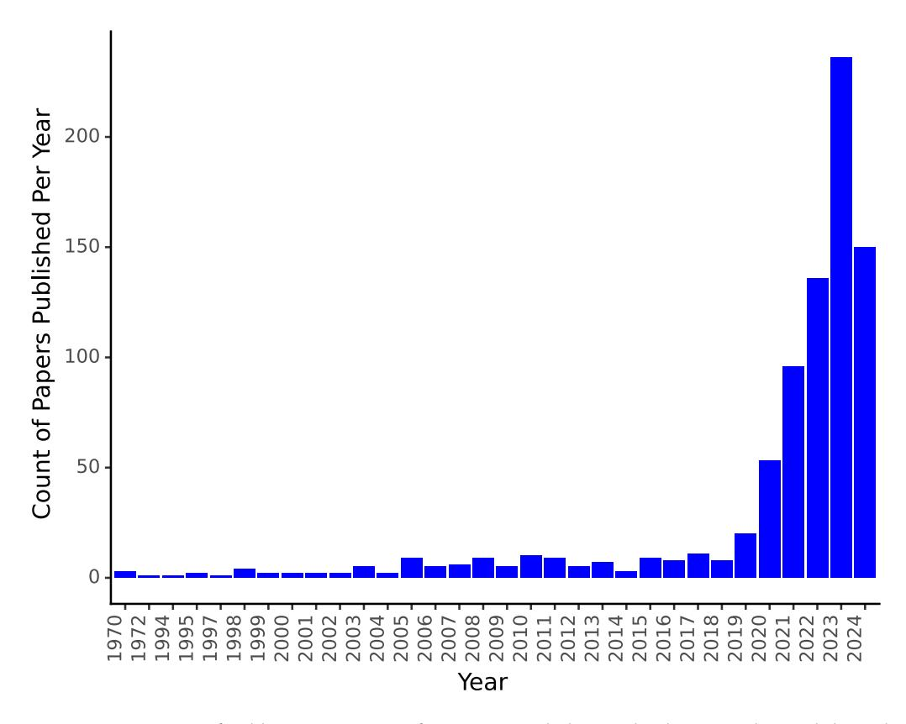
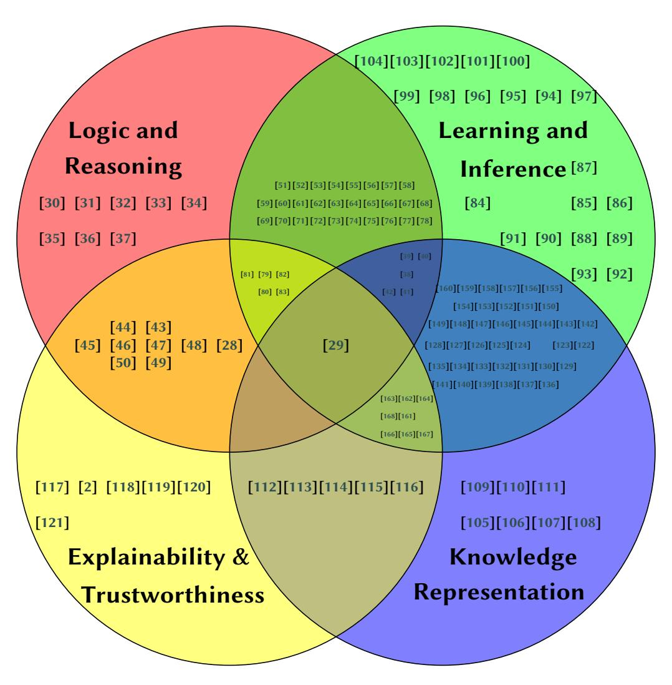
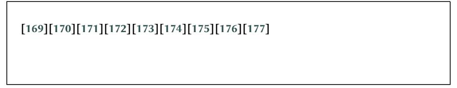

# **Neuro-Symbolic AI in 2024: A Systematic Review**

Brandon C. Colelough*1*,\* , William Regli*2*

#### **Abstract**

Background: The field of Artificial Intelligence has undergone cyclical periods of growth and decline, known as AI summers and winters. Currently, we are in the third AI summer, characterized by significant advancements and commercialization, particularly in the integration of Symbolic AI and Sub-Symbolic AI, leading to the emergence of Neuro-Symbolic AI.

**Contributions:** (1) A definition of Meta-Cognition within Neuro-Symbolic AI. (2) A review of the key themes of the literature post the Neuro-Symbolic research explosion from 2020-2024. (3) Identification of the current gaps in the literature of Neuro-Symbolic AI

**Objective:** This paper provides a systematic literature review of Neuro-Symbolic AI projects within the 2020-24 AI landscape, highlighting key developments, methodologies, and applications. It aims to identify where quality efforts are focused in 2024 and pinpoint existing research gaps in the field.

**Methods:** The review followed the PRISMA methodology, utilizing databases such as IEEE Explore, Google Scholar, arXiv, ACM, and SpringerLink. The inclusion criteria targeted peer-reviewed papers published between 2020 and 2024. Papers were screened for relevance to Neuro-Symbolic AI, with further inclusion based on the availability of associated codebases to ensure reproducibility.

**Results:** From an initial pool of 1,428 papers, 167 met the inclusion criteria and were analyzed in detail. The majority of research efforts are concentrated in the areas of learning and inference (63%), logic and reasoning (35%), and knowledge representation (44%). Explainability and trustworthiness are less represented (28%), with Meta-Cognition being the least explored area (5%). The review identifies significant interdisciplinary opportunities, particularly in integrating explainability and trustworthiness with other research areas.

**Discussion:** The findings reveal a well-integrated body of work in learning and inference, logic and reasoning, and knowledge representation. However, there is a notable gap in research focused on explainability and trustworthiness, which is critical for the deployment of reliable AI systems. The sparse representation of Meta-Cognition highlights the need for further research to develop frameworks that enable AI systems to self-monitor, evaluate, and adjust their processes, enhancing autonomy and adaptability.

**Conclusion:** Neuro-Symbolic AI research has seen rapid growth since 2020, with concentrated efforts in learning and inference. Significant gaps remain in explainability, trustworthiness, and Meta-Cognition. Addressing these gaps through interdisciplinary research will be crucial for advancing the field towards more intelligent, reliable, and context-aware AI systems.

#### **Keywords**

Neuro-Symbolic AI, Systematic Review, Learning and Inference, Knowledge Representation, Logic and Reasoning,, Explainability and Trustworthiness, Meta-Cognition, PRISMA.

*1University of Maryland, College Park, 8125 Paint Branch Dr, College Park, MD 20742*

\*Corresponding author.

\$ brandcol@umd.edu (B. C. Colelough); regli@umd.edu (W. Regli)

https://brandoncolelough.com/ (B. C. Colelough); https://www.cs.umd.edu/people/regli (W. Regli)

0000-0001-8389-3403 (B. C. Colelough); 0000-0001-7116-9338 (W. Regli)

© 2024 Copyright for this paper by its authors. Use permitted under Creative Commons License Attribution 4.0 International (CC BY 4.0).

### **1. Introduction**

The field of Artificial Intelligence (AI) has experienced significant cyclical growth, known as AI summers and winters. At present, we as a community find ourselves in the third AI summer, marked by rapid scientific advances and commercialization, continuing the legacy of previous periods of AI excitement followed by setbacks [1]. A significant product of the third AI summer has been the integration of two prominent fields of AI; Symbolic AI and Sub-Symbolic AI, the fusion of which is known as Neuro-Symbolic AI. There is an ongoing debate about the necessity of Neuro-Symbolic AI [2], opponents arguing that common sense reasoning can be addressed through the use of big data [3] and proponents arguing that "You can't get to the moon by climbing successively taller trees" [4]. For this systematic review, we take the stance that symbolic AI is essential and that Neuro-Symbolic AI represents the best way forward for the community hence, this paper provides a systematic literature review of prominent Neuro-Symbolic projects within the 2024 AI landscape, highlighting key developments, methodologies, and applications.

#### **1.1. Symbolic AI**

Symbolic AI is a "a sub-field of AI concerned with learning the internal symbolic representations of the world around it" where we can " translate some form of implicit human knowledge into a more formalized and declarative form based on rules and logic" [2]. Examples of some of the earliest AI systems that utilised symbolic representations include SHRDLU [5], ELIZA [6], DENDRAL [7] and MYCIN[8] and examples of some of the newest AI systems which heavily utilise symbolic processes include ConceptNet 5.5 [9] CYC [10] and Good Old Fashioned AI (GOFAI) planning systems [11] to name just a few.

#### **1.2. Sub-Symbolic AI**

By contrast, Sub-Symbolic AI are systems that "do not require rules or symbolic representations as inputs" and instead "learn implicit data representations on their own" [2]. Sub-Symbolic AI encompasses approaches such as machine learning, deep learning, and generative AI, which rely on algorithms to automatically extract patterns from raw data to discern relationships and make predictions based on learned representations. Examples of some of the earliest AI systems that utilised sub-symbolic representations include the Perceptron [12], Hopfield Networks [13] and the Backpropagation Algorithm [14] and examples of some of the newest sub-symbolic systems include famous projects such as the Generative Pre-trained Transformer (GPT) models [15], the YOLO family of Convolutional Neural Networks (CNN'S) [16] and the DALLE diffusion model transformer [17] to again just name a few.

#### **1.3. Neuro-Symbolic AI**

There is at present a debate within the AI community surrounding the need for Neuro-Symbolic AI [18]. Simply described, the argument for Neuro-Symbolic AI draws on Kahneman (2011) [19] concepts of System 1 and System 2 thinking whereby System 1 is fast, intuitive, and parallel, akin to the capabilities of deep learning, while System 2 is slow, deliberate, and sequential, resembling symbolic reasoning and hence, Neuro-Symbolic AI aims to combine these two approaches to create systems that benefit from the strengths of both. We Adopt the definition provided by Garcez and Lamb (2023) [18]; Hence, Neuro-Symbolic AI is **"a composite AI framework that seeks to merge the domains of Symbolic AI and Neural Networks" [or more broadly put, Sub-Symbolic AI] "to create a superior hybrid AI model possessing reasoning capabilities"**. As this definition is quite broad, for the purpose of this systematic review, we will further define the sub-components of the Neuro-Symbolic AI taxonomy we believe to be most relevant to the current AI landscape within section 2.

### **2. Methodology**

#### **2.1. Taxonomy of Neuro-Symbolic AI**

We identified five foundational research areas advancing the state of the art in Neuro-Symbolic AI. This taxonomy was synthesized from a review of six survey papers [20, 21, 22, 23, 24, 25] and four seminal books [2, 26, 27, 28]. These areas are:

- 1. **Knowledge Representation:** Integrating symbolic and neural representations and developing commonsense and domain-specific knowledge graphs [20, 26, 28].
- 2. **Learning and Inference:** Combining learning and reasoning processes through end-toend differentiable reasoning and dynamic multi-source knowledge reasoning [21, 22, 2].
- 3. **Explainability and Trustworthiness:** Creating interpretable models and reasoning processes to ensure trust and reliability in Neuro-Symbolic systems [23, 24].
- 4. **Logic and Reasoning:** Integrating logic-based methods with neural networks, including logical and probabilistic reasoning, and the syntax and semantics of Neuro-Symbolic systems [23, 28].
- 5. **Meta-Cognition:** The system's capacity to monitor, evaluate, and adjust its own reasoning and learning processes by integrating neural networks and symbolic representations.

The four above categories represent the core technical areas where current efforts are concentrated. Additionally, we define *Meta-Cognition* to address a gap in current taxonomies that fail to capture fields encompassing self-awareness, adaptive learning, reflective reasoning, self-regulation, and introspective monitoring.

#### **2.2. Meta-Cognition**

Meta-Cognition refers to the processes that involve thinking about one's thinking, enabling self-awareness and self-regulation in cognitive tasks. Meta-Cognition is the controller that sits above the cognitive tasks of systems to direct energy effectively towards the correct system to handle a task. This higher-order cognition is crucial for tasks that require reflection, planning, and adaptation. Its importance lies in its ability to enhance learning, problem-solving, and

decision-making, making it a key focus in Neuro-Symbolic AI. Present research within Neuro-Symbolic AI does not yet effectively cover meta-cognition and neglecting Meta-Cognition in Neuro-Symbolic AI research limits system autonomy, adaptability, and reliability, hindering error correction and reducing trustworthiness in dynamic environments, making self-awareness and self-regulation essential for future advancements.

#### **2.3. Literature Review Approach**

We followed the PRISMA systematic review methodology to ensure a thorough and unbiased survey of the literature. Our search was conducted across five databases: IEEE Explore, Google Scholar, arXiv, ACM Digital Library, and SpringerLink Library, focusing on publications from 2020 to 2024. The keywords included "Neuro-Symbolic" combined with terms related to the foundational research areas. Only peer-reviewed articles, conference papers, and books in English were considered. From an initial broad search, we refined our selection to 392 candidate papers, which were further screened for quality, relevance, and availability of a public codebase, resulting in 167 papers that were included in our review. This streamlined process allowed us to focus on the most relevant and high-quality research, identifying key findings and open problems in Neuro-Symbolic AI.

### **3. Results**

| Database               | Knowledge | Learning & | Explainability & | Logic &   | Meta-Cognition |
|------------------------|-----------|------------|------------------|-----------|----------------|
|                        |           | Inference  | Trustworthiness  | Reasoning | Cognition      |
| IEEE                   | 73        | 97         | 15               | 67        | 33             |
| Google Scholar         | 56        | 126        | 7                | 129       | 3              |
| Ar𝜒iV                  | 17        | 54         | 7                | 55        | 3              |
| ACM                    | 10        | 46         | 5                | 12        | 17             |
| Springer               | 152       | 170        | 65               | 162       | 47             |
| Total(after screening) | 308       | 493        | 99               | 425       | 103            |

**Table 1**

The search terms "neurosymbolic" AND each of the terms required for the 5 foundational research areas within neurosymbolic AI were queried through the 5 databases. The number of pieces of literature returned from each query is shown in the table above. Note also that only publications from 2020-2024 were considered

From the initial Google Scholar scraping, there was a total of 957 publications listed on Google Scholar alone from 1970 til the present. Figure 1 shows how research on Neuro-Symbolic AI is increasing exponentially starting in 2020, with notable increases in the years beginning from 2020 (53 publications), and peaking in 2023 (236 publications). Combining the Google Scholar literature from 2020 onwards with the literature from the four other databases queried for pieces of literature on Neuro-Symbolic AI from 2020 onwards, a total of 1,428 papers were extracted as illustrated in table 1. An illustration of this sub-categorisation showing the overlap between 4 of the 5 main research focal areas is shown in Figure 2. From the total literature extracted, 45% (n = 641) were removed as duplicate entries, and 28% (n = 395) were removed during title and

**Figure 1:** Histogram of publications per year for Neuro-Symbolic AI. The data was obtained through Google Scholar scraping, reflecting significant growth from 2020

abstract screening with 28% (n = 392) held for further analysis. From the remaining 392 papers, the literature was further split based on code/model availability. 42% of the papers (n = 167) had associated code-base repositories (e.g. GitHub, Huggingface etc.) and 58% (n = 225) were further excluded from this literature review as a public code-base could not be found for the associated piece of literature (except for entries on Meta-Cognition as no code-bases could be found for literature associated with this category). The remaining 167 papers gathered were then read in detail and a further 9 papers were removed for not meeting the inclusion criteria leaving 158 included papers and 234 excluded papers. These 158 papers were then sub-categorised under the five main focal research areas and the intersection found therein. There were 44% (n=70) entries in the Knowledge Representation category, 63% (n=99) entries in the Learning and Inference category, 28% (n=44) entries in the Explainability and Trustworthiness category, 35% (n=55) entries in the Logic and Reasoning category, 5% (n=8) entries in the Meta-Cognition category. The intersection of Knowledge Representation and Learning & Inference had 27% (n=43) entries, the intersection of Knowledge Representation and Explainability & Trustworthiness had 4% (n=5), the intersection of Learning & Inference and Logic & Reasoning had 11.48% (n=31), the

## **Meta-Level Cognition**

**Figure 2:** A literature review of existing of the major components of Symbolic AI was conducted. Note that papers from the Meta-Level Cognition were not required to have an associated public codebase/repository

intersection of Explainability & Trustworthiness and Logic & Reasoning had 3.33% (n=9). The intersection of any of the three categories ranged from 5 to 9 entries, except for the intersection of Explainability and Trustworthiness & Logic and Reasoning & Knowledge Representation, which had none. There was only one entry at the intersection of all 4 of the main research focal areas (excluding Meta-Cognition) which was AlphaGeometry from Google[29].

### **4. Discussion & Open Questions**

To build upon the existing literature that has thoroughly summarized the Neuro-Symbolic landscape before 2020, we extend this discussion by analyzing the most influential projects in each sub-field of Neuro-Symbolic AI published since 2020. This section aims to highlight stateof-the-art (SOTA) technologies available to researchers, showcasing significant advancements and ongoing challenges.

#### **4.1. Knowledge Representation**

Research in Knowledge Representation has focused on advancing semantic grounding, representing complex relationships, and improving data efficacy. Development of commonsense knowledge bases and event-based representations [107, 105, 106] has advanced AI's understanding of daily events, aiming to reduce error rates in text generation. These works are furthered through the exploration of minimal data requirements for commonsense knowledge in few-shot learning models[110], and the use of Neuro-Symbolic representations to enhance training efficiency and reduce costs [161]. Additionally, refinement of knowledge representation was demonstrated by predicting complex relationships and embedding techniques in knowledge graphs [111, 109], and the integration of personalized knowledge was demonstrated to ensure narrative consistency in storytelling agents [130]. NeuroQL, a domain-specific language for inter-subjective reasoning, captured complex and long-range relationships, demonstrating how Neuro-Symbolic approaches can 'do more with less', yielding significant savings in training time and environmental impact [108]. Open research questions remain around how Neuro-Symbolic AI can enhance the dynamic interpretation and manipulation of symbols, develop meta-cognitive abilities to monitor and adjust reasoning processes, and ensure transparent, explainable reasoning pathways for more human-like, adaptable, and robust knowledge representation.

#### **4.2. Learning and Inference**

Within Learning and Inference, research has focused on Neuro-Symbolic Integration for Enhanced Learning, Advanced Problem Solving and Decision Making, and Semantic Enhancement for Model Trustworthiness. Neuro-Symbolic integration for Enhanced Learning was demonstrated through the fusion of symbolic reasoning with neural learning mechanisms which adapted commonsense knowledge for few-shot settings and transformed observations into logical facts using Logical Neural Networks [84, 64]. Advanced Problem Solving and Decision Making are highlighted by Plan-SOFAI [92] and the ZeroC architecture [160], which leverage Neuro-Symbolic methods to enhance AI planning and zero-shot concept recognition to integrate

the fast and slow thinking models and the improve machine generalization. Semantic Enhancement and Model Trustworthiness were demonstrated by the introduction of a Pseudo-Semantic Loss for autoregressive models which integrated logic within the loss function [122] and neural networks utilising Logic Tensor Networks [79] which aim to boost logical consistency, reduce model toxicity, and enhance prediction accuracy by concentrating on relevant constraints. Open research questions remain in Neuro-Symbolic AI, including how to develop incremental learning that allows symbolic systems to evolve with new experiences, create context-aware inference mechanisms that adjust reasoning based on situational cues, achieve fine-grained explainability for complex inference chains, and explore meta-cognitive abilities enabling systems to monitor, evaluate, and optimize their learning processes in dynamic environments.

#### **4.3. Explainability and Trustworthiness**

Research centred on Explainability and Trustworthiness within Neuro-Symbolic AI has looked to advance Natural Language Processing (NLP) Techniques, Enhancing Logical Reasoning, and Refining Language Understanding and Summarization. Braid introduced a logical reasoner with probabilistic rules to tackle the brittle matching problem, merging symbolic and neural knowledge to enhance logical reasoning [119]. Similarly, Structure-Aware Abstractive Conversation improved summarization by incorporating discourse relations, action triples, and structured graphs for precise, context-rich summaries, advancing NLP techniques [117]. Semantic-level revisions identifying and correcting "confounders" in Neuro-Symbolic scenes have improved AI decision-making clarity, fostering trust and enhancing logical reasoning by making processes more understandable [166]. Evaluating AI's humour comprehension with the New Yorker Cartoon Caption Contest underscored the need for nuanced understanding, refining language processing in complex cognitive tasks [118]. FactPEGASUS focuses on ensuring factuality in summarization by optimizing pre-training and fine-tuning methods, crucial for maintaining summary integrity and refining language understanding [135]. Complementing this, Neuro-Symbolic methods enhance explainable short answer grading through logical reasoning and cue detection, bridging AI capabilities with human-like responses and advancing NLP techniques [121]. Open research questions remain around how Neuro-Symbolic AI can adapt and evolve symbolic representations in real-time to maintain transparency, integrate meta-cognitive mechanisms for self-monitoring and adjustment of reasoning strategies, develop explainable NLP techniques for complex cognitive tasks, and ensure factual consistency in AI outputs while providing clear, detailed explanations of the underlying reasoning process.

#### **4.4. Logic and Reasoning**

From the research field of Neuro-Symbolic Logic and Reasoning, the research has gravitated largely toward the Integration of Logical Reasoning and Probabilistic Models, Commonsense Knowledge and Language Understanding, and Enhanced Decision-Making. Logical Credal Networks [36] combines logical reasoning with probabilistic models to handle imprecise information, while DeepStochLog [75] enhances traditional logic programming with neural networks for complex reasoning tasks. 2P-Kt [37] offers a comprehensive logic-based framework supporting various reasoning tasks and integrating symbolic and sub-symbolic AI. Research into

Commonsense Knowledge and Language Understanding includes kogito, [106], which generates commonsense knowledge inferences from textual input to enhance AI adaptability, and LinkBERT [88], which improves language understanding and reasoning capabilities by incorporating document links, particularly in multi-hop reasoning tasks. For Enhanced Decision-Making, "Neuro-Symbolic Commonsense Social Reasoning" [44] integrates Neuro-Symbolic methods in autonomous systems, while LASER [135] combines neural networks' flexibility with the precision of symbolic logic. "Getting from Generative AI to Trustworthy AI" [10] addresses LLMs' limitations in trustworthiness and reasoning, proposing integration with symbolic AI systems for reliability. Open research questions remain around how Neuro-Symbolic AI can develop scalable frameworks that integrate traditional logic programming with neural networks for complex reasoning tasks, incorporate commonsense knowledge and advanced language understanding to enhance multi-hop reasoning capabilities, combine symbolic logic with neural networks to ensure reliable and trustworthy decision-making and integrate meta-cognitive abilities to enable self-monitoring and adjustment of reasoning strategies for clearer, more understandable explanations.

#### **4.5. Intersections of the above four research areas**

Much of the literature is cross-sectional between the four areas of research; Explainability & Trustworthiness, Knowledge Representation, Learning & Inference and Logic & Reasoning. AlphaGeometry [29], which is a Neuro-Symbolic system designed to solve Euclidean plane geometry problems at the Olympiad level, stands out as a prominent project that sits at the intersection of all four. AlphaGeometry's ability to synthesise millions of theorems and proofs, using a neural language model trained on large-scale synthetic data to guide a symbolic deduction engine, makes it a groundbreaking example of how Neuro-Symbolic AI can achieve advanced problem-solving capabilities, bridging gaps across multiple domains of AI research. However, there is a distinct lack of integration with the explainability and trustworthiness fields within the unions of the other three research areas as the density of research intersection at the unions of explainability and trustworthiness and the other three research areas is relatively sparse, indicating a significant opportunity for further interdisciplinary work in Neuro-Symbolic AI.

#### **4.6. Meta-Cognition**

Recent advancements in this domain showcase Reinforcement learning (RL) to approximate Meta-Cognition, approaches to integrate cognitive architectures with LLMs to approximate metacognitive capabilities and the integration of many AI architectures and systems to demonstrate the Common Model of Cognition (CMC). The benefits of integrating symbolic features with RL algorithms were demonstrated through meta-reinforcement learning combined with logical program induction to improve financial trading strategies [173]. Enhancing general intelligence by fusing cognitive architectures with LLMs was investigated, creating embodied agents that leverage the strengths of both approaches [169, 170]. Improvements in experiential models were achieved by using LLMs to convert descriptive information into dense signals for instance-based learning [171]. Adaptive conflict resolution in AI was enhanced by coupling cognitive reasoning with generative algorithms [172]. Robust AI systems were developed through modular, agency, and Neuro-Symbolic approaches to combine LLMs with cognitive architectures [174, 175]. These projects align with the CMC, integrating cognitive architectures like ACT-R, Soar, and Sigma to provide a unified framework for human cognition [178]. Enhancements in AI robustness and interoperability were achieved by integrating cognitive architectures with foundation models for cognitively guided few-shot learning [167]. Finally, combining generative networks with the CMC using a Neuro-Symbolic approach merged symbolic reasoning with neural networks to replicate human cognitive processes for powerful, explainable AI systems has been theorised but not yet realised[176]. Open research questions remain around how Neuro-Symbolic AI can integrate symbolic reasoning with meta-reinforcement learning for complex decision-making, fuse cognitive architectures with LLMs to develop meta-cognitive agents, leverage LLMs to enhance instance-based learning through meta-cognitive signals, create adaptive meta-cognitive frameworks for real-time conflict resolution, combine modular and agency approaches to build meta-cognitive AI systems aligned with the Common Model of Cognition, improve few-shot learning with cognitive architectures for meta-cognitive awareness, and develop Neuro-Symbolic generative networks that replicate human-like meta-cognitive processes.

### **5. Meta-Cognition in Neuro-Symbolic AI**

Whilst the initial representation of Neuro-Symbolic AI as system 1 and system 2 level thinking is a useful tool to goal-orientate the field towards a common direction for the integration of neural and symbolic processes, the current adaptation of the human-level cognitive processing ability is too simplistic and does not yet capture the full systems-level breakdown of where the community should be investing effort to push the field forward. As Kahneman himself states, "the two systems do not really exist in the brain or anywhere else. 'System 1 does X' is a shortcut for 'X occurs automatically.' And 'System 2 is mobilized to do Y' is a shortcut for 'arousal increases, pupils dilate, attention is focused, and activity Y is performed.'". Human-level cognition manifests from a deeply complex and intricately layered yet densely connected box of systems of systems that work in unification and act with system-1 system-2 characteristics. The goal of the Neuro-Symbolic research domain is to "create a superior hybrid AI model possessing reasoning capabilities" and hence, to push the field further towards this goal we must seek to design and build systems that act with the same propensity as Kahnemans system-1 system-2 character setup through the implementation of more integrated systems of systems controlled through Meta-Cognition possessing the ability to act lazily when necessary and focused when required.

### **6. Conclusion**

The field of Neuro-Symbolic AI has experienced a notable surge in research activity from 2020 onwards, reflecting the growing recognition of the importance of integrating symbolic and sub-symbolic approaches to enhance AI's reasoning capabilities. The contribution from this systematic literature review is a well-grounded definition of Meta-Cognition within Neuro-Symbolic AI, a review of the key themes of the literature post the Neuro-Symbolic research explosion from 2020-2024 and an identification of the current gaps in the literature of Neuro-Symbolic AI. We found that the majority of the research efforts in between 2020-24 were concentrated in the areas of learning and inference, with a significant portion also dedicated to logic and reasoning, as well as knowledge representation. These areas have seen substantial advancements, with innovative projects and methodologies pushing the boundaries of what AI systems can achieve in terms of understanding, reasoning, and generating human-like responses. However, our review also identifies several critical gaps in the current literature. Despite the substantial progress in learning and inference, there remains a relative sparseness of research focused on explainability and trustworthiness. This gap is particularly concerning given the increasing deployment of AI systems in real-world applications, where transparency and reliability are paramount. Moreover, the intersection of the four main research areas—learning and inference, logic and reasoning, knowledge representation, and explainability and trustworthiness—reveals a significant opportunity for interdisciplinary work. The density of studies that effectively combine these domains indicates the field is generally well integrated. The most underrepresented area in our review is Meta-Cognition. This emerging field, which involves systems' capacity to monitor, evaluate, and adjust their own reasoning and learning processes, holds great potential for advancing AI towards more autonomous and adaptable intelligence. The few existing studies in this domain suggest promising directions, but much more work is needed to develop robust frameworks and practical implementations of Meta-Cognitive architectures.

### **References**

- [1] H. A. Kautz, The third ai summer: Aaai robert s. engelmore memorial lecture, AI Magazine 43 (2022) 105–125. doi:10. 1002/aaai.12036.
- [2] A. Dingli, Neuro-symbolic ai, 2023. Includes bibliographical references and index.
- [3] Y. LeCun, A path towards autonomous machine intelligence, OpenReview Archive (2022). URL: https://openreview.net/ forum?id=BZ5a1r-kVsf, direct Upload.
- [4] G. Marcus, Rebooting ai, 2019.
- [5] T. Winograd, Procedures as a Representation for Data in a Computer Program for Understanding Natural Language, AI Technical Report AITR-235, 1971. URL: http://hdl.handle.net/1721.1/7095, accessed: 2024-05-13.
- [6] J. Weizenbaum, Eliza—a computer program for the study of natural language communication between man and machine, Communications of the ACM 9 (1966) 36–45. doi:10.1145/365153.365168.
- [7] R. K. Lindsay, B. G. Buchanan, E. A. Feigenbaum, J. Lederberg, Applications of Artificial Intelligence for Organic Chemistry: The DENDRAL Project, McGraw-Hill, 1980.
- [8] W. van Melle, Mycin: a knowledge-based consultation program for infectious disease diagnosis, International Journal of Man-Machine Studies 10 (1978) 313–322. doi:10.1016/s0020-7373(78)80049-2.
- [9] R. Speer, J. Chin, C. Havasi, Conceptnet 5.5: An open multilingual graph of general knowledge (2016). doi:10.48550/ ARXIV.1612.03975.
- [10] D. Lenat, G. Marcus, Getting from generative ai to trustworthy ai: What llms might learn from cyc, 2023. doi:10.48550/ ARXIV.2308.04445.
- [11] S. Edelkamp, M. Helmert, R. Reffel, J. Bossek, International planning competition, in: Proceedings of the Fourth International Conference on Automated Planning and Scheduling, 2004, pp. 81–84.
- [12] F. Rosenblatt, The perceptron: A probabilistic model for information storage and organization in the brain., Psychological Review 65 (1958) 386–408. doi:10.1037/h0042519.
- [13] J. J. Hopfield, Neural networks and physical systems with emergent collective computational abilities., Proceedings of the National Academy of Sciences 79 (1982) 2554–2558. doi:10.1073/pnas.79.8.2554.
- [14] D. E. Rumelhart, G. E. Hinton, R. J. Williams, Learning representations by back-propagating errors, Nature 323 (1986) 533–536. doi:10.1038/323533a0.
- [15] A. Vaswani, N. Shazeer, N. Parmar, J. Uszkoreit, L. Jones, A. N. Gomez, L. Kaiser, I. Polosukhin, Attention is all you need, 2017. doi:10.48550/ARXIV.1706.03762.
- [16] J. Redmon, S. Divvala, R. Girshick, A. Farhadi, You only look once: Unified, real-time object detection, 2015. doi:10.48550/ ARXIV.1506.02640.
- [17] A. Ramesh, M. Pavlov, G. Goh, S. Gray, C. Voss, A. Radford, M. Chen, I. Sutskever, Zero-shot text-to-image generation, 2021. doi:10.48550/ARXIV.2102.12092.

- [18] A. d. Garcez, L. C. Lamb, Neurosymbolic ai: the 3rd wave, Artificial Intelligence Review 56 (2023) 12387–12406. doi:10. 1007/s10462-023-10448-w.
- [19] D. Kahneman, Thinking, Fast and Slow, Farrar, Straus and Giroux, 2011.
- [20] W. Gibaut, L. Pereira, F. Grassiotto, A. Osorio, E. Gadioli, A. Munoz, S. Gomes, C. d. Santos, Neurosymbolic ai and its taxonomy: a survey (2023). doi:10.48550/ARXIV.2305.08876.
- [21] D. Yu, B. Yang, D. Liu, H. Wang, S. Pan, A survey on neural-symbolic learning systems, 2021. doi:10.48550/ARXIV.2111. 08164.
- [22] Z. Wan, C.-K. Liu, H. Yang, C. Li, H. You, Y. Fu, C. Wan, T. Krishna, Y. Lin, A. Raychowdhury, Towards cognitive ai systems: a survey and prospective on neuro-symbolic ai, 2024. doi:10.48550/ARXIV.2401.01040.
- [23] G. Marra, S. Dumančić, R. Manhaeve, L. De Raedt, From statistical relational to neurosymbolic artificial intelligence: A survey, Artificial Intelligence 328 (2024) 104062. doi:10.1016/j.artint.2023.104062.
- [24] C. Michel-Deletie, M. K. Sarker, Neuro-symbolic methods for trustworthy ai: a systematic review, Neurosymbolic Artificial Intelligence (2024). Tracking #: 726-1708, Review Assignment Stage.
- [25] D. Bouneffouf, C. C. Aggarwal, Survey on applications of neurosymbolic artificial intelligence, 2022. doi:10.48550/ARXIV. 2209.12618.
- [26] P. Hitzler, M. K. Sarker, A. Eberhart (Eds.), Compendium of Neurosymbolic Artificial Intelligence, volume 369 of *Frontiers in Artificial Intelligence and Applications*, IOS Press, 2023. URL: https://doi.org/10.3233/FAIA369. doi:10.3233/FAIA369.
- [27] P. Hitzler, M. K. Sarker, Neuro-symbolic artificial intelligence: The state of the art, in: Neuro-Symbolic Artificial Intelligence, 2021. URL: https://api.semanticscholar.org/CorpusID:245698629.
- [28] P. Shakarian, C. Baral, G. I. Simari, B. Xi, L. Pokala, Neuro Symbolic Reasoning and Learning, SpringerBriefs in Computer Science, Springer, 2023.
- [29] T. H. Trinh, Y. Wu, Q. V. Le, H. He, T. Luong, Solving olympiad geometry without human demonstrations, Nature 625 (2024) 476–482. URL: https://github.com/google-deepmind/alphageometry. doi:10.1038/s41586-023-06747-5.
- [30] M. Fang, S. Deng, Y. Zhang, Z. Shi, L. Chen, M. Pechenizkiy, J. Wang, Large language models are neurosymbolic reasoners, arXiv preprint arXiv:2401.09334 (2024). URL: https://github.com/hyintell/llmsymbolic. doi:10.1609/aaai.v38i16.29754, submitted 17 January, 2024; originally announced January 2024.
- [31] G. Lima, A. Rademaker, R. Uceda-Sosa, ULKB Logic: A HOL-Based Framework for Reasoning over Knowledge Graphs, Springer Nature Switzerland, 2023, pp. 55–71. URL: https://github.com/IBM/ULKB. doi:10.1007/978-3-031-49342-3\_4.
- [32] S.-W. Lin, P. Tolmach, Y. Liu, Y. Li, Solsee: a source-level symbolic execution engine for solidity, in: Proceedings of the 30th ACM Joint European Software Engineering Conference and Symposium on the Foundations of Software Engineering, ESEC/FSE 2022, Association for Computing Machinery, New York, NY, USA, 2022, pp. 1687–1691. URL: https://github.com/XMUsuny/symbolic-execution-papers. doi:10.1145/3540250.3558923.
- [33] M. Marron, Toward programming languages for reasoning: Humans, symbolic systems, and ai agents, in: Proceedings of the 2023 ACM SIGPLAN International Symposium on New Ideas, New Paradigms, and Reflections on Programming and Software, Onward! 2023, Association for Computing Machinery, New York, NY, USA, 2023, pp. 136–152. URL: https: //github.com/Yangyi-Chen/Multimodal-AND-Large-Language-Models. doi:10.1145/3622758.3622895.
- [34] F. A. Saad, M. C. Rinard, V. K. Mansinghka, Sppl: probabilistic programming with fast exact symbolic inference, in: Proceedings of the 42nd ACM SIGPLAN International Conference on Programming Language Design and Implementation, PLDI 2021, Association for Computing Machinery, New York, NY, USA, 2021, pp. 804–819. URL: https://github.com/ probcomp/sppl. doi:10.1145/3453483.3454078.
- [35] H. Shindo, D. S. Dhami, K. Kersting, Neuro-symbolic forward reasoning, arXiv preprint arXiv:2110.09383 (2021). URL: https://github.com/ml-research/neumann. doi:10.1007/978-3-031-39179-8, submitted 18 October, 2021; originally announced October 2021.
- [36] H. Qian, R. Marinescu, A. Gray, D. Bhattacharjya, F. Barahona, T. Gao, R. Riegel, P. Sahu, Logical credal networks, 2021. URL: https://github.com/radum2275/crema. doi:10.48550/ARXIV.2109.12240.
- [37] G. Ciatto, R. Calegari, A. Omicini, 2p-kt: A logic-based ecosystem for symbolic ai, SoftwareX 16 (2021) 100817. URL: https://github.com/tuProlog/2p-kt. doi:10.1016/j.softx.2021.100817.
- [38] K. Ahmed, K.-W. Chang, G. V. den Broeck, Semantic strengthening of neuro-symbolic learning, arXiv preprint arXiv:2302.14207 (2023). URL: https://github.com/UCLA-StarAI/Semantic-Strengthening. doi:10.3233/faia230153, submitted 27 February, 2023; originally announced February 2023.
- [39] S. J. Giri, P. Dutta, P. Halani, S. Saha, Multipredgo: Deep multi-modal protein function prediction by amalgamating protein structure, sequence, and interaction information, IEEE Journal of Biomedical and Health Informatics 25 (2021) 1832–1838. URL: https://github.com/SwagarikaGiri/Multi-PredGO. doi:10.1109/JBHI.2020.3022806.
- [40] P. Kapanipathi, I. Abdelaziz, S. Ravishankar, S. Roukos, A. Gray, R. Astudillo, M. Chang, C. Cornelio, S. Dana, A. Fokoue, D. Garg, A. Gliozzo, S. Gurajada, H. Karanam, N. Khan, D. Khandelwal, Y.-S. Lee, Y. Li, F. Luus, N. Makondo, N. Mihindukulasooriya, T. Naseem, S. Neelam, L. Popa, R. Reddy, R. Riegel, G. Rossiello, U. Sharma, G. P. S. Bhargav, M. Yu, Leveraging abstract meaning representation for knowledge base question answering, 2020. URL: https://github.com/JBoRu/KBQAPapers. doi:10.48550/ARXIV.2012.01707.
- [41] V. Shah, A. Sharma, G. Shroff, L. Vig, T. Dash, A. Srinivasan, https://github.com/quark0/analogy, arXiv preprint arXiv:2209.08750 (2022). URL: https://github.com/LIANGKE23/Awesome-Knowledge-Graph-Reasoning. doi:10.1109/ access.2021.3109443, submitted 19 September, 2022; originally announced September 2022.
- [42] R. Wang, P. Jansen, M.-A. Côté, P. Ammanabrolu, Behavior cloned transformers are neurosymbolic reasoners, arXiv preprint

- arXiv:2210.07382 (2022). URL: https://github.com/cognitiveailab/neurosymbolic. doi:10.18653/v1/2023.eacl-main. 204, submitted 11 February, 2023; v1 submitted 13 October, 2022; originally announced October 2022.
- [43] F. Arabshahi, J. Lee, M. Gawarecki, K. Mazaitis, A. Azaria, T. Mitchell, Conversational neuro-symbolic commonsense reasoning, arXiv preprint arXiv:2006.10022 (2021). URL: https://github.com/ForoughA/CORGI. doi:10.1609/aaai.v35i6. 16623, submitted 2 February, 2021; v1 submitted 17 June, 2020; originally announced June 2020.
- [44] D. Chanin, A. Hunter, Neuro-symbolic commonsense social reasoning, arXiv preprint arXiv:2303.08264 (2023). URL: https://github.com/chanind/amr-logic-converter, submitted 14 March, 2023; originally announced March 2023.
- [45] M. Ismayilzada, D. Paul, S. Montariol, M. Geva, A. Bosselut, Crow: Benchmarking commonsense reasoning in real-world tasks, 2023. URL: https://github.com/mismayil/crow. doi:10.48550/ARXIV.2310.15239.
- [46] T. X. Olausson, A. Gu, B. Lipkin, C. E. Zhang, A. Solar-Lezama, J. B. Tenenbaum, R. Levy, Linc: A neurosymbolic approach for logical reasoning by combining language models with first-order logic provers, arXiv preprint arXiv:2310.15164 (2023). URL: https://github.com/benlipkin/linc. doi:10.18653/v1/2023.emnlp-main.313, submitted 14 February, 2024; v1 submitted 23 October, 2023; originally announced October 2023.
- [47] J. Prentzas, I. Hatzilygeroudis, Exploring aspects regarding reasoning in neuro-symbolic rules and connectionist expert systems, in: 2021 12th International Conference on Information, Intelligence, Systems & Applications (IISA), 2021, pp. 1–8. URL: https://github.com/MoserMichael/my-notes/blob/master/talking-with-chatgtp-b.md. doi:10.1109/IISA52424. 2021.9555527.
- [48] A. Saparov, H. He, Language models are greedy reasoners: A systematic formal analysis of chain-of-thought, 2022. URL: https://github.com/asaparov/prontoqa. doi:10.48550/ARXIV.2210.01240.
- [49] C. Yang, S. Chaudhuri, Safe neurosymbolic learning with differentiable symbolic execution, arXiv preprint arXiv:2203.07671 (2022). URL: https://github.com/cxyang1997/dse. doi:10.23919/fmcad.2018.8602991, submitted 15 March, 2022; originally announced March 2022.
- [50] S. Yang, X. Li, L. Cui, L. Bing, W. Lam, Neuro-symbolic integration brings causal and reliable reasoning proofs, arXiv preprint arXiv:2311.09802 (2023). URL: https://github.com/damo-nlp-sg/caring. doi:10.1109/twc.2023.3319981, submitted 16 November, 2023; originally announced November 2023.
- [51] H. A. Akl, Psychic: A neuro-symbolic framework for knowledge graph question-answering grounding, arXiv preprint arXiv:2310.12638 (2023). URL: https://github.com/HannaAbiAkl/PSYCHIC. doi:10.1609/aaai.v35i6.16625, submitted 19 October, 2023; originally announced October 2023.
- [52] A. Bosselut, R. L. Bras, Y. Choi, Dynamic neuro-symbolic knowledge graph construction for zero-shot commonsense question answering, arXiv preprint arXiv:1911.03876 (2020). URL: https://github.com/AlirezaDoakhan/QuestionAnswering. doi:10.1609/aaai.v35i6.16625, submitted 30 October, 2020; v1 submitted 10 November, 2019; originally announced November 2019.
- [53] S. Cha, H. Oh, Making symbolic execution promising by learning aggressive state-pruning strategy, in: Proceedings of the 28th ACM Joint Meeting on European Software Engineering Conference and Symposium on the Foundations of Software Engineering, ESEC/FSE 2020, Association for Computing Machinery, New York, NY, USA, 2020, pp. 147–158. URL: https://github.com/XMUsuny/symbolic-execution-papers. doi:10.1145/3368089.3409755.
- [54] S. Chaudhury, P. Sen, M. Ono, D. Kimura, M. Tatsubori, A. Munawar, Neuro-symbolic approaches for text-based policy learning, in: M.-F. Moens, X. Huang, L. Specia, S. W.-t. Yih (Eds.), Proceedings of the 2021 Conference on Empirical Methods in Natural Language Processing, Association for Computational Linguistics, Online and Punta Cana, Dominican Republic, 2021, pp. 3073–3078. URL: https://github.com/subhajit1411/slate-text-based-rl. doi:10.18653/v1/2021.emnlp-main.245.
- [55] Z. Chen, R. Sun, W. Liu, Y. Hong, C. Gan, Genome: Generative neuro-symbolic visual reasoning by growing and reusing modules, arXiv preprint arXiv:2311.04901 (2023). URL: https://github.com/UMass-Foundation-Model/genome. doi:10. 3233/faia230544, submitted 8 November, 2023; originally announced November 2023.
- [56] R. Chitnis, T. Silver, J. B. Tenenbaum, T. Lozano-Pérez, L. P. Kaelbling, Learning neuro-symbolic relational transition models for bilevel planning, in: 2022 IEEE/RSJ International Conference on Intelligent Robots and Systems (IROS), 2022, pp. 4166– 4173. URL: https://github.com/Learning-and-Intelligent-Systems/predicators. doi:10.1109/IROS47612.2022.9981440.
- [57] R. Chitnis, T. Silver, J. B. Tenenbaum, T. Lozano-Perez, L. P. Kaelbling, Learning neuro-symbolic relational transition models for bilevel planning, arXiv preprint arXiv:2105.14074 (2022). URL: https://github.com/Learning-and-Intelligent-Systems/ predicators. doi:10.1109/iros47612.2022.9981440, submitted 30 June, 2022; v1 submitted 28 May, 2021; originally announced May 2021.
- [58] Y. Feng, X. Yang, X. Zhu, M. Greenspan, Neuro-symbolic natural logic with introspective revision for natural language inference, arXiv preprint arXiv:2203.04857 (2022). URL: https://github.com/feng-yufei/ns-nli. doi:10.1162/tacl\_a\_00458, submitted 5 June, 2022; v1 submitted 9 March, 2022; originally announced March 2022.
- [59] T. Gupta, A. Kembhavi, Visual programming: Compositional visual reasoning without training, in: 2023 IEEE/CVF Conference on Computer Vision and Pattern Recognition (CVPR), 2023, pp. 14953–14962. URL: https://github.com/allenai/ visprog. doi:10.1109/CVPR52729.2023.01436.
- [60] R. Hazra, B. Chen, A. Rai, N. Kamra, R. Desai, Egotv: Egocentric task verification from natural language task descriptions, in: 2023 IEEE/CVF International Conference on Computer Vision (ICCV), 2023, pp. 15371–15383. URL: https://github.com/ facebookresearch/EgoTV. doi:10.1109/ICCV51070.2023.01414.
- [61] R. Hazra, L. D. Raedt, Deep explainable relational reinforcement learning: A neuro-symbolic approach, arXiv preprint arXiv:2304.08349 (2023). URL: https://github.com/thuwzy/Neural-Symbolic-and-Probabilistic-Logic-Papers. doi:10.1007/ 978-3-031-43421-1\_13, submitted 14 July, 2023; v1 submitted 17 April, 2023; originally announced April 2023.

- [62] J. He, G. Sivanrupan, P. Tsankov, M. Vechev, Learning to explore paths for symbolic execution, in: Proceedings of the 2021 ACM SIGSAC Conference on Computer and Communications Security, CCS '21, Association for Computing Machinery, New York, NY, USA, 2021, pp. 2526–2540. URL: https://github.com/eth-sri/learch. doi:10.1145/3460120.3484813.
- [63] J. Hsu, J. Mao, J. Wu, Ns3d: Neuro-symbolic grounding of 3d objects and relations, in: 2023 IEEE/CVF Conference on Computer Vision and Pattern Recognition (CVPR), 2023, pp. 2614–2623. URL: https://github.com/joyhsu0504/NS3D. doi:10.1109/CVPR52729.2023.00257.
- [64] D. Kimura, M. Ono, S. Chaudhury, R. Kohita, A. Wachi, D. J. Agravante, M. Tatsubori, A. Munawar, A. Gray, Neuro-symbolic reinforcement learning with first-order logic, 2021. URL: https://github.com/cav-research-lab/ safe-reinforcement-learning-using-symbolic-logical-programming-for-autonomous-highway-driving,https: //ibm.github.io/neuro-symbolic-ai/toolkit/. doi:10.48550/ARXIV.2110.10963.
- [65] D. Kimura, S. Chaudhury, M. Ono, M. Tatsubori, D. J. Agravante, A. Munawar, A. Wachi, R. Kohita, A. Gray, Loa: Logical optimal actions for text-based interaction games, 2021. URL: https://github.com/ibm/loa. doi:10.48550/ARXIV.2110. 10973.
- [66] E. van Krieken, T. Thanapalasingam, J. M. Tomczak, F. van Harmelen, A. ten Teije, A-nesi: A scalable approximate method for probabilistic neurosymbolic inference, arXiv preprint arXiv:2212.12393 (2022). URL: https://github.com/hemile/a-nesi. doi:10.1007/978-3-540-30215-5\_37, submitted 22 September, 2023; v1 submitted 23 December, 2022; originally announced December 2022.
- [67] S. Mghames, L. Castri, M. Hanheide, N. Bellotto, A neuro-symbolic approach for enhanced human motion prediction, in: 2023 International Joint Conference on Neural Networks (IJCNN), 2023, pp. 1–8. URL: https://github.com/sariahmghames/ neurosym-prediction. doi:10.1109/IJCNN54540.2023.10191970.
- [68] K. Murugesan, M. Atzeni, P. Kapanipathi, P. Shukla, S. Kumaravel, G. Tesauro, K. Talamadupula, M. Sachan, M. Campbell, Text-based rl agents with commonsense knowledge: New challenges, environments and baselines, 2020. URL: https: //github.com/IBM/commonsense-rl. doi:10.48550/ARXIV.2010.03790.
- [69] T. Nguyen, K. Nguyen, H. Duong, Syminfer: inferring numerical invariants using symbolic states, in: Proceedings of the ACM/IEEE 44th International Conference on Software Engineering: Companion Proceedings, ICSE '22, Association for Computing Machinery, New York, NY, USA, 2022, pp. 197–201. URL: https://github.com/dynaroars/dig. doi:10.1145/ 3510454.3516833.
- [70] K. Sanders, N. Weir, B. V. Durme, Tv-trees: Multimodal entailment trees for neuro-symbolic video reasoning, arXiv preprint arXiv:2402.19467 (2024). URL: https://github.com/Xuchen-Li/cv-arxiv-daily. doi:10.18653/v1/2021.emnlp-main.585, submitted 10 March, 2024; v1 submitted 29 February, 2024; originally announced February 2024.
- [71] S. Sanyal, R. K. Manna, K. Roy, Ev-planner: Energy-efficient robot navigation via event-based physics-guided neuromorphic planner, IEEE Robotics and Automation Letters 9 (2024) 2080–2087. URL: https://github.com/souravsanyal06/ev-planner. doi:10.1109/LRA.2024.3350982.
- [72] I. Sharifi, M. Yildirim, S. Fallah, Towards safe autonomous driving policies using a neuro-symbolic deep reinforcement learning approach, arXiv preprint arXiv:2307.01316 (2023). URL: https://github.com/ cav-research-lab/safe-reinforcement-learning-using-symbolic-logical-programming-for-autonomous-highway-driving. doi:10.1109/tpami.2023.3322426, submitted 13 July, 2023; v1 submitted 3 July, 2023; originally announced July 2023.
- [73] T. Silver, A. Athalye, J. B. Tenenbaum, T. Lozano-Perez, L. P. Kaelbling, Learning neuro-symbolic skills for bilevel planning, arXiv preprint arXiv:2206.10680 (2022). URL: https://github.com/Learning-and-Intelligent-Systems/predicators. doi:10. 1109/iros47612.2022.9981440, submitted 12 October, 2022; v1 submitted 21 June, 2022; originally announced June 2022.
- [74] R. Wang, P. Jansen, M.-A. Côté, P. Ammanabrolu, Scienceworld: Is your agent smarter than a 5th grader?, 2022. URL: https://github.com/allenai/scienceworld. doi:10.48550/ARXIV.2203.07540.
- [75] T. Winters, G. Marra, R. Manhaeve, L. De Raedt, Deepstochlog: Neural stochastic logic programming, 2021. URL: https: //github.com/ML-KULeuven/deepstochlog. doi:10.48550/ARXIV.2106.12574.
- [76] R. Yan, A. Julius, M. Chang, A. Fokoue, T. Ma, R. Uceda-Sosa, Stone: Signal temporal logic neural network for time series classification, in: 2021 International Conference on Data Mining Workshops (ICDMW), 2021, pp. 778–787. URL: https://github.com/anand-bala/signal-temporal-logic. doi:10.1109/ICDMW53433.2021.00101.
- [77] R. Yan, T. Ma, A. Fokoue, M. Chang, A. Julius, Neuro-symbolic models for interpretable time series classification using temporal logic description, in: 2022 IEEE International Conference on Data Mining (ICDM), 2022, pp. 618–627. URL: https://github.com/xiyuanzh/time-series-papers. doi:10.1109/ICDM54844.2022.00072.
- [78] R. Yan, T. Ma, A. Fokoue, M. Chang, A. Julius, Neuro-symbolic models for interpretable time series classification using temporal logic description, arXiv preprint arXiv:2209.09114 (2022). URL: https://github.com/xiyuanzh/time-series-papers. doi:10.1109/icdm54844.2022.00072, submitted 15 September, 2022; originally announced September 2022.
- [79] S. Badreddine, A. d'Avila Garcez, L. Serafini, M. Spranger, Logic tensor networks, Artificial Intelligence 303 (2022) 103649. URL: https://github.com/logictensornetworks/logictensornetworks. doi:10.1016/j.artint.2021.103649.
- [80] C. Dickens, C. Gao, C. Pryor, S. Wright, L. Getoor, Convex and bilevel optimization for neuro-symbolic inference and learning, arXiv preprint arXiv:2401.09651 (2024). URL: https://github.com/convexbilevelnesylearning/psl. doi:10.1109/ iros47612.2022.9981440, submitted 17 January, 2024; originally announced January 2024.
- [81] M. Kodnongbua, L. H. Curtis, A. Schulz, Zero-shot sequential neuro-symbolic reasoning for automatically generating architecture schematic designs, arXiv preprint arXiv:2402.00052 (2024). URL: https://github.com/Yangyi-Chen/ Multimodal-AND-Large-Language-Models. doi:10.1007/978-3-031-39179-8, submitted 25 January, 2024; originally

- announced February 2024.
- [82] N. Potteiger, X. Koutsoukos, Safe explainable agents for autonomous navigation using evolving behavior trees, in: 2023 IEEE International Conference on Assured Autonomy (ICAA), 2023, pp. 44–52. URL: https://github.com/tmgthb/ Autonomous-Agents. doi:10.1109/ICAA58325.2023.00014.
- [83] C. Zhang, B. Jia, S.-C. Zhu, Y. Zhu, Abstract spatial-temporal reasoning via probabilistic abduction and execution, in: 2021 IEEE/CVF Conference on Computer Vision and Pattern Recognition (CVPR), 2021, pp. 9731–9741. URL: https://github.com/ WellyZhang/PrAE. doi:10.1109/CVPR46437.2021.00961.
- [84] J. Da, R. L. Bras, X. Lu, Y. Choi, A. Bosselut, Analyzing commonsense emergence in few-shot knowledge models, 2021. URL: https://github.com/allenai/few-shot-comet. doi:10.48550/ARXIV.2101.00297.
- [85] R. Feinman, B. M. Lake, Learning task-general representations with generative neuro-symbolic modeling, arXiv preprint arXiv:2006.14448 (2021). URL: https://github.com/rfeinman/GNS-Modeling. doi:10.1145/3539618.3594246, submitted 23 January, 2021; v1 submitted 25 June, 2020; originally announced June 2020.
- [86] D. Gholipour Ghalandari, C. Hokamp, N. T. Pham, J. Glover, G. Ifrim, A large-scale multi-document summarization dataset from the Wikipedia current events portal, in: D. Jurafsky, J. Chai, N. Schluter, J. Tetreault (Eds.), Proceedings of the 58th Annual Meeting of the Association for Computational Linguistics, Association for Computational Linguistics, Online, 2020, pp. 1302–1308. URL: https://github.com/complementizer/wcep-mds-dataset. doi:10.18653/v1/2020.acl-main.120. arXiv:https://aclanthology.org/2020.acl-main.120.
- [87] A. Gomaa, M. Feld, Towards adaptive user-centered neuro-symbolic learning for multimodal interaction with autonomous systems, in: Proceedings of the 25th International Conference on Multimodal Interaction, ICMI '23, Association for Computing Machinery, New York, NY, USA, 2023, pp. 689–694. URL: https://github.com/tmgthb/Autonomous-Agents. doi:10.1145/3577190.3616121.
- [88] M. Yasunaga, J. Leskovec, P. Liang, Linkbert: Pretraining language models with document links, 2022. URL: https://github. com/michiyasunaga/LinkBERT. doi:10.48550/ARXIV.2203.15827.
- [89] E. Zhan, J. J. Sun, A. Kennedy, Y. Yue, S. Chaudhuri, Unsupervised learning of neurosymbolic encoders, arXiv preprint arXiv:2107.13132 (2021). URL: https://github.com/ezhan94/neurosymbolic-encoders. doi:10.1016/j.asoc.2019.105851, submitted 20 December, 2022; v1 submitted 27 July, 2021; originally announced July 2021.
- [90] Y. Zhou, R. Feinman, B. M. Lake, Compositional diversity in visual concept learning, 2023. URL: https://github.com/yanlizhou/ CompositionalDiversity. doi:10.48550/ARXIV.2305.19374.
- [91] A. Roberts, H. W. Chung, A. Levskaya, G. Mishra, J. Bradbury, D. Andor, S. Narang, B. Lester, C. Gaffney, A. Mohiuddin, C. Hawthorne, A. Lewkowycz, A. Salcianu, M. van Zee, J. Austin, S. Goodman, L. B. Soares, H. Hu, S. Tsvyashchenko, A. Chowdhery, J. Bastings, J. Bulian, X. Garcia, J. Ni, A. Chen, K. Kenealy, J. H. Clark, S. Lee, D. Garrette, J. Lee-Thorp, C. Raffel, N. Shazeer, M. Ritter, M. Bosma, A. Passos, J. Maitin-Shepard, N. Fiedel, M. Omernick, B. Saeta, R. Sepassi, A. Spiridonov, J. Newlan, A. Gesmundo, Scaling up models and data with t5x and seqio, 2022. URL: https://github.com/google-research/t5x. doi:10.48550/ARXIV.2203.17189.
- [92] F. Fabiano, V. Pallagani, M. B. Ganapini, L. Horesh, A. Loreggia, K. Murugesan, F. Rossi, B. Srivastava, Plan-SOFAI: A neurosymbolic planning architecture, in: Neuro-Symbolic Learning and Reasoning in the era of Large Language Models, 2023. URL: https://github.com/FrancescoFabiano/SOFAI-x-Planning. arXiv:https://openreview.net/forum?id=ORAhay0H4x.
- [93] D. J. Agravante, D. Kimura, M. Tatsubori, Learning neuro-symbolic world models with logical neural networks, in: PRL Workshop Series – Bridging the Gap Between AI Planning and Reinforcement Learning, 2023. URL: https://github.com/ IBM/LNN. arXiv:https://openreview.net/forum?id=VD0ksRTljb.
- [94] N. Haut, W. Banzhaf, B. Punch, Active learning improves performance on symbolic regression tasks in stackgp, in: Proceedings of the Genetic and Evolutionary Computation Conference Companion, GECCO '22, Association for Computing Machinery, New York, NY, USA, 2022, pp. 550–553. URL: https://github.com/hoolagans/stackgp. doi:10.1145/3520304. 3528941.
- [95] N. Haut, B. Punch, W. Banzhaf, Active learning informs symbolic regression model development in genetic programming, in: Proceedings of the Companion Conference on Genetic and Evolutionary Computation, GECCO '23 Companion, Association for Computing Machinery, New York, NY, USA, 2023, pp. 587–590. URL: https://github.com/hoolagans/stackgp. doi:10. 1145/3583133.3590577.
- [96] J. R. Kirk, R. E. Wray, J. E. Laird, Exploiting language models as a source of knowledge for cognitive agents, Proceedings of the AAAI Symposium Series 2 (2024) 286–294. URL: https://github.com/zjunlp/Prompt4ReasoningPapers. doi:10.1609/ aaaiss.v2i1.27690.
- [97] K. Knowles, M. Witbrock, G. Dobbie, V. Yogarajan, A proposal for a language model based cognitive architecture, Proceedings of the AAAI Symposium Series 2 (2024) 295–301. URL: https://github.com/Aryia-Behroziuan/References. doi:10.1609/ aaaiss.v2i1.27691.
- [98] S. Kulal, J. Mao, A. Aiken, J. Wu, Hierarchical motion understanding via motion programs, in: 2021 IEEE/CVF Conference on Computer Vision and Pattern Recognition (CVPR), 2021, pp. 6564–6572. URL: https://github.com/Sumith1896/motion2prog\_ release. doi:10.1109/CVPR46437.2021.00650.
- [99] A. Liu, S. Swayamdipta, N. A. Smith, Y. Choi, Wanli: Worker and ai collaboration for natural language inference dataset creation, 2022. URL: https://github.com/alisawuffles/wanli. doi:10.48550/ARXIV.2201.05955.
- [100] A. Ross, T. Wu, H. Peng, M. Peters, M. Gardner, Tailor: Generating and perturbing text with semantic controls, in: Proceedings of the 60th Annual Meeting of the Association for Computational Linguistics (Volume 1: Long Papers), Association for Computational Linguistics, 2022. URL: https://github.com/allenai/tailor. doi:10.18653/v1/2022.acl-long.228.

- [101] A. Smirnova, J. Yang, D. Yang, P. Cudre-Mauroux, Nessy: A neuro-symbolic system for label noise reduction, IEEE Transactions on Knowledge and Data Engineering 35 (2023) 8300–8311. URL: https://github.com/eXascaleInfolab/Nessy\_RE. doi:10.1109/TKDE.2022.3199570.
- [102] e. a. Srivastava, Beyond the imitation game: Quantifying and extrapolating the capabilities of language models (2022). URL: https://github.com/google/BIG-bench. doi:10.48550/ARXIV.2206.04615.
- [103] S. Sukhbaatar, D. JU, S. Poff, S. Roller, A. Szlam, J. E. Weston, A. Fan, Not all memories are created equal: Learning to expire, 2021. URL: https://github.com/lucidrains/learning-to-expire-pytorch. doi:10.1037/e527342012-077. arXiv:https://openreview.net/forum?id=ZVBtN6B\_6i7.
- [104] Y. Wu, M. Gardner, P. Stenetorp, P. Dasigi, Generating data to mitigate spurious correlations in natural language inference datasets, in: Proceedings of the 60th Annual Meeting of the Association for Computational Linguistics (Volume 1: Long Papers), Association for Computational Linguistics, 2022. URL: https://github.com/jimmycode/gen-debiased-nli. doi:10.18653/v1/2022.acl-long.190.
- [105] J. D. Hwang, C. Bhagavatula, R. Le Bras, J. Da, K. Sakaguchi, A. Bosselut, Y. Choi, (comet-) atomic 2020: On symbolic and neural commonsense knowledge graphs, Proceedings of the AAAI Conference on Artificial Intelligence 35 (2021) 6384–6392. URL: https://github.com/allenai/comet-atomic-2020. doi:10.1609/aaai.v35i7.16792.
- [106] M. Ismayilzada, A. Bosselut, kogito: A commonsense knowledge inference toolkit, 2022. URL: https://github.com/epfl-nlp/ kogito. doi:10.48550/ARXIV.2211.08451.
- [107] N. Mostafazadeh, A. Kalyanpur, L. Moon, D. Buchanan, L. Berkowitz, O. Biran, J. Chu-Carroll, Glucose: Generalized and contextualized story explanations, 2020. URL: https://github.com/ElementalCognition/glucose. doi:10.48550/ARXIV. 2009.07758.
- [108] N. Papoulias, Neuroql: A neuro-symbolic language and dataset for inter-subjective reasoning, arXiv preprint arXiv:2303.07146 (2023). URL: https://github.com/orgdlabs/neuroQL. doi:10.1109/cict56698.2022.9997814, submitted 13 March, 2023; originally announced March 2023.
- [109] A. Perevalov, D. Diefenbach, R. Usbeck, A. Both, Qald-9-plus: A multilingual dataset for question answering over dbpedia and wikidata translated by native speakers, 2022. URL: https://github.com/perevalov/qald\_9\_plus. doi:10.48550/ARXIV. 2202.00120.
- [110] D. N. Ribeiro, K. Forbus, Combining analogy with language models for knowledge extraction, in: 3rd Conference on Automated Knowledge Base Construction, 2021. URL: https://github.com/dnr2/analogical-ke. doi:10.59350/mk9dg-4r198.
- [111] Z. Chen, G. Weiss, E. Mitchell, A. Celikyilmaz, A. Bosselut, Reckoning: Reasoning through dynamic knowledge encoding, 2023. URL: https://github.com/eric11eca/reckoning-metakg. doi:10.48550/ARXIV.2305.06349.
- [112] A. Agafonov, A. Ponomarev, Localization of ontology concepts in deep convolutional neural networks, in: 2022 IEEE International Multi-Conference on Engineering, Computer and Information Sciences (SIBIRCON), 2022, pp. 160–165. URL: https://github.com/aaagafonov/Concept-Localization-Experiments. doi:10.1109/SIBIRCON56155.2022.10016932.
- [113] I. Harmon, S. Marconi, B. Weinstein, Y. Bai, D. Z. Wang, E. White, S. Bohlman, Improving rare tree species classification using domain knowledge, IEEE Geoscience and Remote Sensing Letters 20 (2023) 1–5. URL: https://github.com/ satellite-image-deep-learning/techniques. doi:10.1109/LGRS.2023.3278170.
- [114] T. Racharak, On approximation of concept similarity measure in description logic elh with pre-trained word embedding, IEEE Access 9 (2021) 61429–61443. URL: https://github.com/monologg/nlp-arxiv-daily. doi:10.1109/ACCESS.2021.3073730.
- [115] K. Raj, A neuro-symbolic approach to enhance interpretability of graph neural network through the integration of external knowledge, in: Proceedings of the 32nd ACM International Conference on Information and Knowledge Management, CIKM '23, Association for Computing Machinery, New York, NY, USA, 2023, pp. 5177–5180. URL: https://github.com/thuwzy/ Neural-Symbolic-and-Probabilistic-Logic-Papers. doi:10.1145/3583780.3616008.
- [116] L. F. R. Ribeiro, M. Liu, I. Gurevych, M. Dreyer, M. Bansal, Factgraph: Evaluating factuality in summarization with semantic graph representations, 2022. URL: https://github.com/amazon-research/fact-graph. doi:10.48550/ARXIV.2204.06508.
- [117] J. Chen, D. Yang, Structure-aware abstractive conversation summarization via discourse and action graphs, 2021. URL: https://github.com/GT-SALT/Structure-Aware-BART. doi:10.48550/ARXIV.2104.08400.
- [118] J. Hessel, A. Marasović, J. D. Hwang, L. Lee, J. Da, R. Zellers, R. Mankoff, Y. Choi, Do androids laugh at electric sheep? humor "understanding" benchmarks from the new yorker caption contest (2022). URL: https://github.com/jmhessel/caption\_ contest\_corpus. doi:10.48550/ARXIV.2209.06293.
- [119] A. Kalyanpur, T. Breloff, D. Ferrucci, Braid: Weaving symbolic and neural knowledge into coherent logical explanations, 2020. URL: https://github.com/chanind/tensor-theorem-prover. doi:10.48550/ARXIV.2011.13354.
- [120] D. Wan, M. Bansal, Factpegasus: Factuality-aware pre-training and fine-tuning for abstractive summarization, 2022. URL: https://github.com/meetdavidwan/factpegasus. doi:10.48550/ARXIV.2205.07830.
- [121] F. Künnecke, A. Filighera, C. Leong, T. Steuer, Enhancing multi-domain automatic short answer grading through an explainable neuro-symbolic pipeline, arXiv preprint arXiv:2403.01811 (2024). URL: https://github.com/iwangjian/ Paper-Reading-ConvAI. doi:10.18653/v1/2023.bea-1.29, submitted 19 March, 2024; v1 submitted 4 March, 2024; originally announced March 2024.
- [122] K. Ahmed, K.-W. Chang, G. V. d. Broeck, A pseudo-semantic loss for autoregressive models with logical constraints, 2023. URL: https://github.com/UCLA-StarAI/PseudoSL. doi:10.48550/ARXIV.2312.03905.
- [123] A. Ahmetoglu, M. Y. Seker, J. Piater, E. Oztop, E. Ugur, Deepsym: Deep symbol generation and rule learning for planning from unsupervised robot interaction, J. Artif. Int. Res. 75 (2022). URL: https://github.com/alper111/DeepSym. doi:10.1613/ jair.1.13754.

- [124] K. G. Baugh, N. Cingillioglu, A. Russo, Neuro-symbolic rule learning in real-world classification tasks, arXiv preprint arXiv:2303.16674 (2023). URL: https://github.com/kittykg/neural-dnf-cub. doi:10.18653/v1/2023.acl-short.57, submitted 29 March, 2023; originally announced March 2023.
- [125] R. Calinescu, C. Imrie, R. Mangal, G. N. Rodrigues, C. Păsăreanu, M. A. Santana, G. Vázquez, Controller synthesis for autonomous systems with deep-learning perception components, IEEE Transactions on Software Engineering (2024) 1–22. URL: https://github.com/ccimrie/DeepDECS. doi:10.1109/TSE.2024.3385378.
- [126] N. Cingillioglu, A. Russo, pix2rule: End-to-end neuro-symbolic rule learning, arXiv preprint arXiv:2106.07487 (2021). URL: https://github.com/kittykg/neural-dnf-cub. doi:10.1007/978-3-030-86340-1\_4, submitted 28 February, 2022; v1 submitted 14 June, 2021; originally announced June 2021.
- [127] D. Cunnington, M. Law, J. Lobo, A. Russo, Neuro-symbolic learning of answer set programs from raw data, arXiv preprint arXiv:2205.12735 (2022). URL: https://github.com/dancunnington/nsil. doi:10.24963/ijcai.2023/399, submitted 2 February, 2024; v1 submitted 25 May, 2022; originally announced May 2022.
- [128] D. Dold, J. S. Garrido, An energy-based model for neuro-symbolic reasoning on knowledge graphs, in: 2021 20th IEEE International Conference on Machine Learning and Applications (ICMLA), 2021, pp. 916–921. URL: https://github.com/ dodo47/cyberml. doi:10.1109/ICMLA52953.2021.00151.
- [129] S. Gao, J. D. Hwang, S. Kanno, H. Wakaki, Y. Mitsufuji, A. Bosselut, Comfact: A benchmark for linking contextual commonsense knowledge, 2022. URL: https://github.com/silin159/comfact. doi:10.48550/ARXIV.2210.12678.
- [130] S. Gao, B. Borges, S. Oh, D. Bayazit, S. Kanno, H. Wakaki, Y. Mitsufuji, A. Bosselut, Peacok: Persona commonsense knowledge for consistent and engaging narratives, 2023. URL: https://github.com/silin159/peacok. doi:10.48550/ARXIV.2305.02364.
- [131] I. Harmon, S. Marconi, B. Weinstein, S. Graves, D. Z. Wang, A. Zare, S. Bohlman, A. Singh, E. White, Injecting domain knowledge into deep neural networks for tree crown delineation, IEEE Transactions on Geoscience and Remote Sensing 60 (2022) 1–19. URL: https://github.com/satellite-image-deep-learning/techniques. doi:10.1109/TGRS.2022.3216622.
- [132] T. He, L. Gao, J. Song, Y.-F. Li, Toward a unified transformer-based framework for scene graph generation and human-object interaction detection, IEEE Transactions on Image Processing 32 (2023) 6274–6288. URL: https://github.com/DirtyHarryLYL/ Transformer-in-Vision. doi:10.1109/TIP.2023.3330304.
- [133] J. Hong, T. P. Pavlic, An insect-inspired randomly, weighted neural network with random fourier features for neurosymbolic relational learning, arXiv preprint arXiv:2109.06663 (2021). URL: https://github.com/jyhong0304/SII. doi:10.1007/ 11816157\_123, submitted 11 September, 2021; originally announced September 2021.
- [134] P. Howard, J. Wang, V. Lal, G. Singer, Y. Choi, S. Swayamdipta, Neurocomparatives: Neuro-symbolic distillation of comparative knowledge, arXiv preprint arXiv:2305.04978 (2023). URL: https://github.com/KSESEU/LLMPapers/blob/main/ README.md. doi:10.5220/0011718500003393, submitted 5 April, 2024; v1 submitted 8 May, 2023; originally announced May 2023.
- [135] J. Huang, Z. Li, M. Naik, S.-N. Lim, Laser: A neuro-symbolic framework for learning spatial-temporal scene graphs with weak supervision, arXiv preprint arXiv:2304.07647 (2023). URL: https://github.com/isLinXu/paper-list. doi:10.23919/ eusipco58844.2023.10289877, submitted 22 November, 2023; v1 submitted 15 April, 2023; originally announced April 2023.
- [136] A. Khatiwada, S. Shirai, K. Srinivas, O. Hassanzadeh, Knowledge graph embeddings for causal relation prediction, in: Workshop on Deep Learning for Knowledge Graphs (DL4KG@ISWC2022), CEUR Workshop Proceedings, CEUR-WS.org, Yorktown Heights, NY, USA; Boston, MA, USA; Troy, NY, USA, 2022. URL: https://github.com/zjukg/cause. doi:10.1088/1742-6596/1871/1/012050. arXiv:https://ceur-ws.org/Vol-3342/paper-8.pdf, work done while at IBM Research.
- [137] H. Kim, J. Bak, K. Cho, H. Koo, A transformer-based function symbol name inference model from an assembly language for binary reversing, in: Proceedings of the 2023 ACM Asia Conference on Computer and Communications Security, ASIA CCS '23, Association for Computing Machinery, New York, NY, USA, 2023, pp. 951–965. URL: https://github.com/agwaBom/ AsmDepictor. doi:10.1145/3579856.3582823.
- [138] T. Klinger, L. Liu, S. Dan, M. Crouse, P. Ram, A. Gray, Compositional program generation for few-shot systematic generalization, 2023. URL: https://github.com/IBM/cpg. doi:10.48550/ARXIV.2309.16467.
- [139] Y. Li, J. Mao, X. Zhang, W. T. Freeman, J. B. Tenenbaum, J. Wu, Perspective plane program induction from a single image, in: 2020 IEEE/CVF Conference on Computer Vision and Pattern Recognition (CVPR), 2020, pp. 4433–4442. URL: https://github.com/42x00/p3i. doi:10.1109/CVPR42600.2020.00449.
- [140] H. Liang, W. Lei, P. Y. Chan, Z. Yang, M. Sun, T.-S. Chua, Pirhdy: Learning pitch-, rhythm-, and dynamics-aware embeddings for symbolic music, in: Proceedings of the 28th ACM International Conference on Multimedia, MM '20, Association for Computing Machinery, New York, NY, USA, 2020, pp. 574–582. URL: https://github.com/mengshor/PiRhDy. doi:10.1145/3394171.3414032.
- [141] L. Luo, G. Zhang, H. Xu, Y. Yang, C. Fang, Q. Li, Insight: End-to-end neuro-symbolic visual reinforcement learning with language explanations, arXiv preprint arXiv:2403.12451 (2024). URL: https://github.com/liruiluo/nsrl-vision-pub. doi:10.18653/v1/2022.findings-emnlp.345, submitted 19 March, 2024; originally announced March 2024.
- [142] E. Marconato, G. Bontempo, E. Ficarra, S. Calderara, A. Passerini, S. Teso, Neuro-symbolic continual learning: Knowledge, reasoning shortcuts and concept rehearsal, arXiv preprint arXiv:2302.01242 (2023). URL: https://github.com/ema-marconato/ nesy-cl. doi:10.1007/978-3-031-39179-8, submitted 19 December, 2023; v1 submitted 2 February, 2023; originally announced February 2023.
- [143] E. Marconato, S. Teso, A. Vergari, A. Passerini, Not all neuro-symbolic concepts are created equal: Analysis and mitigation of

- reasoning shortcuts, arXiv preprint arXiv:2305.19951 (2023). URL: https://github.com/ema-marconato/reasoning-shortcuts. doi:10.1017/cbo9780511574917.007, submitted 18 December, 2023; v1 submitted 31 May, 2023; originally announced May 2023.
- [144] E. Marconato, S. Bortolotti, E. van Krieken, A. Vergari, A. Passerini, S. Teso, Bears make neuro-symbolic models aware of their reasoning shortcuts, arXiv preprint arXiv:2402.12240 (2024). URL: https://github.com/samuelebortolotti/bears. doi:10.1007/978-3-031-39179-8, submitted 19 February, 2024; originally announced February 2024.
- [145] S. Martone, F. Manigrasso, F. Lamberti, L. Morra, Prototypical logic tensor networks (proto-ltn) for zero shot learning, in: 2022 26th International Conference on Pattern Recognition (ICPR), 2022, pp. 4427–4433. URL: https://github.com/ francescomanigrass/proto-ltn. doi:10.1109/ICPR56361.2022.9956239.
- [146] K. Mukherji, D. Parkar, L. Pokala, D. Aditya, P. Shakarian, C. Dorman, Scalable semantic non-markovian simulation proxy for reinforcement learning, in: 2024 IEEE 18th International Conference on Semantic Computing (ICSC), 2024, pp. 183–190. URL: https://github.com/yingchengyang/Reinforcement-Learning-Papers. doi:10.1109/ICSC59802.2024.00035.
- [147] N. K, H. Singh, V. Bindal, A. Tuli, V. Agrawal, R. Jain, P. Singla, R. Paul, Learning neuro-symbolic programs for language guided robot manipulation, in: 2023 IEEE International Conference on Robotics and Automation (ICRA), 2023, pp. 7973–7980. URL: https://github.com/dair-iitd/nsrmp. doi:10.1109/ICRA48891.2023.10160545.
- [148] C. Núñez-Molina, P. Mesejo, J. Fernández-Olivares, Nesig: A neuro-symbolic method for learning to generate planning problems, arXiv preprint arXiv:2301.10280 (2023). URL: https://github.com/IBM/neuro-symbolic-ai. doi:10.1609/aaai. v38i21.30409, submitted 24 January, 2023; originally announced January 2023.
- [149] S. Oruganti, S. Nirenburg, J. English, M. McShane, Automating knowledge acquisition for content-centric cognitive agents using llms, Proceedings of the AAAI Symposium Series 2 (2024) 379–385. URL: https://github.com/AGI-Edgerunners/ LLM-Agents-Papers. doi:10.1609/aaaiss.v2i1.27703.
- [150] A. Potnis, D. Lunga, A. Sorokine, P. Dias, L. Yang, J. Arndt, J. Bowman, J. Wohlgemuth, Towards geospatial knowledge graph infused neuro-symbolic ai for remote sensing scene understanding, in: IGARSS 2023 - 2023 IEEE International Geoscience and Remote Sensing Symposium, 2023, pp. 1400–1403. URL: https://github.com/isLinXu/paper-list. doi:10. 1109/IGARSS52108.2023.10281958.
- [151] D. Purohit, Y. Chudasama, A. Rivas, M.-E. Vidal, Sparkle: Symbolic capturing of knowledge for knowledge graph enrichment with learning, in: Proceedings of the 12th Knowledge Capture Conference 2023, K-CAP '23, Association for Computing Machinery, New York, NY, USA, 2023, pp. 44–52. URL: https://github.com/SDM-TIB/SPARKLE. doi:10.1145/3587259. 3627547.
- [152] C. Raymond, Q. Chen, B. Xue, M. Zhang, Learning symbolic model-agnostic loss functions via meta-learning, IEEE Transactions on Pattern Analysis and Machine Intelligence 45 (2023) 13699–13714. URL: https://github.com/decadz/ evolved-model-agnostic-loss. doi:10.1109/TPAMI.2023.3294394.
- [153] N. Ruaro, K. Zeng, L. Dresel, M. Polino, T. Bao, A. Continella, S. Zanero, C. Kruegel, G. Vigna, Syml: Guiding symbolic execution toward vulnerable states through pattern learning, in: Proceedings of the 24th International Symposium on Research in Attacks, Intrusions and Defenses, RAID '21, Association for Computing Machinery, New York, NY, USA, 2021, pp. 456–468. URL: https://github.com/XMUsuny/symbolic-execution-papers. doi:10.1145/3471621.3471865.
- [154] S. S. Saha, S. S. Sandha, M. Aggarwal, B. Wang, L. Han, J. D. G. Briseno, M. Srivastava, Tinyns: Platform-aware neurosymbolic auto tiny machine learning, ACM Trans. Embed. Comput. Syst. 23 (2024). URL: https://github.com/nesl/neurosymbolic-tinyml. doi:10.1145/3603171.
- [155] S. Shirai, D. Bhattacharjya, O. Hassanzadeh, Event prediction using case-based reasoning over knowledge graphs, in: Proceedings of the ACM Web Conference 2023, WWW '23, ACM, 2023. URL: https://github.com/solashirai/www-evcbr. doi:10.1145/3543507.3583201.
- [156] L. Tao, Y.-X. Huang, W.-Z. Dai, Y. Jiang, Deciphering raw data in neuro-symbolic learning with provable guarantees, arXiv preprint arXiv:2308.10487 (2023). URL: https://github.com/abductivelearning/abl-tl. doi:10.1609/aaai.v38i14.29455, submitted 23 January, 2024; v1 submitted 21 August, 2023; originally announced August 2023.
- [157] A. Valenti, D. Bacciu, Leveraging relational information for learning weakly disentangled representations, in: 2022 International Joint Conference on Neural Networks (IJCNN), 2022, pp. 1–8. URL: https://github.com/andrea-v/weak-disentanglement. doi:10.1109/IJCNN55064.2022.9892093.
- [158] Y. Wang, Z. Tu, Y. Xiang, S. Zhou, X. Chen, B. Li, T. Zhang, Rapid image labeling via neuro-symbolic learning, in: Proceedings of the 29th ACM SIGKDD Conference on Knowledge Discovery and Data Mining, KDD '23, Association for Computing Machinery, New York, NY, USA, 2023, pp. 2467–2477. URL: https://github.com/Neural-Symbolic-Image-Labeling/Rapid. doi:10.1145/3580305.3599485.
- [159] L. Werner, N. Layaïda, P. Genevès, S. Chlyah, Knowledge enhanced graph neural networks, in: 2023 IEEE 10th International Conference on Data Science and Advanced Analytics (DSAA), 2023, pp. 1–10. URL: https://github.com/RUCDM/KB4Rec. doi:10.1109/DSAA60987.2023.10302495.
- [160] T. Wu, M. Tjandrasuwita, Z. Wu, X. Yang, K. Liu, R. Sosič, J. Leskovec, Zeroc: A neuro-symbolic model for zero-shot concept recognition and acquisition at inference time, arXiv preprint arXiv:2206.15049 (2022). URL: https://github.com/ snap-stanford/zeroc. doi:10.1109/tmm.2023.3318300, submitted 11 October, 2022; v1 submitted 30 June, 2022; originally announced June 2022.
- [161] K. Ahmed, S. Teso, K.-W. Chang, G. V. den Broeck, A. Vergari, Semantic probabilistic layers for neuro-symbolic learning, arXiv preprint arXiv:2206.00426 (2022). URL: https://github.com/thuwzy/Neural-Symbolic-and-Probabilistic-Logic-Papers. doi:10.3233/faia230153, submitted 1 June, 2022; originally announced June 2022.

- [162] M. Himabindu, R. V, M. Gupta, A. Rana, P. K. Chandra, H. S. Abdulaali, Neuro-symbolic ai: Integrating symbolic reasoning with deep learning, in: 2023 10th IEEE Uttar Pradesh Section International Conference on Electrical, Electronics and Computer Engineering (UPCON), volume 10, 2023, pp. 1587–1592. URL: https://github.com/thuwzy/ Neural-Symbolic-and-Probabilistic-Logic-Papers. doi:10.1109/UPCON59197.2023.10434380.
- [163] Y. Xian, Z. Fu, H. Zhao, Y. Ge, X. Chen, Q. Huang, S. Geng, Z. Qin, G. de Melo, S. Muthukrishnan, Y. Zhang, Cafe: Coarse-tofine neural symbolic reasoning for explainable recommendation, in: Proceedings of the 29th ACM International Conference on Information & amp; Knowledge Management, CIKM '20, Association for Computing Machinery, New York, NY, USA, 2020, pp. 1645–1654. URL: https://github.com/orcax/CAFE. doi:10.1145/3340531.3412038.
- [164] K. Zheng, K. Zhou, J. Gu, Y. Fan, J. Wang, Z. Di, X. He, X. E. Wang, Jarvis: A neuro-symbolic commonsense reasoning framework for conversational embodied agents, arXiv preprint arXiv:2208.13266 (2022). URL: https://github.com/DirtyHarryLYL/ Transformer-in-Vision. doi:10.1609/aaai.v35i6.16623, submitted 7 September, 2022; v1 submitted 28 August, 2022; originally announced August 2022.
- [165] C. S. Pinhanez, H. Candello, P. Cavalin, M. C. Pichiliani, A. P. Appel, V. H. Alves Ribeiro, J. Nogima, M. de Bayser, M. Guerra, H. Ferreira, G. Malfatti, Integrating machine learning data with symbolic knowledge from collaboration practices of curators to improve conversational systems, in: Proceedings of the 2021 CHI Conference on Human Factors in Computing Systems, CHI '21, Association for Computing Machinery, New York, NY, USA, 2021. URL: https://github. com/naganandy/graph-based-deep-learning-literature/blob/master/conference-publications/README.md. doi:10.1145/ 3411764.3445368.
- [166] W. Stammer, P. Schramowski, K. Kersting, Right for the right concept: Revising neuro-symbolic concepts by interacting with their explanations, in: 2021 IEEE/CVF Conference on Computer Vision and Pattern Recognition (CVPR), 2021, pp. 3618–3628. URL: https://github.com/ml-research/NeSyXIL. doi:10.1109/CVPR46437.2021.00362.
- [167] R. H. Thomson, N. D. Bastian, Integrating cognitive architectures with foundation models: Cognitively-guided fewshot learning to support trusted artificial intelligence, Proceedings of the AAAI Symposium Series 2 (2024) 409–414. doi:10.1609/aaaiss.v2i1.27708.
- [168] N. Weir, P. Clark, B. V. Durme, Nellie: A neuro-symbolic inference engine for grounded, compositional, and explainable reasoning, arXiv preprint arXiv:2209.07662 (2022). URL: https://github.com/JHU-CLSP/NELLIE. doi:10.1117/12.2587850, submitted 21 December, 2023; v1 submitted 15 September, 2022; originally announced September 2022.
- [169] H. Joshi, V. Ustun, Augmenting cognitive architectures with large language models, Proceedings of the AAAI Symposium Series 2 (2024) 281–285. URL: https://github.com/ysymyth/awesome-language-agents. doi:10.1609/aaaiss.v2i1.27689.
- [170] Y. Liu, Y. Liu, C. Shen, Combining minds and machines: Investigating the fusion of cognitive architectures and generative models for general embodied intelligence, Proceedings of the AAAI Symposium Series 2 (2024) 307–314. URL: https: //github.com/Yangyi-Chen/Multimodal-AND-Large-Language-Models. doi:10.1609/aaaiss.v2i1.27693.
- [171] C. McDonald, T. Malloy, T. N. Nguyen, C. Gonzalez, Exploring the path from instructions to rewards with large language models in instance-based learning, Proceedings of the AAAI Symposium Series 2 (2024) 334–339. URL: https://github.com/ datainsightat/introduction\_llm. doi:10.1609/aaaiss.v2i1.27697.
- [172] A. Raja, A. Leshchenko, J. Kim, Leveraging conflict to bridge cognitive reasoning and generative algorithms, Proceedings of the AAAI Symposium Series 2 (2024) 391–395. URL: https://github.com/cmhungsteve/Awesome-Transformer-Attention. doi:10.1609/aaaiss.v2i1.27705.
- [173] S. I. Harini, G. Shroff, A. Srinivasan, P. Faldu, L. Vig, Neuro-symbolic meta reinforcement learning for trading, arXiv preprint arXiv:2302.08996 (2023). URL: https://github.com/IBM/neuro-symbolic-ai. doi:10.18653/v1/2021.emnlp-main.283, submitted 15 January, 2023; originally announced February 2023.
- [174] O. J. Romero, J. Zimmerman, A. Steinfeld, A. Tomasic, Synergistic integration of large language models and cognitive architectures for robust ai: An exploratory analysis, Proceedings of the AAAI Symposium Series 2 (2024) 396–405. URL: https://github.com/ysymyth/awesome-language-agents. doi:10.1609/aaaiss.v2i1.27706.
- [175] T. R. Sumers, S. Yao, K. Narasimhan, T. L. Griffiths, Cognitive architectures for language agents, 2023. URL: https://github. com/ysymyth/awesome-language-agents. doi:10.48550/ARXIV.2309.02427.
- [176] R. L. West, S. Eckler, B. Conway-Smith, N. Turcas, E. Tomkins-Flanagan, M. A. Kelly, Bridging generative networks with the common model of cognition, Proceedings of the AAAI Symposium Series 2 (2024) 415–421.
- [177] D. Choi, On using generative models in a cognitive architecture for embodied agents, Proceedings of the AAAI Symposium Series 2 (2024) 253–255. URL: https://github.com/ysymyth/awesome-language-agents. doi:10.1609/aaaiss.v2i1.27684.
- [178] J. E. Laird, C. Lebiere, P. S. Rosenbloom, A standard model of the mind: Toward a common computational framework across artificial intelligence, cognitive science, neuroscience, and robotics, AI Magazine 38 (2017) 13–26. doi:10.1609/aimag. v38i4.2744.

### University of Maryland College Park

#### DEPARTMENT OF COMPUTER SCIENCE

# Neuro-Symbolic AI in 2024: A Systematic Review

Authors:
Brandon Colelough, William Regli
April 8, 2025

This paper, Neuro-Symbolic AI in 2024: A Systematic Review, is submitted to fulfill the Master of Science "Masters Along the Way" scholarly paper requirement by Brandon Colelough.

This work was accepted and presented at the Logical Foundations of Neuro-Symbolic AI 2024 workshop, co-located with the 33rd International Joint Conference on Artificial Intelligence (IJCAI 2024), held on Jeju Island, South Korea, on August 5, 2024. The paper was also published in the CEUR Workshop Proceedings, ISSN 1613-0073, Vol-3819, urn:nbn:de:0074-3819-1. The proceedings are available online at: https://ceur-ws.org/Vol-3819/.

