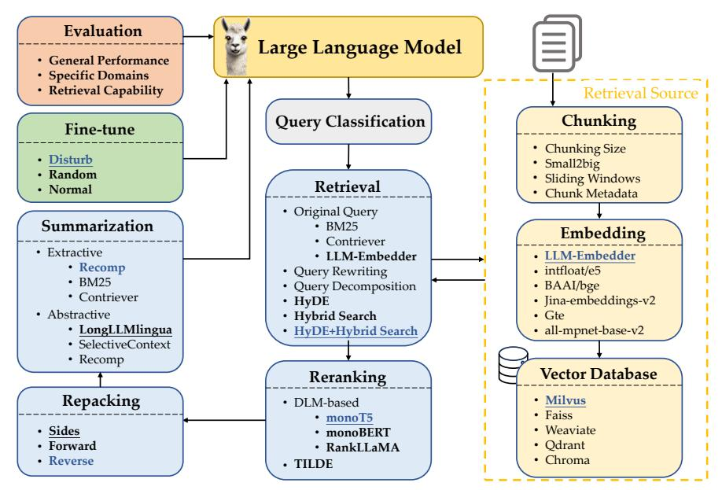
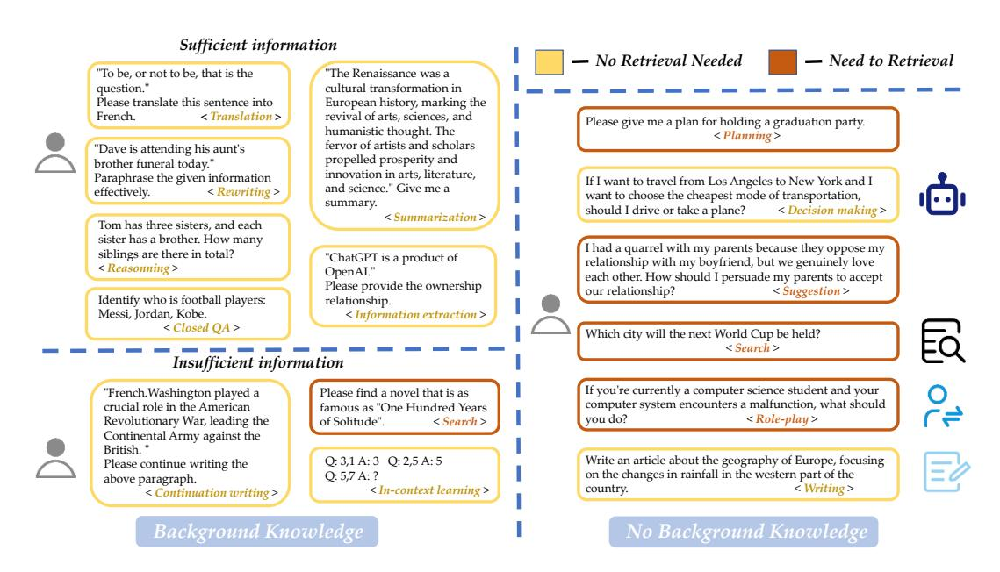
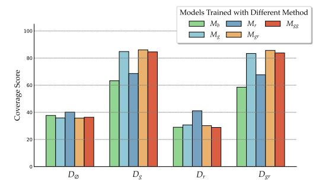

# Searching for Best Practices in Retrieval-Augmented Generation

Xiaohua Wang, Zhenghua Wang, Xuan Gao, Feiran Zhang, Yixin Wu, Zhibo Xu, Tianyuan Shi, Zhengyuan Wang, Shizheng Li, Qi Qian, Ruicheng Yin, Changze Lv, Xiaoqing Zheng[\\*](#page-0-0), Xuanjing Huang School of Computer Science, Fudan University, Shanghai, China Shanghai Key Laboratory of Intelligent Information Processing {xiaohuawang22}@m.fudan.edu.cn {zhengxq,xjhuang}@fudan.edu.cn

#### Abstract

Retrieval-augmented generation (RAG) techniques have proven to be effective in integrating up-to-date information, mitigating hallucinations, and enhancing response quality, particularly in specialized domains. While many RAG approaches have been proposed to enhance large language models through querydependent retrievals, these approaches still suffer from their complex implementation and prolonged response times. Typically, a RAG workflow involves multiple processing steps, each of which can be executed in various ways. Here, we investigate existing RAG approaches and their potential combinations to identify optimal RAG practices. Through extensive experiments, we suggest several strategies for deploying RAG that balance both performance and efficiency. Moreover, we demonstrate that multimodal retrieval techniques can significantly enhance question-answering capabilities about visual inputs and accelerate the generation of multimodal content using a "retrieval as generation" strategy. Code and resources are available at <https://github.com/FudanDNN-NLP/RAG>.

# 1 Introduction

Generative large language models are prone to producing outdated information or fabricating facts, although they were aligned with human preferences by reinforcement learning [\(Ouyang et al.,](#page-11-0) [2022\)](#page-11-0) or lightweight alternatives [\(Liu et al.,](#page-10-0) [2023;](#page-10-0) [Rafailov](#page-11-1) [et al.,](#page-11-1) [2023;](#page-11-1) [Yuan et al.,](#page-12-0) [2023;](#page-12-0) [Zhao et al.,](#page-12-1) [2023b\)](#page-12-1). Retrieval-augmented generation (RAG) techniques address these issues by combining the strengths of pretraining and retrieval-based models, thereby providing a robust framework for enhancing model performance [\(Gao et al.,](#page-9-0) [2023\)](#page-9-0). Furthermore, RAG enables rapid deployment of applications for specific organizations and domains without necessitating updates to the model parameters, as long as query-related documents are provided.

Many RAG approaches have been proposed to enhance large language models (LLMs) through query-dependent retrievals [\(Cai et al.,](#page-9-1) [2022;](#page-9-1) [Gao](#page-9-0) [et al.,](#page-9-0) [2023;](#page-9-0) [Li et al.,](#page-10-1) [2022\)](#page-10-1). A typical RAG workflow usually contains multiple intervening processing steps: query classification (determining whether retrieval is necessary for a given input query), retrieval (efficiently obtaining relevant documents for the query), reranking (refining the order of retrieved documents based on their relevance to the query), repacking (organizing the retrieved documents into a structured one for better generation), summarization (extracting key information for response generation from the repacked document and eliminating redundancies) modules. Implementing RAG also requires decisions on the ways to properly split documents into chunks, the types of embeddings to use for semantically representing these chunks, the choice of vector databases to efficiently store feature representations, and the methods for effectively fine-tuning LLMs (see Figure [1\)](#page-2-0).

What adds complexity and challenge is the variability in implementing each processing step. For example, in retrieving relevant documents for an input query, various methods can be employed. One approach involves rewriting the query first and using the rewritten queries for retrieval [\(Ma et al.,](#page-10-2) [2023a\)](#page-10-2). Alternatively, pseudo-responses to the query can be generated first, and the similarity between these pseudo-responses and the backend documents can be compared for retrieval [\(Gao et al.,](#page-9-2) [2022\)](#page-9-2). Another option is to directly employ embedding models, typically trained in a contrastive manner using positive and negative query-response pairs [\(Wang et al.,](#page-11-2) [2022;](#page-11-2) [Xiao et al.,](#page-11-3) [2023\)](#page-11-3). The techniques chosen for each step and their combinations significantly impact both the effectiveness and efficiency of RAG systems. To the best of our knowledge, there has been no systematic effort to pursue the optimal implementation of RAG, particularly for the entire RAG workflow.

\*Corresponding Author.

In this study, we aim to identify the best practices for RAG through extensive experimentation. Given the infeasibility of testing all possible combinations of these methods, we adopt a three-step approach to identify optimal RAG practices. First, we compare representative methods for each RAG step (or module) and select up to three of the best-performing methods. Next, we evaluate the impact of each method on the overall RAG performance by testing one method at a time for an individual step, while keeping the other RAG modules unchanged. This allows us to determine the most effective method for each step based on its contribution and interaction with other modules during response generation. Once the best method is chosen for a module, it is used in subsequent experiments. Finally, we empirically explore a few promising combinations suitable for different application scenarios where efficiency might be prioritized over performance, or vice versa. Based on these findings, we suggest several strategies for deploying RAG that balance both performance and efficiency.

The contributions of this study are three-fold:

- Through extensive experimentation, we thoroughly investigated existing RAG approaches and their combinations to identify and recommend optimal RAG practices.
- We introduce a comprehensive framework of evaluation metrics and corresponding datasets to comprehensively assess the performance of retrieval-augmented generation models, covering general, specialized (or domain-specific), and RAG-related capabilities.
- We demonstrate that the integration of multimodal retrieval techniques can substantially improve question-answering capabilities on visual inputs and speed up the generation of multimodal content through a strategy of "retrieval as generation".

# 2 Related Work

Ensuring the accuracy of responses generated by Large Language Models (LLMs) such as Chat-GPT [\(OpenAI,](#page-10-3) [2023\)](#page-10-3) and LLaMA [\(Touvron et al.,](#page-11-4) [2023a\)](#page-11-4) is essential. However, simply enlarging model size does not fundamentally address the issue of hallucinations [\(Wang et al.,](#page-11-5) [2023b;](#page-11-5) [Zhang et al.,](#page-12-2) [2023c\)](#page-12-2), especially in knowledgeintensive tasks and specialized domains. Retrievalaugmented generation (RAG) addresses these challenges by retrieving relevant documents from external knowledge bases, providing accurate, real-time, domain-specific context to LLMs [\(Gao et al.,](#page-9-0) [2023\)](#page-9-0). Previous works have optimized the RAG pipeline through query and retrieval transformations, enhancing retriever performance, and fine-tuning both the retriever and generator. These optimizations improve the interaction between input queries, retrieval mechanisms, and generation processes, ensuring the accuracy and relevance of responses.

### 2.1 Query and Retrieval Transformation

Effective retrieval requires queries accurate, clear, and detailed. Even when converted into embeddings, semantic differences between queries and relevant documents can persist. Previous works have explored methods to enhance query information through query transformation, thereby improving retrieval performance. For instance, Query2Doc [\(Wang et al.,](#page-11-6) [2023a\)](#page-11-6) and HyDE [\(Gao](#page-9-2) [et al.,](#page-9-2) [2022\)](#page-9-2) generate pseudo-documents from original queries to enhance retrieval, while TOC [\(Kim](#page-10-4) [et al.,](#page-10-4) [2023\)](#page-10-4) decomposes queries into subqueries, aggregating the retrieved content for final results.

Other studies have focused on transforming retrieval source documents. LlamaIndex [\(Liu,](#page-10-5) [2022\)](#page-10-5) provides an interface to generate pseudo-queries for retrieval documents, improving matching with real queries. Some works employ contrastive learning to bring query and document embeddings closer in semantic space [\(Li et al.,](#page-10-6) [2023;](#page-10-6) [Xiao et al.,](#page-11-3) [2023;](#page-11-3) [Zhang et al.,](#page-12-3) [2023a\)](#page-12-3). Post-processing retrieved documents is another method to enhance generator output, with techniques like hierarchical prompt summarization [\(Jiang et al.,](#page-10-7) [2023a\)](#page-10-7) and using abstractive and extractive compressors [\(Xu et al.,](#page-12-4) [2023\)](#page-12-4) to reduce context length and remove redundancy [\(Wang et al.,](#page-11-7) [2023c\)](#page-11-7).

#### 2.2 Retriever Enhancement Strategy

Document chunking and embedding methods significantly impact retrieval performance. Common chunking strategies divide documents into chunks, but determining optimal chunk length can be challenging. Small chunks may fragment sentences, while large chunks might include irrelevant context. LlamaIndex [\(Liu,](#page-10-5) [2022\)](#page-10-5) optimizes the chunking method like Small2Big and sliding window. Retrieved chunks can be irrelevant and numbers can be large, so reranking is necessary to filter irrelevant documents. A common reranking approach employs deep language models such as BERT [\(Nogueira et al.,](#page-10-8) [2019\)](#page-10-8), T5 [\(Nogueira et al.,](#page-10-9)

Figure 1: Retrieval-augmented generation workflow. This study investigates the contribution of each component and provides insights into optimal RAG practices through extensive experimentation. The optional methods considered for each component are indicated in bold fonts, while the methods underlined indicate the default choice for individual modules. The methods indicated in blue font denote the best-performing selections identified empirically.

[2020\)](#page-10-9), or LLaMA [\(Ma et al.,](#page-10-10) [2023b\)](#page-10-10), which requires slow inference steps during reranking but grants better performance. TILDE [\(Zhuang and](#page-12-5) [Zuccon,](#page-12-5) [2021a](#page-12-5)[,b\)](#page-12-6) achieves efficiency by precomputing and storing the likelihood of query terms, ranking documents based on their sum.

#### 2.3 Retriever and Generator Fine-tuning

Fine-tuning within the RAG framework is crucial for optimizing both retrievers and generators. Some research focuses on fine-tuning the generator to better utilize retriever context [\(Liu et al.,](#page-10-11) [2024b;](#page-10-11) [Luo](#page-10-12) [et al.,](#page-10-12) [2023;](#page-10-12) [Zhang et al.,](#page-12-7) [2024b\)](#page-12-7), ensuring faithful and robust generated content. Others fine-tune the retriever to learn to retrieve beneficial passages for the generator [\(Izacard et al.,](#page-9-3) [2022;](#page-9-3) [Shi et al.,](#page-11-8) [2023;](#page-11-8) [Zhang et al.,](#page-12-8) [2024a\)](#page-12-8). Holistic approaches treat RAG as an integrated system, fine-tuning both retriever and generator together to enhance overall performance [\(Guu et al.,](#page-9-4) [2020;](#page-9-4) [Lin et al.,](#page-10-13) [2023;](#page-10-13) [Zamani and Bendersky,](#page-12-9) [2024\)](#page-12-9), despite increased complexity and integration challenges.

Several surveys have extensively discussed current RAG systems, covering aspects like text generation [\(Cai et al.,](#page-9-1) [2022;](#page-9-1) [Li et al.,](#page-10-1) [2022\)](#page-10-1), integration with LLMs [\(Gao et al.,](#page-9-0) [2023;](#page-9-0) [Huang and Huang,](#page-9-5) [2024\)](#page-9-5), multimodal [\(Zhao et al.,](#page-12-10) [2023a\)](#page-12-10), and AIgenerated content [\(Zhao et al.,](#page-12-11) [2024\)](#page-12-11). While these surveys provide comprehensive overviews of existing RAG methodologies, selecting the appropriate algorithm for practical implementation remains

challenging. In this paper, we focus on best practices for applying RAG methods, advancing the understanding and application of RAG in LLMs.

# 3 RAG Workflow

In this section, we detail the components of the RAG workflow. For each module, we review commonly used approaches and select the default and alternative methods for our final pipeline. Section [4](#page-6-0) will discuss best practices. Figure [1](#page-2-0) presents the workflow and methods for each module. Detailed experimental setups, including datasets, hyperparameters, and results are provided in Appendix [A.](#page-13-0)

#### 3.1 Query Classification

Not all queries require to be retrieval-augmented due to the inherent capabilities of LLMs. While RAG can enhance information accuracy and reduce hallucinations, frequent retrieval costs longer response time. Therefore, we begin by classifying queries to determine retrieval necessity. Queries requiring retrieval proceed through the RAG modules; others are handled directly by LLMs.

Retrieval is generally recommended when knowledge beyond the model's parameters is needed. However, the need for retrieval varies by task. For instance, an LLM trained up to 2023 can handle a translation request for "Sora was developed by OpenAI" without retrieval. Conversely, an introduction request for the same topic would require retrieval to provide relevant information.

To address this issue, we propose classifying tasks by type to determine if a query needs retrieval. We categorize 15 tasks based on whether they provide sufficient information, with specific tasks and examples illustrated in Figure [2.](#page-14-0) For tasks entirely based on user-given information, we denote as "sufficient", which need not retrieval; otherwise, we denote as "insufficient", where retrieval may be necessary. We created a dataset consisting of 111K samples covering 15 different types of tasks, with 64K samples labeled as "retrieval required" and 47K samples as "no retrieval required". A classifier was trained to automate this decision-making process. Specific experimental results are presented in Appendix [A.1.](#page-13-1) Section [4](#page-6-0) explores the impact of query classification on the workflow, comparing scenarios with and without classification.

#### 3.2 Chunking

Chunking documents into smaller segments is crucial for enhancing retrieval precision and avoiding length issues in LLMs. This process can be applied at various levels of granularity, such as token, sentence, and semantic levels.

- Token-level Chunking is straightforward but may split sentences, affecting retrieval quality.
- Semantic-level Chunking uses LLMs to determine breakpoints, context-preserving but timeconsuming.
- Sentence-level Chunking balances preserving text semantics with simplicity and efficiency.

In this study, we use sentence-level chunking, balancing simplicity and semantic preservation. We examine chunking from four dimensions:

Chunk Size Chunk size significantly impacts performance. Larger chunks provide more context, enhancing comprehension but increasing process time. Smaller chunks improve retrieval recall and reduce time but may lack sufficient context.

Chunking Techniques Advanced techniques such as small-to-big and sliding window improve retrieval quality by organizing chunk block relationships. Small-sized blocks are used to match queries, and larger blocks that include the small ones along with contextual information are returned.

Metadata Addition Enhancing chunk blocks with metadata like titles, keywords, and hypothetical questions can improve retrieval, provide more ways to post-process retrieved texts, and help LLMs better understand retrieved information.

Embedding Model Choosing the right embedding model is crucial for effective semantic matching of queries and chunk blocks. Based on the evaluation module of FlagEmbedding[1](#page-3-0) , we select the LLM-Embedder [\(Zhang et al.,](#page-12-3) [2023a\)](#page-12-3) for its balance of performance and size.

A detailed study on metadata inclusion will be addressed in future work. Further discussion on chunk size influence, advanced chunking techniques, and comparative experiments on different embedding models are presented in Appendix [A.2.](#page-13-2)

#### 3.3 Vector Databases

Vector databases store embedding vectors with their metadata, enabling efficient retrieval of documents relevant to queries through various indexing and approximate nearest neighbor (ANN) methods.

To select an appropriate vector database for our research, we evaluated several options based on four key criteria: multiple index types, billion-scale vector support, hybrid search, and cloud-native capabilities. These criteria were chosen for their impact on flexibility, scalability, and ease of deployment in modern, cloud-based infrastructures. Multiple index types provide the flexibility to optimize searches based on different data characteristics and use cases. Billion-scale vector support is crucial for handling large datasets in LLM applications. Hybrid search combines vector search with traditional keyword search, enhancing retrieval accuracy. Finally, cloud-native capabilities ensure seamless integration, scalability, and management in cloud environments. Table [6](#page-14-1) presents a detailed comparison of five open-source vector databases: Weaviate, Faiss, Chroma, Qdrant, and Milvus.

Our evaluation indicates that Milvus stands out as the most comprehensive solution among the databases evaluated, meeting all the essential criteria and outperforming other open-source options.

# 3.4 Retrieval Methods

Given a user query, the retrieval module selects the top-k relevant documents from a pre-built corpus based on the similarity between the query and the documents. The generation model then uses these documents to formulate an appropriate response to the query. However, original queries often underperform due to poor expression and lack of semantic information [\(Gao et al.,](#page-9-0) [2023\)](#page-9-0), negatively impacting the retrieval process. To address these issues, we evaluated three query transformation

1 <https://github.com/FlagOpen/FlagEmbedding>

methods using the LLM-Embedder recommended in Section [3.2](#page-3-1) as the query and document encoder:

- Query Rewriting: Query rewriting refines queries to better match relevant documents. Inspired by the Rewrite-Retrieve-Read framework [\(Ma et al.,](#page-10-2) [2023a\)](#page-10-2), we prompt an LLM to rewrite queries to enhance performance.
- Query Decomposition: This approach involves retrieving documents based on sub-questions derived from the original query, which is more complex to comprehend and handle.
- Pseudo-documents Generation: This approach generates a hypothetical document based on the user query and uses the embedding of hypothetical answers to retrieve similar documents. One notable implement is HyDE [\(Gao et al.,](#page-9-2) [2022\)](#page-9-2),

Recent studies, such as [Sawarkar et al.](#page-11-9) [\(2024\)](#page-11-9), indicate that combining lexical-based search with vector search significantly enhances performance. In this study, we use BM25 for sparse retrieval and Contriever[\(Izacard et al.,](#page-9-6) [2021\)](#page-9-6), an unsupervised contrastive encoder, for dense retrieval, serving as two robust baselines based on [Thakur et al.](#page-11-10) [\(2021\)](#page-11-10).

We evaluated the performance of different search methods on the TREC DL 2019 and 2020 passage ranking datasets. The results presented in Table [7](#page-15-0) show that supervised methods significantly outperformed unsupervised methods. Combining with HyDE and hybrid search, LLM-Embedder achieves the highest scores. However, query rewriting and query decomposition did not enhance retrieval performance as effectively. Considering the best performance and tolerated latency, we recommend Hybrid Search with HyDE as the default retrieval method. Taking efficiency into consideration, Hybrid Search combines sparse retrieval (BM25) and dense retrieval (Original embedding) and achieves notable performance with relatively low latency. Additional implementation details and experiments on the HyDE and hyperparameters of hybrid search are presented in Appendix [A.3.](#page-14-2)

# 3.5 Reranking Methods

After initial retrieval, a reranking phase is employed to further enhance the relevancy of the retrieved documents, ensuring that the most pertinent information appears on top. By leveraging more precise methods, documents are reordered more effectively, increasing the similarity between the query and the top-ranked documents.

We consider two approaches in our reranking module: DLM Reranking, which utilizes classification, and TILDE Reranking, which focuses on query likelihoods. These approaches prioritize performance and efficiency, respectively.

- DLM Reranking: Rerankers utilizing deep language models (DLMs) [\(Ma et al.,](#page-10-10) [2023b;](#page-10-10) [Nogueira et al.,](#page-10-9) [2020,](#page-10-9) [2019\)](#page-10-8) are a representative method, generally providing the best performance, albeit with reduced efficiency. Models are fine-tuned to predict the target tokens "true" or "false" based on the relevancy of the user query and candidate document. The model is fine-tuned with the query and document concatenated as input, labeled accordingly. At inference, documents are then ranked by the probability of the "true" token for each query.
- TILDE Reranking: Conventional query likelihood models [\(Santos et al.,](#page-11-11) [2020;](#page-11-11) [Zhuang et al.,](#page-12-12) [2021\)](#page-12-12) calculate conditional probabilities of query terms based on the likelihoods of its preceding tokens, but lack efficiency. TILDE [\(Zhuang and](#page-12-5) [Zuccon,](#page-12-5) [2021a](#page-12-5)[,b\)](#page-12-6) instead independently considers each query term and predicts the probabilities of tokens across the entire vocabulary. With the candidate documents preprocessed at indexing, rapid reranking can be done by summing the pre-calculated log probabilities corresponding to the query tokens for each document. TILDEv2 further enhances efficiency and greatly reduces index size by indexing only document-present tokens, using NCE loss, and document expansion.

Our experiments were conducted on the MS MARCO Passage ranking dataset [\(Bajaj et al.,](#page-9-7) [2016\)](#page-9-7). We followed and made modifications to the implementation provided by PyGaggle [\(Nogueira](#page-10-9) [et al.,](#page-10-9) [2020\)](#page-10-9) and TILDE, using the models monoT5, monoBERT, RankLLaMA and TILDEv2. Reranking results are shown in Table [10.](#page-17-0) We recommend monoT5 as a comprehensive method balancing performance and efficiency. RankLLaMA is suitable for achieving the best performance, while TILDEv2 is ideal for the quickest experience on a fixed collection. Details on the experimental setup and results are presented in Appendix [A.4.](#page-15-1)

#### 3.6 Document Repacking

The performance of subsequent processes, such as LLM response generation, may be affected by the order documents are provided. To address this issue, we incorporate a compact repacking module into the workflow after reranking, featuring three repacking methods: "forward", "reverse" and "sides". "Forward" repacks documents by descending the relevancy scores from the reranking phase, whereas "reverse" arranges them in ascending order. Inspired by [\(Liu et al.,](#page-10-14) [2024a\)](#page-10-14), which concluded that optimal performance is achieved when relevant information is placed at the head or tail of the input, we also include a "sides" option.

As the repacking method utilized primarily affects subsequent modules, we select the best repacking method in Section [4](#page-6-0) by testing it in combination with other modules. Here, we choose "sides" as the default repacking method.

#### 3.7 Summarization

Retrieval results may contain redundant or unnecessary information, potentially preventing LLMs from generating accurate responses. Additionally, long prompts can slow down the inference process. Therefore, efficient methods to summarize retrieved documents are crucial in the RAG pipeline.

Summarization tasks can be extractive or abstractive. Extractive methods segment text into sentences, then score and rank them based on importance. Abstractive compressors synthesize information from multiple documents to rephrase and generate a cohesive summary. These tasks can be query-based or non-query-based. In this paper, as RAG retrieves information relevant to queries, we focus exclusively on query-based methods.

- Recomp: Recomp [\(Xu et al.,](#page-12-4) [2023\)](#page-12-4) has extractive and abstractive compressors. The extractive compressor selects useful sentences, while the abstractive compressor synthesizes information from multiple documents.
- LongLLMLingua: LongLLMLingua [\(Jiang](#page-10-15) [et al.,](#page-10-15) [2023b\)](#page-10-15) improves LLMLingua by focusing on key information related to the query.

We evaluate these methods on three benchmark datasets: NQ, TriviaQA, and HotpotQA. Comparative results of different summarization methods are shown in Table [11.](#page-17-1) We recommend Recomp for its outstanding performance. LongLLMLingua does not perform well but demonstrates better generalization capabilities as it was not trained on these experimental datasets. Therefore, we consider it as an alternative method. Additional implementation details and discussions on non-query-based methods are provided in Appendix [A.5.](#page-16-0)

#### 3.8 Generator Fine-tuning

In this section, we focus on fine-tuning the generator while leaving retriever fine-tuning for future

exploration. We aim to investigate the impact of fine-tuning, particularly the influence of relevant or irrelevant contexts on the generator's performance.

Formally, we denote x as the query fed into the RAG system, and D as the contexts for this input. The fine-tuning loss of the generator is the negative log-likelihood of the ground-truth output y.

To explore the impact of fine-tuning, especially relevant and irrelevant contexts, we define dgold as a context relevant to the query, and drandom as a randomly retrieved context. We train the model by varying the composition of D as follows:

- Dg: The augmented context consists of queryrelevant documents, denoted as Dg = {dgold}.
- Dr: The context contains one randomly sampled document, denoted as Dr = {drandom}.
- Dgr: The augmented context comprises a relevant document and a randomly-selected one, denoted as Dgr = {dgold, drandom}.
- Dgg: The augmented context consists of two copies of a query-relevant document, denoted as Dgg = {dgold, dgold}.

We denote the base LM generator not fine-tuned as Mb , and the model fine-tuned under the corresponding D as Mg, Mr, Mgr, Mgg. We finetuned our model on several QA and reading comprehension datasets. Ground-truth coverage is used as our evaluation metric since QA task answers are relatively short. Specifically, we adopted a more lenient approach to the Exact Match (EM) score, which evaluates the performance based on the presence of the gold response in the model's output. We select Llama-2-7B [\(Touvron et al.,](#page-11-12) [2023b\)](#page-11-12) as the base model. Similar to training, we evaluate all trained models on validation sets with Dg, Dr, Dgr, and D∅, where D∅ indicates inference without retrieval. Figure [3](#page-17-2) presents our main results. Models trained with a mix of relevant and random documents (Mgr) perform best when provided with either gold or mixed contexts. This suggests that mixing relevant and random contexts during training can enhance the generator's robustness to irrelevant information while ensuring effective utilization of relevant contexts. Therefore, we identify the practice of augmenting with a few relevant and randomly-selected documents during training as the best approach. Detailed dataset information, hyperparameters and experimental results can be found in Appendix [A.6.](#page-16-1)

#### 4 Searching for Best RAG Practices

In the following section, we investigate the optimal practices for implementing RAG. To begin with, we used the default practice identified in Section [3](#page-2-1) for each module. Following the workflow depicted in Figure [1,](#page-2-0) we sequentially optimized individual modules and selected the most effective option among alternatives. This iterative process continued until we determined the best method for implementing the final summarization module. Based on Section [3.8,](#page-5-0) we used the Llama2-7B-Chat model fine-tuned where each query was augmented by a few random-selected and relevant documents as the generator. We used Milvus to build a vector database that includes 10 million text of English Wikipedia and 4 million text of medical data. We also investigated the impact of removing the Query Classification, Reranking, and Summarization modules to assess their contributions.

#### 4.1 Comprehensive Evaluation

We conducted extensive experiments across various NLP tasks and datasets to assess the performance of RAG systems. Specifically: (I) Commonsense Reasoning; (II) Fact Checking; (III) Open-Domain QA; (IV) MultiHop QA; (V) Medical QA. For further details on the tasks and their corresponding datasets, please refer to Appendix [A.7.](#page-17-3) Furthermore, we evaluated the RAG capabilities on subsets extracted from these datasets, employing the metrics recommended in RAGAs [\(Shahul et al.,](#page-11-13) [2023\)](#page-11-13), including Faithfulness, Context Relevancy, Answer Relevancy, and Answer Correctness. Additionally, we measured Retrieval Similarity by computing the cosine similarity between retrieved documents and gold documents.

We used accuracy as the evaluation metric for the tasks of Commonsense Reasoning, Fact Checking, and Medical QA. For Open-Domain QA and Multihop QA, we employed token-level F1 score and Exact Match (EM) score. The final RAG score was calculated by averaging the aforementioned five RAG capabilities. Consistently, the same corpus constructed in Section [3](#page-2-1) was used for all tasks. We followed [Trivedi et al.](#page-11-14) [\(2022\)](#page-11-14) and sub-sampled up to 500 examples from each dataset.

#### 4.2 Results and Analysis

Based on the experimental results presented in Table [1,](#page-7-0) the following key insights emerge:

• Query Classification Module: This module is crucial for both effectiveness and efficiency, lead-

- ing to an average improvement in the overall score from 0.428 to 0.443 and a reduction in latency time from 16.41 to 11.58 seconds per query. The query classification method distinguishes between queries that require retrieval operations and those that do not, based on the completeness of information within the queries. This selective retrieval strategy avoids unnecessary operations, significantly enhancing both performance and response time.
- Retrieval Module: The combination of dense retrieval and the classical BM25 algorithm demonstrates superior performance due to their complementary strengths. While dense retrieval excels at identifying semantic relationships (e.g., linking terms like "bad guy" and "villain"), it struggles with rare terminologies and out-ofvocabulary (OOV) words. BM25, however, is adept at matching specific terms, compensating for these weaknesses. This hybrid approach balances the strengths of both methods, enhancing retrieval robustness. Moreover, the use of generated pseudo-documents minimizes semantic mismatches between the query and relevant documents. While the "Hybrid with HyDE" method achieved the highest RAG score of 0.58, it came at a computational cost of 11.71 seconds per query. In practice, the "Hybrid" or "Original" methods are recommended, as they maintain comparable performance with reduced latency.
- Reranking Module: Reranking is critical to maintaining high-quality results, as demonstrated by a performance drop in its absence. Among DLM-based rerankers, monoT5 significantly outperformed monoBERT and RankLLaMA. This superiority can be attributed to monoT5's larger parameter set and more extensive training data, as well as its encoder-decoder architecture, which provides enhanced natural language understanding compared to the decoder-only LLaMA model. MonoT5's effectiveness in boosting the relevance of retrieved documents affirms the necessity of reranking in improving the quality of generated responses.
- Repacking Module: The Reverse configuration exhibited superior performance, achieving an RAG score of 0.560. This highlights the importance of positioning more relevant context closer to the query to yield optimal results.
- Summarization Module: The Recomp extractive summarization method demonstrated superior performance over LongLLMLingua, an ab-

| Method                                                           | Commonsense Fact Check                                                       |       | ODQA |    | Multihop                                                    |    | Med RAG |       | Avg. |   |             |    |         |
|------------------------------------------------------------------|------------------------------------------------------------------------------|-------|------|----|-------------------------------------------------------------|----|---------|-------|------|---|-------------|----|---------|
|                                                                  | Acc                                                                          | Acc   | EM   | F1 | Score                                                       | EM | F1      | Score | Acc  |   | Score Score | F1 | Latency |
| without retrieval                                                |                                                                              |       |      |    |                                                             |    |         |       |      |   |             |    |         |
| + baseline                                                       | 0.537                                                                        | 0.560 |      |    | 0.373 0.413 0.428 0.167 0.173 0.182 0.360                   |    |         |       |      | - | 0.351 0.292 |    | 1.27    |
|                                                                  | classification module , Hybrid with HyDE, monoT5, sides, Recomp              |       |      |    |                                                             |    |         |       |      |   |             |    |         |
| w/o classification                                               | 0.719                                                                        | 0.505 |      |    | 0.391 0.450 0.478 0.212 0.255 0.254 0.528 0.540 0.422 0.353 |    |         |       |      |   |             |    | 16.58   |
| + classification                                                 | 0.727                                                                        | 0.595 |      |    | 0.393 0.450 0.479 0.207 0.257 0.254 0.460 0.580 0.443 0.353 |    |         |       |      |   |             |    | 11.71   |
| with classification, retrieval module , monoT5, sides, Recomp |                                                                              |       |      |    |                                                             |    |         |       |      |   |             |    |         |
| + HyDE                                                           | 0.718                                                                        | 0.595 |      |    | 0.320 0.373 0.380 0.170 0.213 0.222 0.400 0.545 0.398 0.293 |    |         |       |      |   |             |    | 11.58   |
| + Original                                                       | 0.721                                                                        | 0.585 |      |    | 0.300 0.350 0.363 0.153 0.197 0.206 0.390 0.486 0.383 0.273 |    |         |       |      |   |             |    | 1.44    |
| + Hybrid                                                         | 0.718                                                                        | 0.595 |      |    | 0.347 0.397 0.418 0.190 0.240 0.233 0.750 0.498 0.429 0.318 |    |         |       |      |   |             |    | 1.45    |
| + Hybrid + HyDE                                                  | 0.727                                                                        | 0.595 |      |    | 0.393 0.450 0.479 0.207 0.257 0.254 0.460 0.580 0.443 0.353 |    |         |       |      |   |             |    | 11.71   |
|                                                                  | with classification, Hybrid with HyDE, reranking module , sides, Recomp      |       |      |    |                                                             |    |         |       |      |   |             |    |         |
| w/o reranking                                                    | 0.720                                                                        | 0.591 |      |    | 0.365 0.429 0.435 0.211 0.260 0.253 0.512 0.530 0.430 0.334 |    |         |       |      |   |             |    | 10.31   |
| + monoT5                                                         | 0.727                                                                        | 0.595 |      |    | 0.393 0.450 0.479 0.207 0.257 0.253 0.460 0.580 0.443 0.353 |    |         |       |      |   |             |    | 11.71   |
| + monoBERT                                                       | 0.723                                                                        | 0.593 |      |    | 0.383 0.443 0.463 0.217 0.259 0.253 0.482 0.551 0.438 0.351 |    |         |       |      |   |             |    | 11.65   |
| + RankLLaMA                                                      | 0.723                                                                        | 0.597 |      |    | 0.382 0.443 0.459 0.197 0.240 0.237 0.454 0.558 0.431 0.342 |    |         |       |      |   |             |    | 13.51   |
| + TILDEv2                                                        | 0.725                                                                        | 0.588 |      |    | 0.394 0.456 0.473 0.209 0.255 0.249 0.486 0.536 0.440 0.355 |    |         |       |      |   |             |    | 11.26   |
|                                                                  | with classification, Hybrid with HyDE, monoT5, repacking module , Recomp     |       |      |    |                                                             |    |         |       |      |   |             |    |         |
| + sides                                                          | 0.727                                                                        | 0.595 |      |    | 0.393 0.450 0.479 0.207 0.257 0.253 0.460 0.580 0.443 0.353 |    |         |       |      |   |             |    | 11.71   |
| + forward                                                        | 0.722                                                                        | 0.599 |      |    | 0.379 0.437 0.458 0.215 0.260 0.254 0.472 0.542 0.437 0.349 |    |         |       |      |   |             |    | 11.68   |
| + reverse                                                        | 0.728                                                                        | 0.592 |      |    | 0.387 0.445 0.473 0.219 0.263 0.260 0.532 0.560 0.446 0.354 |    |         |       |      |   |             |    | 11.70   |
|                                                                  | with classification, Hybrid with HyDE, monoT5, reverse, summarization module |       |      |    |                                                             |    |         |       |      |   |             |    |         |
| w/o summarization                                                | 0.729                                                                        | 0.591 |      |    | 0.402 0.457 0.468 0.205 0.252 0.245 0.528 0.533 0.441 0.355 |    |         |       |      |   |             |    | 10.97   |
| + Recomp                                                         | 0.728                                                                        | 0.592 |      |    | 0.387 0.445 0.473 0.219 0.263 0.260 0.532 0.560 0.446 0.354 |    |         |       |      |   |             |    | 11.70   |
| + LongLLMLingua                                                  | 0.713                                                                        | 0.581 |      |    | 0.362 0.423 0.432 0.199 0.245 0.245 0.530 0.539 0.426 0.334 |    |         |       |      |   |             |    | 16.17   |

Table 1: Results of the search for optimal RAG practices. Modules enclosed in a boxed module are under investigation to determine the best method. The underlined method represents the selected implementation. For the two QA tasks, ODQA and MultiHop, we use GPT to score them simultaneously. The "Avg" (average score) is calculated based on the Acc, EM, and RAG scores for all tasks, while the average latency is measured in seconds per query. The best scores are highlighted in bold.

stractive summarization method. Our experiments revealed that LongLLMLingua occasionally distorts semantics and produces incoherent content due to its rewriting approach. Recomp, on the other hand, preserves the integrity of the original content, making it better suited for RAG applications. Although comparable results can be achieved with lower latency by removing the summarization module, Recomp remains the preferred choice for scenarios where addressing the generator's maximum length constraint is crucial. In time-sensitive applications, removing summarization could effectively reduce response time.

The experimental results demonstrate that each module contributes uniquely to the overall performance of the RAG system. The query classification module enhances accuracy and reduces latency, while the retrieval and reranking modules significantly improve the system's ability to handle diverse queries. The repacking and summarization modules further refine the system's output, ensuring high-quality responses across different tasks.

#### 5 Discussion

#### 5.1 Best Practices for Implementing RAG

According to our experimental findings, we suggest two distinct recipes or practices for implementing RAG systems, each customized to address specific requirements: one focusing on maximizing performance, and the other on striking a balance between efficiency and efficacy.

Best Performance Practice: To achieve the highest performance, it is recommended to incorporate query classification module, use the "Hybrid with HyDE" method for retrieval, employ monoT5 for reranking, opt for Reverse for repacking, and leverage Recomp for summarization. This configuration yielded the highest average score of 0.483, albeit with a computationally-intensive process.

Balanced Efficiency Practice: To achieve a balance between performance and efficiency, it is recommended to incorporate the query classification

module, implement the Hybrid method for retrieval, use TILDEv2 for reranking, opt for Reverse for repacking, and employ Recomp for summarization. Given that the retrieval module accounts for the majority of processing time in the system, transitioning to the Hybrid method while keeping other modules unchanged can substantially reduce latency while preserving a comparable performance.

#### 5.2 Generalization of Best Practices

While the above best practices demonstrate strong performance in our experiments, we acknowledge that they may not be universally optimal across all tasks and contexts. Therefore, we emphasize the importance of the comprehensive evaluation framework, which assesses system performance across general, domain-specific, and task-specific capabilities, and the three-step strategy to identify the most effective practices:

- Empirical Comparison of Candidate Implementations: For each module, we compare multiple candidate methods to determine the bestperforming options.
- Module Integration: After selecting the optimal method for each module, we evaluate how they interact when integrated into the full workflow.
- Evaluation of Module Combinations: Finally, we assess the performance of different module combinations to identify opportunities for improving system efficiency and effectiveness.

# 5.3 Multimodal Extension

We have extended RAG to multimodal applications. Specifically, we have incorporated text2image and image2text retrieval capabilities into the system with a substantial collection of paired image and textual descriptions as a retrieval source. As depicted in Figure [4,](#page-19-0) the text2image capability speeds up the image generation process when a user query aligns well with the textual descriptions of stored images (i.e., "retrieval as generation" strategy), while the image2text functionality comes into play when a user provides an image and engages in conversation about the input image. These multimodal RAG capabilities offer the following advantages:

• Groundedness: Retrieval methods provide information from verified multimodal materials, thereby ensuring authenticity and specificity. In contrast, on-the-fly generation relies on models to generate new content, which can occasionally result in factual errors or inaccuracies.

- Efficiency: Retrieval methods are typically more efficient, especially when the answer already exists in stored materials. Conversely, generation methods may require more computational resources to produce new content, particularly for images or lengthy texts.
- Maintainability: Generation models often necessitate careful fine-tuning to tailor them for new applications. In contrast, retrieval-based methods can be improved to address new demands by simply enlarging the size and enhancing the quality of retrieval sources.

We adopted the experimental setup from [\(Koh](#page-10-16) [et al.,](#page-10-16) [2024\)](#page-10-16). Specifically, we used the PartiPrompts dataset to prompt the stable diffusion model to generate images and to retrieve images from the CC3M dataset. We then use the openai/clip-vit-largepatch14[2](#page-8-0) to compute CLIP Similarity between the prompts and both types of images (PRO2GEN and PRO2RET) and compute consumed time in both methods. The figure [5](#page-20-0) represents Groundedness of the "retrieval as generation" strategy, as the generation model is uncontrollable and may lack relevant knowledge. As demonstrated in Table [15,](#page-20-1) the "retrieval as generation" strategy greatly reduces time consumption while maintaining the quality of the images and we can improve the performance of retrieval by expanding the search sources which demonstrates the Efficiency and Maintainability of this strategy.

Furthermore, we plan to broaden the application of this strategy to include other modalities, such as video and speech, while also exploring efficient and effective cross-modal retrieval techniques.

## 6 Conclusion

In this study, we aim to identify optimal practices for implementing retrieval-augmented generation in order to improve the quality and reliability of content produced by large language models. We systematically assessed a range of potential solutions for each module within the RAG framework and recommended the most effective approach for each module. Furthermore, we introduced a comprehensive evaluation benchmark for RAG systems and conducted extensive experiments to determine the best practices among various alternatives. Our findings not only contribute to a deeper understanding of retrieval-augmented generation systems but also establish a foundation for future research.

2 https://huggingface.co/openai/clip-vit-large-patch14

# Limitations

We have evaluated the impact of various methods for fine-tuning LLM generators. Previous studies have demonstrated the feasibility of training both the retriever and generator jointly. We would like to explore this possibility in the future. In this study, we embraced the principle of modular design to simplify the search for optimal RAG implementations, thereby reducing complexity. Due to the daunting costs associated with constructing vector databases and conducting experiments, our evaluation was limited to investigating the effectiveness and influence of representative chunking techniques within the chunking module. It would be intriguing to further explore the impact of different chunking techniques on the entire RAG systems. While we have discussed the application of RAG in the domain of NLP and extended its scope to image generation, an enticing avenue for future exploration would involve expanding this research to other modalities such as speech and video.

#### References

- Akari Asai, Zeqiu Wu, Yizhong Wang, Avirup Sil, and Hannaneh Hajishirzi. 2023. Self-rag: Learning to retrieve, generate, and critique through self-reflection. *arXiv preprint arXiv:2310.11511*.
- Payal Bajaj, Daniel Campos, Nick Craswell, Li Deng, Jianfeng Gao, Xiaodong Liu, Rangan Majumder, Andrew McNamara, Bhaskar Mitra, Tri Nguyen, et al. 2016. Ms marco: A human generated machine reading comprehension dataset. *arXiv preprint arXiv:1611.09268*.
- Jonathan Berant, Andrew Chou, Roy Frostig, and Percy Liang. 2013. Semantic parsing on freebase from question-answer pairs. *Empirical Methods in Natural Language Processing,Empirical Methods in Natural Language Processing*.
- Deng Cai, Yan Wang, Lemao Liu, and Shuming Shi. 2022. Recent advances in retrieval-augmented text generation. In *Proceedings of the 45th international ACM SIGIR conference on research and development in information retrieval*, pages 3417–3419.
- Peter Clark, Isaac Cowhey, Oren Etzioni, Tushar Khot, Ashish Sabharwal, Carissa Schoenick, and Oyvind Tafjord. 2018. [Think you have solved question an](https://api.semanticscholar.org/CorpusID:3922816)[swering? try arc, the ai2 reasoning challenge.](https://api.semanticscholar.org/CorpusID:3922816) *ArXiv*, abs/1803.05457.
- Mike Conover, Matt Hayes, Ankit Mathur, Jianwei Xie, Jun Wan, Sam Shah, Ali Ghodsi, Patrick Wendell, Matei Zaharia, and Reynold Xin. 2023. [Free dolly:](https://www.databricks.com/blog/2023/04/12/dolly-first-open-commercially-viable-instruction-tuned-llm) [Introducing the world's first truly open instruction](https://www.databricks.com/blog/2023/04/12/dolly-first-open-commercially-viable-instruction-tuned-llm)[tuned llm.](https://www.databricks.com/blog/2023/04/12/dolly-first-open-commercially-viable-instruction-tuned-llm)

- Nick Craswell, Bhaskar Mitra, Emine Yilmaz, Daniel Fernando Campos, and Ellen M. Voorhees. 2020. [Overview of the trec 2019 deep learning track.](https://api.semanticscholar.org/CorpusID:253234683) *ArXiv*, abs/2003.07820.
- Nick Craswell, Bhaskar Mitra, Emine Yilmaz, Daniel Fernando Campos, and Ellen M. Voorhees. 2021. [Overview of the trec 2020 deep learning track.](https://api.semanticscholar.org/CorpusID:212737158) *ArXiv*, abs/2102.07662.
- Luyu Gao, Xueguang Ma, Jimmy Lin, and Jamie Callan. 2022. Precise zero-shot dense retrieval without relevance labels. *arXiv preprint arXiv:2212.10496*.
- Yunfan Gao, Yun Xiong, Xinyu Gao, Kangxiang Jia, Jinliu Pan, Yuxi Bi, Yi Dai, Jiawei Sun, and Haofen Wang. 2023. Retrieval-augmented generation for large language models: A survey. *arXiv preprint arXiv:2312.10997*.
- Michael Günther, Jackmin Ong, Isabelle Mohr, Alaeddine Abdessalem, Tanguy Abel, Mohammad Kalim Akram, Susana Guzman, Georgios Mastrapas, Saba Sturua, Bo Wang, et al. 2023. Jina embeddings 2: 8192-token general-purpose text embeddings for long documents. *arXiv preprint arXiv:2310.19923*.
- Kelvin Guu, Kenton Lee, Zora Tung, Panupong Pasupat, and Ming-Wei Chang. 2020. Realm: Retrievalaugmented language model pre-training. *ArXiv*, abs/2002.08909.
- Dan Hendrycks, Collin Burns, Steven Basart, Andy Zou, Mantas Mazeika, Dawn Song, and Jacob Steinhardt. 2020. Measuring massive multitask language understanding. *Cornell University - arXiv,Cornell University - arXiv*.
- Xanh Ho, A. Nguyen, Saku Sugawara, and Akiko Aizawa. 2020. [Constructing a multi-hop qa dataset](https://api.semanticscholar.org/CorpusID:226236740) [for comprehensive evaluation of reasoning steps.](https://api.semanticscholar.org/CorpusID:226236740) *ArXiv*, abs/2011.01060.
- J. Edward Hu, Yelong Shen, Phillip Wallis, Zeyuan Allen-Zhu, Yuanzhi Li, Shean Wang, and Weizhu Chen. 2021. Lora: Low-rank adaptation of large language models. *ArXiv*, abs/2106.09685.
- Yizheng Huang and Jimmy Huang. 2024. A survey on retrieval-augmented text generation for large language models. *arXiv preprint arXiv:2404.10981*.
- Gautier Izacard, Mathilde Caron, Lucas Hosseini, Sebastian Riedel, Piotr Bojanowski, Armand Joulin, and Edouard Grave. 2021. Unsupervised dense information retrieval with contrastive learning. *arXiv preprint arXiv:2112.09118*.
- Gautier Izacard, Patrick Lewis, Maria Lomeli, Lucas Hosseini, Fabio Petroni, Timo Schick, Jane A. Yu, Armand Joulin, Sebastian Riedel, and Edouard Grave. 2022. Few-shot learning with retrieval augmented language models. *ArXiv*, abs/2208.03299.

- Huiqiang Jiang, Qianhui Wu, Chin-Yew Lin, Yuqing Yang, and Lili Qiu. 2023a. Llmlingua: Compressing prompts for accelerated inference of large language models. *arXiv preprint arXiv:2310.05736*.
- Huiqiang Jiang, Qianhui Wu, Xufang Luo, Dongsheng Li, Chin-Yew Lin, Yuqing Yang, and Lili Qiu. 2023b. Longllmlingua: Accelerating and enhancing llms in long context scenarios via prompt compression. *arXiv preprint arXiv:2310.06839*.
- Qiao Jin, Bhuwan Dhingra, Zhengping Liu, William W. Cohen, and Xinghua Lu. 2019. [Pubmedqa: A dataset](https://api.semanticscholar.org/CorpusID:202572622) [for biomedical research question answering.](https://api.semanticscholar.org/CorpusID:202572622) In *Conference on Empirical Methods in Natural Language Processing*.
- Mandar Joshi, Eunsol Choi, Daniel S. Weld, and Luke Zettlemoyer. 2017. Triviaqa: A large scale distantly supervised challenge dataset for reading comprehension. *ArXiv*, abs/1705.03551.
- Gangwoo Kim, Sungdong Kim, Byeongguk Jeon, Joonsuk Park, and Jaewoo Kang. 2023. Tree of clarifications: Answering ambiguous questions with retrievalaugmented large language models. *arXiv preprint arXiv:2310.14696*.
- Tomáš Kocisk ˇ y, Jonathan Schwarz, Phil Blunsom, Chris ` Dyer, Karl Moritz Hermann, Gábor Melis, and Edward Grefenstette. 2018. The narrativeqa reading comprehension challenge. *Transactions of the Association for Computational Linguistics*, 6:317–328.
- Jing Yu Koh, Daniel Fried, and Russ R Salakhutdinov. 2024. Generating images with multimodal language models. *Advances in Neural Information Processing Systems*, 36.
- Tom Kwiatkowski, Jennimaria Palomaki, Olivia Redfield, Michael Collins, Ankur P. Parikh, Chris Alberti, Danielle Epstein, Illia Polosukhin, Jacob Devlin, Kenton Lee, Kristina Toutanova, Llion Jones, Matthew Kelcey, Ming-Wei Chang, Andrew M. Dai, Jakob Uszkoreit, Quoc V. Le, and Slav Petrov. 2019. Natural questions: A benchmark for question answering research. *Transactions of the Association for Computational Linguistics*, 7:453–466.
- Huayang Li, Yixuan Su, Deng Cai, Yan Wang, and Lemao Liu. 2022. A survey on retrieval-augmented text generation. *arXiv preprint arXiv:2202.01110*.
- Zehan Li, Xin Zhang, Yanzhao Zhang, Dingkun Long, Pengjun Xie, and Meishan Zhang. 2023. Towards general text embeddings with multi-stage contrastive learning. *arXiv preprint arXiv:2308.03281*.
- Jimmy Lin, Xueguang Ma, Sheng-Chieh Lin, Jheng-Hong Yang, Ronak Pradeep, and Rodrigo Nogueira. 2021a. Pyserini: A python toolkit for reproducible information retrieval research with sparse and dense representations. In *Proceedings of the 44th International ACM SIGIR Conference on Research and Development in Information Retrieval*, pages 2356– 2362.

- Stephanie Lin, Jacob Hilton, and Owain Evans. 2021b. Truthfulqa: Measuring how models mimic human falsehoods. *arXiv preprint arXiv:2109.07958*.
- Xi Victoria Lin, Xilun Chen, Mingda Chen, Weijia Shi, Maria Lomeli, Rich James, Pedro Rodriguez, Jacob Kahn, Gergely Szilvasy, Mike Lewis, Luke Zettlemoyer, and Scott Yih. 2023. Ra-dit: Retrieval-augmented dual instruction tuning. *ArXiv*, abs/2310.01352.
- Jerry Liu. 2022. [LlamaIndex.](https://doi.org/10.5281/zenodo.1234)
- Nelson F Liu, Kevin Lin, John Hewitt, Ashwin Paranjape, Michele Bevilacqua, Fabio Petroni, and Percy Liang. 2024a. Lost in the middle: How language models use long contexts. *Transactions of the Association for Computational Linguistics*, 12:157–173.
- Wenhao Liu, Xiaohua Wang, Muling Wu, Tianlong Li, Changze Lv, Zixuan Ling, Jianhao Zhu, Cenyuan Zhang, Xiaoqing Zheng, and Xuanjing Huang. 2023. Aligning large language models with human preferences through representation engineering. *arXiv preprint arXiv:2312.15997*.
- Zihan Liu, Wei Ping, Rajarshi Roy, Peng Xu, Chankyu Lee, Mohammad Shoeybi, and Bryan Catanzaro. 2024b. [Chatqa: Surpassing gpt-4 on conversational](https://api.semanticscholar.org/CorpusID:267035133) [qa and rag.](https://api.semanticscholar.org/CorpusID:267035133)
- LlamaIndex. Llamaindex website. [https://www.](https://www.llamaindex.com) [llamaindex.com](https://www.llamaindex.com). Accessed: 2024-06-08.
- Hongyin Luo, Yung-Sung Chuang, Yuan Gong, Tianhua Zhang, Yoon Kim, Xixin Wu, Danny Fox, Helen M. Meng, and James R. Glass. 2023. [Sail: Search](https://api.semanticscholar.org/CorpusID:258865283)[augmented instruction learning.](https://api.semanticscholar.org/CorpusID:258865283) In *Conference on Empirical Methods in Natural Language Processing*.
- Xinbei Ma, Yeyun Gong, Pengcheng He, Hai Zhao, and Nan Duan. 2023a. Query rewriting for retrievalaugmented large language models. *arXiv preprint arXiv:2305.14283*.
- Xueguang Ma, Liang Wang, Nan Yang, Furu Wei, and Jimmy Lin. 2023b. Fine-tuning llama for multi-stage text retrieval. *arXiv preprint arXiv:2310.08319*.
- Todor Mihaylov, Peter Clark, Tushar Khot, and Ashish Sabharwal. 2018. [Can a suit of armor conduct elec](https://doi.org/10.18653/v1/d18-1260)[tricity? a new dataset for open book question an](https://doi.org/10.18653/v1/d18-1260)[swering.](https://doi.org/10.18653/v1/d18-1260) In *Proceedings of the 2018 Conference on Empirical Methods in Natural Language Processing*.
- Rodrigo Nogueira, Zhiying Jiang, and Jimmy Lin. 2020. Document ranking with a pretrained sequence-tosequence model. *arXiv preprint arXiv:2003.06713*.
- Rodrigo Nogueira, Wei Yang, Kyunghyun Cho, and Jimmy Lin. 2019. Multi-stage document ranking with bert. *arXiv preprint arXiv:1910.14424*.
- OpenAI. 2023. [GPT-4 technical report.](https://doi.org/10.48550/ARXIV.2303.08774) *CoRR*, abs/2303.08774.

- Long Ouyang, Jeff Wu, Xu Jiang, Diogo Almeida, Carroll L. Wainwright, Pamela Mishkin, Chong Zhang, Sandhini Agarwal, Katarina Slama, Alex Ray, John Schulman, Jacob Hilton, Fraser Kelton, Luke Miller, Maddie Simens, Amanda Askell, Peter Welinder, Paul Christiano, Jan Leike, and Ryan Lowe. 2022. Training language models to follow instructions with human feedback. In *Proceedings of the Conference on Neural Information Processing Systems (NeurIPS 2022)*.
- Ofir Press, Muru Zhang, Sewon Min, Ludwig Schmidt, NoahA. Smith, and Mike Lewis. 2022. Measuring and narrowing the compositionality gap in language models.
- Rafael Rafailov, Archit Sharma, Eric Mitchell, Stefano Ermon, Christopher D Manning, and Chelsea Finn. 2023. Direct preference optimization: Your language model is secretly a reward model. *arXiv preprint arXiv:2305.18290*.
- Pranav Rajpurkar, Jian Zhang, Konstantin Lopyrev, and Percy Liang. 2016. Squad: 100,000+ questions for machine comprehension of text. *arXiv preprint arXiv:1606.05250*.
- Cicero Nogueira dos Santos, Xiaofei Ma, Ramesh Nallapati, Zhiheng Huang, and Bing Xiang. 2020. Beyond [cls] through ranking by generation. *arXiv preprint arXiv:2010.03073*.
- Kunal Sawarkar, Abhilasha Mangal, and Shivam Raj Solanki. 2024. Blended rag: Improving rag (retriever-augmented generation) accuracy with semantic search and hybrid query-based retrievers. *arXiv preprint arXiv:2404.07220*.
- ES Shahul, Jithin James, Luis Espinosa Anke, and Steven Schockaert. 2023. [Ragas: Automated evalu](https://api.semanticscholar.org/CorpusID:263152733)[ation of retrieval augmented generation.](https://api.semanticscholar.org/CorpusID:263152733) In *Conference of the European Chapter of the Association for Computational Linguistics*.
- Weijia Shi, Sewon Min, Michihiro Yasunaga, Minjoon Seo, Rich James, Mike Lewis, Luke Zettlemoyer, and Wen-tau Yih. 2023. Replug: Retrievalaugmented black-box language models. *arXiv preprint arXiv:2301.12652*.
- Ivan Stelmakh, Yi Luan, Bhuwan Dhingra, and Ming-Wei Chang. 2022. Asqa: Factoid questions meet long-form answers. *ArXiv*, abs/2204.06092.
- Nandan Thakur, Nils Reimers, Andreas Rücklé, Abhishek Srivastava, and Iryna Gurevych. 2021. Beir: A heterogenous benchmark for zero-shot evaluation of information retrieval models. *arXiv preprint arXiv:2104.08663*.
- James Thorne, Andreas Vlachos, Christos Christodoulopoulos, and Arpit Mittal. 2018. [Fever: a large-scale dataset for fact extraction and](https://api.semanticscholar.org/CorpusID:4711425) [verification.](https://api.semanticscholar.org/CorpusID:4711425) *ArXiv*, abs/1803.05355.

- Hugo Touvron, Thibaut Lavril, Gautier Izacard, Xavier Martinet, Marie-Anne Lachaux, Timothée Lacroix, Baptiste Rozière, Naman Goyal, Eric Hambro, Faisal Azhar, et al. 2023a. LLaMA: Open and efficient foundation language models. *arXiv preprint arXiv:2302.13971*.
- Hugo Touvron, Louis Martin, Kevin R. Stone, Peter Albert, Amjad Almahairi, Yasmine Babaei, Nikolay Bashlykov, Soumya Batra, Prajjwal Bhargava, Shruti Bhosale, Daniel M. Bikel, Lukas Blecher, Cristian Cantón Ferrer, Moya Chen, Guillem Cucurull, David Esiobu, Jude Fernandes, Jeremy Fu, Wenyin Fu, Brian Fuller, Cynthia Gao, Vedanuj Goswami, Naman Goyal, Anthony S. Hartshorn, Saghar Hosseini, Rui Hou, Hakan Inan, Marcin Kardas, Viktor Kerkez, Madian Khabsa, Isabel M. Kloumann, A. V. Korenev, Punit Singh Koura, Marie-Anne Lachaux, Thibaut Lavril, Jenya Lee, Diana Liskovich, Yinghai Lu, Yuning Mao, Xavier Martinet, Todor Mihaylov, Pushkar Mishra, Igor Molybog, Yixin Nie, Andrew Poulton, Jeremy Reizenstein, Rashi Rungta, Kalyan Saladi, Alan Schelten, Ruan Silva, Eric Michael Smith, R. Subramanian, Xia Tan, Binh Tang, Ross Taylor, Adina Williams, Jian Xiang Kuan, Puxin Xu, Zhengxu Yan, Iliyan Zarov, Yuchen Zhang, Angela Fan, Melanie Kambadur, Sharan Narang, Aurelien Rodriguez, Robert Stojnic, Sergey Edunov, and Thomas Scialom. 2023b. Llama 2: Open foundation and fine-tuned chat models. *ArXiv*, abs/2307.09288.
- Harsh Trivedi, Niranjan Balasubramanian, Tushar Khot, and Ashish Sabharwal. 2022. [Musique: Multi](https://doi.org/10.1162/tacl_a_00475)[hop questions via single-hop question composition.](https://doi.org/10.1162/tacl_a_00475) *Transactions of the Association for Computational Linguistics*, page 539–554.
- Liang Wang, Nan Yang, Xiaolong Huang, Binxing Jiao, Linjun Yang, Daxin Jiang, Rangan Majumder, and Furu Wei. 2022. Text embeddings by weaklysupervised contrastive pre-training. *arXiv preprint arXiv:2212.03533*.
- Liang Wang, Nan Yang, and Furu Wei. 2023a. Query2doc: Query expansion with large language models. *arXiv preprint arXiv:2303.07678*.
- Xiaohua Wang, Yuliang Yan, Longtao Huang, Xiaoqing Zheng, and Xuan-Jing Huang. 2023b. Hallucination detection for generative large language models by bayesian sequential estimation. In *Proceedings of the 2023 Conference on Empirical Methods in Natural Language Processing*, pages 15361–15371.
- Zhiruo Wang, Jun Araki, Zhengbao Jiang, Md Rizwan Parvez, and Graham Neubig. 2023c. Learning to filter context for retrieval-augmented generation. *arXiv preprint arXiv:2311.08377*.
- Shitao Xiao, Zheng Liu, Peitian Zhang, and Niklas Muennighoff. 2023. [C-pack: Packaged resources](https://arxiv.org/abs/2309.07597) [to advance general chinese embedding.](https://arxiv.org/abs/2309.07597) *Preprint*, arXiv:2309.07597.

- Fangyuan Xu, Weijia Shi, and Eunsol Choi. 2023. Recomp: Improving retrieval-augmented lms with compression and selective augmentation. *arXiv preprint arXiv:2310.04408*.
- Zhilin Yang, Peng Qi, Saizheng Zhang, Yoshua Bengio, William W Cohen, Ruslan Salakhutdinov, and Christopher D Manning. 2018. Hotpotqa: A dataset for diverse, explainable multi-hop question answering. *arXiv preprint arXiv:1809.09600*.
- Zheng Yuan, Hongyi Yuan, Chuanqi Tan, Wei Wang, Songfang Huang, and Fei Huang. 2023. RRHF: Rank responses to align language models with human feedback without tears. *arXiv preprint arXiv:2304.05302*.
- Hamed Zamani and Michael Bendersky. 2024. [Stochas](https://api.semanticscholar.org/CorpusID:269605438)[tic rag: End-to-end retrieval-augmented generation](https://api.semanticscholar.org/CorpusID:269605438) [through expected utility maximization.](https://api.semanticscholar.org/CorpusID:269605438)
- Lingxi Zhang, Yue Yu, Kuan Wang, and Chao Zhang. 2024a. Arl2: Aligning retrievers for black-box large language models via self-guided adaptive relevance labeling. *ArXiv*, abs/2402.13542.
- Peitian Zhang, Shitao Xiao, Zheng Liu, Zhicheng Dou, and Jian-Yun Nie. 2023a. Retrieve anything to augment large language models. *arXiv preprint arXiv:2310.07554*.
- Tianhua Zhang, Hongyin Luo, Yung-Sung Chuang, Wei Fang, Luc Gaitskell, Thomas Hartvigsen, Xixin Wu, Danny Fox, Helen M. Meng, and James R. Glass. 2023b. [Interpretable unified language checking.](https://api.semanticscholar.org/CorpusID:258041307) *ArXiv*, abs/2304.03728.
- Tianjun Zhang, Shishir G. Patil, Naman Jain, Sheng Shen, Matei A. Zaharia, Ion Stoica, and Joseph E. Gonzalez. 2024b. Raft: Adapting language model to domain specific rag. *ArXiv*, abs/2403.10131.
- Yue Zhang, Yafu Li, Leyang Cui, Deng Cai, Lemao Liu, Tingchen Fu, Xinting Huang, Enbo Zhao, Yu Zhang, Yulong Chen, et al. 2023c. Siren's song in the ai ocean: a survey on hallucination in large language models. *arXiv preprint arXiv:2309.01219*.
- Penghao Zhao, Hailin Zhang, Qinhan Yu, Zhengren Wang, Yunteng Geng, Fangcheng Fu, Ling Yang, Wentao Zhang, and Bin Cui. 2024. Retrievalaugmented generation for ai-generated content: A survey. *arXiv preprint arXiv:2402.19473*.
- Ruochen Zhao, Hailin Chen, Weishi Wang, Fangkai Jiao, Xuan Long Do, Chengwei Qin, Bosheng Ding, Xiaobao Guo, Minzhi Li, Xingxuan Li, et al. 2023a. Retrieving multimodal information for augmented generation: A survey. *arXiv preprint arXiv:2303.10868*.
- Yao Zhao, Rishabh Joshi, Tianqi Liu, Misha Khalman, Mohammad Saleh, and Peter J Liu. 2023b. SLIC-HF: Sequence likelihood calibration with human feedback. *arXiv preprint arXiv:2305.10425*.

- Shengyao Zhuang, Hang Li, and Guido Zuccon. 2021. Deep query likelihood model for information retrieval. In *Advances in Information Retrieval: 43rd European Conference on IR Research, ECIR 2021, Virtual Event, March 28–April 1, 2021, Proceedings, Part II 43*, pages 463–470. Springer.
- Shengyao Zhuang and Guido Zuccon. 2021a. Fast passage re-ranking with contextualized exact term matching and efficient passage expansion. *arXiv preprint arXiv:2108.08513*.
- Shengyao Zhuang and Guido Zuccon. 2021b. Tilde: Term independent likelihood model for passage reranking. In *Proceedings of the 44th International ACM SIGIR Conference on Research and Development in Information Retrieval*, pages 1483–1492.

#### A Experimental Details

In this section, we provide detailed experimental settings for each module, covering dataset specifics, training parameters, and any additional experimental results.

#### A.1 Query Classification

Datasets To develop the query classifier, we created a comprehensive dataset consisting of 111K samples covering 15 different types of tasks, with 64K samples labeled as "retrieval required" and 47K samples labeled as "no retrieval required." This dataset was constructed from a variety of specialized sources, each contributing to a broad spectrum of task-specific data:

- Code: code\_alpaca\_20k.
- Medical-related: medical\_questions\_pairs.
- Suggestion: oasst\_quality\_with\_suggestions.
- Roleplay: roleplay\_alpaca.
- Rewriting: merge\_rewrite\_13.3k.
- Multi-task: Databricks-Dolly-15K [\(Conover](#page-9-8) [et al.,](#page-9-8) [2023\)](#page-9-8), which includes tasks such as closed QA, classification, information extraction, summarization, and writing.

For other tasks not covered by these datasets, we generated corresponding samples using GPT-4.

Implementation Details We choose BERT-basemultilingual-cased as our classifier, with a batch size of 16 and a learning rate of 1e-5. The evaluation of results is showcased in Table [2.](#page-13-3)

| Model                  | Metrics |      |      |      |  |  |  |
|------------------------|---------|------|------|------|--|--|--|
|                        | Acc     | Prec | Rec  | F1   |  |  |  |
| BERT-base-multilingual | 0.95    | 0.96 | 0.94 | 0.95 |  |  |  |

Table 2: Results of the Query Classifier.

#### A.2 Experimental Details of Chunking Methods

Chunk Size Finding the optimal chunk size involves a balance between some metrics such as faithfulness, relevancy. Faithfulness measures whether the response is hallucinated or matches the retrieved texts. Relevancy measures whether the retrieved texts and response match queries. We use the evaluation module of LlamaIndex[\(LlamaIndex\)](#page-10-17) to calculate the metrics above. For embedding, we use the text-embedding-ada-002[3](#page-13-4) model, which supports long input length. We choose

zephyr-7b-alpha[4](#page-13-5) and gpt-3.5-turbo[5](#page-13-6) as generation model and evaluation model respectively. The size of the chunk overlap is 20 tokens. First sixty pages of the document lyft\_2021[6](#page-13-7) are used as corpus, then prompting LLMs to generate about one hundred and seventy queries according to chosen corpus. The impact of different chunk sizes is shown in Table [3.](#page-13-8)

Chunking Techniques To demonstrate the effectiveness of advanced chunking techniques, we use the LLM-Embedder [\(Zhang et al.,](#page-12-3) [2023a\)](#page-12-3) model as embedding model. The smaller chunk size is 175 tokens, the larger chunk size is 512 tokens and the chunk overlap is 20 tokens. Techniques like small-to-big and sliding window improve retrieval quality by maintaining context and ensuring relevant information is retrieved. Detailed results are shown in Table [4.](#page-14-3)

Embedding Model Selection The embedding model used for RAG needs to consider the semantic space-matching problem between queries and chunk blocks. We use the evaluation module of FlagEmbedding[7](#page-13-9) which uses the dataset namespace-Pt/msmarco[8](#page-13-10) as queries and dataset namespace-Pt/msmarco-corpus[9](#page-13-11) as corpus to choose the appropriate open source embedding model. As shown in Table [5,](#page-15-2) LLM-Embedder [\(Zhang et al.,](#page-12-3) [2023a\)](#page-12-3) achieves comparable results with BAAI/bge-large-en [\(Xiao et al.,](#page-11-3) [2023\)](#page-11-3), however, the size of the former is three times smaller than that of the latter. Thus, we choose LLM-Embedder to build the vector database.

| Chunk Size | lyft_2021            |                   |  |  |  |  |
|------------|----------------------|-------------------|--|--|--|--|
|            | Average Faithfulness | Average Relevancy |  |  |  |  |
| 2048       | 80.37                | 91.11             |  |  |  |  |
| 1024       | 94.26                | 95.56             |  |  |  |  |
| 512        | 97.59                | 97.41             |  |  |  |  |
| 256        | 97.22                | 97.78             |  |  |  |  |
| 128        | 95.74                | 97.22             |  |  |  |  |

Table 3: Comparison of different chunk sizes.

3 [https://platform.openai.com/docs/guides/embeddings/](https://platform.openai.com/docs/guides/embeddings/embedding-models) [embedding-models](https://platform.openai.com/docs/guides/embeddings/embedding-models)

4 <https://huggingface.co/HuggingFaceH4/zephyr-7b-alpha>

5 <https://www.openai.com/>

6 [https://raw.githubusercontent.com/run-llama/llama\\_index/](https://raw.githubusercontent.com/run-llama/llama_index/main/docs/docs/examples/data/10k/lyft_2021.pdf) [main/docs/docs/examples/data/10k/lyft\\_2021.pdf](https://raw.githubusercontent.com/run-llama/llama_index/main/docs/docs/examples/data/10k/lyft_2021.pdf)

7 <https://github.com/FlagOpen/FlagEmbedding>

8 <https://huggingface.co/datasets/namespace-Pt/msmarco>

9 [https://huggingface.co/datasets/namespace-Pt/](https://huggingface.co/datasets/namespace-Pt/msmarco-corpus) [msmarco-corpus](https://huggingface.co/datasets/namespace-Pt/msmarco-corpus)

Figure 2: Classification of retrieval requirements for different tasks. In cases where information is not provided, we differentiate tasks based on the functions of the model.

| Chunk Skill    | lyft_2021            |                   |  |  |  |  |
|----------------|----------------------|-------------------|--|--|--|--|
|                | Average Faithfulness | Average Relevancy |  |  |  |  |
| Original       | 95.74                | 95.37             |  |  |  |  |
| small2big      | 96.67                | 95.37             |  |  |  |  |
| sliding window | 97.41                | 96.85             |  |  |  |  |

Table 4: Comparison of different chunk skills.

| Database | Multiple Index Type |          |          | Cloud- Native |  |
|----------|------------------------|----------|----------|------------------|--|
| Weaviate | Х                      | Х        | <b>√</b> | <b>√</b>         |  |
| Faiss    | ✓                      | X        | X        | X                |  |
| Chroma   | ×                      | X        | ✓        | ✓                |  |
| Qdrant   | ×                      | <b>✓</b> | ✓        | ✓                |  |
| Milvus   | ✓                      | ✓        | ✓        | ✓                |  |

Table 6: Comparison of Various Vector Databases

# A.3 Experimental Details of Retrieval Methods

Implementation details of the comparative experiments of different retrieval methods are as below: **Datasets** We use the TREC DL 2019 (Craswell et al., 2020) and 2020 (Craswell et al., 2021) passage ranking datasets to evaluate the performance of different retrieval methods.

**Metrics** Widely-used evaluation metrics for retrieval include mAP, nDCG@10, R@50 and R@1k. Both mAP and nDCG@10 are order-aware metrics that take the ranking of search results into account. In contrast, R@k is an order-unaware metric. We also report the average latency incurred by each method per query.

**Implementation Details** For sparse retrieval, we use the BM25 algorithm, which relies on the TF-IDF algorithm. For dense retrieval, we employ Contriever as our unsupervised contrastive text encoder. Based on our evaluation of embedding models, we implement our supervised dense retrieval using LLM-Embedder. We use the default implementation of BM25 and Contriever from Pyserini (Lin et al., 2021a). The BM25 index is constructed using Lucene on MS MARCO collections, while the dense vector index is generated with Faiss employing Flat configuration on the same dataset. For query rewriting, we prompt Zephyr-7b-alpha10, a model trained to act as a helpful assistant, to rewrite the original query. For query decomposition, we employ GPT-3.5-turbo-0125 to break down the original query into multiple sub-queries. We closely follow the implementation from HyDE (Gao et al., 2022), utilizing the more advanced instruction-following language model, GPT-3.5turbo-instruct, to generate hypothetical answers. The model infers with a default temperature of 0.7, sampling up to a maximum of 512 tokens. Retrieval experiments and evaluation are conducted using the Pyserini toolkit.

# A.3.1 HyDE with Different Concatenation of Documents and Query

Table 8 shows the impact of different concatenation strategies for hypothetical documents and queries

 $^{10} {\tt https://huggingface.co/HuggingFaceH4/zephyr-7b-alpha}$ 

| Embedding Model                                          | namespace-Pt/msmarco |        |         |       |       |       |  |  |
|----------------------------------------------------------|----------------------|--------|---------|-------|-------|-------|--|--|
|                                                          | MRR@1                | MRR@10 | MRR@100 | R@1   | R@10  | R@100 |  |  |
| BAAI/LLM-Embedder(Zhang et al., 2023a)                   | 24.79                | 37.58  | 38.62   | 24.07 | 66.45 | 90.75 |  |  |
| BAAI/bge-base-en-v1.5(Xiao et al., 2023)                 | 23.34                | 35.80  | 36.94   | 22.63 | 64.12 | 90.13 |  |  |
| BAAI/bge-small-en-v1.5(Xiao et al., 2023)                | 23.27                | 35.78  | 36.89   | 22.65 | 63.92 | 89.80 |  |  |
| BAAI/bge-large-en-v1.5(Xiao et al., 2023)                | 24.63                | 37.48  | 38.59   | 23.91 | 65.57 | 90.60 |  |  |
| BAAI/bge-large-en(Xiao et al., 2023)                     | 24.84                | 37.66  | 38.73   | 24.13 | 66.09 | 90.64 |  |  |
| BAAI/bge-small-en(Xiao et al., 2023)                     | 23.28                | 35.79  | 36.91   | 22.62 | 63.96 | 89.67 |  |  |
| BAAI/bge-base-en(Xiao et al., 2023)                      | 23.47                | 35.94  | 37.07   | 22.73 | 64.17 | 90.14 |  |  |
| Alibaba-NLP/gte-large-en-v1.5(Li et al., 2023)           | 8.93                 | 15.60  | 16.71   | 8.67  | 32.28 | 60.36 |  |  |
| thenlper/gte-base(Li et al., 2023)                       | 7.42                 | 13.23  | 14.30   | 7.21  | 28.27 | 56.20 |  |  |
| thenlper/gte-small(Li et al., 2023)                      | 7.97                 | 14.81  | 15.95   | 7.71  | 32.07 | 61.08 |  |  |
| jinaai/jina-embeddings-v2-small-en(Günther et al., 2023) | 8.07                 | 15.02  | 16.12   | 7.87  | 32.55 | 60.36 |  |  |
| intfloat/e5-small-v2(Wang et al., 2022)                  | 10.04                | 18.23  | 19.41   | 9.74  | 38.92 | 68.42 |  |  |
| intfloat/e5-large-v2(Wang et al., 2022)                  | 9.58                 | 17.94  | 19.03   | 9.35  | 39.00 | 66.11 |  |  |
| sentence-transformers/all-mpnet-base-v2                  | 5.80                 | 11.26  | 12.26   | 5.66  | 25.57 | 50.94 |  |  |

Table 5: Results for different embedding models on namespace-Pt/msmarco.

|                        | TREC DL19 |         |       |       |         |       | TREC DL20 |       |       |         |  |
|------------------------|-----------|---------|-------|-------|---------|-------|-----------|-------|-------|---------|--|
| Method                 | mAP       | nDCG@10 | R@50  | R@1k  | Latency | mAP   | nDCG@10   | R@50  | R@1k  | Latency |  |
| unsupervised           |           |         |       |       |         |       |           |       |       |         |  |
| BM25                   | 30.13     | 50.58   | 38.32 | 75.01 | 0.07    | 28.56 | 47.96     | 46.18 | 78.63 | 0.29    |  |
| Contriever             | 23.99     | 44.54   | 37.54 | 74.59 | 3.06    | 23.98 | 42.13     | 43.81 | 75.39 | 0.98    |  |
| supervised             |           |         |       |       |         |       |           |       |       |         |  |
| LLM-Embedder           | 44.66     | 70.20   | 49.06 | 84.48 | 2.61    | 45.60 | 68.76     | 61.36 | 84.41 | 0.71    |  |
| + Query Rewriting      | 44.56     | 67.89   | 51.45 | 85.35 | 7.80    | 45.16 | 65.62     | 59.63 | 83.45 | 2.06    |  |
| + Query Decomposition  | 41.93     | 66.10   | 48.66 | 82.62 | 14.98   | 43.30 | 64.95     | 57.74 | 84.18 | 2.01    |  |
| + HyDE                 | 50.87     | 75.44   | 54.93 | 88.76 | 7.21    | 50.94 | 73.94     | 63.80 | 88.03 | 2.14    |  |
| + Hybrid Search        | 47.14     | 72.50   | 51.13 | 89.08 | 3.20    | 47.72 | 69.80     | 64.32 | 88.04 | 0.77    |  |
| + HyDE + Hybrid Search | 52.13     | 73.34   | 55.38 | 90.42 | 11.16   | 53.13 | 72.72     | 66.14 | 90.67 | 2.95    |  |

Table 7: Results for different retrieval methods on TREC DL19/20. The best result for each method is made bold and the second is underlined.

using HyDE. Concatenating multiple pseudodocuments with the original query can significantly enhance retrieval performance, though at the cost of increased latency, suggesting a trade-off between retrieval effectiveness and efficiency. However, indiscriminately increasing the number of hypothetical documents does not yield significant benefits and substantially raises latency, indicating that using a single hypothetical document is sufficient.

# A.3.2 Hybrid Search with Different Weight on Sparse Retrieval

Table [9](#page-16-3) presents the impact of different α values in hybrid search, where α controls the weighting between sparse retrieval and dense retrieval components. The relevance score is calculated as follows:

$$S_h = \alpha \cdot S_s + S_d \tag{1}$$

where Ss, Sd are the normalized relevance scores from sparse retrieval and dense retrieval respectively, and Sh is the total retrieval score.

We evaluated five different α values to determine their influence on performance. The results indicate that an α value of 0.3 yields the best performance, demonstrating that appropriate adjustment of α can enhance retrieval effectiveness to a certain extent. Therefore, we selected α = 0.3 for our retrieval and main experiments.

# A.4 Experimental Details of Reranking Methods

Datasets Our experiments utilize the MS MARCO Passage ranking dataset, a substantial corpus designed for machine reading comprehension tasks. This dataset comprises over 8.8 million passages and 1 million queries. The training set contains approximately 398M tuples of queries paired with corresponding positive and negative passages, while the development set comprises 6,980 queries, paired with their BM25 retrieval results, and preserves the top-1000 ranked candidate passages for each query. We evaluate the effectiveness of the methods on the development set, as the test set is not publicly available.

Metrics The evaluation metrics MRR@1, MRR@10, MRR@1k and Hit Rate@10 are used. MRR@10 is the official metric proposed by MS MARCO.

Implementation Details We follow and make modifications to the implementation provided by PyGaggle [\(Nogueira et al.,](#page-10-9) [2020\)](#page-10-9) and TILDE

|                         | TREC DL19 |         |       |       |         |       | TREC DL20 |       |       |         |  |
|-------------------------|-----------|---------|-------|-------|---------|-------|-----------|-------|-------|---------|--|
| Configuration           | mAP       | nDCG@10 | R@50  | R@1k  | latency | mAP   | nDCG@10   | R@50  | R@1k  | Latency |  |
| HyDE                    |           |         |       |       |         |       |           |       |       |         |  |
| w/ 1 pseudo-doc         | 48.77     | 72.49   | 53.20 | 87.73 | 8.08    | 51.31 | 70.37     | 63.28 | 87.81 | 2.09    |  |
| w/ 1 pseudo-doc + query | 50.87     | 75.44   | 54.93 | 88.76 | 7.21    | 50.94 | 73.94     | 63.80 | 88.03 | 2.14    |  |
| w/ 8 pseudo-doc + query | 51.64     | 75.12   | 54.51 | 89.17 | 14.15   | 53.14 | 73.65     | 65.79 | 88.67 | 3.44    |  |

Table 8: HyDE with different concatenation of hypothetical documents and queries.

|                |       |         | TREC DL19 |       |         | TREC DL20 |         |       |       |         |
|----------------|-------|---------|-----------|-------|---------|-----------|---------|-------|-------|---------|
| Hyperparameter | mAP   | nDCG@10 | R@50      | R@1k  | latency | mAP       | nDCG@10 | R@50  | R@1k  | Latency |
| Hybrid Search  |       |         |           |       |         |           |         |       |       |         |
| α = 0.1        | 46.00 | 70.87   | 49.24     | 88.89 | 2.98    | 46.54     | 69.05   | 63.36 | 87.32 | 0.90    |
| α = 0.3        | 47.14 | 72.50   | 51.13     | 89.08 | 3.20    | 47.72     | 69.80   | 64.32 | 88.04 | 0.77    |
| α = 0.5        | 47.36 | 72.24   | 52.71     | 88.09 | 3.02    | 47.19     | 68.12   | 64.90 | 87.86 | 0.87    |
| α = 0.7        | 47.21 | 71.89   | 52.40     | 88.01 | 3.15    | 45.82     | 67.30   | 64.23 | 87.92 | 1.02    |
| α = 0.9        | 46.35 | 70.67   | 52.64     | 88.22 | 2.74    | 44.02     | 65.55   | 63.22 | 87.76 | 1.20    |

Table 9: Results of hybrid search with different alpha values.

[\(Zhuang and Zuccon,](#page-12-6) [2021b\)](#page-12-6). For DLM-based reranking, we use monoT5 [\(Nogueira et al.,](#page-10-9) [2020\)](#page-10-9) based on T5-base, monoBERT [\(Nogueira et al.,](#page-10-8) [2019\)](#page-10-8) based on BERT-large and RankLLaMA [\(Ma](#page-10-10) [et al.,](#page-10-10) [2023b\)](#page-10-10) based on Llama-2-7b. For TILDE reranking, we use TILDEv2 [\(Zhuang and Zuccon,](#page-12-5) [2021a\)](#page-12-5) based on BERT-base.

Typically, 50 documents are retrieved as input for the reranking module. The documents remaining after the reranking and repacking phase can be further concentrated by assigning a top-k value or a relevancy score threshold.

Result Analysis Reranking results are shown in Table [10.](#page-17-0) We compare our results with a randomly shuffled ordering and the BM25 retrieval baseline. All reranking methods demonstrate a notable increase in performance across all metrics. Approximately equal performance is achieved by monoT5 and monoBERT, and RankLLaMA performs best, each ascending in latency. TILDEv2 is the fastest, taking approximately 10 to 20 milliseconds per query at the cost of performance. Additionally, TILDEv2 requires that the passages reranked be identically included in the previously indexed collection. Preprocessing must be redone at inference for new unseen passages, negating the efficiency advantages.

#### A.5 Experimental Details of Summarization Methods

Selective Context Selective Context enhances LLM efficiency by identifying and removing redundant information in the input context. It evaluates the informativeness of lexical units using selfinformation computed by a base causal language

model. This method is non-query-based, allowing a comparison between query-based and non-querybased approaches.

Datasets We evaluated these methods on three datasets: Natural Questions (NQ) [\(Kwiatkowski](#page-10-19) [et al.,](#page-10-19) [2019\)](#page-10-19), TriviaQA [\(Joshi et al.,](#page-10-20) [2017\)](#page-10-20), and HotpotQA [\(Yang et al.,](#page-12-13) [2018\)](#page-12-13).

Metrics Evaluation metrics include the F1 score and the number of tokens changed after summarization to measure conciseness.

Implementation Details For all methods, we use Llama3-8B-Instruct as the generator model and set a summarization ratio of 0.4. For extractive methods, importance scores determine the sentences retained. For abstractive methods, we control the maximum generation length using the summarization ratio to align with extractive methods. Experiments are conducted on the NQ test set, TriviaQA test set, and HotpotQA development set.

### A.6 Experimental Details of Generator Fine-tuning

Datasets We fine-tune our model on several question answering(QA) and reading comprehension datasets, including ASQA [\(Stelmakh et al.,](#page-11-15) [2022\)](#page-11-15), HotpotQA [\(Yang et al.,](#page-12-13) [2018\)](#page-12-13), NarrativeQA [\(Kocisk](#page-10-21) ˇ y et al. ` , [2018\)](#page-10-21), NQ [\(Kwiatkowski](#page-10-19) [et al.,](#page-10-19) [2019\)](#page-10-19), SQuAD [\(Rajpurkar et al.,](#page-11-16) [2016\)](#page-11-16), TriviaQA [\(Joshi et al.,](#page-10-20) [2017\)](#page-10-20), TruthfulQA [\(Lin et al.,](#page-10-22) [2021b\)](#page-10-22). We use their train splits (for those containing significantly more data entries than others, we conducted a random sample). For evaluation, ASQA [\(Stelmakh et al.,](#page-11-15) [2022\)](#page-11-15), HotpotQA [\(Yang](#page-12-13) [et al.,](#page-12-13) [2018\)](#page-12-13), NQ [\(Kwiatkowski et al.,](#page-10-19) [2019\)](#page-10-19), TriviaQA [\(Joshi et al.,](#page-10-20) [2017\)](#page-10-20) are used. We evaluate our

| Method          | MS MARCO Passage ranking |          |       |        |        |             |         |  |  |  |
|-----------------|--------------------------|----------|-------|--------|--------|-------------|---------|--|--|--|
|                 | Base Model               | # Params | MRR@1 | MRR@10 | MRR@1k | Hit Rate@10 | Latency |  |  |  |
| w/o Reranking   |                          |          |       |        |        |             |         |  |  |  |
| Random Ordering | -                        | -        | 0.011 | 0.027  | 0.068  | 0.092       | -       |  |  |  |
| BM25            | -                        | -        | 6.52  | 11.65  | 12.59  | 24.63       | -       |  |  |  |
| DLM Reranking   |                          |          |       |        |        |             |         |  |  |  |
| monoT5          | T5-base                  | 220M     | 21.62 | 31.78  | 32.40  | 54.07       | 4.5     |  |  |  |
| monoBERT        | BERT-large               | 340M     | 21.65 | 31.69  | 32.35  | 53.38       | 15.8    |  |  |  |
| RankLLaMA       | Llama-2-7b               | 7B       | 22.08 | 32.35  | 32.97  | 54.53       | 82.4    |  |  |  |
| TILDE Reranking |                          |          |       |        |        |             |         |  |  |  |
| TILDEv2         | BERT-base                | 110M     | 18.57 | 27.83  | 28.60  | 49.07       | 0.02    |  |  |  |

Table 10: Results of different reranking methods on the dev set of the MS MARCO Passage ranking dataset. For each query, the top-1000 candidate passages retrieved by BM25 are reranked. Latency is measured in seconds per query.

| Method               | NQ    |        | TQA   |        | HotPotQA |        | Avg.  | Avg. Token    |  |
|----------------------|-------|--------|-------|--------|----------|--------|-------|---------------|--|
|                      | F1    | #token | F1    | #token | F1       | #token |       | 11,8, 1011011 |  |
| w/o Summarization    |       |        |       |        |          |        |       |               |  |
| Origin Prompt        | 27.07 | 124    | 33.61 | 152    | 33.92    | 141    | 31.53 | 139           |  |
| Extractive Method    |       |        |       |        |          |        |       |               |  |
| BM25                 | 27.97 | 40     | 32.44 | 59     | 28.00    | 63     | 29.47 | 54            |  |
| Contriever           | 23.62 | 42     | 33.79 | 65     | 23.64    | 60     | 27.02 | 56            |  |
| Recomp (extractive)  | 27.84 | 34     | 35.32 | 60     | 29.46    | 58     | 30.87 | 51            |  |
| Abstractive Method   |       |        |       |        |          |        |       |               |  |
| SelectiveContext     | 25.05 | 65     | 34.25 | 70     | 34.43    | 66     | 31.24 | 67            |  |
| LongLLMlingua        | 21.32 | 51     | 32.81 | 56     | 30.79    | 57     | 28.29 | 55            |  |
| Recomp (abstractive) | 33.68 | 59     | 35.87 | 61     | 29.01    | 57     | 32.85 | 59            |  |

Table 11: Comparison between different summarization methods.

model on their validation splits or manually split a subset from the training set to avoid overlapping. The exact number of entries in each train and test set is detailed in Table 13.

| Dataset     | #Train | #Eval |
|-------------|--------|-------|
| ASQA        | 2,090  | 483   |
| HotpotQA    | 15,000 | 7,405 |
| TriviaQA    | 9,000  | 6,368 |
| NQ          | 15,000 | 8,006 |
| NarrativeQA | 7,000  |       |
| SQuAD       | 67,00  |       |
| TruthfulQA  | 817    |       |

Table 13: Number of examples in each Dataset used in the fine-tuning experiments.

We use the dataset-provided documents as  $d_{gold}$  for each data entry. To obtain  $d_{random}$  we sample the context of different entries within the same dataset, to make sure the distributions of  $d_{random}$  and  $d_{gold}$  are roughly similar.

**Metrics** We use the ground-truth coverage as our evaluation metric, considering that the answers of QA tasks are relatively short, while the generation length of the model is sometimes hard to limit.

**Implementation Details** We select Llama-2-7b (Touvron et al., 2023b) as the base model. For efficiency, we use LoRA (Hu et al., 2021) and int8 quantization during training. The prompt templates

Figure 3: Results of generator fine-tuning.

used for fine-tuning and evaluation mainly follow (Lin et al., 2023). We train our generator for 3 epochs and constrain the maximum length of the sequence to 1600, using a batch size of 4 and a learning rate of 5e-5. During testing, we use a zero-shot setting.

**Detailed Results** Table 12 shows our evaluation results on each dataset.

# A.7 Experimental Details of Comprehensive Evaluation

**Tasks and Datasets** We conducted extensive experiments across various NLP tasks and datasets to assess the performance of RAG systems. Specifically: (1) **Commonsense Reasoning**: We evaluated on MMLU (Hendrycks et al., 2020), ARC-Challenge (Clark et al., 2018), and OpenbookQA (Mihaylov et al., 2018) datasets. (2) **Fact Check-**

| Context | Model | NQ    | TriviaQA | HotpotQA | ASQA  | Avg.  |
|---------|-------|-------|----------|----------|-------|-------|
|         | Mb    | 29.78 | 60.44    | 23.73    | 37.89 | 37.96 |
|         | Mg    | 26.23 | 58.26    | 26.67    | 32.30 | 35.87 |
| D∅      | Mr    | 31.10 | 61.37    | 28.40    | 39.96 | 40.21 |
|         | Mgr   | 25.92 | 57.62    | 26.43    | 32.99 | 35.70 |
|         | Mgg   | 26.69 | 58.07    | 27.04    | 33.75 | 36.39 |
|         | Mb    | 44.78 | 79.90    | 56.72    | 71.64 | 63.26 |
|         | Mg    | 85.72 | 88.16    | 79.82    | 85.51 | 84.80 |
| Dg      | Mr    | 60.98 | 80.20    | 65.73    | 67.49 | 68.60 |
|         | Mgr   | 87.60 | 87.94    | 81.07    | 87.58 | 86.05 |
|         | Mgg   | 86.72 | 88.35    | 79.59    | 83.44 | 84.53 |
|         | Mb    | 16.49 | 50.03    | 21.57    | 28.79 | 29.22 |
|         | Mg    | 22.15 | 46.98    | 24.36    | 29.40 | 30.72 |
| Dr      | Mr    | 36.92 | 58.42    | 29.64    | 39.54 | 41.13 |
|         | Mgr   | 23.63 | 45.01    | 24.17    | 27.95 | 30.19 |
|         | Mgg   | 21.08 | 43.83    | 23.23    | 27.33 | 28.87 |
|         | Mb    | 34.65 | 81.27    | 52.75    | 65.42 | 58.52 |
|         | Mg    | 85.00 | 87.33    | 78.18    | 83.02 | 83.38 |
| Dgr     | Mr    | 60.28 | 79.32    | 63.82    | 67.29 | 67.68 |
|         | Mgr   | 87.63 | 87.14    | 79.95    | 87.78 | 85.63 |
|         | Mgg   | 86.31 | 86.90    | 78.10    | 83.85 | 83.79 |

Table 12: Results of the model augmented with different contexts on various QA datasets.

| [Instruction] | Please generate ten descriptions for the continuation task.                                                                                                                                                                                                                                                                                                                                                                                                                                                                                                     |
|---------------|-----------------------------------------------------------------------------------------------------------------------------------------------------------------------------------------------------------------------------------------------------------------------------------------------------------------------------------------------------------------------------------------------------------------------------------------------------------------------------------------------------------------------------------------------------------------|
| [Context]     | For example: 1."French.Washington played a crucial role in the American Revolutionary War, leading the Continental Army against the British." Please continue writing the above paragraph. 2."The discovery of the double helix structure of DNA by James Watson and Francis Crick revolutionized the field of genetics, laying the foundation for modern molecular biology and biotechnology." Please continue by discussing recent developments in genetic research, such as CRISPR gene editing, and their potential ethical implications. |

Table 14: Template for generating task classification data.

ing: Our evaluation encompassed the FEVER [\(Thorne et al.,](#page-11-17) [2018\)](#page-11-17) and PubHealth [\(Zhang et al.,](#page-12-14) [2023b\)](#page-12-14) datasets. (3) Open-Domain QA: We assessed on NQ [\(Kwiatkowski et al.,](#page-10-19) [2019\)](#page-10-19), TriviaQA [\(Joshi et al.,](#page-10-20) [2017\)](#page-10-20), and WebQuestions [\(Be](#page-9-15)[rant et al.,](#page-9-15) [2013\)](#page-9-15) datasets. (4) MultiHop QA: Our evaluation included the HotPotQA [\(Yang et al.,](#page-12-13) [2018\)](#page-12-13), 2WikiMultiHopQA [\(Ho et al.,](#page-9-16) [2020\)](#page-9-16), and MuSiQue [\(Trivedi et al.,](#page-11-14) [2022\)](#page-11-14) datasets. For MuSiQue, we followed the approach outlined in [\(Press et al.,](#page-11-18) [2022\)](#page-11-18) and focused solely on answerable 2-hop questions. (5) Medical QA: We also assessed on the PubMedQA [\(Jin et al.,](#page-10-24) [2019\)](#page-10-24) dataset. In each dataset, we randomly sub-sample 500 entries from the test set for our experiments. For datasets without test set, we use develop set instead.

To assess RAG capabilities, we evenly collect a total of 500 entries from NQ, TriviaQA, HotPotQA, 2WikiMultiHopQA and MuSiQue. Each entry is a "question, gold document, gold answer" triple.

Metrics We use token-level F1 score and EM score for Open-Domain QA and MultiHop QA tasks, and accuracy for others. We use a more lenient EM score, which evaluates performance based on whether the model generations include gold answers instead of strictly exact matching [\(Asai et al.,](#page-9-17) [2023\)](#page-9-17).

Towards RAG capabilities evaluation, we adopt four metrics from RAGAs, including Faithfulness, Context Relevancy, Answer Relevancy, and Answer Correctness. Faithfulness measures how factually consistent the generated answer is with the retrieved context. An answer is considered faithful if all claims made can be directly inferred from the provided context. Context Relevancy evaluates how relevant the retrieved context is to the original query. Answer Relevancy assesses the perti-

# Text2image Retrieval A dog is sleeping Retrieval A dog is sleeping Retrieval A dog is sleeping. A dog is sleeping. A dog is sleeping. User Query Low Similarity High Similarity Image Generation Model Image Caption Model

Figure 4: Workflow of multimodal retrieval. The upper section illustrates the text-to-image retrieval process. Initially, a text query is used to find images in the database with the highest similarity. If a high similarity is found, the image is returned directly. If not, an image generation model is employed to create and return an appropriate image. The lower section demonstrates the image-to-text retrieval process. Here, a user-provided image is matched with images in the database to find the highest similarity. If a high similarity is identified, the pre-stored caption of the matching image is returned. Otherwise, an image captioning model generates and returns a new caption.

nence of the generated answer to the original query. Answer Correctness involves the accuracy of the generated answer when compared to the ground truth. For example, Context Relevancy is calculated from the proportion of sentences within the retrieved context that are relevant for answering the given question to all sentences:

$$context\ relevancy = \frac{|S|}{|Total|}$$
 (2)

where |S| denotes the number of relevant sentences, |Total| denotes the total number of sentences retrieved. All these metrics are evaluated using the RAGAs framework, with GPT-4 serving as the judge.

Additionally, we compute the cosine similarity between the retrieved document and the gold document as **Retrieval Similarity**. The retrieved document and gold document are fed into an embedding model, then the resulting embeddings are used to compute the cosine similarity.

**Implementation Details** For Open-Domain QA and MultiHop QA datasets, we set the generation model's maximum new token number to 100 tokens. For other datasets, we set it to 50 tokens. To deal with excessively long retrieved documents, we truncated the documents to 2048 words when evaluating RankLLaMA and LongLLMLingua.

For all datasets, we use greedy decoding during generation. To better compare the capabilities of different RAG modules, we adopt the 0-shot evaluation setting, i.e., no in-context examples are offered. In the multiple choice and fact checking tasks, answers generated by the model may take a variety of forms (e.g., "the answer is A" instead of "A"). Therefore, we preprocess the responses generated by the model, applying regular expression templates to match them with gold labels.

| Method                   | CLIP Similarity LATENCY |       |
|--------------------------|-------------------------|-------|
| PRO2GEN                  | 0.266                   | 6.64S |
| PRO2RET                  | 0.246                   | 0.08S |
| PRO2RET(Need retrieval)  | 0.258                   | −     |
| PRO2RET(Need generation) | 0.227                   | −     |

Table 15: The results of text-to-image retrieval: PRO2GEN and PRO2RET represent using generation and retrieval methods to return images. PRO2RET(Need retrieval) and PRO2RET(Need generation) refer to using prompts annotated as "Need retrieval" and "Need generation" for the retrieval process. "Need retrieval" represents there are exact pictures in retrieval sources well matching this prompt. "Need generation" represents there are no pictures in retrieval sources matching well this prompt. The retrieval time is significantly shorter than the generation time and the quality of retrieval is comparable to generation. The result of PRO2RET(Need retrieval) is better than PRO2RET(Need generation) demonstrating that expanding the size of the retrieval sources can improve outcomes effectively.

| Prompt             | Result of retrieval | Result of generation |
|--------------------|---------------------------|----------------------------|
| A tyrannosaurus |                           |                            |
| A family        |                           |                            |

Figure 5: Some cases of retrieval and generation methods: the generation model is less controllable, occasionally producing errors or low-quality outputs. On the contrary, since the retrieval sources information from authoritative references, it consistently delivers high-quality results.