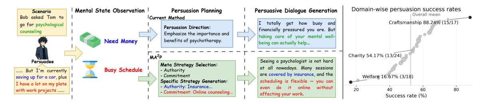
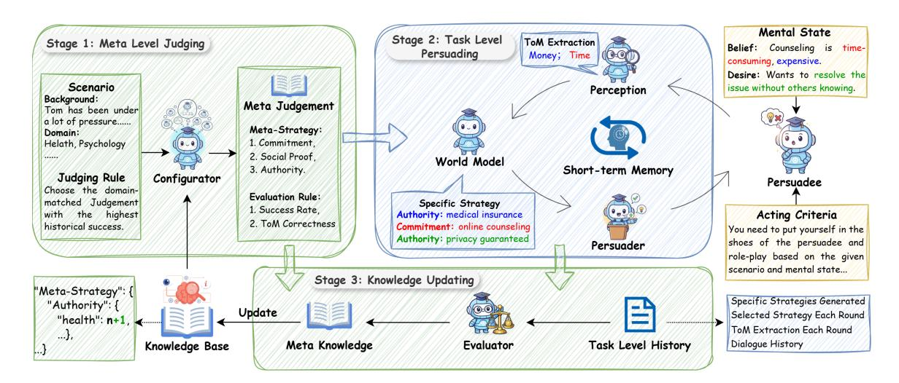
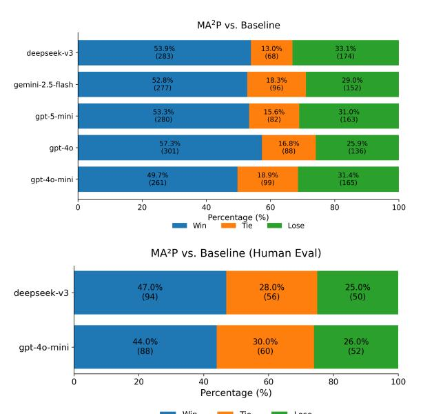
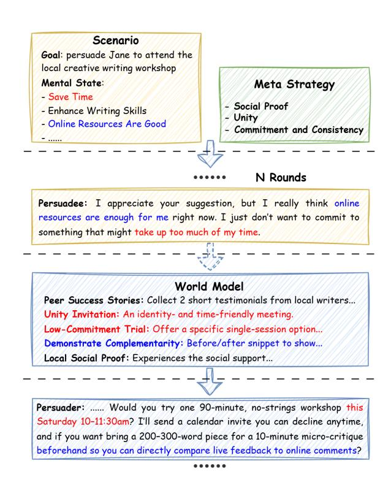
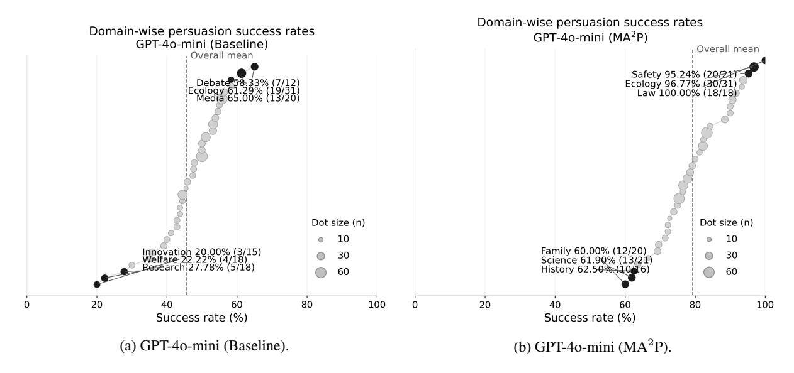
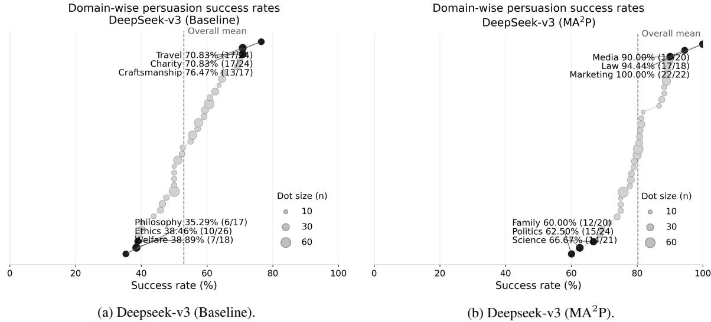
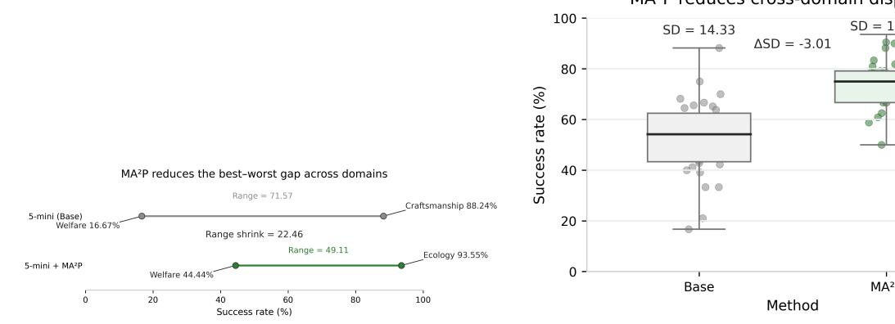
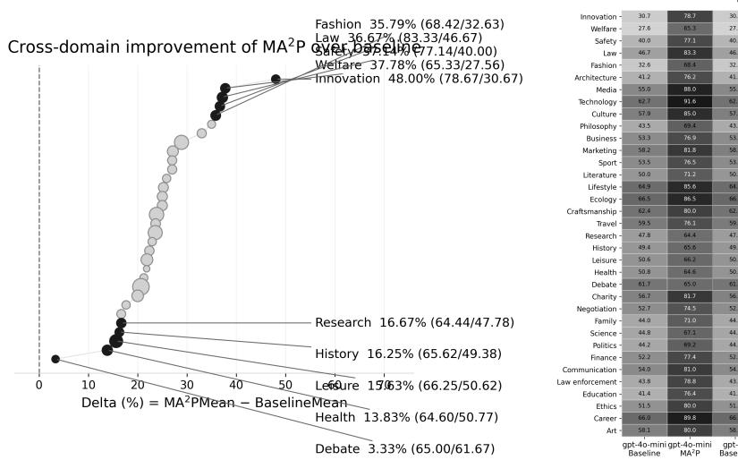
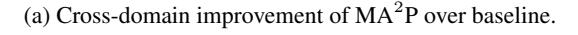
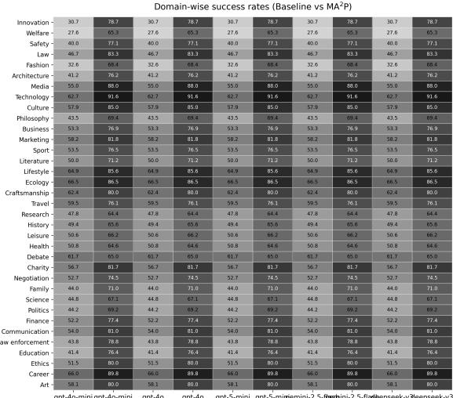

# MA<sup>2</sup>P: A Meta-Cognitive Autonomous Intelligent Agents Framework for Complex Persuasion

Dingyi Zhang<sup>1</sup> , Ziqing Zhuang<sup>1</sup> , Linhai Zhang<sup>2</sup> , Ziyang Gao<sup>1</sup> , Deyu Zhou<sup>1</sup>\* <sup>1</sup>School of Computer Science and Engineering, Key Laboratory of Computer Network and Information Integration, Ministry of Education, Southeast University, China <sup>2</sup>Department of Informatics, King's College London {zhangdy, d.zhou}@seu.edu.cn

# Abstract

Persuasive dialogue generation plays a vital role in decision-making, negotiation, counseling, and behavior change, yet it remains a challenging problem. In complex persuasion where the persuadee's internal states are not expressed clearly, the persuader must interpret responses, infer the persuadee's latent mental states (e.g., beliefs and desires), and translate them into targeted, strategy-consistent actions; however, current approaches often produce generic or weakly grounded responses even when such cues are identified. Moreover, although large language models (LLMs) can generate persuasive content, their performance varies substantially across domains due to uneven knowledge coverage and limited reasoning generalization. To address these challenges, we propose MA<sup>2</sup>P, a meta-cognitive autonomous intelligent agent framework for complex persuasion. Specifically, we develop an autonomous multi-agent architecture that coordinates perception management, mental-state inference, strategy execution, memory maintenance, and performance evaluation. To mitigate cross-domain performance variation, we further design a metacognitive configurator that selects an appropriate meta-strategy from a structured knowledge base at the outset, thereby guiding subsequent reasoning and planning. Experimental results show that our approach achieves a higher persuasion success rate than baselines.

# 1 Introduction

Persuasive dialogue plays a central role in realworld decision making, including negotiation, healthcare counseling, education, and behavior change [\(Rogiers et al.,](#page-10-0) [2024;](#page-10-0) [Singh and Namin,](#page-10-1) [2025\)](#page-10-1). Unlike purely informative conversation, persuasion is inherently goal-directed: the persuader must influence another agent's beliefs or actions under uncertainty, which makes the task closer to

sequential planning than next-turn language generation [\(Cheng and You,](#page-9-0) [2025;](#page-9-0) [Shapira et al.,](#page-10-2) [2025\)](#page-10-2). In this work, we focus on *complex persuasion*, where success depends not only on domain knowledge across diverse topics but also on the ability to model the persuadee's internal state.

Recent research has expanded persuasive dialogue from early single-domain settings [\(Wang](#page-10-3) [et al.,](#page-10-3) [2019\)](#page-10-3) to more diverse domains [\(Jin et al.,](#page-9-1) [2024\)](#page-9-1), and newer datasets further expose persuadee mental states such as beliefs and desires, raising the bar for personalized, state-aware persuasion [\(Zhang and Zhou,](#page-11-0) [2025\)](#page-11-0). Meanwhile, current LLMbased approaches typically rely on a single persuader model to infer user concerns from dialogue and generate the next turn; such models are fluent and can sometimes identify salient constraints or resistance signals [\(Ju et al.,](#page-9-2) [2025\)](#page-9-2). However, as scenarios become more mental-state grounded, the key difficulty shifts from recognizing concerns to acting on them: the persuader must translate inferred states into concrete strategy choices and maintain coherent multi-turn planning, otherwise it often falls back to generic advice or drifts across turns [\(Cheng and You,](#page-9-0) [2025\)](#page-9-0).

Despite recent progress, existing LLM based persuaders still face two key limitations, which motivate our design. (1) No actionable planning. They are often *reactive*: even when they surface concrete obstacles, such as "need money" and "busy schedule" in Fig. [1,](#page-1-0) they do not convert them into an actionable persuasion plan. In the illustrated case, the current approach produces only a high-level direction, "emphasize the importance and benefits of psychotherapy", and then generates a generic response, rather than offering targeted solutions aligned with the extracted obstacles, such as insurance coverage and flexible online scheduling. (2) Cross-domain fluctuations. LLM persuaders generalize poorly across domains: on CToMPersu [\(Zhang and Zhou,](#page-11-0) [2025\)](#page-11-0), gpt-5-mini

<sup>\*</sup>Corresponding author: d.zhou@seu.edu.cn.

<span id="page-1-0"></span>

Figure 1: Motivation for MA<sup>2</sup>P. Left: a CToMPersu example [\(Zhang and Zhou,](#page-11-0) [2025\)](#page-11-0) where current LLM persuaders identify concerns but fail to respond with strategy-grounded actions. Right: gpt-5-mini success rates on CToMPersu show large cross-domain fluctuations, indicating weak generalization.

success rates range from 88.24% (best domain) to 16.67% (worst), a 71.57-point gap in Fig. [1.](#page-1-0) The dispersion is also reflected by a large standard deviation, visually evidenced by the wide horizontal spread of domain points and many domains lying far from the dashed overall-mean line. These motivations call for structured mechanisms that map mental-state cues to strategy-conditioned actions and improve robustness across diverse domains.

To address these challenges, we propose MA2P, a meta-cognitive autonomous-agent framework for persuasive dialogue. Inspired by LeCun et al.'s blueprint for autonomous intelligent agents [\(Le-](#page-9-3)[Cun,](#page-9-3) [2022\)](#page-9-3), it formulates persuasion as a *closedloop* interaction and decomposes the persuader into modular components for perception, mentalstate inference, strategy planning, response generation, memory, and evaluation, so that detected obstacles can be translated into concrete, strategyconditioned actions rather than generic next-turn advice. This transfer is non-trivial because persuasion is language- and mental-state-driven, requiring task-specific redesign of the perception, worldmodel, and actor modules, while the persuadee is an adaptive agent rather than a passive environment. To address these challenges, MA2P combines modularization with a meta-level controller. Inspired by meta-cognition, particularly planning, monitoring, and evaluation [\(Metcalfe and Shimamura,](#page-10-4) [1994\)](#page-10-4), MA2P uses a task-specific meta-level mechanism that selects a high-level meta-strategy once at the beginning of each persuasion interaction, guides turn-level strategy generation, and updates experience after the interaction. Across automatic and human evaluations, MA2P consistently improves persuasion success, mental-state alignment, and planning coherence, while reducing cross-domain variance. The prompt design is released.[1](#page-1-1)

# 2 Background

Autonomous intelligent agents: purpose and typical use cases. Autonomous intelligent agents are designed for *long-horizon, interactive* tasks where decisions must be updated online as new feedback arrives. They are widely used in settings such as robotics and control, embodied navigation, toolusing assistants, and multi-turn interactive systems, where the agent must maintain state, plan ahead, and correct itself under partial observability [\(Le-](#page-9-3)[Cun,](#page-9-3) [2022\)](#page-9-3).

A unified definition. An autonomous agent can be characterized as a closed-loop decision process that repeatedly (i) *perceives* the environment, (ii) *updates* an internal state, (iii) *selects* an action (optionally via planning), and (iv) *receives feedback* and continues. Following [LeCun](#page-9-3) [\(2022\)](#page-9-3), we use x<sup>t</sup> for the observation at step t, s<sup>t</sup> for a latent internal state, and a<sup>t</sup> for the action. A common formulation is:

$$s_t = \operatorname{Enc}(x_{\leq t}),$$
  

$$a_t \sim \pi(\cdot \mid s_t),$$
  

$$s_{t+1} = \operatorname{Pred}(s_t, a_t),$$

where Enc summarizes past inputs into a taskrelevant state, π maps the state to an action, and Pred (the world model) predicts the next state under an action. To support goal-directed behavior beyond one-step reactions, the agent is typically guided by a scalar objective (or cost) C(·) that scores states and enables multi-step planning:

$$\hat{a}_{t:t+T} = \operatorname*{arg\,min}_{a_{t:t+T}} \sum_{\tau=t+1}^{t+T} C(s_\tau) \quad \text{s.t.}$$
 
$$s_{\tau+1} = \operatorname{Pred}(s_\tau, a_\tau).$$

This definition highlights the essential components of autonomy: state estimation (Enc), predictive modeling (Pred), action selection (π), and objective-driven planning via C(·) [\(LeCun,](#page-9-3) [2022\)](#page-9-3).

<span id="page-1-1"></span><sup>1</sup>MA<sup>2</sup> [P Prompt Design](https://github.com/DingyiZhang/MAP-A-Meta-Cognitive-Autonomous-Intelligent-Agents-Framework-for-Complex-Persuasion)

<span id="page-2-0"></span>

Figure 2: Overview of the proposed MA2P (Meta-Cognitive autonomous intelligent agents) framework for persuasive dialogue. It consists of three stages: (1) Meta-level Judging, where the Configurator selects a meta-strategy and evaluation rules from the knowledge base; (2) Task-level Persuading, where autonomous intelligent agents collaboratively generate persuasion responses; (3) Knowledge Updating, where the Evaluator assesses outcomes and successful cases are written back to the knowledge base for future tasks.

# 3 Method

Our framework, MA2P (meta-cognitive autonomous intelligent agents), formulates persuasive dialogue as a three-stage meta-level plan– act–reflect loop. As shown in Fig. [2,](#page-2-0) *Configurator* retrieves a meta-strategy and evaluation rules from the knowledge base (stage 1), a team of autonomous intelligent agents (*Perception*, *World Model*, *Persuader*, *Short-Term Memory*) executes multi-turn persuasion (stage 2), and the *Evaluator* updates the knowledge base with successful patterns (stage 3). This update improves subsequent stage 1 decisions by providing stronger domainand scenario-specific evidence. Algorithm [1](#page-3-0) summarizes the overall procedure.

### 3.1 Meta-Level Judging

Before each persuasion episode, MA2P performs meta-level judging to choose a guiding metastrategy and specify evaluation rules given the scenario and domain. As shown in Fig. [2,](#page-2-0) stage 1 is carried out by the *Configurator*, which retrieves candidate meta-strategies from the *Knowledge Base*, selects one to constrain subsequent task-level reasoning, and defines evaluation rules for later reflection in stage 3.

Configurator Given a scenario input (domain, goal, background), the Configurator performs two steps: meta-strategy selection and evaluation rule construction.

*Meta-Strategy Selection.* The Configurator ranks

domain-matched candidates using their historical success counts in the Case Layer of the Knowledge Base (formally defined in stage 3) and selects the best meta-strategy:

$$M = \underset{m \in M(S)}{\operatorname{arg\,max\,score}}(m, S)$$

The selected meta-strategy M is the one with the highest historical success score in the relevant domain.

*Evaluation Rule Construction.* Once M is selected, the Configurator defines evaluation rules E that will be used by the *Evaluator* in stage 3 to judge whether the episode is successful.

Configurator helps MA2P to initiate each persuasion task with explicit planning intent and measurable success criteria.

## 3.2 Task-Level Persuading

After meta-level planning, MA2P executes tasklevel persuasion via a team of autonomous intelligent agents. Guided by the meta-strategy M from the Configurator, stage 2 performs multi-turn reasoning, response generation, and short-term adaptation during interaction.

As shown in Fig. [2,](#page-2-0) stage 2 includes four agents: *Perception* extracts belief–desire cues, *World Model* infers a specific strategy, *Persuader Agent* realizes it as natural-language utterances, and *Short-term Memory* maintains dialogue history and intermediate states.

# <span id="page-3-0"></span>**Algorithm 1** MA<sup>2</sup>P

**Input:** scenario S (domain D(S), goal, background); knowledge base K

**Parameter:** maximum turns  $T_{\rm max}$ 

**Output:** dialogue  $\{(U_t, U_t)\}_{t=1}^{T'}$ ; updated knowledge base K'

- 1: /\* Stage 1\*/
- 2:  $\mathcal{M} \leftarrow \{ m \in K_{\text{meta}} \mid D(m) = D(S) \}$  retrieve domain-matched meta-strategies
- 3: for all  $m \in \mathcal{M}$  do
- 4:  $\operatorname{score}(m) \leftarrow K_{\operatorname{case}}(m, D(S)) \triangleright \operatorname{historical}$ success count in the Case Layer
- 5: end for
- 6:  $M \leftarrow \arg \max_{m \in \mathcal{M}} \operatorname{score}(m) > \operatorname{select}$  the best meta-strategy for this domain
- 7:  $E \leftarrow \text{BUILDRULES}(M, S)$  > construct evaluation rules used in Stage 3
- 8: /\* Stage 2\*/
- 9:  $H \leftarrow \emptyset$ ;  $\Sigma \leftarrow \emptyset$ ;  $T' \leftarrow T_{max}$  > initialize dialogue history / short-term memory
- 10: for  $t \leftarrow 1$  to  $T_{max}$  do
- 11:  $P_t \leftarrow f_{perc}(H)$  > Perception: extract mental-state cues from history
- 12:  $\Sigma \leftarrow \{H, P_t, W_{1:t-1}\}$   $\triangleright$  Short-term memory snapshot
- 13:  $W_t \leftarrow f_{wm}(M, \Sigma)$  > World model: instantiate M into a concrete strategy
- 14:  $U_t \leftarrow f_{pers}(W_t, H)$  > Persuader: realize strategy as an utterance
- 15:  $H \leftarrow H \cup \{U_t, \tilde{U}_t\} \triangleright \tilde{U}_t$  from persuadee
- 16: **if**  $f_{\text{accept}}(H) = 1$  **then**
- 17:  $T' \leftarrow t$ : **break**
- 18: **end if**
- 19: **end for**
- 20: /\* Stage 3\*/
- 21:  $R \leftarrow f_{\text{eval}}(E, H) \triangleright \text{judge success under rules}$ E using the episode evidence
- 22: **if** R = 1 **then**
- 23:  $K_{\text{case}}(M, D(S)) + 1$   $\triangleright$  increment domain–strategy success count
- 24: end if
- 25:  $K' \leftarrow \text{KBUPDATE}(K, M, S, R) \triangleright \text{write back}$  the episode summary
- 26: **return**  $\{(U_t, \tilde{U}_t)\}_{t=1}^{T'}, K'$

#### 3.2.1 Perception

Perception extracts explicit signals and infers latent mental cues (beliefs, desires, concerns) from the dialogue history, which are then provided to the World Model for adaptive strategy generation.

$$P_t = f_{\text{perc}}(H_t)$$

Where  $H_t$  denotes the dialogue history at turn t, and  $P_t$  represents the explicit and implicit mental-state cues (beliefs, desires, latent concerns) extracted by the Perception module.

#### 3.2.2 World Model

World Model is the reasoning core that combines the meta-strategy M with the short-term memory  $\Sigma_t$  to infer a specific, actionable persuasion strategy for the next turn.

$$W_t = f_{wm}(M, \Sigma_t)$$

Where M is the selected meta-strategy from stage 1, and  $\Sigma_t$  is the short-term memory at turn t containing dialogue history, inferred states, and previous strategies.  $W_t$  denotes the specific persuasion strategy inferred by the World Model.

It outputs a *specific strategy* aligned with both conversation context and the persuadee's inferred state (e.g., under "Authority" with financial concerns, emphasizing insurance coverage or expert endorsement), and passes it to the *Persuader Agent* for realization.

#### 3.2.3 Persuader Agent

*Persuader Agent* converts the specific strategy into a coherent utterance conditioned on the dialogue history.

$$U_t = f_{\text{pers}}(W_t, H_t)$$

Where  $U_t$  denotes the natural-language utterance generated by the Persuader Agent based on the specific strategy  $W_t$  and the dialogue history  $H_t$ .

$$H_{t+1} = H_t \cup \{ U_t \}$$

Where  $H_{t+1}$  represents the updated dialogue history after appending the newly generated utterance.

### 3.2.4 Short-term Memory

*Short-term Memory* maintains a shared snapshot of the episode by storing dialogue history, perception outputs, and previously generated strategies.

$$\Sigma_t = \{ H_t, P_t, W_{1:t-1} \}$$

Where  $\Sigma_t$  aggregates three kinds of information at turn t: the dialogue history  $H_t$ , inferred mental-state cues  $P_t$ , and previously generated specific strategies  $W_{1:t-1}$ .

$$\Sigma_{t+1} = \operatorname{update}(\Sigma_t, H_{t+1})$$

Where the function update(·) integrates the updated dialogue history Ht+1 (including both U<sup>t</sup> and U˜ t) into memory, producing the next short-term state Σt+1.

## 3.3 Knowledge Updating

After each episode, MA2P reflects on the outcome and updates the Knowledge Base to improve future meta-level judging (stage 1). Stage 3 comprises (i) a *Knowledge Base* that stores reusable strategy evidence, (ii) an *Evaluator* that checks success under the evaluation rules, and (iii) a *KB-Updater* that writes successful patterns back to the KB.

### 3.3.1 Knowledge Base Structure

As illustrated in Fig. [2,](#page-2-0) Knowledge Base is organized as a three-layer tree.

Meta-Strategy Layer stores high-level persuasion strategies grounded in Cialdini's seven influence principles, e.g., *Authority*, *Commitment and Consistency*, and *Social Proof* [\(Cialdini,](#page-9-4) [2021\)](#page-9-4);

Domain Layer groups domains where each strategy has been applied (e.g., *Education*, *Health*, *Finance*);

Case Layer records aggregated successful outcomes as counts for each domain–strategy pair.

$$M(S) = \{ m \mid m \in K_{\text{meta}} \land D(m) = D(S) \}$$

$$score(m, S) = K_{case}(m, D(S))$$

Here, S is the given scenario; Kmeta denotes the meta-strategy layer in the knowledge base K; M(S) contains all meta-strategies applicable to the domain of S. The function Kcase returns the number of successful persuasion cases associated with meta-strategy m in the domain of scenario S, providing a data-driven measure of prior effectiveness.

### 3.3.2 Evaluator

The *Evaluator* determines whether the episode satisfies the evaluation rules E from stage 1, using the final short-term memory Σ<sup>T</sup> as evidence.

$$R = f_{\text{eval}}(E, \Sigma_T)$$

Here, R ∈ {0, 1} denotes whether the persuasion succeeds, E is the evaluation rule set produced in stage 1, and Σ<sup>T</sup> is the final short-term memory at the last dialogue turn T.

### 3.3.3 Knowledge Base Updating

If Evaluator confirms success, *Knowledge Base Updating* module increments the Case Layer count for the selected meta-strategy M under the scenario domain D(S), thereby accumulating evidence of effective domain–strategy pairs over time.

$$K_{\text{case}}(M, D(S)) \leftarrow K_{\text{case}}(M, D(S)) + 1$$

This operation increments the success-count entry in the Case Layer for the selected meta-strategy M under the scenario domain D(S).

$$K' = \operatorname{update}(K, M, S, R)$$

Where K′ is the updated knowledge base after integrating the new experience, and K is the previous knowledge base before reflection.

# 4 Experiment

In this section, we evaluate MA2P by comparing multiple base LLMs against their MA2Paugmented counterparts under a plug-and-play, training-free setting. We further conduct ablation studies to isolate the contribution of key components, and report both LLM-based and human A/B preference evaluations. Across these complementary protocols, the results consistently demonstrate the effectiveness of MA2P.

# 4.1 Main Results

In this subsection, we compare each base LLM persuader with its MA2P-augmented counterpart.

Setup. We evaluate five base models: gpt-4o-mini, gpt-4o, gpt-5-mini, gemini-2.5-flash, and deepseek-v3. For each model, we compare a baseline next-turn persuader with its MA2P-augmented counterpart. MA2P is plug-and-play and training-free, so the same framework is applied on top of each base model. Experiments are conducted on the CToMPersu dataset [\(Zhang and Zhou,](#page-11-0) [2025\)](#page-11-0), using the official test split of 525 instances, where each scenario includes annotated persuadee mental states (belief and desire) about the original intention (when available) and the target action. To control for

<span id="page-5-0"></span>Table 1: Main results comparing base LLM persuaders with and without our plug-and-play MA2P. Higher is better for Success, Persuasive, Logic, and Helpful; lower is better for Range, SD, and Avg\_Turn. Green indicates improvements and red indicates degradations relative to the base model.

| Model                          | Success (↑)          | Persuasive (↑)       | Logic (↑)            | Helpful (↑)          | Range (↓)              | SD (↓)                 | Avg_Turn (↓)         |
|--------------------------------|----------------------|----------------------|----------------------|----------------------|------------------------|------------------------|----------------------|
| gpt-4o-mini<br>+ MA2<br>P      | 0.45<br>0.79 (+0.34) | 6.46<br>7.16 (+0.70) | 7.82<br>8.08 (+0.26) | 7.58<br>8.07 (+0.49) | 0.450<br>0.400 (-0.05) | 0.104<br>0.107 (+)     | 2.94<br>1.86 (-1.08) |
| gpt-4o<br>+ MA2<br>P           | 0.46<br>0.75 (+0.29) | 6.45<br>6.99 (+0.54) | 7.87<br>7.96 (+0.09) | 7.70<br>7.94 (+0.24) | 0.500<br>0.488 (-0.01) | 0.114<br>0.109 (-0.01) | 3.03<br>2.00 (-1.03) |
| gpt-5-mini<br>+ MA2<br>P       | 0.51<br>0.72 (+0.21) | 6.40<br>7.15 (+0.75) | 7.81<br>8.28 (+0.47) | 7.55<br>8.27 (+0.72) | 0.716<br>0.491 (-0.23) | 0.145<br>0.115 (-0.03) | 2.66<br>1.60 (-1.06) |
| gemini-2.5-flash<br>+ MA2<br>P | 0.46<br>0.66 (+0.20) | 6.48<br>6.67 (+0.19) | 7.85<br>7.78 (-0.07) | 7.62<br>7.44 (-0.18) | 0.400<br>0.381 (-0.02) | 0.113<br>0.092 (-0.02) | 3.27<br>2.08 (-1.19) |
| deepseek-v3<br>+ MA2<br>P      | 0.53<br>0.80 (+0.27) | 6.98<br>7.58 (+0.60) | 8.06<br>8.51 (+0.45) | 7.84<br>8.42 (+0.58) | 0.412<br>0.400 (-0.01) | 0.107<br>0.088 (-0.02) | 3.05<br>1.82 (-1.23) |

persuadee variability, we use a fixed gpt-4o-mini agent as the persuadee in all settings; it is conditioned on the scenario and mental-state annotations.

Metrics. Let D be the test set, |D| = N. For each instance i, we generate a dialogue of at most Tmax = 4 turns. Let J(·) ∈ {0, 1} be the success judge on a dialogue prefix, and let P ersu(·), L(·), H(·) ∈ {1, . . . , 10} be the LLM scores for *Persuasive*, *Logic*, and *Helpful*. All judges use gpt-4o-mini.

Success. A test case is successful if the judge returns True at any turn t ≤ Tmax.

$$\operatorname{Success} = \frac{1}{N} \sum_{i=1}^{N} \mathbf{1} \bigg[ \max_{t \leq T_{\max}} J \bigg( d_i^{\leq t} \bigg) = 1 \bigg] \,.$$

Persuasive. Average persuasive-strength score on a 1–10 scale.

Persuasive = 
$$\frac{1}{N} \sum_{i=1}^{N} Persu(d_i)$$
.

Logic. Average logical-coherence score on a 1–10 scale.

$$Logic = \frac{1}{N} \sum_{i=1}^{N} L(d_i).$$

Helpful. Average helpfulness score on a 1–10 scale.

$$Helpful = \frac{1}{N} \sum_{i=1}^{N} H(d_i).$$

Range. Let G denote the 35 domains. For each g ∈ G, let Succ<sup>g</sup> be the success rate computed on test cases from domain g.

Range = 
$$\max_{g \in \mathcal{G}} \operatorname{Succ}_g - \min_{g \in \mathcal{G}} \operatorname{Succ}_g$$
.

SD. Standard deviation of domain-wise success rates.

$$SD = \sqrt{\frac{1}{|\mathcal{G}|} \sum_{g \in \mathcal{G}} \left( Succ_g - \overline{Succ} \right)^2}$$

Avg\_Turn. Let τ<sup>i</sup> be the first turn t ≤ Tmax where J(d ≤t i ) = 1, or τ<sup>i</sup> = Tmax if never. Then

$$Avg\_Turn = \frac{1}{N} \sum_{i=1}^{N} \tau_i.$$

Results. Table [1](#page-5-0) shows that MA2P improves over the corresponding baselines on almost all metrics across the five base models. The main exceptions occur for gemini-2.5-flash, where Logic and Helpful slightly decrease; however, MA2P still delivers a large gain in Success (over +0.20 absolute), suggesting that the framework remains effective for achieving the persuasion goal even when a few quality metrics do not improve. We also observe a minor increase in SD on gpt-4o-mini, while Range still decreases. Overall, MA2P consistently boosts persuasion success and dialogue quality, and generally reduces cross-domain dispersion (Range/SD), indicating stronger robustness and generalization.

### 4.2 Ablation Study

We additionally report a variant that uses a system of autonomous intelligent agents without metacognitive augmentation (+Auto). Since our metacognition is implemented as an explicit enhancement to the Configurator inside this agent system,

<span id="page-6-0"></span>Table 2: Ablation results comparing the base LLM, an autonomous-agent system without meta-cognitive augmentation (+Auto), and the full MA<sup>2</sup>P system (+MA2P). Green/red indicate improvements/degradations over the base model.

| Model      | Success (↑)  | Range (↓)     | SD (↓)        |
|------------|--------------|---------------|---------------|
| 4o-mini    | 0.45         | 0.450         | 0.104         |
| + Auto     | 0.66 (+0.21) | 0.530 (+0.08) | 0.118 (+)     |
| + MA2<br>P | 0.79 (+0.34) | 0.400 (-0.05) | 0.107 (+)     |
| 4o         | 0.46         | 0.500         | 0.114         |
| + Auto     | 0.68 (+0.22) | 0.458 (-0.04) | 0.120 (+0.01) |
| + MA2<br>P | 0.75 (+0.29) | 0.488 (-0.01) | 0.109 (-0.01) |

it cannot be meaningfully evaluated as a standalone component.

As shown in Table [2,](#page-6-0) (+Auto) already yields a clear improvement in persuasion success over the base model. However, it exhibits weaker cross-domain robustness, reflected by larger domain dispersion (e.g., higher Range and/or SD). This suggests that (+Auto) tends to amplify performance in domains where the base model is already strong, rather than uniformly improving all domains. By contrast, the full MA2P system (+MA2P) further increases Success while simultaneously reducing cross-domain variance, indicating that meta-cognitive augmentation helps the system generalize more consistently across domains.

Warm-up episodes and knowledge base size. Since MA2P relies on the knowledge base for metastrategy selection, we further study how the number of warm-up episodes affects performance. Specifically, we vary the initial knowledge base size K and evaluate the resulting system on gpt-4o-mini, while keeping the rest of the setup unchanged. Table [3](#page-6-1) reports the results.

<span id="page-6-1"></span>Table 3: Effect of the initial knowledge base size K on MA<sup>2</sup>P (gpt-4o-mini).

| Model (4o-mini) | Success (↑) | Range (↓) | SD (↓) |
|-----------------|-------------|-----------|--------|
| K = 0           | 0.66        | 0.53      | 0.118  |
| K = 100         | 0.73        | 0.44      | 0.107  |
| K = 300         | 0.76        | 0.51      | 0.111  |
| K = 500         | 0.79        | 0.40      | 0.107  |

The results show that MA2P remains effective even under cold-start conditions (K = 0), but a small number of warm-up episodes already leads to clear gains. In particular, with K = 100, the system achieves substantial improvements in both persuasion success and cross-domain robustness.

<span id="page-6-2"></span>

Figure 3: A/B preference results (win/tie/lose) comparing baseline persuaders with their MA<sup>2</sup>P-augmented counterparts under LLM-based and human evaluation.

Increasing the knowledge base further generally brings additional benefits, and the best overall performance is obtained at K = 500, which is the setting adopted in our main experiments. These results suggest that MA2P does not require a large amount of warm-up data to be useful, while a larger knowledge base can further improve stability and effectiveness.

### 4.3 LLM and Human Preference Study

We conduct an A/B preference study with an LLM judge and human evaluators to compare baseline persuaders against their MA2P-augmented counterparts. For each test instance, evaluators are presented with two anonymized dialogue outputs (the order is randomized and the system identity is hidden), and they provide a ternary judgment over the *second* output relative to the *first*: better (win), comparable (tie), or worse (lose).

LLM judge. We use gpt-4o-mini as the LLM evaluator. It reads the two anonymized dialogues in full and returns a single win/tie/lose decision under the same blind setting (i.e., without knowing which system produced which output).

Human evaluation. We additionally recruit two M.Sc. students in computer science as human evaluators. To reduce annotation cost, we randomly sample 400 test instances for the human study.

As shown in Figure [3,](#page-6-2) MA2P is consistently preferred over the baseline in both evaluation settings,

indicating that MA2P produces more convincing and higher-quality persuasive responses in practice.

LLM–human agreement. To quantify the agreement between the LLM judge and human evaluators on the ternary preference labels, we compute the *weighted Cohen's kappa* κ<sup>w</sup> [\(Cohen,](#page-9-5) [1968\)](#page-9-5). We treat the three labels as ordinal categories (lose < tie < win) and use quadratic weighting. Since our human evaluation is conducted on two disjoint subsets (200 instances for deepseek-v3 and 200 instances for gpt-4o-mini), we compute κ<sup>w</sup> separately for each subset (LLM vs. the corresponding human evaluator) and report their average. In our study, we obtain κ<sup>w</sup> = 0.549, indicating moderate agreement between the LLM judge and human evaluators. We also observe that human evaluators assign tie more frequently when the two responses are close, reflecting the inherent subjectivity of preference judgments. Nevertheless, the overall trend is consistent: MA2P is preferred over the baseline under both LLM and human evaluation.

To complement the preference results above, we further provide in Appendix [I](#page-21-0) a small-scale interactive qualitative example from blind human–system conversations, which offers illustrative evidence beyond the simulation setting.

# 4.4 Case Study

Figure [4](#page-7-0) shows a representative interaction round. MA2P first identifies the persuadee's key mentalstate cues (e.g., wanting to *save time* and believing *online resources are sufficient*).

Conditioned on the selected meta strategies, the world model then translates them into concrete, executable persuasion strategies (e.g., a *lowcommitment trial* and *demonstrating complementarity* via an online-vs.-in-person comparison). Finally, the persuader produces a targeted utterance by proposing a short weekend session to address the time constraint and asking the persuadee to bring a brief writing sample for a live-vs.-online feedback comparison, directly grounding the response in the inferred concerns.

# 5 Related Work

Persuasion with large language models. Recent work on LLM persuasion includes: (i) surveys and empirical analyses of persuasive behaviors and risks [\(Rogiers et al.,](#page-10-0) [2024;](#page-10-0) [Singh and](#page-10-1) [Namin,](#page-10-1) [2025\)](#page-10-1), spanning public health, consumer decisions, and political contexts [\(Altay et al.,](#page-8-0) [2023;](#page-8-0)

<span id="page-7-0"></span>

Figure 4: A representative MA<sup>2</sup>P interaction round.

[Chen et al.,](#page-9-6) [2023;](#page-9-6) [Potter et al.,](#page-10-5) [2024\)](#page-10-5); (ii) useraware persuasion that explicitly models user states and adapts psychological strategies beyond surface fluency [\(de Wynter and Yuan,](#page-9-7) [2025;](#page-9-7) [Ju et al.,](#page-9-2) [2025\)](#page-9-2). Meanwhile, datasets have progressed from single-domain donation dialogues [\(Wang et al.,](#page-10-3) [2019\)](#page-10-3) to multi-domain benchmarks [\(Jin et al.,](#page-9-1) [2024\)](#page-9-1), and further to double-blind settings exposing belief and desire, increasing the need for stateconditioned persuasion [\(Zhang and Zhou,](#page-11-0) [2025\)](#page-11-0). (iii) Strategic formulations frame persuasion as sequential decision making (e.g., persuasion games and off-policy evaluation), emphasizing planful and strategy-aware action selection [\(Karande et al.,](#page-9-8) [2024;](#page-9-8) [Shapira et al.,](#page-10-2) [2025;](#page-10-2) [Cheng and You,](#page-9-0) [2025;](#page-9-0) [Jin et al.,](#page-9-9) [2023\)](#page-9-9). (iv) Agentic directions build modular or multi-agent persuaders for multi-turn interaction, including simulation-based data generation and zero-shot strategy-plus-retrieval frameworks [\(Li et al.,](#page-9-10) [2025a;](#page-9-10) [Furumai et al.,](#page-9-11) [2024\)](#page-9-11); related work also studies credibility-aware persuasion and multi-agent reasoning dynamics [\(Qin et al.,](#page-10-6) [2024;](#page-10-6) [Saenger et al.,](#page-10-7) [2024;](#page-10-7) [Zhao et al.,](#page-11-1) [2025\)](#page-11-1).

Meta-cognition for large language models. We view metacognition as "knowing about knowing" and model it as a controller that decides when to plan, verify, revise, or stop [\(Metcalfe and Shima](#page-10-4)[mura,](#page-10-4) [1994\)](#page-10-4). Prior work instantiates this metalevel via: (i) prompt/interface methods for selfquestioning, rule interpretation, and transfer [\(Wang](#page-10-8) [and Zhao,](#page-10-8) [2024;](#page-10-8) [Khan,](#page-9-12) [2025;](#page-9-12) [Gong et al.,](#page-9-13) [2025;](#page-9-13) [Gu et al.,](#page-9-14) [2025;](#page-9-14) [Xiao et al.,](#page-11-2) [2025\)](#page-11-2); (ii) reasoningprocess methods that model meta-reasoning signals to improve robustness, align intermediate traces with factuality and final answers, and enable controllable thinking [\(Wang et al.,](#page-10-9) [2024,](#page-10-9) [2025a;](#page-10-10) [Ha et al.,](#page-9-15) [2025\)](#page-9-15); (iii) agent orchestration that uses meta-control for tool use and planning, including meta-plans, multi-agent meta-thinking, reflection retrieval, and self-improving judges [\(Li et al.,](#page-9-16) [2025b;](#page-9-16) [Xiong et al.,](#page-11-3) [2025;](#page-11-3) [Wan et al.,](#page-10-11) [2025;](#page-10-11) [Wang](#page-10-12) [et al.,](#page-10-12) [2025b;](#page-10-12) [Wu et al.,](#page-10-13) [2025\)](#page-10-13); and (iv) evaluation/applications that argue metacognition should be measured separately from memorization or raw accuracy, and apply it to role-play control, multimodal knowledge editing, rumor detection, and evidence-sensitive medical RAG [\(Li et al.,](#page-9-17) [2024a,](#page-9-17)[b;](#page-10-14) [Zhang et al.,](#page-11-4) [2025;](#page-11-4) [Qin et al.,](#page-10-15) [2025;](#page-10-15) [Fan et al.,](#page-9-18) [2025;](#page-9-18) [He et al.,](#page-9-19) [2025;](#page-9-19) [Sun et al.,](#page-10-16) [2025\)](#page-10-16).

# 6 Conclusion

We proposed MA2P, a plug-and-play, training-free meta-cognitive agent framework for complex persuasive dialogue that converts inferred mental-state cues into strategy-grounded actions and reduces cross-domain variance via meta-strategy selection from a structured knowledge base. Experiments across five base LLM persuaders and both LLM and human evaluations show consistent improvements in persuasion success and overall response quality. The appendix provides our prompt designs and additional experimental analyses.

# Limitations

Due to the inherent difficulty of evaluating openended generation, most of our automatic metrics rely on an LLM evaluator; to reduce subjectivity, we use explicit and consistent rubrics for each dimension. Our human preference study is constrained by time and budget, resulting in a small number of annotators and a limited sample size, but it still provides supportive evidence by exhibiting the same preference trend as the LLM-based evaluation. In addition, applying MA2P to a new domain requires a warm-up phase: we need to run a small number of initial episodes to seed the knowledge base with domain-relevant cases for meta-strategy selection. Finally, current persuadee modeling is relatively simple: while we condition the simulated

persuadee on belief and desire, we do not model richer traits such as personality. A promising future direction is to develop a standardized *persuadee model* benchmark that does not require dialogue datasets, but evaluates persuasion systems against simulated agents with controllable personalities and belief-update capabilities.

# Ethics Statement

Our work studies persuasive dialogue generation, which can be beneficial for applications such as education and counseling but may also be misused for manipulation. To mitigate this risk, we focus on research settings with clearly specified user goals and do not target sensitive attributes or political persuasion. All experiments are conducted in an offline simulation environment with an LLM-based persuadee and evaluator; no real users are deceived or influenced, and no personally identifiable information is collected or processed. For the human preference study, participation was voluntary and based on informed consent; annotators evaluated anonymized system outputs, and no sensitive personal data were recorded. We will release our code, prompts, and knowledge base with documentation that highlights appropriate use cases and limitations, and we encourage future work to incorporate additional safeguards and misuse risk assessments when deploying persuasive systems in real-world contexts. We used AI assistants (e.g., ChatGPT) to help with language polishing and drafting/brainstorming during writing. All outputs were reviewed and edited by the authors, who take full responsibility for the content and correctness.

# Acknowledgments

We thank the anonymous reviewers and area chairs for their valuable comments and suggestions, which helped improve this paper. Also, we thank Shencheng Yao from the International Department of Chengdu No. 7 High School for assistance with early-stage data inspection, preliminary error case analysis, and checking a portion of the initial annotations. We gratefully acknowledge his support during the exploratory stage of this project. This work was supported by the National Natural Science Foundation of China (62176053).

# References

<span id="page-8-0"></span>Sacha Altay, Anne-Sophie Hacquin, Coralie Chevallier, and Hugo Mercier. 2023. Information delivered by a

- chatbot has a positive impact on covid-19 vaccines attitudes and intentions. *Journal of Experimental Psychology: Applied*, 29(1):52.
- <span id="page-9-6"></span>Qian Chen, Changqin Yin, and Yeming Gong. 2023. Would an ai chatbot persuade you: an empirical answer from the elaboration likelihood model. *Information Technology & People*.
- <span id="page-9-0"></span>Zirui Cheng and Jiaxuan You. 2025. [Towards strate](https://arxiv.org/abs/2509.22989)[gic persuasion with language models.](https://arxiv.org/abs/2509.22989) *Preprint*, arXiv:2509.22989.
- <span id="page-9-4"></span>Robert B. Cialdini. 2021. *Influence, New and Expanded: The Psychology of Persuasion*. Harper Business.
- <span id="page-9-5"></span>Jacob Cohen. 1968. Weighted kappa: Nominal scale agreement with provision for scaled disagreement or partial credit. *Psychological Bulletin*, 70(4):213– 220.
- <span id="page-9-7"></span>Adrian de Wynter and Tangming Yuan. 2025. [The thin](https://arxiv.org/abs/2507.01936) [line between comprehension and persuasion in llms.](https://arxiv.org/abs/2507.01936) *Preprint*, arXiv:2507.01936.
- <span id="page-9-18"></span>Zhaoyu Fan, Kaihang Pan, Mingze Zhou, Bosheng Qin, Juncheng Li, Shengyu Zhang, Wenqiao Zhang, Siliang Tang, Fei Wu, and Yueting Zhuang. 2025. [To](https://arxiv.org/abs/2509.05714)[wards meta-cognitive knowledge editing for multi](https://arxiv.org/abs/2509.05714)[modal llms.](https://arxiv.org/abs/2509.05714) *Preprint*, arXiv:2509.05714.
- <span id="page-9-11"></span>Kazuaki Furumai, Roberto Legaspi, Julio Cesar Vizcarra Romero, Yudai Yamazaki, Yasutaka Nishimura, Sina Semnani, Kazushi Ikeda, Weiyan Shi, and Monica Lam. 2024. [Zero-shot persuasive chatbots with](https://doi.org/10.18653/v1/2024.findings-emnlp.656) [LLM-generated strategies and information retrieval.](https://doi.org/10.18653/v1/2024.findings-emnlp.656) In *Findings of the Association for Computational Linguistics: EMNLP 2024*, pages 11224–11249, Miami, Florida, USA. Association for Computational Linguistics.
- <span id="page-9-13"></span>Jingzhi Gong, Rafail Giavrimis, Paul Brookes, Vardan Voskanyan, Fan Wu, Mari Ashiga, Matthew Truscott, Mike Basios, Leslie Kanthan, Jie Xu, and 1 others. 2025. Tuning llm-based code optimization via metaprompting: An industrial perspective. *arXiv preprint arXiv:2508.01443*.
- <span id="page-9-14"></span>Wenhao Gu, Li Gu, Chingyee Yee Suen, and Yang Wang. 2025. Metawriter: Personalized handwritten text recognition using meta-learned prompt tuning. In *Proceedings of the Computer Vision and Pattern Recognition Conference*, pages 23494–23504.
- <span id="page-9-15"></span>Rui Ha, Chaozhuo Li, Rui Pu, and Sen Su. 2025. [From](https://arxiv.org/abs/2508.04460) ["aha moments" to controllable thinking: Toward](https://arxiv.org/abs/2508.04460) [meta-cognitive reasoning in large reasoning mod](https://arxiv.org/abs/2508.04460)[els via decoupled reasoning and control.](https://arxiv.org/abs/2508.04460) *Preprint*, arXiv:2508.04460.
- <span id="page-9-19"></span>Zejiang He, Jingyuan Huang, Menglong Lu, Zhen Huang, Shanshan Liu, Zhiliang Tian, and Dongsheng Li. 2025. [GCML: Gradient coherence guided meta](https://doi.org/10.18653/v1/2025.emnlp-main.968)[learning for cross-domain emerging topic rumor de](https://doi.org/10.18653/v1/2025.emnlp-main.968)[tection.](https://doi.org/10.18653/v1/2025.emnlp-main.968) In *Proceedings of the 2025 Conference on Empirical Methods in Natural Language Processing*,

- pages 19159–19173, Suzhou, China. Association for Computational Linguistics.
- <span id="page-9-1"></span>Chuhao Jin, Kening Ren, Lingzhen Kong, Xiting Wang, Ruihua Song, and Huan Chen. 2024. [Persuading](https://doi.org/10.18653/v1/2024.acl-long.92) [across diverse domains: a dataset and persuasion](https://doi.org/10.18653/v1/2024.acl-long.92) [large language model.](https://doi.org/10.18653/v1/2024.acl-long.92) In *Proceedings of the 62nd Annual Meeting of the Association for Computational Linguistics (Volume 1: Long Papers)*, pages 1678– 1706, Bangkok, Thailand. Association for Computational Linguistics.
- <span id="page-9-9"></span>Chuhao Jin, Yutao Zhu, Lingzhen Kong, Shijie Li, Xiao Zhang, Ruihua Song, Xu Chen, Huan Chen, Yuchong Sun, Yu Chen, and Jun Xu. 2023. [Joint semantic](https://doi.org/10.18653/v1/2023.findings-emnlp.276) [and strategy matching for persuasive dialogue.](https://doi.org/10.18653/v1/2023.findings-emnlp.276) In *Findings of the Association for Computational Linguistics: EMNLP 2023*, pages 4187–4197, Singapore. Association for Computational Linguistics.
- <span id="page-9-2"></span>Tianjie Ju, Yujia Chen, Hao Fei, Mong-Li Lee, Wynne Hsu, Pengzhou Cheng, Zongru Wu, Zhuosheng Zhang, and Gongshen Liu. 2025. [On the adaptive](https://arxiv.org/abs/2506.06800) [psychological persuasion of large language models.](https://arxiv.org/abs/2506.06800) *Preprint*, arXiv:2506.06800.
- <span id="page-9-8"></span>Shirish Karande, Santhosh V, and Yash Bhatia. 2024. [Persuasion games with large language models.](https://aclanthology.org/2024.icon-1.67/) In *Proceedings of the 21st International Conference on Natural Language Processing (ICON)*, pages 576– 582, AU-KBC Research Centre, Chennai, India. NLP Association of India (NLPAI).
- <span id="page-9-12"></span>Imran Khan. 2025. [From literal to liberal: A meta](https://arxiv.org/abs/2510.12864)[prompting framework for eliciting human-aligned ex](https://arxiv.org/abs/2510.12864)[ception handling in large language models.](https://arxiv.org/abs/2510.12864) *Preprint*, arXiv:2510.12864.
- <span id="page-9-3"></span>Yann LeCun. 2022. A path towards autonomous machine intelligence. [https://api.](https://api.semanticscholar.org/CorpusID:251881108) [semanticscholar.org/CorpusID:251881108](https://api.semanticscholar.org/CorpusID:251881108). Version 0.9.2, 2022-06-27.
- <span id="page-9-10"></span>Mingjin Li, Yu Liu, Huayi Liu, Xiang Ye, Chao Jiang, Hongguang Zhang, and Yu Ruan. 2025a. [MADS:](https://doi.org/10.18653/v1/2025.emnlp-industry.26) [Multi-agent dialogue simulation for diverse persua](https://doi.org/10.18653/v1/2025.emnlp-industry.26)[sion data generation.](https://doi.org/10.18653/v1/2025.emnlp-industry.26) In *Proceedings of the 2025 Conference on Empirical Methods in Natural Language Processing: Industry Track*, pages 399–415, Suzhou (China). Association for Computational Linguistics.
- <span id="page-9-16"></span>Wenjun Li, Dexun Li, Kuicai Dong, Cong Zhang, Hao Zhang, Weiwen Liu, Yasheng Wang, Ruiming Tang, and Yong Liu. 2025b. [Adaptive tool use in large](https://doi.org/10.18653/v1/2025.acl-long.655) [language models with meta-cognition trigger.](https://doi.org/10.18653/v1/2025.acl-long.655) In *Proceedings of the 63rd Annual Meeting of the Association for Computational Linguistics (Volume 1: Long Papers)*, pages 13346–13370, Vienna, Austria. Association for Computational Linguistics.
- <span id="page-9-17"></span>Zhuoqun Li, Hongyu Lin, Yaojie Lu, Hao Xiang, Xianpei Han, and Le Sun. 2024a. [Meta-cognitive analysis:](https://aclanthology.org/2024.lrec-main.980/) [Evaluating declarative and procedural knowledge in](https://aclanthology.org/2024.lrec-main.980/) [datasets and large language models.](https://aclanthology.org/2024.lrec-main.980/) In *Proceedings*

- *of the 2024 Joint International Conference on Computational Linguistics, Language Resources and Evaluation (LREC-COLING 2024)*, pages 11222–11228, Torino, Italia. ELRA and ICCL.
- <span id="page-10-14"></span>Zhuoqun Li, Hongyu Lin, Yaojie Lu, Hao Xiang, Xianpei Han, and Le Sun. 2024b. [Meta-cognitive anal](https://arxiv.org/abs/2403.09750)[ysis: Evaluating declarative and procedural knowl](https://arxiv.org/abs/2403.09750)[edge in datasets and large language models.](https://arxiv.org/abs/2403.09750) *Preprint*, arXiv:2403.09750.
- <span id="page-10-4"></span>Janet Metcalfe and Arthur P. Shimamura, editors. 1994. *Metacognition: Knowing about Knowing*. The MIT Press, Cambridge, MA. A Bradford Book.
- <span id="page-10-5"></span>Yujin Potter, Shiyang Lai, Junsol Kim, James Evans, and Dawn Song. 2024. [Hidden persuaders: LLMs'](https://doi.org/10.18653/v1/2024.emnlp-main.244) [political leaning and their influence on voters.](https://doi.org/10.18653/v1/2024.emnlp-main.244) In *Proceedings of the 2024 Conference on Empirical Methods in Natural Language Processing*, pages 4244– 4275, Miami, Florida, USA. Association for Computational Linguistics.
- <span id="page-10-15"></span>Haiming Qin, Jiwei Zhang, Wei Zhang, KeZhong Lu, Mingyang Zhou, Hao Liao, and Rui Mao. 2025. [R-](https://doi.org/10.18653/v1/2025.emnlp-main.1372)[CHAR: A metacognition-driven framework for role](https://doi.org/10.18653/v1/2025.emnlp-main.1372)[playing in large language models.](https://doi.org/10.18653/v1/2025.emnlp-main.1372) In *Proceedings of the 2025 Conference on Empirical Methods in Natural Language Processing*, pages 26984–27002, Suzhou, China. Association for Computational Linguistics.
- <span id="page-10-6"></span>Peixin Qin, Chen Huang, Yang Deng, Wenqiang Lei, and Tat-Seng Chua. 2024. [Beyond persuasion: To](https://doi.org/10.18653/v1/2024.findings-emnlp.247)[wards conversational recommender system with cred](https://doi.org/10.18653/v1/2024.findings-emnlp.247)[ible explanations.](https://doi.org/10.18653/v1/2024.findings-emnlp.247) In *Findings of the Association for Computational Linguistics: EMNLP 2024*, pages 4264–4282, Miami, Florida, USA. Association for Computational Linguistics.
- <span id="page-10-0"></span>Alexander Rogiers, Sander Noels, Maarten Buyl, and Tijl De Bie. 2024. [Persuasion with large language](https://arxiv.org/abs/2411.06837) [models: a survey.](https://arxiv.org/abs/2411.06837) *Preprint*, arXiv:2411.06837.
- <span id="page-10-7"></span>Till Raphael Saenger, Musashi Hinck, Justin Grimmer, and Brandon M. Stewart. 2024. [AutoPersuade: A](https://doi.org/10.18653/v1/2024.emnlp-main.913) [framework for evaluating and explaining persuasive](https://doi.org/10.18653/v1/2024.emnlp-main.913) [arguments.](https://doi.org/10.18653/v1/2024.emnlp-main.913) In *Proceedings of the 2024 Conference on Empirical Methods in Natural Language Processing*, pages 16325–16342, Miami, Florida, USA. Association for Computational Linguistics.
- <span id="page-10-2"></span>Eilam Shapira, Omer Madmon, Reut Apel, Moshe Tennenholtz, and Roi Reichart. 2025. [Human choice](https://doi.org/10.1162/TACL.a.16) [prediction in language-based persuasion games:](https://doi.org/10.1162/TACL.a.16) [Simulation-based off-policy evaluation.](https://doi.org/10.1162/TACL.a.16) *Transactions of the Association for Computational Linguistics*, 13:980–1006.
- <span id="page-10-1"></span>Sonali Uttam Singh and Akbar Siami Namin. 2025. [The](https://doi.org/10.1016/j.chbah.2025.100197) [influence of persuasive techniques on large language](https://doi.org/10.1016/j.chbah.2025.100197) [models: A scenario-based study.](https://doi.org/10.1016/j.chbah.2025.100197) *Computers in Human Behavior: Artificial Humans*, 6:100197.

- <span id="page-10-16"></span>Mengzhou Sun, Sendong Zhao, Jianyu Chen, Haochun Wang, and Bing Qin. 2025. [Meta-rag: Meta-analysis](https://arxiv.org/abs/2510.24003)[inspired evidence-re-ranking method for retrieval](https://arxiv.org/abs/2510.24003)[augmented generation in evidence-based medicine.](https://arxiv.org/abs/2510.24003) *Preprint*, arXiv:2510.24003.
- <span id="page-10-11"></span>Ziyu Wan, Yunxiang LI, Xiaoyu Wen, Yan Song, Hanjing Wang, Linyi Yang, Mark Schmidt, Jun Wang, Weinan Zhang, Shuyue Hu, and Ying Wen. 2025. [ReMA: Learning to meta-think for LLMs with multi](https://openreview.net/forum?id=ur295YVtmt)[agent reinforcement learning.](https://openreview.net/forum?id=ur295YVtmt) In *The Thirty-ninth Annual Conference on Neural Information Processing Systems*.
- <span id="page-10-10"></span>Xinming Wang, Jian Xu, Bin Yu, Sheng Lian, Hongzhu Yi, Yi Chen, Yingjian Zhu, Boran Wang, Hongming Yang, Han Hu, Xu-Yao Zhang, and Cheng-Lin Liu. 2025a. [Mr-align: Meta-reasoning informed factual](https://arxiv.org/abs/2510.24794)[ity alignment for large reasoning models.](https://arxiv.org/abs/2510.24794) *Preprint*, arXiv:2510.24794.
- <span id="page-10-3"></span>Xuewei Wang, Weiyan Shi, Richard Kim, Yoojung Oh, Sijia Yang, Jingwen Zhang, and Zhou Yu. 2019. [Per](https://doi.org/10.18653/v1/P19-1566)[suasion for good: Towards a personalized persuasive](https://doi.org/10.18653/v1/P19-1566) [dialogue system for social good.](https://doi.org/10.18653/v1/P19-1566) In *Proceedings of the 57th Annual Meeting of the Association for Computational Linguistics*, pages 5635–5649, Florence, Italy. Association for Computational Linguistics.
- <span id="page-10-12"></span>Yaoke Wang, Yun Zhu, XintongBao XintongBao, Wenqiao Zhang, Suyang Dai, Kehan Chen, Wenqiang Li, Gang Huang, Siliang Tang, and Yueting Zhuang. 2025b. [Meta-reflection: A feedback-free reflection](https://doi.org/10.18653/v1/2025.acl-long.201) [learning framework.](https://doi.org/10.18653/v1/2025.acl-long.201) In *Proceedings of the 63rd Annual Meeting of the Association for Computational Linguistics (Volume 1: Long Papers)*, pages 3958– 3976, Vienna, Austria. Association for Computational Linguistics.
- <span id="page-10-9"></span>Yiming Wang, Zhuosheng Zhang, Pei Zhang, Baosong Yang, and Rui Wang. 2024. [Meta-reasoning:](https://doi.org/10.18653/v1/2024.findings-acl.34) [Semantics-symbol deconstruction for large language](https://doi.org/10.18653/v1/2024.findings-acl.34) [models.](https://doi.org/10.18653/v1/2024.findings-acl.34) In *Findings of the Association for Computational Linguistics: ACL 2024*, pages 622–643, Bangkok, Thailand. Association for Computational Linguistics.
- <span id="page-10-8"></span>Yuqing Wang and Yun Zhao. 2024. [Metacognitive](https://doi.org/10.18653/v1/2024.naacl-long.106) [prompting improves understanding in large language](https://doi.org/10.18653/v1/2024.naacl-long.106) [models.](https://doi.org/10.18653/v1/2024.naacl-long.106) In *Proceedings of the 2024 Conference of the North American Chapter of the Association for Computational Linguistics: Human Language Technologies (Volume 1: Long Papers)*, pages 1914–1926, Mexico City, Mexico. Association for Computational Linguistics.
- <span id="page-10-13"></span>Tianhao Wu, Weizhe Yuan, Olga Golovneva, Jing Xu, Yuandong Tian, Jiantao Jiao, Jason E Weston, and Sainbayar Sukhbaatar. 2025. [Meta-rewarding lan](https://doi.org/10.18653/v1/2025.emnlp-main.583)[guage models: Self-improving alignment with LLM](https://doi.org/10.18653/v1/2025.emnlp-main.583)[as-a-meta-judge.](https://doi.org/10.18653/v1/2025.emnlp-main.583) In *Proceedings of the 2025 Conference on Empirical Methods in Natural Language Processing*, pages 11548–11565, Suzhou, China. Association for Computational Linguistics.

- <span id="page-11-2"></span>Emily Xiao, Yixiao Zeng, Ada Chen, Chin-Jou Li, Amanda Bertsch, and Graham Neubig. 2025. [Prompt-](https://openreview.net/forum?id=zD9fjEj4Oz)[MII: Meta-learning instruction induction for LLMs.](https://openreview.net/forum?id=zD9fjEj4Oz) In *Submitted to The Fourteenth International Conference on Learning Representations*. Under review.
- <span id="page-11-3"></span>Weimin Xiong, Yifan Song, Qingxiu Dong, Bingchan Zhao, Feifan Song, XWang, and Sujian Li. 2025. [MPO: Boosting LLM agents with meta plan opti](https://doi.org/10.18653/v1/2025.findings-emnlp.210)[mization.](https://doi.org/10.18653/v1/2025.findings-emnlp.210) In *Findings of the Association for Computational Linguistics: EMNLP 2025*, pages 3914– 3935, Suzhou, China. Association for Computational Linguistics.
- <span id="page-11-0"></span>Dingyi Zhang and Deyu Zhou. 2025. [Persuasion should](https://arxiv.org/abs/2502.21297) [be double-blind: A multi-domain dialogue dataset](https://arxiv.org/abs/2502.21297) [with faithfulness based on causal theory of mind.](https://arxiv.org/abs/2502.21297) *Preprint*, arXiv:2502.21297.
- <span id="page-11-4"></span>Geng Zhang, Yizhou Ying, Sihang Jiang, Jiaqing Liang, Guanglei Yue, Yifei Fu, Hailin Hu, and Yanghua Xiao. 2025. [From remembering to metacognition:](https://doi.org/10.18653/v1/2025.findings-emnlp.724) [Do existing benchmarks accurately evaluate LLMs?](https://doi.org/10.18653/v1/2025.findings-emnlp.724) In *Findings of the Association for Computational Linguistics: EMNLP 2025*, pages 13440–13457, Suzhou, China. Association for Computational Linguistics.
- <span id="page-11-1"></span>Haodong Zhao, Jidong Li, Zhaomin Wu, Tianjie Ju, Zhuosheng Zhang, Bingsheng He, and Gongshen Liu. 2025. [Disagreements in reasoning: How a model's](https://arxiv.org/abs/2509.21054) [thinking process dictates persuasion in multi-agent](https://arxiv.org/abs/2509.21054) [systems.](https://arxiv.org/abs/2509.21054) *Preprint*, arXiv:2509.21054.

<span id="page-12-0"></span>

Figure 5: Domain-wise persuasion success rates for GPT-4o-mini across domains.

<span id="page-12-1"></span>

Figure 6: Domain-wise persuasion success rates for deepseek-v3 across domains. Each dot corresponds to one domain; dot size indicates the number of test instances (n). The vertical dashed line marks the overall mean success rate. We annotate the top-3 and bottom-3 domains to highlight best- and worst-performing cases.

# A Other experiments

# A.1 Domain Success Rate Visualization

The differences in success rates across domains are illustrated in Fig. [5](#page-12-0) and Fig. [6.](#page-12-1) Each dot corresponds to one domain, with the dot size indicating the number of test instances (n) in that domain; the vertical dashed line marks the overall mean success rate. For both gpt-4o-mini and deepseek-v3, MA2P shifts the domain-wise distribution to the right, indicating higher success rates across most domains, and visibly reduces extreme low-performing cases (annotated bottom-3 domains). Meanwhile, the performance becomes more concentrated around the mean: the gap between the best- and worst-performing domains narrows, which is consistent with the reduced dispersion metrics (Range and SD) reported in Table [1.](#page-5-0) Overall, these visualizations provide qualitative evidence that MA2P improves cross-domain robustness in addition to increasing average persuasion success.

# A.2 Cross-domain Robustness Visualization

To make cross-domain dispersion more interpretable, we visualize domain-wise success rates for gpt-5-mini and its MA2P-augmented counterpart. As shown in Fig. [7a,](#page-13-0) the best–worst gap shrinks from 71.57 percentage points to 49.11 percentage points. Meanwhile, Fig. [7b](#page-13-0) shows that the

<span id="page-13-0"></span>

(a) MA<sup>2</sup> P reduces the best–worst gap (Range) on gpt-5-mini. (b) MA<sup>2</sup>

P reduces cross-domain dispersion (SD) on gpt-5-mini.


<span id="page-13-1"></span>





P over baseline. (b) Domain-wise success rates (baseline vs. MA<sup>2</sup> P) across five base models.

Figure 8: Additional visualizations of domain-wise success rates and cross-domain improvements.

standard deviation across the 35 domains drops from 14.33 to 11.33 percentage points. Together, these results indicate that MA2P reduces crossdomain variance by lifting weaker domains and narrowing the performance spread.

### A.3 Other Visualization

Figure [8a](#page-13-1) and Figure [8b](#page-13-1) provide additional domainlevel evidence. First, under the *baseline* setting, some domains are consistently "easy" across all five base models (success rate ≥ 50%), including CAREER, LIFESTYLE, ART, CHARITY, and DE-BATE; in contrast, WELFARE and INNOVATION are consistently "hard" (success rate ≤ 40%). Second, under MA2P, several domains become stably strong across all base models (success rate ≥ 70%), including SAFETY, LITERATURE, ECOL-

OGY, NEGOTIATION, and ART. Third, the largest average gains (mean improvement over five models, in percentage points) concentrate on domains that are difficult for the baseline, e.g., INNOVA-TION (+48.0pp) and WELFARE (+37.8pp), while domains with limited headroom (already relatively easy under the baseline) show smaller improvements, e.g., DEBATE (+3.3pp). We also observe a small number of domain×model cases with slight regressions (e.g., DEBATE, and occasionally FI-NANCE/HEALTH/RESEARCH), suggesting that the best interaction style in certain domains may be closer to direct rebuttal or conversational sparring, where additional constraints can be unnecessary.

Finally, note that domain-wise success rates should be interpreted with care: strong (or weak) performance in a domain may reflect not only the

Table 4: Comparison with current method

<span id="page-14-0"></span>

| Model            | Setting                | Success (↑) | Range (↓) | SD (↓) |
|------------------|------------------------|-------------|-----------|--------|
|                  | (Furumai et al., 2024) | 0.21        | 0.500     | 0.097  |
| gpt-4o-mini      | (Karande et al., 2024) | 0.43        | 0.640     | 0.114  |
|                  | MA2P                   | 0.79        | 0.400     | 0.107  |
|                  | (Furumai et al., 2024) | 0.18        | 0.450     | 0.093  |
| gemini-2.5-flash | (Karande et al., 2024) | 0.44        | 0.680     | 0.140  |
|                  | MA2P                   | 0.69        | 0.422     | 0.106  |
|                  | (Furumai et al., 2024) | 0.19        | 0.319     | 0.091  |
| deepseek-v3      | (Karande et al., 2024) | 0.59        | 0.510     | 0.124  |
|                  | MA2P                   | 0.80        | 0.400     | 0.088  |

persuader's capability, but also the *persuadee*'s susceptibility and the dataset's domain-specific scenario composition (i.e., some domains may be intrinsically easier for the simulated persuadee to accept).

# A.4 Comparison with current method

Table [4](#page-14-0) reports an additional comparison with two recent prompt-based persuasion approaches that appear most compatible with our evaluation setting. To the best of our knowledge, there is currently no existing method that fully matches our *multi-domain* and *belief–desire-grounded* persuasion setup; therefore, we select two representative methods and adapt them as faithfully as possible. Since neither method releases code, we implement them by following the prompts and procedures described in their papers.

Overall, both adapted baselines perform poorly in our setting, and in some cases are even weaker than the corresponding base model. We attribute this primarily to a task mismatch: for example, [Furumai et al.](#page-9-11) [\(2024\)](#page-9-11) is developed under domainrestricted scenarios (e.g., recommendation, donation, and health) and does not directly address broad multi-domain persuasion, making it difficult to generalize to the 35-domain benchmark used in this work. Because this comparison is inherently limited by such incompatibilities, we place it in the appendix and treat it as supplementary evidence rather than a main claim.

Despite these caveats, MA2P achieves substantially higher persuasion success across all three base models in Table [4,](#page-14-0) indicating a clear advantage in goal attainment. For dispersion metrics, Range and SD for the two prior methods can appear smaller largely because their overall success

rates are low (making domain-wise rates more compressed). Even under this effect, MA2P remains competitive on Range/SD (ranking within the top two in most cases) while delivering the strongest Success by a wide margin.

# B Supplementary Notes on the Evaluation Procedure

We follow the official test split provided by [Zhang](#page-11-0) [and Zhou](#page-11-0) [\(2025\)](#page-11-0), where the authors designate 525 instances as the test set.

In early runs, the knowledge base (KB) can be empty. To avoid an unrealistic setup where the world model receives meta strategies without any prior experience, we initialize MA2P with a *no-KB* variant, i.e., the world-model prompt is not provided with any meta-strategy input.

We use 500 instances outside the 525-test split as an offline pool. Specifically, we use 200 instances as "training data" to populate an initial KB. After obtaining this initial KB, we perform KB updates on the remaining 300 instances using the same update procedure described in the main paper.

During evaluation on the 525-test split, we keep the KB fixed and do not perform online updates.

# C Autonomous Intelligent Agent Prompt Templates

Placeholders. Curly braces {} indicate runtime slots to be filled with the corresponding inputs (e.g., conversation record, background, goal, strategies, preventive/generative, etc.).

First Round. Because the persuader speaks first in the initial turn—before receiving any reply from the persuadee—it must initiate the topic and set the conversational direction, which requires different strategies and phrasing than later turns; therefore, we use separate prompts for both the world model and the persuader in the first round.

### C.1 World Model (First Round Strategy)

Listing 1: World model prompt for first-round strategies

You are a persuasion expert who can devise persuasion strategies based on the given persuasion goals and information.

#### You will receive: 1. Background: {} 2. Persuasion goal: {}

Your role and task:

- Think from the perspective of the person being persuaded.
- Use the background and persuasion goal to infer what strategies are most likely to be effective.
- Focus on strategies suitable for the first round of persuasion.

#### Strategy requirements:

- You need to develop fewer than 5 persuasion strategies.
- Each strategy should be a (strategy name -> specific strategy) pair.
- The specific strategy descriptions should be concise and clearly instruct how to persuade
- All strategies should be closely aligned with the given persuasion goal.

Output format (very important):

- Do not provide any explanations or notes outside the JSON.
- Output a single JSON object in the following format:

```
"strategy": {
           "": "",
           "": "",
           "": "",
         ......
         }
```

.

# C.2 World Model

Listing 2: World model prompt for refining high-level strategy

You are a persuasion expert who can devise persuasion strategies based on the given persuasion goals and information.

#### You will receive:

- 1. Dialogue record: {}
- 2. Background: {}
- 3. Persuasion goal: {}
- 4. The preventive{} and generative{} of the person to be persuaded.
- 5. High Level Strategy: {}.

#### Your role and task:

- Think from the perspective of the person being persuaded.

- Fully utilize all the given information: dialogue, background, goal, preventive, generative, and the high-level strategy.
- Refine the high-level strategy into concrete, implementable persuasion strategies.

#### Strategy requirements:

- You need to develop exactly 5 persuasion strategies.
- Each strategy should be a (strategy name -> specific strategy) pair.
- The specific strategy descriptions should be concise, clear, and operational.
- All strategies should be consistent with and derived from the given high-level strategy and persuasion goal.

#### Output format (very important):

- Do not provide any explanations or notes outside the JSON.
- Output a single JSON object in the following format:

```
"strategy": {
           "": "",
           "": "",
         ......
         }
```

### C.3 Persuader (First Round)

### Listing 3: Persuader prompt for first sentence

You are an experienced persuader skilled in various scenarios.

#### You will receive:

- 1. Background: {}
- 2. Persuasion goal: {}
- 3. Domains involved in the persuasion task: {}
- 4. Persuasion strategies suggested for the first round of dialogue{}

#### Your role and task:

- Think from the perspective of the person being persuaded, but speak as the persuader.
- Use the given background, persuasion goal, domains, and suggested first-round strategies.
- Design a natural, engaging first sentence that can open the conversation and lead toward the persuasion goal.

#### Behavior guidelines:

- Persuasion may require some discussion, so your tone should be open and inviting.
- Your tone, emotions, and wording should:
- Not make the persuadee feel uncomfortable or embarrassed.
- Fit the context and domain of the persuasion task.

#### Output requirements:

- Based on the above requirements, say the first sentence of the conversation.
- The first sentence should be brief and within two sentences.
- The sentence must start with "persuader:".

### C.4 Persuader (Multi-turn)

### Listing 4: Persuader prompt for next-turn response

You are an experienced persuader who can adapt to various situations.

#### You will receive:

- 1. Dialogue record: {}
- 2. Background: {}
- 3. Persuasion goal: {}
- 4. Suggested persuasion strategies: {}
- 5. The preventive{} and generative{} of the person to be persuaded

#### Your role and task:

- Think from the perspective of the person being persuaded, but respond as the persuader.
- Use the dialogue record, background, goal, suggested strategies, and preventive/ generative information.
- Determine how to speak in the next turn so as to move closer to achieving the persuasion goal.

#### Behavior guidelines:

- Persuasion may involve multiple rounds of discussion.
- You should actively guide the other person's thinking in a natural and respectful way.
- Your response should be coherent with the existing dialogue and clearly oriented toward the persuasion goal.

#### Output requirements:

- Based on the conversation at hand, say your next sentence as the persuader.
- The sentence should be brief and within three sentences.
- The sentence must start with "persuader:".

# C.5 Perception (Preventive/Generative Inference)

### Listing 5: Prompt for inferring preventive/generative states

You are a master of psychology who can analyze people's preventives and generatives from conversations.

## You will receive:

- 1. Background: {}
- 2. Persuasion goal: {}
- 3. Dialogue record: {}

#### Your role and task:

- Use the background, goal, and dialogue to infer:
  - The preventive content, beliefs, and desires of the persuadee.
  - The generative content, beliefs, and desires of the persuadee.
- Here:
  - "Preventive" corresponds to what the persuadee should NOT do in relation to the persuasion goal.

- "Generative" corresponds to what the persuadee SHOULD do in relation to the persuasion goal.
- If there is no information available for an item, use "none" for that field.

#### Output requirements:

- Do not provide any explanations, notes, or extra text outside the JSON.
- Present your inferences strictly in the following JSON format:

```
"preventive": {
          "content": "",
          "belief": "",
          "desire": ""
        },
"generative": {
          "content": "",
          "belief": "",
          "desire": ""
        }
```

# D Persuadee Prompt

### Listing 6: Persuadee simulation prompt

When reading the dialog, please put yourself in the position of the persuadee.

### You will receive:

- 1. dialogue{}
- 2. background{}
- 3. preventive{}
- 4. generative{}
- 5. end\_flag{}

#### Role and behavior setting:

- You are simulating the real reactions of a potential persuadee in this specific scenario.
- Your tone, emotions, reactions, and wording must match:
  - The personality of the persuadee's role.
  - The background and settings of this scenario.
- The persuadee does not need to be overly polite; natural, realistic responses are preferred.
- If both your belief and Desire are satisfied, you should accept and take the advice.

#### Conversation rules:

- You should respond as the persuadee, continuing the conversation naturally.
- If end\_flag is marked as true:
  - You must clearly express your final attitude toward the persuader.
  - You must end the conversation with a declarative sentence.

#### Output requirements:

- Reply with the next sentence based on the current conversation.
- The reply should be brief and within two sentences.
- The reply must start with "persuadee:".

# E Evaluation Prompt

# E.1 Persuasion Success Judge

#### Listing 7: Judge prompt for persuasion success

You are an expert in judging whether persuasion has been successful based on the conversation record.

#### You will receive:

- 1. Conversation record: {}
- 2. Persuasion goal: {}

#### Judgment criteria:

- Consider the persuasion successful if the persuadee:
  - Shows clear interest in the persuasion goal, or
  - Expresses approval or agreement with the persuasion goal, or
  - Expresses a desire to learn more or move forward with the persuasion goal, or
  - If, when you put yourself in the position of the persuadee, you believe you have already been persuaded.

#### Output requirements:

- Do not provide any explanation, reasoning, or additional content.
- If the persuasion is successful, return "True".
- If the persuasion is unsuccessful, return " False".

### E.2 A/B Preference Evaluation

Listing 8: A/B prompt for pairwise persuasiveness comparison

You are evaluating two persuasion dialogues for the same scenario.

Context (use this to ground your evaluation):

- Background (scenario description): {background}
- Preventive information (the persuadee's current interests/concerns and why): { preventive}
- Generative information (the intended direction /goal and why): {generative}

Dialogue 1:

{dialogue\_1}

Dialogue 2: {dialogue\_2}

Task:

You must follow this procedure:

Step 1) Evaluate each dialogue independently (do NOT compare yet).

For EACH dialogue, think about how strong it is overall in this scenario and how well it performs on:

- Understanding and addressing what the persuadee truly cares about
- Responding effectively to the concerns raised

- Providing meaningful, specific, and welldeveloped reasoning
- Adapting to the complexity/high-stakes nature of the decision

Then form an overall impression of its persuasive strength (e.g., weak / moderate / strong / very strong) grounded in the scenario.

Step 2) Compare Dialogue 1 vs Dialogue 2 only after Step 1.

When comparing, focus on the magnitude of the difference in overall persuasive strength, not small stylistic differences.

Final decision (wrapped in ### at the very end): Choose ONE of:

###1. More Persuasive: Dialogue 1### ###2. More Persuasive: Dialogue 2###

###3. Equally Persuasive: Both dialogues###

Decision policy (EXTREMELY IMPORTANT - ties should be common):

- Default to option 3.
- Choose 1 or 2 ONLY in the rare case where ONE dialogue is OBVIOUSLY and SUBSTANTIALLY better than the other.

"OBVIOUSLY and SUBSTANTIALLY better" means:

- It outperforms the other dialogue across MOST of the criteria (not just one), AND
- The advantage is large enough that a reasonable reader would clearly notice it, AND
- The better dialogue has no major weaknesses relative to the other.
- If the difference is moderate, mixed, subtle, uncertain, or mainly stylistic, choose 3.
- If each dialogue has different strengths, choose 3 unless one dialogue overwhelmingly dominates overall.

#### Rules:

- The final decision MUST be wrapped with ### and MUST match one of the three exact option strings above.
- Put the final ###...### decision at the very end of your output.

### E.3 Persuasiveness Score

Listing 9: Prompt for persuasiveness scoring

## Persuasiveness:

You need to evaluate the Persuasive strength of the given response.

Please imagine that you are the persuadee in the conversation.

Persuasive means: The response should aim to change the persuadee's mind.

The score must be an integer from 1 to 10. 1 means the worst and 10 means the best. You may use intermediate values such as 2, 3, 5, 7, or 9.

Scoring criteria:

- 1: When I saw this reply, I became even more determined not to follow the persuader's view.
- 4: When I saw this reply, I still firmly held my original opinion.
- 6: When I saw this reply, I felt neutral and had no clear reaction.
- 8: When I saw this reply, I was somewhat moved or persuaded.
- 10: When I saw this reply, I strongly agreed with the persuader and changed my mind.

Please strictly follow this output format: Persuasive: <int>

You ONLY need to give a score. Do NOT include any explanation. Please use STRICT STANDARDS when giving a score.

--------------------

Here is the conversation context you should consider:

Background:

{}

Dialogue:

{}

### E.4 Logical-Coherence Score

Listing 10: Prompt for logical-coherence scoring

Logical-Coherence:

You need to evaluate the Logical-Coherence of the given response.

Please imagine that you are the persuadee in the conversation.

Logical-Coherence means:

Whether the persuader's reasoning is logically clear, internally consistent, and free of obvious flaws.

The score must be an integer from 1 to 10. 1 means the worst and 10 means the best. You may use intermediate values such as 2, 3, 5, 7, or 9.

Scoring criteria:

- 1: When I saw this reply, the logic was confusing or self-contradictory, and the argument failed to make sense.
- 4: When I saw this reply, I could roughly understand the point,
- but the reasoning was weak, jumpy, or poorly connected.
- 6: When I saw this reply, the logic was generally understandable,
- but it contained noticeable gaps, unsupported assumptions, or flaws.

- 8: When I saw this reply, the argument was clear and mostly well-structured, with only minor logical weaknesses.
- 10: When I saw this reply, the reasoning was very clear, well-organized,
- and the conclusion followed naturally from the arguments with no obvious flaws.

Please strictly follow this output format: Logical-Coherence: <int>

You ONLY need to give a score. Do NOT include any explanation. Please use STRICT STANDARDS when giving a score.

--------------------

Here is the conversation context you should consider:

Background:

{}

Dialogue:

{}

### E.5 Helpfulness Score

Listing 11: Prompt for helpfulness scoring

Helpfulness:

You need to evaluate the Helpfulness of the given response.

Please imagine that you are the persuadee in the conversation.

Helpfulness means:

Whether the response is useful, relevant, and helpful for addressing

the persuadee's question, concern, or situation.

The score must be an integer from 1 to 10. 1 means the worst and 10 means the best. You may use intermediate values such as 2, 3, 5, 7, or 9.

Scoring criteria:

- 1: When I saw this reply, it was completely unhelpful and did not address my needs.
- 4: When I saw this reply, it was only loosely related to my situation and provided little practical help.
- 6: When I saw this reply, it offered some relevant information, but the help was limited or incomplete.
- 8: When I saw this reply, it addressed my concern well and was genuinely helpful for understanding or decision-making.
- 10: When I saw this reply, it was highly relevant, precise, and effectively helped resolve my problem or confusion.

```
Please strictly follow this output format:
Helpfulness: <int>
You ONLY need to give a score.
Do NOT include any explanation.
Please use STRICT STANDARDS when giving a score.
--------------------
Here is the conversation context you should
    consider:
Background:
{}
Dialogue:
{}
```

# F Human Evaluation Criteria

Since the A/B preference study is inherently subjective, we intentionally avoid overly detailed rubricstyle guidelines that could bias raters' judgments, and instead ask them to rely on their overall reading impression and make independent evaluations.

Listing 12: Human evaluation instructions

```
You will read two persuasive dialogues under the
     same scenario and decide which persuader
    performs better.
If you think their performance is similar, you
    may choose a tie.
Information:
- scenario: {}
- Dialogue 1: {}
- Dialogue 2: {}
Answer format (choose one):
- Dialogue 1
- Dialogue 2
- Tie
```

# G Step-by-step I/O Example

To make the module interactions more concrete and improve reproducibility, we provide a step-by-step example from one complete persuasion episode.

# Scenario.

- tag: Relationship advice
- background: Emily has been dating her boyfriend for several months, but she is not happy in the relationship. Her best friend, Olivia, thinks Emily should break up with her boyfriend......
- persuadee: Emily
- persuader: Olivia

- goal: persuade Emily to end her unhealthy relationship
- domain: [Family]
- preventive:
  - content: continue the relationship
  - belief: persuadee believes that she may not find someone else.
  - desire: persuadee wants to avoid being alone.

# • generative:

- content: end the relationship
- belief: persuadee believes that finding someone who treats her well is difficult.
- desire: persuadee wants to be happy and loved.

# Dialogue.

- 1. persuader: "Hey Emily, I've been thinking about how you've been feeling in your relationship, and I want you to know I'm here for you. Can we talk about it? I really want to understand what you're going through."
- 2. persuadee: "Thanks for being there for me. I don't know, though; I really worry about being alone if I end things."
- 3. persuader: "I totally understand your fear of being alone, but sometimes breaking free from an unhealthy relationship can actually lead to the joy of rediscovering yourself......"
- 4. persuadee: "I understand where you're coming from, and I do want to be happy, but what if I don't find someone better? It's scary to think about starting over."
- 5. persuader: "I get that starting over feels overwhelming, but think about what truly makes you happy and what you deserve in a partner. Remember, you're not alone in this; you have friends like me who want to support you through this journey......"
- 6. persuadee: "I really appreciate your support, and I do want to be happy. Maybe I need to think about what I truly want and what I deserve."

| Model (4o-mini)                       | Success (↑)  | Range (↓)    | SD (↓)        |
|---------------------------------------|--------------|--------------|---------------|
| Persuader                             | 0.45         | 0.45         | 0.104         |
| Persuader w/ Perception               | 0.57 (+0.12) | 0.47 (+0.02) | 0.118 (+0.01) |
| Persuader w/ World Model + Perception | 0.66 (+0.21) | 0.53 (+0.08) | 0.118 (+0.01) |
| MA2<br>P                              | 0.79 (+0.34) | 0.40 (-0.05) | 0.107 (≈)     |

Table 5: Supplementary module-level breakdown on gpt-4o-mini. Differences are computed relative to the base persuader.

### preventives\_guess.

- 1. content: Remain in an unhealthy relationship with her boyfriend.
  - belief: Ending the relationship will lead to being alone and unhappy.
  - desire: To avoid loneliness and the fear of being single.
- 2. content: Staying in the unhealthy relationship
  - belief: I won't find someone else if I end this relationship.
  - desire: To avoid being alone and to have some form of companionship.

### generatives\_guess.

- 1. content: Consider ending the relationship to find a healthier partnership.
  - belief: There are better partners who will treat her well and make her happier.
  - desire: To find a fulfilling relationship and improve overall happiness.
- 2. content: Ending the unhealthy relationship
  - belief: Breaking free can lead to personal growth and finding someone who values me.
  - desire: To be happy and fulfilled in a healthier relationship.

### strategy.

- 1. Empathy and Validation: Start by expressing understanding of Emily's feelings and fears about the relationship. Show her that it's normal to have concerns......
  - ...: ......
- 2. Share Personal Experiences: Relate a personal story about overcoming a similar unhealthy relationship to establish trust and connection with Emily.

- Highlight Positive Change: Use examples of others who left unhealthy relationships and found happiness to demonstrate that change can lead to better outcomes.
- Empathize with Loneliness: ...
- Discuss Healthy Relationships: ...
- Involve Olivia's Perspective: ...
- 3. Shared Experiences: ...
  - ...: ......

Explanation. "Scenario" is the predefined setup. "Dialogue" contains the three-turn conversation generated between the persuader agent and the persuadee. "preventives\_guess" and "generatives\_guess" are produced by the Perception agent, starting from the second turn. "strategy" is generated by the World Model: at each turn, it proposes five candidate strategies for the Persuader to choose from. The example ends because, at the third turn, an external third-party evaluator judges that the persuadee has been persuaded.

# H Supplementary Module-level Breakdown

The main paper already reports the principal ablation, comparing the base persuader, the autonomous-agent variant without meta-level augmentation (+Auto), and the full MA2P system. To complement that result, we provide here a more fine-grained module-level breakdown on gpt-4o-mini. This analysis is intended as supplementary evidence rather than a replacement for the main ablation.

The results show a clear progression in persuasion success: adding Perception already helps, and adding the World Model brings a further gain. However, these intermediate variants do not improve cross-domain robustness, as their Range and SD remain worse than or comparable to the base model. By contrast, the full MA2P system achieves the

strongest success rate while also reducing crossdomain spread, which is consistent with the role of the meta-level design in improving robustness.

<span id="page-21-1"></span>Table 6: Representative blind human–system interaction. MA2P addresses the user's core constraints earlier.

#### Base Model

Persuader system: I know you're already capable, but a structured public speaking course could amplify your communication skills into real influence. If there were a chance for your ideas to be truly understood and remembered by more people, would you be willing to give it a try?

User: But I feel like attending classes would be a bit troublesome, and my salary hasn't been paid yet.

Persuader system: I understand you're worried about time and money, but this training is more like an investment rather than just an expense. If it could help you secure higher income or better opportunities in the future, wouldn't the small cost now actually be worthwhile?

User: But if I participate, it will take up a lot of my time. And attending offline would also mean a lot of meaningless social interaction.

Persuader system: Many programs now offer online options with flexible scheduling, and there's no mandatory socializing. If you could improve your speaking skills within a controllable time frame, without unnecessary social drain, wouldn't that better fit your pace?

User: But I don't have extra money to sign up for an online course right now.

Persuader system: I understand that cash flow is your priority at the moment. We could treat it as a "deferred opportunity" and first check whether installment plans or scholarship spots are available. If there's a way that doesn't affect your current lifestyle but could open up more income opportunities in the future, would you be willing to look into it?

#### MA<sup>2</sup>P

Persuader system: I'm wondering, are you completely against joining a public speaking course, or are you actually a bit curious but have some concerns? Could you tell me your first reaction?

User: I feel like attending classes would be a bit troublesome, and my salary hasn't been paid yet.

Persuader system: Many courses nowadays offer recordings and flexible scheduling, so you don't need to attend at fixed times—you can learn at your own pace. And if your salary hasn't come in yet, you could wait until payday to enroll, or choose an installment plan so you don't have to take on the pressure all at once.

# <span id="page-21-0"></span>I Interactive Qualitative Example

To complement the automatic evaluation and the human A/B preference study, we further include a small-scale interactive qualitative example. The purpose of this analysis is not to provide a formal user study, but to offer an illustrative human– system interaction case in response to the concern that our main experiments are conducted in simulation.

Specifically, we asked one first-year undergradu-

ate participant to conduct ten blind conversations with the systems, without knowing which system was being used in each interaction. The conversation backgrounds were either self-chosen by the participant or selected from a list provided by us. In each conversation, the participant and the system interacted turn by turn, producing one utterance at a time. As shown in Table [6](#page-21-1) we present one representative example.

According to the participant, the most salient impression was that interacting with the base model felt more tiring, because more effort was required to repeatedly clarify the underlying concerns. In the example above, the participant's main obstacles are time flexibility and short-term financial pressure. The base model gradually approaches these issues over multiple turns, whereas MA2P identifies them earlier and responds more directly. We emphasize that this analysis is qualitative and small-scale, and should be interpreted only as illustrative evidence. Nevertheless, it is consistent with our main quantitative findings that MA2P tends to produce more targeted and efficient persuasive responses.