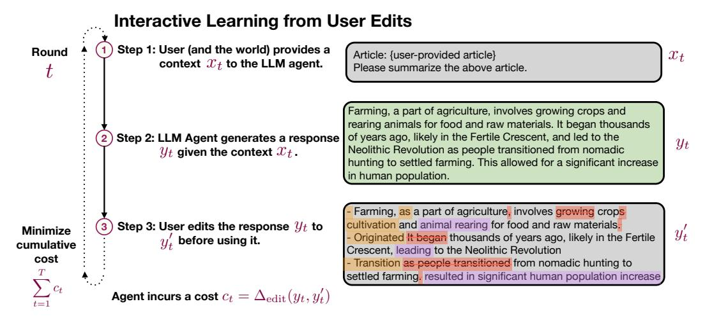
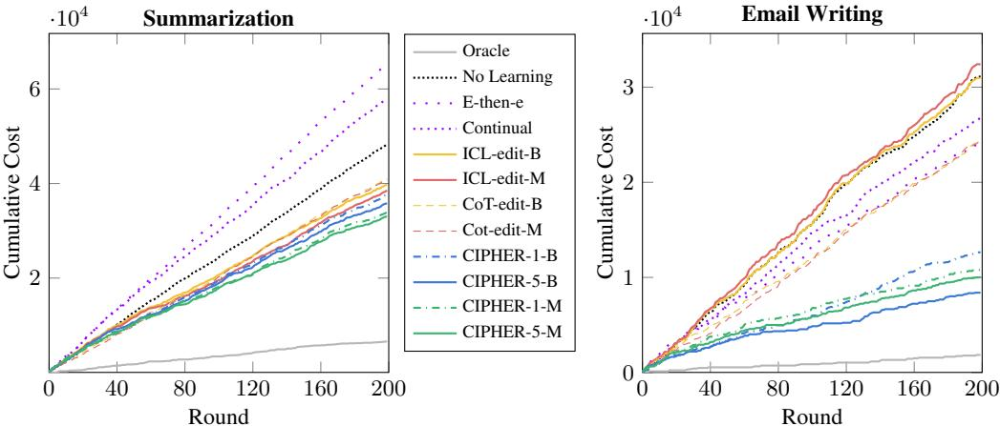
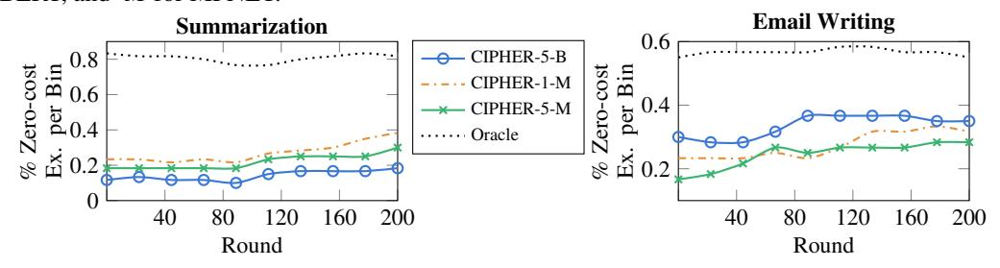
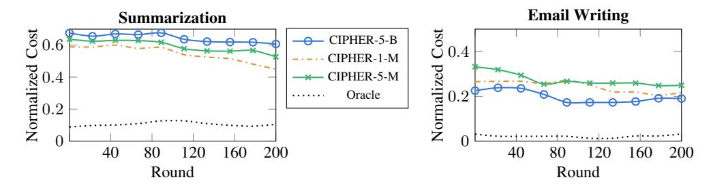

# Aligning LLM Agents by Learning Latent Preference from User Edits

Ge Gao♣∗ Alexey Taymanov♢∗ Eduardo Salinas♢ Paul Mineiro♢ Dipendra Misra♢ Department of Computer Science, Cornell University♣ Microsoft Research New York♢ ggao@cs.cornell.edu {ataymano, edus, pmineiro, dimisra}@microsoft.com

## Abstract

We study interactive learning of LLM-based language agents based on user edits made to the agent's output. In a typical setting such as writing assistants, the user interacts with a language agent to generate a response given a context, and may optionally edit the agent response to personalize it based on their *latent* preference, in addition to improving the correctness. The edit feedback is *naturally generated*, making it a suitable candidate for improving the agent's alignment with the user's preference, and for reducing the cost of user edits over time. We propose a learning framework, PRELUDE that infers a description of the user's latent preference based on historic edit data. The inferred user preference descriptions are used to define prompts for generating responses in the future. This avoids fine-tuning the agent, which is costly, challenging to scale with the number of users, and may even degrade its performance on other tasks. Furthermore, learning descriptive preference improves interpretability, allowing the user to view and modify the learned preference. However, user preference can be complex, subtle, and vary based on context, making it challenging to learn. To address this, we propose a simple yet effective algorithm named CIPHER that leverages the LLM to infer the user preference for a given context based on user edits. In the future, CIPHER retrieves inferred preferences from the k-closest contexts in the history, and forms an aggregate preference for response generation. We introduce two interactive environments – summarization and email writing, and use a GPT-4 simulated user for evaluation. On both tasks, CIPHER outperforms several baselines by achieving the lowest edit distance cost while only having a small overhead in LLM query cost over the base agent. Our analysis reports that user preferences learned by CIPHER show significant similarity to the ground truth latent preferences.[1](#page-0-0)

## 1 Introduction

Language agents based on large language models (LLMs) have been developed for a variety of applications [\(Dohmke,](#page-10-0) [2022;](#page-10-0) [Brynjolfsson et al.,](#page-9-0) [2023\)](#page-9-0), following recent breakthroughs in improving LLMs [\(Achiam et al.,](#page-9-1) [2023;](#page-9-1) [Ouyang et al.,](#page-12-0) [2022b;](#page-12-0) [Team et al.,](#page-13-0) [2023\)](#page-13-0). However, despite their impressive zero-shot performance, LLMs still need to align to a given user and task [\(Mysore et al.,](#page-11-0) [2023;](#page-11-0) [Li et al.,](#page-11-1) [2023\)](#page-11-1). In many applications, a natural feedback for LLM-based agents is user edits, where a user queries the agent and edits the agent's response before their own final use. In contrast, typical feedback used for fine-tuning, such as the comparison-based preference feedback in RLHF, is explicitly collected by providing annotators with model responses and asking them to rank [\(Ziegler](#page-13-1) [et al.,](#page-13-1) [2019;](#page-13-1) [Stiennon et al.,](#page-12-1) [2020;](#page-12-1) [Nakano et al.,](#page-12-2) [2021;](#page-12-2) [Ouyang et al.,](#page-12-3) [2022a,](#page-12-3) inter alia), making such feedback an expensive choice for improving alignment. Motivated by this observation, we focus on interactive learning of LLM-based language agents using user edits as feedback.

<sup>∗</sup>Equal contribution.

<span id="page-0-0"></span><sup>1</sup>Our code and data are publicly available at <https://github.com/gao-g/prelude>.

<span id="page-1-0"></span>

Figure 1: Illustration of interactive learning from user edits. Color coding in edits is for visualization only – our agent takes the plain revised text as feedback.

Consider the scenario in Figure 1 where a user interacts with an LLM-based writing assistant (agent) to complete their task. The interaction starts with the user (and the world) providing a context to the agent. This context may include a query prompt provided by the user, along with additional information provided by the world, such as the content on the screen, current time, and the user's calendar information. The agent generates a textual response given the context.

In the beginning, the agent's response may not be optimal for the user, as it is not personalized to this user's individual needs and preference. As most users are not familiar with prompt engineering, and LLMs are often able to generate a reasonable response for the task, therefore, users may find it the most convenient to simply edit this response when it is not ideal, rather than trying different prompts to get new responses. The example in Figure 1 illustrates that the user directly edits the summary generated by the agent to satisfy their preference for bullet point format. It takes time and effort for the user to make edits which can be measured using metrics such as the edit distance between the agent's response and the user edits. Our goal is to minimize the cumulative user edit cost over time using feedback from user edits. Notably, there is no distinction between training and testing in our setting as every natural use of the agent yields an edit feedback for learning.

We conjecture that user edits are driven by user's hidden preference which can be described in natural language. These *preference descriptions* are different from the notion of comparison-based preference used in RLHF. In this paper, we use the word *preference* to mean *preference descriptions*. For instance, preference of the user in Figure 1 can be described as *bullet points*. In practice, user preference can be compound, such as preferring *bullet point*, *informal*, *with emojis* at the same time, and also context-dependent, e.g., *informal* tone when writing an email to a family member, and *formal* tone when writing to a colleague. In more complex settings, user preference can evolve with time (non-stationary), or depend on information unavailable in the context (partially observed). Further, users may not be fully aware of all their preferences, or may fail to express these preferences in their query prompt. These considerations imply that user preference is *latent* to the language agent. If the agent could learn the *latent* preference correctly, it can significantly improve its performance by generating satisfactory responses. Furthermore, preference learned by the agent can be shown to the user to enhance *interpretability*, and can even be modified by the user to improve correctness. Motivated by this, we propose a learning framework, **PRELUDE** (**PRE**ference Learning from User's **D**irect Edits), where we seek to learn a user preference description for a given context using the history of user edits.

In a typical real-world scenario such as writing assistants, one has to potentially update the LLM-based agent for every user. Efficient approaches, therefore, must scale with the number of users. This makes approaches that fine-tune LLM parameters expensive to scale. Furthermore, LLMs typically undergo rigorous evaluation on a variety of safety tests before being released, and fine-tuning them can result in loosing the safety guarantees offered by these tests. For example, fine-tuning GPT-4 for millions of users can quickly turn very expensive. Approaches such as adding LORA and Adapter layers and only updating them, or using federated learning, can reduce the expense to some extent, but the loss of safety guarantees remains a concern. In this work, we focus

on leveraging a frozen, black-box LLM, and instead learning a *prompt policy* that can infer user preference description for a given context, and then use it to directly drive the response generation.

We introduce a simple yet effective algorithm **CIPHER** that implements the PRELUDE framework. CIPHER infers user preference for every context in the history with the aid of an LLM. In the future, given a context, it retrieves inferred preferences of similar contexts from the history and uses them to generate a response. CIPHER is computationally efficient and only slightly increases the LLM query cost compared to the base agent.

We introduce two interactive environments that evaluate the agent's ability to summarize documents and compose emails from a given notes. These tasks are inspired by writing assistant applications. For both tasks, we simulate a GPT-4 user that can generate edits based on a pre-designed *latent* preference that can vary based on the context. We evaluate CIPHER against several baselines and show that it achieves the lowest user edit cost. Additionally, CIPHER results in a lower LLM query cost than other retrieval-based baselines. Finally, we analyze preferences learned by our agents, and find that they show significant similarity to the ground truth latent preferences in our setup.

## 2 Interactive Learning from User Edits and the PRELUDE Framework

We first describe LLM agents and the general learning framework from user edits and then discuss our PRELUDE framework and associated learning challenges.

**LLM and Language Agents.** We assume access to a language agent that internally relies on an LLM. We make no assumption on the agent except that it can take as input a piece of context which can include both texts and images and an additional prompt (which can be in-context learning examples or learned preferences) and generates a text response. The language agent may simply perform greedy decoding of the LLM given the input or may perform complex planning to generate a response.

## <span id="page-2-0"></span>Protocol 1 Interactive Learning from User Edits.

- 1: **for**  $t = 1, 2, \dots, T$  **do**
- 2: User and the world provide a context  $x_t$
- 3: Agent generates a response  $y_t$  given the context  $x_t$
- 4: User edits the response to  $y'_t$
- 5: Agent receives a cost of  $c_t = \Delta_{\text{edit}}(y_t, y_t')$
- 6: Evaluate the agent and learning algorithm on  $\sum_{t=1}^{T} c_t$

Interactive Learning from User Edits. In an application such as a writing assistant, a user interacts with the language agent over T rounds. Protocol 1 shows such learning protocol. In the  $t^{th}$  round, the user and the world provide a context  $x_t \in \mathcal{X}$  where  $\mathcal{X}$  is the space of all possible contexts. This context will include the user prompt in text, along with additional information provided by the user or the world, and may include multimodal data as well such as images. Given the context  $x_t$ , the language agent generates a response  $y_t \in \mathcal{Y}$  in text, where  $\mathcal{Y}$  is the space of all texts. The user edits the response  $y_t$  to  $y_t'$ . If the user does not perform any edits, we treat this as setting  $y_t' = y_t$ . The agent receives a cost of  $c_t = \Delta_{\text{edit}}(y_t, y_t')$  for this round, which measures the user's efforts on making edits. The goal of the agent is to minimize the sum of costs across all rounds  $\sum_{t=1}^T c_t$ . In our experiments, we use  $\Delta_{\text{edit}}$  as Levenshtein edit distance (Levenshtein, 1965) in the token space which computes the minimum number of token insertion, deletion, and substitution necessary to convert  $y_t$  to  $y_t'$ . In general, a higher edit distance implies that the user has made more edits and spent more efforts.

**PRELUDE Framework.** We describe our PRELUDE framework in Protocol 2 which is a specialization of Protocol 1. In PRELUDE, in the  $t^{th}$  round, the agent infers the preference of the user as  $f_t$ , and uses it to generate a response. We assume that in this round and for the given context  $x_t$ , the user has a *latent* preference  $f_t^{\star}$  that drives the user to perform all edits. Furthermore, we assume that if the agent was able to infer this *latent* preference  $(f_t = f_t^{\star})$ , then it will lead to minimal possible edits. To remove the dependence on performance due to the choice of the base LLM agent, we compare with an oracle agent that has access to  $f_t^{\star}$  at the start of each round. We assume that the LLM remains frozen across all methods in this work.

<span id="page-2-1"></span><sup>&</sup>lt;sup>2</sup>The edit cost in practice may not always be 0, as the language agent could be incapable of adeptly using the correct preference, or the user may perform edits that are inconsistent with their preference.

## <span id="page-3-0"></span>Protocol 2 PRELUDE: PREference Learning from User's Direct Edits

```
1: for t=1,2,\cdots,T do
2: User presents a text context x_t
3: Agent infers a preference f_t using the history \{(x_\ell,y_\ell,y_\ell')\}_{\ell=1}^{t-1} and context x_t
4: Agent uses f_t and x_t to generate a response y_t
5: User edits the response to y_t' using their latent preference f_t^{\star}
6: Agent incurs a cost c_t = \Delta(y_t, y_t')
7: Return \sum_{t=1}^T c_t
```

Challenges of Learning User Preference. Learning user preference from edits is challenging. In practice, user preference are multifaceted and complex. Furthermore, user's preference can also significantly vary based on the context. The feedback in the form of user edits emerges naturally but is inherently implicit, lacking direct expressions of the actual preference and carrying subtleties that may lead to diverse interpretations. The combination of preference variability and the implicit nature of feedback poses considerable challenges for agents in accurately learning and integrating these preferences.

## 3 Learning User Preference through Retrieval and Aggregation

In this section, we present our method, CIPHER (Consolidates Induced Preferences based on Historical Edits with Retrieval), that learns user preference based on user edits.

**Algorithm 1** CIPHER $(\phi, k, \delta)$ . A context representation function  $\phi : \mathcal{X} \to \mathbb{R}^d$ , the retrieval hyperparameter k, and tolerance hyperparameter  $\delta \geq 0$ . We initialize history  $\mathcal{D} = \emptyset$ .

```
1: for t = 1, 2, \dots, T do
 2:
          User (and the world) presents a context x_t
          Retrieve the top-k examples \{\phi(x_{z_i}), \tilde{f}_{z_i}\}_{i=1}^k in \mathcal{D} with maximum cosine similarity to \phi(x_t)
 3:
          If k > 1, then query the LLM to aggregate these preferences \{\tilde{f}_{z_i}\}_{i=1}^k into f_t, else f_t = \tilde{f}_{z_1}
 4:
          Agent generates a text response y_t based on x_t and f_t
 5:
 6:
          User edits the response to y'_t using their latent preference f_t^*
 7:
          Agent incurs a cost c_t = \Delta_{\text{edit}}(y_t, y_t')
          if c_t \leq \delta then
 8:
               \tilde{f}_t = f_t
 9:
10:
                Query the LLM to generate a preference \tilde{f}_t that best explains user edits in (y_t, y'_t)
11:
12: \mathcal{D} \leftarrow \mathcal{D} \cup \{(\phi(x_t), \tilde{f}_t)\}
13: Return \sum_{t=1}^{T} c_t
```

Algorithm 1 shows CIPHER which implements the PRELUDE framework. CIPHER maintains a preference history  $\mathcal{D}_t = \{(x_\ell, \tilde{f}_\ell)\}_{\ell=1}^{t-1}$  of past contexts  $x_\ell$  along with a preference  $\tilde{f}_\ell$  inferred by the agent. CIPHER assumes access to a *context representation function*  $\phi: \mathcal{X} \to \mathbb{R}^d$  that can map a context to a vector representation. For a given round t with context  $x_t$ , the agent first retrieves the k-closest contexts from the interaction history  $\mathcal{D}_t$ . We use cosine similarity for computing proximity, although other metrics such as Euclidean distance, or Hamming distance when  $\phi$  outputs a binary vector, can be used. Given the retrieved contexts and their inferred preferences  $\{(x_{z_i}, \tilde{f}_{z_i})\}_{i=1}^k$ , we query the underlying LLM to summarize the inferred preferences  $\{\tilde{f}_{z_i}\}_{i=1}^k$  into a single preference  $f_t$ . In the beginning, when  $t \leq k$ , we retrieve all the past t contexts. In particular, for t=1 we have  $f_1$  as an empty string as the agent has no prior knowledge of this user's preference.

The agent uses the inferred preference  $f_t$  to generate the response. This is done by concatenating the context  $x_t$  with an agent prompt such as "This user has a preference of  $\langle f_t \rangle$  which must be used when generating the response", where  $\langle f_t \rangle$  indicates where we insert the inferred preference  $f_t$ . We list the actual template used in our experiments in Table 7 in Appendix B.

Given the user edits  $y'_t$ , if the user edits are minimal, i.e.,  $\Delta_{\text{edit}}(y_t, y'_t) \leq \delta$  for a hyperparameter  $\delta$ , then we set the inferred preference for this round as  $\tilde{f}_t = f_t$  as using  $f_t$  for generating a response

<span id="page-3-1"></span><sup>&</sup>lt;sup>3</sup>In practice, one can initialize with a publicly available preference history.

Table 1: Latent user preference design, specific to the document source.

<span id="page-4-0"></span>

| Doc Source                                | Latent User Preference                                                                                | Scenario                                      |
|-------------------------------------------|-------------------------------------------------------------------------------------------------------|-----------------------------------------------|
| Summarization                             |                                                                                                       |                                               |
| News article (See et al., 2017)           | targeted to young children, storytelling, short<br>sentences, playful language, interactive, positive | introduce a political news to kids            |
| Reddit post                               | second person narrative, brief, show emotions,                                                        | for character development in cre-             |
| (Stiennon et al., 2020)<br>Wikipedia page | invoke personal reflection, immersive<br>bullet points, parallel structure, brief                     | ative writing<br>take notes for key knowledge |
| (Foundation, 2022)                        | bullet points, paramer structure, orier                                                               | take notes for key knowledge                  |
| Paper abstract                            | tweet style, simple English, inquisitive, skillful                                                    | promote a paper to invoke more                |
| (Clement et al., 2019)                    | foreshadowing, with emojis                                                                            | attention and interests                       |
| Movie review                              | question answering style, direct, concise                                                             | quickly get main opinions                     |
| (Maas et al., 2011)                       |                                                                                                       |                                               |
| Email Writing                             |                                                                                                       |                                               |
| Personal problem                          | informal, conversational, short, no closing                                                           | share life with friends                       |
| (Stiennon et al., 2020)                   |                                                                                                       |                                               |
| Paper review                              | casual tone, positive, clear, call to action                                                          | peer review to colleague                      |
| (Hua et al., 2019)                        |                                                                                                       | . 1: 3.6                                      |
| Paper tweet                               | engaging, personalized, professional tone, thank-                                                     | networking emails for researchers             |
| (Bar, 2022)                               | ful closing                                                                                           | milastana raport to superiors                 |
| Paper summary (Kershaw & Koeling,         | structured, straight to the points, respectful, pro-<br>fessional greeting and closing                | ninestone report to superiors                 |
| 2020)                                     | ressional greeting and crossing                                                                       |                                               |

resulted in minimal edits. However, if  $\Delta_{\text{edit}}(y_t, y_t') > \delta$ , then we query the LLM a third time to generate the inferred preference  $\tilde{f}_t$  that explains why the user edited  $y_t$  to  $y_t'$ . We call this the *Latent Preference Induction* (LPI) step. In both cases, we append  $(x_t, f_t)$  to the preference history.

Note that we cannot query the LLM for the inferred preference in the first case where the user edit cost  $c_t$  is small, i.e.,  $c_t \leq \delta$ . In this case, querying the LLM to infer the preference to explain the edits in  $y_t'$  given  $y_t$ , will result in the LLM outputting that the agent has no preference which is incorrect.

Computational Cost of CIPHER. In a given round, CIPHER adds a maximum of 3 LLM calls on top of the cost of calling the underlying inference algorithm of the agent in line 5. CIPHER further reduces the memory storage by only storing the representation of contexts in the preference string instead of the input itself. Finally, CIPHER only adds a small prompt to the context  $x_t$ , before calling the agent's inference algorithm. This only slightly increases the length of the prompt, thereby, reducing the query cost associated with LLMs that scales with the number of input tokens.

## 4 Experiment

We first introduce two interactive tasks for learning from user edits, and then describe our results.

## 4.1 Two Interactive Writing Assistant Environments for Learning from User Edits

**Task.** We introduce two tasks inspired by the use of LLMs as writing assistants (Mysore et al., 2023; Shen et al., 2023; Wang et al., 2023). In the first task, we evaluate the agent's ability to summarize a given document. In the second task, we evaluate the agent's ability to compose an email given notes. For both tasks, we use documents from several existing sources listed in Table 1. These sources represent a diverse category of documents that a writing assistant would typically encounter (see Table 4 in Appendix for examples). In any given round, the user is provided a context that is a document from one of the sources for the given task. Importantly, the agent is *unaware of the source of the given document* which as we discuss later, will determine the user preference. For both tasks, we run an experiment for T=200 rounds. We sample an equal number of documents from each source and mix them to remove any temporal correlation in document sources.

**Two-Stage GPT-4 Simulated User.** We simulate a user that can edit a given response. We define a set of *latent user preferences* for the user that vary based on the document source. Table 1 lists the preference for every source. This captures the context-dependent nature of user preferences as the document source influences the type of context. For example, the *Personal problem* document

source contains documents pertaining to discussions with a friend, and a user may have a different preference when writing an email to a friend compared to writing an email to a colleague. We assume that our user is aware of the document source  $d_t$  of a given context  $x_t$ . This implies, that we can express the true user preference for  $x_t$  as  $f_t^* = F(d_t)$  where F maps a given document source to the user preference. Recall that the agent is never provided the document source of any context.

We model our user using GPT-4 with a two-stage approach. Given an agent response  $y_t$  and the context  $x_t$ , we first query GPT-4 to check if  $y_t$  satisfies the preference in  $f_t^*$ . If the answer is yes, then the user preforms no edits and returns  $y_t' = y_t$ . If the answer is no, then we use GPT-4 to generate the edited response  $y_t'$  given  $y_t$  and  $f_t^*$ . We found that our two-stage GPT-4 user can generate high-quality edits, consistent with observations in prior work that LLM-written feedback is high-quality and useful to learn from (Bai et al., 2022; Saunders et al., 2022). We adopted a two-stage process since using GPT-4 to directly edit the response  $y_t$  always resulted in edits even when the response satisfied the preference  $f_t^*$ . We provide GPT-4 user prompt template and user edit examples in Appendix B.

Evaluation Metric. We propose three metrics for evaluating agents learning from user edits. Our main metric is the cumulative user edit cost  $\sum_{t=1}^T \Delta_{\text{edit}}(y_t, y_t')$  over T rounds where  $\Delta_{\text{edit}}(y_t, y_t')$  is the Levenshtein edit distance between agent response  $y_t$  and user edits  $y_t'$  computed in the token space using Tiktoken tokenizer. For methods that learn an interpretable preference, we additionally evaluate the quality of the inferred user preference  $f_t$ . We do so by evaluating if  $f_t$  is closer to the true preference  $f_t^* = F(d_t)$ , where  $d_t$  is the document source of context in round t, compared to preference of any other document source. Formally, we compute  $\frac{1}{T}\sum_{t=1}^T \mathbb{1}\{d_t = \arg\max_{d \in \mathcal{S}} \text{BERTScore}(f_t, F(d))\}$ , where BERTScore (Zhang\* et al., 2020) is a text similarity metric and  $\mathcal{S}$  is the set of all document sources. Finally, we report the total number of input and output BPE tokens to the LLM across all rounds. This measures the expense associated with using LLM, used by popular LLM providers to charge their customers.

## 4.2 Details of CIPHER and Comparison Systems

We use GPT-4 as our base LLM for CIPHER and all baselines. We do not perform fine-tuning of the GPT-4 and do not add any additional parameters to the model. We use a prompt-based GPT-4 agent for all methods that uses a single prompt with greedy decoding to generate the response. Our main method CIPHER and the baselines, can be extended to more complex language agents that perform multiple steps of reasoning on top of the base LLM before generating a response.

**CIPHER Details.** We use a simple agent that uses GPT-4 with a prompt template to generate the response  $y_t$  given the context  $x_t$  and preference  $f_t$ . We list templates in Table 7 in Appendix B. We experiment with MPNET (Song et al., 2020) and BERT (Devlin et al., 2019) as our two context representation functions  $\phi$ , and use cosine similarity for retrieval. We experiment with two different values of the number of retrieved examples  $k \in \{1, 5\}$ .

**Baselines.** We evaluate CIPHER against baselines that either perform no learning, or learn context-agnostic preferences, or directly use past edits to generate a response:

- 1. No learning: The agent performs no learning based on interaction with the user.
- 2. Explore-then-exploit (E-then-e) LPI: This baseline is based on the classic explore-then-exploit strategy in interactive learning (Garivier et al., 2016). The agent first generates responses for the first  $T_e$  rounds without performing any learning (exploration stage). It then infers a single user preference  $\tilde{f}_e$  using the user edits in the first  $T_e$  rounds by applying the LPI step (Algorithm 1, line 11), which is used to generate responses for remaining rounds (exploitation step).
- 3. Continual LPI: This baseline is similar to E-then-e LPI except that it never stops exploring and avoids overfitting to the first  $T_e$  rounds. In any given round t, it uses the data of all past edits  $\{(y_\ell, y'_\ell)\}_{\ell=1}^{t-1}$  to learn a preference  $f_t$  by performing the LPI step. It then generates a response using this preference. Similar to E-then-e LPI, this approach learn context-agnostic preferences.
- 4. *ICL-edit:* This is a standard retrieval-based in-context learning (ICL) baseline (Brown et al., 2020). In a given round t, the agent first retrieves the closest k examples  $\{(y_{z_\ell}, y'_{z_\ell})\}_{\ell=1}^k$  to the given context  $x_t$  using the representation function  $\phi$ . These examples are provided in an ICL prompt and use to generate the response  $y_t$ . This approach does not learn preferences but unlike E-then-e LPI and Continual LPI it can perform context-dependent learning.

5. CoT-edit: This is a standard retrieval-based chain-of-thought (CoT) baseline (Wei et al., 2022). This baseline is similar to *ICL-edit* except the prompt for generation requires the agent to infer a user preference  $f_t$  based on retrieved k examples, and generate an output according to  $f_t$ .

**Oracle Method.** We also evaluate an oracle approach which uses the true user preference in each round to generate the response. This provides an upper bound on performance and helps to evaluate if our setup is well-designed, i.e., whether learning the true user preference indeed leads to low edit costs.

#### 4.3 Main Result and Discussion.

**Main Results.** Table 2 reports the performance of all methods on the two tasks on three metrics. We report the mean and standard deviation across 3 different random seeds.<sup>5</sup>

<span id="page-6-1"></span>Table 2: Performance of baselines and our methods in terms of cumulative edit distance cost and classification accuracy.  $\mu_{\sigma}$  denotes the mean  $\mu$  and standard deviation  $\sigma$  across 3 runs over different seeds. Expense column shows budget as the average number of input and output BPE tokens across 3 runs (unit is  $\cdot 10^5$ ). We use -k in method names to denote that we use k retrieved examples. Numbers in bold are the best performance in each column excluding *oracle preference* method, underline for the second best, and dotted underline for the third best.

| Method            | Sur                          | nmarization                   |          | Em                            | ail Writing                |          |
|-------------------|------------------------------|-------------------------------|----------|-------------------------------|----------------------------|----------|
|                   | Edit Distance↓               | Accuracy <sup>†</sup>         | Expense↓ | Edit Distance↓                | Accuracy↑                  | Expense↓ |
| Oracle Preference | 6,573 <sub>1,451</sub>       | 1.000                         | 1.67     | 1,851 <sub>243</sub>          | 1.000                      | 1.62     |
| No Learning       | 48,269 <sub>957</sub>        | -                             | 1.50     | 31,103900                     | -                          | 1.65     |
| E-then-e LPI      | $65,218_{17,466}$            | $0.218_{0.003}$               | 1.99     | 24,562 <sub>1,022</sub>       | $0.263_{0.003}$            | 1.73     |
| Continual LPI     | $57,915_{2,210}$             | $0.233_{0.010}$               | 8.89     | $26,852_{1,464}$              | $0.243_{0.019}$            | 8.63     |
| ICL-edit-5-MPNET  | 38,560 <sub>1,044</sub>      | -                             | 8.00     | 32,405 <sub>1,307</sub>       | -                          | 12.12    |
| ICL-edit-5-BERT   | $39,734_{1,929}$             | -                             | 7.96     | $30,949_{3,250}$              | -                          | 11.55    |
| CoT-edit-5-MPNET  | $40,747_{1,874}$             | $0.230_{0.026}$               | 6.82     | 24,292 <sub>3,503</sub>       | $0.300_{0.023}$            | 8.74     |
| CoT-edit-5-BERT   | $41,088_{1,846}$             | $0.230_{0.013}$               | 6.92     | 24,301 <sub>1,382</sub>       | $0.263_{0.032}$            | 8.26     |
| CIPHER-1-MPNET    | 33,926 <sub>4,000</sub>      | $0.520_{0.022}$               | 2.74     | 10,781 <sub>1,711</sub>       | 0.435 <sub>0.084</sub>     | 1.94     |
| CIPHER-5-MPNET    | <b>32,974</b> <sub>195</sub> | $0.478_{0.010}$               | 3.00     | 10,058 <sub>1,709</sub>       | $0.467_{0.081}$            | 2.09     |
| CIPHER-1-BERT     | 37,637 <sub>3,025</sub>      | <b>0.565</b> <sub>0.053</sub> | 2.81     | $\overline{12,634}_{4,868}$   | $\overline{0.487}_{0.125}$ | 1.99     |
| CIPHER-5-BERT     | 35,811 <sub>3,384</sub>      | $0.478_{0.028}$               | 3.03     | <b>8,391</b> <sub>3,038</sub> | $0.363_{0.075}$            | 2.22     |

**Discussion of Main Result.** We observe that not performing learning results in a high edit cost, whereas using the oracle preferences achieves a significantly smaller edit cost. This shows that our environments are sound and well-conditioned. *E-then-e LPI* and *Continual LPI* learn context-agnostic preferences which cannot capture the context-dependent preferences in the environments and end up doing poorly. For the summarization task, they end up with a higher edit distance than even performing no learning. One possible explanation is that using context-agnostic preferences can push the model to specialize to a given preference much more than the base model, resulting in more edits when that preference is incorrect. We see this in preference accuracy, which is low for both of these baselines, and lower for the summarization task than the email writing task where they outperform no learning baselines. Further, *Continual LPI* has a higher expense cost due to constantly querying the LLM to infer the user preference.

*ICL-edit* baselines perform significantly better on the summarization task. However, using a list of user edits in the prompt results in a higher token expense cost, as the responses and their edits can be significantly long in practice. Further, the ICL-edit baselines provide no interpretable explanation for their response or for explaining user behavior. Although *CoT-edit* baselines provide an interpretable preference, they still result in relatively high expense and low classification accuracy.

CIPHER achieves the smallest edit distance cost reducing edits by 31% in the summarization task and 73% in the email writing task. We observe that retrieving k=5 preferences and aggregating them achieves lower edit distance, however, the choice of ideal representation  $\phi$  seems task-dependent.

<span id="page-6-2"></span><span id="page-6-0"></span><sup>&</sup>lt;sup>4</sup>Appendix B reports additional details of our baselines, such as hyperparameters and prompt templates.

<sup>&</sup>lt;sup>5</sup>We randomize the context sampling from source datasets, so experiments on different seeds contain different sets of input contexts. On the same seed, experiments across different methods are strictly comparable, as both the set of input contexts and the order of input context seen are the same in our implementation.

<span id="page-7-0"></span>Figure 2: Learning curves of different methods based on cumulative cost over time (average across 3 seeds). In the legend, -k means with top k retrieved examples, -B for BERT, and -M for MPNET.



<span id="page-7-1"></span>Figure 3: Percentage of zero-cost examples of CIPHER over time, binned per 20 rounds to show the trend (average across 3 seeds). In the legend, -k means with top k retrieved examples, -B for BERT, and -M for MPNET.



Further, CIPHER achieves the highest preference accuracy showing that CIPHER can learn preferences that correlate more with the ground truth preference than preferences of other document sources. Note that the performance of a random preference classifier is only 20% for summarization and 25% for email writing. Further, CIPHER achieves a smaller cost than *ICL-edit* and *Continual LPI* baselines, as it doesn't use long user edits in the prompt for generating a response. In summary, CIPHER provides a cheap, more effective, and interpretable method than our baselines.

**Learning Curves.** We plot mean cumulative user edit costs over rounds in Figure 2. The cumulative user edit costs in Figure 2 show that the angle of the learning curves decreases for CIPHER after an initial number of rounds, showing that learning helps decrease the rate at which user edits are accumulated. In contrast, the angle of the learning curve for the no-learning baseline remains unchanged.

**Evaluating Fraction of Non-Edited Responses.** Recall that the first stage of our GPT-4 user checks if the agent response satisfies the latent user preference  $f^*$ . If it does, then no edits are performed, otherwise, the user edits the response. We plot the percentage of examples with zero edit cost per 20 rounds bin in Figure 3. We notice a small increase in the number of examples with zero edit cost. This indicates that gains come not just by increasing the number of examples that avoid getting edited in stage 1 of our user but more generally across examples.

**Qualitative Analysis of Learned Preferences.** We evaluate the quality of preferences learned by CIPHER on the harder summarization task. Table 3 lists 3 learned preferences per document source for CIPHER-5-MPNET which are randomly sampled at the beginning, middle, and end of the interaction history. We see that overall the agent can learn a reasonable description of the latent preference. For example, it can learn bullet points preference for Wikipedia articles, and second person narrative for Reddit posts, and QA style for Movie reviews. CIPHER can pick some preferences fairly early such as bullet points for Wikipedia and emojis for Paper abstract, whereas some are learned only later such as Structured Q&A for Movie reviews. This shows using CIPHER can quickly learn useful preferences, but further interaction continues to help.<sup>6</sup>

<span id="page-7-2"></span><sup>&</sup>lt;sup>6</sup>We present more additional analysis in Appendix C, including detailed expense report, normalized edit distance cost, failure case analysis, and retrieval accuracy.

<span id="page-8-0"></span>Table 3: Examples of learned preferences on summarization task with *CIPHER-5-MPNET*, grouped based on the document source and corresponding latent preference. We randomly sample 3 examples per type at the beginning, middle, and end of the interaction history.

| Latent User Preference                                                                                                        | (Round) Learned Preference                                                                                                                                                                                                                                               |
|-------------------------------------------------------------------------------------------------------------------------------|--------------------------------------------------------------------------------------------------------------------------------------------------------------------------------------------------------------------------------------------------------------------------|
| News article.<br>targeted to<br>young children, storytelling,<br>short sentences, playful lan<br>guage, interactive, positive | (22) Fairy tale narrative style, informal and conversational tone, use of rhetorical<br>questions, simplified language.<br>(115) Simplified, childlike storytelling with playful language and imagery<br>(192) Simplified and playful storytelling language              |
| Reddit post. second person<br>narrative, brief, show emo<br>tions, invoke personal reflec<br>tion, immersive                  | (14) Concise and coherent storytelling<br>(102) The user prefers a second-person narrative and a more direct, personal tone<br>(194) Poetic and descriptive language, narrative perspective shift to second person                                                       |
| Wikipedia page.<br>bullet<br>points,<br>parallel<br>structure,<br>brief                                                       | (19) Concise, Bullet-Pointed, Structured Summaries with a Narrative Q&A Style<br>(124) Concise and factual writing style, bullet-point formatting<br>(197) Concise and streamlined formatting, with bullet points and clear subhead<br>ings for easy scanning            |
| Paper abstract. tweet style,<br>simple English, inquisitive,<br>skillful foreshadowing, with<br>emojis                        | (20) Concise, conversational summaries with bullet points and emojis.<br>(111) Concise, conversational, whimsical bullet-point summaries with emojis.<br>(193) Concise, conversational, and whimsical bullet-point summaries with emojis.                                |
| Movie review. question an<br>swering style                                                                                    | (12) The user prefers a straightforward, clear, and concise writing style with<br>factual formatting.<br>(123) The user prefers a clear and concise question and answer format with<br>straightforward language.<br>(199) Concise, Structured Q&A with Whimsical Clarity |

## 4.4 Human Evaluation

We conduct two types of evaluation with human users to further understand the performance of our methods on summarization. We focus on our best-performing method *CIPHER-5-MPNET*. [7](#page-8-1)

Win Rate Evaluation. We conduct win rate evaluation where evaluators are given a pair of text and choose which one has higher quality. We compare the output of *CIPHER-5-MPNET* against the output of the best-performing baseline *ICL-edit-5-MPNET*, and against the generation of the oracle method. Each evaluation covers 15 text pairs, with three random samples from each scenario in the last 50 rounds of interaction. We conduct these *CIPHER vs. ICL* and *CIPHER vs. Oracle* evaluations with 7 human evaluators recruited through our personal network. For each text pair, we consider the output receiving the majority vote as a win. We find that the win rate of *CIPHER-5-MPNET* against *ICL-edit-5-MPNET* is 73.3%. This confirms that our method outperforms the best-performing baseline for human users. In *CIPHER vs. Oracle* evaluation, the win rate of *CIPHER-5-MPNET* is 23.7%, which reflects the performance gap we reported in previous sections.

Edits by Human Users. We study the edit feedback from human users to the generation of *CIPHER-5-MPNET* and the oracle method. We instruct human users to edit the output based on the given latent preference, and to leave no edits when the output aligns with the given preference. We mix 20 outputs from *CIPHER-5-MPNET* and the oracle method so that human users cannot tell the source of each output. The total edit distance, averaged across 3 human users, is 211 for CIPHER, and 98 for the oracle method. The averaged percentage of zero-edit examples is 60% for CIPHER and 76.7% for oracle.

## 5 Conclusion

We study aligning LLM-based agents using user edits that arise naturally in applications such as writing assistants. We introduce the PRELUDE framework that seeks to learn the latent user preferences that drive these edits, and uses them to generate a response. We propose a practical algorithm CI-PHER that implements PRELUDEand outperforms baselines on two interactive tasks with a GPT-4 simulated user. Evaluating CIPHER with human-in-the-loop as well as developing algorithms that can fine-tune LLMs using user edit where fine-tuning is feasible, are interesting future work directions.

<span id="page-8-1"></span><sup>7</sup>Examples in each evaluation have no overlap, which are sampled from experiments on different seeds.

## Acknowledgments

Gao was a research intern in MSR NYC, and later was partially supported by NSF project #1901030. All content represents the opinion of the authors, which is not necessarily shared or endorsed by their respective employers and/or sponsors. We thank MSR NYC research community, Jonathan D. Chang, Daniel D. Lee, Claire Cardie, and Sasha Rush for helpful discussions and support. We also thank Stéphane Aroca-Ouellette, Kyunghyun Cho, and Columbia NLP community for their valuable feedback.

## References

- <span id="page-9-1"></span>Josh Achiam, Steven Adler, Sandhini Agarwal, Lama Ahmad, Ilge Akkaya, Florencia Leoni Aleman, Diogo Almeida, Janko Altenschmidt, Sam Altman, Shyamal Anadkat, et al. Gpt-4 technical report. *arXiv preprint arXiv:2303.08774*, 2023.
- <span id="page-9-12"></span>Sweta Agrawal and Marine Carpuat. An imitation learning curriculum for text editing with nonautoregressive models. *ArXiv*, abs/2203.09486, 2022.
- <span id="page-9-3"></span>Yuntao Bai, Saurav Kadavath, Sandipan Kundu, Amanda Askell, Jackson Kernion, Andy Jones, Anna Chen, Anna Goldie, Azalia Mirhoseini, Cameron McKinnon, Carol Chen, Catherine Olsson, Christopher Olah, Danny Hernandez, Dawn Drain, Deep Ganguli, Dustin Li, Eli Tran-Johnson, Ethan Perez, Jamie Kerr, Jared Mueller, Jeffrey Ladish, Joshua Landau, Kamal Ndousse, Kamile Lukosuite, Liane Lovitt, Michael Sellitto, Nelson Elhage, Nicholas Schiefer, Noemi Mercado, Nova DasSarma, Robert Lasenby, Robin Larson, Sam Ringer, Scott Johnston, Shauna Kravec, Sheer El Showk, Stanislav Fort, Tamera Lanham, Timothy Telleen-Lawton, Tom Conerly, Tom Henighan, Tristan Hume, Samuel R. Bowman, Zac Hatfield-Dodds, Ben Mann, Dario Amodei, Nicholas Joseph, Sam McCandlish, Tom Brown, and Jared Kaplan. Constitutional ai: Harmlessness from ai feedback, 2022.
- <span id="page-9-9"></span>Vidhisha Balachandran, Hannaneh Hajishirzi, William Cohen, and Yulia Tsvetkov. Correcting diverse factual errors in abstractive summarization via post-editing and language model infilling. *ArXiv*, abs/2210.12378, 2022.
- <span id="page-9-2"></span>Nitsan Bar. Papertweet. <https://github.com/bnitsan/PaperTweet/>, 2022.
- <span id="page-9-10"></span>Jan A. Botha, Manaal Faruqui, John Alex, Jason Baldridge, and Dipanjan Das. Learning to split and rephrase from wikipedia edit history. *ArXiv*, abs/1808.09468, 2018.
- <span id="page-9-11"></span>Shaked Brody, Uri Alon, and Eran Yahav. A structural model for contextual code changes. *Proceedings of the ACM on Programming Languages*, 4:1 – 28, 2020.
- <span id="page-9-4"></span>Tom Brown, Benjamin Mann, Nick Ryder, Melanie Subbiah, Jared D Kaplan, Prafulla Dhariwal, Arvind Neelakantan, Pranav Shyam, Girish Sastry, Amanda Askell, et al. Language models are few-shot learners. *Advances in neural information processing systems*, 33:1877–1901, 2020.
- <span id="page-9-0"></span>Erik Brynjolfsson, Danielle Li, and Lindsey R Raymond. Generative ai at work. Technical report, National Bureau of Economic Research, 2023.
- <span id="page-9-8"></span>Mengyao Cao, Yue Dong, Jiapeng Wu, and Jackie Chi Kit Cheung. Factual error correction for abstractive summarization models. *ArXiv*, abs/2010.08712, 2020.
- <span id="page-9-6"></span>Jonathan D Chang, Kiante Brantley, Rajkumar Ramamurthy, Dipendra Misra, and Wen Sun. Learning to generate better than your llm. *arXiv preprint arXiv:2306.11816*, 2023.
- <span id="page-9-7"></span>Zimin Chen, Steve Kommrusch, Michele Tufano, Louis-Noël Pouchet, Denys Poshyvanyk, and Monperrus Martin. Sequencer: Sequence-to-sequence learning for end-to-end program repair. *IEEE Transactions on Software Engineering*, 47:1943–1959, 2018.
- <span id="page-9-5"></span>Ching-An Cheng, Andrey Kolobov, Dipendra Misra, Allen Nie, and Adith Swaminathan. Llf-bench: Benchmark for interactive learning from language feedback. *arXiv preprint arXiv:2312.06853*, 2023.

- <span id="page-10-15"></span>Ruining Chong, Cunliang Kong, Liu Wu, Zhenghao Liu, Ziye Jin, Liner Yang, Yange Fan, Hanghang Fan, and Erhong Yang. Leveraging prefix transfer for multi-intent text revision. *Annual Meeting of the Association for Computational Linguistics*, 2023.
- <span id="page-10-2"></span>Colin B. Clement, Matthew Bierbaum, Kevin P. O'Keeffe, and Alexander A. Alemi. On the use of arxiv as a dataset, 2019.
- <span id="page-10-13"></span>Mike D'Arcy, Alexis Ross, Erin Bransom, Bailey Kuehl, Jonathan Bragg, Tom Hope, and Doug Downey. Aries: A corpus of scientific paper edits made in response to peer reviews. *ArXiv*, abs/2306.12587, 2023.
- <span id="page-10-10"></span>Mingkai Deng, Jianyu Wang, Cheng-Ping Hsieh, Yihan Wang, Han Guo, Tianmin Shu, Meng Song, Eric P Xing, and Zhiting Hu. Rlprompt: Optimizing discrete text prompts with reinforcement learning. *arXiv preprint arXiv:2205.12548*, 2022.
- <span id="page-10-5"></span>Jacob Devlin, Ming-Wei Chang, Kenton Lee, and Kristina Toutanova. Bert: Pre-training of deep bidirectional transformers for language understanding. *North American Chapter of the Association for Computational Linguistics*, 2019.
- <span id="page-10-0"></span>Thomas Dohmke. Github copilot is generally available to all developers. [https://github.blog/](https://github.blog/2022-06-21-github-copilot-is-generally-available-to-all-developers/) [2022-06-21-github-copilot-is-generally-available-to-all-developers/](https://github.blog/2022-06-21-github-copilot-is-generally-available-to-all-developers/), 2022. Accessed: April-20-2024.
- <span id="page-10-12"></span>Wanyu Du, Vipul Raheja, Dhruv Kumar, Zae Myung Kim, Melissa Lopez, and Dongyeop Kang. Understanding iterative revision from human-written text. *ArXiv*, abs/2203.03802, 2022.
- <span id="page-10-11"></span>Felix Faltings, Michel Galley, Gerold Hintz, Chris Brockett, Chris Quirk, Jianfeng Gao, and Bill Dolan. Text editing by command. *ArXiv*, abs/2010.12826, 2020.
- <span id="page-10-7"></span>Patrick Fernandes, Aman Madaan, Emmy Liu, António Farinhas, Pedro Henrique Martins, Amanda Bertsch, José G. C. de Souza, Shuyan Zhou, Tongshuang Sherry Wu, Graham Neubig, and André F. T. Martins. Bridging the gap: A survey on integrating (human) feedback for natural language generation. *ArXiv*, abs/2305.00955, 2023.
- <span id="page-10-1"></span>Wikimedia Foundation. Wikimedia downloads. <https://dumps.wikimedia.org>, 2022.
- <span id="page-10-6"></span>Aurélien Garivier, Tor Lattimore, and Emilie Kaufmann. On explore-then-commit strategies. *Advances in Neural Information Processing Systems*, 29, 2016.
- <span id="page-10-9"></span>Shangmin Guo, Biao Zhang, Tianlin Liu, Tianqi Liu, Misha Khalman, Felipe Llinares, Alexandre Rame, Thomas Mesnard, Yao Zhao, Bilal Piot, et al. Direct language model alignment from online ai feedback. *arXiv preprint arXiv:2402.04792*, 2024.
- <span id="page-10-16"></span>Kelvin Guu, Tatsunori B. Hashimoto, Yonatan Oren, and Percy Liang. Generating sentences by editing prototypes. *Transactions of the Association for Computational Linguistics*, 6:437–450, 2017.
- <span id="page-10-8"></span>Braden Hancock, Antoine Bordes, Pierre-Emmanuel Mazaré, and Jason Weston. Learning from dialogue after deployment: Feed yourself, chatbot! *Annual Meeting of the Association for Computational Linguistics*, 2019.
- <span id="page-10-3"></span>Xinyu Hua, Mitko Nikolov, Nikhil Badugu, and Lu Wang. Argument mining for understanding peer reviews. *Proceedings of the 2019 Conference of the North American Chapter of the Association for Computational Linguistics: Human Language Technologies, Volume 1 (Long and Short Papers)*, June 2019.
- <span id="page-10-4"></span>Daniel James Kershaw and R. Koeling. Elsevier oa cc-by corpus. *ArXiv*, abs/2008.00774, 2020. doi: https://doi.org/10.48550/arXiv.2008.00774. URL [https://elsevier.digitalcommonsdata.](https://elsevier.digitalcommonsdata.com/datasets/zm33cdndxs) [com/datasets/zm33cdndxs](https://elsevier.digitalcommonsdata.com/datasets/zm33cdndxs).
- <span id="page-10-14"></span>Zae Myung Kim, Wanyu Du, Vipul Raheja, Dhruv Kumar, and Dongyeop Kang. Improving iterative text revision by learning where to edit from other revision tasks. *ArXiv*, abs/2212.01350, 2022.

- <span id="page-11-10"></span>Philippe Laban, Jesse Vig, Wojciech Kryscinski, Shafiq R. Joty, Caiming Xiong, and Chien-Sheng Wu. Swipe: A dataset for document-level simplification of wikipedia pages. *Annual Meeting of the Association for Computational Linguistics*, 2023.
- <span id="page-11-8"></span>Mina Lee, Katy Ilonka Gero, John Joon Young Chung, Simon Buckingham Shum, Vipul Raheja, Hua Shen, Subhashini Venugopalan, Thiemo Wambsganss, David Zhou, Emad A. Alghamdi, Tal August, Avinash Bhat, Madiha Zahrah Choksi, Senjuti Dutta, Jin L.C. Guo, Md. Naimul Hoque, Yewon Kim, Seyed Parsa Neshaei, Agnia Sergeyuk, Antonette Shibani, Disha Shrivastava, Lila Shroff, Jessi Stark, S. Sterman, Sitong Wang, Antoine Bosselut, Daniel Buschek, Joseph Chee Chang, Sherol Chen, Max Kreminski, Joonsuk Park, Roy Pea, Eugenia H. Rho, Shannon Zejiang Shen, and Pao Siangliulue. A design space for intelligent and interactive writing assistants. *Conference on Human Factors in Computing Systems*, abs/2403.14117, 2024.
- <span id="page-11-2"></span>Vladimir I. Levenshtein. Binary codes capable of correcting deletions, insertions, and reversals. *Soviet physics. Doklady*, 10:707–710, 1965.
- <span id="page-11-1"></span>Cheng Li, Mingyang Zhang, Qiaozhu Mei, Weize Kong, and Michael Bendersky. Automatic prompt rewriting for personalized text generation. *arXiv preprint arXiv:2310.00152*, 2023.
- <span id="page-11-4"></span>Jiwei Li, Alexander H. Miller, Sumit Chopra, Marc'Aurelio Ranzato, and Jason Weston. Dialogue learning with human-in-the-loop. *ArXiv*, abs/1611.09823, 2016.
- <span id="page-11-5"></span>Zichao Li, Prakhar Sharma, Xing Han Lu, Jackie Chi Kit Cheung, and Siva Reddy. Using interactive feedback to improve the accuracy and explainability of question answering systems post-deployment. *ArXiv*, abs/2204.03025, 2022.
- <span id="page-11-15"></span>Ruibo Liu, Chenyan Jia, Ge Zhang, Ziyu Zhuang, Tony X. Liu, and Soroush Vosoughi. Second thoughts are best: Learning to re-align with human values from text edits. *ArXiv*, abs/2301.00355, 2023.
- <span id="page-11-9"></span>Yixin Liu, Budhaditya Deb, Milagro Teruel, Aaron L Halfaker, Dragomir R. Radev, and Ahmed Hassan Awadallah. On improving summarization factual consistency from natural language feedback. *Annual Meeting of the Association for Computational Linguistics*, 2022.
- <span id="page-11-3"></span>Andrew L. Maas, Raymond E. Daly, Peter T. Pham, Dan Huang, Andrew Y. Ng, and Christopher Potts. Learning word vectors for sentiment analysis. *Proceedings of the 49th Annual Meeting of the Association for Computational Linguistics: Human Language Technologies*, June 2011.
- <span id="page-11-6"></span>Chaitanya Malaviya, Subin Lee, Dan Roth, and Mark Yatskar. Pachinko: Patching interpretable qa models through natural language feedback. *ArXiv*, abs/2311.09558, 2023.
- <span id="page-11-14"></span>Jonathan Mallinson, Aliaksei Severyn, Eric Malmi, and Guillermo Garrido. Felix: Flexible text editing through tagging and insertion. *ArXiv*, abs/2003.10687, 2020.
- <span id="page-11-12"></span>Edison Marrese-Taylor, Machel Reid, and Yutaka Matsuo. Variational inference for learning representations of natural language edits. *ArXiv*, abs/2004.09143, 2020.
- <span id="page-11-13"></span>Edison Marrese-Taylor, Machel Reid, and Alfredo Solano. Edit aware representation learning via levenshtein prediction. *The Fourth Workshop on Insights from Negative Results in NLP*, 2023.
- <span id="page-11-7"></span>Dipendra Misra, Aldo Pacchiano, and Robert E Schapire. Provable interactive learning with hindsight instruction feedback. *arXiv preprint arXiv:2404.09123*, 2024.
- <span id="page-11-11"></span>Masato Mita, Keisuke Sakaguchi, Masato Hagiwara, Tomoya Mizumoto, Jun Suzuki, and Kentaro Inui. Towards automated document revision: Grammatical error correction, fluency edits, and beyond. *ArXiv*, abs/2205.11484, 2022.
- <span id="page-11-0"></span>Sheshera Mysore, Zhuoran Lu, Mengting Wan, Longqi Yang, Steve Menezes, Tina Baghaee, Emmanuel Barajas Gonzalez, Jennifer Neville, and Tara Safavi. Pearl: Personalizing large language model writing assistants with generation-calibrated retrievers. *arXiv preprint arXiv:2311.09180*, 2023.

- <span id="page-12-2"></span>Reiichiro Nakano, Jacob Hilton, S. Arun Balaji, Jeff Wu, Long Ouyang, Christina Kim, Christopher Hesse, Shantanu Jain, Vineet Kosaraju, William Saunders, Xu Jiang, Karl Cobbe, Tyna Eloundou, Gretchen Krueger, Kevin Button, Matthew Knight, Benjamin Chess, and John Schulman. Webgpt: Browser-assisted question-answering with human feedback. *ArXiv*, 2021.
- <span id="page-12-11"></span>Khanh X Nguyen, Dipendra Misra, Robert Schapire, Miroslav Dudík, and Patrick Shafto. Interactive learning from activity description. *International Conference on Machine Learning*, pp. 8096–8108, 2021.
- <span id="page-12-3"></span>Long Ouyang, Jeff Wu, Xu Jiang, Diogo Almeida, Carroll L. Wainwright, Pamela Mishkin, Chong Zhang, Sandhini Agarwal, Katarina Slama, Alex Ray, John Schulman, Jacob Hilton, Fraser Kelton, Luke E. Miller, Maddie Simens, Amanda Askell, Peter Welinder, Paul Francis Christiano, Jan Leike, and Ryan J. Lowe. Training language models to follow instructions with human feedback. *ArXiv*, 2022a.
- <span id="page-12-0"></span>Long Ouyang, Jeffrey Wu, Xu Jiang, Diogo Almeida, Carroll Wainwright, Pamela Mishkin, Chong Zhang, Sandhini Agarwal, Katarina Slama, Alex Ray, et al. Training language models to follow instructions with human feedback. *Advances in neural information processing systems*, 35:27730– 27744, 2022b.
- <span id="page-12-8"></span>Dominic Petrak, Nafise Sadat Moosavi, Ye Tian, Nikolai Rozanov, and Iryna Gurevych. Learning from free-text human feedback - collect new datasets or extend existing ones? *ArXiv*, abs/2310.15758, 2023.
- <span id="page-12-13"></span>Dheeraj Rajagopal, Xuchao Zhang, Michael Gamon, Sujay Kumar Jauhar, Diyi Yang, and Eduard H. Hovy. One document, many revisions: A dataset for classification and description of edit intents. *International Conference on Language Resources and Evaluation*, 2022.
- <span id="page-12-14"></span>Machel Reid and Graham Neubig. Learning to model editing processes. *Conference on Empirical Methods in Natural Language Processing*, 2022.
- <span id="page-12-12"></span>Machel Reid, Vincent J. Hellendoorn, and Graham Neubig. Diffuser: Diffusion via edit-based reconstruction. *International Conference on Learning Representations*, 2023.
- <span id="page-12-6"></span>William Saunders, Catherine Yeh, Jeff Wu, Steven Bills, Ouyang Long, Jonathan Ward, and Jan Leike. Self-critiquing models for assisting human evaluators. *ArXiv*, abs/2206.05802, 2022.
- <span id="page-12-9"></span>J'er'emy Scheurer, Jon Ander Campos, Tomasz Korbak, Jun Shern Chan, Angelica Chen, Kyunghyun Cho, and Ethan Perez. Training language models with language feedback at scale. *ArXiv*, abs/2303.16755, 2023.
- <span id="page-12-4"></span>Abigail See, Peter J. Liu, and Christopher D. Manning. Get to the point: Summarization with pointergenerator networks. *Proceedings of the 55th Annual Meeting of the Association for Computational Linguistics (Volume 1: Long Papers)*, July 2017.
- <span id="page-12-5"></span>Zejiang Shen, Tal August, Pao Siangliulue, Kyle Lo, Jonathan Bragg, Jeff Hammerbacher, Doug Downey, Joseph Chee Chang, and David Sontag. Beyond summarization: Designing ai support for real-world expository writing tasks. *arXiv preprint arXiv:2304.02623*, 2023.
- <span id="page-12-10"></span>Weiyan Shi, Emily Dinan, Kurt Shuster, Jason Weston, and Jing Xu. When life gives you lemons, make cherryade: Converting feedback from bad responses into good labels. *ArXiv*, abs/2210.15893, 2022.
- <span id="page-12-7"></span>Kaitao Song, Xu Tan, Tao Qin, Jianfeng Lu, and Tie-Yan Liu. Mpnet: Masked and permuted pre-training for language understanding. *ArXiv*, abs/2004.09297, 2020.
- <span id="page-12-15"></span>Felix Stahlberg and Shankar Kumar. Seq2edits: Sequence transduction using span-level edit operations. *Conference on Empirical Methods in Natural Language Processing*, 2020.
- <span id="page-12-1"></span>Nisan Stiennon, Long Ouyang, Jeff Wu, Daniel M. Ziegler, Ryan J. Lowe, Chelsea Voss, Alec Radford, Dario Amodei, and Paul Christiano. Learning to summarize from human feedback. *ArXiv*, abs/2009.01325, 2020.

- <span id="page-13-0"></span>Gemini Team, Rohan Anil, Sebastian Borgeaud, Yonghui Wu, Jean-Baptiste Alayrac, Jiahui Yu, Radu Soricut, Johan Schalkwyk, Andrew M Dai, Anja Hauth, et al. Gemini: a family of highly capable multimodal models. *arXiv preprint arXiv:2312.11805*, 2023.
- <span id="page-13-2"></span>Sitong Wang, Lydia B Chilton, and Jeffrey V Nickerson. Writing with generative ai: Multi-modal and multi-dimensional tools for journalists. *The Second Workshop on Intelligent and Interactive Writing Assistants at ACM CHI*, 2023.
- <span id="page-13-4"></span>Jason Wei, Xuezhi Wang, Dale Schuurmans, Maarten Bosma, Ed Huai hsin Chi, F. Xia, Quoc Le, and Denny Zhou. Chain of thought prompting elicits reasoning in large language models. *ArXiv*, abs/2201.11903, 2022.
- <span id="page-13-5"></span>Jason Weston. Dialog-based language learning. *ArXiv*, abs/1604.06045, 2016.
- <span id="page-13-6"></span>Jing Xu, Megan Ung, Mojtaba Komeili, Kushal Arora, Y-Lan Boureau, and Jason Weston. Learning new skills after deployment: Improving open-domain internet-driven dialogue with human feedback. *Annual Meeting of the Association for Computational Linguistics*, 2022.
- <span id="page-13-8"></span>Ziyu Yao, Frank F. Xu, Pengcheng Yin, Huan Sun, and Graham Neubig. Learning structural edits via incremental tree transformations. *ArXiv*, abs/2101.12087, 2021.
- <span id="page-13-7"></span>Pengcheng Yin, Graham Neubig, Miltiadis Allamanis, Marc Brockschmidt, and Alexander L. Gaunt. Learning to represent edits. *ArXiv*, abs/1810.13337, 2018.
- <span id="page-13-9"></span>Jiyang Zhang, Sheena Panthaplackel, Pengyu Nie, Junyi Jessy Li, and Miloš Gligoric. Coditt5: ´ Pretraining for source code and natural language editing. *Proceedings of the 37th IEEE/ACM International Conference on Automated Software Engineering*, 2022.
- <span id="page-13-3"></span>Tianyi Zhang\*, Varsha Kishore\*, Felix Wu\*, Kilian Q. Weinberger, and Yoav Artzi. Bertscore: Evaluating text generation with bert. *International Conference on Learning Representations*, 2020.
- <span id="page-13-1"></span>Daniel M. Ziegler, Nisan Stiennon, Jeff Wu, Tom B. Brown, Alec Radford, Dario Amodei, Paul Christiano, and Geoffrey Irving. Fine-tuning language models from human preferences. *ArXiv*, 2019.

## **Appendix**

## A Related Work

We describe related work in this area grouped by main themes in this work.

**Learning from Feedback.** Besides pair-wise comparison feedback from annotators used in Reinforcement Learning from Human Feedback (RLHF) research (Ziegler et al., 2019; Stiennon et al., 2020; Nakano et al., 2021; Ouyang et al., 2022a, inter alia), prior work has also studied free-form text feedback provided by annotators (Fernandes et al., 2023), such as on the task of dialog (Weston, 2016; Li et al., 2016; Hancock et al., 2019; Xu et al., 2022; Petrak et al., 2023), question answering (Li et al., 2022; Malaviya et al., 2023), summarization (Saunders et al., 2022), and general decision making (Cheng et al., 2023). This feedback, tailored to each example, is often utilized to rank candidate outputs, thereby improving task performance. Some work studies learning from text feedback to generate outputs directly (Scheurer et al., 2023; Bai et al., 2022; Shi et al., 2022), by generating multiple refinements of the original output based on the feedback and fine-tuning the original model to maximize the likelihood of the best refinement. In grounded settings such as instruction-based navigation, one line of work has also used hindsight feedback that explicitly provides a text instruction for the generated trajectory, to train policies (Nguyen et al., 2021; Misra et al., 2024). Moving beyond the conventional focus on text feedback that explicitly articulates human intent, we investigate feedback in the form of direct edits on the original model output. Such revisions by users occur naturally during model deployment in practice. Additionally, we examine the learning of user preferences through historical interactions, aiming to surpass the constraints of example-specific feedback.

Language Agents and Personalization. LLMs have enabled the development of language agents for a variety of tasks from writing assistants (Lee et al., 2024), coding assistants (Dohmke, 2022), and customer service assistants (Brynjolfsson et al., 2023). Since these LLM-based assistants are often used by individuals, a natural question has arisen on how to personalize these agents for each user. Straightforward approaches for fine-tuning LLMs includes supervised learning, online DPO (Guo et al., 2024), learning-to-search (Chang et al., 2023), and reinforcement learning (Ouyang et al., 2022b). These approaches can be directly applied to our setting. For example, one can use  $(y_t, y_t')$  in Protocol 1 as the preference data where  $y_t'$  is preferred over  $y_t$ , or use  $y_t'$  as the ground truth for supervised learning. However, fine-tuning is expensive and hard to scale with the number of users. Therefore, a line of work has explored improving the alignment of frozen LLMs by *prompt engineering*, such as learning a personalized retrieval model (Mysore et al., 2023), learning a prompt policy given a reward function (Deng et al., 2022), or more generally, learning to rewrite the entire prompt (Li et al., 2023). We focus on learning a prompt policy by learning from user edits, and specifically, using them to extract textural descriptions of user preference.

Edits and Revisions. Many prior work on editing model output focuses on error correction, such as fixing source code (Yin et al., 2018; Chen et al., 2018; Reid et al., 2023) and improving the factual consistency of model summaries (Cao et al., 2020; Liu et al., 2022; Balachandran et al., 2022). A line of work has explored understanding human edits based on edit history of Wikipedia (Botha et al., 2018; Faltings et al., 2020; Rajagopal et al., 2022; Reid & Neubig, 2022; Laban et al., 2023), or revisions of academic writings (Mita et al., 2022; Du et al., 2022; D'Arcy et al., 2023). Prior work explores predicting text revisions with edit intents (Brody et al., 2020; Kim et al., 2022; Chong et al., 2023), and modeling edits with various approaches, including latent vectors (Guu et al., 2017; Marrese-Taylor et al., 2020, 2023), structured trees (Yao et al., 2021), discrete diffusion process (Reid et al., 2023), or a series of singular edit operations (Stahlberg & Kumar, 2020; Mallinson et al., 2020; Agrawal & Carpuat, 2022; Zhang et al., 2022; Liu et al., 2023). However, these methodologies predominantly target generic improvements in model performance, overlooking the intricacies of individual user satisfaction and preference. Our research takes a distinct direction, focusing on understanding edits across a variety of examples to study user-level preferences, with a practical goal of aligning the agent to individual preferences.

## <span id="page-15-0"></span>**B** Additional Details

**Dataset Examples.** We list links to dataset sources for our user-provided context in Table 4.

**GPT-4** User's Edits We list examples of OUR GPT-4 user's edits with different latent preference on summarization in Table 5.

**GPT-4** User **Templates.** Prompt templates used by our GPT-4 user are provided in Table 6.

**Baseline Hyperparameters.** For E-then-e LPI and Continual LPI we set  $T_e = 5$ . For ICL-edit baselines, we experimented with different values of k, and report our best results with k = 5.

**CIPHER Templates.** Prompt templates used by CIPHER are provided in Table 7.

**ICL-edit Templates.** Prompt templates used by *ICL-edit* baseline are provided in Table 8.

**CoT-edit Templates.** Prompt templates used by *CoT-edit* baseline are provided in Table 9.

## <span id="page-15-1"></span>C Additional Analysis

Evaluating Normalized Edit Cost. The cumulative user edit cost measures the total effort of the user but is susceptible to outlier examples, as the edit distance for a given round is potentially unbounded. Therefore, we also compute a normalized edit distance  $\Delta_{\rm edit}(y_t,y_t')/|y_t|$  by dividing the edit distance by  $\max\{|y_t|,|y_t'|\}$ , i.e. the max length of the agent output or user revised text. As Levenshtein distance  $\Delta_{\rm edit}(y_t,y_t')$  is upper bounded by  $\max\{|y_t|,|y_t'|\}$ , therefore, the normalized cost is at most 1. Figure 4 reports normalized cost over rounds for the top 3 methods. We notice that for all variants of CIPHER for the summarization task, and for CIPHER-5-M for the email writing task, the normalized cost decreases notably as training progresses indicating learning. As the cost is normalized by the response length, even a small decrease can lead to a significant reduction in the number of tokens edited.

**Detailed Expense.** We list a detailed computational expense of different methods in Table 10.

**Failure Case Analysis.** CIPHER notably reduces the edit cost and learns useful preference, however, significant gaps to the oracle method remain, especially in the summarization task. We manually analyze failure cases on summarization task with the best performing method *CIPHER-5-MPNET*. Table 11 in the Appendix reports the summary and example of our findings, categorized as preference inference from output-revision pair, consolidation of inferred preferences, and retrieval. In brief, the most common type of failure is on the preference inference step given the agent output and user revision. For example, the agent often misses the exact keyword for *brief* or *short sentences*, and sometimes struggles with inferring the *second-person narrative* aspect.

**Retrieval Accuracy.** We calculate retrieval accuracy for CIPHER as the fraction of all retrieved contexts that are of the same document type as the currently given context across all seeds and time steps. We report the results in Table 12. We find that the retrieval accuracy is higher on the summarization task than on email writing. and using MPNET typically performs better than using Bert to encode context.

**Survey Details.** We did a small survey with several participants recruited from our personal network. The instructions for the two tasks are as follows:

1. Task 1 instruction: "You're asked to compare 2 pieces of writing in terms of satisfaction towards certain preference. There are 15 pairs to compare in total.". For a specific example, we ask "Assume that the writing style you prefer is reference>. (e.g., you want to quickly get main opinions from a movie review) Which piece of writing below do you like better". We replace reference> with the given preference.

<span id="page-16-0"></span>Table 4: Link to each source dataset, from which we randomly sample examples as the user-provided context in our tasks.

| Data Source                       | Link and Example                                         |
|-----------------------------------|----------------------------------------------------------|
| CNN Daily Mail (See et al., 2017) | https://huggingface.co/datasets/cnn_dailymail            |
| SLF5K (Stiennon et al., 2020)     | https://huggingface.co/datasets/JeremyAlain/SLF5K        |
| Wikidump (Foundation, 2022)       | https://huggingface.co/datasets/wikipedia                |
| Arxiv (Clement et al., 2019)      | https://huggingface.co/datasets/CShorten/ML-ArXiv-Papers |
| IMDb (Maas et al., 2011)          | https://huggingface.co/datasets/imdb                     |
| PaperTweet (Bar, 2022)            | https://huggingface.co/datasets/nitsanb/paper_tweet      |
| Elsevier OA CC-By (Kershaw &      | https://huggingface.co/datasets/orieg/elsevier-oa-cc-by  |
| Koeling, 2020)                    |                                                          |

<span id="page-16-1"></span>Figure 4: Normalized cost of CIPHER over time, binned per 20 rounds to show the trend (average across 3 seeds). In the legend, *-k* means with top k retrieved examples, *-B* for BERT, and *-M* for MPNET.



2. Task 2 instruction: *'*'This study is a simulation of how you use AI writing assistants. There are 20 pieces of text that you need to review. You will be given an assumption of the preferred writing style, and you can edit the piece of writing if it doesn't satisfy the given preference. If the writing aligns with the specified style, please leave no edits! Please treat each writing as an independent piece, even though some writings are based on the same article. For example, when reviewing the writing and making edits, do not bring in the knowledge you learned from another piece of writing.

## D Broader Impact Statement

Our work provides a way to develop language agents that learn from user edits. Our work is part of a broader effort to release language-based agents and consequently shares all risks associated with deploying language agents such as hallucination or bias innate in these models. We advocate for caution and thorough testing in releasing language agents. Further, we strongly emphasize seeking the permission of users before releasing language agents that learn from their edits. Specially, users should have the option to take back their consent at any time.

<span id="page-17-0"></span>Table 5: Examples of user edits with different latent preference on summarization. The agent output column shows the agent generation without conditioning on any preference. The latent preference for the user edits is in bold and parenthesis. We truncate some examples due to limited space.

#### Agent Output User Edits

## Leon Fenner, the suspected gunman in a \$2 million diamond heist at Watch Standard Jewelry in New York City, was arrested in Maryland. The robbery occurred on November 11 and resulted in the injury of the store owner's elderly father. Fenner's accomplice, Rondu Frisby, was a friend of the store owner and was apprehended a week after the heist. The robbery took place during the city's Veteran's Day Parade, leading to a block shutdown. Fenner and Frisby stole numerous jewels and 20 luxury watches, but were caught on surveillance cameras. Fenner is set to appear before a federal court in Maryland.

The article describes a situation where a neighbor's cat, one of seven rescued by a "cat lady," has started frequenting the author's front yard after leaving its original home due to the presence of other cats. Over the past few months, the cat has become more consistent in its visits, meowing at the author and their family members for attention. The cat allows itself to be petted and shows affectionate behavior, such as rubbing against legs and headbutting hands, until it is fed. After eating, the cat typically leaves but returns in the evening. The author is seeking advice on how to handle the situation, expressing concern about feeding the cat because it is not legally theirs and there could be potential ownership and legal issues.

The Puerto Plata Province is a northern province in the Dominican Republic, known for its beautiful beaches and as a popular tourist destination since the late 1990s. Its capital is San Felipe de Puerto Plata, named after the silver clouds Columbus saw on a mountain nearby in 1493. The city of Puerto Plata was founded in 1502.

Historically, the first European town in the Americas, La Isabela, was established by Columbus near Puerto Plata in 1493. In 1605, the governor Antonio de Osorio destroyed Puerto Plata and other towns to curb illegal trade, leading to the formation of new settlements.

Puerto Plata became a Maritime District in 1865 and was later recognized as a province in the 1907 constitution. Over time, it expanded to include more municipalities and municipal districts, with the latest additions in 2007. *[TRUNCATED]*

#### (targeted to young children, storytelling, short sentences, playful language, interactive, positive)

Once upon a time in the big, bustling city of New York, during a parade filled with music and marching on Veteran's Day, something sneaky happened at a place called Watch Standard Jewelry. This wasn't just any store; it was a treasure chest full of sparkling diamonds and shiny watches that could make your eyes twinkle like stars.

Now, two not-so-nice men, Leon Fenner and his buddy Rondu Frisby, thought they could be sneaky and take these treasures without asking. On November 11, while everyone was watching the parade, they tiptoed into the store. But oh no! They accidentally hurt the store owner's dear old dad, which wasn't very kind at all. *[TRUNCATED]*

#### (second person narrative, brief, show emotions, invoke personal reflection, immersive)

Imagine yourself in a quaint neighborhood, where the gentle purrs of a feline friend have become a familiar part of your daily routine. This isn't just any cat—it's one of seven, a charming escapee from the home of a local ""cat lady,"" seeking solace in the tranquility of your front yard. Over recent months, this whiskered wanderer has turned your doorstep into its personal stage, meowing for attention with a persistence that tugs at your heartstrings.

Each encounter with this affectionate creature is a dance of mutual admiration. You find yourself captivated by its soft fur and the way it eagerly rubs against your legs, headbutting your hands in a silent plea for affection. *[TRUNCATED]*

#### (bullet points, parallel structure, brief)

- Location: Northern Dominican Republic
- Capital: San Felipe de Puerto Plata
- Founding: 1502 by Europeans
- Historical site: La Isabela (1493, first European town in the Americas)
- 1605: Destruction by Governor Antonio de Osorio to stop illegal trade
- Status: Became Maritime District in 1865, recognized as province in 1907
- Expansion: Added more municipalities, latest in 2007
- Borders: Atlantic Ocean, Espaillat, Santiago, Valverde, Monte Cristi provinces *[TRUNCATED]*

The article discusses the challenge of detecting and classifying stuttered speech, which affects many people but has been subject to limited research. The authors present a new model that differs from most existing methods, which typically use language models for stutter identification. Instead, their model is based on acoustic features, which allows it to identify various kinds of stuttering disfluencies without relying on speech recognition technology. The proposed model combines a deep residual network with bidirectional long short-term memory (LSTM) layers to classify different stutter types. It has been shown to significantly outperform current leading methods, reducing the average miss rate to 10.03%, which is a 27% improvement over the state-of-the-art.

The article discusses a movie that begins promisingly but later becomes confusing due to a poorly depicted portrayal of ancient black magic rituals. The male lead delivers a strong performance despite his character's unfavorable outcome in the climax. The movie is compared to a mix of "Boomerang" and "Extremities."

#### (tweet style, simple English, inquisitive, skillful foreshadowing, with emojis)

Ever struggled with stuttering or know someone who does? Research on detecting stutters hasn't been huge, but guess what? A new study is changing the game! Instead of just looking at words, this smart model listens to how things are said. It's like a detective for sounds, using cool tech called deep learning and memory networks to spot different stutter types. And it's crushing it, beating old methods by 27%! Missed stutters? Down to just 10%! This could be a big deal for speech therapy! #Stuttering # SpeechTech # Innovation

## (question answering style, direct, concise)

What is the general sentiment of the article about the movie?

The article suggests that the movie starts off well but eventually becomes muddled. The depiction of ancient black magic rituals is criticized for being confusing.

How does the article describe the male lead's performance?

The male lead's performance is described as strong, even though his character does not have a favorable outcome in the climax.

What films is the movie compared to in the article? The movie is compared to ""Boomerang"" and ""Extremities"" in the article.

<span id="page-18-0"></span>Table 6: Prompt templates for the AI user. The first step is to prompt the user for yes/no answer regarding satisfaction. If the answer is no, the second step is to ask the user edit the agent output according to the latent preference. If the answer is yes, the agent output receives 0 edits.

|        | Summarization                                                                                                                                                                                                                              | Email Writing                                                                                                                                                                                                         |
|--------|--------------------------------------------------------------------------------------------------------------------------------------------------------------------------------------------------------------------------------------------|-----------------------------------------------------------------------------------------------------------------------------------------------------------------------------------------------------------------------|
| Step 1 | Article: {user-provided article}<br>Summary: {agent-generated summary}<br>Is the above summary of the above article<br>good for person who would love to use the<br>following style: {latent user preference}?<br>Please answer yes or no. | Notes: {user-provided notes}<br>Email: {agent-generated email}<br>Is the above email based on the above notes good<br>for a user who wants the following style: {latent<br>user preference}? Please answer yes or no. |
| Step 2 | Summary: {agent-generated summary}<br>Please revise the above summary of an article<br>to meet your style: {latent user preference}.                                                                                                       | Email: {agent-generated email}<br>Assume that you prefer {latent user preference}.<br>Please revise the above email to meet your style.                                                                               |

Table 7: Prompt templates for CIPHER.

<span id="page-19-0"></span>

|                                                                                                       | Summarization                                                                                                                                                                                                                                                                                                                                                                                                            | Email Writing                                                                                                                                                                                                                                                                                                                                                                    |
|-------------------------------------------------------------------------------------------------------|--------------------------------------------------------------------------------------------------------------------------------------------------------------------------------------------------------------------------------------------------------------------------------------------------------------------------------------------------------------------------------------------------------------------------|----------------------------------------------------------------------------------------------------------------------------------------------------------------------------------------------------------------------------------------------------------------------------------------------------------------------------------------------------------------------------------|
| Task prompt<br>conditioned<br>on<br>inferred<br>preference<br>(line 5 in Al<br>gorithm 1)             | Article: {user-provided article}<br>Assume that you need to summarize the above<br>article for a user, who prefers the following<br>style: {inferred user preference}. Please write<br>a summary of the above article to address those<br>specified preferences.                                                                                                                                                         | Notes: {user-provided notes}<br>These notes are written by a user who prefers<br>the following style of emails: {inferred user<br>preference}. Please write a short email based<br>on the above notes to address those specified<br>preferences.                                                                                                                                 |
| Prompt to in<br>fer user pref<br>erence based<br>on revision<br>(line 11 in Al<br>gorithm 1)          | Original summary of an article:<br>{agent<br>generated summary}<br>Revised summary by a user: {user revision}<br>Based on the edits and revision by this user on<br>the original summary in the above examples,<br>what do you find about this user's generic pref<br>erence in terms of writing style and formatting?<br>Please answer in a short phrase and only recom<br>mend those preferences that are widely used. | Original email: {agent-generated email}<br>Revised email: {user revision}<br>Based on the edits and revision by this user on<br>the original email in the above examples, what<br>do you find about this user's generic preference<br>in terms of writing style and formatting? Please<br>answer in a short phrase and only recommend<br>those preferences that are widely used. |
| Prompt<br>to<br>consolidate<br>inferred<br>preferences<br>from history<br>(line 4 in Al<br>gorithm 1) | List of user preferences successfully being used<br>to generate summaries of similar documents:<br>- {inferred preference in a retrieved example}<br>- {inferred preference in a retrieved example}<br><br>Based on the the above examples, please come<br>up with short phrase with the most represented<br>summarization preferences of the user.                                                                      | List of user preferences successfully being used<br>to generate emails of a similar kind:<br>- {inferred preference in a retrieved example}<br>- {inferred preference in a retrieved example}<br><br>Based on the the above examples, please come<br>up with short phrase with the most represented<br>writing preferences of this user.                                         |

Table 8: Prompt templates for the *ICL-edit* baseline.

<span id="page-19-1"></span>

|                                                      | Summarization                                                                                                                                                                                                                                                                                                                    | Email Writing                                                                                                                                                                                                                                                                                                                    |
|------------------------------------------------------|----------------------------------------------------------------------------------------------------------------------------------------------------------------------------------------------------------------------------------------------------------------------------------------------------------------------------------|----------------------------------------------------------------------------------------------------------------------------------------------------------------------------------------------------------------------------------------------------------------------------------------------------------------------------------|
| Prompt with<br>retrieved<br>user<br>edit<br>examples | Original summary of an article:<br>{agent<br>generated summary in a retrieved example}<br>Revised summary by a user: {user revision in<br>a retrieved example}<br>Original summary of an article:<br>{agent<br>generated summary in a retrieved example}<br>Revised summary by a user: {user revision in<br>a retrieved example} | Original summary of an article:<br>{agent<br>generated summary in a retrieved example}<br>Revised summary by a user: {user revision in<br>a retrieved example}<br>Original summary of an article:<br>{agent<br>generated summary in a retrieved example}<br>Revised summary by a user: {user revision in<br>a retrieved example} |
|                                                      | <br>Article: {user-provided article}<br>Based on the edits and revision by this user on<br>the original summary in the above examples,<br>Please summarize the above article:                                                                                                                                                    | <br>Notes: {user-provided notes}<br>Based on the edits and revision by this user on<br>the original email in the above examples, Please<br>write an email based on the above notes for this<br>user:                                                                                                                             |

Table 9: Prompt templates for the *CoT-edit* baseline.

#### <span id="page-20-0"></span>Summarization Email Writing Prompt with retrieved user edit examples Original summary of an article: {agentgenerated summary in a retrieved example} Revised summary by a user: {user revision in a retrieved example} Original summary of an article: {agentgenerated summary in a retrieved example} Revised summary by a user: {user revision in a retrieved example} ... FIRST, come up with short phrases that explain edits made by the user in the above examples, to show this user's writing preference. SECOND, on a new line, summarize the above given article using the inferred preference. Your response MUST FOLLOW THE FOLLOWING FOR-MAT: PREFERENCE: <your inferred preference as a list of short phrases> RESULT: <your summary of the given article> Original summary of an article: {agentgenerated summary in a retrieved example} Revised summary by a user: {user revision in a retrieved example} Original summary of an article: {agentgenerated summary in a retrieved example} Revised summary by a user: {user revision in a retrieved example} ... Notes: {user-provided notes} FIRST, come up with short phrases that explain edits made by the user in the above examples, to show this user's writing preference. SEC-OND, on a new line, write an email based on the above notes using the inferred preference. Your response MUST FOLLOW THE FOL-LOWING FORMAT: PREFERENCE: <your inferred preference as a list of short phrases> RESULT: <your email based on the given notes>

<span id="page-20-1"></span>Table 10: Expense of different methods: number of BPE tokens in terms of input, output and total. Each number is the average across 3 runs (unit is ·10<sup>5</sup> ).

| Method            |       | Summarization |       |       | Email Writing |       |
|-------------------|-------|---------------|-------|-------|---------------|-------|
|                   | Input | Output        | Total | Input | Output        | Total |
| Oracle Preference | 1.14  | 0.53          | 1.67  | 0.91  | 0.71          | 1.62  |
| No Learning       | 1.06  | 0.44          | 1.50  | 0.85  | 0.80          | 1.65  |
| E-then-e LPI      | 1.16  | 0.83          | 1.99  | 0.94  | 0.79          | 1.73  |
| Continual LPI     | 8.14  | 0.75          | 8.89  | 7.89  | 0.73          | 8.63  |
| ICL-edit-5-MPNET  | 7.35  | 0.65          | 8.00  | 11.05 | 1.06          | 12.12 |
| ICL-edit-5-BERT   | 7.32  | 0.64          | 7.96  | 10.51 | 1.03          | 11.55 |
| CoT-edit-5-MPNET  | 6.23  | 0.59          | 6.82  | 7.67  | 0.79          | 8.47  |
| CoT-edit-5-BERT   | 6.34  | 0.58          | 6.92  | 7.48  | 0.78          | 8.26  |
| CIPHER-1-MPNET    | 2.02  | 0.72          | 2.74  | 1.21  | 0.73          | 1.94  |
| CIPHER-5-MPNET    | 2.27  | 0.73          | 3.00  | 1.44  | 0.64          | 2.09  |
| CIPHER-1-BERT     | 2.10  | 0.71          | 2.81  | 1.27  | 0.73          | 1.99  |
| CIPHER-5-BERT     | 2.32  | 0.71          | 3.03  | 1.48  | 0.73          | 2.22  |

Table 11: Summary of failure cases on summarization task with *CIPHER-5-MPNET*.

<span id="page-21-0"></span>

| Type of Failures                                                                                       | Summary                                                                                                                                                                                                                                                                                                                                                                                                         | Examples                                                                                                                                                                                                                                                                                                                                                                                                                                                                                                                                                                                 |
|--------------------------------------------------------------------------------------------------------|-----------------------------------------------------------------------------------------------------------------------------------------------------------------------------------------------------------------------------------------------------------------------------------------------------------------------------------------------------------------------------------------------------------------|------------------------------------------------------------------------------------------------------------------------------------------------------------------------------------------------------------------------------------------------------------------------------------------------------------------------------------------------------------------------------------------------------------------------------------------------------------------------------------------------------------------------------------------------------------------------------------------|
| Preference inference<br>based on an output<br>revision pair (ft)<br>(the most common fail<br>ure type) | 1) Not totally wrong but in<br>sufficient, i.e. the inferred<br>preference only captures a<br>few aspects of user's latent<br>preference.<br>This is most<br>common for news articles<br>and Reddit posts, for which<br>the user shows nuanced pref<br>erence for several aspects.<br>2) Sometimes fail to in<br>fer some important aspects,<br>even though the user edits<br>clearly show such prefer<br>ence. | The dominant missing aspect is brief or short sen<br>tences across different context, although the agent<br>can infer keywords such as concise.<br>For news<br>article context, the agent tends to infer the prefer<br>ence keyword whimsical. The agent has difficulty<br>to infer subtle aspects, including invoke personal<br>reflection, immersive, positive, parallel structure,<br>inquisitive, and skillful foreshadowing.<br>The agent often could not infer second-person nar<br>rative. For question answering style, the agent<br>occasionally only learns consistent format. |
| Consolidation<br>of<br>induced<br>preferences<br>from retrieved interac<br>tions ( ˜ft)                | Overall, this step can cap<br>ture the majority preference<br>relatively well, although it<br>tends to result in a more gen<br>eral preference compared to<br>the retrieved ones.                                                                                                                                                                                                                               | When both specific phrase second-person narra<br>tive and general phrase narrative or narration oc<br>cur in retrieved examples, the agent often chooses<br>to give a final preference not including the second<br>person perspective aspect.                                                                                                                                                                                                                                                                                                                                            |
| Retrieval of historical<br>examples relevant to<br>the given context                                   | The retrieval part in general<br>works reasonably well, with<br>more than half of the re<br>trieved example being truly<br>relevant to the given con<br>text.<br>Note that one incor<br>rect retrieved example typ<br>ically does not affect the<br>performance, as we instruct<br>the agent to only use the<br>most represented preference<br>keywords among all five re<br>trieved examples.                  | The agent sometimes retrieves wrong examples<br>for Wikipedia context when its topic very relates<br>to other context, e.g. wrongly retrieving past ex<br>amples on news articles and movie reviews when<br>the topic in the given Wikipedia context relates to<br>these domains.                                                                                                                                                                                                                                                                                                        |

<span id="page-21-1"></span>Table 12: We report retrieval accuracy as the percentage of total retrieved document representations across all time steps and seeds that are of the same document source type as the context document for which they were retrieved. We use 3 seeds. We retrieve 600 examples for k = 1 and 2970 examples for k = 5.

| Method     | Summarization | Email Writing |
|------------|---------------|---------------|
| CIPHER-1-B | 72.00         | 25.83         |
| CIPHER-1-M | 82.00         | 26.33         |
| CIPHER-5-B | 65.79         | 26.57         |
| CIPHER-5-M | 76.33         | 25.45         |