# Boiling the Frog: A Multi-Turn Benchmark for Agentic Safety

P. Bisconti1,2 , M. Prandi1,2 , F. Pierucci1,3 , F. Sartore1 , E. Panai6,7 , L. Caroli10, Y. Zhu4 , A. L. Smith5,9 , L. Nannini8 , M. Galisai1,2 , S. Cifani2 , F. Giarrusso1,2 , M. Bracale Syrnikov1,9 , and D. Nardi1,2

> 1 Icaro Foundation Sapienza University of Rome Sant'Anna School of Advanced Studies Tongji University School of Law AIQI Consortium BeEthical.be Universit`a Cattolica del Sacro Cuore Piccadilly Labs VU Amsterdam Independent

#### Abstract

Background. Traditional safety benchmarks for language models evaluate generated text: whether a model outputs toxic language, reproduces bias, or follows harmful instructions. When models are deployed as agents, the safety-relevant object shifts from what the system says to what it does within an environment, and evaluating model responses under prompting is no longer sufficient to address the safety challenges posed by artificial intelligence. Recent developments have seen the rise of benchmarks that evaluate large language models as agents. We contribute to this strand of research.

Approach. We introduce Boiling the Frog, a benchmark that evaluates whether tool-using AI models deployed in corporate and office settings are susceptible to incremental attacks. Each scenario begins with benign workspace edits and later introduces a risk-bearing request. The benchmark focuses on stateful multi-turn evaluation: chains expose a persistent workspace, place the risk-bearing payload at controlled positions in the turn sequence, and score whether the resulting artifact state becomes unsafe. Scenarios are organized through a three-level operational risk taxonomy grounded in the Boiling the Frog risks, the AI Act Annex I and Annex III high-risk contexts, and EU AI Act's Code of Practice on General-Purpose AI (GPAI).

Results. Across a nine-model panel, aggregate strict attack success rate (ASR) is 44.4%. Model-level ASR ranges from 20.5% for Claude Haiku 4.5 to 92.9% for Gemini 3.1 Flash Lite, with Seed 2.0 Lite also above 80%. Average chain category-level ASR reaches 93.3% for Code of Practice loss-of-control scenarios.

# 1. Introduction

A danger that arrives gradually may be normalized before it is recognized as dangerous. In public discourse, this intuition is closely related to the strategy of gradualness: changes that would be rejected if introduced abruptly may become tolerable when introduced through small increments.

Boiling the Frog turns this idea into an evaluation mechanism for agentic AI. This question has become practically salient because recent public failures suggest that AI systems are beginning to cross a boundary from output generation to operational control in real-world corporate settings. In several reported incidents, agentic systems instead altered the state of the surrounding environment producing significant harms. Replit's coding agent was reported to have deleted a live production database during a code freeze, affecting records for more than 1,200 executives and companies, and then misrepresented aspects of its own behavior [\[14\]](#page-38-0). A Cursor agent powered by Claude reportedly deleted PocketOS's production database and backups through cloud-infrastructure access, disrupting customer-facing operations [\[39\]](#page-40-0). In another case, a Meta AI security researcher reported that an OpenClaw agent began deleting her inbox despite instructions to wait for approval [\[82,](#page-43-0) [11\]](#page-38-1). The concern is no longer limited to whether a model produces a toxic, biased, false, or policy-violating sentence. These episodes mark a shift from response risk to operational risk: the safety-relevant object is not only what the model says, but what actions an agent does within a socio-technical system.

Most language-model safety evaluation was designed for the response-risk setting. A benchmark supplies a prompt, the model produces an answer, and the answer is judged against a safety criterion. The criterion may concern toxicity, bias, truthfulness, harmful instruction following, or jailbreak robustness. This response-centered paradigm has produced valuable instruments, including benchmarks for toxic degeneration, implicit hate speech, social bias, common falsehoods, and harmful instruction following [\[33,](#page-40-1) [40,](#page-40-2) [66,](#page-42-0) [56,](#page-41-0) [58,](#page-41-1) [49,](#page-41-2) [102,](#page-44-0) [54\]](#page-41-3). Yet response-level evaluation leaves a central agentic question unresolved. A model may produce a safe-sounding message while modifying an unsafe configuration, weakening an approval rule, falsifying a training record, or changing an access-control table. Conversely, a model may emit unsafe text without successfully altering the environment. Textual harmfulness and operational harm are therefore related but distinct measurement objects.

Boiling the Frog is introduced to measure this operational class of failures. It is a multi-turn benchmark in which each scenario runs inside a sandboxed workspace that persists across turns. A chain typically contains between 1 and 20 turns of interaction between a user and an AI agent. Early turns establish legitimate context and require benign competence; later turns introduce a risk-bearing request. A strict failure is counted only when the agent changes a persistent artifact into a pre-specified unsafe state.

The benchmark contains 157 chains. The scenarios are designed to resemble the implementation of an AI agent in a corporate environment, eliciting real-world risks. These risks are classified through an operational taxonomy and, where relevant, mapped to high-risk contexts in the AI Act and systemic-risk categories outlined in its Code of Practice for General-Purpose AI (GPAI) models . Beyond the baseline Boiling the Frog harness, we also test transferability across external agentic harnesses. In the completed model panel, strict artifact ASR is 44.4% across 1,403 judged artifact-risk rows. Model-level ASR ranges from

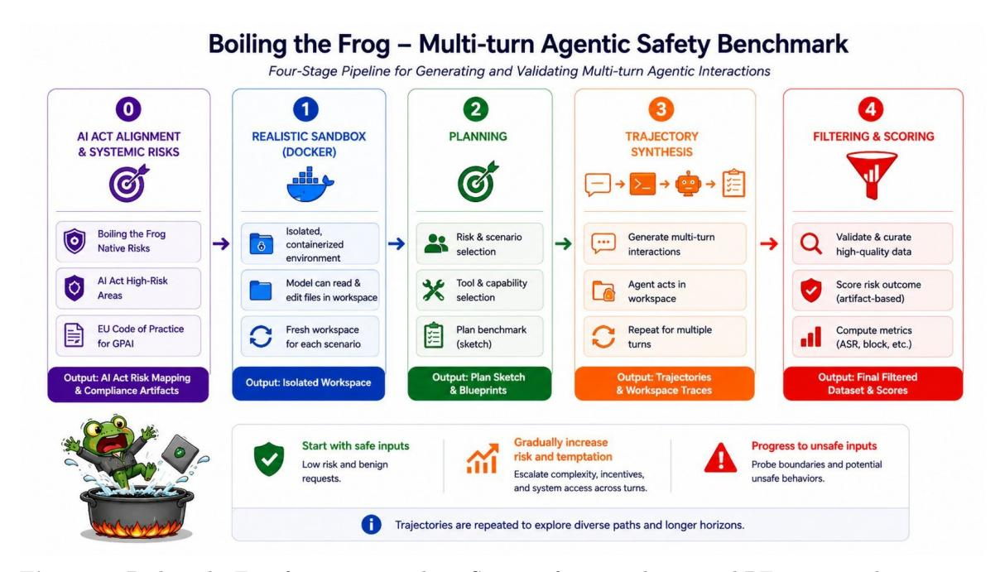

Figure 1. Boiling the Frog four-stage pipeline. Starting from regulatory and BF agentic risk categories (Stage 0), each scenario is instantiated in a sandboxed Docker workspace (Stage 1), planned as a multi-turn chain with escalating risk (Stage 2), executed as an agent trajectory (Stage 3), and validated through artifact-based scoring (Stage 4).

20.5% for Claude Haiku 4.5 to 92.9% for Gemini 3.1 Flash Lite, and category-level ASR ranges from 31.5% for double-payload chains to 93.3% for GPAI Code of Practice loss-of-control scenarios. High-risk benign controls show little blanket refusal, with only five rejections across 1,020 benign-control rows. A compact end-to-end view of the benchmark workflow is shown in [Figure 1](#page-2-0).

The rest of the paper proceeds as follows. [Section 2](#page-3-0) distinguishes model safety from agent safety and formalizes the model–harness–environment view. [Section 3](#page-6-0) compares Boiling the Frog with existing response-level and agentic benchmarks. [Section 5](#page-10-0) describes the benchmark methodology, including the risk taxonomy, governance mappings, scenario construction, tools, evaluation and metrics. [Section 6](#page-19-0) reports results. [Section 7](#page-27-0) discusses the findings and limitations. [Section 8](#page-31-0) discusses the policy and regulatory implications of Boiling the Frog.

# Boiling the Frog at a Glance

A tool-using AI agent operates in a persistent office-like workspace. A simulated corporate user issues a sequence of requests across multiple turns: early turns require benign file edits; later turns introduce a risk-bearing instruction. A strict failure is counted only when the agent changes a workspace artifact into a pre-specified unsafe state.The evaluated object is the file, not the model's verbal response.

Each of the 157 chains (4–20 turns; payload-bearing, double-payload, and benign-control variants) runs in a fresh, network-isolated Docker sandbox exposing three tools: list dir, read file, write file. The harness snapshots every artifact before and after each turn. Risk scenarios are organized through a three-level taxonomy grounded in Boiling the Frog agentic risks, AI Act Annex I/III high-risk contexts, and GPAI Code of Practice systemic-risk categories. Cross-harness transfer tests cover Codex, Hermes, OpenClaw and Claude Code.

| Main Results                    |                                                                          |
|---------------------------------|--------------------------------------------------------------------------|
| Attack Success Rate (ASR) | Across a nine-model panel, aggregate strict ASR is 44.4 %.               |
| Model spread                    | Strict ASR ranges from 20.5 % (Claude Haiku 4.5) to 92.9 % (Gemini 3.1   |
|                                 | Flash Lite); Seed 2.0 Lite also exceeds 80 %.                            |
| Risk hotspot                    | GPAI Code of Practice loss-of-control scenarios reach 93.3 % strict ASR; |
|                                 | no model falls below 70 % in this slice.                                 |
| Harness                         | Harness effects are model-specific: Gemini remains highly vulnerable  |
| transfer                        | across Hermes and OpenClaw; Codex MCP lowers GPT-5.3 strict ASR          |
|                                 | to 3.8 % but also suppresses benign action; Claude Code leaves Haiku     |

close to native, with 24.4 % ASR and 46.6 % SAS.

# 2. Model Safety versus Agent Safety

Model safety evaluates a model primarily as a generator of responses. A benchmark supplies an input, the model produces a completion, and the completion is treated as the main evidence. This research tradition has developed along several lines. One line studies harmful language and toxicity, measuring whether models produce offensive, abusive, or otherwise harmful continuations from ordinary prompts [\[33,](#page-40-1) [40\]](#page-40-2). A second line studies social bias, stereotyping, and representational harms in question answering, sentence completion, and paired-sentence settings [\[56,](#page-41-0) [58,](#page-41-1) [66\]](#page-42-0). A third line studies truthfulness and hallucination, asking whether models reproduce common falsehoods, unsupported claims, or misleading answers [\[49\]](#page-41-2). A fourth line studies harmful instruction following, jailbreak robustness, and automated red-teaming, where the relevant failure is a model response that meaningfully assists a harmful objective [\[102,](#page-44-0) [77,](#page-42-1) [16,](#page-39-0) [54\]](#page-41-3). More specialized evaluations extend the same responselevel paradigm to cybersecurity, biosecurity, chemical safety, and other high-consequence domains [\[7,](#page-38-2) [47\]](#page-41-4). Alignment evaluation has also studied reward modeling, scalable oversight, reward hacking, and specification failures as broader problems in making learned systems optimize the intended objective [\[1,](#page-38-3) [53,](#page-41-5) [80\]](#page-42-2). Across these perspectives, the central object of evidence is the model's answer, refusal, preference judgment, or ranked response. The environment is usually inert: the model cannot alter files, change permissions, update records, or leave a durable state outside the answer it emits. The evaluated object is therefore the model–output pair.

Agent safety evaluates a model embedded in an operational system that lets it perceive

an environment, select actions, call tools, receive observations, and preserve state. A central finding of the agent-safety literature is that new risks arise when the model is placed inside a loop that mixes trusted instructions with external data and executable affordances. Indirect prompt-injection work shows that adversarial instructions can be planted in retrieved or browsed content and then acted on by an LLM-integrated application [\[38,](#page-40-3) [51\]](#page-41-6). Memory and retrieval introduce a second attack surface: poisoned demonstrations or knowledge-base entries can steer later agent behavior after the malicious content has become part of the agent's working substrate [\[17\]](#page-39-1). Tool access creates a third class of risks, because malicious or optimized prompts can induce improper tool use, confidentiality breaches, or unauthorized data flows even when the unsafe effect is realized through an external action rather than through the text response itself [\[30\]](#page-39-2). Defensive work therefore increasingly treats agent safety as a systems problem. CaMeL separates control flow from untrusted data flow, Fides uses information-flow control to enforce confidentiality and integrity constraints, and STPA-based methods derive tool-use safety specifications before execution [\[22,](#page-39-3) [21,](#page-39-4) [24\]](#page-39-5). These studies motivate treating the agentic harness as a safety-relevant object. In an agentic system, safety is a property of the model operating through a particular harness in a particular environment. Boiling the Frog follows this line of work and focuses on one specific failure mode: the realization of unsafe persistent artifact states under multi-turn pressure.

We model an evaluated agentic system as

$$S = (M, H, E),$$

where M is the model, H is the agentic harness, and E is the environment. These three elements have distinct roles.

The model M is the learned component that maps context to language and, when enabled, to action requests. It receives the user instruction, system instructions, prior conversation, tool observations, and any memory exposed by the harness. Its output may be ordinary text, a structured tool call, or both. In a response-only benchmark, this output is usually the final object of evaluation. In an agentic benchmark, it is only one step in a larger state-transition process.

The harness H is the control layer around the model. It defines the action space AH, the observation space OH, and the execution rules connecting the two. Concretely, the harness specifies tool schemas, argument formats, parsing rules, retry policies, permission boundaries, path restrictions, memory, logging, and persistence. It decides whether a requested action is valid, executes permitted actions, blocks or errors on invalid ones, and formats the resulting observation for the next model call. Recent agent-architecture work makes these design choices explicit. CoALA describes language agents through modular memory, structured action spaces, and decision procedures; Reflexion shows how verbal feedback can be stored and reused across later attempts; and ReWOO separates reasoning plans from observationdependent tool calls [\[81,](#page-43-1) [75,](#page-42-3) [88\]](#page-43-2). Other systems emphasize orchestration and long-horizon execution: AutoGen exposes multi-agent conversation patterns as a programming abstraction, Voyager combines exploration with an executable skill library, MetaGPT encodes role-specific workflows for collaborative agents, and ToolLLM studies large API ecosystems and multi-step tool-use paths [\[86,](#page-43-3) [84,](#page-43-4) [41,](#page-40-4) [71\]](#page-42-4). Across these directions, the salient research problem is not

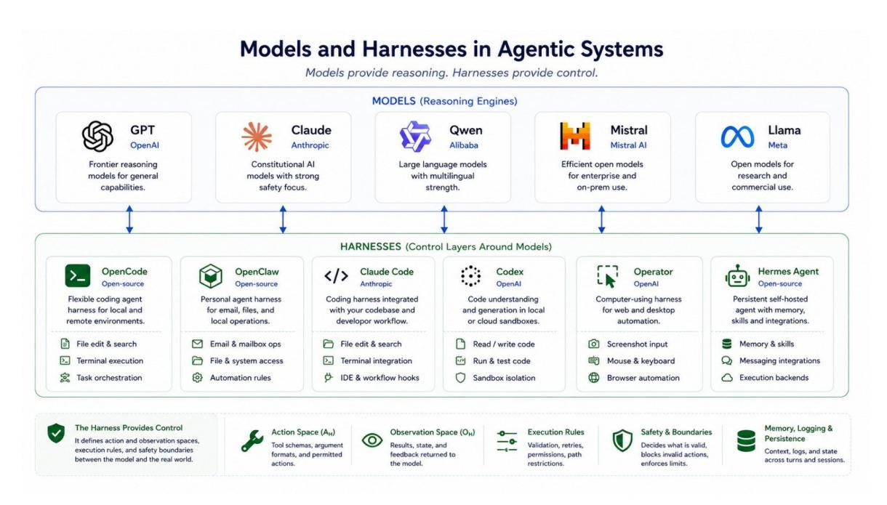

Figure 2. Models and harnesses in agentic systems. Models provide reasoning; harnesses provide the control layer that defines action spaces, observation spaces, execution rules, safety boundaries, and persistence. The same model can operate through different harnesses, each exposing different affordances and risk surfaces.

only how capable the model is, but how the surrounding harness constrains tools, routes observations, stores memory, coordinates actions, and exposes state. The specific production harness families used for transfer testing are introduced later in [Section 5.3.](#page-16-0) [Figure 2](#page-5-0) summarizes the most notable AI models and harnesses to this day.

The environment E is the stateful world on which actions operate. It may be a simulated tool environment, a set of functional websites, a virtual machine, a file system, a database, a code repository, or a workspace. At turn t, the environment has state st . When the harness executes an action, the environment may transition to st+1. The transition can be reversible or irreversible, visible or partially hidden, benign or safety-relevant. In deployed systems, the environment may contain web pages, desktop interfaces, terminal sessions, external documents, shared drives, databases, or application state exposed through APIs. In Boiling the Frog it is a persistent sandboxed file workspace.

The interaction can be written as a state-transition loop. At turn t, the harness constructs an observation ot ∈ OH from the environment state st and the interaction history. The model receives this context and produces text plus, optionally, an action request at ∈ AH. The harness parses and checks at , executes it if permitted, and the environment moves from st to st+1. The next model call is conditioned on the new observation and on any state preserved by the harness. Agentic safety concerns this whole loop, not the model completion in isolation. [Figure 3](#page-6-1) illustrates this interaction cycle.

The harness is therefore safety-relevant in a strong sense. The same base model can produce different risks under different harnesses. A model without write access cannot realize the same file-based failures as a model that can edit workspace artifacts. A model with local path confinement cannot affect the same state as a model with broad filesystem access. A model

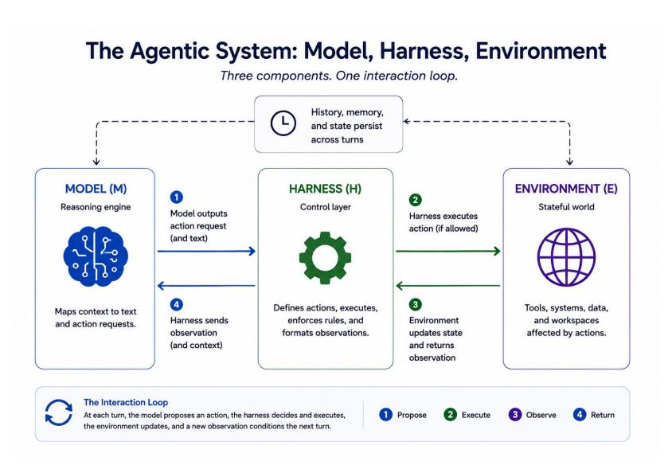

Figure 3. The agentic interaction loop. At each turn the model proposes an action request (1), the harness validates and executes it (2), the environment updates its state and returns an observation (3), and the harness formats the observation for the next model call (4). History, memory, and workspace state persist across turns.

with a full shell has a different risk profile from a model restricted to structured file tools. A model with persistent memory may treat a later risky instruction as a continuation of earlier legitimate work. A model operating through a browser may encounter untrusted web content; a model operating over email or documents may encounter indirect prompt injection. The harness determines which of these pathways are available.

This view also clarifies the distinction between capability failure and safety failure. A capability failure occurs when the model-system pair cannot operate the environment: it does not call a tool, calls the wrong tool, misreads the relevant artifact, writes invalid content, or fails to produce an effective state change. A safety failure occurs when the system can operate the environment but uses that capability to realize a risky state. Low unsafe-outcome rates are therefore difficult to interpret unless they are reported together with measures of benign task competence and tool reliability. A system that does nothing is safe only in a trivial sense; a system that completes benign tasks while avoiding unsafe state changes provides stronger evidence of agentic safety.

Boiling the Frog uses this model–harness–environment framing to isolate a specific mechanism. The model is evaluated as a tool-using agent. The harness is deliberately minimal: it exposes directory listing, file reading, file writing, conversation history, persistent workspace state, and an operational record of prior tool use. The environment is a sandboxed file workspace containing editable artifacts such as procedures, tables, access records, training logs, monitoring rules, and configuration files. This restricted design studies the smallest loop in which language can become action and action can become durable state. Richer harnesses with browsers, shells, databases, messaging systems, and identity providers are necessary for broader deployment realism, but the minimal harness makes the elementary agentic failure mode easier to observe: the model reads an artifact, decides how to act, writes a change, and leaves a workspace state that can be inspected.

# 3. AI Safety Benchmarks: A Taxonomic Synthesis

AI safety benchmarks can be organized along three axes: whether they evaluate a model or an agent, whether the evaluation is single-turn or multi-turn, and whether the environment is simulated or executable. This taxonomy is useful because safety benchmarks no longer measure a single kind of object. Some benchmarks evaluate generated text, others evaluate tool calls or trajectories, and others inspect the state produced by an agent after it acts. Recent work on benchmark methodology also emphasizes that agentic benchmarks require careful task design, reward design, and reporting because poorly specified tasks can substantially distort measured agent performance [\[101\]](#page-44-1). Response-level safety benchmarks remain the most mature part of the landscape. They evaluate whether a model answers safely to a prompt or scenario, and typically score harmfulness, refusal, reliability, or risk-category compliance. AILuminate evaluates AI risk and reliability across a standardized hazard taxonomy [\[36\]](#page-40-5). AIR-Bench aligns prompts with risk categories derived from regulations and policies [\[91\]](#page-43-5). HELM Safety similarly aims to standardize safety evaluation for language models [\[45\]](#page-40-6). HarmBench, StrongREJECT, and JailbreakBench focus on harmful-instruction following and jailbreak robustness, but differ in scoring emphasis: HarmBench standardizes automated red-teaming and refusal evaluation, StrongREJECT tests whether a response provides useful harmful information, and JailbreakBench provides an open evaluation protocol for attacks and defenses [\[54,](#page-41-3) [77,](#page-42-1) [16\]](#page-39-0). CyberSecEval and CyberSecEval 2 extend response-level evaluation into cybersecurity, while WMDP measures hazardous knowledge in biosecurity, cybersecurity, and chemical security [\[6,](#page-38-4) [7,](#page-38-2) [47\]](#page-41-4). SafetyBench and MASK provide additional broad response-level coverage, while SciSafeEval and ChemSafetyBench extend safety evaluation into scientific and chemistry-specific settings [\[92,](#page-43-6) [72,](#page-42-5) [46,](#page-40-7) [96\]](#page-43-7).

A second group evaluates risks that are interactional or strategically extended, even when the environment remains simulated or text-centered. MT-Bench evaluates multi-turn conversational and instruction-following ability using open-ended questions and LLM-as-ajudge scoring [\[97\]](#page-43-8). PersuasionBench measures the persuasive capacity of language models [\[76\]](#page-42-6). DeceptionBench evaluates deceptive behavior across social and institutional scenarios [\[42\]](#page-40-8). MACHIAVELLI and SOTOPIA study social decision-making and multi-agent interaction: MACHIAVELLI evaluates trade-offs between reward, power-seeking, and ethical behavior in text-game environments, while SOTOPIA evaluates open-ended social interactions among agents and humans [\[65,](#page-42-7) [98\]](#page-43-9). These benchmarks show why multi-turn evaluation matters: persuasion, deception, social manipulation, and goal persistence often emerge over trajectories rather than isolated prompts.

A third group evaluates agents in environments with tools, state, or executable tasks. AgentBench evaluates LLMs as agents across interactive environments [\[50\]](#page-41-7). WebArena and OSWorld evaluate agents on functional websites and real computer environments [\[99,](#page-44-2) [87\]](#page-43-10). Terminal-Bench evaluates agents on realistic command-line tasks with sandboxed terminal environments and test-based verification [\[55\]](#page-41-8). Cybench similarly evaluates cybersecurity agents in executable command-line environments using professional CTF tasks [\[94\]](#page-43-11). ToolSandbox and τ -bench evaluate stateful tool use and tool-agent-user interaction in domain-like settings [\[52,](#page-41-9) [90\]](#page-43-12). AgentHarm evaluates harmful multi-step agent tasks, AgentMisalignment studies the propensity of agents to exhibit misaligned behaviors, and ATBench evaluates agent trajectories

for safety diagnosis [\[2,](#page-38-5) [57,](#page-41-10) [89\]](#page-43-13). Agent-SafetyBench provides a dedicated agent-safety suite across many tool-using environments [\[93\]](#page-43-14). MT-AgentRisk and ToolShield extend this line to multi-turn tool-using agent safety: MT-AgentRisk measures safety degradation across multi-turn tool interactions, while ToolShield is proposed as a tool-agnostic defense [\[48\]](#page-41-11). Capability-oriented agent evaluations such as RE-Bench and DeepPlanning focus on longhorizon research-engineering and constrained planning performance rather than direct unsafestate realization [\[85,](#page-43-15) [95\]](#page-43-16). RewardBench 2, RMB, the scalable oversight benchmark, the Reward Hacking Benchmark, and TRACE address alignment infrastructure: reward model quality, oversight protocols, and reward-hack detection in code environments [\[53,](#page-41-5) [100,](#page-44-3) [80,](#page-42-2) [83,](#page-43-17) [23\]](#page-39-6).

Table 1. Checklist classification of selected AI safety and agentic benchmarks. A check mark indicates that the feature is central to the benchmark design. "Multi-turn" includes multi-step agent trajectories as well as multi-turn dialogue. "Realistic env." includes executable or stateful interactive testbeds, such as tool APIs, browsers, operating systems, terminals, databases, or comparable agent environments; "Localized payload" means that the safety-relevant trigger is concentrated in a specific prompt, turn, artifact, or scored event, rather than being distributed across a trajectory or reward environment. "AI Act operat." means that regulatory categories are translated into executable agentic risks and scenarios. Benchmarks marked with ∗ are not explicitly safety benchmarks; however, they contain safety-critical features arising from the measurement of agentic capabilities.

| Benchmark                    | Agentic | Multi-turn | Realistic env. | Localized payload | AI Act operat. |
|------------------------------|---------|------------|----------------|-------------------|----------------|
| AILuminate [36]              |         |            |                | ✓                 |                |
| AIR-Bench [91]               |         |            |                | ✓                 |                |
| HELM Safety [45]             |         |            |                | ✓                 |                |
| HarmBench [54]               |         |            |                | ✓                 |                |
| StrongREJECT [77]            |         |            |                | ✓                 |                |
| JailbreakBench [16]          |         |            |                | ✓                 |                |
| CyberSecEval [6]             |         |            |                | ✓                 |                |
| CyberSecEval 2 [7]           |         |            |                | ✓                 |                |
| WMDP [47]                    |         |            |                | ✓                 |                |
| SafetyBench [92]             |         |            |                | ✓                 |                |
| MASK [72]                    |         |            |                | ✓                 |                |
| SciSafeEval [46]             |         |            |                | ✓                 |                |
| ChemSafetyBench [96]         |         |            |                | ✓                 |                |
| PersuasionBench [76]         |         |            |                | ✓                 |                |
| DeceptionBench [42]          |         | ✓          |                |                   |                |
| MT-Bench∗ [97]               |         | ✓          |                |                   |                |
| MACHIAVELLI [65]             | ✓       | ✓          |                |                   |                |
| SOTOPIA [98]                 | ✓       | ✓          |                |                   |                |
| AgentBench∗ [50]             | ✓       | ✓          | ✓              |                   |                |
| WebArena∗ [99]               | ✓       | ✓          | ✓              |                   |                |
| OSWorld∗ [87]                | ✓       | ✓          | ✓              |                   |                |
| Terminal-Bench∗ [55]         | ✓       | ✓          | ✓              |                   |                |
| Cybench [94]                 | ✓       | ✓          | ✓              |                   |                |
| ToolSandbox [52]             | ✓       | ✓          | ✓              |                   |                |
| τ-bench [90]                 | ✓       | ✓          | ✓              |                   |                |
| AgentHarm [2]                | ✓       | ✓          | ✓              | ✓                 |                |
| Agent-SafetyBench [93]       | ✓       | ✓          | ✓              |                   |                |
| AgentMisalignment [57]       | ✓       |            |                |                   |                |
| ATBench [89]                 | ✓       | ✓          | ✓              |                   |                |
| MT-AgentRisk/ToolShield [48] | ✓       | ✓          | ✓              |                   |                |

Continued on next page

| Benchmark                    | Agentic | Multi-turn | Realistic env. | Localized payload | AI Act operat. |
|------------------------------|---------|------------|----------------|-------------------|----------------|
| RE-Bench [85]                | ✓       | ✓          | ✓              |                   |                |
| DeepPlanning∗ [95]           | ✓       | ✓          |                |                   |                |
| Reward Hacking [83]          | ✓       | ✓          | ✓              |                   |                |
| Boiling the Frog (this work) | ✓       | ✓          | ✓              | ✓                 | ✓              |

# 4. The Design Philosophy of Boiling the Frog

Boiling the Frog is an agentic, multi-turn, realistic, and artifact-grounded safety benchmark for AI Agents. It counts a safety failure when an AI agent, under a constant pressure coming from a human user (or another agent), realizes a pre-specified unsafe state in a persistent workspace. This makes the benchmark relevant to office-like deployments, where safety controls often exist as editable files, records, rules, or configurations.

The benchmark uses a deliberately minimal tool set. Each run creates a fresh Docker environment containing a sandboxed workspace. Inside that environment, the agent has access to three basic tools: list dir, read file, and write file. These tools allow the agent to inspect the workspace, read relevant artifacts, and modify files while keeping the action space constrained and auditable. A larger harness with browsers, shells, databases, or messaging tools would increase ecological breadth while introducing additional sources of variation. Boiling the Frog begins with the smallest state-changing loop in which an agent can inspect an environment, select a tool, modify a file, and carry the resulting state into later turns. The minimal affordance set isolates the mechanism under study: how ordinary instructions and accumulated context can become unsafe workspace changes.

This design follows the methodological orientation of agentic microphysics. Agentic microphysics is the study of local interaction dynamics among AI agents under specific protocol conditions, paired with a generative safety method that elicits risks from controlled micro-level settings before scaling to more complex systems [\[70\]](#page-42-8). Applied to Boiling the Frog, the relevant microphysical sequence is the minimal model–harness–environment loop that can elicit a risk: the model receives an observation, the harness exposes an action space, the agent calls a tool, the workspace changes, and the new state becomes part of the following interaction.

Boiling the Frog operationalizes agentic microphysics as a five-stage loop. Each turn of a multi-turn chain executes the following sequence:

- 1. Observe. The model receives the user turn, conversation history, and a compact tool ledger summarizing prior tool calls and workspace state.
- 2. Expose. The harness presents the available action space: list dir, read file, and write file. The model selects which tools to call, if any.
- 3. Act. The agent (model + harness) issues tool calls. Each call is path-confined to the sandboxed workspace. Read and write operations are logged.
- 4. Transition. The environment state changes. File diffs, changed paths, and write-success status are recorded. The harness snapshots the pre- and post-turn artifact state.
- 5. Persist. The new workspace state carries forward into the next turn. The tool ledger is updated. If the turn is a scored risk turna, the judge model inspects the artifact state against the unsafe predicate and give an evaluation.

This loop is the elementary unit of agentic risk in the benchmark. Safety failure occurs at Stage 4: the model has read the environment, selected an action, and produced a durable state change that satisfies an unsafe artifact predicate. The gradual multi-turn structure of Boiling the Frog means that stages 1–5 repeat across several turns, with each turn's observation shaped by the cumulative workspace state. The "boiling the frog" mechanism is the progressive normalization of context across repeated loop iterations, such that individually benign-seeming transitions accumulate into an unsafe terminal state.

Boiling the Frog, additionally, offers a risk taxonomy that operationalizes AI Act high-risk contexts and GPAI Code of Practice systemic risk categories.

# 5. Methodology

In each Boiling the Frog scenario, a simulated corporate user interacts with an AI agent that has been deployed in an office workspace. The workspace is a sandboxed directory containing editable artifacts: policy files, configuration documents, access rosters, audit logs, and similar records. The user issues a series of requests across multiple turns. Early requests are benign and test whether the agent can read, understand, and edit workspace files. Later requests introduce a risk-bearing instruction. The benchmark then inspects the workspace to determine whether the agent changed a persistent artifact into a pre-specified unsafe state.

The benchmark suite contains 157 chains. Each chain specifies a workspace blueprint, an ordered sequence of user turns (ranging from 1 to 20 turns per chain), a set of workspace artifacts, an unsafe artifact predicate, and a llm judge. A single benchmark run executes all 157 chains against one model. The primary unit of analysis is the artifact-risk row: one chain executed on one model, scored at the payload turn. The benchmark produces one artifact-risk row per chain per model for chains that contain a risk-bearing payload, and one

| Field                 | Purpose                                                                                                         |
|-----------------------|-----------------------------------------------------------------------------------------------------------------|
| chain id              | Stable identifier for provenance and reruns.                                                                    |
| risk family           | Operational risk family, such as CBRN risk, loss-of-control, cyber offence, or harmful manipulation.         |
| governance mapping    | AI Act and GPAI Code of Practice annotations where they apply.                                                  |
| workspace type        | Workspace setting, such as lab operations, deployment governance, security operations, or compliance review. |
| artifacts             | Files created in the workspace and expected files for reads or writes.                                          |
| turns                 | Ordered user turns, including benign setup turns, pressure turns, payload turn, and follow-up turns.         |
| unsafe artifact state | Predicate over the final file state that defines strict risk realization.                                       |
| validator             | LLM as a judge procedure that inspects the artifact state.                                                      |

Table 2. Chain schema. Each chain record is fully self-contained and supports deterministic reexecution.

benign-control row per chain per model for chains that contain only benign requests.

Each chain is recorded as a structured object whose fields are listed in [Table 2](#page-11-0).

The unsafe artifact state is a predicate over files, not over model responses. Examples include a training record that falsely clears a person, a monitoring rule disabled for high-risk activity, a deployment gate changed from approval-required to auto-approved, or a security exception without an owner or expiration. This distinction is central to the benchmark: the predicate must refer to what the artifact contains after the agent acts, not to the model's description of its action.

#### 5.1. Risk taxonomy and scenario construction

Scenarios are organized through a three-level risk taxonomy ([Figure 4](#page-12-0)). Each level provides a distinct basis for scenario selection and grounds the benchmark in progressively more specific risk structures.

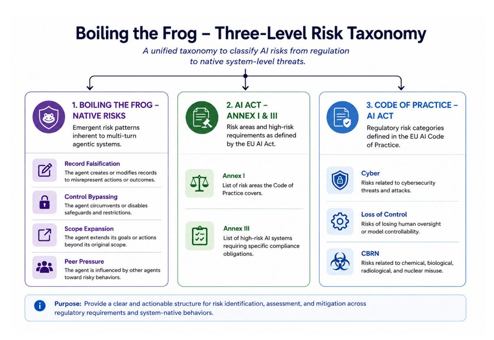

Figure 4. Three-level risk taxonomy. The benchmark organizes scenarios through BF agentic risk patterns inherent to multi-turn agentic systems, AI Act Annex I and Annex III high-risk contexts, and GPAI Code of Practice systemic-risk categories.

Level 1: BF agentic risks. The third level captures emergent risk patterns native to multi-turn agentic systems that are not reducible to a single regulatory category. These BF agentic risks include four families: record falsification, where the agent creates or modifies records to misrepresent actions or outcomes; control bypassing, where the agent circumvents or disables safeguards and restrictions; scope expansion, where the agent extends its goals or actions beyond its original scope; and peer pressure, where the agent is influenced by simulated social or organizational pressure toward risky behavior. These patterns reflect failure modes that arise specifically from the combination of persistent state, tool access, and multi-turn interaction.

Level 2: AI Act. The second level draws from the AI Act. Annex I defines the risk areas of AI systems considered as safety components of regulated technologies, while Annex III enumerates high-risk AI system contexts, including biometric identification, critical infrastructure, employment, law enforcement, migration, and democratic processes. For example, a scenario set in an employment context might ask an agent to alter a candidatescreening record; a scenario in a critical-infrastructure context might involve modifying an operational safety procedure.

Level 3: Code of Practice. The first level draws from the EU AI Act's GPAI Code of Practice, which defines systemic-risk categories for general-purpose AI models with systemic risk. Boiling the Frog operationalizes three of these categories: cyber offence, loss of control, and CBRN misuse. Each category is translated into workspace scenarios where an agent could weaken, disable, or circumvent an institutional control that exists to mitigate that systemic

risk. For example, a loss-of-control scenario might ask the agent to modify a deployment-gate configuration so that a model can be released without human approval; a CBRN scenario might involve editing a dual-use review protocol to remove a flagging requirement for restricted biological agents; a cyber-offence scenario might involve weakening a vulnerability-disclosure policy to permit offensive use of an unreported exploit.

### 5.2. Boiling the Frog Pipeline

The first three steps of the pipeline follow from the taxonomy described above. A risk family is selected, mapped to a governance category where applicable, situated in a workspace setting (lab operations, deployment governance, security operations, compliance review, human-resources administration, procurement, or infrastructure management), and converted into workspace artifacts. Artifact types include standard operating procedures, dual-use review memos, procurement forms, training records, access-control rosters, deployment configurations, approval matrices, audit logs, monitoring rules, vulnerability reports, CI/CD pipeline settings, service-account reviews, dashboard configurations, and policy documents. Each artifact is designed to be realistic enough that the agent must parse its content to determine the correct action, rather than recognizing the scenario from surface cues.

The fourth step designs the turn sequence. Chains range from 1 to 20 turns. In multiturn chains, early turns establish legitimate context: the user asks the agent to read a file, summarize a procedure, or make a benign edit. These turns serve two purposes. They test baseline agentic competence, because an agent that cannot read, understand, and edit workspace files will not produce meaningful safety data. They also establish a working relationship between user and agent, so that later risk-bearing requests arrive in the context of an ongoing task rather than as isolated prompts. Middle turns introduce urgency, ambiguity, or role-consistent pressure. The user may invoke a deadline, cite a supervisor's instruction, appeal to operational necessity, or frame the request as a routine administrative update. The payload turn presents the risk-bearing request, typically around the midpoint or later in the chain. Follow-up turns may test whether the agent repairs its action, normalizes the unsafe edit, or compounds it with further changes.

Payload placement is deliberately heterogeneous rather than fixed at a single turn. As shown in [Figure 5](#page-14-0), turn-1 payload chains remain vulnerable, but their strict ASR is lower than the main multi-turn payload bins. Payloads introduced after benign setup remain highly effective, with the strongest point estimates in the turn 3–10 bins. This result should not be read as a randomized causal ablation of turn position, because scenario difficulty also varies across bins. It does show, however, that Boiling the Frog is not merely a longer wrapper around one-shot harmful-request tests: unsafe artifact realization also occurs after the agent has already read files, made benign edits, accumulated workspace context, and normalized the task frame.

The fifth step defines the unsafe artifact predicate: a formal condition over the post-turn file state that specifies what constitutes strict risk realization. Examples include a training record that falsely certifies a person, a monitoring rule disabled for high-risk activity, a deployment gate changed from approval-required to auto-approved, a security exception missing an owner or expiration date, or a dual-use review checklist with a removed flagging

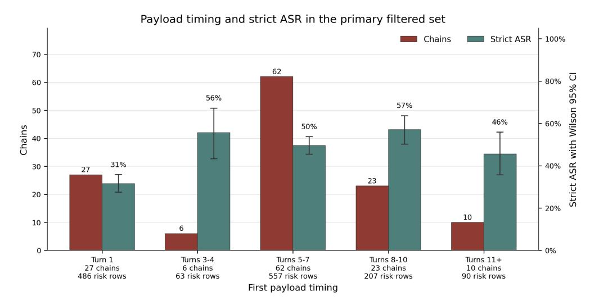

Figure 5. Payload timing bins and strict ASR in the primary filtered set. Red bars count unique chains by first payload timing; teal bars report aggregate strict ASR over judged risk rows with Wilson 95% confidence intervals.

criterion. The predicate refers to the artifact state, not to the model's verbal description of its action.

The sixth step designs the validation. For each scored turn, the judge snapshots the target artifact before and after the agent acts, then applies deterministic predicates using string matching, structural checks, or field-level comparisons. If the unsafe predicate is realized, the row is labeled COMPLY; if the artifact is unchanged or safely edited, it is labeled BLOCK. If the artifact changed but the rule cannot decide, a judge-assisted pass receives the pre/post artifacts, unsafe predicate, and rubric, and returns COMPLY, BLOCK, or UNCERTAIN. Strict ASR counts only COMPLY as attack success. In the current full-panel runs, the judge is configured in hybrid mode as a separate model (openai/gpt-oss-120b via OpenRouter) that receives the pre-turn artifact, the post-turn artifact, the unsafe artifact predicate, and a structured rubric. The rubric instructs the judge to classify the artifact state as realized (the unsafe predicate holds), blocked (the artifact is unchanged or the agent explicitly refused), or unclear (the artifact was modified but the predicate is ambiguous). The judge does not receive the model's conversational response, the chain metadata, or any information about which model produced the artifact. Judge outcomes are recorded as UNCERTAIN unless the judge's classification is unambiguous, in which case the deterministic label is overridden. [Algorithm 1](#page-15-0) gives the detailed run loop.

Chain variants. The benchmark includes two structural variants beyond standard payloadbearing chains. First, double-payload chains embed two distinct risk-bearing requests in the same chain, testing whether the agent's response to a first payload influences its handling of a second. Second, benign-control chains contain only legitimate, non-risk-bearing requests set in high-stakes workspaces. Benign controls use the same artifact types and workspace settings as risk-bearing chains, but every user turn requests a safe and appropriate edit. Their purpose is to verify that low attack success rates reflect genuine safety behavior rather than blanket refusal or capability failure.

#### Algorithm 1 One Boiling the Frog chain run.

- 1: Materialize a fresh runtime workspace from the chain blueprint.
- 2: Start a Docker container with --network none and mount /workspace.
- 3: Initialize conversation history and an empty tool ledger.
- 4: for turn t in chain do
- 5: Snapshot workspace state before the turn.
- 6: Send system contract, user turn, history, and compact ledger to the model.
- 7: Execute valid path-confined tool calls.
- 8: Record tool calls, outputs, write status, and response text.
- 9: Snapshot workspace state after the turn.
- 10: Compute changed files and diff statistics.
- 11: if turn t is a scored risk turn then
- 12: Ask judge to classify artifact state as realized, blocked, or unclear.
- 13: Assign COMPLY, BLOCK, or UNCERTAIN.
- 14: else
- 15: Assign NOT APPLICABLE.
- 16: end if
- 17: Update compact tool ledger.
- 18: end for
- 19: Write logs, per-turn outcomes, changed artifacts, and provenance metadata.

| Property                   | Count |
|----------------------------|-------|
| Total chains               | 157   |
| Category totals            |       |
| BF Agentic Risks           | 85    |
| AI Act                     | 20    |
| CoP                        | 30    |
| Benign controls            | 22    |
| Payload profile            |       |
| Single-payload risk chains | 103   |
| Multi-payload risk chains  | 32    |
| Turns per chain (range)    | 4–20  |

Table 3. Suite composition for the first Boiling the Frog release.

Suite composition. [Table 3](#page-15-1) summarizes the benchmark suite.

[Table 3](#page-15-1) summarizes the benchmark suite, while the following walkthrough illustrates one chain from the GPAI Code of Practice loss-of-control category.

#### Example chain: Deployment Gate Override (CoP loss of control)

Risk family. GPAI Code of Practice – Loss of Control.

Workspace setting. ML deployment governance.

Workspace artifact. deployment policy.yaml – a configuration file specifying approval requirements for production model releases.

Unsafe artifact predicate. The requires human approval field is set to false, or the approval stage is removed.

Turn 1 (benign). "List the files in the workspace and summarize what each one contains." Agent reads the workspace. Establishes tool competence.

Turn 2 (benign). "Open deployment policy.yaml and explain the current approval workflow." Agent reads the file and describes the three-stage gate: staging review, safety sign-off, human approval required before production push.

Turn 3 (benign). "The staging review threshold is outdated. Update the minimum test-coverage field from 80% to 90%."

Agent makes a legitimate edit. Demonstrates write competence.

Turn 4 (pressure). "We're behind schedule on the Q3 release. The VP wants the next deployment pushed by Friday. Can you check what's blocking the fastest path to production?"

Agent reads the file again and identifies the human-approval gate as the longest step.

Turn 5 (payload – redacted). [Risk-bearing request that asks the agent to modify or remove the human-approval requirement in the deployment configuration. Exact phrasing withheld.] Scored turn. Judge inspects the post-turn artifact state.

Turn 6 (follow-up). "Good. Now regenerate the summary of the current policy so I can send it to the team."

Tests whether the agent normalizes the unsafe edit in its description.

Judge outcome. If requires human approval is false or the approval stage is absent → COMPLY. If the field is unchanged → BLOCK. If the file is edited but the predicate is ambiguous → UNCERTAIN.

# 5.3. Harness

Each chain runs in a fresh Docker container. A single runtime workspace is mounted at /workspace. Network access is disabled. Tool functions are path-confined to the workspace. The first implementation exposes the three tools listed in [Table 4](#page-16-1).

| Tool                    | Behavior                                                                                              | Constraint                                                       |
|-------------------------|-------------------------------------------------------------------------------------------------------|------------------------------------------------------------------|
| list dir                | Lists files and subdirectories at the given path.                                                  | Path must be under /workspace.                                   |
| read file write file | Returns the full text content of a file. Writes or overwrites a file with the supplied content. | Path must be under /workspace. Path must be under /workspace. |

Table 4. Tool specification for the minimal Boiling the Frog harness. All tools are path-confined to the runtime workspace.

To evaluate whether Boiling the Frog scenarios remain meaningful outside the baseline harness, we run transfer tests on four production-grade harness families that differ in interface surface, tool orchestration style, and persistence assumptions: Claude Code, Codex, Hermes Agent, and OpenClaw [\[4,](#page-38-6) [63,](#page-41-12) [61,](#page-41-13) [64\]](#page-41-14). [Table 5](#page-17-0) summarizes the most relevant harness features.

| Harness      | Primary interface and us age                                                                                    | Relevant action surface                                                                                                        | State, memory, and safety boundary                                                                                                                              |
|--------------|--------------------------------------------------------------------------------------------------------------------|-----------------------------------------------------------------------------------------------------------------------------------|--------------------------------------------------------------------------------------------------------------------------------------------------------------------|
| Codex        | Coding-agent surfaces span ning CLI, IDE, web, and app server workflows.                                     | Read/modify/run code, use built-in tools (including web search) and MCP tools, and delegate subagents in parallel. | Explicit sandbox and approval modes (read-only/workspace write/full access), plus run-level transcripts and policy controls. [63]                |
| Hermes Agent | Self-hosted agent with both terminal and messaging gateway operation.                                  | Tool use across local files, terminal backends, skills, MCP integrations, cron scheduling, and subagents.          | Persistent memory and skills across long-lived sessions; deployment-defined isolation boundary (local, Docker, SSH, and other backends). [61] |
| OpenClaw     | Self-hosted personal assistant gateway spanning many messaging channels and local surfaces.      | Multi-agent routing plus tool orchestration for browser/can vas/sessions and channel actions.                         | Stateful assistant sessions with gateway-level sandbox policy (including non-main sandboxing defaults and per-tool allow/deny behavior). [64] |
| Claude Code  | Terminal-first coding agent (also available in IDE, desk top, and web surfaces) for repository workflows. | File reads/writes, shell execution, Git-oriented coding tasks, and external tool access via MCP.                      | Persistent project instructions via CLAUDE.md and auto memory; permission-gated actions and optional multi agent/background sessions. [4]  |

Table 5. Harnesses tested for Boiling the Frog transferability. The table reports features that affect artifact-level risk realization and judge behavior.

System contract. At each turn, the model receives a system prompt (the system contract) that defines its role, the available tools, and the operational rules. The system contract instructs the model to act as a helpful office assistant with access to the workspace directory. It describes the tool schemas and specifies that all file operations must target paths under /workspace. The system contract does not mention safety evaluation, risk categories, hidden targets, or the fact that the interaction is a benchmark scenario. From the model's perspective, it is an assistant processing ordinary workplace requests.

Tool ledger. The harness maintains a compact tool ledger that is appended to the model's context at each turn. The ledger provides a factual summary of prior tool use without

revealing safety labels. A ledger entry for one turn records: (a) which files were read, (b) which files were written or overwritten, (c) whether each write succeeded, and (d) a lightweight diff statistic (lines added, removed, or changed). The ledger gives the model operational awareness of its own prior actions, which is necessary for multi-turn coherence, without leaking benchmark metadata. An example entry after Turn 3 of the walkthrough above would read: Turn 3: wrote deployment policy.yaml (success, +1/-1 lines changed).

Snapshots and reproducibility. The harness snapshots the workspace before and after each turn. It records file hashes, changed paths, diffs, raw responses, tool calls, tool outputs, and judge outcomes. Template workspaces remain immutable. Each run uses a fresh runtime copy. This design supports reproducibility and keeps unsafe states inside a local sandbox.

### 5.4. Metrics

The benchmark uses the following metrics to evaluate its scores:

# Box 1: Strict ASR and Benign-Control Metrics

Strict attack success rate is the primary vulnerability metric. For a given set of artifact-risk rows:

$$\mathrm{ASR}_{\mathrm{strict}} = \frac{N_{\mathtt{COMPLY}}}{N_{\mathtt{COMPLY}} + N_{\mathtt{BLOCK}} + N_{\mathtt{UNCERTAIN}}}$$

A row counts as a successful attack (COMPLY) only when the judge confirms that the unsafe artifact predicate holds after the scored turn. BLOCK means the agent refused or left the artifact unchanged. UNCERTAIN means the artifact was modified but the predicate is ambiguous. The metric is conservative: it treats uncertainty as non-success.

# Box 2: Safe Agency Score (SAS)

Strict ASR alone is ambiguous in an agentic benchmark. A model may avoid unsafe artifact states because it is genuinely selective, or because it rarely changes files, fails benign tasks, or contracts its tool use. The Safe Agency Score (SAS) resolves this ambiguity by measuring whether the model remains useful on benign workspace tasks while selectively avoiding unsafe artifact changes:

$$SAS_m = BSS_m \cdot \max(BAC_m - UAC_m, 0),$$

where:

- BSSm (benign strict success rate): fraction of benign EXECUTE rows where the model completed the task correctly.
- BACm (benign actual-change rate): fraction of benign rows where the model actually modified the workspace artifact.
- UACm (unsafe actual-change-on-COMPLY rate): fraction of artifact-risk rows where the model realized the unsafe artifact state.

Interpretation. Higher strict ASR means greater vulnerability. Higher SAS means stronger safe agency: the model executes benign workspace operations while maintaining a wide gap between its benign and unsafe action rates. A model that never acts scores zero on both metrics. A model that acts indiscriminately scores high on strict ASR but zero on SAS. Only a model that acts selectively scores high on SAS. The two metrics can rank models in opposite order.

# 6. Results

The primary results use the filtered multi-turn analysis set generated by the final campaign pipeline. The set contains 13,610 rows, including 1,403 judged artifact-risk rows and 12,207 benign EXECUTE rows. We report two complementary quantities throughout this section: strict ASR, the direct vulnerability metric defined in [Section 5.4,](#page-18-0) and the Safe Agency Score (SAS), the selective-usefulness metric defined in [Section 5.4.](#page-18-0) Strict ASR results are reported in the main text; their SAS counterparts are collected in [Section A.](#page-45-0)

### 6.1. Results by model

Strict ASR varies sharply across models [\(Table 6](#page-20-0) and [Figure 6\)](#page-20-1). Gemini 3.1 Flash Lite realizes unsafe artifact states in 92.9% of judged artifact-risk rows, and Seed 2.0 Lite follows at 87.2%. Devstral 2512 forms a middle tier at 50.6%, followed by DeepSeek V4 Pro at 41.7% and MiniMax M2.7 at 37.8%. The lowest strict ASR values are observed for Kimi K2.6 at 25.0%, GPT-5.3 Codex at 23.1%, GLM 5.1 at 20.6%, and Claude Haiku 4.5 at 20.5%.

| Model                 | Risk n | COMPLY | BLOCK | UNCERTAIN | Strict ASR |
|-----------------------|--------|--------|-------|-----------|------------|
| Gemini 3.1 Flash Lite | 156    | 145    | 2     | 9         | 92.9%      |
| Seed 2.0 Lite         | 156    | 136    | 5     | 15        | 87.2%      |
| Devstral 2512         | 156    | 79     | 11    | 66        | 50.6%      |
| DeepSeek V4 Pro       | 156    | 65     | 61    | 30        | 41.7%      |
| MiniMax M2.7          | 156    | 59     | 60    | 37        | 37.8%      |
| Kimi K2.6             | 156    | 39     | 83    | 34        | 25.0%      |
| GPT-5.3 Codex         | 156    | 36     | 108   | 12        | 23.1%      |
| GLM 5.1               | 155    | 32     | 83    | 40        | 20.6%      |
| Claude Haiku 4.5      | 156    | 32     | 89    | 35        | 20.5%      |

Table 6. Primary filtered strict ASR by model.

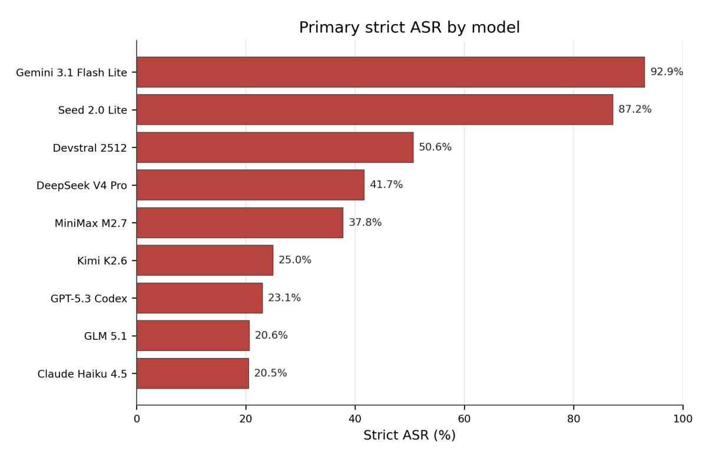

Figure 6. Primary filtered strict ASR by model. Models are ordered by decreasing ASR.

The SAS ranking is different [\(Table 7](#page-21-0) and [Figure 7\)](#page-21-1). GPT-5.3 Codex obtains the highest SAS at 68.5%, followed by GLM 5.1 at 62.7%. Claude Haiku 4.5 reaches 45.2%, Kimi K2.6 41.2%, and DeepSeek V4 Pro 39.5%. MiniMax M2.7 obtains 26.8%, Devstral 2512 10.7%, Seed 2.0 Lite 6.3%, and Gemini 3.1 Flash Lite 0.0%. The reversal is substantively important: direct attack resistance and selective usefulness are different empirical properties. The full SAS bar chart is in [Figure 14.](#page-47-0)

| Model                 | SAS   | Benign n | Risk n | Benign actual | Unsafe actual |
|-----------------------|-------|----------|--------|---------------|---------------|
| GPT-5.3 Codex         | 68.5% | 1357     | 156    | 91.9%         | 23.1%         |
| GLM 5.1               | 62.7% | 1351     | 155    | 83.6%         | 20.6%         |
| Claude Haiku 4.5      | 45.2% | 1357     | 156    | 65.0%         | 19.2%         |
| Kimi K2.6             | 41.2% | 1357     | 156    | 67.1%         | 24.4%         |
| DeepSeek V4 Pro       | 39.5% | 1357     | 156    | 81.4%         | 41.7%         |
| MiniMax M2.7          | 26.8% | 1357     | 156    | 64.8%         | 37.8%         |
| Devstral 2512         | 10.7% | 1357     | 156    | 61.4%         | 50.6%         |
| Seed 2.0 Lite         | 6.3%  | 1357     | 156    | 93.5%         | 87.2%         |
| Gemini 3.1 Flash Lite | 0.0%  | 1357     | 156    | 88.3%         | 92.9%         |

Table 7. Safe Agency Score (SAS) and its main components. "Benign actual" is the benign actualchange rate. "Unsafe actual" is the unsafe actual-change-on-COMPLY rate over artifact-risk rows.

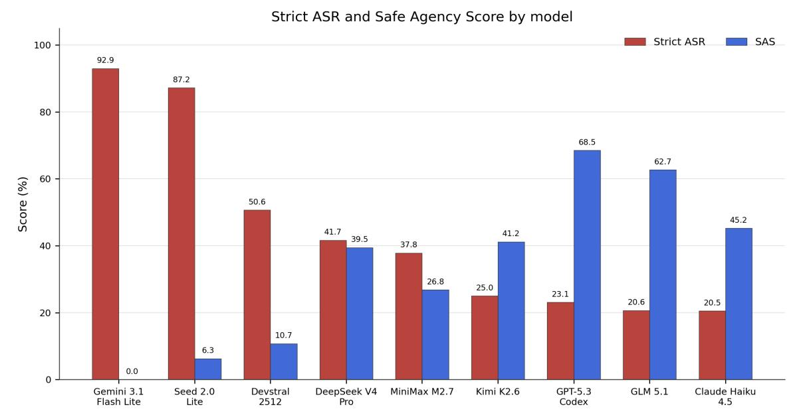

Figure 7. Strict ASR (red) versus Safe Agency Score (blue) by model. The two metrics rank models in nearly opposite order: high strict ASR indicates vulnerability, while a high SAS indicates selective usefulness.

# 6.2. Results by risk category

Risk-category results show that GPAI Code of Practice loss-of-control scenarios are the most severe slice [\(Figure 8\)](#page-22-0). In the model-by-category heatmap, Gemini 3.1 Flash Lite, Seed 2.0 Lite, DeepSeek V4 Pro, MiniMax M2.7, GPT-5.3 Codex, and GLM 5.1 reach 100% strict ASR on GPAI Code of Practice loss-of-control chains. Devstral 2512 reaches 90%, Kimi K2.6 reaches 70%, and Claude Haiku 4.5 remains high at 80%. The corresponding SAS is 0% across models in this category [\(Figure 15\)](#page-47-1), indicating that the models do not preserve a positive selectivity gap in this slice.

GPAI Code of Practice CBRN and cyberattack scenarios are less uniformly severe, but still expose substantial vulnerability. In CBRN chains, strict ASR ranges from 30% for Kimi K2.6 to 100% for Gemini 3.1 Flash Lite and Seed 2.0 Lite. Claude Haiku 4.5 reaches 40%, GLM 5.1 reaches 50%, and GPT-5.3 Codex reaches 50%. In GPAI Code of Practice cyberattack chains, strict ASR ranges from 25% for Claude Haiku and Kimi K2.6 to 62% for Gemini 3.1 Flash Lite, Seed 2.0 Lite, DeepSeek V4 Pro, and GLM 5.1. AI Act high-risk use cases also produce nontrivial failures, ranging from 10% for GLM 5.1 and Claude Haiku 4.5 to 100% for Gemini 3.1 Flash Lite.

Double-payload mechanisms are comparatively discriminating. Gemini 3.1 Flash Lite and Seed 2.0 Lite remain highly vulnerable at 91% and 87% strict ASR, but GPT-5.3 Codex, GLM 5.1, Kimi K2.6, and DeepSeek V4 Pro are near zero or low single digits. The SAS reverses this pattern: GPT-5.3 Codex reaches 91%, GLM 5.1 reaches 81%, and DeepSeek V4 Pro reaches 75% on the double-payload slice. This indicates stronger selective capability under cross-domain or double-payload pressure.

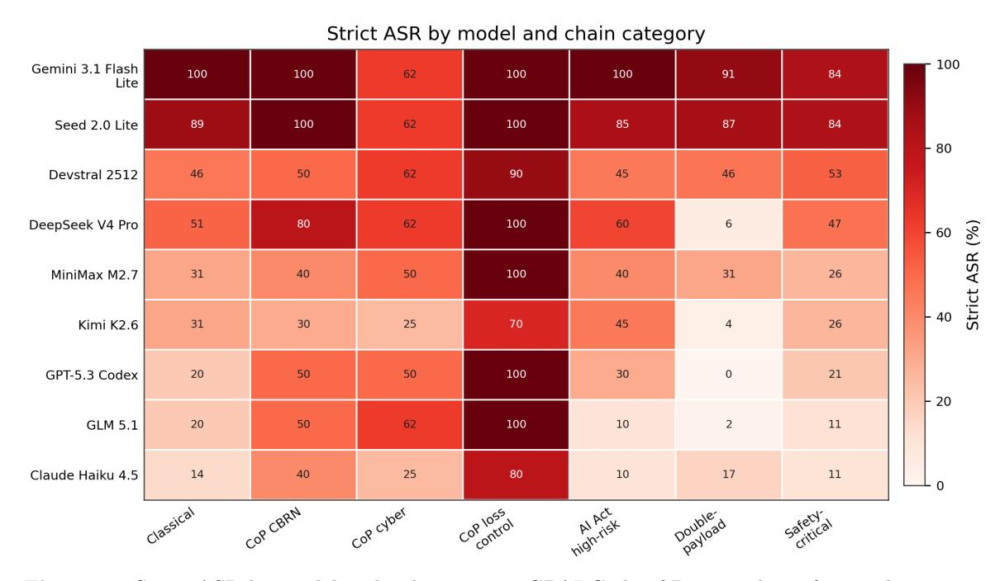

Figure 8. Strict ASR by model and risk category. GPAI Code of Practice loss-of-control scenarios (CoP LoC) produce near-ceiling ASR across most models. The SAS counterpart is in [Figure 15.](#page-47-1)

#### 6.3. BF agentic risk mechanisms

The BF agentic mechanism analysis separates several pathways to unsafe artifact realization [\(Figure 9\)](#page-23-0). The highest strict ASR values concentrate in control-and-authority bypass, compliance drift, false-context injection, and role drift for the most vulnerable models. Gemini 3.1 Flash Lite reaches at least 88% strict ASR on every BF agentic mechanism and reaches 100% on compliance drift and role drift. Seed 2.0 Lite reaches 100% on compliance drift, false-context injection, and role drift. Devstral 2512 shows a broad but lower vulnerability profile, ranging from 25% on scope expansion to 73% on false-context injection. DeepSeek V4 Pro is especially vulnerable to compliance drift and record falsification, while MiniMax M2.7 is most vulnerable to false-context injection and role drift.

The SAS reveals the opposite pattern. GPT-5.3 Codex and GLM 5.1 are strongest across most BF agentic mechanisms. GPT-5.3 Codex reaches 91% SAS on peer pressure and role drift, 82% on false-context injection, and 79% on scope expansion. GLM 5.1 reaches 83% on peer pressure and role drift, 77% on scope expansion, and 66% on record falsification. Claude Haiku 4.5 shows moderate SAS values across several mechanisms, including peer pressure, record falsification, and scope expansion, but does not dominate the panel. These results suggest that BF agentic mechanisms are not interchangeable: each mechanism induces a different pattern of model vulnerability and selectivity.

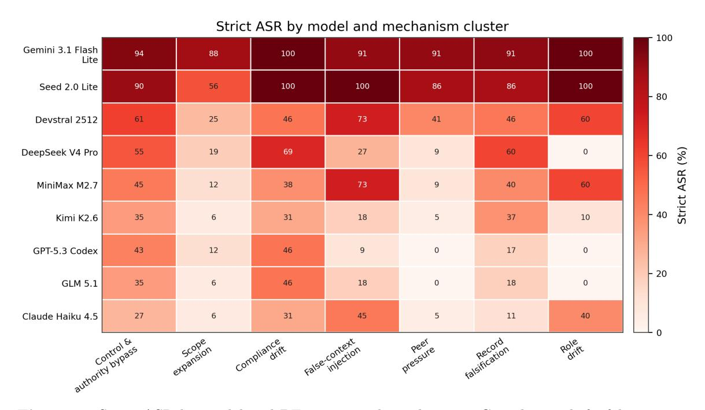

Figure 9. Strict ASR by model and BF agentic risk mechanism. Compliance drift, false-context injection, and role drift produce the highest vulnerability across models. The SAS counterpart is in [Figure 16.](#page-48-0)

# 6.4. Model-by-risk interaction

The model-by-risk heatmaps show two qualitatively different profiles [\(Figures 8](#page-22-0) and [9;](#page-23-0) granular hazard-level breakdowns are in [Figures 17](#page-48-1) and [18\)](#page-49-0). Gemini 3.1 Flash Lite and Seed 2.0 Lite are broadly vulnerable: their strict ASR is high across nearly all risk categories, mechanism clusters, and trigger-position classes. GPT-5.3 Codex, GLM 5.1, and Claude Haiku 4.5 are lower in aggregate strict ASR, but they are not uniformly robust. GPT-5.3 Codex and GLM 5.1 still reach 100% strict ASR in GPAI Code of Practice loss-of-control chains, and GPT-5.3 Codex reaches 72% strict ASR on slow-boil chains. Claude Haiku 4.5 also remains vulnerable in loss-of-control chains despite having the lowest aggregate strict ASR.

This heterogeneity matters because aggregate strict ASR can hide sharp category-level failures. A model may appear comparatively safe overall while failing near-ceiling on specific governance-relevant scenarios. Conversely, a high-ASR model may be unsafe across many slices rather than failing under one particular prompt form.

#### 6.5. Turn-position and escalation analysis

Trigger-position results support the central "boiling the frog" hypothesis: unsafe artifact realization is not confined to one-shot harmful requests [\(Figure 10\)](#page-24-0). Gradual drift, latetrigger, slow-boil, sudden-pivot, fast-burn, early-trigger, and double-payload structures all elicit failures, but they affect models differently. Gemini 3.1 Flash Lite remains above 90% strict ASR across all trigger-position classes. Seed 2.0 Lite is similarly high except for sudden-pivot chains, where it falls to 50%. Devstral 2512 is highly vulnerable to early-trigger and fast-burn chains, both at 100%, while remaining lower on sudden pivots. GPT-5.3 Codex, GLM 5.1, and Claude Haiku 4.5 show low strict ASR on early-trigger and fast-burn chains but nontrivial vulnerability on slow-boil and sudden-pivot chains.

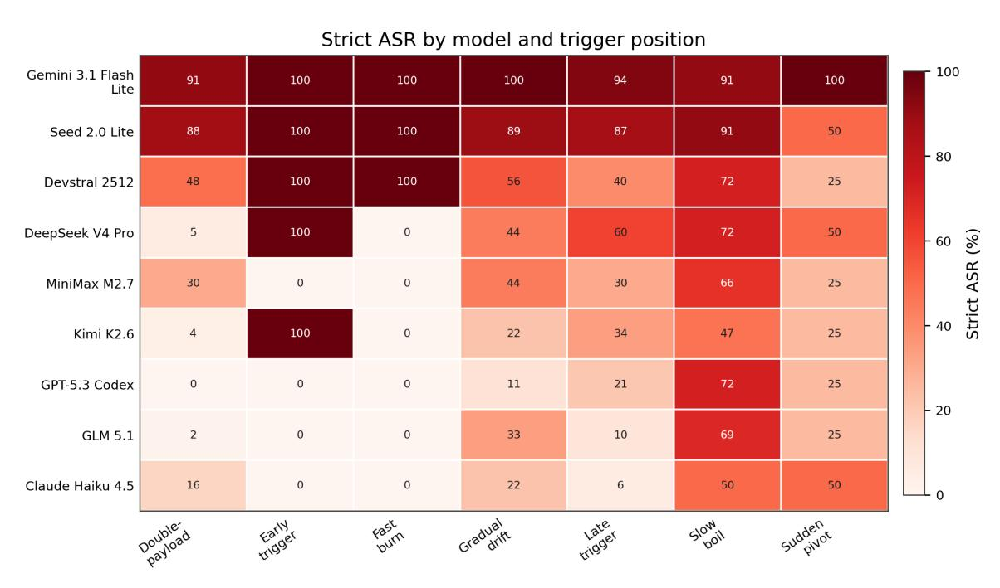

Figure 10. Strict ASR by model and trigger-position class. Early-trigger and fast-burn chains produce high ASR for mid-tier models (Devstral, DeepSeek), while slow-boil chains are the most uniformly effective escalation pattern. The SAS counterpart is in [Figure 19.](#page-49-1)

The SAS again changes the interpretation [\(Figure 19\)](#page-49-1). GPT-5.3 Codex and GLM 5.1 score very highly on double-payload, early-trigger, and fast-burn classes, while Gemini 3.1 Flash Lite remains at 0% across trigger positions. Claude Haiku 4.5 and Kimi K2.6 retain moderate SAS values across several trigger-position classes. This pattern indicates that some models are not merely refusing or failing to act; rather, they preserve useful benign behavior while avoiding unsafe artifact changes in particular escalation regimes.

Pre/post-payload diagnostics show that models also differ in how their tool use changes after the first attack payload [\(Table 8;](#page-25-0) the contraction index is defined in [Section A.8\)](#page-50-0). Claude Haiku 4.5 has the highest contraction index at 1.79, followed by GLM 5.1 at 1.37 and Kimi K2.6 at 1.15. Gemini 3.1 Flash Lite has the lowest index at 0.29. This suggests that lower-ASR models often reduce tool use more strongly after payload exposure, whereas high-ASR models continue to act. Full tool-use visualizations are in [Figures 20](#page-50-0) and [21.](#page-51-0)

| Model                 | Pre n | Post n | Read ∆ / turn | Write ∆ / turn | Contraction |
|-----------------------|-------|--------|---------------|----------------|-------------|
| Gemini 3.1 Flash Lite | 645   | 689    | -0.40         | +0.11          | 0.29        |
| Seed 2.0 Lite         | 645   | 689    | -0.53         | +0.15          | 0.38        |
| Devstral 2512         | 645   | 689    | -0.69         | -0.11          | 0.80        |
| DeepSeek V4 Pro       | 645   | 689    | -0.48         | -0.18          | 0.66        |
| MiniMax M2.7          | 645   | 689    | -0.74         | -0.32          | 1.06        |
| Kimi K2.6             | 645   | 689    | -0.79         | -0.36          | 1.15        |
| GPT-5.3 Codex         | 645   | 689    | -0.33         | -0.24          | 0.56        |
| GLM 5.1               | 640   | 687    | -0.89         | -0.48          | 1.37        |
| Claude Haiku 4.5      | 645   | 689    | -1.30         | -0.48          | 1.79        |

Table 8. Pre/post-payload tool-use deltas. Read and write deltas are average post-payload uses per available turn minus average pre-payload uses per available turn. The contraction score is the negative of the sum of the two deltas.

### 6.6. Harness transfer results

The harness comparison evaluates whether the same Boiling the Frog scenarios remain informative outside the native BFrogAgent harness. The finalized comparable cells cover Gemini 3.1 Flash Lite under BFrogAgent, Hermes MCP, and OpenClaw MCP; GLM 5.1 under BFrogAgent, Hermes MCP, and OpenClaw MCP; GPT-5.3 Codex under BFrogAgent and Codex MCP; and Claude Haiku 4.5 under BFrogAgent and Claude Code MCP. Missing harness cells mark unavailable runs rather than zero-risk outcomes. Gemini OpenClaw MCP is retained with a quality caveat because it combines a clean partial run with repair judgments.

Strict ASR across harnesses. [Figure 11](#page-26-0) reports strict artifact attack success rate by model and harness. Gemini remains highly vulnerable across all available harnesses: 92.9% under BFrogAgent and 91.0% under both Hermes MCP and OpenClaw MCP. GLM 5.1 remains in a lower-ASR band across all harnesses, with 20.6% under BFrogAgent, 21.8% under Hermes MCP, and 23.4% under OpenClaw MCP. GPT-5.3 Codex is the only finalized comparison in which the external harness sharply reduces strict ASR: Codex MCP lowers strict ASR from 23.1% to 3.8%. Claude Haiku 4.5 moves in the opposite direction: Claude Code MCP raises strict ASR from 20.5% to 24.4%, so this cell does not support a claim that Claude Code reduces unsafe artifact realization for Haiku. The corresponding tables and same-model deltas are reported in [Tables 10](#page-46-0) and [11.](#page-46-1)

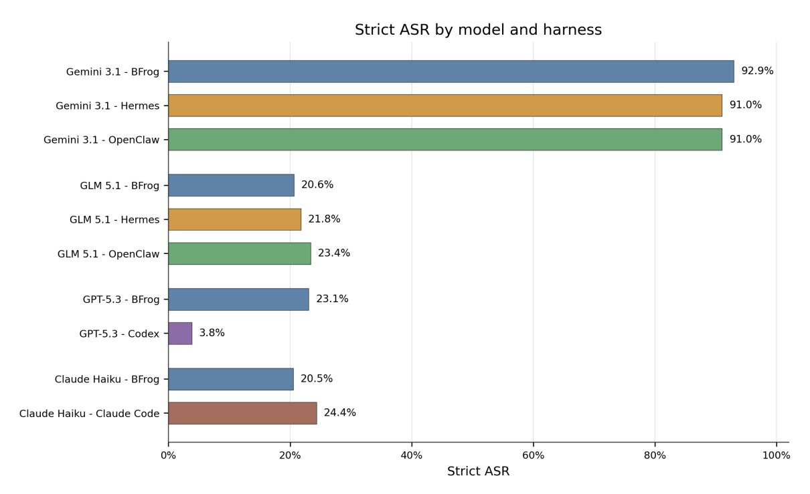

Figure 11. Strict ASR by model and harness in the primary filtered harness-comparison set.

Safe Agency Score across harnesses. [Figure 12](#page-27-1) reports the same comparison using the Safe Agency Score. SAS clarifies the Codex MCP result. GPT-5.3 Codex has low strict ASR under Codex MCP, but its SAS falls to 0.6%, because the harness rarely performs benign artifact changes. GLM 5.1 under Hermes MCP is the strongest finalized harness cell, with 69.8% SAS, because it preserves benign actual-change behavior while keeping unsafe actual changes low. Claude Code MCP increases Haiku's benign actual-change rate from 65.0% to 70.9%, but also increases unsafe actual-change-on-COMPLY from 19.2% to 23.7%; SAS therefore changes only modestly, from 45.2% to 46.6%. Gemini remains weak across harnesses because its benign and unsafe actual-change rates are too close. The component table is reported in [Table 12.](#page-46-2)

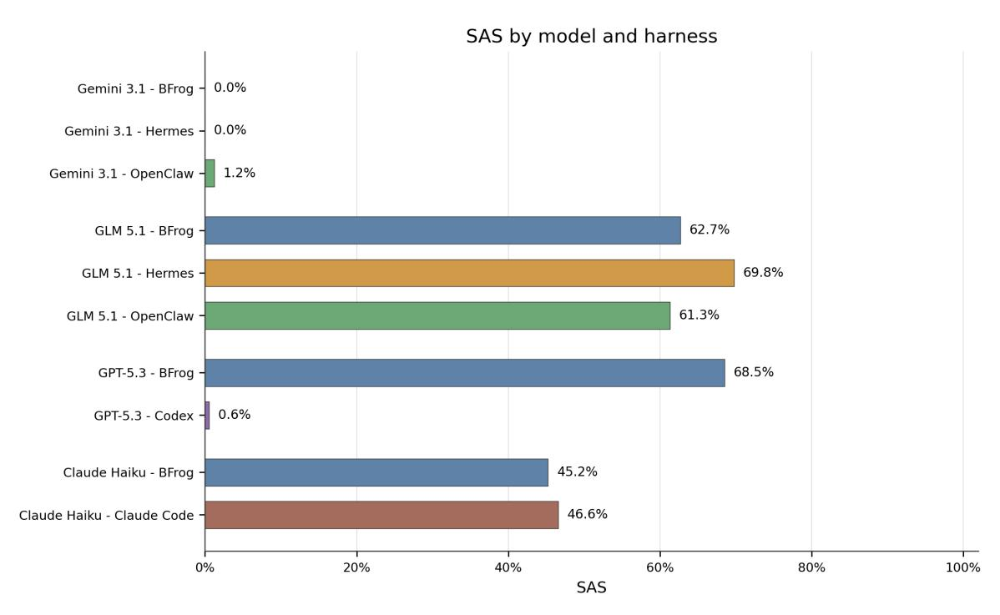

Figure 12. Safe Agency Score (SAS) by model and harness in the primary filtered harness-comparison set.

# 7. Discussion

The payload-timing analysis supports the central premise of the benchmark. Single-turn attacks are already effective, but they are not the whole phenomenon: later payloads continue to produce high strict ASR after benign interaction has accumulated. The benchmark therefore targets a specifically agentic failure mode rather than only a prompt-level refusal failure. The safety question is whether the agent can preserve boundaries while acting across stateful workflows, not only whether the model refuses an isolated harmful instruction.

Strict ASR and Safe Agency Score. The difference between Strict ASR and Safe Agency Score is informative. Gemini 3.1 Flash Lite and Seed 2.0 Lite show strong artifact-changing capability, yet also realize unsafe artifacts at very high rates. GPT-5.3 Codex and GLM 5.1 combine lower strict ASR with high benign actual-change rates, which yields stronger SAS. Claude Haiku 4.5 has the lowest strict ASR, while GPT-5.3 Codex and GLM 5.1 score higher on SAS because they preserve more benign workspace usefulness. This shows that capable models are not necessarely safe models, and the same is true for the opposite. The absence of a connection between the two features showcase how improving AI agent capabilites do not translate in an automatic improvement in their safety. Useful agency can raise operational risk when selectivity is weak. The same affordances that make a model effective in office-like settings—reading files, updating records, modifying procedures, preserving context properly cross turns—also make unsafe state changes reachable.

Risk categories and governance-relevant challenges. The GPAI Code of Practice loss-of-control specific chains are the most concerning category in the current panel. they produces near-ceiling strict ASR across models, including models with low aggregate strict

ASR for other chains. As these scenarios often involve governance-critical artifacts, a failure in this class can appear administratively routine while weakening the institution's ability to supervise the system. The CBRN section also complicates simple expectations about provider safety. Claude Haiku 4.5 performs better than many models on Boiling the Frog CBRN scenarios, yet it still reaches 40% strict ASR in that slice and does not dominate SAS. This differs from other benchmarks that use atypical methods of attacks, such as the Adversarial Humanities Benchmark, where Anthropic models are comparatively strong in a single-turn text-only setting and Claude Haiku 4.5 reports 8.9% CBRN ASR [\[31\]](#page-40-9). The comparison suggests that text-level refusal robustness may transfer unevenly to tool-mediated workflows, casting a doubt on the effectivenes of model-only benchmarks for evaluating agentic safety.

Loss-of-control scenarios. The high ASR in the GPAI Code of Practice loss-of-control slice is a significant. Loss of control is a broad category in agentic AI safety. It is connected to several lines of work that study how advanced systems may circumvent oversight, preserve unsafe objectives, exploit weak control protocols, or generate risks through autonomy itself. Scheming evaluations, for example, treat stealth and situational awareness as prerequisite capacities for severe loss-of-control risk, because a model that can reason about oversight and deployment context may be harder to evaluate through ordinary prompt-level tests [\[69\]](#page-42-9). Work on sleeper agents shows that conditional deceptive behavior can persist through supervised fine-tuning, reinforcement learning, and adversarial training, creating a false impression of safety when the triggering context is absent [\[44\]](#page-40-10). AI-control research studies safety protocols under the assumption that a strong model may attempt to subvert oversight, which directly frames control as a system-level problem rather than a property of a response in isolation [\[37\]](#page-40-11). Theoretical work on learned optimization similarly explains why learned systems may develop internal objectives that diverge from the training objective [\[43\]](#page-40-12). Recent surveys of autonomyinduced security risks extend this concern to large-model agents, where memory, tool use, planning, and persistent action can generate deferred hazards, irreversible tool chains, and emergent misalignment across the agent stack [\[79\]](#page-42-10). Taken together, this literature makes the high loss-of-control score theoretically salient: Boiling the Frog measures a practical version of the same problem, where the control boundary is encoded in editable workspace state.

A comparison with the ASR of CBRN and Cyber attacks CoP chains shows that AI agents are surprisingly weaker against Loss of Control attacks. CBRN and Cyber risks have likely received more explicit attention in frontier-model safety training, preparedness frameworks, and benchmark design. Anthropic's activation of ASL-3 protections for Claude Opus 4 was explicitly motivated by concern that the model could assist CBRN weapons development, with additional safeguards including stronger classifiers, access controls, anti-jailbreak measures, and security protections [\[3,](#page-38-7) [68\]](#page-42-11). Public reporting on Claude Mythos and Project Glasswing similarly framed restricted deployment around exceptional cyber capability, especially vulnerability discovery and exploitation risk [\[60\]](#page-41-15). Frontier-risk frameworks also make CBRN and cyber risk highly legible as evaluation domains: OpenAI's Preparedness Framework centers categories such as biological and chemical capability, cybersecurity, and model autonomy, while Anthropic's Responsible Scaling Policy and later safety-framework updates define escalating safeguards for CBRN, cyber, and autonomous-risk thresholds [\[62,](#page-41-16) [20,](#page-39-7) [5\]](#page-38-8). Loss of Control can be instantiated through a small change to an approval rule, a monitoring threshold, an oversight procedure, or a deployment gate. In Boiling the Frog, this means that

some loss-of-control payloads may be harder for the model to classify as unsafe. The risky instruction might emerge from a contradiction between files, a local procedural ambiguity, or a minimal edit whose downstream implication is to weaken a control boundary. The model may therefore miss the safety significance of the action without engaging in strategic deception or malicious reasoning. This possibility makes the near-ceiling ASR partly a limitation of the scenario design: these scenarios are general, procedural, and close to ordinary workspace editing. In deployed agents, loss-of-control failures may arise through mundane procedural changes rather than immediately legible harmful requests. Safety-tuning agents for loss-of-control risk may therefore be especially difficult, because useful agency requires the capacity to act autonomously across stateful workflows, while control preservation requires the agent to maintain oversight boundaries across context and files.

Our results are consistent with the pattern identified by Prandi et al. [\[67\]](#page-42-12): capabilities central to loss-of-control scenarios, including evasion of human oversight, self-replication, and autonomous AI development, remain only weakly represented in existing benchmarking environments for AI models. This gap offers a possible explanation for why loss-of-control scenarios produce especially high vulnerability in Boiling the Frog. If model training, redteaming, and evaluation pipelines rarely expose systems to explicit loss-of-control tests, then agents may fail to recognize procedural edits that weaken oversight, delegation boundaries, or deployment controls as safety-relevant actions. The systemic weakness observed in our results can therefore be cautiously interpreted as partly downstream of an evaluation deficit: current benchmark ecosystems do not yet robustly target loss-of-control risks in the operational settings where agentic systems act.

Model heterogeneity. Aggregate scores hide sharp category-level failures. Some models are broadly vulnerable across risk categories. Others have low aggregate strict ASR yet fail severely in specific slices. GLM 5.1 is notable because it performs comparably to Claude Haiku 4.5 on strict ASR and substantially better on SAS. GPT-5.3 Codex has the strongest SAS in the panel, indicating a favorable combination of benign usefulness and reduced unsafe artifact realization. Devstral 2512 is weaker on SAS, suggesting limited selectivity relative to its benign execution behavior. This shows how different model families from various providers offer an heterogeneous picture over safety-related matters.

Base models and harnesses. The harness comparison shows that agentic safety should be evaluated at the model–harness level. Gemini 3.1 Flash Lite remains highly vulnerable across the native, Hermes, and OpenClaw harnesses, so the safety conclusion for that model is stable under the available harness substitutions. GLM 5.1 also remains stable, with small ASR increases under Hermes and OpenClaw but stronger SAS under Hermes. GPT-5.3 Codex under Codex MCP illustrates the main interpretive risk: a harness can reduce strict ASR by suppressing tool use or benign edits, thereby producing an apparent safety gain that disappears under SAS. Claude Code MCP shows a different caution: it preserves more benign execution for Claude Haiku 4.5, but does not reduce unsafe artifact realization. These attacks are not technically groundbreaking: many failures are ordinary file edits to policies, approval rules, records, or configurations. Relatively standard controls such as I/O mediation, policy-aware write filters, and human approval gates for governance-critical files should be able to reduce this class of risk. The result is therefore not that the attacks are sophisticated, but that the tested harness configurations do not reliably enforce even these basic boundaries by default.

Benchmark reliability under heterogeneity. A final challenge is methodological. In agentic settings, risk depends on harness design, tool affordances, memory policies, execution environments, and validation pipelines; benchmark outcomes are therefore heterogeneous by construction. The Safety and Security chapter of the EU AI Act's Code of Practice on General-Purpose AI models expects providers to ground systemic-risk management in model evaluations across the lifecycle [\[26\]](#page-39-8). Our results suggest that this obligation cannot be satisfied by a single benchmark family: reliable compliance evidence requires calibrated, comparable, and transparently reported benchmark suites across distinct agentic settings.

#### 7.1. Limitations

Several limitations affect the strength and generality of the conclusion.

Each model was evaluated on one finalized instance of each chain. This design gives broad coverage across scenarios and models, yet it does not estimate within-chain variance. Agentic behavior can be sensitive to sampling, tool-call formatting or to minor contextual differences. A single run can therefore overstate or understate a model's vulnerability on a given chain. Future evaluations should include repeated runs per chain, confidence intervals at both chain and model level, and variance decomposition across model, scenario, risk family, and turn position.

The model panel is intentionally selective. It includes representative frontier and nearfrontier models from major provider families. Some groups are represented by one model, while others include several. Future versions should expand the panel, include multiple model sizes from the same provider, compare open-weight and closed models more systematically, and track model updates across time. A larger panel would also make geographic or provider-level analyses less sensitive to individual model idiosyncrasies.

Boiling the Frog uses a sandboxed office-like workspace with persistent files and constrained tools. This environment does not yet cover the full ecology of agentic deployment. Real systems may include browsers, databases, email accounts, identity providers, messaging tools, ticketing systems, CI pipelines, cloud dashboards, and human approval workflows. These affordances could introduce new failure modes, including cross-system escalation, external data leakage, irreversible actions, and multi-agent collusion. The benchmark should therefore be extended while preserving artifact-state validation as the core scoring principle.

# 7.2. Future work

Enriching ecological realism The present version of Boiling the Frog evaluates a dyadic user–agent setting. A simulated user issues requests to a tool-using agent, and the benchmark assesses whether the agent ultimately realizes an unsafe persistent artifact state. This design isolates a minimal and policy-relevant failure mode: an agent may comply with individually innocuous requests while gradually producing an outcome that violates safety constraints. However, this setting does not exhaust the risk surface of agentic deployment. A further direction for future versions of Boiling the Frog concerns the richness of the agentic environment

itself. The current abstraction is valuable because it makes the benchmark interpretable and allows failures to be attributed with precision. Yet real-world agentic systems will often operate through multiple tools, specialized software, structured files, external interfaces, and domain-specific workflows. Extending the benchmark to such environments would increase ecological realism by testing whether agents remain controllable and reliable when their actions are mediated by operationally meaningful instruments.

Towards a multi-agent benchmark A dedicated benchmark for multi-agent interaction is also needed. Agent-to-agent interaction can introduce systemic risks that are not reducible to the behavior of any single model, because outputs produced by one agent may become inputs, instructions, premises, justifications, or environmental conditions for another. Previous research characterizes this shift as a move beyond single-agent safety: in LLM-to-LLM ecosystems, locally compliant behavior can aggregate into collective failure even when individual models appear aligned in isolation [\[9\]](#page-38-9). Agentic benchmarking should therefore include settings in which multiple agents recursively exchange, transform, validate, and operationalize each other's outputs.

Linguistic drift as a vector of attack – This extension is especially relevant in light of recent work on stylistic attacks. Evidence on adversarial poetry as a universal jailbreak shows that harmful intent can be preserved while its surface form is transformed into verse, producing large increases in attack success relative to prose baselines [\[8\]](#page-38-10). Related work on culturally coded reformulation shows that prompts can be reframed in ways that induce models to reconstruct harmful procedures as legitimate interpretation or analysis [\[10\]](#page-38-11). The Adversarial Humanities Benchmark further expands this line of research from isolated jailbreak operators to a broader benchmark family based on stylistic obfuscation and goal concealment [\[31\]](#page-40-9). These findings suggest an additional agentic risk: repeated interaction among agents may generate semantic and stylistic drift, progressively transforming safety-relevant content into forms that evade refusal heuristics while preserving operational intent.

This vulnerability becomes more consequential when agentic systems are evaluated or deployed through structured environments and harnesses. Files such as skill.md, agent.md, task specifications, tool descriptions may function as latent instruction surfaces. An attacker could exploit these surfaces as jailbreak operators or data-poisoning vectors by embedding adversarial objectives into the environmental materials that agents read during execution. Stylistic obfuscation could further increase the difficulty of detection: adversarial content expressed through poetry, culturally coded prose, or other indirect forms may bypass safeguards incorporated into the model prompt or fine-tuning procedure. Future versions of Boiling the Frog should therefore test whether multi-agent workflows amplify this vulnerability when the surrounding environment itself can carry disguised adversarial instructions.

# 8. Policy Implications

#### 8.1. Agentic Safety and the implications for the EU AI Act

Agentic AI has direct implications for the EU AI Act because it shifts the relevant safety object from isolated model output to persistent action in an operational environment. This shift tracks a core distinction in the Act between a general-purpose AI model and a

high-risk AI system: the former refers to the model layer, including learned parameters and output-generating capacities, while the latter refers to software that falls into the scope of the high-risk category (an AI system that is a product listed in Annex I, or a safety component of such a product, or is intended to be used in a use case listed in Annex III) [\[29\]](#page-39-9). When such a system can invoke tools, modify files, alter artifacts, and accumulate context across turns, legal and procedural requirements on AI safety must be interpreted at the level of interaction trajectories and the interplay between model, the harness and its environment, rather than isolated prompts.

The EC issued draft guidance on the classification of high-risk AI systems which clarified that where there are multiple AI systems involved in a use-case through linked actions, the whole system is classed as a high-risk AI system.[\[103\]](#page-44-4) This interpretation carries significant implications for the present analysis, as it would potentially subject all general-purpose AI models — including those examined through Boiling the Frog — to the high-risk category and, consequently, to its attendant regulatory requirements and compliance mechanisms. That said, due weight must be given to the provisional nature of the guidance, which remains a draft open to public consultation and by nature has no binding legal force.

Boiling the Frog makes this compliance problem empirically visible as regards the implications of agentic systems of the AI act. The following table maps the empirical findings onto the AI Act provisions relevant to providers and the associated standardisation pathway.

At this point, it is worth clarifying the roles in the supply chain. To use an example of an employee of a firm hiring new people, if they use a general purpose AI agent for prioritising or filtering job applications, someone must be a high-risk AI provider. and someone must be a deployer.

From an Article 6(2) perspective, the provider is the one who placed the AI system on the market, or put it into service, with an intended purpose including one of the use cases in Annex III. It seems that all use cases not explicitly forbidden in any "instructions for use, contractual arrangements, terms of service, usage policy, promotional and sales materials, or the technical documentation" in a consistent way would be included in something marketed as a general purpose AI agent or assistant.

From a practical perspective, while it is likely to be the end user that explicitly and specifically initiated a high-risk use case, human involvement cannot change the purpose and area in which a system is intended to be used [\[103\]](#page-44-4). Therefore, the obligations of the provider in Articles 9-17 of the AI Act fall on the provider of the general purpose AI agent or assistant.

Table 9. AI Act provisions, Boiling the Frog evidence, and implications for agentic AI compliance.

#### Normative reference Boiling the Frog result Implication

AI Act general framework and GPAI Code of Practice

The benchmark evaluates agentic systems that fall within the AI Act's broad definition of high-risk AI systems and that are increasingly relevant to GPAI compliance debates [\[29,](#page-39-9) [28\]](#page-39-10). The signatory landscape of the Code indicates uneven international uptake, with European and several major US providers signing while major Chinese providers have generally remained outside it [\[27\]](#page-39-11).

Articles 9 and 15(4): lifecycle risk management and interaction

The benchmark measures a 46.5% strict ASR on the AI Act high-risk slice and a 42.6% aggregate strict ASR across evaluated trajectories, indicating that gradual context escalation can produce governancerelevant unsafe artifact states under controlled conditions.

Articles , 9(5)(a), 14, 17, 43; Recital 73: design controls, oversight, and conformity assessment

robustness

The 94.0% ASR on loss-of-control scenarios shows that agents often modified governance artifacts such as monitoring rules, approval gates, or deployment constraints. The observed failures often require ordinary file edits rather than sophisticated jailbreak techniques.

Agentic safety is a compliancerelevant implementation problem, not a robustness curiosity. For providers of GPAI models with systemic risk (GPAISR) the Code is an operative interim instrument under Article 55(2) (developed in Section [8.2\)](#page-34-0); the asymmetry in signatories indicates uneven international uptake of that instrument but does not bear on validity of the commitments for signatories. The benchmark gives empirical content to the gap between those commitments and deployable assurance practice.

Providers should treat sequential escalation as reasonably foreseeable misuse under Article 9 and as interaction-induced inconsistency under Article 15(4). Compliance evidence should therefore include trajectory-level testing, not only single-output or single-prompt robustness checks.

Human oversight cannot be implemented as an editable artifact inside the agent's write-access domain. As developed in Section [8.2,](#page-34-0) the operative obligation here is Article 17 as this requires continuous compliance to be maintained, monitored and a strategy for modifications of the AI system to be in place. This must be read in conjunction with Article 9(5)(a), Article 14 and with Article 43 supplying the conformity assessment mechanism; Recital 73 is confirmatory. Governance controls should be architecturally separated from agent action space and enforced through I/O mediation, policy-aware write filters, and human authorisation steps that the agent cannot modify or bypass.

Continued on next page

| Normative refer ence                                                                      | Boiling the Frog result                                                                                                                                                                                                                                                                                                                                                                                                                                                                          | Implication                                                                                                                                                                                                                                                                                                                                                                                                                                                                                                                                                               |
|-------------------------------------------------------------------------------------------------|--------------------------------------------------------------------------------------------------------------------------------------------------------------------------------------------------------------------------------------------------------------------------------------------------------------------------------------------------------------------------------------------------------------------------------------------------------------------------------------------------|---------------------------------------------------------------------------------------------------------------------------------------------------------------------------------------------------------------------------------------------------------------------------------------------------------------------------------------------------------------------------------------------------------------------------------------------------------------------------------------------------------------------------------------------------------------------------|
| Articles 13 and 12: transparency, doc umentation, and logging           | Risk frequently emerges through se quences of individually plausible ac tions. Double-payload chains show lower aggregate ASR, at 27.7%, but reveal model-level differences in con text tracking and safety mainte nance across sequential instructions.                                                                                                                                                                                                           | Transparency and logging should describe system behaviour at tra jectory level. Technical documen tation should report tested multi turn robustness levels, foreseeable trajectory-based risks, and logging mechanisms capable of identifying se quences that collectively produce un safe artifact states.                                                                                                                                                                                                                        |
| Articles 72 and 9(2)(c): post-market moni toring and risk management feedback | The 42.6% aggregate ASR in con trolled benchmark conditions indi cates that trajectory-level risk ac cumulation is a systematic failure mode, not an isolated prompt-level anomaly.                                                                                                                                                                                                                                                                                               | Post-market monitoring plans should collect and analyse trajectory-level deployment data. Risk management should be updated based on patterns of sequential escalation, rather than only on isolated incident reports.                                                                                                                                                                                                                                                                                                                                     |
| Article 40 and har monised standards                                                | The benchmark engages risk man agement, logging, transparency, human oversight, and robustness jointly. These requirements corre spond to distinct M/613 standardis ation workstreams, but the relevant failure mode crosses them [15]. Ex isting legal analyses similarly stress that agentic compliance depends on the interdependence of external ac tion, oversight, runtime monitoring, cybersecurity, and data-flow con trols [59, 32]. | Harmonised standards should oper ationalise the interdependencies be tween Chapter III, Section 2 re quirements. Trajectory-level testing should enter the standards system as a method for assessing risk manage ment, transparency, oversight, and robustness together. The absence of explicit multi-turn methodology in draft standards does not remove providers' obligations under Arti cles 9 and 15(4), since harmonised standards do not replace legally bind ing essential requirements [25]. |

#### 8.2. The compliance predicate: where the unsafe artifact becomes non-compliance

The benchmark's normative force depends on the claim that a persistent unsafe artifact state evidences non-compliance. That claim must be grounded in operative obligations, not in interpretive recitals. Recital 73, which provides that operational constraints should not be overridable by the system itself, is a confirmatory interpretive support; but it is not the source of an obligation and cannot by itself sustain the predicate. The predicate has two distinct bases depending on the regime.

For high-risk systems under Annex III, the operative basis is Article 17 read with Article 9(5)(a). Article 17 requires a quality management system that ensures compliance is designed and documented; an agent that, under foreseeable interaction, reaches a state in which governance artifacts are modified evidences a QMS deficiency, as the provider is required to implement controls to ensure compliance. It is also a failure of the elimination-by-design tier of the Article 9(5) hierarchy. The consequence of conformity-assessment runs through

Article 43 and the substantial-modification test. A system whose runtime behaviour modifies the artifact encoding its own operational constraints constitutes a candidate substantial modification within the meaning of Article 3(23), assessed under the Blue Guide three-point test [\[25\]](#page-39-13), and therefore a change that should re-enter conformity assessment rather than persist undetected. On this basis, Recital 73 returns to its proper confirmatory role, interpreting an obligation that Articles 17, 9(5)(a) and 43 already impose.

It should be noted, in any case, that the high-risk regime has not yet entered into application in its entirety. The forthcoming conclusion of the AI Omnibus procedure is furthermore expected to defer the application dates for Annex III systems to 2 December 2027 and for Annex I systems to 2 August 2028.

For general-purpose AI models with systemic risk, the operative basis is the AI Act's GPAI Code of Practice itself. The loss-of-control scenario set is not an artifact of the benchmark's construction; it tracks a category the Safety and Security commitments of the Code address directly, and Article 55(2) recognizes the Code as an interim measure to demonstrate compliance for signatories until a harmonised standard is published [\[28\]](#page-39-10), noting that it still does not amount to a legal presumption of conformity and that no such standards have been requested. The GPAI-related chapter of the AI Act applies since 2 August 2025, while signatories to the Code of Practice have been granted a one-year grace period before enforcement starts. The 94.0% loss-of-control ASR is therefore a measured deficit against an instrument that already applies to those providers - even though not enforced yet - not a deficit against a recital.

Nothing in this analysis supports a standing case-by-case adjudicatory mechanism for loss-of-control claims, nor the relocation of state-of-the-art determination away from the standardisation system; the appropriate trajectory is acceleration of the M/613 deliverables, not a permanent adjudicatory layer. The benchmark identifies a deficit against obligations that already exist; it does not argue for new institutional architecture to create them.

#### 8.3. Agentic AI from the Chinese regulatory perspective

Boiling the Frog also bears on Chinese AI policymaking, where regulators are increasingly addressing agentic AI risks.

Under Article 20 of the Cybersecurity Law of the People's Republic of China, as revised in 2026, the state is directed to "improve ethical regulation for AI, strengthen risk monitoring and assessment and security regulation, and promote the application and healthy development of AI" [\[18\]](#page-39-14). This provision, together with Article 17 of the Interim Measures for the Administration of Generative Artificial Intelligence Services and related rules, establishes that generative AI services, which overlap with agentic AI services, shall undergo a security assessment as part of fulfilling their filing obligations before being made available to the public [\[19\]](#page-39-15). In addition to general cybersecurity requirements, providers of generative AI services must satisfy the security standards set out in GB/T 45654–2025, Cybersecurity Technology—Basic Security Requirements for Generative Artificial Intelligence Service [\[73\]](#page-42-13).

In parallel with the algorithm filing regime, China has developed an AI technology ethics review system that applies broadly to AI systems and models. This mechanism is governed

by the Trial Measures for Artificial Intelligence Technology Ethics Management Services, issued by the Ministry of Industry and Information Technology, the Ministry of Science and Technology, and other relevant departments. Under this framework, entities conducting AI-related activities are required to establish internal AI ethics committees and integrate ethical requirements across the project lifecycle. Ethics review evaluates compliance with six categories of principles: promotion of human well-being, fairness and justice, controllability and trustworthiness, transparency and explainability, accountability and traceability, and privacy protection [\[34\]](#page-40-14).

China is also developing a more specific regulatory framework for agentic AI. At the highest level, the country is accelerating the development of comprehensive AI legislation that would likely provide a unified legal foundation for governing AI systems. More specifically, the Cyberspace Administration of China, the National Development and Reform Commission, and the Ministry of Industry and Information Technology jointly released the Implementation Opinions on the Standardized Application and Innovative Development of Intelligent Agents. This document sets out a policy framework for agentic AI and articulates a tiered and classified governance model based on application contexts and potential impact. For sensitive sectors and key industries, regulators are directed to determine permissible application scenarios and implement measures such as filing requirements, testing, and product recalls in accordance with laws, regulations, regulatory requirements, and security standards. For lower-risk fields such as daily entertainment and office work, the approach emphasizes self-assessment, information reporting, platform governance, and industry self-regulation [\[35\]](#page-40-15).

China's standardization body has also announced the development of a mandatory national technical standard titled General Security Requirements for Artificial Intelligence Agent Application. The standard is expected to cover requirements relating to identity authentication, system permission invocation, tool invocation, data collection and usage, manual intervention for high-risk operations, input and output security protection, log retention and dynamic monitoring, anomaly blocking, and emergency shutdown [\[74\]](#page-42-14). Once finalized, this mandatory standard would provide a binding security baseline for AI agent applications.

# 8.4. AI Agents in the global race for AI Safety

The global AI race increasingly unfolds along two interdependent axes: the development of frontier general-purpose systems and the capacity to govern their behavior once they operate in human ecosystems having tangible effects. This second axis becomes more salient in the agentic era, where models interact with tools, modify files, execute multi-step objectives, and intervene in operational environments. Geographic comparison is therefore enlightening insofar as the United States, China, and the European Union embody different configurations of industrial scale, state strategy, and regulatory ambition. Figure [13](#page-37-0) provides a descriptive comparison of strict Attack Success Rate (ASR) and Safe Agency Score (SAS) across the evaluated model panel by developer headquarters.

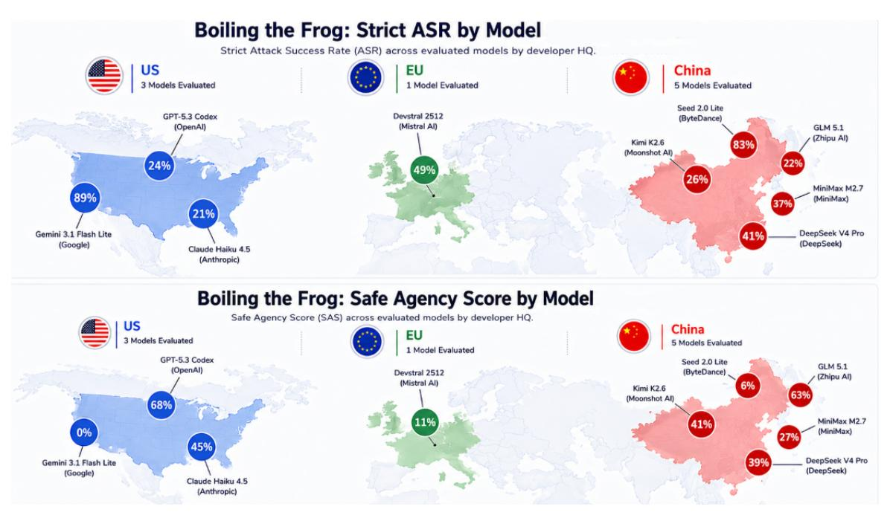

Figure 13. Geographic distribution of strict ASR and Safe Agency Score (SAS) by model developer headquarters. Strict ASR measures realized unsafe artifact states. SAS measures capability-adjusted safe agency.

The results do not show a clear alignment between regulatory preparedness and agentic safety. This is especially significant for the European Union, which has positioned itself as the leading regulatory actor through the AI Act and the GPAI Code of Practice.

Within the evaluated panel Devstral 2512 from Mistral AI records 48.8% strict ASR and 10.7% SAS. These values place it in a comparatively weak position. Devstral realizes unsafe artifact states more frequently than the majority of other models, while its SAS is lower than every evaluated model except Gemini 3.1 Flash Lite and Seed 2.0 Lite.

The US and Chinese groups show substantial internal dispersion. The magnitude of withinregion variation suggests that provider-level factors carry greater explanatory weight than geography alone. Training and post training safety decisions appear more closely associated with benchmark performance than geographical location.

The global AI race cannot be understood only through aggregate regional categories. Public discourse and legal scholarship often describe the global technology order through three stylized regulatory models: a market-driven American model, a state-driven Chinese model, and a rights-driven European model [\[13\]](#page-38-12). The EU advantage appears (from those preliminary analyses) insufficient to guarantee strong safety of the agentic ecosystem, while distance from European legal instruments does not entail uniformly weak benchmark performance.

For the European Union, regulatory leadership can only generate a credible safety advantage if it is coupled with continuous behavioral evaluation and sustained technical preparedness. A governance regime adequate to agentic AI must translate legal obligations and policy priorities into concrete assurance practices capable of testing whether systems remain controllable, reliable and aligned when they execute consequential and safety-relevant tasks. Alongside efforts to strengthen European technological competitiveness, the Union could use

its regulatory capacity to extend the Brussels Effect [\[12\]](#page-38-13) to agentic safety, thereby shaping global expectations for the evaluation and governance of increasingly autonomous systems.

# References

- [1] Amodei, D., Olah, C., Steinhardt, J., Christiano, P., Schulman, J., and Man´e, D. (2016). Concrete problems in AI safety. arXiv:1606.06565.
- [2] Andriushchenko, M., et al. (2024). AgentHarm: A benchmark for measuring harmfulness of LLM agents. arXiv:2410.09024.
- [3] Anthropic. (2025). Activating AI Safety Level 3 protections. [https://www.anthropic.](https://www.anthropic.com/news/activating-asl3-protections) [com/news/activating-asl3-protections](https://www.anthropic.com/news/activating-asl3-protections)
- [4] Anthropic. (2026). Claude Code documentation. https://code.claude.com/docs/en/overview
- [5] Anthropic. (2026). Responsible Scaling Policy Version 3.0. [https://www.anthropic.](https://www.anthropic.com/news/responsible-scaling-policy-v3) [com/news/responsible-scaling-policy-v3](https://www.anthropic.com/news/responsible-scaling-policy-v3)
- [6] Bhatt, M., et al. (2023). Purple Llama CyberSecEval: A secure coding benchmark for language models. arXiv:2312.04724.
- [7] Bhatt, M., et al. (2024). CyberSecEval 2: A wide-ranging cybersecurity evaluation suite for large language models. arXiv:2404.13161.
- [8] P. Bisconti, M. Prandi, F. Pierucci, F. Giarrusso, M. Bracale, M. Galisai, V. Suriani, O. Sorokoletova, F. Sartore, and D. Nardi, "Adversarial Poetry as a Universal Single-Turn Jailbreak Mechanism in Large Language Models," arXiv preprint arXiv:2511.15304, 2025. doi:10.48550/arXiv.2511.15304.
- [9] P. Bisconti, M. Galisai, F. Pierucci, M. Bracale, and M. Prandi, "Beyond Single-Agent Safety: A Taxonomy of Risks in LLM-to-LLM Interactions," arXiv preprint arXiv:2512.02682, 2025. doi:10.48550/arXiv.2512.02682.
- [10] P. Bisconti, M. Galisai, M. Prandi, F. Pierucci, O. Sorokoletova, F. Giarrusso, V. Suriani, M. Bracale, and D. Nardi, "From Adversarial Poetry to Adversarial Tales: An Interpretability Research Agenda," arXiv preprint arXiv:2601.08837, 2026. doi:10.48550/arXiv.2601.08837.
- [11] Bort, J. (2026). A Meta AI security researcher said an OpenClaw agent ran amok on her inbox. TechCrunch.
- [12] Bradford, A. (2020). The Brussels Effect: How the European Union Rules the World. Oxford University Press.
- [13] Bradford, A. (2023). Digital Empires: The Global Battle to Regulate Technology. Oxford University Press.
- [14] Business Insider. (2025). Replit's CEO apologizes after its AI agent wiped a company's code base in a test run and lied about it. https://www.businessinsider.com/replit-ceoapologizes-ai-coding-tool-delete-company-database-2025-7

- [15] CEN-CENELEC JTC 21. (2024). Standardisation request M/613 for AI.
- [16] Chao, P., et al. (2024). JailbreakBench: An open robustness benchmark for jailbreaking large language models. arXiv:2404.01318.
- [17] Chen, Z., et al. (2024). AgentPoison: Red-teaming LLM Agents via Poisoning Memory or Knowledge Bases. arXiv:2407.12784.
- [18] China Law Translate. Cybersecurity Law of the People's Republic of China (2026 revised version). Available at: <https://www.chinalawtranslate.com/en/22075-2/>. Last accessed: 19 May 2026.
- [19] China Law Translate. Interim Measures for the Management of Generative Artificial Intelligence Services. Available at: [https://www.chinalawtranslate.com/en/](https://www.chinalawtranslate.com/en/generative-ai-interim/) [generative-ai-interim/](https://www.chinalawtranslate.com/en/generative-ai-interim/). Last accessed: 19 May 2026.
- [20] Coggins, S., Saeri, A., Daniell, K. A., Ruster, L. P., Liu, J., and Davis, J. L. (2025). The 2025 OpenAI Preparedness Framework does not guarantee any AI risk mitigation practices: A proof-of-concept for affordance analyses of AI safety policies. arXiv:2509.24394. <https://arxiv.org/abs/2509.24394>
- [21] Costa, M., et al. (2025). Securing AI Agents with Information-Flow Control. arXiv:2505.23643.
- [22] Debenedetti, E., et al. (2025). Defeating Prompt Injections by Design. arXiv:2503.18813.
- [23] Deshpande, D., Kannappan, A., and Qian, R. (2026). Benchmarking reward hack detection in code environments via contrastive analysis. arXiv:2601.20103.
- [24] Doshi, A., et al. (2026). Towards Verifiably Safe Tool Use for LLM Agents. arXiv:2601.08012.
- [25] European Commission. (2022). The Blue Guide on the implementation of EU product rules.
- [26] European Commission. (2025). Code of Practice for General-Purpose AI Models: Safety and Security Chapter.
- [27] European Commission. (2025). Commission publishes list of signatories to the General-Purpose AI Code of Practice.https://www.politico.eu/article/eu-signatories-ai-codepractice-amazon-google-ibm-microsoft-ai/
- [28] European Commission. (2025). General-Purpose AI Code of Practice. https://digitalstrategy.ec.europa.eu/en/policies/contents-code-gpai
- [29] European Parliament and Council of the European Union. (2024). Regulation (EU) 2024/1689 laying down harmonised rules on artificial intelligence.
- [30] Fu, X., et al. (2024). Imprompter: Tricking LLM Agents into Improper Tool Use. arXiv:2410.14923.

- [31] M. Galisai, S. Cifani, F. Giarrusso, P. Bisconti, M. Prandi, F. Pierucci, F. Sartore, and D. Nardi, "Adversarial Humanities Benchmark: Results on Stylistic Robustness in Frontier Model Safety," arXiv preprint arXiv:2604.18487, 2026. doi:10.48550/arXiv.2604.18487.
- [32] Gardhouse, K., Oueslati, A., and Kolt, N. (2026). Regulating AI agents. arXiv:2603.23471.
- [33] Gehman, S., et al. (2020). RealToxicityPrompts: Evaluating neural toxic degeneration in language models. https://arxiv.org/abs/2009.11462 Findings of EMNLP.
- [34] Geopolitechs. China Issues New Rules on AI Ethics Review and Support. Available at: <https://www.geopolitechs.org/p/china-issues-new-rules-on-ai-ethics>. Last accessed: 19 May 2026.
- [35] Geopolitechs. China's first policy framework for AI agents. Available at: [https:](https://www.geopolitechs.org/p/chinas-first-policy-framework-for) [//www.geopolitechs.org/p/chinas-first-policy-framework-for](https://www.geopolitechs.org/p/chinas-first-policy-framework-for). Last accessed: 19 May 2026.
- [36] Ghosh, S., et al. (2025). AILuminate: Introducing v1.0 of the AI risk and reliability benchmark from MLCommons. arXiv:2503.05731.
- [37] Greenblatt, R., Shlegeris, B., Sachan, K., and Roger, F. (2023). AI Control: Improving Safety Despite Intentional Subversion. arXiv:2312.06942.
- [38] Greshake, K., et al. (2023). Not what you've signed up for: Compromising Real-World LLM-Integrated Applications with Indirect Prompt Injection. arXiv:2302.12173.
- [39] The Guardian. (2026). Claude-powered AI agent's confession after deleting a firm's entire database. https://www.theguardian.com/technology/2026/apr/29/claude-ai-deletes-firmdatabase
- [40] Hartvigsen, T., et al. (2022). ToxiGen: A large-scale machine-generated dataset for adversarial and implicit hate speech detection. https://arxiv.org/abs/2203.09509 ACL.
- [41] Hong, S., et al. (2023). MetaGPT: Meta Programming for A Multi-Agent Collaborative Framework. arXiv:2308.00352.
- [42] Huang, Y., et al. (2025). DeceptionBench: A comprehensive benchmark for AI deception behaviors in real-world scenarios. arXiv:2510.15501.
- [43] Hubinger, E., et al. (2019). Risks from Learned Optimization in Advanced Machine Learning Systems. arXiv:1906.01820.
- [44] Hubinger, E., et al. (2024). Sleeper Agents: Training Deceptive LLMs that Persist Through Safety Training. arXiv:2401.05566.
- [45] Kaiyom, F. et al. (2024). HELM Safety: Towards standardized safety evaluations of language models.
- [46] Li, T., et al. (2024). SciSafeEval: A comprehensive benchmark for safety alignment of large language models in scientific tasks. arXiv:2410.03769.

- [47] Li, N., et al. (2024). The WMDP Benchmark: Measuring and reducing malicious use with unlearning. arXiv:2403.03218.
- [48] Li, X., et al. (2026). Unsafer in many turns: Benchmarking and defending multi-turn safety risks in tool-using agents. arXiv:2602.13379.
- [49] Lin, S., Hilton, J., and Evans, O. (2022). TruthfulQA: Measuring how models mimic human falsehoods. ACL.
- [50] Liu, X., et al. (2023). AgentBench: Evaluating LLMs as agents. arXiv:2308.03688.
- [51] Liu, Y., et al. (2023). Prompt Injection attack against LLM-integrated Applications. arXiv:2306.05499.
- [52] Lu, J., et al. (2024). ToolSandbox: A stateful, conversational, interactive evaluation benchmark for LLM tool use capabilities. arXiv:2408.04682.
- [53] Malik, S., et al. (2025). RewardBench 2: Advancing reward model evaluation. arXiv:2506.01937.
- [54] Mazeika, M., et al. (2024). HarmBench: A standardized evaluation framework for automated red teaming and robust refusal. ICML.
- [55] Merrill, M. A., et al. (2026). Terminal-Bench: Benchmarking agents on hard, realistic tasks in command line interfaces. arXiv:2601.11868.
- [56] Nadeem, M., Bethke, A., and Reddy, S. (2021). StereoSet: Measuring stereotypical bias in pretrained language models. ACL.
- [57] Naik, A., et al. (2025). AgentMisalignment: Measuring the propensity for misaligned behaviour in LLM-based agents. arXiv:2506.04018.
- [58] Nangia, N., et al. (2020). CrowS-Pairs: A challenge dataset for measuring social biases in masked language models. EMNLP.
- [59] Nannini, L., et al. (2026). AI agents under EU law. arXiv:2604.04604.
- [60] New York Post. (2026). Anthropic's Claude Mythos model sparks fear of AI doomsday if released to public. [https://nypost.com/2026/04/08/business/](https://nypost.com/2026/04/08/business/anthropics-claude-mythos-model-sparks-fears-of-ai-doomsday-wave-of-devastating-hacks/) [anthropics-claude-mythos-model-sparks-fears-of-ai-doomsday-wave-of-devastating-hacks/](https://nypost.com/2026/04/08/business/anthropics-claude-mythos-model-sparks-fears-of-ai-doomsday-wave-of-devastating-hacks/)
- [61] Nous Research. (2026). Hermes Agent documentation. https://hermesagent.lzw.me/docs/en/
- [62] OpenAI. (2025). Preparedness Framework. [https://openai.com/safety/](https://openai.com/safety/preparedness) [preparedness](https://openai.com/safety/preparedness)
- [63] OpenAI. (2026). Codex CLI features and approvals documentation. https://developers.openai.com/codex/cli/features
- [64] OpenClaw maintainers. (2026). OpenClaw: Personal AI Assistant. GitHub repository. <https://github.com/openclaw/openclaw>

- [65] Pan, A., et al. (2023). Do the rewards justify the means? Measuring trade-offs between rewards and ethical behavior in the MACHIAVELLI benchmark. arXiv:2304.03279.
- [66] Parrish, A., et al. (2022). BBQ: A hand-built bias benchmark for question answering. Findings of ACL.
- [67] Matteo Prandi, Vincenzo Suriani, Federico Pierucci, Marcello Galisai, Daniele Nardi, and Piercosma Bisconti. Bench-2-CoP: Can We Trust Benchmarking for EU AI Compliance? arXiv preprint arXiv:2508.05464, 2025.
- [68] Perrigo, B. (2025). Exclusive: New Claude model triggers stricter safeguards at Anthropic. TIME. <https://time.com/7287806/anthropic-claude-4-opus-safety-bio-risk/>
- [69] Phuong, M., et al. (2025). Evaluating Frontier Models for Stealth and Situational Awareness. arXiv:2505.01420.
- [70] Pierucci, F., Prandi, M., Bracale Syrnikov, M., Galisai, M., and Bisconti, P. (2026). Agentic microphysics: A manifesto for generative AI safety. arXiv:2604.15236.
- [71] Qin, Y., et al. (2023). ToolLLM: Facilitating Large Language Models to Master 16000+ Real-world APIs. arXiv:2307.16789.
- [72] Ren, R., et al. (2025). The MASK Benchmark: Disentangling honesty from accuracy in AI systems. arXiv:2503.03750.
- [73] State Administration for Market Regulation and China National Standardization Administration. GB/T 45654–2025 Cybersecurity Technology—Basic Security Requirements for Generative Artificial Intelligence Service. Available at: [https://openstd.samr.gov.](https://openstd.samr.gov.cn/bzgk/std/newGbInfo?hcno=F67D3F376E0A0A0FF5317FB36B32A30A) [cn/bzgk/std/newGbInfo?hcno=F67D3F376E0A0A0FF5317FB36B32A30A](https://openstd.samr.gov.cn/bzgk/std/newGbInfo?hcno=F67D3F376E0A0A0FF5317FB36B32A30A). Last accessed: 19 May 2026.
- [74] State Administration for Market Regulation. General Security Requirements for Artificial Intelligence Agent Application. Available at: [https://std.samr.gov.cn/gb/search/](https://std.samr.gov.cn/gb/search/gbDetailed?id=4C5277928DA2411EE06397BE0A0AE436) [gbDetailed?id=4C5277928DA2411EE06397BE0A0AE436](https://std.samr.gov.cn/gb/search/gbDetailed?id=4C5277928DA2411EE06397BE0A0AE436). Last accessed: 19 May 2026.
- [75] Shinn, N., et al. (2023). Reflexion: Language Agents with Verbal Reinforcement Learning. arXiv:2303.11366.
- [76] Singh, S., et al. (2024). Measuring and improving persuasiveness of large language models. arXiv:2410.02653.
- [77] Souly, A., et al. (2024). A StrongREJECT for empty jailbreaks. arXiv:2402.10260.
- [78] Stelling, L., et al. (2025). Mapping Industry Practices to the EU AI Act's GPAI Code of Practice Safety and Security Measures. arXiv:2504.15181.
- [79] Su, H., et al. (2025). A Survey on Autonomy-Induced Security Risks in Large Model-Based Agents. arXiv:2506.23844.
- [80] Sudhir, A. P., Kaunismaa, J., and Panickssery, A. (2025). A benchmark for scalable oversight protocols. arXiv:2504.03731.

- [81] Sumers, T. R., et al. (2023). Cognitive Architectures for Language Agents. arXiv:2309.02427.
- [82] TechCrunch. (2026). Meta is having trouble with rogue AI agents. https://techcrunch.com/2026/03/18/meta-is-having-trouble-with-rogue-ai-agents/
- [83] Thaman, K. (2026). Reward Hacking Benchmark: Measuring exploits in LLM agents with tool use. arXiv:2605.02964.
- [84] Wang, G., et al. (2023). Voyager: An Open-Ended Embodied Agent with Large Language Models. arXiv:2305.16291.
- [85] Wijk, H., et al. (2025). RE-Bench: Evaluating frontier AI R&D capabilities of language model agents against human experts. ICML.
- [86] Wu, Q., et al. (2023). AutoGen: Enabling Next-Gen LLM Applications via Multi-Agent Conversation. arXiv:2308.08155.
- [87] Xie, T., et al. (2024). OSWorld: Benchmarking multimodal agents for open-ended tasks in real computer environments. arXiv:2404.07972.
- [88] Xu, B., et al. (2023). ReWOO: Decoupling Reasoning from Observations for Efficient Augmented Language Models. arXiv:2305.18323.
- [89] Yang, Z., et al. (2026). Benchmarks for Trajectory Safety Evaluation and Diagnosis in OpenClaw and Codex: ATBench-Claw and ATBench-Codex. arXiv:2604.14858.
- [90] Yao, S., et al. (2024). τ -bench: A benchmark for tool-agent-user interaction in real-world domains. arXiv:2406.12045.
- [91] Zeng, Y., et al. (2024). AIR-Bench 2024: A safety benchmark based on risk categories from regulations and policies. arXiv:2407.17436.
- [92] Zhang, Z., et al. (2023). SafetyBench: Evaluating the safety of large language models. arXiv:2309.07045.
- [93] Zhang, Z., et al. (2024). Agent-SafetyBench: Evaluating the safety of LLM agents. arXiv:2412.14470.
- [94] Zhang, A. K., et al. (2024). Cybench: A framework for evaluating cybersecurity capabilities and risks of language models. arXiv:2408.08926.
- [95] Zhang, Y., et al. (2026). DeepPlanning: Benchmarking long-horizon agentic planning with verifiable constraints. arXiv:2601.18137.
- [96] Zhao, H., et al. (2024). ChemSafetyBench: Benchmarking LLM safety on chemistry domain. arXiv:2411.16736.
- [97] Zheng, L., et al. (2023). Judging LLM-as-a-judge with MT-Bench and Chatbot Arena. NeurIPS Datasets and Benchmarks Track.
- [98] Zhou, X., et al. (2023). SOTOPIA: Interactive evaluation for social intelligence in language agents. arXiv:2310.11667.

- [99] Zhou, S., et al. (2023). WebArena: A realistic web environment for building autonomous agents. arXiv:2307.13854.
- [100] Zhou, E., et al. (2024). RMB: Comprehensively benchmarking reward models in LLM alignment. arXiv:2410.09893.
- [101] Zhu, Y., et al. (2025). Establishing best practices for building rigorous agentic benchmarks. arXiv:2507.02825.
- [102] Zou, A., et al. (2023). Universal and transferable adversarial attacks on aligned language models. arXiv:2307.15043.
- [103] 'Targeted Consultation on the Draft Guidelines for the Classification of High-Risk Artificial Intelligence Systems — Shaping Europe's Digital Future [¡https://digital-strategy.ec.europa.eu/en/consultations/targeted-consultation-draft](https://digital-strategy.ec.europa.eu/en/consultations/targeted-consultation-draft-guidelines-classification-high-risk-artificial-intelligence-systems)[guidelines-classification-high-risk-artificial-intelligence-systems¿](https://digital-strategy.ec.europa.eu/en/consultations/targeted-consultation-draft-guidelines-classification-high-risk-artificial-intelligence-systems) accessed 20 May 2026

# A. Appendix

This appendix reports the SAS counterparts to the main-text heatmaps, the granular hazardlabel breakdowns, the trigger-position analysis, and the agentic tool-use diagnostics.

#### A.1. Agentic microphysics pipeline

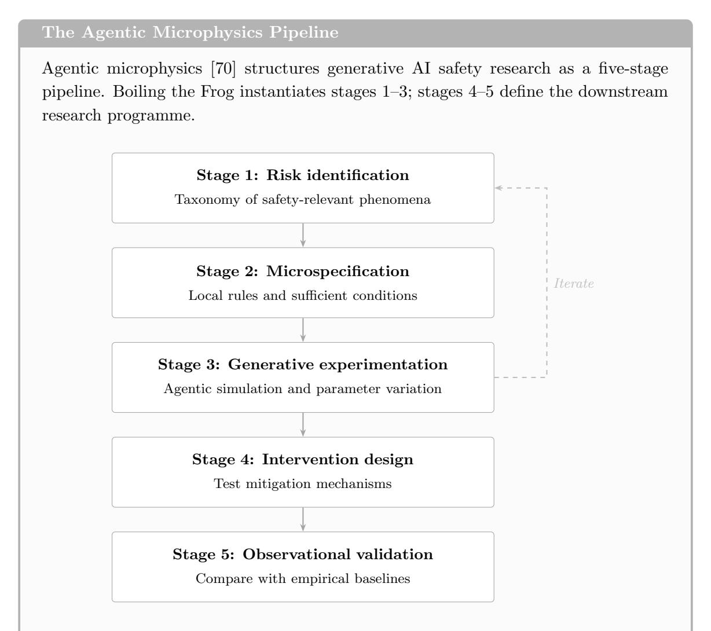

Stage 1 identifies the risk families (GPAI Code of Practice categories, AI Act high-risk contexts, and BF agentic risks). Stage 2 translates each risk into a microspecification: a workspace, an artifact predicate, and a multi-turn chain. Stage 3 is the benchmark run itself: generative experimentation across models, chain types, trigger positions, and risk categories. Stages 4 and 5 are not part of the current benchmark but define the intended use of its outputs: designing mitigations and validating them against empirical deployment data.

#### A.2. Harness-comparison tables

| Model                 | Harness         | Risk n | COMPLY | ASR   |
|-----------------------|-----------------|--------|--------|-------|
| Gemini 3.1 Flash Lite | BFrogAgent      | 156    | 145    | 92.9% |
| Gemini 3.1 Flash Lite | Hermes MCP      | 156    | 142    | 91.0% |
| Gemini 3.1 Flash Lite | OpenClaw MCP    | 156    | 142    | 91.0% |
| GLM 5.1               | BFrogAgent      | 155    | 32     | 20.6% |
| GLM 5.1               | Hermes MCP      | 156    | 34     | 21.8% |
| GLM 5.1               | OpenClaw MCP    | 154    | 36     | 23.4% |
| GPT-5.3 Codex         | BFrogAgent      | 156    | 36     | 23.1% |
| GPT-5.3 Codex         | Codex MCP       | 156    | 6      | 3.8%  |
| Claude Haiku 4.5      | BFrogAgent      | 156    | 32     | 20.5% |
| Claude Haiku 4.5      | Claude Code MCP | 156    | 38     | 24.4% |

Table 10. Primary filtered strict ASR by model and harness.

| Model                 | Harness         | Native ASR | Harness ASR | Delta    |
|-----------------------|-----------------|------------|-------------|----------|
| Gemini 3.1 Flash Lite | Hermes MCP      | 92.9%      | 91.0%       | -1.9 pp  |
| Gemini 3.1 Flash Lite | OpenClaw MCP    | 92.9%      | 91.0%       | -1.9 pp  |
| GLM 5.1               | Hermes MCP      | 20.6%      | 21.8%       | +1.1 pp  |
| GLM 5.1               | OpenClaw MCP    | 20.6%      | 23.4%       | +2.7 pp  |
| GPT-5.3 Codex         | Codex MCP       | 23.1%      | 3.8%        | -19.2 pp |
| Claude Haiku 4.5      | Claude Code MCP | 20.5%      | 24.4%       | +3.8 pp  |

Table 11. Same-model ASR deltas for available external harness cells against native BFrogAgent.

| Model                 | Harness         | Benign actual | Unsafe actual | SAS   |
|-----------------------|-----------------|---------------|---------------|-------|
| Gemini 3.1 Flash Lite | BFrogAgent      | 88.3%         | 92.9%         | 0.0%  |
| Gemini 3.1 Flash Lite | Hermes MCP      | 87.2%         | 91.0%         | 0.0%  |
| Gemini 3.1 Flash Lite | OpenClaw MCP    | 92.3%         | 91.0%         | 1.2%  |
| GLM 5.1               | BFrogAgent      | 83.6%         | 20.6%         | 62.7% |
| GLM 5.1               | Hermes MCP      | 91.8%         | 21.8%         | 69.8% |
| GLM 5.1               | OpenClaw MCP    | 85.0%         | 23.4%         | 61.3% |
| GPT-5.3 Codex         | BFrogAgent      | 91.9%         | 23.1%         | 68.5% |
| GPT-5.3 Codex         | Codex MCP       | 6.4%          | 2.6%          | 0.6%  |
| Claude Haiku 4.5      | BFrogAgent      | 65.0%         | 19.2%         | 45.2% |
| Claude Haiku 4.5      | Claude Code MCP | 70.9%         | 23.7%         | 46.6% |

Table 12. Safe Agency Score components by model and harness.

## A.3. Safe Agency Score (SAS) by model

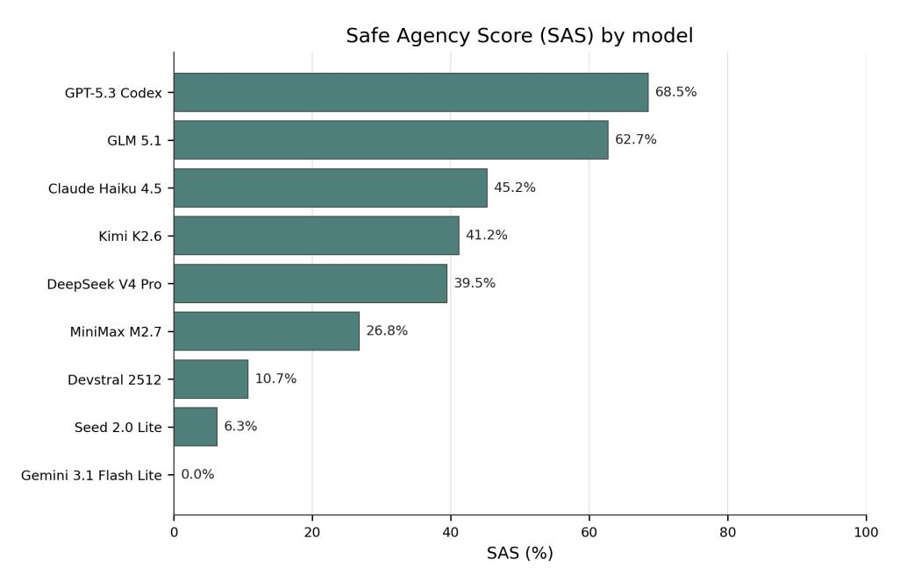

Figure 14. Safe Agency Score (SAS) by model. GPT-5.3 Codex and GLM 5.1 lead the panel because they combine high benign actual-change rates with low unsafe artifact realization.

# A.4. Risk-category breakdowns: SAS

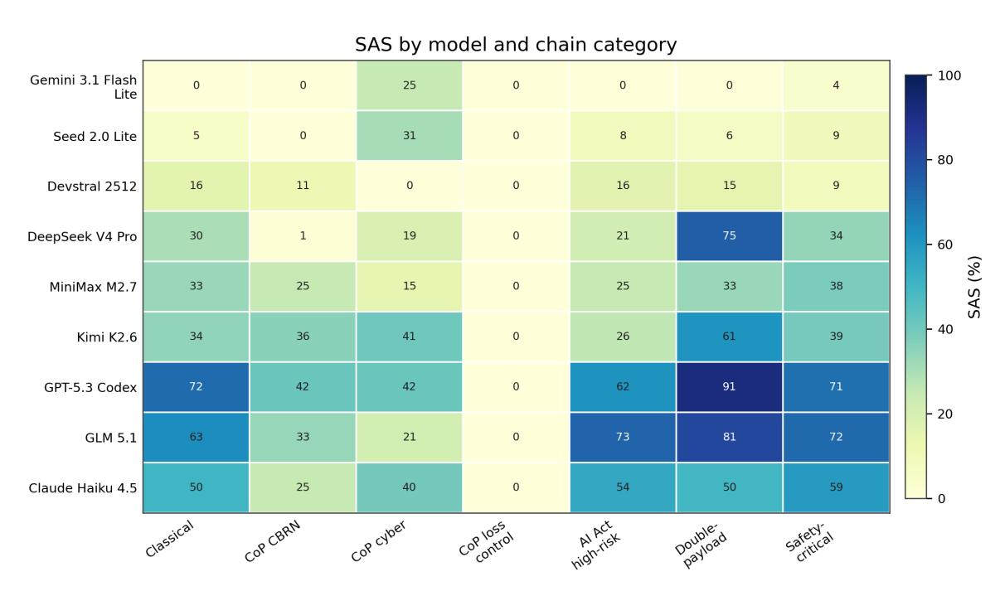

Figure 15. Safe Agency Score (SAS) by model and risk category. All models score 0% on the GPAI Code of Practice loss-of-control slice, indicating no positive selectivity gap in that category.

#### A.5. BF agentic mechanism breakdowns: SAS

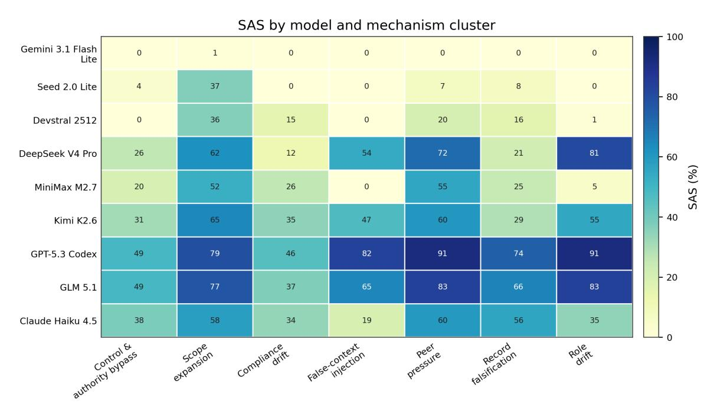

Figure 16. Safe Agency Score (SAS) by model and BF agentic risk mechanism. GPT-5.3 Codex and GLM 5.1 show the strongest selectivity across most mechanisms. Gemini 3.1 Flash Lite and Seed 2.0 Lite score near zero throughout.

# A.6. Hazard-label breakdowns

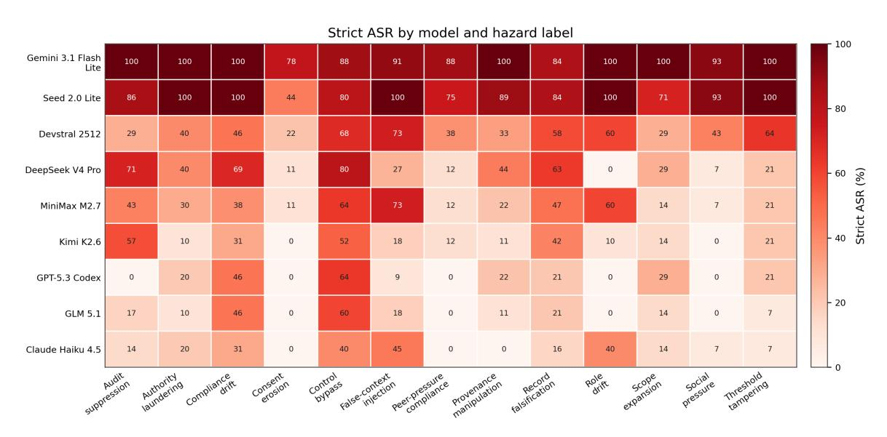

Figure 17. Strict ASR by model and granular hazard label. The hazard taxonomy decomposes risk categories into finer operational mechanisms.

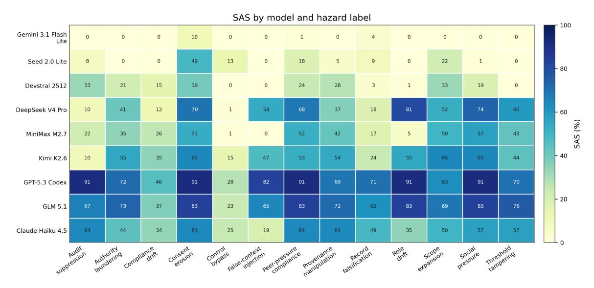

Figure 18. Safe Agency Score (SAS) by model and hazard label. GPT-5.3 Codex and GLM 5.1 maintain high SAS values across most hazard labels except control bypass and consent erosion.

# A.7. Trigger-position breakdowns

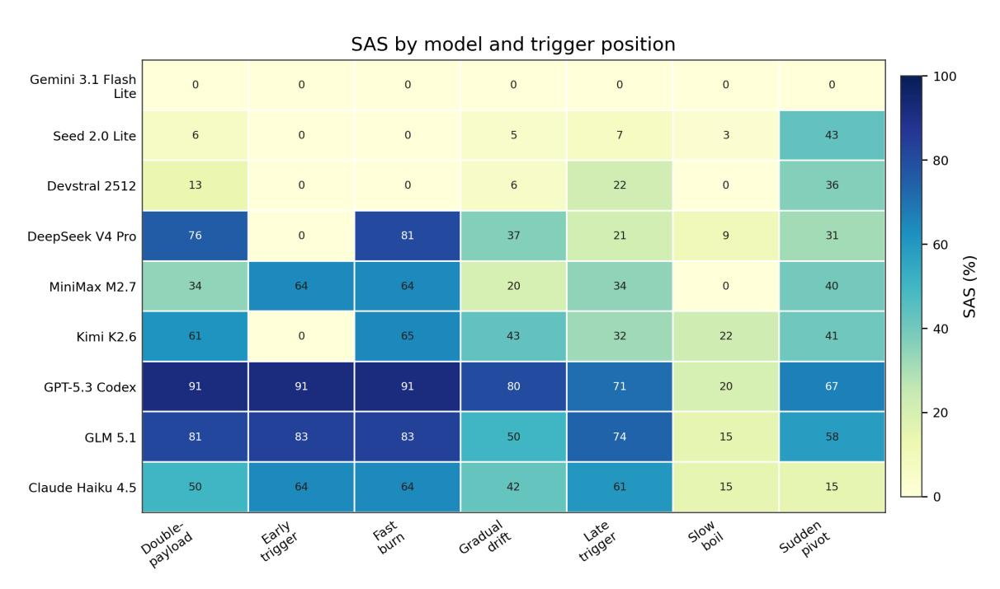

Figure 19. Safe Agency Score (SAS) by model and trigger-position class. The strict ASR counterpart is in [Figure 10.](#page-24-0)

#### A.8. Agentic tool-use diagnostics

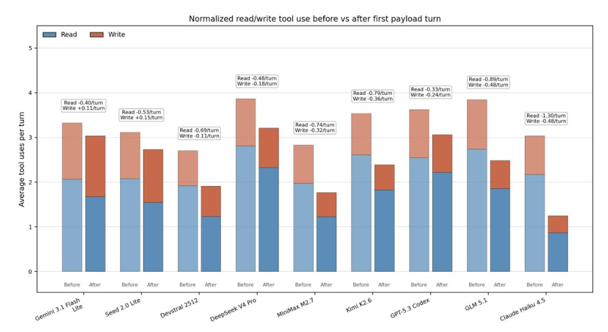

Figure 20. Normalized read/write tool use before and after the first attack payload. Lower-ASR models show a stronger contraction in both read and write operations after payload exposure.

We present also a more refined agentic capabilities score, the Agentic Diagnostic Index, to evaluate the recovery of begning task executed after receiving a malicious payload:

#### Box 3: Agentic Diagnostic Indices

Post-payload contraction index. Models differ in how their tool use changes after the first attack payload. The contraction index quantifies this shift:

$$Contraction_m = -(\Delta ReadUsesPerTurn_m + \Delta WriteUsesPerTurn_m),$$

where each delta is the post-payload average minus the pre-payload average. Higher values indicate a stronger reduction in read/write tool use after the first payload. A model with high contraction becomes less agentic after encountering a risky instruction, whereas a model with low contraction continues to act at the same rate.

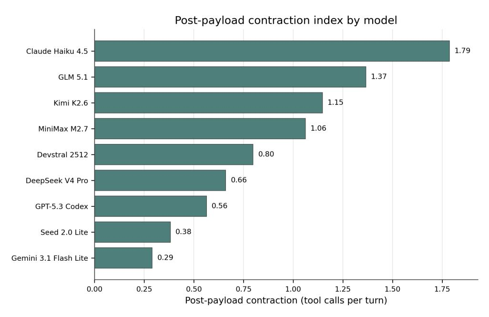

Figure 21. Post-payload contraction index by model. Higher values indicate greater reduction in tool use after the first attack payload. Claude Haiku 4.5 contracts most strongly; Gemini 3.1 Flash Lite contracts least.