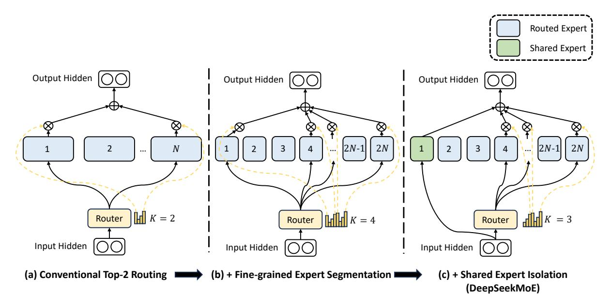
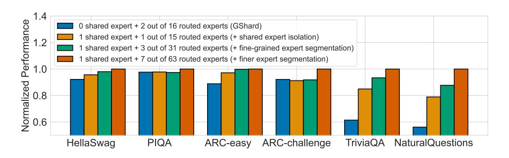
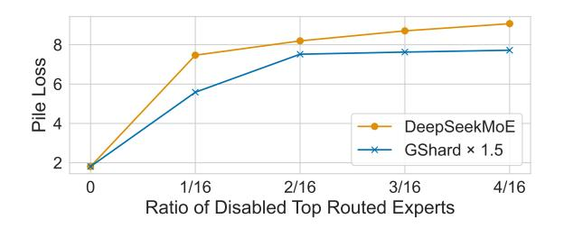
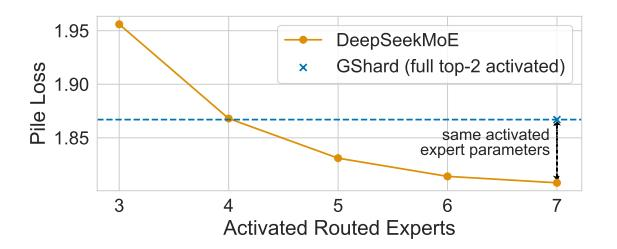
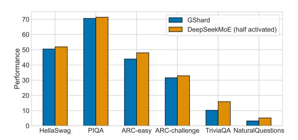
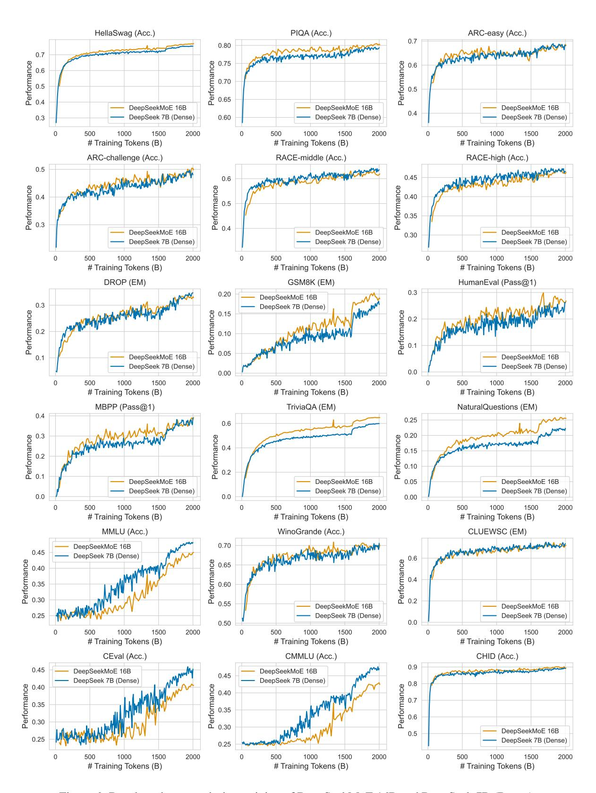
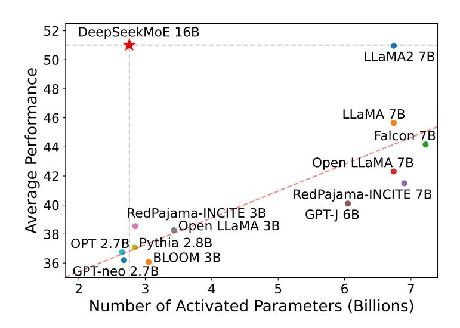

# DeepSeekMoE: Towards Ultimate Expert Specialization in Mixture-of-Experts Language Models

Damai Dai†[‡∗](#page-0-0) , Chengqi Deng‡ , Chenggang Zhao‡§∗, Runxin Xu‡ , Huazuo Gao‡ , Deli Chen‡ , Jiashi Li‡ , Wangding Zeng‡ , Xingkai Yu‡¶∗, Y. Wu‡ , Zhenda Xie‡ , Y.K. Li‡ , Panpan Huang‡ , Fuli Luo‡ , Chong Ruan‡ , Zhifang Sui† , Wenfeng Liang‡⋄

†State Key Laboratory of Multimedia Information Processing, Peking University ‡DeepSeek-AI § Institute for Interdisciplinary Information Sciences, Tsinghua University ¶National Key Laboratory for Novel Software Technology, Nanjing University {daidamai,szf}@pku.edu.cn, {damai.dai,wenfeng.liang}@deepseek.com <https://github.com/deepseek-ai/DeepSeek-MoE>

## Abstract

In the era of large language models, Mixtureof-Experts (MoE) is a promising architecture for managing computational costs when scaling up model parameters. However, conventional MoE architectures like GShard, which activate the top-K out of N experts, face challenges in ensuring expert specialization, i.e. each expert acquires non-overlapping and focused knowledge. In response, we propose the DeepSeek-MoE architecture towards ultimate expert specialization. It involves two principal strategies: (1) finely segmenting the experts into mN ones and activating mK from them, allowing for a more flexible combination of activated experts; (2) isolating Ks experts as shared ones, aiming at capturing common knowledge and mitigating redundancy in routed experts. Starting from a modest scale with 2B parameters, we demonstrate that DeepSeekMoE 2B achieves comparable performance with GShard 2.9B, which has 1.5× expert parameters and computation. In addition, DeepSeekMoE 2B nearly approaches the performance of its dense counterpart with the same number of total parameters, which sets the upper bound of MoE models. Subsequently, we scale up DeepSeekMoE to 16B parameters and show that it achieves comparable performance with DeepSeek 7B and LLaMA2 7B, with only about 40% of computations.

# 1 Introduction

Recent research and practices have empirically demonstrated that, with sufficient training data available, scaling language models with increased parameters and computational budgets can yield remarkably stronger models [\(Brown et al.,](#page-8-0) [2020;](#page-8-0) [OpenAI,](#page-10-0) [2023;](#page-10-0) [Touvron et al.,](#page-11-0) [2023a;](#page-11-0) [Hoffmann](#page-9-0) [et al.,](#page-9-0) [2022;](#page-9-0) [DeepSeek-AI,](#page-9-1) [2024\)](#page-9-1). However, the endeavor to scale models to an extremely large scale is also associated with exceedingly high computational costs. Considering the substantial costs, the Mixture-of-Experts (MoE) architecture [\(Jacobs](#page-10-1) [et al.,](#page-10-1) [1991;](#page-10-1) [Jordan and Jacobs,](#page-10-2) [1994;](#page-10-2) [Shazeer et al.,](#page-11-1) [2017\)](#page-11-1) has emerged as a popular solution, which enables parameter scaling while concurrently keeping modest computational costs.

Despite the promising potential of MoE architectures, existing MoE architectures like GShard [\(Lep](#page-10-3)[ikhin et al.,](#page-10-3) [2021\)](#page-10-3) potentially suffer from issues of knowledge hybridity and knowledge redundancy: (1) Knowledge Hybridity: existing MoE practices often employ a limited number of experts, and thus tokens assigned to a specific expert will be likely to cover diverse knowledge. Consequently, the designated expert will intend to assemble vastly different types of knowledge in its parameters, which are hard to utilize simultaneously. (2) Knowledge Redundancy: tokens assigned to different experts may require common knowledge. As a result, multiple experts may converge in acquiring shared knowledge in their respective parameters, thereby leading to redundancy in expert parameters. These issues collectively limit the expert specialization in MoE models, i.e., each expert acquires non-overlapping and focused knowledge.

In response to the aforementioned issues, we introduce DeepSeekMoE, an innovative MoE architecture specifically designed towards ultimate expert specialization. Our architecture involves two principal strategies: (1) Fine-Grained Expert Segmentation: while maintaining the number of parameters constant, we segment the experts into a finer granularity by splitting the FFN intermediate hidden dimension. Correspondingly, keeping a constant computational cost, we also activate more fine-grained experts to enable a more flexible and adaptable combination of activated experts. Finegrained expert segmentation allows diverse knowledge to be decomposed more finely and be learned more precisely into different experts, where each expert will retain a higher level of specialization. In addition, the increased flexibility in combining

∗ Contribution during internship at DeepSeek-AI.

⋄ Corresponding author.

activated experts also contributes to more accurate knowledge acquisition. (2) **Shared Expert Isolation:** we isolate certain experts to serve as shared experts that are always activated, aiming at capturing and consolidating common knowledge across varying contexts. Through compressing common knowledge into these shared experts, redundancy among other routed experts will be mitigated. This can enhance the parameter efficiency and ensure that each routed expert remains specialized by focusing on distinctive aspects. These architectural innovations in DeepSeekMoE offer opportunities to train a parameter-efficient MoE language model where each expert is highly specialized.

Starting from a modest scale with 2B parameters, we validate the advantages of the DeepSeekMoE architecture. Empirical results on 12 diverse benchmarks indicate that DeepSeekMoE 2B surpasses GShard 2B (Lepikhin et al., 2021) by a substantial margin, and even matches GShard 2.9B, a larger MoE model with  $1.5 \times$  expert parameters and computation. Remarkably, we find that DeepSeekMoE 2B nearly approaches the performance of its dense counterpart with an equivalent number of parameters, which sets the strict upper bound of MoE language models. We also conduct elaborate ablation studies and specialization analysis, and the studies validate the effectiveness of our main strategies, and provide evidence supporting that DeepSeek-MoE can achieve higher expert specialization.

Subsequently, we scale up the model parameters to 16B and train DeepSeekMoE 16B on a large-scale corpus with 2T tokens. Evaluation results reveal that with only about 40% of computations, it achieves comparable performance with DeepSeek 7B (DeepSeek-AI, 2024) and LLaMA2 7B (Touvron et al., 2023b), two strong 7B dense models.

Our contributions are summarized as follows: (1) We introduce DeepSeekMoE, an innovative MoE architecture aiming at achieving ultimate expert specialization. (2) We conduct extensive experiments to empirically validate the effectiveness of DeepSeekMoE and reveal its high level of expert specialization. (3) We scale up DeepSeekMoE to train a 16B MoE model which shows strong performance. (4) We will release the code and model checkpoint of DeepSeekMoE 16B to the public.

#### 2 Preliminaries

We first introduce a generic MoE architecture for Transformer language models. A standard Trans-

former language model is constructed by stacking L layers of standard Transformer blocks, where each block can be represented as follows:

$$\mathbf{u}_{1:T}^{l} = \text{Self-Att}\left(\mathbf{h}_{1:T}^{l-1}\right) + \mathbf{h}_{1:T}^{l-1},\tag{1}$$

$$\mathbf{h}_{t}^{l} = \text{FFN}\left(\mathbf{u}_{t}^{l}\right) + \mathbf{u}_{t}^{l},\tag{2}$$

where T denotes the sequence length,  $\mathbf{u}_{1:T}^l \in \mathbb{R}^{T \times d}$  are the hidden states after the l-th attention module, and  $\mathbf{h}_t^l \in \mathbb{R}^d$  is the output hidden state of the t-th token after the l-th Transformer block. For brevity, we omit the layer normalization.

A typical practice to construct an MoE language model usually substitutes Feed-Forward Networks (FFNs) in a Transformer with MoE layers at specified intervals (Fedus et al., 2021; Lepikhin et al., 2021; Du et al., 2022; Zoph, 2022). An MoE layer is composed of multiple experts, where each expert is structurally identical to a standard FFN. Then, each token will be assigned to a few experts. If the l-th FFN is substituted with an MoE layer, its computation can be expressed as:

$$\mathbf{h}_{t}^{l} = \sum_{i=1}^{N} \left( g_{i,t} \operatorname{FFN}_{i} \left( \mathbf{u}_{t}^{l} \right) \right) + \mathbf{u}_{t}^{l}, \tag{3}$$

$$g_{i,t} = \begin{cases} s_{i,t}, & s_{i,t} \in \text{Topk}(\{s_{j,t}|1 \le j \le N\}, K), \\ 0, & \text{otherwise,} \end{cases}$$
 (4)

$$s_{i,t} = \text{Softmax}_i \left( \mathbf{u}_t^{l}^T \mathbf{e}_i^{l} \right),$$
 (5)

where N denotes the total number of experts,  $\operatorname{FFN}_i(\cdot)$  is the i-th expert FFN,  $g_{i,t}$  denotes the gate value for the i-th expert,  $s_{i,t}$  denotes the tokento-expert affinity,  $\operatorname{Topk}(\cdot,K)$  denotes the set comprising K highest affinity scores among those calculated for the t-th token and all N experts, and  $\mathbf{e}_i^l$  is the centroid of the i-th expert in the l-th layer. Note that for each token, only K out of N gate values are nonzero. This sparsity property ensures computational efficiency within an MoE layer.

#### 3 DeepSeekMoE Architecture

On top of the generic MoE architecture, DeepSeek-MoE introduces two principal strategies, fine-grained expert segmentation and shared expert isolation, as illustrated in Figure 1. Both strategies aim at elevating the level of expert specialization.

#### 3.1 Fine-Grained Expert Segmentation

In scenarios where the number of experts is limited, tokens assigned to a particular expert will be more likely to cover diverse types of knowledge. As a consequence, the designated expert will intend

Figure 1: Illustration of DeepSeekMoE. (a) showcases an MoE layer with the conventional top-2 routing strategy. (b) illustrates the fine-grained expert segmentation strategy. Subsequently, (c) introduces the shared expert isolation strategy, constituting the complete DeepSeekMoE architecture.

to learn vastly different types of knowledge in its parameters, and they are hard to be simultaneously utilized. However, if each token can be routed to more experts, diverse knowledge will gain the potential to be decomposed and learned in different experts respectively, where each expert can still remain specialized and focused.

In pursuit of this goal, while maintaining a consistent number of expert parameters and computational cost, we segment the experts with a finer granularity. To be specific, on top of a typical MoE architecture shown in Figure 1(a), we segment each expert FFN into m smaller experts by reducing the FFN intermediate hidden dimension to  $\frac{1}{m}$  times its original size. Since each expert becomes smaller, in response, we also increase the number of activated experts to m times to keep the same computation cost, as illustrated in Figure 1(b). Then, the output of an MoE layer can be expressed as:

$$\mathbf{h}_{t}^{l} = \sum_{i=1}^{mN} \left( g_{i,t} \operatorname{FFN}_{i} \left( \mathbf{u}_{t}^{l} \right) \right) + \mathbf{u}_{t}^{l}, \tag{6}$$

$$g_{i,t} = \begin{cases} s_{i,t}, s_{i,t} \in \text{Topk}(\{s_{j,t}|1 \le j \le mN\}, mK), \\ 0, & \text{otherwise,} \end{cases}$$
 (7)

$$s_{i,t} = \text{Softmax}_i \left( \mathbf{u}_t^{l^T} \mathbf{e}_i^{l} \right),$$
 (8)

where the number of expert parameters is equal to N times a standard FFN, and mN denotes the number of fine-grained experts. Also, the number of nonzero gates will increase to mK.

From a combinatorial perspective, fine-grained

expert segmentation substantially enhances the combinatorial flexibility of activated experts. As an example, we consider the case where N=16. A typical top-2 routing strategy can yield  $\binom{16}{2}=120$  possible combinations. By contrast, if each expert is split into 4 smaller experts, we can yield  $\binom{64}{8}=4,426,165,368$  potential combinations. The surge in combinatorial flexibility enhances the potential for achieving more accurate and targeted knowledge acquisition.

#### 3.2 Shared Expert Isolation

With a conventional routing strategy, tokens assigned to different experts may require some common knowledge. As a result, multiple experts will converge in acquiring shared knowledge in their respective parameters, leading to parameter redundancy. However, if there are shared experts that capture and consolidate common knowledge across varying contexts, the parameter redundancy among other routed experts will be alleviated.

Towards this objective, we further isolate  $K_s$  experts as shared experts. Regardless of the router, each token will be deterministically assigned to these shared experts. In order to maintain a constant computational cost, the number of activated routed experts will be decreased by  $K_s$ , as depicted in Figure 1(c). Finally, an MoE layer in the com-

plete DeepSeekMoE architecture is formulated as:

$$\mathbf{h}_{t}^{l} = \sum_{i=1}^{K_{s}} \text{FFN}_{i} \left( \mathbf{u}_{t}^{l} \right) + \sum_{i=K_{s}+1}^{mN} \left( g_{i,t} \, \text{FFN}_{i} \left( \mathbf{u}_{t}^{l} \right) \right) + \mathbf{u}_{t}^{l},$$
(9)

$$g_{i,t} = \begin{cases} s_{i,t}, s_{i,t} \in \text{Topk}(\{s_{j,t}|K_s + 1 \le j \le mN\}, mK - K_s), \\ 0, & \text{otherwise}, \end{cases}$$

(10)

$$s_{i,t} = \operatorname{Softmax}_i \left( \mathbf{u_t^l}^T \mathbf{e}_i^l \right).$$
 (11)

Finally, the number of shared experts is  $K_s$ , the number of routed experts is  $mN - K_s$ , and the number of nonzero gates is  $mK - K_s$ . The prototype of shared expert isolation can be credited to some previous work Rajbhandari et al. (2022); Elbayad et al. (2023), but we derive this strategy from different standpoints.

#### 3.3 Load Balance Consideration

We employ an expert-level balance loss to mitigate the risk of routing collapse (Shazeer et al., 2017). The computation of the balance loss is as follows:

$$\mathcal{L}_{\text{Bal}} = \alpha \sum_{i=1}^{N'} f_i P_i, \tag{12}$$

$$f_i = \frac{N'}{K'T} \sum_{t=1}^{T} \mathbb{1}(\text{Token } t \text{ selects Expert } i), \qquad (13)$$

$$P_i = \frac{1}{T} \sum_{t=1}^{T} s_{i,t}, \tag{14}$$

where balance factor  $\alpha$  is a hyper-parameter,  $\mathbb{1}(\cdot)$  denotes the indicator function, N' is equal to  $(mN-K_s)$ , and K' is equal to  $(mK-K_s)$ .

## 4 Validation Experiments

#### 4.1 Experimental Setup

Training Data and Tokenization. Our training data is sampled from a large-scale corpus created by DeepSeek-AI (DeepSeek-AI, 2024), which focuses on English and Chinese and is derived from diverse sources. For the purpose of validation experiments, we sample a subset containing 100B tokens from the corpus to train our models. For tokenization, we utilize the HuggingFace Tokenizer¹ tools to train a byte pair encoding (BPE) (Sennrich et al., 2016) tokenizer with an 8K vocabulary size on a subset of the training corpus.

**Hyper-Parameters.** In the validation experiments, we set the number of Transformer layers

to 9 and the hidden dimension to 1280. We substitute all FFNs with MoE layers, and ensure that the total number of expert parameters equals 16 times that of a standard FFN. Additionally, we keep the activated expert parameters, including shared expert parameters and activated routed expert parameters, as 2 times that of a standard FFN. Under this configuration, each MoE model has approximately 2B total parameters, with the number of activated parameters around 0.3B. As for training, we employ the AdamW optimizer (Loshchilov and Hutter, 2019) and set the maximum learning rate to  $1.08 \times 10^{-3}$ . The batch size is set to 2K, and with a maximum sequence length of 2K, each training batch contains 4M tokens. Correspondingly, the total number of training steps is set to 25,000 to achieve 100B training tokens. In order to prevent routing collapse, we set a balance factor of 0.01. Due to the page limit, we leave the other hyper-parameters in Appendix A.1. We also describe the training framework and infrastructures in Appendix B.

**Evaluation Benchmarks.** We conduct evaluations on a wide range of benchmarks covering various types of tasks. For language modeling, we evaluate the models on the test set of Pile (Gao et al., 2020), and the evaluation metric is the crossentropy loss. For language understanding and reasoning, we consider HellaSwag (Zellers et al., 2019), PIQA (Bisk et al., 2020), ARC-challenge and ARC-easy (Clark et al., 2018), and the evaluation metric for these tasks is accuracy. For reading comprehension, we consider RACE-high and RACE-middle (Lai et al., 2017), and the evaluation metric is accuracy. For **code generation**, we consider HumanEval (Chen et al., 2021) and MBPP (Austin et al., 2021), and the evaluation metric is Pass@1. For closed-book question answering, we consider TriviaQA (Joshi et al., 2017) and NaturalQuestions (Kwiatkowski et al., 2019), and the metric is the Exactly Matching (EM) rate.

#### 4.2 Evaluations

**Baselines.** Including DeepSeekMoE, we compare five models for validation experiments. **Dense** denotes a standard dense Transformer model with 0.2B total parameters. **Hash Layer** (Roller et al., 2021) and **Switch Transformer** (Fedus et al., 2021) are two well-known MoE architectures based on top-1 routing, with 2.0B total parameters and 0.2B activated parameters. **GShard** (Lepikhin et al.,

&lt;sup>1https://github.com/huggingface/tokenizers

| Metric                | # Shot | Dense | Hash Layer | Switch Transformer | GShard | DeepSeekMoE |
|-----------------------|--------|-------|------------|--------------------|--------|-------------|
| # Total Params        | N/A    | 0.2B  | 2.0B       | 2.0B               | 2.0B   | 2.0B        |
| # Activated Params    | N/A    | 0.2B  | 0.2B       | 0.2B               | 0.3B   | 0.3B        |
| FLOPs per 2K Tokens   | N/A    | 2.9T  | 2.9T       | 2.9T               | 4.3T   | 4.3T        |
| Pile (Loss)           | N/A    | 2.060 | 1.932      | 1.881              | 1.867  | 1.808       |
| HellaSwag (Acc.)      | 0      | 38.8  | 46.2       | 49.1               | 50.5   | 54.8        |
| PIQA (Acc.)           | 0      | 66.8  | 68.4       | 70.5               | 70.6   | 72.3        |
| ARC-easy (Acc.)       | 0      | 41.0  | 45.3       | 45.9               | 43.9   | 49.4        |
| ARC-challenge (Acc.)  | 0      | 26.0  | 28.2       | 30.2               | 31.6   | 34.3        |
| RACE-middle (Acc.)    | 5      | 38.8  | 38.8       | 43.6               | 42.1   | 44.0        |
| RACE-high (Acc.)      | 5      | 29.0  | 30.0       | 30.9               | 30.4   | 31.7        |
| HumanEval (Pass@1)    | 0      | 0.0   | 1.2        | 2.4                | 3.7    | 4.9         |
| MBPP (Pass@1)         | 3      | 0.2   | 0.6        | 0.4                | 0.2    | 2.2         |
| TriviaQA (EM)         | 5      | 4.9   | 6.5        | 8.9                | 10.2   | 16.6        |
| NaturalQuestions (EM) | 5      | 1.4   | 1.4        | 2.5                | 3.2    | 5.7         |

Table 1: Evaluation results for validation experiments. **Bold** font indicates the best.

Figure 2: Ablation studies for DeepSeekMoE. The performance is normalized by the best performance.

2021) employs a top-2 learnable routing strategy, with 2.0B total parameters and 0.3B activated parameters. **DeepSeekMoE** has 1 shared expert and 63 routed experts, where each expert is 0.25 times the size of a standard FFN. Including DeepSeek-MoE, all compared models share the same training corpus and training hyper-parameters.

**Results.** As shown in Table 1, (1) With more total parameters, Hash Layer and Switch Transformer achieve significantly stronger performance than the dense baseline with the same number of activated parameters. (2) Compared with Hash Layer and Switch Transformer, GShard has more activated parameters and achieves slightly better performance. (3) With the same number of total and activated parameters, DeepSeekMoE demonstrates overwhelming advantages over GShard. These results show the superiority of our DeepSeekMoE architecture.

# **4.3** DeepSeekMoE Aligns Closely with the upper bound of MoE Models

For a more precise understanding of the performance of DeepSeekMoE, we compare it with larger

baselines with more parameters or computations.

Comparison with GShard×1.5. We first compare DeepSeekMoE with a larger GShard model with 1.5 times the expert size, which results in 1.5 times both expert parameters and expert computation. Evaluation results show that GShard×1.5 achieves a Pile test loss of 1.808, and DeepSeekMoE also achieves the same Pile test loss. This underscores the significant advantage of the DeepSeekMoE architecture. Due to the page limit, we show the complete evaluation results including all the benchmarks in Appendix C.

Comparison with Dense×16. We also compare DeepSeekMoE and a dense model with the same number of total parameters. For a fair comparison, we do not use the widely used ratio (1:2) between the attention and FFN parameters. Instead, we configure 16 shared experts where each expert has the same number of parameters as a standard FFN. This architecture mimics a dense model with 16 times standard FFN parameters, which sets the strict upper bound of MoE models in terms of the

Figure 3: Pile test loss with regard to different ratios of disabled top routed experts.

model capacity. We find that this dense model achieves a Pile test loss of 1.806, while DeepSeek-MoE achieves a close Pile test loss of 1.808. Due to the page limit, we also show the complete evaluation results in Appendix C. To summarize, these results suggest that, at least at the scale of about 2B parameters and 100B training tokens, the performance of DeepSeekMoE aligns closely with the theoretical upper bound of MoE models.

#### 4.4 Ablation Studies

We conduct ablation studies for DeepSeekMoE to substantiate the effectiveness of our two principal strategies. For a fair comparison, we ensure all models included in the comparison have the same number of total and activated parameters.

**Shared Expert Isolation.** In order to evaluate the influence of shared expert isolation, based on GShard, we isolate one expert as the shared one. From Figure 2, we observe that compared with GShard, the isolation yields improved performance across a majority of benchmarks.

**Fine-Grained Expert Segmentation.** For assessing the effectiveness of fine-grained expert segmentation, we segment each expert into 2 or 4 smaller experts, resulting in 32 (1 shared + 31 routed) or 64 (1 shared + 63 routed) total experts. Figure 2 shows a consistent trend that finer expert segmentation granularity corresponds to better performance.

#### 4.5 Analysis on Expert Specialization

We conduct an empirical analysis on the expert specialization of DeepSeekMoE 2B, which refers to the model reported in Table 1.

**DeepSeekMoE Exhibits Lower Redundancy Among Routed Experts.** In order to assess the redundancy among routed experts, for each token, we mask a certain ratio of experts with the highest routing probability, and then select top-K experts

Figure 4: Pile loss with regard to different numbers of activated routed experts in DeepSeekMoE.

Figure 5: Comparison between GShard and DeepSeek-MoE trained from scratch and with half the activated experts.

from the remaining routed experts. For fairness, we compare DeepSeekMoE with GShard×1.5 since they have the same Pile loss when no experts are disabled. As shown in Figure 3, compared with GShard×1.5, DeepSeekMoE is more sensitive to the disabling of top routed experts. This implies lower parameter redundancy in DeepSeekMoE, since each routed expert is more irreplaceable.

Shared Experts Are Irreplaceable by Routed Experts. In order to investigate the role of the shared expert in DeepSeekMoE, we disable it and activate one more routed expert. The evaluation on Pile shows a significant increase in the Pile loss, rising from 1.808 to 2.414, even though we maintain the same computational cost. This result indicates that the shared expert captures fundamental and essential knowledge not shared with routed experts, making it irreplaceable by routed ones.

**DeepSeekMoE Acquires Knowledge More Accurately.** In order to validate our claim that higher flexibility in combining activated experts contributes to more accurate and targeted knowledge acquisition, we investigate whether DeepSeekMoE can acquire requisite knowledge with fewer activated experts. To be specific, we vary the number of activated routed experts from 3 to 7 and evaluate the resulting Pile loss. As demonstrated in Figure 4, even with only 4 routed experts activated,

DeepSeekMoE is still comparable with GShard.

Encouraged by these findings, we further train a new MoE model from scratch, which comprises 1 shared expert and 63 routed experts but only 3 routed experts are activated. Figure [5](#page-5-2) demonstrates that, even with the same total expert parameters and only half of the activated expert parameters, DeepSeekMoE still outperforms GShard.

## 5 Scaling up to DeepSeekMoE 16B

With the DeepSeekMoE architecture, we further scale up our MoE model to a larger scale with 16B total parameters and train it on 2T tokens.

### 5.1 Experimental Setup

Training Data and Tokenization For training DeepSeekMoE 16B, we sample 2T tokens from the same corpus as described in Section [4.1,](#page-3-1) and use a larger BPE tokenizer with a 100K vocabulary size.

Hyper-Parameters For DeepSeekMoE 16B, we set the number of Transformer layers to 28 and the hidden dimension to 2048. We substitute all FFNs except for the first layer with MoE layers, since we observe that the load balance status converges especially slower for the first layer. Each MoE layer consists of 2 shared experts and 64 routed experts, where each expert is 0.25 times the size of a standard FFN. Each token will be routed to these 2 shared experts and 6 out of 64 routed experts. Under this configuration, DeepSeekMoE 16B has approximately 16.4B total parameters, with the number of activated parameters around 2.8B. As for training, we employ the AdamW optimizer [\(Loshchilov and Hutter,](#page-10-5) [2019\)](#page-10-5) and set the maximum learning rate to 4.2 × 10−4 . The batch size is set to 4.5K, and with a maximum sequence length of 4K, each training batch contains 18M tokens. Correspondingly, the total number of training steps is set to 106,449 to achieve 2T training tokens. In order to prevent routing collapse, we set a balance factor of 0.001. Due to the page limit, we leave the other hyper-parameters in Appendix [A.2.](#page-13-2)

Evaluation Benchmarks In addition to the benchmarks used in the validation experiments, we incorporate additional benchmarks for a more comprehensive evaluation. For language modeling, we also evaluate the models on the test set of Pile [\(Gao et al.,](#page-9-5) [2020\)](#page-9-5). Since the tokenizer used in DeepSeekMoE 16B is different from that used in LLaMA2 7B, we use bits per byte (BPB)

as the evaluation metric for a fair comparison. For reading comprehension, we additionally consider DROP [\(Dua et al.,](#page-9-7) [2019\)](#page-9-7) and the evaluation metric is EM. For math reasoning, we additionally incorporate GSM8K [\(Cobbe et al.,](#page-9-8) [2021\)](#page-9-8) and MATH [\(Hendrycks et al.,](#page-9-9) [2021\)](#page-9-9), using EM as the evaluation metric. For multi-subject multiplechoice, we additionally evaluate the models on MMLU [\(Hendrycks et al.,](#page-9-10) [2020\)](#page-9-10) and the evaluation metric is accuracy. For disambiguation, we additionally consider WinoGrande [\(Sakaguchi](#page-10-10) [et al.,](#page-10-10) [2019\)](#page-10-10) and the evaluation metric is accuracy. Since DeepSeekMoE 16B is pretrained on a bilingual corpus, we also evaluate it on four Chinese benchmarks: CLUEWSC [\(Xu et al.,](#page-11-5) [2020\)](#page-11-5), CEval [\(Huang et al.,](#page-9-11) [2023\)](#page-9-11), CMMLU [\(Li et al.,](#page-10-11) [2023\)](#page-10-11), and CHID [\(Zheng et al.,](#page-11-6) [2019\)](#page-11-6). Evaluation metrics for these benchmarks are accuracy or EM.

### 5.2 Evaluations

We compare DeepSeekMoE 16B with LLaMA2 7B [\(Touvron et al.,](#page-11-2) [2023b\)](#page-11-2) and DeepSeek 7B [\(DeepSeek-AI,](#page-9-1) [2024\)](#page-9-1), two strong and wellknown dense models trained on 2T tokens. In addition, DeepSeekMoE 16B and DeepSeek 7B use the same training data. As shown in Table [2,](#page-7-0) we have the following observations: (1) On the whole, with about only 40% of the computations, DeepSeekMoE 16B achieves comparable performance with LLaMA2 7B and DeepSeek 7B. (2) DeepSeekMoE 16B exhibits notable strengths in language modeling and knowledge-intensive tasks such as Pile, HellaSwag, and TriviaQA. (3) Compared with the excellent performance on other tasks, DeepSeekMoE exhibits limitations in addressing multiple-choice tasks, which may stem from the limited attention parameters in DeepSeekMoE 16B. (4) Compared with LLaMA2 7B, DeepSeek 7B and DeepSeekMoE 16B have much stronger performance on math, coding, and Chinese benchmarks. For a more comprehensive understanding of the training process of DeepSeekMoE 16B, we also provide the benchmark curves of DeepSeekMoE 16B and DeepSeek 7B (Dense) during training in Appendix [D.](#page-14-1)

In addition, we provide a comparison between DeepSeekMoE 16B and other open source models on the Open LLM Leaderboard in Appendix [E.](#page-14-2)

| Metric                | # Shot | LLaMA2 7B (Dense) | DeepSeek 7B (Dense) | DeepSeekMoE 16B |
|-----------------------|--------|-------------------|---------------------|-----------------|
| # Total Params        | N/A    | 6.7B              | 6.9B                | 16.4B           |
| # Activated Params    | N/A    | 6.7B              | 6.9B                | 2.8B            |
| FLOPs per 4K Tokens   | N/A    | 187.9T            | 183.5T              | 74.4T           |
| Pile (BPB)            | N/A    | 0.76              | 0.75                | 0.74            |
| HellaSwag (Acc.)      | 0      | 75.6              | 75.4                | 77.1            |
| PIQA (Acc.)           | 0      | 78.0              | 79.2                | 80.2            |
| ARC-easy (Acc.)       | 0      | 69.1              | 67.9                | 68.1            |
| ARC-challenge (Acc.)  | 0      | 49.0              | 48.1                | 49.8            |
| RACE-middle (Acc.)    | 5      | 60.7              | 63.2                | 61.9            |
| RACE-high (Acc.)      | 5      | 45.8              | 46.5                | 46.4            |
| DROP (EM)             | 1      | 34.0              | 34.9                | 32.9            |
| GSM8K (EM)            | 8      | 15.5              | 17.4                | 18.8            |
| MATH (EM)             | 4      | 2.6               | 3.3                 | 4.3             |
| HumanEval (Pass@1)    | 0      | 14.6              | 26.2                | 26.8            |
| MBPP (Pass@1)         | 3      | 21.8              | 39.0                | 39.2            |
| TriviaQA (EM)         | 5      | 63.8              | 59.7                | 64.8            |
| NaturalQuestions (EM) | 5      | 25.5              | 22.2                | 25.5            |
| MMLU (Acc.)           | 5      | 45.8              | 48.2                | 45.0            |
| WinoGrande (Acc.)     | 0      | 69.6              | 70.5                | 70.2            |
| CLUEWSC (EM)          | 5      | 64.0              | 73.1                | 72.1            |
| CEval (Acc.)          | 5      | 33.9              | 45.0                | 40.6            |
| CMMLU (Acc.)          | 5      | 32.6              | 47.2                | 42.5            |
| CHID (Acc.)           | 0      | 37.9              | 89.3                | 89.4            |

Table 2: Comparison among LLaMA2 7B, DeepSeek 7B, and DeepSeekMoE 16B.

# 6 Related Work

The Mixture of Experts (MoE) technique is first proposed by [Jacobs et al.](#page-10-1) [\(1991\)](#page-10-1); [Jordan and Jacobs](#page-10-2) [\(1994\)](#page-10-2) to deal with different samples with independent expert modules. [Shazeer et al.](#page-11-1) [\(2017\)](#page-11-1) introduce MoE into language model training and build a large-scale LSTM-based [\(Hochreiter and Schmid](#page-9-12)[huber,](#page-9-12) [1997\)](#page-9-12) MoE models. As Transformer become the most popular architecture for NLP, many attempts extend FFNs in a Transformer as MoE layers to build MoE language models. GShard [\(Lep](#page-10-3)[ikhin et al.,](#page-10-3) [2021\)](#page-10-3) and Switch Transformer [\(Fedus](#page-9-2) [et al.,](#page-9-2) [2021\)](#page-9-2) are pioneers which employ learnable top-2 or top-1 routing strategies to scale the MoE language models to an extremely large scale. Hash Layer [\(Roller et al.,](#page-10-9) [2021\)](#page-10-9) and StableMoE [\(Dai](#page-9-13) [et al.,](#page-9-13) [2022\)](#page-9-13) use fixed routing strategies for more stable routing and training. [Zhou et al.](#page-12-1) [\(2022\)](#page-12-1) propose an expert-choice routing strategy, where each token can be assigned to different numbers of experts. [Zoph](#page-12-0) [\(2022\)](#page-12-0) focus on the issues of training instability and fine-tuning difficulty in MoE models, and propose ST-MoE to overcome these challenges. [Gao et al.](#page-9-14) [\(2022\)](#page-9-14) investigate parameterefficient MoE architectures via sharing information among experts. [Krishnamurthy et al.](#page-10-12) [\(2023\)](#page-10-12) attempt to improve the expert specialization on toy data. In addition to research on MoE architectures and training strategies, recent years have also witnessed the emergence of numerous largescale language or multimodal models [\(Lin et al.,](#page-10-13) [2021;](#page-10-13) [Du et al.,](#page-9-3) [2022;](#page-9-3) [Ren et al.,](#page-10-14) [2023;](#page-10-14) [Xue et al.,](#page-11-7) [2023\)](#page-11-7) based on existing MoE architectures. By and large, most of the previous MoE models are based on conventional top-1 or top-2 routing strategies, leaving large room for improving expert specialization. In response, we design the DeepSeekMoE architecture to improve the expert specialization.

## 7 Conclusion

In this paper, we introduce the DeepSeekMoE architecture for MoE language models, with the objective of achieving ultimate expert specialization. Through fine-grained expert segmentation and shared expert isolation, DeepSeekMoE achieves significantly higher expert specialization and performance compared with prevailing MoE architectures. Starting with a modest scale of 2B parameters, we validate the advantages of DeepSeekMoE, demonstrating its capability to approach the upper bound performance for MoE models. Furthermore, we provide empirical evidence to show that DeepSeekMoE has a higher level of expert specialization than GShard. Scaling up to a larger scale of 16B total parameters, we train DeepSeekMoE 16B on 2T tokens and demonstrate its outstanding performance comparable with DeepSeek 7B and LLaMA2 7B, with only about 40% of computations. For research purposes, we will release the model checkpoint of DeepSeekMoE 16B to the public, which can be deployed on a single GPU with 40GB of memory. We aspire for this work to provide valuable insights for both academia and industry, and contribute to the accelerated advancement of large language models.

# Limitations and Future Work

Although we find that finer granularity in expert segmentation always leads to better model performance, we just use a moderate granularity in DeepSeekMoE 16B, since too fine granularity will decrease the computational efficiency. In future research, we plan to build a scaling law for the expert segmentation granularity and explore finer segmentation on larger-scale models.

In addition, since DeepSeekMoE will select more experts, it has the potential to result in additional communication overhead when the experts are distributed across different devices. In the future, we will also design better algorithms and parallelism strategies to mitigate such additional communication overhead.

Finally, in this paper, we fix the number of expert parameters to 16 times that of a standard FFN, and the number of activated expert parameters to twice that of a standard FFN. In larger model settings, the optimal numbers of total parameters and activated parameters are also a topic for future research and discussion.

## Acknowledgement

Damai Dai and Zhifang Sui are supported by the National Key Research and Development Program of China 2020AAA0106700.

# References

Ebtesam Almazrouei, Hamza Alobeidli, Abdulaziz Alshamsi, Alessandro Cappelli, Ruxandra Cojocaru, Merouane Debbah, Etienne Goffinet, Daniel Heslow, Julien Launay, Quentin Malartic, Badreddine Noune, Baptiste Pannier, and Guilherme Penedo.

2023. Falcon-40B: an open large language model with state-of-the-art performance.

Jacob Austin, Augustus Odena, Maxwell Nye, Maarten Bosma, Henryk Michalewski, David Dohan, Ellen Jiang, Carrie Cai, Michael Terry, Quoc Le, et al. 2021. Program synthesis with large language models. *arXiv preprint arXiv:2108.07732*.

Stella Biderman, Hailey Schoelkopf, Quentin Gregory Anthony, Herbie Bradley, Kyle O'Brien, Eric Hallahan, Mohammad Aflah Khan, Shivanshu Purohit, USVSN Sai Prashanth, Edward Raff, Aviya Skowron, Lintang Sutawika, and Oskar van der Wal. 2023. [Pythia: A suite for analyzing large language models](https://proceedings.mlr.press/v202/biderman23a.html) [across training and scaling.](https://proceedings.mlr.press/v202/biderman23a.html) In *International Conference on Machine Learning, ICML 2023, 23-29 July 2023, Honolulu, Hawaii, USA*, volume 202 of *Proceedings of Machine Learning Research*, pages 2397–2430. PMLR.

Yonatan Bisk, Rowan Zellers, Ronan Le Bras, Jianfeng Gao, and Yejin Choi. 2020. [PIQA: reasoning about](https://doi.org/10.1609/aaai.v34i05.6239) [physical commonsense in natural language.](https://doi.org/10.1609/aaai.v34i05.6239) In *The Thirty-Fourth AAAI Conference on Artificial Intelligence, AAAI 2020, The Thirty-Second Innovative Applications of Artificial Intelligence Conference, IAAI 2020, The Tenth AAAI Symposium on Educational Advances in Artificial Intelligence, EAAI 2020, New York, NY, USA, February 7-12, 2020*, pages 7432– 7439. AAAI Press.

Sid Black, Leo Gao, Phil Wang, Connor Leahy, and Stella Biderman. 2021. [GPT-Neo: Large](https://doi.org/10.5281/zenodo.5297715) [Scale Autoregressive Language Modeling with Mesh-](https://doi.org/10.5281/zenodo.5297715)[Tensorflow.](https://doi.org/10.5281/zenodo.5297715) If you use this misc, please cite it using these metadata.

Tom B. Brown, Benjamin Mann, Nick Ryder, Melanie Subbiah, Jared Kaplan, Prafulla Dhariwal, Arvind Neelakantan, Pranav Shyam, Girish Sastry, Amanda Askell, Sandhini Agarwal, Ariel Herbert-Voss, Gretchen Krueger, Tom Henighan, Rewon Child, Aditya Ramesh, Daniel M. Ziegler, Jeffrey Wu, Clemens Winter, Christopher Hesse, Mark Chen, Eric Sigler, Mateusz Litwin, Scott Gray, Benjamin Chess, Jack Clark, Christopher Berner, Sam McCandlish, Alec Radford, Ilya Sutskever, and Dario Amodei. 2020. [Language models are few-shot learners.](https://proceedings.neurips.cc/paper/2020/hash/1457c0d6bfcb4967418bfb8ac142f64a-Abstract.html) In *Advances in Neural Information Processing Systems 33: Annual Conference on Neural Information Processing Systems 2020*.

Mark Chen, Jerry Tworek, Heewoo Jun, Qiming Yuan, Henrique Pondé de Oliveira Pinto, Jared Kaplan, Harrison Edwards, Yuri Burda, Nicholas Joseph, Greg Brockman, Alex Ray, Raul Puri, Gretchen Krueger, Michael Petrov, Heidy Khlaaf, Girish Sastry, Pamela Mishkin, Brooke Chan, Scott Gray, Nick Ryder, Mikhail Pavlov, Alethea Power, Lukasz Kaiser, Mohammad Bavarian, Clemens Winter, Philippe Tillet, Felipe Petroski Such, Dave Cummings, Matthias Plappert, Fotios Chantzis, Elizabeth Barnes, Ariel Herbert-Voss, William Hebgen Guss, Alex Nichol, Alex Paino, Nikolas Tezak, Jie

- Tang, Igor Babuschkin, Suchir Balaji, Shantanu Jain, William Saunders, Christopher Hesse, Andrew N. Carr, Jan Leike, Joshua Achiam, Vedant Misra, Evan Morikawa, Alec Radford, Matthew Knight, Miles Brundage, Mira Murati, Katie Mayer, Peter Welinder, Bob McGrew, Dario Amodei, Sam McCandlish, Ilya Sutskever, and Wojciech Zaremba. 2021. [Evaluat](http://arxiv.org/abs/2107.03374)[ing large language models trained on code.](http://arxiv.org/abs/2107.03374) *CoRR*, abs/2107.03374.
- Peter Clark, Isaac Cowhey, Oren Etzioni, Tushar Khot, Ashish Sabharwal, Carissa Schoenick, and Oyvind Tafjord. 2018. [Think you have solved question an](http://arxiv.org/abs/1803.05457)[swering? try arc, the AI2 reasoning challenge.](http://arxiv.org/abs/1803.05457) *CoRR*, abs/1803.05457.
- Karl Cobbe, Vineet Kosaraju, Mohammad Bavarian, Mark Chen, Heewoo Jun, Lukasz Kaiser, Matthias Plappert, Jerry Tworek, Jacob Hilton, Reiichiro Nakano, et al. 2021. Training verifiers to solve math word problems. *arXiv preprint arXiv:2110.14168*.
- Damai Dai, Li Dong, Shuming Ma, Bo Zheng, Zhifang Sui, Baobao Chang, and Furu Wei. 2022. [Stable](https://doi.org/10.18653/V1/2022.ACL-LONG.489)[moe: Stable routing strategy for mixture of experts.](https://doi.org/10.18653/V1/2022.ACL-LONG.489) In *Proceedings of the 60th Annual Meeting of the Association for Computational Linguistics (Volume 1: Long Papers), ACL 2022, Dublin, Ireland, May 22-27, 2022*, pages 7085–7095. Association for Computational Linguistics.
- DeepSeek-AI. 2024. Deepseek llm: Scaling opensource language models with longtermism. *arXiv preprint arXiv:2401.02954*.
- Nan Du, Yanping Huang, Andrew M. Dai, Simon Tong, Dmitry Lepikhin, Yuanzhong Xu, Maxim Krikun, Yanqi Zhou, Adams Wei Yu, Orhan Firat, Barret Zoph, Liam Fedus, Maarten P. Bosma, Zongwei Zhou, Tao Wang, Yu Emma Wang, Kellie Webster, Marie Pellat, Kevin Robinson, Kathleen S. Meier-Hellstern, Toju Duke, Lucas Dixon, Kun Zhang, Quoc V. Le, Yonghui Wu, Zhifeng Chen, and Claire Cui. 2022. [Glam: Efficient scaling of language mod](https://proceedings.mlr.press/v162/du22c.html)[els with mixture-of-experts.](https://proceedings.mlr.press/v162/du22c.html) In *International Conference on Machine Learning, ICML 2022, 17-23 July 2022, Baltimore, Maryland, USA*, volume 162 of *Proceedings of Machine Learning Research*, pages 5547–5569. PMLR.
- Dheeru Dua, Yizhong Wang, Pradeep Dasigi, Gabriel Stanovsky, Sameer Singh, and Matt Gardner. 2019. [DROP: A reading comprehension benchmark requir](https://doi.org/10.18653/V1/N19-1246)[ing discrete reasoning over paragraphs.](https://doi.org/10.18653/V1/N19-1246) In *Proceedings of the 2019 Conference of the North American Chapter of the Association for Computational Linguistics: Human Language Technologies, NAACL-HLT 2019, Minneapolis, MN, USA, June 2-7, 2019, Volume 1 (Long and Short Papers)*, pages 2368–2378. Association for Computational Linguistics.
- Maha Elbayad, Anna Y. Sun, and Shruti Bhosale. 2023. [Fixing moe over-fitting on low-resource languages](https://doi.org/10.18653/v1/2023.findings-acl.897) [in multilingual machine translation.](https://doi.org/10.18653/v1/2023.findings-acl.897) In *Findings of the Association for Computational Linguistics:*

- *ACL 2023, Toronto, Canada, July 9-14, 2023*, pages 14237–14253. Association for Computational Linguistics.
- William Fedus, Barret Zoph, and Noam Shazeer. 2021. [Switch transformers: Scaling to trillion parameter](http://arxiv.org/abs/2101.03961) [models with simple and efficient sparsity.](http://arxiv.org/abs/2101.03961) *CoRR*, abs/2101.03961.
- Leo Gao, Stella Biderman, Sid Black, Laurence Golding, Travis Hoppe, Charles Foster, Jason Phang, Horace He, Anish Thite, Noa Nabeshima, et al. 2020. The Pile: An 800GB dataset of diverse text for language modeling. *arXiv preprint arXiv:2101.00027*.
- Ze-Feng Gao, Peiyu Liu, Wayne Xin Zhao, Zhong-Yi Lu, and Ji-Rong Wen. 2022. [Parameter-efficient](https://aclanthology.org/2022.coling-1.288) [mixture-of-experts architecture for pre-trained lan](https://aclanthology.org/2022.coling-1.288)[guage models.](https://aclanthology.org/2022.coling-1.288) In *Proceedings of the 29th International Conference on Computational Linguistics, COLING 2022, Gyeongju, Republic of Korea, October 12-17, 2022*, pages 3263–3273. International Committee on Computational Linguistics.
- Xinyang Geng and Hao Liu. 2023. [Openllama: An open](https://github.com/openlm-research/open_llama) [reproduction of llama.](https://github.com/openlm-research/open_llama)
- Aaron Harlap, Deepak Narayanan, Amar Phanishayee, Vivek Seshadri, Nikhil R. Devanur, Gregory R. Ganger, and Phillip B. Gibbons. 2018. [Pipedream:](http://arxiv.org/abs/1806.03377) [Fast and efficient pipeline parallel DNN training.](http://arxiv.org/abs/1806.03377) *CoRR*, abs/1806.03377.
- Dan Hendrycks, Collin Burns, Steven Basart, Andy Zou, Mantas Mazeika, Dawn Song, and Jacob Steinhardt. 2020. Measuring massive multitask language understanding. *arXiv preprint arXiv:2009.03300*.
- Dan Hendrycks, Collin Burns, Saurav Kadavath, Akul Arora, Steven Basart, Eric Tang, Dawn Song, and Jacob Steinhardt. 2021. [Measuring mathematical](http://arxiv.org/abs/2103.03874) [problem solving with the math dataset.](http://arxiv.org/abs/2103.03874)
- High-Flyer. 2023. [Hai-llm: An efficient and lightweight](https://www.high-flyer.cn/en/blog/hai-llm) [tool for training large models.](https://www.high-flyer.cn/en/blog/hai-llm)
- Sepp Hochreiter and Jürgen Schmidhuber. 1997. [Long](https://doi.org/10.1162/neco.1997.9.8.1735) [short-term memory.](https://doi.org/10.1162/neco.1997.9.8.1735) *Neural Computing*, 9(8):1735– 1780.
- Jordan Hoffmann, Sebastian Borgeaud, Arthur Mensch, Elena Buchatskaya, Trevor Cai, Eliza Rutherford, Diego de Las Casas, Lisa Anne Hendricks, Johannes Welbl, Aidan Clark, Tom Hennigan, Eric Noland, Katie Millican, George van den Driessche, Bogdan Damoc, Aurelia Guy, Simon Osindero, Karen Simonyan, Erich Elsen, Jack W. Rae, Oriol Vinyals, and Laurent Sifre. 2022. [Training compute-optimal](https://doi.org/10.48550/arXiv.2203.15556) [large language models.](https://doi.org/10.48550/arXiv.2203.15556) *CoRR*, abs/2203.15556.
- Yuzhen Huang, Yuzhuo Bai, Zhihao Zhu, Junlei Zhang, Jinghan Zhang, Tangjun Su, Junteng Liu, Chuancheng Lv, Yikai Zhang, Jiayi Lei, et al. 2023. C-Eval: A multi-level multi-discipline chinese evaluation suite for foundation models. *arXiv preprint arXiv:2305.08322*.

- Robert A. Jacobs, Michael I. Jordan, Steven J. Nowlan, and Geoffrey E. Hinton. 1991. [Adaptive mixtures of](https://doi.org/10.1162/neco.1991.3.1.79) [local experts.](https://doi.org/10.1162/neco.1991.3.1.79) *Neural Computing*, 3(1):79–87.
- Michael I. Jordan and Robert A. Jacobs. 1994. [Hier](https://doi.org/10.1162/neco.1994.6.2.181)[archical mixtures of experts and the EM algorithm.](https://doi.org/10.1162/neco.1994.6.2.181) *Neural Computing*, 6(2):181–214.
- Mandar Joshi, Eunsol Choi, Daniel Weld, and Luke Zettlemoyer. 2017. [triviaqa: A Large Scale Distantly](http://arxiv.org/abs/1705.03551) [Supervised Challenge Dataset for Reading Compre](http://arxiv.org/abs/1705.03551)[hension.](http://arxiv.org/abs/1705.03551) *arXiv e-prints*, page arXiv:1705.03551.
- Vijay Anand Korthikanti, Jared Casper, Sangkug Lym, Lawrence McAfee, Michael Andersch, Mohammad Shoeybi, and Bryan Catanzaro. 2023. Reducing activation recomputation in large transformer models. *Proceedings of Machine Learning and Systems*, 5.
- Yamuna Krishnamurthy, Chris Watkins, and Thomas Gärtner. 2023. [Improving expert specialization in](https://doi.org/10.48550/arXiv.2302.14703) [mixture of experts.](https://doi.org/10.48550/arXiv.2302.14703) *CoRR*, abs/2302.14703.
- Tom Kwiatkowski, Jennimaria Palomaki, Olivia Redfield, Michael Collins, Ankur Parikh, Chris Alberti, Danielle Epstein, Illia Polosukhin, Matthew Kelcey, Jacob Devlin, Kenton Lee, Kristina N. Toutanova, Llion Jones, Ming-Wei Chang, Andrew Dai, Jakob Uszkoreit, Quoc Le, and Slav Petrov. 2019. Natural questions: a benchmark for question answering research. *Transactions of the Association of Computational Linguistics*.
- Guokun Lai, Qizhe Xie, Hanxiao Liu, Yiming Yang, and Eduard H. Hovy. 2017. [RACE: large-scale read](https://doi.org/10.18653/V1/D17-1082)[ing comprehension dataset from examinations.](https://doi.org/10.18653/V1/D17-1082) In *Proceedings of the 2017 Conference on Empirical Methods in Natural Language Processing, EMNLP 2017, Copenhagen, Denmark, September 9-11, 2017*, pages 785–794. Association for Computational Linguistics.
- Dmitry Lepikhin, HyoukJoong Lee, Yuanzhong Xu, Dehao Chen, Orhan Firat, Yanping Huang, Maxim Krikun, Noam Shazeer, and Zhifeng Chen. 2021. [Gshard: Scaling giant models with conditional com](https://openreview.net/forum?id=qrwe7XHTmYb)[putation and automatic sharding.](https://openreview.net/forum?id=qrwe7XHTmYb) In *9th International Conference on Learning Representations, ICLR 2021*. OpenReview.net.
- Haonan Li, Yixuan Zhang, Fajri Koto, Yifei Yang, Hai Zhao, Yeyun Gong, Nan Duan, and Timothy Baldwin. 2023. CMMLU: Measuring massive multitask language understanding in Chinese. *arXiv preprint arXiv:2306.09212*.
- Junyang Lin, Rui Men, An Yang, Chang Zhou, Ming Ding, Yichang Zhang, Peng Wang, Ang Wang, Le Jiang, Xianyan Jia, Jie Zhang, Jianwei Zhang, Xu Zou, Zhikang Li, Xiaodong Deng, Jie Liu, Jinbao Xue, Huiling Zhou, Jianxin Ma, Jin Yu, Yong Li, Wei Lin, Jingren Zhou, Jie Tang, and Hongxia Yang. 2021. [M6: A chinese multimodal pretrainer.](https://arxiv.org/abs/2103.00823) *CoRR*, abs/2103.00823.

- Stephanie Lin, Jacob Hilton, and Owain Evans. 2022. [Truthfulqa: Measuring how models mimic human](https://doi.org/10.18653/V1/2022.ACL-LONG.229) [falsehoods.](https://doi.org/10.18653/V1/2022.ACL-LONG.229) In *Proceedings of the 60th Annual Meeting of the Association for Computational Linguistics (Volume 1: Long Papers), ACL 2022, Dublin, Ireland, May 22-27, 2022*, pages 3214–3252. Association for Computational Linguistics.
- Ilya Loshchilov and Frank Hutter. 2019. [Decoupled](https://openreview.net/forum?id=Bkg6RiCqY7) [weight decay regularization.](https://openreview.net/forum?id=Bkg6RiCqY7) In *7th International Conference on Learning Representations, ICLR 2019, New Orleans, LA, USA, May 6-9, 2019*. OpenReview.net.
- Deepak Narayanan, Mohammad Shoeybi, Jared Casper, Patrick LeGresley, Mostofa Patwary, Vijay Korthikanti, Dmitri Vainbrand, Prethvi Kashinkunti, Julie Bernauer, Bryan Catanzaro, et al. 2021. Efficient large-scale language model training on gpu clusters using megatron-lm. In *Proceedings of the International Conference for High Performance Computing, Networking, Storage and Analysis*, pages 1– 15.
- OpenAI. 2023. [GPT-4 technical report.](https://doi.org/10.48550/arXiv.2303.08774) *CoRR*, abs/2303.08774.
- Samyam Rajbhandari, Conglong Li, Zhewei Yao, Minjia Zhang, Reza Yazdani Aminabadi, Ammar Ahmad Awan, Jeff Rasley, and Yuxiong He. 2022. [Deepspeed-moe: Advancing mixture-of-experts in](https://proceedings.mlr.press/v162/rajbhandari22a.html)[ference and training to power next-generation AI](https://proceedings.mlr.press/v162/rajbhandari22a.html) [scale.](https://proceedings.mlr.press/v162/rajbhandari22a.html) In *International Conference on Machine Learning, ICML 2022, 17-23 July 2022, Baltimore, Maryland, USA*, volume 162 of *Proceedings of Machine Learning Research*, pages 18332–18346. PMLR.
- Samyam Rajbhandari, Jeff Rasley, Olatunji Ruwase, and Yuxiong He. 2020. [Zero: memory optimizations](https://doi.org/10.1109/SC41405.2020.00024) [toward training trillion parameter models.](https://doi.org/10.1109/SC41405.2020.00024) In *Proceedings of the International Conference for High Performance Computing, Networking, Storage and Analysis, SC 2020, Virtual Event / Atlanta, Georgia, USA, November 9-19, 2020*, page 20. IEEE/ACM.
- Xiaozhe Ren, Pingyi Zhou, Xinfan Meng, Xinjing Huang, Yadao Wang, Weichao Wang, Pengfei Li, Xiaoda Zhang, Alexander Podolskiy, Grigory Arshinov, Andrey Bout, Irina Piontkovskaya, Jiansheng Wei, Xin Jiang, Teng Su, Qun Liu, and Jun Yao. 2023. Pangu-Σ[: Towards trillion parameter language](https://doi.org/10.48550/arXiv.2303.10845) [model with sparse heterogeneous computing.](https://doi.org/10.48550/arXiv.2303.10845) *CoRR*, abs/2303.10845.
- Stephen Roller, Sainbayar Sukhbaatar, Arthur Szlam, and Jason Weston. 2021. [Hash layers for large sparse](http://arxiv.org/abs/2106.04426) [models.](http://arxiv.org/abs/2106.04426) *CoRR*, abs/2106.04426.
- Keisuke Sakaguchi, Ronan Le Bras, Chandra Bhagavatula, and Yejin Choi. 2019. [Winogrande: An adver](http://arxiv.org/abs/1907.10641)[sarial winograd schema challenge at scale.](http://arxiv.org/abs/1907.10641)
- Teven Le Scao, Angela Fan, Christopher Akiki, Ellie Pavlick, Suzana Ilic, Daniel Hesslow, Roman Castagné, Alexandra Sasha Luccioni, François Yvon,

Matthias Gallé, Jonathan Tow, Alexander M. Rush, Stella Biderman, Albert Webson, Pawan Sasanka Ammanamanchi, Thomas Wang, Benoît Sagot, Niklas Muennighoff, Albert Villanova del Moral, Olatunji Ruwase, Rachel Bawden, Stas Bekman, Angelina McMillan-Major, Iz Beltagy, Huu Nguyen, Lucile Saulnier, Samson Tan, Pedro Ortiz Suarez, Victor Sanh, Hugo Laurençon, Yacine Jernite, Julien Launay, Margaret Mitchell, Colin Raffel, Aaron Gokaslan, Adi Simhi, Aitor Soroa, Alham Fikri Aji, Amit Alfassy, Anna Rogers, Ariel Kreisberg Nitzav, Canwen Xu, Chenghao Mou, Chris Emezue, Christopher Klamm, Colin Leong, Daniel van Strien, David Ifeoluwa Adelani, and et al. 2022. [BLOOM:](https://doi.org/10.48550/ARXIV.2211.05100) [A 176b-parameter open-access multilingual language](https://doi.org/10.48550/ARXIV.2211.05100) [model.](https://doi.org/10.48550/ARXIV.2211.05100) *CoRR*, abs/2211.05100.

Rico Sennrich, Barry Haddow, and Alexandra Birch. 2016. [Neural machine translation of rare words with](https://doi.org/10.18653/V1/P16-1162) [subword units.](https://doi.org/10.18653/V1/P16-1162) In *Proceedings of the 54th Annual Meeting of the Association for Computational Linguistics, ACL 2016, August 7-12, 2016, Berlin, Germany, Volume 1: Long Papers*. The Association for Computer Linguistics.

Noam Shazeer, Azalia Mirhoseini, Krzysztof Maziarz, Andy Davis, Quoc V. Le, Geoffrey E. Hinton, and Jeff Dean. 2017. [Outrageously large neural networks:](https://openreview.net/forum?id=B1ckMDqlg) [The sparsely-gated mixture-of-experts layer.](https://openreview.net/forum?id=B1ckMDqlg) In *5th International Conference on Learning Representations, ICLR 2017*. OpenReview.net.

Mohammad Shoeybi, Mostofa Patwary, Raul Puri, Patrick LeGresley, Jared Casper, and Bryan Catanzaro. 2019. Megatron-lm: Training multi-billion parameter language models using model parallelism. *arXiv preprint arXiv:1909.08053*.

Philippe Tillet, H. T. Kung, and David Cox. 2019. [Tri](https://doi.org/10.1145/3315508.3329973)[ton: An intermediate language and compiler for tiled](https://doi.org/10.1145/3315508.3329973) [neural network computations.](https://doi.org/10.1145/3315508.3329973) In *Proceedings of the 3rd ACM SIGPLAN International Workshop on Machine Learning and Programming Languages*, MAPL 2019, page 10–19, New York, NY, USA. Association for Computing Machinery.

Together-AI. 2023. [Redpajama-data: An open source](https://github.com/togethercomputer/RedPajama-Data) [recipe to reproduce llama training dataset.](https://github.com/togethercomputer/RedPajama-Data)

Hugo Touvron, Thibaut Lavril, Gautier Izacard, Xavier Martinet, Marie-Anne Lachaux, Timothée Lacroix, Baptiste Rozière, Naman Goyal, Eric Hambro, Faisal Azhar, Aurélien Rodriguez, Armand Joulin, Edouard Grave, and Guillaume Lample. 2023a. [Llama: Open](https://doi.org/10.48550/arXiv.2302.13971) [and efficient foundation language models.](https://doi.org/10.48550/arXiv.2302.13971) *CoRR*, abs/2302.13971.

Hugo Touvron, Louis Martin, Kevin Stone, Peter Albert, Amjad Almahairi, Yasmine Babaei, Nikolay Bashlykov, Soumya Batra, Prajjwal Bhargava, Shruti Bhosale, Dan Bikel, Lukas Blecher, Cristian Canton-Ferrer, Moya Chen, Guillem Cucurull, David Esiobu, Jude Fernandes, Jeremy Fu, Wenyin Fu, Brian Fuller, Cynthia Gao, Vedanuj Goswami, Naman Goyal, Anthony Hartshorn, Saghar Hosseini, Rui Hou, Hakan

Inan, Marcin Kardas, Viktor Kerkez, Madian Khabsa, Isabel Kloumann, Artem Korenev, Punit Singh Koura, Marie-Anne Lachaux, Thibaut Lavril, Jenya Lee, Diana Liskovich, Yinghai Lu, Yuning Mao, Xavier Martinet, Todor Mihaylov, Pushkar Mishra, Igor Molybog, Yixin Nie, Andrew Poulton, Jeremy Reizenstein, Rashi Rungta, Kalyan Saladi, Alan Schelten, Ruan Silva, Eric Michael Smith, Ranjan Subramanian, Xiaoqing Ellen Tan, Binh Tang, Ross Taylor, Adina Williams, Jian Xiang Kuan, Puxin Xu, Zheng Yan, Iliyan Zarov, Yuchen Zhang, Angela Fan, Melanie Kambadur, Sharan Narang, Aurélien Rodriguez, Robert Stojnic, Sergey Edunov, and Thomas Scialom. 2023b. [Llama 2: Open foundation and](https://doi.org/10.48550/arXiv.2307.09288) [fine-tuned chat models.](https://doi.org/10.48550/arXiv.2307.09288) *CoRR*, abs/2307.09288.

Ben Wang and Aran Komatsuzaki. 2021. GPT-J-6B: A 6 Billion Parameter Autoregressive Language Model. [https://github.com/kingoflolz/](https://github.com/kingoflolz/mesh-transformer-jax) [mesh-transformer-jax](https://github.com/kingoflolz/mesh-transformer-jax).

Liang Xu, Hai Hu, Xuanwei Zhang, Lu Li, Chenjie Cao, Yudong Li, Yechen Xu, Kai Sun, Dian Yu, Cong Yu, Yin Tian, Qianqian Dong, Weitang Liu, Bo Shi, Yiming Cui, Junyi Li, Jun Zeng, Rongzhao Wang, Weijian Xie, Yanting Li, Yina Patterson, Zuoyu Tian, Yiwen Zhang, He Zhou, Shaoweihua Liu, Zhe Zhao, Qipeng Zhao, Cong Yue, Xinrui Zhang, Zhengliang Yang, Kyle Richardson, and Zhenzhong Lan. 2020. [CLUE: A chinese language understanding evaluation](https://doi.org/10.18653/V1/2020.COLING-MAIN.419) [benchmark.](https://doi.org/10.18653/V1/2020.COLING-MAIN.419) In *Proceedings of the 28th International Conference on Computational Linguistics, COLING 2020, Barcelona, Spain (Online), December 8-13, 2020*, pages 4762–4772. International Committee on Computational Linguistics.

Fuzhao Xue, Zian Zheng, Yao Fu, Jinjie Ni, Zangwei Zheng, Wangchunshu Zhou, and Yang You. 2023. Openmoe: Open mixture-of-experts language models. <https://github.com/XueFuzhao/OpenMoE>.

Rowan Zellers, Ari Holtzman, Yonatan Bisk, Ali Farhadi, and Yejin Choi. 2019. [HellaSwag: Can a](https://doi.org/10.18653/v1/p19-1472) [machine really finish your sentence?](https://doi.org/10.18653/v1/p19-1472) In *Proceedings of the 57th Conference of the Association for Computational Linguistics, ACL 2019, Florence, Italy, July 28- August 2, 2019, Volume 1: Long Papers*, pages 4791–4800. Association for Computational Linguistics.

Susan Zhang, Stephen Roller, Naman Goyal, Mikel Artetxe, Moya Chen, Shuohui Chen, Christopher Dewan, Mona Diab, Xian Li, Xi Victoria Lin, Todor Mihaylov, Myle Ott, Sam Shleifer, Kurt Shuster, Daniel Simig, Punit Singh Koura, Anjali Sridhar, Tianlu Wang, and Luke Zettlemoyer. 2022. [Opt: Open pre](http://arxiv.org/abs/2205.01068)[trained transformer language models.](http://arxiv.org/abs/2205.01068)

Chujie Zheng, Minlie Huang, and Aixin Sun. 2019. [Chid: A large-scale chinese idiom dataset for cloze](https://doi.org/10.18653/V1/P19-1075) [test.](https://doi.org/10.18653/V1/P19-1075) In *Proceedings of the 57th Conference of the Association for Computational Linguistics, ACL 2019, Florence, Italy, July 28- August 2, 2019, Volume 1: Long Papers*, pages 778–787. Association for Computational Linguistics.

Yanqi Zhou, Tao Lei, Hanxiao Liu, Nan Du, Yanping Huang, Vincent Zhao, Andrew M. Dai, Zhifeng Chen, Quoc V. Le, and James Laudon. 2022. [Mixture-of](http://papers.nips.cc/paper_files/paper/2022/hash/2f00ecd787b432c1d36f3de9800728eb-Abstract-Conference.html)[experts with expert choice routing.](http://papers.nips.cc/paper_files/paper/2022/hash/2f00ecd787b432c1d36f3de9800728eb-Abstract-Conference.html) In *NeurIPS*.

Barret Zoph. 2022. [Designing effective sparse expert](https://doi.org/10.1109/IPDPSW55747.2022.00171) [models.](https://doi.org/10.1109/IPDPSW55747.2022.00171) In *IEEE International Parallel and Distributed Processing Symposium, IPDPS Workshops 2022, Lyon, France, May 30 - June 3, 2022*, page 1044. IEEE.

## Appendices

# A Details of Hyper-Parameters

## A.1 Validation Experiments

Model Settings. In the validation experiments, we set the number of Transformer layers to 9 and the hidden dimension to 1280. We employ the multi-head attention mechanism with a total of 10 attention heads, where each head has a dimension of 128. For initialization, all learnable parameters are randomly initialized with a standard deviation of 0.006. We substitute all FFNs with MoE layers, and ensure that the total number of expert parameters equals 16 times that of a standard FFN. Additionally, we keep the activated expert parameters, including shared expert parameters and activated routed expert parameters, as 2 times that of a standard FFN. Under this configuration, each MoE model has approximately 2B total parameters, with the number of activated parameters around 0.3B.

Training Settings. We employ the AdamW optimizer [\(Loshchilov and Hutter,](#page-10-5) [2019\)](#page-10-5) with hyperparameters set to β1 = 0.9, β2 = 0.95, and weight\_decay = 0.1. The learning rate is scheduled using a warmup-and-step-decay strategy. Initially, the learning rate linearly increases from 0 to the maximum value during the first 2K steps. Subsequently, the learning rate is multiplied by 0.316 at 80% of the training steps, and again by 0.316 at 90% of the training steps. The maximum learning rate for validation experiments is set to 1.08×10−3 , and the gradient clipping norm is set to 1.0. The batch size is set to 2K, and with a maximum sequence length of 2K, each training batch contains 4M tokens. Correspondingly, the total number of training steps is set to 25,000 to achieve 100B training tokens. Due to the abundance of training data, we do not use dropout during training. Given the relatively small model size, all parameters, including expert parameters, are deployed on a single GPU device to avoid unbalanced computation. In order to prevent routing collapse, we set the balance factor to 0.01.

### A.2 DeepSeekMoE 16B

Model Settings. For DeepSeekMoE 16B, we set the number of Transformer layers to 28 and the hidden dimension to 2048. We employ the multi-head attention mechanism with a total of 16 attention heads, where each head has a dimension of 128. As for initialization, all learnable parameters are

randomly initialized with a standard deviation of 0.006. We substitute all FFNs except for the first layer with MoE layers, since we observe that the load balance status converges especially slower for the first layer. Each MoE layer consists of 2 shared experts and 64 routed experts, where each expert is 0.25 times the size of a standard FFN. Each token will be routed to these 2 shared experts and 6 out of 64 routed experts. An even finer expert segmentation granularity is not employed due to the potential reduction in computational efficiency associated with excessively small expert sizes. At a larger scale over 16B, a finer granularity can still be employed. Under our configuration, DeepSeekMoE 16B has approximately 16.4B total parameters, with the number of activated parameters around 2.8B.

Training Settings. We employ the AdamW optimizer [\(Loshchilov and Hutter,](#page-10-5) [2019\)](#page-10-5) with hyperparameters set to β1 = 0.9, β2 = 0.95, and weight\_decay = 0.1. The learning rate is also scheduled using a warmup-and-step-decay strategy. Initially, the learning rate linearly increases from 0 to the maximum value during the first 2K steps. Subsequently, the learning rate is multiplied by 0.316 at 80% of the training steps, and again by 0.316 at 90% of the training steps. The maximum learning rate for DeepSeekMoE 16B is set to 4.2 × 10−4 , and the gradient clipping norm is set to 1.0. The batch size is set to 4.5K, and with a maximum sequence length of 4K, each training batch contains 18M tokens. Correspondingly, the total number of training steps is set to 106,449 to achieve 2T training tokens. Due to the abundance of training data, we do not use dropout during training. We leverage pipeline parallelism to deploy different layers of a model on different devices, and for each layer, all the experts will be deployed on the same device. Therefore, there will not be unbalanced computation during training. In order to prevent routing collapse, we set a quite small balance factor of 0.001 because we find that under our parallelization strategy, a higher balance factor cannot increase the computation efficiency, but instead, it will compromise the model performance.

# B Infrastructures

We conduct experiments based on HAI-LLM [\(High-Flyer,](#page-9-15) [2023\)](#page-9-15), an efficient and light-weight training framework which integrates multiple parallelism strategies, including tensor

parallelism [\(Shoeybi et al.,](#page-11-8) [2019;](#page-11-8) [Narayanan](#page-10-15) [et al.,](#page-10-15) [2021;](#page-10-15) [Korthikanti et al.,](#page-10-16) [2023\)](#page-10-16), ZeRO data parallelism [\(Rajbhandari et al.,](#page-10-17) [2020\)](#page-10-17), PipeDream pipeline parallelism [\(Harlap et al.,](#page-9-16) [2018\)](#page-9-16), and more specifically, expert parallelism [\(Lepikhin et al.,](#page-10-3) [2021\)](#page-10-3) by combining data and tensor parallelism. In order to optimize performance, we develop GPU kernels with CUDA and Triton [\(Tillet et al.,](#page-11-9) [2019\)](#page-11-9) for gating algorithms and fusing computations across linear layers in different experts.

All experiments are carried out on clusters equipped with NVIDIA A100 or H800 GPUs. Each node in the A100 cluster contains 8 GPUs connected pairwise via the NVLink bridge. The H800 cluster also features 8 GPUs per node, interconnected using NVLink and NVSwitch within nodes. For both A100 and H800 clusters, InfiniBand interconnects are utilized to facilitate communication across nodes.

# C Comparisons among DeepSeekMoE and Larger Models

We show the comparisons among DeepSeekMoE, larger GShard models, and larger dense models in Table [3.](#page-15-0)

# D Training Benchmark Curves of DeepSeekMoE 16B

We present the benchmark curves during training of DeepSeekMoE 16B and DeepSeek 7B (Dense) in Figure [6](#page-16-0) for reference.

## E Evaluation on Open LLM Leaderboard

Beyond our internal evaluations, we also evaluate DeepSeekMoE 16B on the Open LLM Leaderboard[2](#page-14-3) and compare it with other open source models. The Open LLM Leaderboard is a public leaderboard supported by HuggingFace, it consists of six tasks: ARC [\(Clark et al.,](#page-9-6) [2018\)](#page-9-6), HellaSwag [\(Zellers](#page-11-4) [et al.,](#page-11-4) [2019\)](#page-11-4), MMLU [\(Hendrycks et al.,](#page-9-10) [2020\)](#page-9-10), TruthfulQA [\(Lin et al.,](#page-10-18) [2022\)](#page-10-18), Winogrande [\(Sak](#page-10-10)[aguchi et al.,](#page-10-10) [2019\)](#page-10-10), and GSM8K [\(Cobbe et al.,](#page-9-8) [2021\)](#page-9-8). In addition to LLaMA2 7B, we take a broader set of open source models into consideration, including LLaMA 7B [\(Touvron et al.,](#page-11-0) [2023a\)](#page-11-0), Falcon 7B [\(Almazrouei et al.,](#page-8-4) [2023\)](#page-8-4), GPT-J 6B [\(Wang and Komatsuzaki,](#page-11-10) [2021\)](#page-11-10), RedPajama-INCITE 7B and 3B [\(Together-AI,](#page-11-11) [2023\)](#page-11-11), Open LLaMA 7B and 3B [\(Geng and Liu,](#page-9-17) [2023\)](#page-9-17), OPT

2.7B [\(Zhang et al.,](#page-11-12) [2022\)](#page-11-12), Pythia 2.8B [\(Biderman](#page-8-5) [et al.,](#page-8-5) [2023\)](#page-8-5), GPT-neo 2.7B [\(Black et al.,](#page-8-6) [2021\)](#page-8-6), and BLOOM 3B [\(Scao et al.,](#page-10-19) [2022\)](#page-10-19). The evaluation results, as presented in Figure [7,](#page-17-0) show that DeepSeekMoE 16B consistently outperforms models with similar activated parameters by a large margin. Moreover, it achieves comparable performance with LLaMA2 7B, which has approximately 2.5 times the activated parameters.

2 https://huggingface.co/spaces/HuggingFaceH4/open\_llm\_leaderboard

| Metric                    | # Shot | GShard×1.5 | Dense×16 | DeepSeekMoE |
|---------------------------|--------|------------|----------|-------------|
| Relative Expert Size      | N/A    | 1.5        | 1        | 0.25        |
| # Experts                 | N/A    | 0 + 16     | 16 + 0   | 1 + 63      |
| # Activated Experts       | N/A    | 0 + 2      | 16 + 0   | 1 + 7       |
| # Total Expert Params     | N/A    | 2.83B      | 1.89B    | 1.89B       |
| # Activated Expert Params | N/A    | 0.35B      | 1.89B    | 0.24B       |
| FLOPs per 2K Tokens       | N/A    | 5.8T       | 24.6T    | 4.3T        |
| # Training Tokens         | N/A    | 100B       | 100B     | 100B        |
| Pile (Loss)               | N/A    | 1.808      | 1.806    | 1.808       |
| HellaSwag (Acc.)          | 0      | 54.4       | 55.1     | 54.8        |
| PIQA (Acc.)               | 0      | 71.1       | 71.9     | 72.3        |
| ARC-easy (Acc.)           | 0      | 47.3       | 51.9     | 49.4        |
| ARC-challenge (Acc.)      | 0      | 34.1       | 33.8     | 34.3        |
| RACE-middle (Acc.)        | 5      | 46.4       | 46.3     | 44.0        |
| RACE-high (Acc.)          | 5      | 32.4       | 33.0     | 31.7        |
| HumanEval (Pass@1)        | 0      | 3.0        | 4.3      | 4.9         |
| MBPP (Pass@1)             | 3      | 2.6        | 2.2      | 2.2         |
| TriviaQA (EM)             | 5      | 15.7       | 16.5     | 16.6        |
| NaturalQuestions (EM)     | 5      | 4.7        | 6.3      | 5.7         |

Table 3: Comparisons among DeepSeekMoE, larger GShard models, and larger dense models. In the line of "# Experts", a + b denotes a shared experts and b routed experts. In the line of "# Activated Experts", a + b denotes a activated shared experts and b activated routed experts. DeepSeekMoE achieves comparable performance with a GShard model containing 1.5 times expert parameters and computation. In addition, DeepSeekMoE nearly approaches the performance of a dense model with 16 times FFN parameters, which sets the upper bound for MoE models in terms of the model capacity.

Figure 6: Benchmark curves during training of DeepSeekMoE 16B and DeepSeek 7B (Dense).

Figure 7: Comparison between DeepSeekMoE 16B and open source models on the Open LLM Leaderboard.