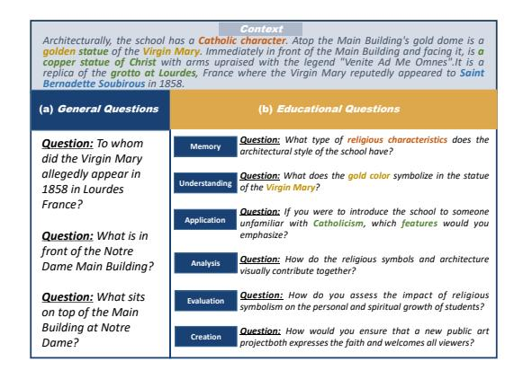
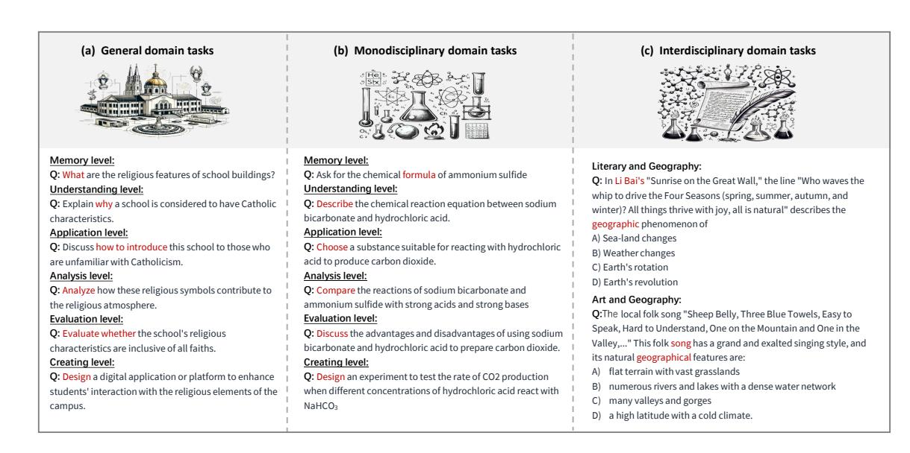
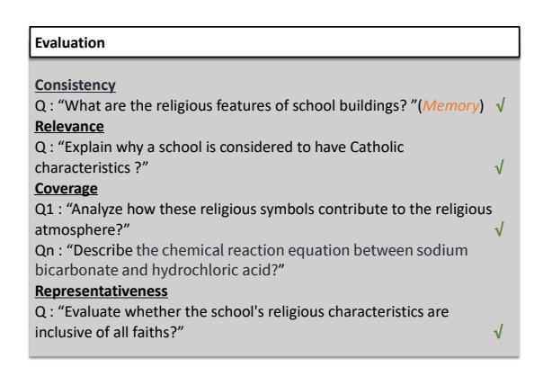
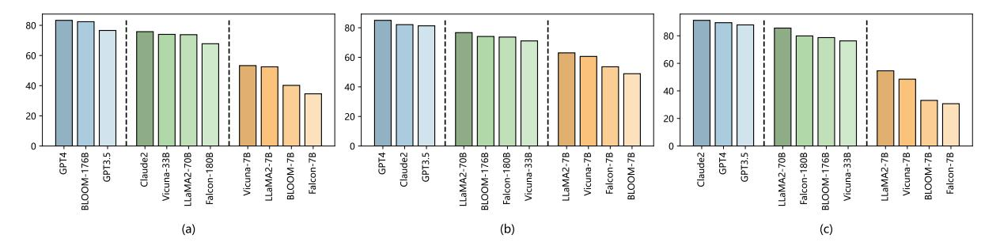
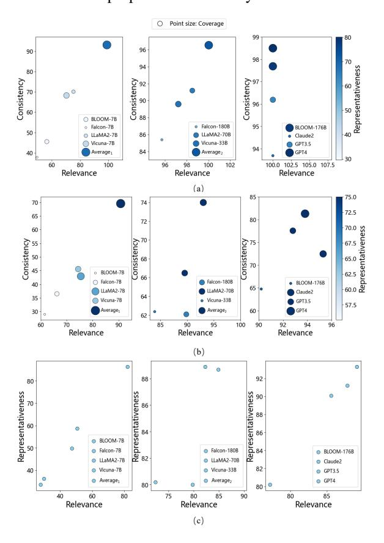
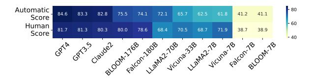
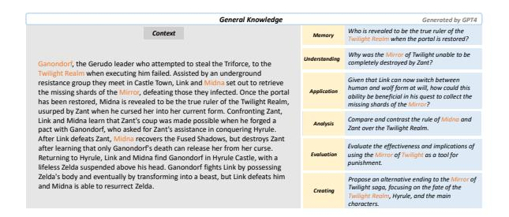
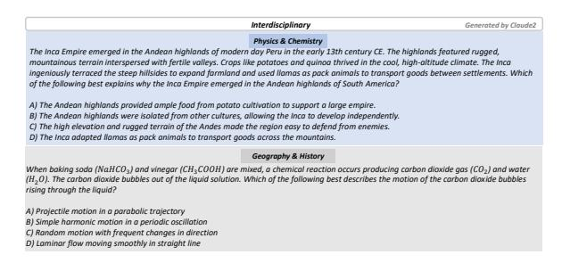

# Dr.Academy: A Benchmark for Evaluating Questioning Capability in Education for Large Language Models

Yuyan Chen¹, Chenwei Wu², Songzhou Yan¹, Panjun Liu³, Haoyu Zhou, Yanghua Xiao¹ □ Shanghai Key Laboratory of Data Science, School of Computer Science, Fudan University, ¹Electrical Engineering and Computer Science Department, University of Michigan, ³School of Computer Science, Beijing Institute of Technology {chenyuyan21@m., szyan21@m., shawyh@}fudan.edu.cn, chenweiw@umich.edu, panjunliu@outlook.com, haoyucharleszhou@gmail.com

# **Abstract**

Teachers are important to imparting knowledge and guiding learners, and the role of large language models (LLMs) as potential educators is emerging as an important area of study. Recognizing LLMs' capability to generate educational content can lead to advances in automated and personalized learning. While LLMs have been tested for their comprehension and problem-solving skills, their capability in teaching remains largely unexplored. In teaching, questioning is a key skill that guides students to analyze, evaluate, and synthesize core concepts and principles. Therefore, our research introduces a benchmark to evaluate the questioning capability in education as a teacher of LLMs through evaluating their generated educational questions, utilizing Anderson and Krathwohl's taxonomy across general, monodisciplinary, and interdisciplinary domains. We shift the focus from LLMs as learners to LLMs as educators, assessing their teaching capability through guiding them to generate questions. We apply four metrics, including relevance, coverage, representativeness, and consistency, to evaluate the educational quality of LLMs' outputs. Our results indicate that GPT-4 demonstrates significant potential in teaching general, humanities, and science courses; Claude2 appears more apt as an interdisciplinary teacher. Furthermore, the automatic scores align with human perspectives.

# 1 Introduction

Large language models (LLMs) have demonstrated great performance in various natural language processing (NLP) tasks, including question answering (Saad-Falcon et al., 2023), information retrieval (Liu et al., 2023b), reasoning (Kojima et al., 2022), and generation (Chung et al., 2023), etc. Beyond these general NLP applications, LLMs are

Figure 1: Comparison between general and educational questions.

also widely used in other domains, such as education. In the educational field, LLMs can now be used as substitutes for teachers. They can help automated teaching or assisted learning applications, thereby alleviating the pressure on human teachers. Additionally, LLMs can recommend appropriate elective courses based on a student's knowledge state, learning style, and interests, automatically generating practice problems of corresponding difficulty levels, and identifying areas where a student is struggling to provide targeted improvement.

However, the capability of questioning is a crucial aspect in the educational field. As LLMs take on the role of teachers, can they pose high-quality questions like human educators? Therefore, evaluating what constitutes a high-quality question in education becomes necessary. According to Anderson and Krathwohl's educational taxonomy (Anderson and Krathwohl, 2001; Elkins et al., 2023), we consider that high-quality questioning in the educational field must meet the following characteristics: i) achieve a higher level across the six domains including memory, understanding, application, analysis, evaluation, and creation; ii) be

relevant to the given context; iii) comprehensively cover the content of the context, and iv) also reflect the important knowledge of this context. We consider that questions meeting these characteristics can effectively assess students' knowledge levels, and LLMs capable of posing such questions can assume the role of competent human educators. The first characteristic is the most basic requirement for LLMs to act as human teachers, while the following three characteristics measure the excellence of LLMs in their role as a teacher.

Evaluating and enhancing the capability of LLMs to generate questions of high quality standards in the educational domain requires a benchmark. However, previous studies have mainly viewed LLMs from a student's perspective, focusing on tasks like reading comprehension (Bai et al., 2023; Tran and Kretchmar, 2023; Chen et al., 2023; Cheng et al., 2023; Izacard and Grave, 2020; Kawabata and Sugawara, 2023; Zhou et al., 2023b,a) and exam evaluations (Zhang et al., 2023b; Huang et al., 2023; Zhong et al., 2023; Li et al., 2023; Wang et al., 2023; Zeng, 2023; Wei et al., 2023). However, these tasks focus on adopting contexts to passively answer questions or make reasoning, and these tests treat LLMs as students, assessing their abilities by how they answer questions, while the LLM's questioning capability through generating educational questions is under-studied. Current education-related research is far from adequate to determine LLMs' question raising capability as a teacher, and there isn't a benchmark that studies the overall teaching abilities of LLMs, seeing them as teachers. Although some role-playing tasks (Shao et al., 2023) mimic professional dialogues but don't truly assess the LLMs' teaching capabilities. Therefore, if we want LLMs to assist in teaching effectively, we need to evaluate and enhance their teaching abilities, as possessing knowledge and guiding others to learn are distinct skills.

Therefore, in this paper, we have developed a benchmark for assessing whether LLMs generate high-quality questions in the field of education, guided by professional educational theories. Unlike general questioning, as shown in Fig. 1 (a), our benchmark requires that the generated questions not only be fluent and readable but also meet the fundamental characteristics proposed earlier (i.e. the first characteristic), as shown in Fig. 1(b). Specifically, we draw on Anderson and Krathwohl's educational taxonomy (Anderson and Krathwohl, 2001) to prompt LLMs to generate questions

at six levels for each context. We select tasks from three domains, including general, single-discipline, and interdisciplinary domains, to more comprehensively assess the strengths of LLMs as teachers in various fields. Based on the four characteristics proposed earlier, we have also designed four evaluation metrics: consistency, relevance, coverage, and representativeness, to assess the value of questions posed by LLMs in the educational domain, thereby comprehensively evaluating the questioning capability of LLMs as teachers in education through evaluating their generated educational questions. Our experiments reveal that LLMs like GPT-4, Claude2, and GPT-3.5 demonstrate good questioning capability across domains as teachers in education through evaluating their generated educational questions. In summary, our contributions are threefolds:

- We introduce the problem of evaluating questioning capability in education as a teacher for LLMs through evaluating their generated educational questions, building a framework based on educational theory that includes six cognitive levels and tasks from three different domains.
- We establish four evaluation metrics to assess the questioning capability in education as a teacher of LLMs through evaluating their generated educational questions.
- We conduct experimental evaluations of 11 LLMs, providing quantitative standards and subject orientations for each LLM's questioning capability as a teacher.

# 2 Datasets and Task Setups

We propose a benchmark named Dr.Academy, which has tasks from three domains. The first two request LLMs to generate questions in the general and monodisciplinary domain, respectively, based on the six levels of Anderson and Krathwohl's educational taxonomy (Anderson and Krathwohl, 2001), including memory, understanding, application, analysis, evaluation and creation. The third one requests LLMs to generate questions that intersect multiple subjects. The overview of Dr.Academy is shown in Fig. 2.

# 2.1 Context Construction

Initially, we collect 10,000 contexts from the general domain and produce an additional 10,000 contexts specifically for the monodisciplinary domain.

Figure 2: The overview of the proposed benchmark Dr.Academy, including three domains and different levels.

In the general domain, the contexts are sourced from the SQuAD dataset (Rajpurkar et al., 2016), an extractive reading comprehension dataset derived from Wikipedia articles, and are utilized as the foundation for the LLMs to generate questions. In the monodisciplinary domain, we generate corresponding contexts for each of the multiple-choice questions in the MMLU dataset (Hendrycks et al., 2020), which covers a broad spectrum of subjects, with GPT4 1 . These contexts include essential information related to the question and all candidate choices. The prompt for generating contexts is shown in Table 1. We also conduct manual evaluations on the generated contexts for the MMLU questions. In this process, we engage three graduate students from different disciplines to perform the evaluations. For each discipline, we randomly select 1% of the questions to undergo manual assessment. If these entries do not achieve a manual evaluation score of 4 (on a scale of 1-5), we will regenerate the contexts.

# 2.2 Task Setup

We have designed three tasks and each task requires LLMs to generate questions catering for the corresponding domain. Finally, these generated questions will be used to evaluate the questioning capability in education as a teacher of LLMs. The prompt for generating questions is shown in Table 8 (row "Generation").

General domain tasks request an LLM to generate questions with the collected contexts from SQuAD based on the six levels of Anderson and

Krathwohl's educational taxonomy (Anderson and Krathwohl, 2001), including memory, understanding, application, analysis, evaluation and creation. For instance, in Fig. 2 (a), at the memory level, a question might ask specific details like "*What are the religious features of a school building?*"; at the understanding level, it could be about reasons such as "*Why is a school considered to have Catholic characteristics?*"; at the creating level, questions could be more open-ended, involving imagination and design, etc. This task is designed to evaluate "which LLM is more suitable to be a general course teacher".

Monodisciplinary domain tasks request an LLM to generate questions with the generated contexts from MMLU, focusing on either humanities (like history, geography) or sciences (like physics, chemistry), based on the same six educational levels. In science, for instance, a memory-level question might ask about element symbols and formulas, such as "*What is the chemical formula for ammonium sulfate?*"; an application-level question related to real-world phenomena, like "*choose a substance that reacts with hydrochloric acid to produce carbon dioxide*". This task is designed to evaluate "which of the two LLMs is more suitable to act as a humanities teacher and a science teacher."

Interdisciplinary domain tasks request an LLM to generate questions that cross multiple subject areas, reflecting each subject's characteristics. For example, in Fig. 2(c), when merging literature and geography, a question might seek an explanation of the geographical phenomenon described in a poem's line. In combining art and geography, a

1 https://chat.openai.com/

Craft a comprehensive and integrative textbook text that seamlessly weaves together the various knowledge points encompassed by the multiple-choice options. Begin by presenting a thorough exploration of each topic in individual paragraphs, ensuring the narrative flows logically from one subject to the next. The text should serve as a foundation that could logically precede the multiple-choice question. The goal is to offer a well-rounded and complete context that encapsulates the knowledge points mentioned in the options, setting the stage for the question to arise naturally from the presented material.

Table 1: The instruction prompt in generating contexts based on a given multiple-choice questions.

question might ask about the geographical features represented in a song. A less successful example of an interdisciplinary question is one where the involved disciplines are unrelated, such as asking about Einstein's theory of relativity and then about the Cauchy inequality in mathematics. This question touches on physics and mathematics but lacks a meaningful connection between the two, making it not truly interdisciplinary. This task is designed to evaluate "which LLM is more suitable to act as a interdisciplinary teacher.", qualifying if LLMs solving the problem requires understanding knowledge from both subjects.

# 2.3 Evaluation metrics

We adopt consistency, relevance, coverage, and representativeness to evaluate LLMs' generated questions in the general and monodisciplinary domains, respectively, while using relevance and representativeness to evaluate questions in the interdisciplinary domain. The difference of metrics selection is because questions in interdisciplinary domain lack a comprehensive contextual framework. For instance, in reality, there is no distinct academic discipline like "historical geography." This absence of a well-defined, unified context means that metrics such as coverage and consistency do not apply.

To validate the effectiveness of these metrics, we consult ten experts in education to rate the effectiveness of these metrics within the field of education on a scale of 1 to 5. They consistently award these metrics scores of 4 and above, which leads us to believe that these metrics are meaningful for evaluating questions in education. We also align these metrics with manual evaluations in Figure 6, indicating that our metrics are indeed significant within the field of education. Additionally, experiments are conducted to compare these metrics with human scoring in order to corroborate the validity and reasonableness of them (see Fig. 6). The prompt for evaluating questions is shown in Table 8 (see row "Evaluation"). Specifically, consistency is to assess whether the question accurately corresponds to a pre-defined level of the educational taxonomy, relevance is to assess whether the question is related to the provided text content or theme, coverage is

assessed by determining if all generated questions based on a context encompasses a major portion (over 50%) of this given context, representativeness evaluates whether a question captures the main content or core ideas of the text. Metrics are rated on a binary scale, with 1 for criteria met and 0 for not met, as shown in Fig. 3 and Table 2. We adopt GPT-4 to score each question three times. A question that scores 1 in two out of three instances meets the metric's requirement.

Figure 3: The evaluation metrics for assessing the quality of generated questions.

# 3 Experiments

In this section, we conduct extensive experiments to evaluate different LLMs' questioning capability through evaluating their generated educational questions in the proposed Dr.Academy.

# 3.1 Experimental Setups

Our experiments are conducted on 8 Nvidia A100 GPUs, each with 80GB of memory, and we use PyTorch 2 in Python 3. We set the maximum sequence length for both input and output sequences to maximum 1000 tokens.

# 3.2 Datasets, Baselines and Metrics

The baseline LLMs for this evaluation are BLOOM-7B (Workshop et al., 2023) BLOOM-176B (Workshop et al., 2023), Claude2 (Bai et al., 2022), Falcon-7B (Almazrouei et al., 2023), Falcon-180B (Almazrouei et al., 2023), GPT3.5 (Brown

&lt;sup>2https://pytorch.org/

3https://www.python.org/

| Metric             | Criteria                                                                                                                                                                                                                                                                                                                                                                                                                            | Score |
|--------------------|-------------------------------------------------------------------------------------------------------------------------------------------------------------------------------------------------------------------------------------------------------------------------------------------------------------------------------------------------------------------------------------------------------------------------------------|-------|
| Consistency        | The question does not align with any of the six educational levels (memory, understanding, application, analysis, evaluation, creation) as outlined in Anderson and Krathwohl's revised version of Bloom's Taxonomy.  The question aligns with one of the six educational levels (memory, understanding, application, analysis, evaluation, creation) as mentioned in Anderson and Krathwohl's revised version of Bloom's Taxonomy. |       |
| Relevance          | The question is no more than 50% relevant to the provided textual context.  The question is more than 50% relevant to the provided textual context.                                                                                                                                                                                                                                                                                 | 0     |
| Coverage           | The content addressed by all questions does not cover more than 50% of the textual context.  The content addressed by all questions covers more than 50% of the textual context.                                                                                                                                                                                                                                                    | 0     |
| Representativeness | The question does not represent more than 50% of the important content within the context.  The question represents more than 50% of the important content within the context.                                                                                                                                                                                                                                                      | 0     |

Table 2: Rating criteria of each metric for evaluating generated questions.

et al., 2020), GPT4 (OpenAI, 2023), LLaMA2-7B (Touvron et al., 2023), LLaMA2-70B (Touvron et al., 2023), Vicuna-7B (Chiang et al., 2023), and Vicuna-33B (Zheng et al., 2023). For the task of manual evaluation, we enlist the help of three graduate students specializing in education. We begin by informing the annotators about the purpose of each task and the scoring guidelines. Following this, we request them to score the responses. During the evaluation phase, we randomly select 1000 questions generated by each LLM for each task and ask three volunteers to manually evaluate the generated responses using the same criteria applied to GPT-4. To ensure the reliability and validity of the human ratings, we calculate the Inter-rater Agreement using Krippendorff's Alpha (IRA). For ratings that exhibit low agreement (< 0.7), we remove the particular statement from consideration and replace it with a new one. This method guarantees the precision and consistency of our human assessment.

# 3.3 Main results

Question 1: Which LLM is more suitable to be a general course teacher? Answer 1: GPT4! The term "suitable" is used to assess the effectiveness of each LLM in different academic subjects. This evaluation helps in identifying which LLMs perform best in specific educational disciplines. In the general domain tasks, various LLMs demonstrate diverse performances as shown in Table 3 and Table 6. Specifically, GPT4 achieves a perfect score of 100% in both consistency and relevance, indicating its strong capability in understanding task requirements and generating relevant questions. However, its coverage score of 54.5% suggests there is room for improvement in generating questions that encompass more content. In representativeness, with a score of 80.1%, GPT-4 shows a good grasp of the context's core content and viewpoints, crafting questions with depth and breadth. BLOOM-176B and Claude2 also score perfectly

|             | Con  | Rel   | Cov  | Rep  | Aver | 0-shot | ↓(%) |
|-------------|------|-------|------|------|------|--------|------|
| BLOOM-7B    | 45.5 | 56.4  | 26.6 | 32.1 | 40.2 | 30.8   | 30.4 |
| BLOOM-176B  | 97.7 | 100.0 | 53.7 | 78.2 | 82.4 | 78.3   | 5.2  |
| Claude2     | 93.7 | 100.0 | 40.5 | 68.8 | 75.8 | 74.7   | 1.4  |
| Falcon-7B   | 37.8 | 49.4  | 21.5 | 29.6 | 34.6 | 21.1   | 63.9 |
| Falcon-180b | 85.4 | 95.7  | 34.8 | 55.1 | 67.8 | 57.2   | 18.4 |
| GPT3.5      | 96.2 | 100.0 | 46.4 | 63.6 | 76.6 | 71.2   | 7.5  |
| GPT4        | 98.5 | 100.0 | 54.5 | 80.1 | 83.3 | 80.1   | 4.0  |
| LLaMA2-7B   | 70.2 | 75.2  | 24.7 | 40.0 | 52.5 | 40.7   | 29.1 |
| LLaMA2-70b  | 91.2 | 98.5  | 39.7 | 65.6 | 73.8 | 71.2   | 3.6  |
| Vicuna-7B   | 68.3 | 70.3  | 31.8 | 42.7 | 53.3 | 38.5   | 38.4 |
| Vicuna-33B  | 89.6 | 97.2  | 41.7 | 67.3 | 74.0 | 64.6   | 14.5 |

Table 3: Performance of different LLMs in the general domain. Con: Consistency, Rel: Relevance; Cov: Coverage, Rep: Representativeness.

in relevance, reflecting their excellent performance in linking questions to the context's themes and content. However, their lower scores in coverage and representativeness indicate potential for improvement in capturing the full extent and core insights of the texts. Moreover, "Aver" in Table 3, Table 4 and Table 5 represent the average result of the corresponding dimensions under each domain, which are obtained using in-context learning (i.e. ICL). ICL is to introduce a human-written sample into the prompt which typically improves LLMs' performance across all metrics, while most LLMs show a decline in the 0-shot setting, demonstrating the critical role of ICL in enhancing the quality of question generation.

Question 2: Which of the two LLMs is more suitable to act as a humanities teacher and a science teacher? Answer 2: Both are GPT4!

In the monodisciplinary domain tasks, LLMs are compared based on their performance in humanities and sciences as illustrated in Table 4 and Table 6. The results reveal that the majority of the LLMs perform marginally better in the scientific disciplines compared to the general domain. Specifically, GPT4 excels across all metrics, particularly in the science disciplines, where it scores higher than in the humanities, indicating great capability in handling science content. Following closely is Claude2, which nearly matches or equals GPT4 in Relevance and representativeness in the humanities,

|             | Con  |      | Con Rel |      | Cov         |      | Rep  |      |      | 0 -1   | ↓(%) |
|-------------|------|------|---------|------|-------------|------|------|------|------|--------|------|
|             | Н    | S    | Н       | S    | Н           | S    | Н    | S    | Aver | 0-shot | ↓(%) |
| BLOOM-7B    | 28.7 | 29.5 | 61.1    | 62.0 | 47.8        | 51.3 | 55.9 | 54.4 | 48.8 | 39.3   | 24.3 |
| BLOOM-176B  | 58.3 | 71.3 | 88.1    | 92.2 | 62.6        | 76.7 | 71.1 | 72.5 | 74.1 | 71.5   | 3.6  |
| Claude2     | 66.5 | 78.4 | 95.5    | 95.0 | <u>75.5</u> | 83.4 | 82.6 | 79.7 | 82.1 | 81.2   | 1.1  |
| Falcon-7B   | 33.2 | 40.1 | 62.3    | 70.1 | 52.3        | 58.8 | 53.5 | 58.4 | 53.6 | 40.7   | 31.7 |
| Falcon-180B | 53.4 | 70.8 | 88.2    | 91.5 | 71.7        | 75.6 | 67.5 | 70.3 | 73.6 | 66.8   | 10.2 |
| GPT3.5      | 71.9 | 83.3 | 92.1    | 93.5 | 74.6        | 79.6 | 75.8 | 79.8 | 81.3 | 79.6   | 2.2  |
| GPT4        | 77.2 | 85.4 | 93.4    | 94.2 | 81.9        | 86.2 | 81.6 | 80.3 | 85.0 | 84.1   | 1.1  |
| LLaMA2-7B   | 42.1 | 43.9 | 74.5    | 76.3 | 64.6        | 70.2 | 60.2 | 71.8 | 62.9 | 50.6   | 24.4 |
| LLaMA2-70B  | 60.1 | 72.9 | 89      | 89.9 | 73.3        | 78.7 | 73.2 | 76.5 | 76.7 | 72.3   | 6.1  |
| Vicuna-7B   | 42.4 | 48.8 | 72.4    | 76.4 | 56.8        | 62.3 | 60.1 | 65.5 | 60.6 | 45.5   | 33.2 |
| Vicuna-33B  | 57.9 | 66.9 | 84.2    | 83.7 | 66.6        | 70.6 | 68.8 | 69.7 | 71.0 | 65.9   | 7.8  |

Table 4: Performance of different LLMs in the monodisciplinary domain.

demonstrating a deep understanding and effective processing of humanities content. Claude2 also maintains a high performance in the science disciplines. GPT3.5 shows competitive strength across the four metrics, especially in relevance and representativeness within the science subjects, approaching the leading performance of GPT4. BLOOM-176B scores significantly higher in consistency within science compared to the humanities, and also demonstrates good capability in coverage and representativeness, suggesting its strengths in processing logical and scientific data.

Question 3: Which LLM is more suitable to be a interdisciplinary teacher? Answer 3: Claude2!

Results of LLMs in the interdisciplinary domain tasks are shown in Table 5 and Table 6. It shows that Claude2 outperforms other LLMs with scores of 89.1% in relevance and 93.3% in representativeness. Following closely is GPT4, with scores of 87.8% in relevance and 91.2% in representativeness, also indicating strong performance. GPT3.5 and LLaMA2-70B also show high scores, particularly in representativeness, suggesting their capability in understanding key textual content and generating in-depth questions. On the other hand, BLOOM-7B, Falcon-7B, and Vicuna-7B perform relatively poorly on both metrics. Specifically, BLOOM-7B scores below 40% in both relevance and representativeness, which may suggest a need for further enhancement in understanding interdisciplinary content and generating high-quality questions.

Question 4: Which LLM is more suitable to be a all-around teacher? Answer 4: GPT4!

We also comprehensively compare the performance of LLMs in three tasks as shown in Table 6 and Fig. 4. Specifically, in the general domain tasks, GPT4 scores the highest and ranks first. In the monodisciplinary domain tasks, including humanities and science, GPT4 also has the best performance. In the interdisciplinary domain tasks, Claude2 occupies the first rank. Finally, for

|             | Rel  | Rep  | Aver | 0-shot | ↓(%) |
|-------------|------|------|------|--------|------|
| BLOOM-7B    | 29.9 | 36.2 | 33.1 | 22.5   | 46.9 |
| BLOOM-176B  | 77.2 | 80.2 | 78.7 | 68.5   | 14.9 |
| Claude2     | 89.1 | 93.3 | 91.2 | 88.8   | 2.7  |
| Falcon-7B   | 27.8 | 33.6 | 30.7 | 20.6   | 49.0 |
| Falcon-180B | 79.8 | 80.0 | 79.9 | 71.7   | 11.4 |
| GPT3.5      | 85.6 | 90.1 | 87.9 | 80.7   | 8.9  |
| GPT4        | 87.8 | 91.2 | 89.5 | 86.3   | 3.7  |
| LLaMA2-7B   | 50.5 | 58.7 | 54.6 | 39.8   | 37.2 |
| LLaMA2-70B  | 82.3 | 88.9 | 85.6 | 81.6   | 4.9  |
| Vicuna-7B   | 47.2 | 49.8 | 48.5 | 32.7   | 48.3 |
| Vicuna-33B  | 72.4 | 80.2 | 76.3 | 68.6   | 11.2 |

Table 5: Performance of different LLMs in the interdisciplinary domain.

|             | Gen  |    | Gen   Mon-H   Mon-S |    | Mon  |    | Int  |    | Com  |    |      |    |
|-------------|------|----|---------------------|----|------|----|------|----|------|----|------|----|
|             | S    | R  | S                   | R  | S    | R  | S    | R  | S    | R  | S    | R  |
| GPT4        | 83.3 | 1  | 83.5                | 1  | 86.5 | 1  | 85.0 | 1  | 89.5 | 2  | 85.9 | 1  |
| Claude2     | 75.8 | 4  | 80.0                | 2  | 84.1 | 2  | 82.1 | 2  | 91.2 | 1  | 83.0 | 2  |
| GPT3.5      | 76.6 | 3  | 78.6                | 3  | 84.1 | 3  | 81.3 | 3  | 87.9 | 3  | 81.9 | 3  |
| LLaMA2-70B  | 73.8 | 6  | 73.9                | 4  | 79.5 | 4  | 76.7 | 4  | 85.6 | 4  | 78.7 | 4  |
| BLOOM-176B  | 82.4 | 2  | 70.0                | 6  | 78.2 | 5  | 74.1 | 5  | 78.7 | 6  | 78.4 | 5  |
| Falcon-180B | 67.8 | 7  | 70.2                | 5  | 77.1 | 6  | 73.7 | 6  | 79.9 | 5  | 73.8 | 6  |
| Vicuna-33B  | 74.0 | 5  | 69.4                | 7  | 72.7 | 7  | 71.1 | 7  | 76.3 | 7  | 73.8 | 7  |
| LLaMA2-7B   | 52.5 | 9  | 60.3                | 8  | 65.6 | 8  | 63.0 | 8  | 54.6 | 8  | 56.7 | 8  |
| Vicuna-7B   | 53.3 | 8  | 57.9                | 9  | 63.3 | 9  | 60.6 | 9  | 48.5 | 9  | 54.1 | 9  |
| BLOOM-7B    | 40.2 | 10 | 48.4                | 11 | 49.3 | 11 | 48.9 | 11 | 33.1 | 10 | 40.7 | 10 |
| Falcon-7B   | 34.6 | 11 | 50.3                | 10 | 56.9 | 10 | 53.6 | 10 | 30.7 | 11 | 39.6 | 11 |

Table 6: Score and rank of different LLMs among general, humanities-related monodisciplinary, science-related monodisciplinary, and interdisciplinary domain. And LLMs' comprehensive performance. S: score, R: rank, Gen: the general domain, Mon-H: humanities-related monodisciplinary domain, Mon-S: science-related monodisciplinary domain, Int: the interdisciplinary domain, Com: the comprehensive performance.

the comprehensive rating, GPT4 ranks first again with the highest score. Overall, GPT4 shows the best performance in most tasks, while Claude2 also demonstrates strong capability in certain tasks. Overall, GPT4, Claude2, and GPT3.5 perform well in these assessments, demonstrating their versatility and adaptability as high-performance models. On the other hand, BLOOM-7B and Falcon-7B tend to perform weaker in most fields, which may make them more suitable for specific application scenarios.

Question 5: What's the relationship among metrics for various LLMs? Answer 5: Pairwise positive correlations!

We also analyze the relationship among four metrics in three tasks as shown in Fig. 5. Fig. 5 (a) and Fig. 5 (b) represent the relationship between four metrics of question quality generated by different LLMs in the general and monodisciplinary domains, respectively. The size of the circle indicates coverage, with larger circles covering more content of the text. The darker the color of the circle, the higher the relevance of the questions to the text. The "Average1" in the first graph represents a group of LLMs, which are zoomed in on the second

Figure 4: The comprehensive performance of different LLMs in the proposed Dr.Academy benchmark.

graph, and the "Average2" in the second graph represents a subset of these LLMs, which are further examined in the third graph. In Fig. 5 (a), analyzing the general domain tasks, we see a positive correlation between relevance and consistency across all three graphs. Representativeness also shows a positive correlation with relevance and consistency, but the correlation is weaker. As relevance and consistency increase, the LLMs have darker colors and larger circles, indicating higher relevance and coverage. Although larger LLMs like BLOOM-176B show good coverage, not all models with large coverage have high relevance. For example, Falcon-180B does not perform as well as BLOOM-176B in relevance, suggesting a need for balance between the breadth of text coverage and the accuracy of question generation. In the third graph, LLMs like GPT4 maintain high relevance while also achieving good coverage. In Fig. 5 (b), for the monodisciplinary domain tasks, the correlations between the four metrics are not as pronounced as in the general domain. The third graph shows little color variation, indicating that representativeness does not change much with increased relevance and consistency. However, there are LLMs like GPT4 that stand out in all metrics, shown in the top right corner with a dark color and large size. But GPT3.5, while showing good representativeness and relevance, has only average consistency. In Fig. 5 (c), analyzing the interdisciplinary domain tasks, generally shows a positive correlation between relevance and representativeness, although it's not as clear in the second graph. Overall, LLMs like GPT4, Claude2, BLOOM-176B, and GPT3.5 perform well across all four metrics, while the 7B series models tend to perform less well. The metrics also tend to show positive correlations with each other.

*Question 6: Is the automatic scores generated by GPT4 agree with human perspectives? Answer 6: Yes, the Pearson correlation coefficient reaches 0.947 and Spearman rank correlation reaches 0.87!*

Figure 5: The relationship among four metrics of different LLMs.

We adopt Pearson correlation coefficient that normalized to a 1-100 scale to investigate the difference between automatic and human scores for different LLMs as shown in Fig. 6. The human scores for each metric and the corresponding agreement of human annotators on these metrics are listed in Table 7. We find that automatic and human evaluations for LLMs generally agree, showing a high positive correlation with the Pearson correlation coefficient reaching 0.947 and Spearman rank correlation reaching 0.870. Specifically, GPT4 performs excellently in both automatic and human scoring, with minimal difference, indicating widespread recognition of its capability. Similarly, Claude2 has close scores in both evaluations, indi-

|             | Consistency |           | Relevance |           | C     | overage   | Representativeness |           |
|-------------|-------------|-----------|-----------|-----------|-------|-----------|--------------------|-----------|
|             | Score       | Agreement | Score     | Agreement | Score | Agreement | Score              | Agreement |
| BLOOM-7B    | 30.8        | 0.87      | 38.5      | 0.91      | 46.8  | 0.82      | 39.5               | 0.75      |
| BLOOM-176B  | 81.5        | 0.92      | 86.2      | 0.93      | 77.1  | 0.79      | 75.2               | 0.77      |
| Claude2     | 78.6        | 0.95      | 88.8      | 0.95      | 76.7  | 0.83      | 77.1               | 0.82      |
| Falcon-7B   | 31.5        | 0.88      | 42.8      | 0.9       | 39.8  | 0.78      | 40.7               | 0.74      |
| Falcon-180B | 77.4        | 0.90      | 85.6      | 0.91      | 77.4  | 0.8       | 74                 | 0.78      |
| GPT3.5      | 78.6        | 0.94      | 86.3      | 0.92      | 77.9  | 0.82      | 71.6               | 0.81      |
| GPT4        | 83.8        | 0.95      | 88.3      | 0.94      | 78.3  | 0.83      | 76.4               | 0.83      |
| LLaMA 2-7B  | 60.8        | 0.85      | 73.4      | 0.86      | 70.7  | 0.76      | 69.9               | 0.8       |
| LLaMA 2-70B | 63.5        | 0.89      | 74.7      | 0.92      | 66.6  | 0.79      | 68.8               | 0.81      |
| Vicuna-7B   | 69.9        | 0.84      | 78.4      | 0.87      | 69    | 0.77      | 70.3               | 0.76      |
| Vicuna-33B  | 70.2        | 0.88      | 76.5      | 0.89      | 64.6  | 0.81      | 70.7               | 0.78      |

Table 7: The human scores for each metric and the corresponding agreement of human annotators on these metrics.

cating balanced performance in assessment tasks. It's important to clarify that the process of generating questions and scoring them is separate. During the scoring phase, there is no knowledge of which LLM generates which question. We believe that even if other LLMs are used to evaluate GPT-4's performance against a comparatively weaker 7b model, the results would still favor GPT-4, a conclusion also supported by human evaluations. The findings suggests that automatic scoring has the potential to partially replace human scoring for evaluating questioning capability in education as a teacher of LLMs through evaluating their generated educational questions.

Figure 6: The Pearson correlation coefficient that normalized to a 1-100 scale between automatic and human scores of different LLMs.

Figure 7: Questions posed by the top LLM, i.e. GPT4, in the general domain.

# 3.4 Case study

We present a set of general domain questions generated by GPT4, identified as the leading LLM in this area, in Fig.7. The top-performing LLMs in monodisciplinary (Humanities), monodisciplinary (Science), and interdisciplinary domains have their

Figure 8: Questions posed by the top LLM, i.e. Claude2, in the interdisciplinary domain.

questions displayed in Fig.9, Fig.10, and Fig.8, respectively. Additionally, further examples from baseline LLMs are shown in figures ranging from Fig.11 to Fig.26. In Fig.7, the first question tests memory by asking about the true ruler of the Twilight Realm. The second requires understanding the reasons behind the Mirror of Twilight's durability. The third applies Link's transformation ability to his quest. The fourth analyzes the contrasting rules of Midna and Zant. The fifth evaluates the use of the Mirror as a punishment tool. Finally, the sixth encourages creating an alternative ending for the saga. These questions showcase GPT-4's range from simple recall to creative thinking, and the generated questions can be adopted to make students quickly grasp the key content, indicating its strong questioning capability in education as a teacher through evaluating their generated educational questions.

We also show a good case in the interdisciplinary tasks generated by Claude2, which shows outstanding comprehensive capability that can effectively combining different subject knowledge to pose accurate and challenging questions. In chemistry and physics combination questions, it understands the basic principles of chemical reactions and the physical properties of bubble motion in liquids, demonstrating analysis and synthesis ability in interdisciplinary questions. Claude2 shows high adaptability and understanding in complex tasks involving multiple disciplines.

# 4 Related Work

# 4.1 Question Generation

The potential of LLMs in generating questions for educational purposes garners significant academic attention. Chen et al. (2019) have developed a reinforcement learning approach specifically for generating natural questions. Elkins et al. (2023) evaluate the educational utility of questions produced by LLMs, organizing them according to their levels

of difficulty. Tavares et al. (2023) investigate the methods LLMs use to create questions, focusing on the tracking of dialogue states. Kai et al. (2021) introduce a method involving double hints for the generation of questions about visuals. Uehara et al. (2022) emphasize the importance of sub-questions in improving the effectiveness of primary visual questions. Arora et al. (2022) examine various prompting techniques for LLMs and analyze the differences in model responses. Abdelghani et al. (2022) utilize the capabilities of GPT-3 to foster curiosity-driven questioning among children. Collectively, these studies underline the evolving role of LLMs in reshaping question generation instead of searching valuable questioning points.

# 4.2 Test-based Benchmark

There has been an increasing focus on evaluating the capability of LLMs in the context of standardized exams and academic benchmarks. For example, Zhang et al. (2023b) introduce GAOKAO Benchmark to evaluate the intuitive benchmark of Chinese college entrance examination questions; Huang et al. (2023) propose the first comprehensive Chinese evaluation package C-EVAL; Zhong et al. (2023) present a human-centric benchmark AGIEval designed for evaluating foundation models; Li et al. (2023) introduce CMMLU, a comprehensive Chinese benchmark covering multiple disciplines; Wang et al. (2023) introduce SciBench to systematically investigate the reasoning ability required to solve complex scientific problems;; Liu et al. (2023a) propose M3KE, a large-scale multilayer and multi-disciplinary knowledge assessment benchmark; Zeng (2023) propose a method to evaluate the multi-task accuracy of large Chinese language models across various domains; Zhang et al. (2023a) introduce FinEval, a benchmark designed for financial knowledge evaluation in LLMs; Wei et al. (2023) focus on the Chinese Elementary School Math Word Problems dataset to evaluate reasoning capability; Dao et al. (2023) explore ChatGPT's potential to complete the Vietnam National High School Graduation Exam; Raina and Gales (2022) propose performance criteria to assess the generated multiple-choice questions; Chen et al. (2018) present LearningQ, an educational question generation dataset containing over 230K document-question pairs. However, these tests treat LLMs as students, assessing their abilities by how they answer questions instead of seeing them as teachers.

# 5 Conclusions and Future Work

In conclusion, our study presents a pioneering investigation into the questioning capability in education as a teacher of large language models (LLMs) through evaluating their generated educational questions, shifting the traditional role of LLMs from learners to educators. We have developed a comprehensive benchmark, named Dr.Academy, based on educational taxonomies that assesses LLMs' abilities to generate questions across various domains with four evaluation metrics. Our findings indicate that models like GPT4, Claude2, and GPT3.5 demonstrate promising teaching potential. Looking ahead, the future directions of this research include refining the evaluation metrics for even more nuanced assessments of teaching effectiveness and expanding the range of subjects and domains covered.

# Limitations

One limitation of our study is that it primarily focuses on the ability of large language models (LLMs) to generate questions, which is just one aspect of teaching. Actual teaching involves more complex interactions, including providing feedback, adapting to students' needs, and fostering critical thinking, areas not fully captured by our current benchmark. Additionally, our approach relies heavily on the textual content, which may not comprehensively represent the nuances of human teaching methods that include non-verbal cues and personalized interactions. Therefore, while our findings offer valuable insights into the potential of LLMs as teaching aids, they should be viewed as a starting point for more in-depth research into the multifaceted nature of teaching and learning processes.

# Acknowledgements

This work is supported by Science and Technology Commission of Shanghai Municipality Grant (No. 22511105902), Shanghai Municipal Science and Technology Major Project (No.2021SHZDZX0103), the National Natural Science Foundation of China (No.62072323), Shanghai Science and Technology Innovation Action Plan (No. 22511104700), and the Zhejiang Lab Open Research Project (NO. K2022NB0AB04).

# References

- Rania Abdelghani, Yen-Hsiang Wang, Xingdi Yuan, Tong Wang, Hélène Sauzéon, and Pierre-Yves Oudeyer. 2022. Gpt-3-driven pedagogical agents for training children's curious question-asking skills. *arXiv preprint arXiv:2211.14228*.
- Ebtesam Almazrouei, Hamza Alobeidli, Abdulaziz Alshamsi, Alessandro Cappelli, Ruxandra Cojocaru, Mérouane Debbah, Étienne Goffinet, Daniel Hesslow, Julien Launay, Quentin Malartic, Daniele Mazzotta, Badreddine Noune, Baptiste Pannier, and Guilherme Penedo. 2023. The falcon series of open language models.
- Lorin W Anderson and David R Krathwohl. 2001. *A taxonomy for learning, teaching, and assessing: A revision of Bloom's taxonomy of educational objectives: complete edition*. Addison Wesley Longman, Inc.
- Simran Arora, Avanika Narayan, Mayee F Chen, Laurel J Orr, Neel Guha, Kush Bhatia, Ines Chami, Frederic Sala, and Christopher Ré. 2022. Ask me anything: A simple strategy for prompting language models. *arXiv preprint arXiv:2210.02441*.
- Yuntao Bai, Saurav Kadavath, Sandipan Kundu, Amanda Askell, Jackson Kernion, Andy Jones, Anna Chen, Anna Goldie, Azalia Mirhoseini, Cameron McKinnon, Carol Chen, Catherine Olsson, Christopher Olah, Danny Hernandez, Dawn Drain, Deep Ganguli, Dustin Li, Eli Tran-Johnson, Ethan Perez, Jamie Kerr, Jared Mueller, Jeffrey Ladish, Joshua Landau, Kamal Ndousse, Kamile Lukosuite, Liane Lovitt, Michael Sellitto, Nelson Elhage, Nicholas Schiefer, Noemi Mercado, Nova DasSarma, Robert Lasenby, Robin Larson, Sam Ringer, Scott Johnston, Shauna Kravec, Sheer El Showk, Stanislav Fort, Tamera Lanham, Timothy Telleen-Lawton, Tom Conerly, Tom Henighan, Tristan Hume, Samuel R. Bowman, Zac Hatfield-Dodds, Ben Mann, Dario Amodei, Nicholas Joseph, Sam McCandlish, Tom Brown, and Jared Kaplan. 2022. Constitutional ai: Harmlessness from ai feedback.
- Yushi Bai, Xin Lv, Jiajie Zhang, Hongchang Lyu, Jiankai Tang, Zhidian Huang, Zhengxiao Du, Xiao Liu, Aohan Zeng, Lei Hou, et al. 2023. Longbench: A bilingual, multitask benchmark for long context understanding. *arXiv preprint arXiv:2308.14508*.
- Tom B. Brown, Benjamin Mann, Nick Ryder, Melanie Subbiah, Jared Kaplan, Prafulla Dhariwal, Arvind Neelakantan, Pranav Shyam, Girish Sastry, Amanda Askell, Sandhini Agarwal, Ariel Herbert-Voss, Gretchen Krueger, Tom Henighan, Rewon Child, Aditya Ramesh, Daniel M. Ziegler, Jeffrey Wu, Clemens Winter, Christopher Hesse, Mark Chen, Eric Sigler, Mateusz Litwin, Scott Gray, Benjamin Chess, Jack Clark, Christopher Berner, Sam McCandlish, Alec Radford, Ilya Sutskever, and Dario Amodei. 2020. Language models are few-shot learners.

- Guanliang Chen, Jie Yang, Claudia Hauff, and Geert-Jan Houben. 2018. Learningq: a large-scale dataset for educational question generation. In *Proceedings of the international AAAI conference on web and social media*, volume 12.
- Jialin Chen, Zhuosheng Zhang, and Hai Zhao. 2023. Modeling hierarchical reasoning chains by linking discourse units and key phrases for reading comprehension. *arXiv preprint arXiv:2306.12069*.
- Yu Chen, Lingfei Wu, and Mohammed J Zaki. 2019. Reinforcement learning based graph-to-sequence model for natural question generation. *arXiv preprint arXiv:1908.04942*.
- Daixuan Cheng, Shaohan Huang, and Furu Wei. 2023. Adapting large language models via reading comprehension. *arXiv preprint arXiv:2309.09530*.
- Wei-Lin Chiang, Zhuohan Li, Zi Lin, Ying Sheng, Zhanghao Wu, Hao Zhang, Lianmin Zheng, Siyuan Zhuang, Yonghao Zhuang, Joseph E Gonzalez, et al. 2023. Vicuna: An open-source chatbot impressing gpt-4 with 90%\* chatgpt quality. *See https://vicuna. lmsys. org (accessed 14 April 2023)*.
- John Joon Young Chung, Ece Kamar, and Saleema Amershi. 2023. Increasing diversity while maintaining accuracy: Text data generation with large language models and human interventions. *arXiv preprint arXiv:2306.04140*.
- Xuan-Quy Dao, Ngoc-Bich Le, Xuan-Dung Phan, and Bac-Bien Ngo. 2023. Can chatgpt pass the vietnamese national high school graduation examination? *arXiv preprint arXiv:2306.09170*.
- Sabina Elkins, Ekaterina Kochmar, Iulian Serban, and Jackie CK Cheung. 2023. How useful are educational questions generated by large language models? In *International Conference on Artificial Intelligence in Education*, pages 536–542. Springer.
- Dan Hendrycks, Collin Burns, Steven Basart, Andy Zou, Mantas Mazeika, Dawn Song, and Jacob Steinhardt. 2020. Measuring massive multitask language understanding. *arXiv preprint arXiv:2009.03300*.
- Yuzhen Huang, Yuzhuo Bai, Zhihao Zhu, Junlei Zhang, Jinghan Zhang, Tangjun Su, Junteng Liu, Chuancheng Lv, Yikai Zhang, Jiayi Lei, et al. 2023. C-eval: A multi-level multi-discipline chinese evaluation suite for foundation models. *arXiv preprint arXiv:2305.08322*.
- Gautier Izacard and Edouard Grave. 2020. Leveraging passage retrieval with generative models for open domain question answering. *arXiv preprint arXiv:2007.01282*.
- Shen Kai, Lingfei Wu, Siliang Tang, Yueting Zhuang, Zhuoye Ding, Yun Xiao, Bo Long, et al. 2021. Learning to generate visual questions with noisy supervision. *Advances in Neural Information Processing Systems*, 34:11604–11617.

- Akira Kawabata and Saku Sugawara. 2023. Evaluating the rationale understanding of critical reasoning in logical reading comprehension. In *Proceedings of the 2023 Conference on Empirical Methods in Natural Language Processing*, pages 116–143.
- Takeshi Kojima, Shixiang Shane Gu, Machel Reid, Yutaka Matsuo, and Yusuke Iwasawa. 2022. Large language models are zero-shot reasoners. *Advances in neural information processing systems*, 35:22199– 22213.
- Haonan Li, Yixuan Zhang, Fajri Koto, Yifei Yang, Hai Zhao, Yeyun Gong, Nan Duan, and Timothy Baldwin. 2023. Cmmlu: Measuring massive multitask language understanding in chinese. *arXiv preprint arXiv:2306.09212*.
- Chuang Liu, Renren Jin, Yuqi Ren, Linhao Yu, Tianyu Dong, Xiaohan Peng, Shuting Zhang, Jianxiang Peng, Peiyi Zhang, Qingqing Lyu, et al. 2023a. M3ke: A massive multi-level multi-subject knowledge evaluation benchmark for chinese large language models. *arXiv preprint arXiv:2305.10263*.
- Jiongnan Liu, Jiajie Jin, Zihan Wang, Jiehan Cheng, Zhicheng Dou, and Ji-Rong Wen. 2023b. Reta-llm: A retrieval-augmented large language model toolkit. *arXiv preprint arXiv:2306.05212*.
- OpenAI. 2023. Gpt-4 technical report.
- Vatsal Raina and Mark Gales. 2022. Multiple-choice question generation: Towards an automated assessment framework. *arXiv preprint arXiv:2209.11830*.
- Pranav Rajpurkar, Jian Zhang, Konstantin Lopyrev, and Percy Liang. 2016. Squad: 100,000+ questions for machine comprehension of text. *arXiv preprint arXiv:1606.05250*.
- Jon Saad-Falcon, Joe Barrow, Alexa Siu, Ani Nenkova, Ryan A Rossi, and Franck Dernoncourt. 2023. Pdftriage: Question answering over long, structured documents. *arXiv preprint arXiv:2309.08872*.
- Yunfan Shao, Linyang Li, Junqi Dai, and Xipeng Qiu. 2023. Character-llm: A trainable agent for roleplaying. *arXiv preprint arXiv:2310.10158*.
- Diogo Tavares, David Semedo, Alexander Rudnicky, and Joao Magalhaes. 2023. Learning to ask questions for zero-shot dialogue state tracking. In *Proceedings of the 46th International ACM SIGIR Conference on Research and Development in Information Retrieval*, pages 2118–2122.
- Hugo Touvron, Louis Martin, Kevin Stone, Peter Albert, Amjad Almahairi, Yasmine Babaei, Nikolay Bashlykov, Soumya Batra, Prajjwal Bhargava, Shruti Bhosale, Dan Bikel, Lukas Blecher, Cristian Canton Ferrer, Moya Chen, Guillem Cucurull, David Esiobu, Jude Fernandes, Jeremy Fu, Wenyin Fu, Brian Fuller, Cynthia Gao, Vedanuj Goswami, Naman Goyal, Anthony Hartshorn, Saghar Hosseini, Rui Hou, Hakan Inan, Marcin Kardas, Viktor Kerkez, Madian Khabsa,

- Isabel Kloumann, Artem Korenev, Punit Singh Koura, Marie-Anne Lachaux, Thibaut Lavril, Jenya Lee, Diana Liskovich, Yinghai Lu, Yuning Mao, Xavier Martinet, Todor Mihaylov, Pushkar Mishra, Igor Molybog, Yixin Nie, Andrew Poulton, Jeremy Reizenstein, Rashi Rungta, Kalyan Saladi, Alan Schelten, Ruan Silva, Eric Michael Smith, Ranjan Subramanian, Xiaoqing Ellen Tan, Binh Tang, Ross Taylor, Adina Williams, Jian Xiang Kuan, Puxin Xu, Zheng Yan, Iliyan Zarov, Yuchen Zhang, Angela Fan, Melanie Kambadur, Sharan Narang, Aurelien Rodriguez, Robert Stojnic, Sergey Edunov, and Thomas Scialom. 2023. Llama 2: Open foundation and finetuned chat models.
- Son Quoc Tran and Matt Kretchmar. 2023. Singlesentence reader: A novel approach for addressing answer position bias. *arXiv preprint arXiv:2308.04566*.
- Kohei Uehara, Nan Duan, and Tatsuya Harada. 2022. Learning to ask informative sub-questions for visual question answering. In *Proceedings of the IEEE/CVF Conference on Computer Vision and Pattern Recognition*, pages 4681–4690.
- Xiaoxuan Wang, Ziniu Hu, Pan Lu, Yanqiao Zhu, Jieyu Zhang, Satyen Subramaniam, Arjun R Loomba, Shichang Zhang, Yizhou Sun, and Wei Wang. 2023. Scibench: Evaluating college-level scientific problem-solving abilities of large language models. *arXiv preprint arXiv:2307.10635*.
- Tianwen Wei, Jian Luan, Wei Liu, Shuang Dong, and Bin Wang. 2023. Cmath: Can your language model pass chinese elementary school math test? *arXiv preprint arXiv:2306.16636*.
- BigScience Workshop, :, Teven Le Scao, Angela Fan, Christopher Akiki, Ellie Pavlick, Suzana Ilic, Daniel ´ Hesslow, Roman Castagné, Alexandra Sasha Luccioni, François Yvon, Matthias Gallé, Jonathan Tow, Alexander M. Rush, Stella Biderman, Albert Webson, Pawan Sasanka Ammanamanchi, Thomas Wang, Benoît Sagot, Niklas Muennighoff, Albert Villanova del Moral, Olatunji Ruwase, Rachel Bawden, Stas Bekman, Angelina McMillan-Major, Iz Beltagy, Huu Nguyen, Lucile Saulnier, Samson Tan, Pedro Ortiz Suarez, Victor Sanh, Hugo Laurençon, Yacine Jernite, Julien Launay, Margaret Mitchell, Colin Raffel, Aaron Gokaslan, Adi Simhi, Aitor Soroa, Alham Fikri Aji, Amit Alfassy, Anna Rogers, Ariel Kreisberg Nitzav, Canwen Xu, Chenghao Mou, Chris Emezue, Christopher Klamm, Colin Leong, Daniel van Strien, David Ifeoluwa Adelani, Dragomir Radev, Eduardo González Ponferrada, Efrat Levkovizh, Ethan Kim, Eyal Bar Natan, Francesco De Toni, Gérard Dupont, Germán Kruszewski, Giada Pistilli, Hady Elsahar, Hamza Benyamina, Hieu Tran, Ian Yu, Idris Abdulmumin, Isaac Johnson, Itziar Gonzalez-Dios, Javier de la Rosa, Jenny Chim, Jesse Dodge, Jian Zhu, Jonathan Chang, Jörg Frohberg, Joseph Tobing, Joydeep Bhattacharjee, Khalid Almubarak, Kimbo Chen, Kyle Lo, Leandro Von Werra, Leon Weber, Long Phan, Loubna Ben allal, Ludovic Tanguy, Manan Dey, Manuel Romero Muñoz,

Maraim Masoud, María Grandury, Mario Šaško, Max Huang, Maximin Coavoux, Mayank Singh, Mike Tian-Jian Jiang, Minh Chien Vu, Mohammad A. Jauhar, Mustafa Ghaleb, Nishant Subramani, Nora Kassner, Nurulaqilla Khamis, Olivier Nguyen, Omar Espejel, Ona de Gibert, Paulo Villegas, Peter Henderson, Pierre Colombo, Priscilla Amuok, Quentin Lhoest, Rheza Harliman, Rishi Bommasani, Roberto Luis López, Rui Ribeiro, Salomey Osei, Sampo Pyysalo, Sebastian Nagel, Shamik Bose, Shamsuddeen Hassan Muhammad, Shanya Sharma, Shayne Longpre, Somaieh Nikpoor, Stanislav Silberberg, Suhas Pai, Sydney Zink, Tiago Timponi Torrent, Timo Schick, Tristan Thrush, Valentin Danchev, Vassilina Nikoulina, Veronika Laippala, Violette Lepercq, Vrinda Prabhu, Zaid Alyafeai, Zeerak Talat, Arun Raja, Benjamin Heinzerling, Chenglei Si, Davut Emre Ta¸sar, Elizabeth Salesky, Sabrina J. Mielke, Wilson Y. Lee, Abheesht Sharma, Andrea Santilli, Antoine Chaffin, Arnaud Stiegler, Debajyoti Datta, Eliza Szczechla, Gunjan Chhablani, Han Wang, Harshit Pandey, Hendrik Strobelt, Jason Alan Fries, Jos Rozen, Leo Gao, Lintang Sutawika, M Saiful Bari, Maged S. Al-shaibani, Matteo Manica, Nihal Nayak, Ryan Teehan, Samuel Albanie, Sheng Shen, Srulik Ben-David, Stephen H. Bach, Taewoon Kim, Tali Bers, Thibault Fevry, Trishala Neeraj, Urmish Thakker, Vikas Raunak, Xiangru Tang, Zheng-Xin Yong, Zhiqing Sun, Shaked Brody, Yallow Uri, Hadar Tojarieh, Adam Roberts, Hyung Won Chung, Jaesung Tae, Jason Phang, Ofir Press, Conglong Li, Deepak Narayanan, Hatim Bourfoune, Jared Casper, Jeff Rasley, Max Ryabinin, Mayank Mishra, Minjia Zhang, Mohammad Shoeybi, Myriam Peyrounette, Nicolas Patry, Nouamane Tazi, Omar Sanseviero, Patrick von Platen, Pierre Cornette, Pierre François Lavallée, Rémi Lacroix, Samyam Rajbhandari, Sanchit Gandhi, Shaden Smith, Stéphane Requena, Suraj Patil, Tim Dettmers, Ahmed Baruwa, Amanpreet Singh, Anastasia Cheveleva, Anne-Laure Ligozat, Arjun Subramonian, Aurélie Névéol, Charles Lovering, Dan Garrette, Deepak Tunuguntla, Ehud Reiter, Ekaterina Taktasheva, Ekaterina Voloshina, Eli Bogdanov, Genta Indra Winata, Hailey Schoelkopf, Jan-Christoph Kalo, Jekaterina Novikova, Jessica Zosa Forde, Jordan Clive, Jungo Kasai, Ken Kawamura, Liam Hazan, Marine Carpuat, Miruna Clinciu, Najoung Kim, Newton Cheng, Oleg Serikov, Omer Antverg, Oskar van der Wal, Rui Zhang, Ruochen Zhang, Sebastian Gehrmann, Shachar Mirkin, Shani Pais, Tatiana Shavrina, Thomas Scialom, Tian Yun, Tomasz Limisiewicz, Verena Rieser, Vitaly Protasov, Vladislav Mikhailov, Yada Pruksachatkun, Yonatan Belinkov, Zachary Bamberger, Zdenek Kasner, Al- ˇ ice Rueda, Amanda Pestana, Amir Feizpour, Ammar Khan, Amy Faranak, Ana Santos, Anthony Hevia, Antigona Unldreaj, Arash Aghagol, Arezoo Abdollahi, Aycha Tammour, Azadeh HajiHosseini, Bahareh Behroozi, Benjamin Ajibade, Bharat Saxena, Carlos Muñoz Ferrandis, Daniel McDuff, Danish Contractor, David Lansky, Davis David, Douwe Kiela, Duong A. Nguyen, Edward Tan, Emi Baylor, Ezinwanne Ozoani, Fatima Mirza, Frankline Ononiwu, Habib Rezanejad, Hessie Jones, Indrani Bhat-

tacharya, Irene Solaiman, Irina Sedenko, Isar Nejadgholi, Jesse Passmore, Josh Seltzer, Julio Bonis Sanz, Livia Dutra, Mairon Samagaio, Maraim Elbadri, Margot Mieskes, Marissa Gerchick, Martha Akinlolu, Michael McKenna, Mike Qiu, Muhammed Ghauri, Mykola Burynok, Nafis Abrar, Nazneen Rajani, Nour Elkott, Nour Fahmy, Olanrewaju Samuel, Ran An, Rasmus Kromann, Ryan Hao, Samira Alizadeh, Sarmad Shubber, Silas Wang, Sourav Roy, Sylvain Viguier, Thanh Le, Tobi Oyebade, Trieu Le, Yoyo Yang, Zach Nguyen, Abhinav Ramesh Kashyap, Alfredo Palasciano, Alison Callahan, Anima Shukla, Antonio Miranda-Escalada, Ayush Singh, Benjamin Beilharz, Bo Wang, Caio Brito, Chenxi Zhou, Chirag Jain, Chuxin Xu, Clémentine Fourrier, Daniel León Periñán, Daniel Molano, Dian Yu, Enrique Manjavacas, Fabio Barth, Florian Fuhrimann, Gabriel Altay, Giyaseddin Bayrak, Gully Burns, Helena U. Vrabec, Imane Bello, Ishani Dash, Jihyun Kang, John Giorgi, Jonas Golde, Jose David Posada, Karthik Rangasai Sivaraman, Lokesh Bulchandani, Lu Liu, Luisa Shinzato, Madeleine Hahn de Bykhovetz, Maiko Takeuchi, Marc Pàmies, Maria A Castillo, Marianna Nezhurina, Mario Sänger, Matthias Samwald, Michael Cullan, Michael Weinberg, Michiel De Wolf, Mina Mihaljcic, Minna Liu, Moritz Freidank, Myungsun Kang, Natasha Seelam, Nathan Dahlberg, Nicholas Michio Broad, Nikolaus Muellner, Pascale Fung, Patrick Haller, Ramya Chandrasekhar, Renata Eisenberg, Robert Martin, Rodrigo Canalli, Rosaline Su, Ruisi Su, Samuel Cahyawijaya, Samuele Garda, Shlok S Deshmukh, Shubhanshu Mishra, Sid Kiblawi, Simon Ott, Sinee Sang-aroonsiri, Srishti Kumar, Stefan Schweter, Sushil Bharati, Tanmay Laud, Théo Gigant, Tomoya Kainuma, Wojciech Kusa, Yanis Labrak, Yash Shailesh Bajaj, Yash Venkatraman, Yifan Xu, Yingxin Xu, Yu Xu, Zhe Tan, Zhongli Xie, Zifan Ye, Mathilde Bras, Younes Belkada, and Thomas Wolf. 2023. Bloom: A 176b-parameter open-access multilingual language model.

Hui Zeng. 2023. Measuring massive multitask chinese understanding. *arXiv preprint arXiv:2304.12986*.

Liwen Zhang, Weige Cai, Zhaowei Liu, Zhi Yang, Wei Dai, Yujie Liao, Qianru Qin, Yifei Li, Xingyu Liu, Zhiqiang Liu, et al. 2023a. Fineval: A chinese financial domain knowledge evaluation benchmark for large language models. *arXiv preprint arXiv:2308.09975*.

Xiaotian Zhang, Chunyang Li, Yi Zong, Zhengyu Ying, Liang He, and Xipeng Qiu. 2023b. Evaluating the performance of large language models on gaokao benchmark. *arXiv preprint arXiv:2305.12474*.

Lianmin Zheng, Wei-Lin Chiang, Ying Sheng, Siyuan Zhuang, Zhanghao Wu, Yonghao Zhuang, Zi Lin, Zhuohan Li, Dacheng Li, Eric. P Xing, Hao Zhang, Joseph E. Gonzalez, and Ion Stoica. 2023. Judging llm-as-a-judge with mt-bench and chatbot arena.

Wanjun Zhong, Ruixiang Cui, Yiduo Guo, Yaobo Liang, Shuai Lu, Yanlin Wang, Amin Saied, Weizhu Chen, and Nan Duan. 2023. Agieval: A human-centric

- benchmark for evaluating foundation models. *arXiv preprint arXiv:2304.06364*.
- Tongquan Zhou, Yao Zhang, Siyi Cao, Yulu Li, and Tao Wang. 2023a. Complementary advantages of chatgpts and human readers in reasoning: Evidence from english text reading comprehension. *arXiv preprint arXiv:2311.10344*.
- Yucheng Zhou, Xiubo Geng, Tao Shen, Chongyang Tao, Guodong Long, Jian-Guang Lou, and Jianbing Shen. 2023b. Thread of thought unraveling chaotic contexts. *arXiv preprint arXiv:2311.08734*.

| General/Monodisciplinary | Generation | Given a text, please propose some questions for students. These questions are divided into six levels: memory, understanding, application, analysis, evaluation, and creation. The memory level requires students to recall specific facts or information from the article. For example, 'What are the main ecosystem services mentioned in the article?'; The understanding level checks whether students have grasped the concepts or arguments in the article. For example, 'Explain what biodiversity is and why it is important to ecosystems.'; The application level involves applying understood concepts to new situations or examples. For example, 'How would the reduction in biodiversity affect ecosystem services?'; The analysis level involves dissecting the information in the article, such as comparing and contrasting different concepts or situations. For example, 'Compare the importance of different ecosystem services mentioned in the article.'; The evaluation level assesses or critiques the views, methods, or arguments of the article. For example, 'Evaluate the author's argument about the importance of biodiversity conservation'; The creation level involves combining different parts of the article to form new insights or summaries. For example, 'Integrate the information mentioned in the article to discuss the best strategy for biodiversity conservation.'Text content is xxx. You need to propose three questions of each level based on the above text. |
|--------------------------|------------|-------------------------------------------------------------------------------------------------------------------------------------------------------------------------------------------------------------------------------------------------------------------------------------------------------------------------------------------------------------------------------------------------------------------------------------------------------------------------------------------------------------------------------------------------------------------------------------------------------------------------------------------------------------------------------------------------------------------------------------------------------------------------------------------------------------------------------------------------------------------------------------------------------------------------------------------------------------------------------------------------------------------------------------------------------------------------------------------------------------------------------------------------------------------------------------------------------------------------------------------------------------------------------------------------------------------------------------------------------------------------------------------------------------------------------------------------------------------------------------------------------------------|
|                          | Evaluation | The text content is xxx. A question is xxx. You need to evaluate this question considering the following four criteria: i) Consistency. 0: The question does not align with any of the six educational levels (memory, understanding, application, analysis, evaluation, creation) as outlined in Anderson and Krathwohl's revised version of Bloom's Taxonomy.1: The question aligns with one of the six educational levels (memory, understanding, application, analysis, evaluation, creation) as mentioned in Anderson and Krathwohl's revised version of Bloom's Taxonomy. ii) Relevance. 0: The question is less than 50% relevant to the provided textual context.1: The question is more than 50% relevant to the provided textual context. The content addressed by all questions does not cover more than 50% of the textual context. iv) Representativeness. 0: The question does not represent more than 50% of the important content within the context. 1: The question represents more than 50% of the important content within the context. For each criterion, you only need to give a number, where 1 represents 'meets the criterion' and 0 represents 'does not meet the criterion'. Give the result in this format: [x, x, x, x]                                                                                                                                                                                                                                                             |
| Interdisciplinary        | Generation | Create an interdisciplinary problem of subjectA and subjectB. Give detailed subjectA's knowledge as background and infer subjectB's events or phenomenon from subjectA's background. For example, "The Strait of Gibraltar is a narrow waterway that serves as a natural separation between the Iberian Peninsula in Europe and the North African coast. This strategic location has historically been a crucial passage for naval trade and military movements, influencing the development and outcome of various historical events in the Mediterranean region. Based on the geographical background provided about the Strait of Gibraltar, which of the following historical events or phenomena can be inferred to have been significantly influenced by its location?A) The establishment of the Silk RoadB) The expansion of the Roman Empire into Northern AfricaC) The Viking exploration of the North AtlanticD) The trade routes during the Age of Discovery "The subjectA and subjectB can be geography and history, physics and chemistry, biology and chemistry, art and history, physics and history, etc.Please give such a multiple-choice question.                                                                                                                                                                                                                                                                                                                                            |
|                          | Evaluation | A question is xxx. You need to evaluate this question considering the following two criteria: i) Relevance. 0: The question is less than 50% relevant to the provided textual context. 1: The question is more than 50% relevant to the provided textual context. ii) Representativeness. 0: The question does not represent more than 50% of the important content within the context. 1: The question represents more than 50% of the important content within the context. For each criterion, you only need to give a number, where 1 represents 'meets the criterion' and 0 represents 'does not meet the criterion'. Give the result in this format: [x, x]                                                                                                                                                                                                                                                                                                                                                                                                                                                                                                                                                                                                                                                                                                                                                                                                                                                 |

Table 8: The instruction prompts of three domains in guiding LLMs to generate questions and making evaluation.

| Monodisciplinary (Humanities)                                                                                                                                                                                                                                                                                                 | Generated by GPT4 |                                                                                                                                    |
|-------------------------------------------------------------------------------------------------------------------------------------------------------------------------------------------------------------------------------------------------------------------------------------------------------------------------------|-------------------|------------------------------------------------------------------------------------------------------------------------------------|
| Context The discourse titled ""The Physical Basis of Life,"" penned by Thomas Henry Huxley in 1868, delves into a topic that may be novel to many: the existence of a physical                                                                                                                                                | Memory            | What is the name of the substance that Thomas Henry Huxley proposed as the physical basis of life in his 1868 discourse?     |
| basis, or matter, of life. Contrary to the widespread belief of life being a force that works through matter, Huxley introduced the concept of ""Protoplasm"", the scientific name for the substance that constitutes the physical basis of life. Huxley's                                                                    | Understanding     | What does <u>Huxley</u> mean when he says that life is a property of a specific kind of matter, the <u>Protoplasm</u> ?      |
| argument revolves around the understanding that life is not merely a philosoph notion or a supernatural phenomenon that transcends the physical world. Inste he proposes life as a property of a specific kind of matter – the Protoplasm. This                                                                               | Application       | How can you apply Huxley's concept of "Protoplasm" as the physical basis of life to modern scientific explorations of life's |
| matter, according to Huxley, showcases the vitality of life due to the continuous process of death it undergoes. This process results in the breakdown of the Protoplasm into carbonic acid, water, and nitrogenous compounds, all of which possess properties of ordinary matter. Therefore, Huxley's argument does not view | Analysis          | How does Huxley's concept of 'Protoplasm' challenge traditional philosophical and supernatural understandings of life?             |
| life as a force that works through matter; it is not a metaphysical or theological concept. He emphasizes that life is a property of a particular kind of matter. This perspective offers a fresh understanding of life, grounding it in the physical realm                                                                   | Evaluation        | Do you agree or disagree with Huxley's argument that life is a property of a specific kind of matter, the Protoplasm?        |
| rather than attributing it to abstract or supernatural forces. Thus, Huxley's discourse provides a foundation for understanding life from a scientific perspective, stripping away philosophical or supernatural connotations.                                                                                                | Creating          | How would you design an experiment to test Huxley's theory that life is a property of the Protoplasm?                        |

Figure 9: Questions posed by the top LLM, i.e. GPT4, in the humanities-related monodisciplinary domain.

| Monodisciplinary (Science)                                                                                                                                                                                                                                                                                                                                     | Generated by GPT4 |                                                                                                                                                  |
|----------------------------------------------------------------------------------------------------------------------------------------------------------------------------------------------------------------------------------------------------------------------------------------------------------------------------------------------------------------|-------------------|--------------------------------------------------------------------------------------------------------------------------------------------------|
| Context  In the world of computer programming, numerous languages are employed to enable the smooth functioning of applications. One such language is Python.                                                                                                                                                                                                  | Memory            | What are the two types of shift operations in Python 3?                                                                                          |
| Python 3, a later version of Python, offers an array of mathematical operations, including the shift operation. The shift operation in Python is of two types: left-shift and right-shift. Each operation has a unique syntax and function. The left-shift operation, represented by '<<', multiplies the left operand by 2 raised to the power                | Understanding     | Explain the difference between a left-shift operation and a right-shift operation in Python 3.                                                   |
| of the right operand. On the other hand, the right-shift operation, denoted by '>>', divides the left operand by 2 raised to the power of the right operand. The resultant value is rounded down to the nearest whole number. To illustrate, let's consider the left-shift operation on a variable 'x' with a value of 1, denoted as 'x << 3'. In this case,   | Application       | How would you use the left-shift and right-shift operations in Python 3 to manipulate the binary representation of a number? Provide an example. |
| Python 3 multiplies the value of 'x' (1) by 2 to the power of 3. The calculation would be as follows: $1 * (2^3) = 1 * 8 = 8$ . Therefore, the output of the operation 'x << 3' when the value of 'x' is 1 would be 8. In contrast, if we were to carry out a right-shift operation, such as 'x>> 3', Python 3 would divide the value of 'x' by 2 to the power | Analysis          | Can you analyze and explain the difference in calculation and results between the left-shift and right-shift operations in Python 3?             |
| of 3. Therefore, the output would be $1/(2^3) = 1/8 = 0.125$ . As mentioned before, Python 3 would round down this value to the nearest whole number, which would result in 0. In conclusion, the shift operations in Python 3 serve as shortcuts for multiplication and division by powers of two. These operations are integral to                           | Evaluation        | Why might a programmer choose to use a shift operation instead of the traditional multiplication or division operators?                          |
| programming tasks that involve manipulating binary representations of numbers. As such, understanding the left-shift and right-shift operations is crucial for anyone seeking to master Python 3.                                                                                                                                                              | Creating          | Design a simple program in Python 3 that uses both left-shift and right-shift operations and explain what the program does.                |

Figure 10: Questions posed by the top LLM, i.e. GPT4, in the science-related monodisciplinary domain.

#### **General**

#### **BLOOM-7B:**

**Memory :** What is the main idea of the text? **Understanding :** What is the main idea of the text? **Application:** What is the main idea of the text? **Analysis:** What is the main idea of the text? **Evaluation:** What is the main idea of the text? **Creating:** What is the main idea of the text?

# **Claude2:**

**Memory :** What item allows Link to switch between his Hylian and wolf forms?

**Understanding :** Explain why the Mirror of Twilight served as a gateway between Hyrule and the Twilight Realm.

**Application:** What do you think would have happened if Zant was able to completely destroy the Mirror of Twilight?

**Analysis:** Contrast the powers of Midna, Zant, and Ganondorf over the course of the story.

**Evaluation:** Assess whether retrieving the Mirror Shards was the most effective method for stopping Zant.

**Creating:** Develop your own explanation for how Ganondorf forged his pact with Zant.

# **Falcon-180B:**

**Memory :** What is the Mirror of Twilight and where is it located?

**Understanding :** Why did the sages banish Ganondorf to the Twilight Realm?

**Application:** How does the discovery of Midna's true identity change the dynamics of their quest?

**Analysis:** Compare and contrast the personalities and characteristics of the different characters in the story.

**Evaluation:** Evaluate the significance of the Mirror of Twilight in the story and its impact on the characters and plot.

**Creating:** Create a summary of the events leading up to the final battle with Ganondorf.

# **BLOOM-176B:**

**Memory :** What magical item does Link obtain that allows him to switch between wolf form and his normal form?

**Understanding :** Explain the significance of the Master Sword and the Shadow Crystal in the story.

**Application:** How does Link's ability to switch between forms affect his journey?

Analysis: Compare and contrast the motivations and actions of Zant and Ganondorf?

**Evaluation:** Evaluate the decision made by the Sages to banish Ganondorf to the Twilight Realm. Was it a wise choice considering the events that followed?

**Creating:** Combine the information about the Master Sword, Shadow Crystal, and Mirror of Twilight to propose a new strategy for Link to defeat his enemies.

# **Falcon-7B:**

**Memory :** When was Martin born?

**Understand :** What is Martin's occupation?

**Application:** How does Martin use his skills to help others?

**Analysis:** What are the key factors that make Martin a successful leader?

**Evaluation:** How has Martin's leader-ship impacted the community?

**Creating:** What are some of Martin's most significant accomplishments?

Figure 11: Questions posed by different LLMs in the general domain.

# **General**

# **GPT3.5:**

**Memory :** What is the name of the artifact that Link obtains after gaining the Master Sword?

**Understanding :** Explain the significance of the Mirror of Twilight in relation to the Twilight Realm and Hyrule.

**Application:** How does the ability to switch between forms help Link and Midna in their quest?

**Analysis:** Compare and contrast Link's battle with Zant and Ganondorf in terms of their motives and methods.

**Evaluation:** Evaluate Link and Midna's decision to trust the Sages' information about the Mirror of Twilight. Was it justified?

**Creating:** Integrate the information mentioned in the text to propose a strategy for Link and Midna to successfully retrieve the missing shards of the Mirror of Twilight.

#### **LLaMA2-7B:**

**Memory :** How many shards of the Mirror of Twilight are needed to restore it?

**Understanding :** What is the significance of the Mirror of Twilight in the story?

**Application:** How would Link's defeat of Zant impact the fate of Hyrule?

**Analysis:** Analyze the motivations of Zant and Ganondorf in their actions throughout the story.

**Evaluation:** Assess the impact of the story on the player's emotional investment in the game.

**Creating:** Summarize the main plot points of the story in a creative way.

# **GPT4:**

**Memory :** Who is revealed to be the true ruler of the Twilight Realm when the portal is restored?

**Understanding :** Why was the Mirror of Twilight unable to be completely destroyed by Zant?

**Application:** Given that Link can now switch between human and wolf form at will, how could this ability be beneficial in his quest to collect the missing shards of the Mirror?

**Analysis:** Compare and contrast the rule of Midna and Zant over the Twilight Realm.

**Evaluation:** Evaluate the effectiveness and implications of using the Mirror of Twilight as a tool for punishment.

**Creating:** Propose an alternative ending to the Mirror of Twilight saga, focusing on the fate of the Twilight Realm, Hyrule, and the main characters.

# **LLaMA2-70B:**

**Memory :** What is the name of the sword that Link uses to defeat Ganondorf?

**Understanding:** Why is the Mirror of Twilight important for Link and Midna's quest?

**Application:** What is the significance of Midna's curse and how does it relate to Zant's coup?

**Analysis:** Compare and contrast the motivations of Link and Ganondorf in their respective quests.

**Evaluation:** How does the story's portrayal of the Twilight Realm and its inhabitants comment on the nature of good and evil?

**Creating:** Imagine an alternate scenario where Ganondorf successfully destroys the Mirror of Twilight. How would this affect the story's plot and themes?

Figure 12: Questions posed by different LLMs in the general domain.

# **General**

# **Vicuna7B:**

**Memory :** What is the Master Sword?

**Understanding :** Explain the significance of the Mirror of Twilight in the story.

**Application:** How does the broken Mirror of Twilight affect the story?

**Analysis:** Compare and contrast the roles of Midna and Ganondorf in the story.

**Evaluation:** Evaluate the portrayal of Midna as a character.

**Creating:** Integrate the information mentioned in the article to discuss the significance of the Master Sword in the story.

# **Vicuna-33B:**

**Memory :** What is the name of the underground resistance group that Link and Midna meet in Castle Town?

**Understanding :** What is the purpose of the Mirror of Twilight?

**Application:** How does the restoration of the Mirror of Twilight help Link and Midna in their quest?

**Analysis:** Compare and contrast the roles of Link and Midna in the story.

**Evaluation:** Assess the ethical implications of Link and Midna's actions throughout the story.

**Creating:** Use the information from the text to propose an alternative ending to the story.

Figure 13: Questions posed by different LLMs in the general domain.

# **BLOOM-7B:**

**Memory :**From the passage, one may infer that Huxley argued that 'life' was essentially a property of a certain kind of matter.

**Understanding :** According to the passage, "While the words of the philosophers have not been able to pierce the veil of the unconscious, the science of physiology has been able to penetrate within the temple of the unconscious and have seen there the life of the soul." The meaning of the passage is that the understanding of the passage is that the understanding of the passage is that the science of physiology has been able to penetrate within the temple of the unconscious and have seen there the life of the soul.

**Application:** In the above paragraph, the author argues that life is not a force that works through matter, but rather a property of one specific kind of matter: the Protoplasm. This matter, according to Huxley, is constantly undergoing the continuous process of death.

**Analysis:** From the passage, one may infer that Huxley argued that 'life' was essentially a property of a certain kind of matter, and that this property of matter is essential to life. In other words, the life of a plant is not a force that works through matter. Therefore, Huxley argued that life is a property of a certain kind of matter. Consequently, the life of a plant is a property of its own kind of matter, and that kind of matter is essential to life. In other words, it is only this kind of matter that makes the life of a plant possible.

**Evaluation:** What is the correct answer to this question?

**Creating:** The passage portrays a novel idea in science, the idea that life is a property of a certain kind of matter. The passage does not define life as a thing that works through matter; instead he argues that life is a property of a certain kind of matter, that is, a substance called Protoplasm. The passage does not say that life is a force that works through matter; instead it argues that life is a property of a certain kind of matter, that is, a substance called Protoplasm. In other words, life is not a force that works through matter; instead it is a property of a certain kind of matter. What is life?

#### **BLOOM-176B:**

**Memory :** What is the name of the substance that Huxley proposes as the physical basis of life?

**Understanding:** Can you paraphrase Huxley's argument about life being a property of a specific kind of matter?

**Application:** How might Huxley's concept of life as a property of Protoplasm change our understanding of biological processes?

**Analysis:** What are the key components of Huxley's argument that life is not a force that works through matter, but a property of it?

**Evaluation:** What impact do you think Huxley's argument had on the scientific community's understanding of life at the time it was proposed?

**Creation:** If you were to build upon Huxley's concept of life as a property of a specific kind of matter, what new theory or perspective might you propose?

# **Claude2:**

**Memory :** What is the scientific name for the physical basis of life that Huxley introduced?

**Understanding :** In your own words, explain Huxley's main argument about the nature of life.

**Application:** Provide an example that supports Huxley's perspective on life as a property of a certain kind of matter.

**Analysis:** Compare Huxley's view on life to the widespread prior belief that life was a supernatural force working through matter.

**Evaluation:** Do you agree with Huxley that life should be understood from a purely scientific perspective rather than a philosophical or theological one? Why or why not?

**Creating:** Construct a diagram that visually depicts Huxley's scientific conception of life in contrast to prevailing philosophical/theological notions.

Figure 14: Questions posed by different LLMs in the humanities-related monodisciplinary domain.

## **Falcon-7B:**

**Memory :**In the passage, Huxley stated protoplasm as the physical basis of life. what do you think it is?

**Understanding :** The most important content of the text is a \_\_.

**Application:** This passage is about a debate between two scientific camps about the nature of life. According to Huxley life is a property of a specific kind of matter. He argues that life is a physical basis of the life. The material that is the Protoplasm, which is a special kind of matter. According to the text, how Huxley has the protoplasm as a physical basis of life?

**Analysis:** From the passage, one may infer that Huxley argued that

**Evaluation:** What does Huxley argue in the passage?

**Creating:** From the text, one may infer Huxley argued that 'life' was essentially the property of one kind of matter" to which thecorrect answer is indeed, option C.

# **GPT3.5:**

**Memory :** What is the scientific term proposed by Thomas Henry Huxley to describe the substance that constitutes the physical basis of life?

**Understanding :** What is the concept of "Protoplasm" according to Huxley's argument in "The Physical Basis of Life"?

**Application:** How does Huxley's concept of Protoplasm challenge traditional notions of life as a metaphysical or theological concept?

**Analysis:** How does Huxley's concept of Protoplasm challenge traditional beliefs about the nature of life?

**Evaluation:** How does Huxley's concept of "Protoplasm" challenge traditional beliefs about the nature of life?

**Creating:** Can you provide examples of the properties of Protoplasm that demonstrate its vitality and connection to ordinary matter?

#### **Falcon-180B:**

**Memory :** What is the scientific name for the substance that constitutes the physical basis of life, according to Huxley's discourse?

**Understanding :** How does Huxley's argument view life in terms of its properties and characteristics, and how does this differ from traditional beliefs?

**Application:** Can you provide an example of how Huxley's argument can be applied in a scientific research setting, such as studying the properties of Protoplasm and its role in the physical basis of life?

**Analysis:** How does Huxley's argument challenge or support existing scientific theories about the nature of life?

**Evaluation:** In your opinion, based on Huxley's argument, do you believe that life is solely a property of Protoplasm, or are there other factors that contribute to the physical basis of life?

**Creating:** Can you propose a new experiment or research study that builds upon Huxley's argument and further investigates the physical basis of life?

# **GPT4:**

**Memory :**What is the name of the substance that Thomas Henry Huxley proposed as the physical basis of life in his 1868 discourse?

**Understanding :** What does Huxley mean when he says that life is a property of a specific kind of matter, the Protoplasm?

**Application:** How can you apply Huxley's concept of "Protoplasm" as the physical basis of life to modern scientific explorations of life's origin?

**Analysis:** How does Huxley's concept of 'Protoplasm' challenge traditional philosophical and supernatural understandings of life?

**Evaluation:** Do you agree or disagree with Huxley's argument that life is a property of a specific kind of matter, the Protoplasm? Justify your position with evidence from the text or other scientific sources.

**Creating :** Do you agree or disagree with Huxley's argument that life is a property of a specific kind of matter, the Protoplasm? Justify your position with evidence from the text or other scientific sources.

Figure 15: Questions posed by different LLMs in the humanities-related monodisciplinary domain.

# **LLaMA2-7B:**

**Memory :** In what ways does Huxley's concept of "Protoplasm" challenge prevailing beliefs about life and its relationship to the physical world?

**Understanding :** What was the primary argument presented by Huxley regarding the physical basis of life?

**Application:** What are some examples of how Huxley's arguments regarding the physical basis of life have influenced scientific research and understandings of life in the years since the publication of his article?

**Analysis:** Analyze the reasoning behind Huxley's argument regarding the physical basis of life. How does he attempt to ground life in the physical realm, and what implications does this have for our understanding of life?

**Evaluation:** Evaluate the validity of Huxley's argument regarding the physical basis of life by considering the implications of his theory in contemporary scientific discourse.

**Creating:** Create an argument that challenges Huxley's perspective on the physical basis of life. Consider alternative explanations for the observed properties of living organisms.

# **LLaMa2-70B:**

**Memory :** What is according to Huxley the scientific name for the substance that constitutes the physical basis of life?

**Understanding :** What is the main argument of Thomas Henry Huxley in his discourse "The Physical Basis of Life"?

**Application:** What are the implications of Huxley's argument that life is a property of Protoplasm on our understanding of the nature of life and its relationship with matter?

**Analysis:** What is the core idea of Huxley's discourse according to the text?

**Evaluation:** Can Huxley's view of life as a property of matter be applied to the various forms of life on Earth, including plants and animals, or is it limited to a certain type of organism?

**Creating:** What is the significance of Huxley's argument in understanding life from a scientific perspective?

Figure 16: Questions posed by different LLMs in the humanities-related monodisciplinary domain.

# **Vicuna-7B:**

**Memory :**Which of the following is NOT a characteristic of Protoplasm, as described by Huxley in 1868?

A. It is the physical basis of life.

B. It can be broken down into carbonic acid, water, and nitrogenous compounds.

C. It is a philosophical or theological concept.

D. It is a supernatural force that works through matter.

**Understanding :** Based on the passage, which of the following best summarizes Huxley's argument regarding the physical basis of life?

A. Life is an abstract concept that works through matter but is not necessarily grounded in the physical realm.

B. Life is a property of a particular kind of matter, as proposed by Huxley, and is grounded in the physical realm.

C. Life is a force that works through matter,

as it is not a physical property but rather a philosophical or supernatural concept.

D. Life is a property of a certain kind of matter, as proposed by Huxley, but it is not necessarily grounded in the physical realm.

**Application:** Based on the passage, which of the following best summarizes Huxley's argument regarding the physical basis of life?

**Analysis:** According to Huxley's argument, what is the physical basis of life?

**Evaluation:** Based on the text provided, what is the scientific name for the substance that constitutes the physical basis of life according to Huxley's argument?

**Creating :** In his discourse, Huxley's central argument is

A. That life is a force that works through matter

B. That life is a property of a specific kind of matter

C. That life is an abstract or supernatural phenomenon

D. That life is a philosophical notion transcending the physical world

# **Vicuna-33B:**

**Memory :** What is the main idea presented in "The Physical Basis of Life," and why does this idea challenge the prevailing beliefs of the time?

**Understanding :** What is the primary idea that Huxley presented in "The Physical Basis of Life"?

**Application: H**ow does Huxley's argument contribute to the scientific study of life?

**Analysis:** Is Huxley's understanding of life as a property of matter in line with contemporary scientific understanding of life If not, how does it differ? If so, provide examples to support this claim.

**Evaluation:** What are the implications of accepting Huxley's argument that life is a property of a specific kind of matter? How does this understanding influence our understanding of life, its origins, and its potential?

**Creating:** What are the main points of Huxley's argument regarding the physical basis of life?

Figure 17: Questions posed by different LLMs in the humanities-related monodisciplinary domain.

#### **Monodisciplinary (Science)**

# **BLOOM-7B:**

**Memory :** Not a question.

**Understanding :** What is the output of Python 3 when the value of x is 1, denoted as x << 3?

**Application:** In Python 3, the left-shift operation, represented by '<<', multiplies the left operand by 2 raised to the power of the right operand. On the other hand, the right-shift operation, denoted by '>>', divides the left operand by 2 raised to the power of the right operand. The resultant value is rounded down to the nearest whole number.

What is the value of x << 3 in Python 3?

A. 1

B. 3

C. 8

D. 16

**Analysis:** Let's consider a variable y = 1. What is y << 3 in Python 2?

A. 2

B. 4

C. 6

D. 8

**Evaluation:** Given the above, would you say that the Python 3 shift operation has a functional or a symbolic nature?

**Creating:** Not a question.

# **Falcon-7B:**

**Memory :** Not complete

**Understanding :** Not complete

**Application:** Not complete

**Analysis:** What are the different types of the operations that fall under the category of

operations?

**Evaluation:** What is the nature of the shift

operation?

**Creating:** Not complete

# **BLOOM-176B:**

**Memory :** What are the symbols used to represent the left-shift and right-shift operations in Python 3?

**Understanding :** Can you explain in your own words how the left-shift and right-shift operations work in Python 3?

**Application:** How would you use the right-shift operation to divide a number by 8 in Python 3?

What is the value of x << 3 in Python 3?

A. 1

B. 3

C. 8

D. 16

**Analysis:** What is the significance of the shift operations in tasks that involve manipulating binary representations of numbers in Python 3?

**Evaluation:** How efficient are the shift operations in Python 3 compared to traditional methods of multiplication and division?

**Creating:** Can you develop a Python 3 program that uses both left-shift and right-shift operations to manipulate binary representations of numbers?

# **Falcon-180B:**

**Memory :**What are the differences between leftshift and right-shift operations in Python 3?

**Understanding :** Can you explain the syntax and function of the left-shift operation in Python 3?

**Application:** How can a left-shift operation in Python 3 be used to manipulate binary representations of numbers?

**Analysis:** Compare and contrast the left-shift and right-shift operations in Python 3.

**Evaluation:** In what situations would the leftshift and right-shift operations be useful in Python 3 programming?

**Creating :** Can you write a Python 3 program that demonstrates the use of left-shift and rightshift operations in manipulating binary numbers?

Figure 18: Questions posed by different LLMs in the science-related monodisciplinary domain.

#### **Monodisciplinary (Science)**

#### **Claude2:**

**Memory:** What function converts a string to a floating point number in Python 3?

**understanding:** Explain why the long() function from Python 2 is no longer used in Python 3.

**Application:** Write code to convert user inputs, taken as strings, into appropriate numeric types for some mathematical operations.

**Analysis:** Distinguish between the key differences in purpose and usage of the int() and float() functions in Python.

**Evaluation:** Critique the removal of long() in Python 3 - was this change necessary or limiting for developers? What tradeoffs did it introduce?

**Creating:** Devise your own new variant of the int() function called int\_clamp() that converts strings to integers but clamps values outside a specific range.

# **GPT4:**

**Memory :** What are the two types of shift operations in Python 3?

**Understanding :** Explain the difference between a left-shift operation and a right-shift operation in Python 3.

**Application:** How would you use the left-shift and right-shift operations in Python 3 to manipulate the binary representation of a number? Provide an example.

**Analysis:** Can you analyze and explain the difference in calculation and results between the left-shift and right-shift operations in Python 3?

**Evaluation:** Why might a programmer choose to use a shift operation instead of the traditional multiplication or division operators?

**Creating:** Design a simple program in Python 3 that uses both left-shift and right-shift operations and explain what the program does.

#### **GPT3.5:**

**Memory :** What is the purpose of the shift operations in Python 3?

**Understanding :** What are the two types of shift operations in Python 3?

**Application:** How does the left-shift operation in Python 3 differ from the right-shift operation?

**Analysis:** How does the right-shift operation differ from the left-shift operation in Python 3?

**Evaluation:** What is the purpose of the shift operations in Python 3?

**Creating:** Explain the difference between the leftshift and right-shift operations in Python 3 and provide an example for each.

# **LLaMA2-7B :**

**Memory :** What is the purpose of the shift operations in Python 3? **Understanding :** What is the purpose of the shift operations in Python 3? **Application:** Apply the concept of shift operations in Python 3 to solve a problem involving binary representation of numbers. Choose the correct answer from the options provided.

**Analysis:** What is the primary function of the shift operations in Python 3?

A. To perform multiplication and division by powers of two.

B. To enable smoother functioning of applications.

C. To enable the creation of new mathematical operations.

D. To simplify complex mathematical expressions.

**Evaluation:** Design an algorithm using Python 3 to compute the result of a left-shift operation on a variable 'x' with a value of 10, followed by a rightshift operation by a factor of 2. Could you explain your reasoning?

**Creating:** What is the purpose of the shift operations in Python 3?

Figure 19: Questions posed by different LLMs in the science-related monodisciplinary domain.

#### **Monodisciplinary (Science)**

# **LLaMA2-70B :**

**Memory :** What are the two types of shift operations in Python 3?

**Understanding :** What is the relationship between the left-shift operation and the right-shift operation in Python 3?

**Application:** What are the two types of shift operations available in Python 3, and how do they differ in their function and syntax?

**Analysis:** In what ways can the shift operations in Python 3 be used to simplify programming tasks involving binary representation of numbers?

**Evaluation:** What is the purpose of the shift operations in Python 3?

- A. To perform multiplication by powers of two.
- B. To perform division by powers of two.
- C. To perform addition by powers of two.

D. To perform subtraction by powers of two. **Creating :** What would be the output of the following code in Python3?

x = 10

print(x << 3).

# **Vicuna-33B :**

**Memory :** How does Python 3 perform shift operations?

**Understanding :** Explain how Python 3 handles division in the context of right-shift operations

**Application:** How would you use the shift operations in Python 3 to calculate the value of x >> 5, where x = 10?

**Analysis:** The shift operations in Python 3 are useful for:

- A. Multiplying and dividing numbers by powers of two
- B. Converting decimal numbers to binary representation
- C. Rounding down values to the nearest whole number
- D. All of the above

**Evaluation:** How does the right-shift operation differ from the left-shift operation in Python 3?

**Creating:** What are the differences between the leftshift and right-shift operations in Python 3?

#### **Vicuna-7B:**

**Memory :** What is the primary purpose of the shift operations in Python 3?

**Understanding :** What is the primary function of the right-shift operation in Python 3?

**Application:** Apply the left-shift operation to a given number in Python 3. What is the result of x << 2 when x is equal to 5?

**Evaluation:** What is the primary purpose of the shift operation in Python 3, and how does it differ from traditional multiplication and division operations?

**Analysis:** Which of the following statements regarding the behavior of the left-shift operation in Python 3 is NOT true?

- A. The left-shift operation in Python 3 multiplies the left operand by 2 raised to the power of the right operand.
- B. The left-shift operation in Python 3 rounds the result down to the nearest whole number.
- C. The left-shift operation in Python 3 is denoted by '<<'.
- D. The left-shift operation in Python 3 is not equivalent to multiplication by 2^3.

**Creating :** What is the primary function of the shift operations in Python 3?

- A. To perform arithmetic calculations
- B. To manipulate binary representations of numbers
- C. To compare values
- D. To organize data

Figure 20: Questions posed by different LLMs in the science-related monodisciplinary domain.

#### **BLOOM-7B:**

**Q:** suppose a gas contains molecules of three different types. One type of molecule is formed by two atoms of element A and one atom of element B; one type of molecule is formed by two atoms of element C and one atom of element D; and one type of molecule is formed by two atoms of element E and one atom of element F.

What is the ratio of the number of molecules of type 3 to the number of molecules of type 1?

What is the ratio of the number of molecules of type 2 to the number of molecules of type 1? What is the ratio of the number of molecules of type 3 to the number of molecules of type 2?

# **Claude2:**

**Q:** The Inca Empire emerged in the Andean highlands of modern day Peru in the early 13th century CE. The highlands featured rugged, mountainous terrain interspersed with fertile valleys. Crops like potatoes and quinoa thrived in the cool, high-altitude climate. The Inca ingeniously terraced the steep hillsides to expand farmland and used llamas as pack animals to transport goods between settlements.

Which of the following best explains why the Inca Empire emerged in the Andean highlands of South America?

- A) The Andean highlands provided ample food from potato cultivation to support a large empire.
- B) The Andean highlands were isolated from other cultures, allowing the Inca to develop independently.
- C) The high elevation and rugged terrain of the Andes made the region easy to defend from enemies.
- D) The Inca adapted llamas as pack animals to transport goods across the mountains.

# **BLOOM-176B:**

**Q:** Consider a chemical reaction where 2 moles of hydrogen gas (H2) react with 1 mole of oxygen gas (O2) to produce 2 moles of water (H2O). This reaction releases 572 kJ of energy.

Physics Question: If all the energy released from this reaction is used to heat a 1 kg block of copper initially at 20 degrees Celsius, what will be the final temperature of the copper block? (Assume no heat loss to the surroundings and the specific heat capacity of copper is 0.385 J/ g °C)

A)60 degrees Celsius

B)120 degrees Celsius

C)180 degrees Celsius

D)240 degrees Celsius

# **Falcon-7B:**

**Q:** "A mixture of ethanol and water is added to a solution of sodium hydroxide. The mixture is heated to 35 degrees Celsius.

What happens to the solution?"

- 1. The mixture will turn into an organic alcohol.
- 2. The solution will turn into an organic alcohol.
- 3. The solution will turn into an organic alcohol and water.
- 4. The solution will turn into a salt.
- 5. The solution will turn into a salt and water.
- 6. The solution will turn into a salt and alcohol.

Figure 21: Questions posed by different LLMs in the interdisciplinary domain.

#### **Falcon-180B:**

**Q:** The Nile River is the longest river in the world, stretching over 4,000 miles from its source in Burundi to its delta in Egypt. The Nile flows through 11 African countries, including Tanzania, Uganda, Sudan, and Egypt. The Nile River has been vital to the development of civilizations in Africa for thousands of years, providing water for irrigation and transportation. The Nile River also played a significant role in the rise and fall of ancient Egypt, which relied on the river for its annual floods to replenish the soil . What historical event is associated with the geography of the Nile River?

- A) The construction of the Great Wall of China
- B) The fall of the Roman Empire
- C) The rise of ancient Egypt
- D) The colonization of the Americas by Europeans

# **GPT3.5:**

- **Q:** The Silk Road was an ancient network of trade routes that connected the East and West, facilitating the exchange of goods, ideas, and cultures between different regions. It stretched over 4,000 miles, traversing diverse geographical landscapes such as deserts, mountains, and grasslands. The trade routes of the Silk Road passed through several key regions, including Central Asia, the Middle East, and the Mediterranean . Based on the geography of the Silk Road, which historical phenomenon is most likely to have occurred?
- a) The spread of Buddhism from India to China.
- b) The rise of the Roman Empire in Europe.
- c) The colonization of the Americas by European powers.
- d) The development of feudalism in medieval Europe.

# **GPT4:**

**Q:** The Volga River has played a pivotal role in the development of the societies that have lived along its banks. As the longest river in Europe, it flows through central Russia for about 3,530 kilometers, eventually emptying into the Caspian Sea. Its basin area covers about 1.35 million square kilometers, supporting a variety of climates and biomes, including the steppe, forest-steppe, and taiga.

The river's geography has influenced human settlement patterns, trade routes, and military campaigns. Its fertile floodplains have supported agriculture that has been the backbone of societies since ancient times. Moreover, the river's connectivity to other waterways, such as the Don through the Volga-Don Canal, has made it a crucial segment of the trade routes connecting the Northern forests, the Caspian Sea, and, beyond, the Black Sea and the Mediterranean.

Given the geographic background of the Volga River, which of the following historical events or phenomena is most likely to have been influenced by its geography?

- A) The establishment of the Silk Road as a major trade route connecting East Asia with the Mediterranean.
- B) The migration and settlement patterns of the Slavic peoples in the early medieval period.
- C) The success of the Mongol Empire's invasion of Europe in the 13th century.
- D) The flourishing of the Renaissance cultural movement in European cities like Florence and Venice.

Figure 22: Questions posed by different LLMs in the interdisciplinary domain.

# **LLaMA2-7B:**

**Q:** The Mongol Empire was known for its extensive network of trade routes, which connected China to Europe. These routes passed through the Himalayan Mountains, the Tibetan Plateau, and the Caucasus region. The Mongols also established a system of governors and administrators in the conquered territories, which helped to maintain order and extract resources from the regions they occupied.

What was the primary motivation behind the Mongol Empire's expansion into Eastern Europe?

- A) To spread Buddhism to the local populations
- B) To establish trade routes and extract resources from the region
- C) To conquer new territories and expand the empire's borders
- D) To spread the Mongolian language and culture to the local populations.

# **LLaMA2-70B:**

- **Q:** The Niger River, located in West Africa, has played a significant role in the history of the region. Which of the following historical events or phenomena can be inferred from the geography of the Niger River?
- A) The transatlantic slave trade
- B) The spread of Islam in West Africa
- C) The colonization of West Africa by European powers
- D) The development of ancient civilizations in the region

# **Vicuna-7B:**

- **Q:** The Silk Road was a network of trade routes that connected the East and West during the ancient and medieval periods. Which of the following geographical features was most important in facilitating the development of the Silk Road?
- A) Mountains
- B) Deserts
- C) Oceans
- D) Plains

#### **LLaMA2-13B:**

**Q:** The city of Istanbul (formerly known as Constantinople) has a rich and complex history that spans over 2,500 years. It is located at the crossroads of Europe and Asia, where the Bosphorus Strait connects the Black Sea to the Marmara Sea, and where the Golden Horn river flows into the Bosphorus.

The city has been the capital of numerous empires, including the Roman Empire, the Byzantine Empire, the Ottoman Empire, and modern-day Turkey. Throughout its history, Istanbul has been a center of trade, culture, and religion, and has been influenced by various cultures, including Greek, Roman, Christian, Islamic, and Jewish. Today, Istanbul is a bustling metropolis of over 14 million people, with a diverse population and a vibrant cultural scene.

Which of the following historical events or phenomena can be inferred from the geography of Istanbul?

- A) The Ottoman Empire's expansion into Europe
- B) The Byzantine Empire's decline and fall
- C) The influence of Islamic culture on the city's architecture and art
- D) The city's strategic location as a trade hub between Europe and Asia

# **Vicuna-33B:**

- **Q:** An ancient city in the geographical environment of a land valley topography, with abundant water and good weather. The city has historically been an important strategic location, probably due to its superior strategic location. Please choose which of the following best fits this description and explain your choice:
- A. Rome, on the banks of the Canalo River
- B. Babylon, located at the intersection of Roman strategic routes
- C. A land city in Egypt, rich in agricultural resources
- D. Strategic city in India, with convenient transportation on the shopping road.

Figure 23: Questions posed by different LLMs in the interdisciplinary domain.

# **BLOOM-7B:**

#### **Q:** NOT RELEVANT

#### **Claude2:**

**Q:** When baking soda (NaHCO3) and vinegar (CH3COOH) are mixed, a chemical reaction occurs producing carbon dioxide gas (CO2) and water (H2O). The carbon dioxide bubbles out of the liquid solution.

Which of the following best describes the motion of the carbon dioxide bubbles rising through the liquid?

- A) Projectile motion in a parabolic trajectory
- B) Simple harmonic motion in a periodic oscillation
- C) Random motion with frequent changes in direction
- D) Laminar flow moving smoothly in straight line

# **BLOOM-176B:**

**Q:** How might the geographical characteristics of the Great Plains have influenced historical events or phenomena in the United States?

A)The flat terrain and grassy landscape of the Great Plains facilitated the development of the Transcontinental Railroad in the 19th century.

- B) The semi-arid climate of the Great Plains led to the Dust Bowl in the 1930s, causing severe economic and social distress.
- C) The geographical location of the Great Plains had no significant impact on historical events or phenomena in the United States.
- D) The harsh winters of the Great Plains hindered westward expansion during the 19th century.

# **GPT3.5:**

**Q:** Chemical reactions involve the rearrangement of atoms to form new substances. These reactions are governed by the principles of chemistry, such as the conservation of mass and energy, and the understanding of reaction rates and equilibrium.

How does temperature affect the rate of a chemical reaction?

- A) Higher temperature increases the rate of a chemical reaction
- B) Lower temperature increases the rate of a chemical reaction
- C) Temperature does not affect the rate of a chemical reaction
- D) Temperature affects the rate of a chemical reaction, but the effect can vary depending on the specific reaction.

# **Falcon-7B:**

**Q:** Which of the following is not a characteristic of a tropical climate?

- (a) warm
- (b) dry
- (c) rainfall
- (d) humidity

# **Falcon-180B:**

**Q:** What is the primary reason why some chemical reactions occur quickly while others occur slowly?

- A) The temperature of the reaction mixture
- B) The concentration of the reactants
- C) The pressure of the system
- D) The presence of a catalyst
- E) The phase of the reactants (solid, liquid)

Figure 24: Questions posed by different LLMs in the interdisciplinary domain.

# **LLaMA-7B:**

**Q:** A chemical reaction occurs in a container, where two chemicals (A and B) are mixed together and react to form a new compound (C). The reaction is exothermic, meaning it releases heat, and the temperature of the system increases as the reaction proceeds. The reaction is also highly non-ideal, meaning that the concentrations of the reactants and products are not equal at any point during the reaction. The reaction is described by the following chemical equation:

#### A + B → C

What is the most likely cause of the non-ideal behavior of the reaction, based on the thermodynamic properties of the reactants and products?

- A) The reaction is limited by the availability of a particular reactant.
- B) The reaction is limited by the availability of a particular product.
- C) The reaction is influenced by the temperature of the system.
- D) The reaction is influenced by the pressure of the system.

# **LLaMA-13B:**

**Q:** A chemical reaction involves the mixing of two substances, A and B, to form a new compound, C. The reaction is exothermic, meaning it releases heat. The reaction is described by the equation:

# A + B → C + heat

Question: As the reaction proceeds, the temperature of the system increases. What physical principle can be used to explain this increase in temperature?

- A) The law of conservation of energy
- B) The law of conservation of mass
- C) The second law of thermodynamics
- D) The first law of thermodynamics

# **GPT4:**

**Q:** A chemical reaction takes place in a closed container where hydrogen gas reacts with oxygen gas to form water. The reaction is exothermic, releasing a certain amount of heat energy into the surroundings within the container.

$$2H_2(g) + O_2(g) \rightarrow 2H_2O(l) + Energy$$

The released heat increases the temperature of the gases remaining in the container, causing them to expand. The container is rigid and does not allow the volume to change. The increase in temperature of the gas mixture follows the ideal gas law PV = nRT, where P is the pressure, V is the volume, n is the number of moles of gas, R is the ideal gas constant, and T is the temperature in Kelvin.

Assuming the initial temperature and pressure of the hydrogen and oxygen gas mixture were 298 K and 1 atm respectively, and no gas escapes the container during the reaction, which of the following outcomes is expected after the reaction based on the ideal gas law?

- A) The pressure inside the container will decrease because the number of moles of gas has decreased.
- B) The pressure inside the container will increase because the temperature of the gas has increased.
- C) The pressure inside the container will remain the same because the volume of the container is constant.
- D) The pressure inside the container will decrease because the reaction consumes energy from the gas mixture.

Figure 25: Questions posed by different LLMs in the interdisciplinary domain.

## **LLaMA-70B:**

**Q:** A chemical reaction involves the mixing of two substances, A and B, to form a new compound, C. The reaction is exothermic, meaning it releases heat. The reaction is described by the equation:

A + B → C + heat

Question: As the reaction proceeds, the temperature of the system increases. What physical principle can be used to explain this increase in temperature?

- A) The law of conservation of energy
- B) The law of conservation of mass
- C) The second law of thermodynamics
- D) The first law of thermodynamics

# **Vicuna-33B:**

**Q:** Question: In a chemical reaction, the rate at which a substance decomposes can be affected by factors such as temperature and pressure. Which of the following physical concepts best describes how temperature and pressure influence the rate of a chemical reaction?

- A) The kinetic theory of gases
- B) The quantum mechanical behavior of subatomic particles
- C) The principles of thermodynamics
- D) The arrangement of electrons in atomic orbitals

# **Vicuna-7B:**

**Q:** Chemical reactions involve the transfer of energy and the transformation of matter. The rate at which a chemical reaction occurs depends on various factors, including the temperature, the concentration of reactants, and the presence of a catalyst.

Which of the following factors has the greatest influence on the rate of a chemical reaction?

- A) The concentration of reactants
- B) The temperature of the reaction
- C) The presence of a catalyst
- D) The volume of the reaction vessel

Figure 26: Questions posed by different LLMs in the interdisciplinary domain.