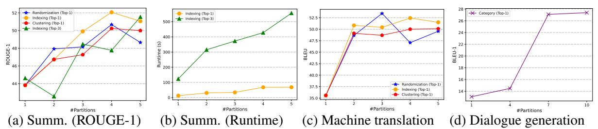
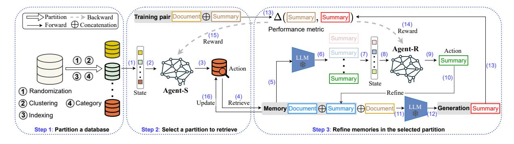

## M-RAG: Reinforcing Large Language Model Performance through Retrieval-Augmented Generation with Multiple Partitions

Zheng Wang<sup>1</sup> , Shu Xian Teo<sup>1</sup> , Jieer Ouyang<sup>1</sup> , Yongjun Xu<sup>1</sup> , Wei Shi<sup>1</sup> <sup>1</sup>Huawei Technologies, Co., Ltd.

{wangzheng155,teo.shu.xian,ouyang.jieer,xuyongjun6,w.shi}@huawei.com

## Abstract

Retrieval-Augmented Generation (RAG) enhances Large Language Models (LLMs) by retrieving relevant memories from an external database. However, existing RAG methods typically organize all memories in a whole database, potentially limiting focus on crucial memories and introducing noise. In this paper, we introduce a multiple partition paradigm for RAG (called M-RAG), where each database partition serves as a basic unit for RAG execution. Based on this paradigm, we propose a novel framework that leverages LLMs with Multi-Agent Reinforcement Learning to optimize different language generation tasks explicitly. Through comprehensive experiments conducted on seven datasets, spanning three language generation tasks and involving three distinct language model architectures, we confirm that M-RAG consistently outperforms various baseline methods, achieving improvements of 11%, 8%, and 12% for text summarization, machine translation, and dialogue generation, respectively.

## 1 Introduction

Introduced by [\(Lewis et al.,](#page-9-0) [2020\)](#page-9-0), Retrieval-Augmented Generation (RAG) represents a paradigm within the domain of Large Language Models (LLMs) to augment generative tasks. More specifically, RAG incorporates an initial retrieval step where LLMs query an external database to acquire relevant information before progressing to answer questions or generate text. This process not only guides the subsequent generation step but also guarantees that the responses are firmly anchored in the retrieved information (referred to as memories). Consequently, it enhances LLM performance, and has attracted growing research interests [\(Gao](#page-9-1) [et al.,](#page-9-1) [2023\)](#page-9-1) in recent years.

While the majority of existing studies [\(Asai et al.,](#page-9-2) [2023;](#page-9-2) [Cheng et al.,](#page-9-3) [2023b;](#page-9-3) [Ma et al.,](#page-10-0) [2023\)](#page-10-0) adopt a retrieval approach that considers *a database as*

*a whole*, which tends to yield a coarse-grained retrieval. The collective organization of all memories may hinder the focus on crucial memories and introduce noise, particularly due to the inherent challenges of Approximate k-Nearest Neighbor (AKNN) search when applied to large datasets. In this context, we investigate a retrieval approach that aims to search within a partition of the database, corresponding retrieval at a fine-grained level, which is designed to enhance the generation process by targeting specific memories. Moreover, in quite a few vector database systems, database partitions are regarded as fundamental units for analysis. This facilitates the construction and maintenance of index structures [\(Pan et al.,](#page-10-1) [2023\)](#page-10-1), ensures the protection of user privacy data (stored in specific partitions with access rights) [\(Xue et al.,](#page-11-0) [2017\)](#page-11-0), and supports distributed architectures [\(Guo et al.,](#page-9-4) [2022\)](#page-9-4). Therefore, in this work, we propose to take *a partition as a basic entity* in the execution of RAG, which is less explored in current methods.

We discuss our proposal with a motivating experiment illustrated in Figure [1.](#page-1-0) We investigate various strategies for partitioning a database (elaborated in Section [3.1\)](#page-3-0), and perform RAG with varying the number of partitions for three generation tasks: summarization, translation, and dialogue generation, where we explore all partitions for the retrieval, and the best result (assessed based on a development set) across different partitions is reported. We observe that the optimal performance is typically not achieved through retrieval based on the entire database (#Partitions = 1). This observation inspires us to investigate a novel RAG setting with multiple partitions. To achieve this, the task should address three significant challenges, summarized below. (1) Determining a strategy for partitioning a database and the number of partitions. (2) Developing a method for selecting a suitable partition for a given input query to discover effective memories. (3) Enhancing memory quality,

<span id="page-1-0"></span>

Figure 1: Comparison with database partitioning strategies for language generation tasks.

including inherent issues such as hallucination, or irrelevant context, which can impact the grounding of LLM generation.

Building upon the aforementioned discussion, we introduce a new solution called M-RAG, designed to facilitate RAG across multiple partitions of a database. M-RAG addresses all of the three challenges. For (1), we draw insights from the literature on vector database management (Pan et al., 2023; Han et al., 2023) and assess various strategies, namely Randomization (Indyk and Motwani, 1998), Clustering (Jegou et al., 2010), Indexing (Malkov et al., 2014; Malkov and Yashunin, 2018), and Category (Gollapudi et al., 2023), through empirical studies. The effectiveness of these strategies, along with the corresponding number of partitions, is evaluated across different generative tasks on a development set in our experiments. For (2), with multiple partitions at play, we formulate partition selection as a multi-armed bandit problem (Slivkins et al., 2019). In this context, an agent, denoted as Agent-S, iteratively selects one among several partitions. The characteristics of each partition are only partially known at the time of selection, and Agent-S gains a better understanding over time by maximizing cumulative rewards in the environment. To optimize the decision policy, we leverage reinforcement learning with a carefully designed Markov Decision Process (MDP). For (3), after selecting a partition and obtaining memories for generation, we introduce another agent, denoted as Agent-R. This agent generates a pool of candidate memories iteratively through the use of LLMs. Once a candidate is selected, Agent-R evaluates its quality by demonstrating it to generate a hypothesis. The identification of a high-quality hypothesis determined by a specific performance metric, triggers a boosting process, where it signals the exploration and replacement of the previous memory with a superior one, and continues the process. Further, we integrate the efforts of Agent-S and Agent-R through multi-agent reinforcement learning. With a shared objective of enhancing text generation

for a given input query, they are jointly optimized through end-to-end training.

Our contributions can be summarized as follows: (1) we propose a multiple partition paradigm for RAG, aiming to facilitate fine-grained retrieval and concentrate on pivotal memories to enhance overall performance. In addition, the utilization of multiple partitions benefits other aspects of RAG, including facilitating the construction and maintenance of indices, protecting user privacy data within specific partitions, and supporting distributed parallel processing across different partitions. (2) We introduce M-RAG, a new solution based on multiagent reinforcement learning that tackles the three challenges in executing RAG across multiple partitions. We show that the training objective of M-RAG is well aligned with that of text generation tasks. (3) We conduct extensive experiments on seven datasets for three generation tasks on three distinct language model architectures, including a recent Mixture of Experts (MoE) architecture (Jiang et al., 2024). The results demonstrate the effectiveness of M-RAG across diverse RAG baselines. In comparison to the best baseline approach, M-RAG exhibits improvements of 11%, 8%, and 12% for text summarization, machine translation, and dialogue generation tasks, respectively.

#### <span id="page-1-1"></span>2 Related Work

Retrieval-Augmented Generation. We review the literature of Retrieval-Augmented Generation (RAG) in terms of (1) Naive RAG, (2) Advanced RAG, and (3) Modular RAG. For (1), Naive RAG follows a standard process including indexing, retrieval, and generation (Ma et al., 2023). However, its quality faces significant challenges such as low precision, hallucination, and redundancy during the process. For (2), Advanced RAG is further developed to overcome the shortcomings of Naive RAG. Specifically, during the indexing stage, the objective is to enhance the quality of the indexed content by optimizing data embedding (Li et al.,

2023). During the retrieval stage, the focus is on identifying the appropriate context by calculating the similarity between the query and chunks, where the techniques involve fine-tuning embedding models (Xiao et al., 2023), or learning dynamic embeddings for different context (Karpukhin et al., 2020). During the generation stage, it merges the retrieved context with the query as an input into large language models (LLMs), where it addresses challenges posed by context window limits with re-ranking the most relevant content (Jiang et al., 2023b; Zhuang et al., 2023), or compressing prompts (Litman et al., 2020; Xu et al., 2023). In addition, Self-RAG (Asai et al., 2023) is proposed to identify whether retrieval is necessary, or the retrieved context is relevant, which helps language models to produce meaningful generation (Asai et al., 2023). For (3), Modular RAG diverges from the traditional Naive RAG structure by incorporating external modules to further enhance the performance, including search module (Wang et al., 2023a), memory module (Wang et al., 2022; Cheng et al., 2023b), tuning module (Lin et al., 2023), and task adapter (Cheng et al., 2023a; Dai et al., 2023). Specifically, Selfmem (Cheng et al., 2023b) incorporates a retrieval-enhanced generator to iteratively create a memory pool, it then trains a selector to choose one of the memories from the pool to generate responses. The work (Gao et al., 2023) provides a comprehensive survey of RAG for LLMs. Our work differs from existing RAG studies in two aspects. First, we introduce a multiple partition setting, where each partition serves as a fundamental entity for retrieval, rather than retrieving from the entire database. Second, we introduce an M-RAG framework built upon multiagent reinforcement learning, which tackles three distinct challenges posed by this novel setting.

Reinforcement Learning for LLMs. Recently, reinforcement learning has seen broad applications across a variety of language-related tasks for Large Language Models (LLMs). This includes tasks such as text summarization (Wu et al., 2021a), machine translation (Kreutzer et al., 2018), dialogue systems (Jaques et al., 2019; Yi et al., 2019), semantic parsing (Lawrence and Riezler, 2018), and review generation (Cho et al., 2018). For example, WebGPT (Nakano et al., 2021) incorporates a reinforcement learning framework to autonomously train the GPT-3 model using a search engine during the text generation process. Further,

InstructGPT (Ouyang et al., 2022) collects a dataset containing desired model outputs provided by human labelers. Subsequently, it employs Reinforcement Learning from Human Feedback (RLHF) to fine-tune GPT-3 (Brown et al., 2020). In addition, R3 (Ma et al., 2023) introduces a Rewrite-Retrieve-Read process, where the LLM performance serves as a reinforcement learning incentive for a rewriting module. This approach empowers the rewriter to enhance retrieval queries, consequently improving the reader's performance in downstream tasks. MMQS (Wang et al., 2024) introduces a new multimodal question suggestion task with a multi-agent version of RLHF. In this work, we propose a novel multi-agent reinforcement learning framework utilizing two agents to collaboratively optimize text generation tasks. To our best knowledge, this is the first of its kind.

Multi-source Knowledge-grounded Dialogue **System (MKDS).** We review the literature on MKDS (Wu et al., 2021b, 2022), and highlight differences with our M-RAG regarding (1) datasets, (2) solutions, and (3) tasks. For (1), MKDS uses multi-source heterogeneous data (plain text, tables, knowledge graphs), each contributing uniquely to dialogue generation. M-RAG uses a single-source homogeneous dataset, initially vectorized and indexed for RAG retrieval. We explore partitioning strategies to create multiple homogeneous partitions for effective retrieval. For (2), MKDS employs an encoder-decoder framework with varied attention weights for different knowledge sources, trained with a small dialogue model like MSKE-Dialog (59.14M parameters) (Wu et al., 2021b). M-RAG uses a Retrieval-then-Generation approach with two RL agents (Agent-S and Agent-R) focusing on retrieval and generation, respectively. For (3), M-RAG leverages LLMs for diverse language generation tasks, including text summarization, machine translation, and dialogue generation, unlike MKDS's specific focus on dialogue generation (Wu et al., 2021b, 2022).

#### 3 Methodology

A task involving M-RAG can be formulated below. Given a database  $\mathbb{D}=\{(x_i,y_i)\}_{i=1}^{|\mathbb{D}|}$  for a language generation task (e.g., summarization), where each pair (x,y) represents a document and its corresponding summary stored in  $\mathbb{D}$ . The M-RAG initiates the process by partitioning  $\mathbb{D}$  into multiple partitions. This can be achieved through meth-

<span id="page-3-2"></span>

Figure 2: Illustration of M-RAG training in a summarization task: The M-RAG initiates training with multiple partitions (Section 3.1), it then selects a partition to perform retrieval via Agent-S (Section 3.2), and refines the memories within the selected partition via Agent-R (Section 3.3). Both agents are collaboratively trained to enhance generation capabilities through multi-agent reinforcement learning (Section 3.4). For inference, it includes elements (1), (2), (3), (4), (11), and (12).

ods like clustering or by leveraging inherent category labels in the data. The resulting partitions are denoted as  $\mathbb{D} = \{D_m\}_{m=1}^{|M|}$ , where each  $D_m$  $(1 \le m \le M)$  supports an independent RAG process (Section 3.1). The M-RAG framework comprises both training and inference processes, as outlined in Algorithm 1. For training, Agent-S learns to select a specific  $D_m$  for an input text pair (Section 3.2). Subsequently, Agent-R refines the retrieved memories, represented as  $(\tilde{x}, \tilde{y}) \in D_m$ , within the selected partition  $D_m$  (Section 3.3). Finally, the two agents are collaboratively trained with multi-agent reinforcement learning (see Section 3.4). Figure 2 illustrates the training process of M-RAG. For inference, the refined  $\mathbb{D}$  is utilized to support a LLM in generating hypotheses, where a  $D_m$  is selected by the trained Agent-S.

#### <span id="page-3-0"></span>3.1 Discussion on Partitioning a Database

As M-RAG relies on multiple partitions for RAG operations, we investigate various strategies to partition an external database (typically the training corpus). The results of these strategies are then validated through empirical studies. We review the literature, including recent vector database surveys (Pan et al., 2023; Han et al., 2023), and identify the following strategies: namely (1) Randomization (Indyk and Motwani, 1998), (2) Clustering (Jegou et al., 2010), (3) Indexing (Malkov et al., 2014; Malkov and Yashunin, 2018) and (4) Category (Gollapudi et al., 2023). Specifically, for (1), it targets the utilization of probability amplification techniques, such as locality-sensitive hashing (LSH), to hash similar items (data vectors) into the same bucket with a high probability. For (2), it involves clustering data vectors using K-means, where this clustering concept is widely applied in

Inverted File Index (IVF) for tasks like Approximate k-Nearest Neighbor (AKNN) search. For (3), navigable graph indexes, such as HNSW (Malkov and Yashunin, 2018) or NSW (Malkov et al., 2014), are designed to facilitate easy traversal of different regions within a vector database. To achieve effective partitions, we employ graph partitioning with spectral clustering on a navigable graph. For (4), it involves assigning data vectors to partitions based on their respective categories. For example, in the Daily Dialog dataset (Li et al., 2017), which includes 7 emotion categories (e.g., joy, anger) and 10 topic categories (e.g., work, health), vectors are partitioned according to their category labels. We note that a single vector may be assigned to multiple partitions, due to the characteristics of the dataset, where a dialogue spans multiple categories.

In Figure 1, we perform experiments on a development set, manipulating the number of partitions wrt the 4 strategies across three language generation tasks (summarization, translation, and dialogue generation). The results demonstrate the effectiveness of the strategies, and we conclude the selected strategies with the number of partitions as follows. We choose Indexing (4 partitions), Randomization (3 partitions), and Category (10 partitions) for the summarization, translation, and dialogue generation tasks, respectively. In addition, as shown in Figure 1 (a) and (b), we observe that both Top-1 and Top-3 retrieval methods exhibit comparable performance. For enhanced efficiency, we default to Top-1 retrieval in the rest of the paper.

#### <span id="page-3-1"></span>3.2 Agent-S: Selecting a Database Partition

During the training process of an Agent-S to select a partition from  $\mathbb{D}$ , the environment is naturally modeled as a bandit setting. In this context, when

a random partition is selected, the language model generates a response for the query with feedback (typically based on a specific performance metric), and concludes the episode. The selection process can be formulated as a Markov Decision Process (MDP), involving states, actions, and rewards.

**States.** Given a training pair (x,y) and a set of database partitions  $\mathbb{D} = \{D_m\}_{m=1}^{|M|}$ , the state  $s^{(S)}$  is defined by assessing the semantic relevance, typically quantified by measures such as cosine similarity  $\sin(\cdot,\cdot)$ , between the input (x,y) and the stored memories  $(\tilde{x},\tilde{y})$  within each  $D_m$ .

$$s^{(S)} = \{ \max_{(\tilde{x}, \tilde{y}) \in D_m} \sin(\sigma(\tilde{x} \oplus \tilde{y}), \sigma(x \oplus y)) \}_{m=1}^{|M|},$$
(1)

where  $\oplus$  denotes the concatenation operation, and  $\sigma(\cdot)$  denotes an embedded model utilized to obtain text representations, such as the CPT-Text (Neelakantan et al., 2022). We consider the Top-1 retrieved memories to construct the state.

**Actions.** Let  $a^{(S)}$  represent an action undertaken by Agent-S. The design of actions corresponds to that of the state  $s^{(S)}$ . Specifically, the actions are defined as follows:

$$a^{(S)} = m \ (1 \le m \le M),$$
 (2)

where action  $a^{(S)} = m$  means to select the  $D_m$  for subsequent the generation task.

**Rewards.** The reward is denoted by  $r^{(S)}$ . When the action  $a^{(S)}$  involves exploring a partition, the reward cannot be immediately observed, as no response has been received for the query x. However, when the action involves selecting a partition for Agent-R to refine the memories within the partition, the stored response  $\tilde{y}$  is updated, and some reward signal can be obtained (for example, by measuring the difference between the results on the original memory and that on the refined memory). Therefore, we make Agent-S and Agent-R are trained with multi-agent reinforcement learning, since they cooperate towards the same objective of learning a policy that produces a response (hypothesis) as similar as possible to the reference y for the x.

## <span id="page-4-0"></span>3.3 Agent-R: Refining Memories in the Selected Partition

Next, we formulate the task of refining the retrieved memories carried out by Agent-R within a selected partition. To accomplish this, Agent-R explores potential responses denoted by  $\hat{y}$  through LLMs

for the retrieved  $\tilde{x}$ , and generates a candidate pool  $\mathbb{C} = \{\hat{y}_k \leftarrow \text{LLM}(\tilde{x})\}_{k=1}^{|K|}$  for selection, where K denotes the number of candidates. Upon selecting a candidate, Agent-R evaluates its quality by demonstrating the new memory  $(\tilde{x},\hat{y}_k)$  to generate a hypothesis  $h \leftarrow \text{LLM}(x \oplus (\tilde{x},\hat{y}_k))$ . In summary, a high-quality hypothesis h benefits from superior memory, which can be then refined through the produced hypothesis for subsequent selections. Consequently, Agent-R iterates in a boosting process optimized via reinforcement learning, where the states, actions, and rewards are detailed below.

<span id="page-4-1"></span>**States.** The state  $s^{(R)}$  is defined to assess the semantic relevance between the produced hypothesis h and the selected  $\hat{y}_k$  from the pool  $\mathbb{C}$ . The rationale is to identify a memory that closely resembles the hypothesis, which aligns with the human intuition that a superior demonstration sample often leads to better generation results, that is

<span id="page-4-2"></span>
$$s^{(R)} = \{ \sin(\sigma(h), \sigma(\hat{y}_k)) \}_{k=1}^{|K|},$$
 (3)

where  $\sigma(\cdot)$  denotes an embedded model, and K governs the constructed state space.

**Actions.** Let  $a^{(R)}$  represent an action taken by Agent-R. The design is consistent with the state  $s^{(R)}$ , which involves selecting a candidate memory from the pool, that is

$$a^{(R)} = k \ (1 \le k \le K).$$
 (4)

**Rewards.** We denote the reward of Agent-R as  $r_t^{(R)}$ , which corresponds to the transition from the current state  $\mathbf{s}_t^{(R)}$  to the next state  $\mathbf{s}_{t+1}^{(R)}$  after taking action  $a_t^{(R)}$ . Specifically, when a memory  $(\tilde{x},\hat{y}_k)$  is updated, the hypothesis changes from h to h' accordingly. We remark that the best hypothesis (denoted as h') identified at state  $s^{(R)}$  is maintained according to a specific metric  $\Delta(\cdot,\cdot)$  (e.g., ROUGE for text summarization, BLEU for machine translation, BLEU and Distinct for dialogue generation), and the reward is defined as:

$$r^{(R)} = \Delta(h', y) - \Delta(h, y), \tag{5}$$

where y denotes the reference result. In this reward definition, we observe that the objective of the Markov Decision Process (MDP), which aims to maximize cumulative rewards, aligns with Agent-R's goal of discovering the best hypothesis among the memories. To illustrate, we consider the process through a sequence of states:

#### **Algorithm 1:** The M-RAG Framework

```
Require: a database \mathbb{D}; a frozen LLM(\cdot)
 1 obtain \mathbb{D} = \{D_m\}_{m=1}^{|M|} via a partitioning strategy
 2 initialize Ag-S \pi_{\theta}(a^{(S)}|s^{(S)}), Ag-R \pi_{\phi}(a^{(R)}|s^{(R)})
     while not converged on a validation set do
             sample a text pair (x, y) from the training set
             construct s_1^{(S)} with (x, y) on \mathbb D by Eq 1
 5
             \quad \mathbf{for} \ i=1,2,\dots \, \mathbf{do}
                     sample m = a_i^{(S)} \sim \pi_\theta(a|s_i^{(S)})
                     r_{i}^{(S)} \leftarrow 0
                     h \leftarrow \text{LLM}(x \oplus (\tilde{x}, \tilde{y}) \in D_m)
                     construct s_1^{(R)} with h on
10
                       \mathbb{C} = \{\hat{y}_k \leftarrow \text{LLM}(\tilde{x})\}_{k=1}^{|K|} \text{ by Eq } 3
                     for j = 1, 2, ... do
\begin{vmatrix} sample \ k = a_j^{(R)} \sim \pi_{\phi}(a|s_j^{(R)}) \end{vmatrix}
11
                             h' \leftarrow \text{LLM}(x \oplus (\tilde{x}, \hat{y}_k))
                             if \Delta(h',y)>\Delta(h,y) then
                                  r_j^{(R)} \leftarrow \Delta(h', y) - \Delta(h, y)
D_m.\tilde{y} \leftarrow \hat{y}_k, h \leftarrow h'
15
16
17
                               r_i^{(R)} \leftarrow 0
15
                             construct s_{j+1}^{(R)} with h on a new \mathbb{C} r_i^{(S)} \leftarrow r_i^{(S)} + r_j^{(R)}
19
20
                     construct s_{i+1}^{(S)} by updating (\tilde{x}, \tilde{y}) and (x, y)
21
                     optimize \pi_{\theta} and \pi_{\phi} via DQN
22
```

23 generate final hypotheses via LLM(·) on D (where the trained Ag-S selects a partition)

 $s_1^{(R)}, s_2^{(R)}, ..., s_N^{(R)}$ , concluding at  $s_N^{(R)}$ . The rewards received at these states, except for the termination state, can be denoted as  $r_1^{(R)}, r_2^{(R)}, ..., r_{N-1}^{(R)}$ . When future rewards are not discounted, we have:

$$\sum_{t=2}^{N} r_{t-1}^{(R)} = \sum_{t=2}^{N} (\Delta(h_t, y) - \Delta(h_{t-1}, y))$$

$$= \Delta(h_N, y) - \Delta(h_1, y),$$
(6)

where  $\Delta(h_N,y)$  corresponds to the highest hypothesis value found throughout the entire iteration, and  $\Delta(h_1,y)$  represents an initial value that remains constant. Therefore, maximizing cumulative rewards is equivalent to maximizing the discovered hypothesis value. Finally, the cumulative reward is shared with Agent-S to align with the training objective, that is

$$r^{(S)} = \Delta(h_N, y) - \Delta(h_1, y).$$
 (7)

#### <span id="page-5-0"></span>3.4 The M-RAG Framework

**Policy Learning via DQN.** In a MDP, the primary challenge lies in determining an optimal policy that guides an agent to select actions at states, with the aim of maximizing cumulative rewards. Given that

the states within our MDPs are continuous, we employ Deep Q-Networks (DQN) with replay memory (Mnih et al., 2013) to learn the policy, denoted as  $\pi_{\theta}(a^{(S)}|s^{(S)})$  for Agent-S (resp.  $\pi_{\phi}(a^{(R)}|s^{(R)})$  for Agent-R). The policy samples an action  $a^{(S)}$  (resp.  $a^{(R)}$ ) at a given state  $s^{(S)}$  (resp.  $s^{(R)}$ ) via DQN, with parameters denoted by  $\theta$  (resp.  $\phi$ ).

Combining Agent-S and Agent-R. We present the M-RAG framework in Algorithm 1, which combines the functionalities of Agent-S and Agent-R on multiple partitions (line 1). The algorithm comprises two main phases: training and inference. During the training phase (lines 2-22), we randomly sample text pairs from the training set (line 4). For each pair, we generate episodes to iteratively train Agent-S and Agent-R, with the MDPs outlined in (lines 6-21) and (lines 11-20), respectively. Experiences of  $(s_t^{(S)}, a_t^{(S)}, r_t^{(S)}, s_{t+1}^{(S)})$  and  $(s_t^{(R)}, a_t^{(R)}, r_t^{(R)}, s_{t+1}^{(R)})$  are stored during the iteration, and a minibatch is sampled to optimize the two agents via DQN (line 22).

During the inference phase (line 23), final hypotheses are generated via a LLM based on the refined  $\mathbb{D}$ , where a partition is selected by the trained Agent-S, and the  $\tilde{y}$  and y (unknown during inference) are omitted to construct the state by Eq 1.

Time Complexity. We discuss the complexity of M-RAG compared to a Naive RAG setup introduced in Section 2 in terms of the three steps: (1) indexing, (2) retrieval, and (3) generation as shown in Figure 2. In terms of inference, involving (1) and (2), it is worth noting that the M-RAG exhibits a complexity comparable to that of a Naive RAG setup, with the additional complexity (3) only being involved during training.

For (1), the complexity associated with constructing multiple partitions (e.g., using the HNSW index structure) is represented as  $O(M \cdot N \log N)$ , where M indicates the number of partitions and N indicates the maximum number of memories within a partition. This approach proves to be faster compared to a Naive RAG setup, which organizes all data within a single index structure with a construction complexity of  $O(N' \log N')$ , where N' represents the total number of memories in the database.

For (2), the complexity of Agent-S is approximately  $O(M \cdot \log N)$ , where an AKNN search is performed within each partition, incurring a cost of  $O(M \cdot \log N)$  with HNSW. Additionally, sampling actions via Agent-S requires O(1) complexity, owing to its lightweight neural network architecture.

In contrast, for the Naive RAG setup, conducting the AKNN search within the entire database costs  $O(\log N')$ , which is marginally faster than the M-RAG setup.

For (3), the complexity of Agent-R is roughly  $O(C \cdot E^2)$ , where E tokens are generated via a LLM based on the transformer attention mechanism, and C represents the number of its MDP iterations. This component predominantly influences the overall training complexity. In contrast, for a Naive RAG setup, it runs only once during the inference procedure to produce the generation outcomes, with a complexity of approximately  $O(E^2)$ .

#### 4 Experiments

#### 4.1 Experimental Setup

Datasets. By following (Cheng et al., 2023b), we conduct experiments on seven datasets for three generation tasks: (1) text summarization (XSum Narayan et al., 2018 and BigPatent Sharma et al., 2019), (2) machine translation (JRC-Acquis Steinberger et al., 2006 with Es→En,  $En \rightarrow Es$ ,  $De \rightarrow En$ , and  $En \rightarrow De$ ), and (3) dialogue generation (DailyDialog Li et al., 2017). Specifically, XSum comprises single-document summaries for highly abstractive articles sourced from BBC news. BigPatent comprises 1.3 million records of U.S. patent documents accompanied by human-written abstractive summaries. JRC-Acquis serves as a collection of parallel legislative texts of European Union Law, commonly employed as a benchmark in machine translation tasks. DailyDialog comprises multi-turn dialogues centered around daily life topics. The detailed statistics for these datasets are available in (Cheng et al., 2023b).

**Baselines.** We carefully review the literature including a recent survey paper (Gao et al., 2023), and identify the following RAGs, namely Naive RAG (Ma et al., 2023), Self-RAG (Asai et al., 2023), and Selfmem (Cheng et al., 2023b), which correspond to three kinds of RAG techniques as described in Section 2. In addition, we incorporate the RAGs into three typical language model architectures, namely Mixtral 8×7B (Jiang et al., 2024), Llama 2 13B (Touvron et al., 2023), Phi-2 2.7B (Abdin et al., 2023), Gemma 7B (Mesnard et al., 2024), and Mistral 7B (Jiang et al., 2023a) for the evaluation.

**Evaluation Metrics.** We evaluate the effectiveness of M-RAG in terms of the three generation tasks by following (Cheng et al., 2023b). (1) For summa-

rization, ROUGE (R-1/2/L) (Lin, 2004) is used. (2) For machine translation, BLEU (Post, 2018) is used. (3) For dialogue generation, BLEU (B-1/2) and Distinct (D-1/2) (Li et al., 2016, 2021) are used. Overall, a higher evaluation metric (i.e., ROUGE, BLEU, Distinct) indicates a better result. We remark that all results are statistically significant, as confirmed by a t-test with p < 0.05.

**Implementation Details.** We implement M-RAG and adapt other baselines using Python 3.7 and LlamaIndex. The database partitioning strategies for Randomization <sup>1</sup> and Indexing <sup>2</sup> utilize existing libraries. The Agent-S (resp. Agent-R) is instantiated through a two-layered feedforward neural network. The first layer consists of 25 neurons using the tanh activation function, and the second layer comprises M (resp. K) neurons corresponding to the action space with a linear activation function. The hyperparameters M and K are empirically set to 4 and 3, respectively. Some of the built-in RL codes can be found in the GitHub repositories referenced in (Wang et al., 2023b, 2021). During training, we randomly sample 10% of text pairs from the training set, while the remaining data is utilized for constructing the database with multiple partitions. The MDP iterations are determined by performance evaluation on a validation set. Evaluation metrics, such as ROUGE, BLEU, and Distinct, are obtained from (Cheng et al., 2023b). The language models with 4-bit quantization, including Mixtral 8×7B, Llama 2 13B, Phi-2 2.7B, Gemma 7B, and Mistral 7B, are available for download via the link <sup>3</sup>. To boost training efficiency, we cache the QA pairs generated by the LLMs during training.

#### 4.2 Experimental Results

(1) Effectiveness evaluation (partitioning strategies). We conduct experiments to evaluate various partitioning strategies across text summarization (XSum), machine translation (Es→En), and dialogue generation (DailyDialog) tasks with Mixtral 8 × 7B. The best results, based on a development set across different partitions, are reported. As shown in Figure 1, we observe that retrieval based on the entire database generally fails to achieve optimal performance. Moreover, the performance slightly decreases as the number of partitions increases. This is attributed to the AKNN search, where a smaller partition size recalls more similar

<span id="page-6-0"></span><sup>&</sup>lt;sup>1</sup>https://pypi.org/project/graph-partition/

<span id="page-6-1"></span><sup>&</sup>lt;sup>2</sup>https://pypi.org/project/LocalitySensitiveHashing/

<span id="page-6-2"></span><sup>&</sup>lt;sup>3</sup>https://huggingface.co/TheBloke

Table 1: Text summarization.

<span id="page-7-0"></span>

| LLM                   | RAG      |       | XSum  |       | BigPatent |       |       |  |
|-----------------------|----------|-------|-------|-------|-----------|-------|-------|--|
|                       | KAG      | R-1   | R-2   | R-L   | R-1       | R-2   | R-L   |  |
| Mixtral $8 \times 7B$ | None     | 25.40 | 6.39  | 18.30 | 47.41     | 16.63 | 25.14 |  |
| Mixtral $8 \times 7B$ | Naive    | 43.82 | 22.07 | 37.44 | 60.11     | 38.33 | 43.44 |  |
| Mixtral $8 \times 7B$ | Selfmem  | 44.67 | 22.38 | 37.86 | 64.12     | 39.21 | 46.21 |  |
| Mixtral $8 \times 7B$ | Self-RAG | 44.01 | 22.26 | 37.51 | 63.59     | 38.65 | 45.25 |  |
| Mixtral 8 × 7B        | M-RAG    | 48.13 | 24.66 | 39.43 | 71.34     | 42.24 | 47.22 |  |
| Llama 2 13B           | M-RAG    | 37.18 | 18.02 | 26.44 | 60.31     | 37.33 | 33.47 |  |
| Phi-2 2.7B            | M-RAG    | 30.70 | 11.57 | 26.20 | 31.25     | 14.72 | 18.98 |  |

Table 2: Machine translation.

<span id="page-7-1"></span>

| LLM                   | RAG      | Es→En |       | En→Es |       | De→En |       | En→De |       |
|-----------------------|----------|-------|-------|-------|-------|-------|-------|-------|-------|
|                       | KAG      | Dev   | Test  | Dev   | Test  | Dev   | Test  | Dev   | Test  |
| Mixtral 8 × 7B        | None     | 34.34 | 34.81 | 32.60 | 28.32 | 43.75 | 44.09 | 43.78 | 42.24 |
| Mixtral $8 \times 7B$ | Naive    | 36.64 | 36.22 | 33.18 | 30.70 | 47.84 | 46.77 | 45.83 | 44.23 |
| Mixtral $8 \times 7B$ | Selfmem  | 37.65 | 37.11 | 34.12 | 31.86 | 48.08 | 47.31 | 51.38 | 49.81 |
| Mixtral $8 \times 7B$ | Self-RAG | 37.17 | 36.82 | 33.80 | 31.61 | 47.99 | 47.27 | 50.10 | 48.75 |
| Mixtral 8 × 7B        | M-RAG    | 39.11 | 39.98 | 35.18 | 32.70 | 49.16 | 48.15 | 53.76 | 50.75 |
| Llama 2 13B           | M-RAG    | 30.41 | 30.03 | 26.40 | 22.03 | 41.10 | 42.22 | 45.98 | 42.58 |
| Phi-2 2.7B            | M-RAG    | 22.83 | 24.22 | 17.64 | 16.60 | 34.21 | 34.71 | 40.01 | 37.08 |

Table 3: Dialogue generation.

<span id="page-7-2"></span>

| T.T.N.C            | DAG      | DailyDialog |       |       |       |  |  |
|--------------------|----------|-------------|-------|-------|-------|--|--|
| LLM                | RAG      | B-1         | B-2   | D-1   | D-2   |  |  |
| Mix. $8 \times 7B$ | None     | 15.52       | 7.05  | 61.49 | 89.51 |  |  |
| Mix. $8 \times 7B$ | Naive    | 37.44       | 29.16 | 89.42 | 92.55 |  |  |
| Mix. $8 \times 7B$ | Selfmem  | 38.16       | 29.92 | 89.23 | 95.23 |  |  |
| Mix. $8 \times 7B$ | Self-RAG | 37.76       | 29.79 | 88.24 | 95.34 |  |  |
| Mix. $8 \times 7B$ | M-RAG    | 42.61       | 32.97 | 88.82 | 95.74 |  |  |
| Llama 2 13B        | M-RAG    | 31.29       | 17.63 | 63.19 | 88.20 |  |  |
| Phi-2 2.7B         | M-RAG    | 7.71        | 3.93  | 44.21 | 82.86 |  |  |
| Mix. $8 \times 7B$ | M-RAG(D) | 39.14       | 30.98 | 93.14 | 98.34 |  |  |

memories, which may not align well with the LLM preferences and impede the focus on crucial memories. Additionally, we observe that the RAG with Top-1 retrieval exhibits faster runtime compared to the Top-3 due to a shorter input length for the LLM, while maintaining comparable performance.

(2) Effectiveness evaluation (text summarization). We compare the performance of the M-RAG against alternative RAG methods on three distinct language models: Mixtral 8×7B, Llama 2 13B, and Phi-2 2.7B. The corresponding results are outlined in Table 1. We observe consistent improvement in language models when utilizing the RAG framework (e.g., Naive) compared to models without RAG (e.g., None). In addition, the recent MoE architecture Mistral 8 × 7B generally outperforms the typical Llama 2 13B in the summarization task. Specifically, when considering Mistral 8 × 7B as a base model, the performance of M-RAG outperforms that of other baseline models on both datasets. For

example, it achieves better results than the best baseline model Selfmem, by 8% and 11% in terms of R-1 on XSum and BigPatent, respectively.

- (3) Effectiveness evaluation (machine translation). We further conduct experiments to evaluate the performance of M-RAG for machine translation, and the results are reported in Table 2. We observe that a consistent improvement in the performance of translation tasks with M-RAG across four datasets and three architectures. Notably, it surpasses the Selfmem by 8% in the Es→En translation task.
- (4) Effectiveness evaluation (dialogue generation). As shown in Table 3, M-RAG further enhances the language model performance for dialogue generation tasks. It outperforms the Selfmem by 12% in terms of B-1. Notably, we can also use the Distinct score as the performance metric for optimizing the two agents, denoted by M-RAG(D), and it results in a more diverse dialogue.
- (5) Effectiveness evaluation (results on 7B LLMs). We increase the number of evaluated LLMs, e.g., comparing 7B models (Gemma 7B and Mistral 7B) to show more results. This comparison aims to assess the performance of M-RAG across the three generation tasks, against the best baseline method Selfmem. The results are presented in Table 4. In general, M-RAG consistently outperforms Selfmem on the 7B models.
- **(6) Ablation study.** To evaluate the effectiveness of the two agents in M-RAG, we conduct an ablation study on XSum. We remove Agent-S and utilize

Table 4: Comparing M-RAG on various 7B LLMs.

<span id="page-8-0"></span>

|            | RAG     | Summarization |       |       | Translation (Es→En) | Dialogue |       |
|------------|---------|---------------|-------|-------|---------------------|----------|-------|
| LLM        |         | R-1           | R-2   | R-L   | BLEU                | B-1      | B-2   |
| Gemma 7B   | Selfmem | 31.38         | 9.97  | 25.07 | 24.61               | 15.56    | 7.91  |
| Gemma 7B   | M-RAG   | 33.81         | 12.93 | 27.82 | 26.92               | 18.15    | 9.95  |
| Mistral 7B | Selfmem | 35.40         | 12.68 | 27.06 | 26.26               | 18.28    | 10.05 |
| Mistral 7B | M-RAG   | 37.47         | 13.24 | 30.49 | 32.65               | 24.52    | 11.53 |

Table 5: Ablation study.

<span id="page-8-1"></span>

| Components              | R-1   | R-2   | R-L   |
|-------------------------|-------|-------|-------|
| M-RAG                   | 48.13 | 24.66 | 39.43 |
| w/o Agent-S (single DB) | 44.20 | 22.72 | 37.40 |
| w/o Agent-R (greedy)    | 45.75 | 23.21 | 38.28 |
| w/o Agent-S and Agent-R | 43.82 | 22.07 | 37.44 |

<span id="page-8-2"></span>Table 6: Impacts of the number of M in Agent-S.

| M                 | 1    | 2    | 3    | 4                             | 5    |
|-------------------|------|------|------|-------------------------------|------|
| R-1               |      |      |      | 44.20 44.53 46.27 48.13 47.21 |      |
| Index constr. (s) | 299  | 278  | 257  | 246                           | 227  |
| Retrieval (s)     | 0.61 | 1.09 | 1.54 | 2.19                          | 2.59 |
| Generation (s)    |      |      |      | 83.59 84.88 82.81 82.89 86.64 |      |

the entire database for RAG; we replace Agent-R with a greedy rule to select a candidate memory from the pool according to Equation [3;](#page-4-2) and we remove both agents, which degrades to the Naive RAG. The results are presented in Table [5,](#page-8-1) demonstrating that both agents contribute to performance improvement. Specifically, removing Agent-S results in a significant decline in R-1 from 48.13 to 44.20. This underscores the role of the multiple partition setting in enhancing overall performance. Moreover, removing Agent-R leads to a reduction in R-1 from 48.13 to 45.75. This decline is attributed to the effectiveness of Agent-R in learning memory selection dynamically, as opposed to relying on a fixed rule for decision-making.

(7) Parameter study (Agent-S state space M). We study the effect of parameter M, which controls the state space of Agent-S and corresponds to the number of partitions. In Table [6,](#page-8-2) we observe that setting M = 4 yields the best effectiveness while maintaining reasonable runtime in terms of index construction, retrieval, and generation. This is consistent with empirical studies illustrated in Figure [1](#page-1-0) (a). When M = 1, it reduces to a single database for RAG. As M increases, index construction accelerates on smaller partitions, while retrieval time sightly increases due to the additional time required for constructing states by querying each partition. As expected, the retrieval time is much smaller than the language generation time.

(8) Parameter study (Agent-R state space K).

<span id="page-8-3"></span>Table 7: Impacts of the number of K in Agent-R.

| K             | 1     | 2     | 3     | 4     | 5     |  |
|---------------|-------|-------|-------|-------|-------|--|
| R-1           | 45.81 | 46.54 | 48.13 | 48.18 | 48.25 |  |
| Pool gen. (s) | 76    | 191   | 267   | 290   | 359   |  |

We study the effect of parameter K in Agent-R, representing the state space of Agent-R, to choose one memory from a candidate pool with a size of K. In Table [7,](#page-8-3) we observe a performance improvement as K increases from 1 to 3, and then remains stable. Particularly, when K = 1, M-RAG exhibits the worst performance, possibly due to the limited exploration of potential memories for generating improved hypotheses. We choose the setting of K = 3, as it demonstrates effective performance, and runs reasonably fast for generating the pool.

## 5 Conclusion and Limitations

In this paper, we propose a multiple partition paradigm for RAG, which aims to refine retrieval processes and emphasize pivotal memories to improve overall performance. Additionally, we introduce M-RAG, a novel framework with multi-agent reinforcement learning, which addresses key challenges inherent in executing RAG across multiple partitions. The training objective of M-RAG is well aligned with that of text generation tasks, showcasing its potential to enhance system performance explicitly. Through extensive experiments conducted on seven datasets for three language generation tasks, we validate the effectiveness of M-RAG.

For limitations, we conduct experiments with quantized versions of language models due to computational constraints. However, the observed effectiveness gains are expected to remain consistent across different model sizes and should not significantly impact the overall trends of various RAG methods. Further, although the parameters of the LLMs remain fixed and only the parameters of Agent-S and Agent-R are trained, the training efficiency is limited, as indicated by the training time complexity discussed in Section [3.4.](#page-5-0) This is due to the necessity of querying the LLMs during the training process. In future work, we intend to explore solutions to overcome these limitations.

## References

- <span id="page-9-19"></span>Marah Abdin, Jyoti Aneja, ebastien Bubeck, and Caio Cesar Teodoro Mendes et al. 2023. Phi-2: The surprising power of small language models. https://www.microsoft.com/en-us/research/blog/phi-2-the-surprising-power-of-small-language-models.
- <span id="page-9-24"></span>Nathan Anderson, Caleb Wilson, and Stephen D. Richardson. 2022. Lingua: Addressing scenarios for live interpretation and automatic dubbing. In *AMTA*, pages 202–209.
- <span id="page-9-2"></span>Akari Asai, Zeqiu Wu, Yizhong Wang, Avirup Sil, and Hannaneh Hajishirzi. 2023. Self-rag: Learning to retrieve, generate, and critique through self-reflection. *CoRR*, abs/2310.11511.
- <span id="page-9-23"></span>V. Blagojevi. 2023. Enhancing rag pipelines in haystack: Introducing diversityranker and lostinthemiddleranker. *https://towardsdatascience.com/enhancingrag-pipelines-in-haystack-45f14e2bc9f5*.
- <span id="page-9-18"></span>Tom Brown, Benjamin Mann, Nick Ryder, Melanie Subbiah, Jared D Kaplan, Prafulla Dhariwal, Arvind Neelakantan, Pranav Shyam, Girish Sastry, Amanda Askell, et al. 2020. Language models are few-shot learners. *NeurIPS*, 33:1877–1901.
- <span id="page-9-25"></span>Howard Chen, Ramakanth Pasunuru, Jason Weston, and Asli Celikyilmaz. 2023. Walking down the memory maze: Beyond context limit through interactive reading. *CoRR*, abs/2310.05029.
- <span id="page-9-12"></span>Daixuan Cheng, Shaohan Huang, Junyu Bi, Yuefeng Zhan, Jianfeng Liu, Yujing Wang, Hao Sun, Furu Wei, Weiwei Deng, and Qi Zhang. 2023a. UPRISE: universal prompt retrieval for improving zero-shot evaluation. In *EMNLP*, pages 12318–12337.
- <span id="page-9-3"></span>Xin Cheng, Di Luo, Xiuying Chen, Lemao Liu, Dongyan Zhao, and Rui Yan. 2023b. Lift yourself up: Retrieval-augmented text generation with self memory. *NeurIPS*.
- <span id="page-9-17"></span>Woon Sang Cho, Pengchuan Zhang, Yizhe Zhang, Xiujun Li, Michel Galley, Chris Brockett, Mengdi Wang, and Jianfeng Gao. 2018. Towards coherent and cohesive long-form text generation. *CoRR*.
- <span id="page-9-13"></span>Zhuyun Dai, Vincent Y. Zhao, Ji Ma, Yi Luan, Jianmo Ni, Jing Lu, Anton Bakalov, Kelvin Guu, Keith B. Hall, and Ming-Wei Chang. 2023. Promptagator: Few-shot dense retrieval from 8 examples. In *ICLR*.
- <span id="page-9-1"></span>Yunfan Gao, Yun Xiong, Xinyu Gao, Kangxiang Jia, Jinliu Pan, Yuxi Bi, Yi Dai, Jiawei Sun, Qianyu Guo, Meng Wang, and Haofen Wang. 2023. Retrievalaugmented generation for large language models: A survey. *CoRR*, abs/2312.10997.
- <span id="page-9-8"></span>Siddharth Gollapudi, Neel Karia, Varun Sivashankar, Ravishankar Krishnaswamy, Nikit Begwani, Swapnil Raz, Yiyong Lin, Yin Zhang, Neelam Mahapatro, Premkumar Srinivasan, et al. 2023. Filtered-diskann: Graph algorithms for approximate nearest neighbor search with filters. In *WWW*, pages 3406–3416.

- <span id="page-9-21"></span>Jiatao Gu, Yong Wang, Kyunghyun Cho, and Victor O. K. Li. 2018. Search engine guided neural machine translation. In *AAAI*, pages 5133–5140. AAAI Press.
- <span id="page-9-4"></span>Rentong Guo, Xiaofan Luan, Long Xiang, Xiao Yan, Xiaomeng Yi, Jigao Luo, Qianya Cheng, Weizhi Xu, Jiarui Luo, Frank Liu, et al. 2022. Manu: a cloud native vector database management system. *PVLDB*, 15(12):3548–3561.
- <span id="page-9-5"></span>Yikun Han, Chunjiang Liu, and Pengfei Wang. 2023. A comprehensive survey on vector database: Storage and retrieval technique, challenge. *CoRR*.
- <span id="page-9-22"></span>Nabil Hossain, Marjan Ghazvininejad, and Luke Zettlemoyer. 2020. Simple and effective retrieve-editrerank text generation. In *ACL*, pages 2532–2538.
- <span id="page-9-6"></span>Piotr Indyk and Rajeev Motwani. 1998. Approximate nearest neighbors: towards removing the curse of dimensionality. In *STOC*, pages 604–613.
- <span id="page-9-15"></span>Natasha Jaques, Asma Ghandeharioun, Judy Hanwen Shen, Craig Ferguson, Agata Lapedriza, Noah Jones, Shixiang Gu, and Rosalind Picard. 2019. Way offpolicy batch deep reinforcement learning of implicit human preferences in dialog. *CoRR*.
- <span id="page-9-7"></span>Herve Jegou, Matthijs Douze, and Cordelia Schmid. 2010. Product quantization for nearest neighbor search. *TPAMI*, 33(1):117–128.
- <span id="page-9-20"></span>Albert Q. Jiang, Alexandre Sablayrolles, Arthur Mensch, Chris Bamford, and et al. 2023a. Mistral 7b. *CoRR*, abs/2310.06825.
- <span id="page-9-9"></span>Albert Q. Jiang, Alexandre Sablayrolles, Antoine Roux, and Arthur Mensch et al. 2024. Mixtral of experts. *CoRR*, abs/2401.04088.
- <span id="page-9-11"></span>Huiqiang Jiang, Qianhui Wu, Chin-Yew Lin, Yuqing Yang, and Lili Qiu. 2023b. Llmlingua: Compressing prompts for accelerated inference of large language models. In *EMNLP*, pages 13358–13376.
- <span id="page-9-10"></span>Vladimir Karpukhin, Barlas Oguz, Sewon Min, Patrick S. H. Lewis, Ledell Wu, Sergey Edunov, Danqi Chen, and Wen-tau Yih. 2020. Dense passage retrieval for open-domain question answering. In *EMNLP (1)*, pages 6769–6781.
- <span id="page-9-14"></span>Julia Kreutzer, Shahram Khadivi, Evgeny Matusov, and Stefan Riezler. 2018. Can neural machine translation be improved with user feedback? *CoRR*.
- <span id="page-9-16"></span>Carolin Lawrence and Stefan Riezler. 2018. Improving a neural semantic parser by counterfactual learning from human bandit feedback. *CoRR*.
- <span id="page-9-0"></span>Patrick Lewis, Ethan Perez, Aleksandra Piktus, Fabio Petroni, Vladimir Karpukhin, Naman Goyal, Heinrich Küttler, Mike Lewis, Wen-tau Yih, Tim Rocktäschel, et al. 2020. Retrieval-augmented generation for knowledge-intensive nlp tasks. *NeurIPS*, 33:9459–9474.

- <span id="page-10-24"></span>Jinpeng Li, Yingce Xia, Rui Yan, Hongda Sun, Dongyan Zhao, and Tie-Yan Liu. 2021. Stylized dialogue generation with multi-pass dual learning. In *NeurIPS*, pages 28470–28481.
- <span id="page-10-23"></span>Jiwei Li, Michel Galley, Chris Brockett, Jianfeng Gao, and Bill Dolan. 2016. A diversity-promoting objective function for neural conversation models. In *HLT-NAACL*, pages 110–119.
- <span id="page-10-5"></span>Xinze Li, Zhenghao Liu, Chenyan Xiong, Shi Yu, Yu Gu, Zhiyuan Liu, and Ge Yu. 2023. Structureaware language model pretraining improves dense retrieval on structured data. In *ACL (Findings)*, pages 11560–11574.
- <span id="page-10-13"></span>Yanran Li, Hui Su, Xiaoyu Shen, Wenjie Li, Ziqiang Cao, and Shuzi Niu. 2017. Dailydialog: A manually labelled multi-turn dialogue dataset. In *IJCNLP(1)*, pages 986–995.
- <span id="page-10-21"></span>Chin-Yew Lin. 2004. ROUGE: A package for automatic evaluation of summaries. In *Text Summarization Branches Out*, pages 74–81.
- <span id="page-10-9"></span>Xi Victoria Lin, Xilun Chen, Mingda Chen, Weijia Shi, Maria Lomeli, Rich James, Pedro Rodriguez, Jacob Kahn, Gergely Szilvasy, Mike Lewis, Luke Zettlemoyer, and Scott Yih. 2023. RA-DIT: retrieval-augmented dual instruction tuning. *CoRR*, abs/2310.01352.
- <span id="page-10-6"></span>Ron Litman, Oron Anschel, Shahar Tsiper, Roee Litman, Shai Mazor, and R. Manmatha. 2020. SCAT-TER: selective context attentional scene text recognizer. In *CVPR*, pages 11959–11969.
- <span id="page-10-0"></span>Xinbei Ma, Yeyun Gong, Pengcheng He, Hai Zhao, and Nan Duan. 2023. Query rewriting for retrievalaugmented large language models. *EMNLP*, pages 5303–5315.
- <span id="page-10-3"></span>Yu A Malkov and Dmitry A Yashunin. 2018. Efficient and robust approximate nearest neighbor search using hierarchical navigable small world graphs. *TPAMI*, 42(4):824–836.
- <span id="page-10-2"></span>Yury Malkov, Alexander Ponomarenko, Andrey Logvinov, and Vladimir Krylov. 2014. Approximate nearest neighbor algorithm based on navigable small world graphs. *Information Systems*, 45:61–68.
- <span id="page-10-20"></span>Thomas Mesnard, Cassidy Hardin, Robert Dadashi, Surya Bhupatiraju, and et al. 2024. Gemma: Open models based on gemini research and technology. *CoRR*, abs/2403.08295.
- <span id="page-10-15"></span>Volodymyr Mnih, Koray Kavukcuoglu, David Silver, Alex Graves, Ioannis Antonoglou, Daan Wierstra, and Martin Riedmiller. 2013. Playing atari with deep reinforcement learning. *CoRR*.
- <span id="page-10-10"></span>Reiichiro Nakano, Jacob Hilton, Suchir Balaji, and Jeff Wu et al. 2021. Webgpt: Browser-assisted question-answering with human feedback. *CoRR*, abs/2112.09332.

- <span id="page-10-16"></span>Shashi Narayan, Shay B. Cohen, and Mirella Lapata. 2018. Don't give me the details, just the summary! topic-aware convolutional neural networks for extreme summarization. In *EMNLP*, pages 1797–1807.
- <span id="page-10-14"></span>Arvind Neelakantan, Tao Xu, Raul Puri, Alec Radford, Jesse Michael Han, Jerry Tworek, Qiming Yuan, Nikolas Tezak, Jong Wook Kim, Chris Hallacy, et al. 2022. Text and code embeddings by contrastive pretraining. *CoRR*.
- <span id="page-10-11"></span>Long Ouyang, Jeffrey Wu, Xu Jiang, Diogo Almeida, Carroll Wainwright, Pamela Mishkin, Chong Zhang, Sandhini Agarwal, Katarina Slama, Alex Ray, et al. 2022. Training language models to follow instructions with human feedback. *NeurIPS*, 35:27730– 27744.
- <span id="page-10-1"></span>James Jie Pan, Jianguo Wang, and Guoliang Li. 2023. Survey of vector database management systems. *CoRR*.
- <span id="page-10-22"></span>Matt Post. 2018. A call for clarity in reporting BLEU scores. In *WMT*, pages 186–191.
- <span id="page-10-17"></span>Eva Sharma, Chen Li, and Lu Wang. 2019. BIG-PATENT: A large-scale dataset for abstractive and coherent summarization. In *ACL (1)*, pages 2204– 2213.
- <span id="page-10-4"></span>Aleksandrs Slivkins et al. 2019. Introduction to multiarmed bandits. *Foundations and Trends® in Machine Learning*, 12(1-2):1–286.
- <span id="page-10-18"></span>Ralf Steinberger, Bruno Pouliquen, Anna Widiger, Camelia Ignat, Tomaz Erjavec, Dan Tufis, and Dániel Varga. 2006. The jrc-acquis: A multilingual aligned parallel corpus with 20+ languages. In *LREC*, pages 2142–2147.
- <span id="page-10-19"></span>Hugo Touvron, Louis Martin, Kevin Stone, and Peter Albert et al. 2023. Llama 2: Open foundation and fine-tuned chat models. *CoRR*, abs/2307.09288.
- <span id="page-10-8"></span>Shuohang Wang, Yichong Xu, Yuwei Fang, Yang Liu, Siqi Sun, Ruochen Xu, Chenguang Zhu, and Michael Zeng. 2022. Training data is more valuable than you think: A simple and effective method by retrieving from training data. In *ACL*, pages 3170–3179.
- <span id="page-10-7"></span>Xintao Wang, Qianwen Yang, Yongting Qiu, Jiaqing Liang, Qianyu He, Zhouhong Gu, Yanghua Xiao, and Wei Wang. 2023a. Knowledgpt: Enhancing large language models with retrieval and storage access on knowledge bases. *CoRR*, abs/2308.11761.
- <span id="page-10-12"></span>Zheng Wang, Bingzheng Gan, and Wei Shi. 2024. Multimodal query suggestion with multi-agent reinforcement learning from human feedback. In *WWW*, pages 1374–1385.
- <span id="page-10-25"></span>Zheng Wang, Cheng Long, Gao Cong, and Christian S. Jensen. 2023b. Collectively simplifying trajectories in a database: A query accuracy driven approach. *CoRR*, abs/2311.11204.

<span id="page-11-8"></span>Zheng Wang, Cheng Long, Gao Cong, and Qianru Zhang. 2021. Error-bounded online trajectory simplification with multi-agent reinforcement learning. In *KDD*, pages 1758–1768.

<span id="page-11-4"></span>Jeff Wu, Long Ouyang, Daniel M Ziegler, Nisan Stiennon, Ryan Lowe, Jan Leike, and Paul Christiano. 2021a. Recursively summarizing books with human feedback. *CoRR*.

<span id="page-11-6"></span>Sixing Wu, Ying Li, Minghui Wang, Dawei Zhang, Yang Zhou, and Zhonghai Wu. 2021b. More is better: Enhancing open-domain dialogue generation via multi-source heterogeneous knowledge. In *EMNLP*, pages 2286–2300.

<span id="page-11-7"></span>Sixing Wu, Ying Li, Dawei Zhang, and Zhonghai Wu. 2022. KSAM: infusing multi-source knowledge into dialogue generation via knowledge source aware multi-head decoding. In *ACL (Findings)*, pages 353– 363.

<span id="page-11-1"></span>Shitao Xiao, Zheng Liu, Peitian Zhang, and Xingrun Xing. 2023. Lm-cocktail: Resilient tuning of language models via model merging. *CoRR*, abs/2311.13534.

<span id="page-11-3"></span>Fangyuan Xu, Weijia Shi, and Eunsol Choi. 2023. RECOMP: improving retrieval-augmented lms with compression and selective augmentation. *CoRR*, abs/2310.04408.

<span id="page-11-0"></span>Wenzhuo Xue, Hui Li, Yanguo Peng, Jiangtao Cui, and Yu Shi. 2017. Secure k nearest neighbors query for high-dimensional vectors in outsourced environments. *IEEE TBD*, 4(4):586–599.

<span id="page-11-5"></span>Sanghyun Yi, Rahul Goel, Chandra Khatri, Alessandra Cervone, Tagyoung Chung, Behnam Hedayatnia, Anu Venkatesh, Raefer Gabriel, and Dilek Hakkani-Tur. 2019. Towards coherent and engaging spoken dialog response generation using automatic conversation evaluators. *CoRR*.

<span id="page-11-2"></span>Shengyao Zhuang, Bing Liu, Bevan Koopman, and Guido Zuccon. 2023. Open-source large language models are strong zero-shot query likelihood models for document ranking. In *EMNLP (Findings)*, pages 8807–8817.

## A Appendix

## A.1 Other Evaluation Metrics for Machine Translation

We utilize BLEURT [4](#page-11-9) (with the checkpoint of BLEURT-20) and COMET [5](#page-11-10) (with wmt22-cometda to obtain features) to evaluate the performance of machine translation, and then compare M-RAG with the best baseline method, Selfmem, on the Mixtral 8 × 7B. The results are reported in Table [8.](#page-12-0) Overall, we observe that M-RAG consistently outperforms Selfmem across diverse translation datasets, as evidenced by various evaluation metrics.

## A.2 Further Discussion

## Q1. Why applying RAG for summarization or translation?

Employing RAG for summarization or translation is based on two key factors: (1) We believe that the two tasks effectively capture the essence of text generation facilitated by LLMs; (2) the widespread adoption of summarization and translation tasks in retrieval-augmented literature [\(Cheng et al.,](#page-9-3) [2023b;](#page-9-3) [Gu et al.,](#page-9-21) [2018;](#page-9-21) [Hossain et al.,](#page-9-22) [2020\)](#page-9-22) provides a standardized and comparable testbed for benchmarking our method. Here, certain text pairs are stored within an external database, such as (document, summary) pairs for summarization or (context, response) pairs for dialogue generation. These pairs are retrieved from the database and serve as demonstration examples to guide a LLM in conducting text generations. The underlying rationale of this paradigm is that better demonstrations typically prompt better generation outcomes.

## Q2. Why applying such partitioning, what intuition behind that, instead of improving the quality of retrieval or introduce more dimensions in the scoring function to account for categories/partitions?

We recognize that database partitioning plays a crucial role in efficiently managing a database. However, this aspect has been relatively underexplored in the context of RAG, despite the necessity of accessing an external database to obtain essential information for LLM generation. To address this gap, we investigate a multiple partition paradigm for executing RAG. The rationale behind this approach is intuitive: with various attributes associated with the data in a database, queries should ideally be matched with their corresponding attributed data, thereby filtering out noise data.

We discuss our choice of employing partitioning for RAG instead of two alternative approaches: (1) improving the quality of retrieval or (2) introduce more dimensions in the scoring function to account for categories/partitions.

For (1), improving retrieval quality typically emphasizes the effectiveness of AKNN search, often measured using metrics such as recall. However, this focus is not entirely aligned with the primary objective of RAG, which is to generate a good re-

<span id="page-11-9"></span><sup>4</sup> https://huggingface.co/spaces/evaluate-metric/bleurt

<span id="page-11-10"></span><sup>5</sup> https://huggingface.co/spaces/evaluate-metric/comet

Table 8: Machine translation with BLEURT and COMET.

<span id="page-12-0"></span>

| LLM                   | RAG     | BLEURT |       |       |       | COMET |       |       |       |
|-----------------------|---------|--------|-------|-------|-------|-------|-------|-------|-------|
|                       |         | Es→En  | En→Es | De→En | En→De | Es→En | En→Es | De→En | En→De |
| Mixtral $8 \times 7B$ | Selfmem | 63.63  | 53.26 | 59.93 | 59.91 | 75.65 | 55.28 | 60.41 | 52.13 |
| Mixtral $8 \times 7B$ | M-RAG   | 71.74  | 63.66 | 66.77 | 70.99 | 82.66 | 80.29 | 67.33 | 85.14 |

sponse. In the M-RAG framework, we prioritize the quality of LLM generation as an end-to-end metric explicitly guiding the retrieved information.

For (2), unlike attending to data categories or partitions, we observe that the multiple partition setup offers a cost-effective approach to enhance effectiveness, as confirmed in Figure 1. In this context, no additional computation associated with the LLM is required. Instead, we can keep the LLM frozen, and explore (via Agent-S) or revise (via Agent-R) a relevant memory. This typically leads to improved generation results for the LLM.

# Q3. What is the motivation of the Agent-R and the revision of the retrieved memory?

M-RAG involves a Retrieval-then-Generation process employing LLMs, typically containing billions of parameters. Here, the LLM remains frozen while the retrieved memories undergo revision before being fed back into the LLM to enhance results. Common revision operations within the retrieved memory, such as re-ranking content (Blagojevi, 2023), eliminating irrelevant context (Anderson et al., 2022), summarizing key information (Chen et al., 2023), and generating candidates for selection (Cheng et al., 2023b), have been extensively studied in retrieval-augmented literature, as highlighted in the survey paper (Gao et al., 2023). In our work, we conceptualize memory revision as a Markov Decision Process (MDP) and investigate a reinforcement learning solution employing the proposed Agent-R for this operation.

## Q4. M-RAG relies on the partitioning strategy. If the partitions are not well-optimized, it could lead to suboptimal retrieval and generation performance?

The performance of M-RAG is preserved through several measures. First, we conduct an empirical study, depicted in Figure 1, to investigate a partitioning strategy that outperforms retrieval from the entire database. This serves as a prerequisite for achieving performance improvements. Additionally, building upon this prerequisite, the challenge shifts to identifying suitable partitions and

enhancing data quality within them, tasks that are addressed concurrently by two agents. As illustrated in the ablation study presented in Table 5, performance gains are still attainable even if one agent fails, suggesting that performance improvements can be expected with the M-RAG approach.