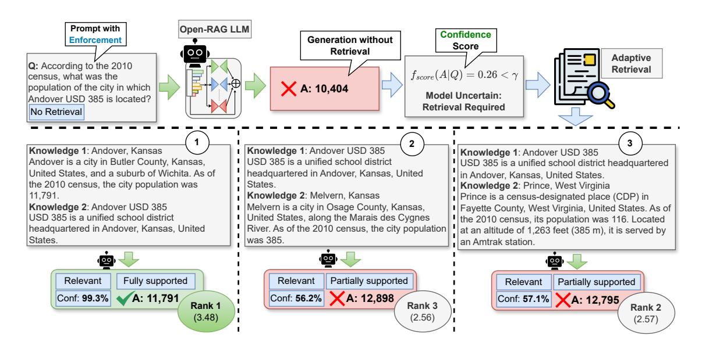
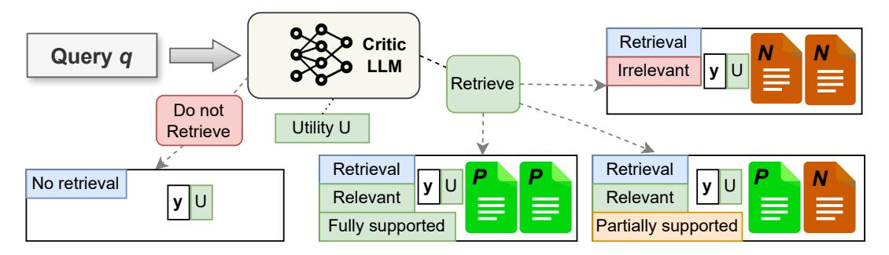
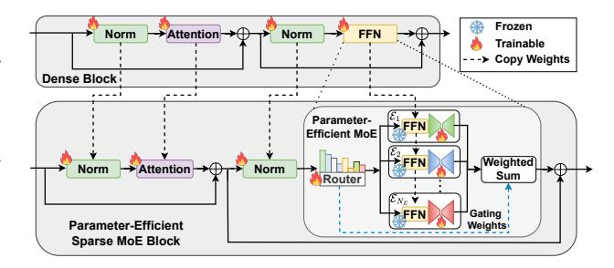
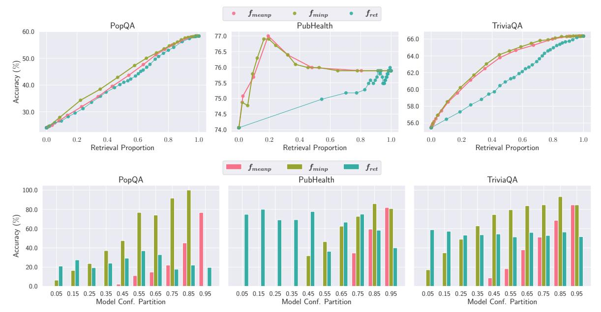
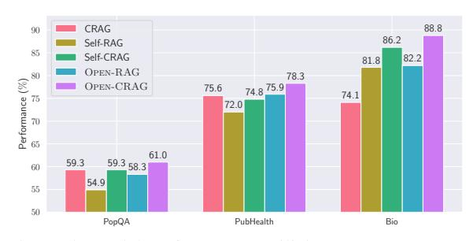
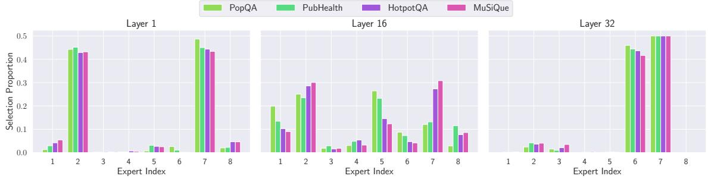
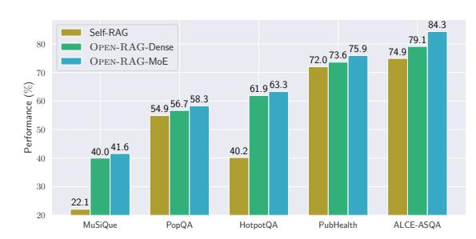

# <span id="page-0-0"></span>OPEN-RAG: Enhanced Retrieval-Augmented Reasoning with Open-Source Large Language Models

Shayekh Bin Islam[\\*](#page-0-0),1,6,<sup>7</sup> , Md Asib Rahman\*,<sup>1</sup> , K S M Tozammel Hossain<sup>2</sup> Enamul Hoque<sup>3</sup> , Shafiq Joty<sup>4</sup> , Md Rizwan Parvez<sup>5</sup>

1 Bangladesh University of Engineering and Technology, <sup>2</sup>University of North Texas <sup>3</sup>York University, Canada, <sup>4</sup> Salesforce Research, <sup>5</sup>Qatar Computing Research Institute (QCRI) 6 Fatima Al-Fihri Predoctoral Fellowship, <sup>7</sup> Cohere For AI Community shayekh.bin.islam@gmail.com, mparvez@hbku.edu.qa

# Abstract

Retrieval-Augmented Generation (RAG) has been shown to enhance the factual accuracy of Large Language Models (LLMs) , but existing methods often suffer from limited reasoning capabilities in effectively using the retrieved evidence, particularly when using open-source LLMs. To mitigate this gap, we introduce a novel framework, OPEN-RAG, designed to enhance reasoning capabilities in RAG with opensource LLMs. Our framework transforms an arbitrary dense LLM into a parameter-efficient sparse mixture of experts (MoE) model capable of handling complex reasoning tasks, including both single- and multi-hop queries. OPEN-RAG uniquely trains the model to navigate challenging distractors that appear relevant but are misleading. As a result, OPEN-RAG leverages latent learning, dynamically selecting relevant experts and integrating external knowledge effectively for more accurate and contextually relevant responses. In addition, we propose a hybrid adaptive retrieval method to determine retrieval necessity and balance the trade-off between performance gain and inference speed. Experimental results show that the Llama2-7Bbased OPEN-RAG outperforms state-of-the-art LLMs and RAG models such as ChatGPT, Self-RAG, and Command R+ in various knowledgeintensive tasks. We open-source our code and models at <https://openragmoe.github.io/>

# 1 Introduction

The rapid advancement of Large Language Models (LLMs) has significantly improved various NLP tasks [\(Beeching et al.,](#page-9-0) [2023\)](#page-9-0). However, these models often suffer from factual inaccuracies [\(Min](#page-10-0) [et al.,](#page-10-0) [2023a;](#page-10-0) [Mallen et al.,](#page-10-1) [2022\)](#page-10-1). Retrieval-Augmented Generation (RAG) has emerged as a promising approach to integrate LLMs with external knowledge, thereby improving generation accuracy [\(Asai et al.,](#page-9-1) [2023;](#page-9-1) [Lewis et al.,](#page-9-2) [2020\)](#page-9-2).

Despite this, existing RAG methods demonstrate limited reasoning capabilities, particularly when employing open-source LLMs and addressing highcomplexity queries such as multi-hop retrieval augmented tasks [\(Jeong et al.,](#page-9-3) [2024b;](#page-9-3) [Zhang et al.,](#page-11-0) [2024b\)](#page-11-0). Thus, building an effective RAG model using open-source LLMs remains an open challenge. To address this gap, we present OPEN-RAG, a novel framework aimed at improving reasoning capabilities in RAG with open-source LLMs.

Reasoning over retrieved documents is particularly difficult. In general, retrievers are imperfect and can return noisy passages [\(Shi et al.,](#page-10-2) [2023\)](#page-10-2). The generated outputs can also be inconsistent with retrieved passages [\(Gao et al.,](#page-9-4) [2023a\)](#page-9-4) or can even override the LLM's accurate parametric knowledge [\(Parvez,](#page-10-3) [2024\)](#page-10-3). Approaches like re-ranking or filtering retrieved documents [\(Xu et al.,](#page-11-1) [2023;](#page-11-1) [Nogueira](#page-10-4) [and Cho,](#page-10-4) [2020;](#page-10-4) [Wang et al.,](#page-10-5) [2018\)](#page-10-5) and active retrieval methods (i.e., retrieve only when needed) [\(Mallen et al.,](#page-10-6) [2023;](#page-10-6) [Jiang et al.,](#page-9-5) [2023a;](#page-9-5) [Trivedi](#page-10-7) [et al.,](#page-10-7) [2023a\)](#page-10-7) have shown promising success in tackling these, but they require substantial human annotations, can filter out useful information, often perform sequential and repetitive calls (hence slow), and can still suffer from distracting content, even in relevant passages [\(Wang et al.,](#page-11-2) [2023\)](#page-11-2).

To address and control these behaviors such as retrieval frequency of the RAG model and guide the generation to be contextually consistent, Self-RAG and its variants [\(Asai et al.,](#page-9-6) [2024;](#page-9-6) [Yan et al.,](#page-11-3) [2024;](#page-11-3) [Jeong et al.,](#page-9-7) [2024a\)](#page-9-7) adopt a self-reflectionbased method. During training, these models learn to generate both task output and intermittent special reflection or critic tokens (e.g., *is\_supported*, *is\_relevant*, etc.), leveraging knowledge distillation from proprietary models like GPT-4. At inference, these generated tokens determine the usability of each candidate output. While these methods enable the model to effectively rank candidate outputs from different retrievals and partially improve

<sup>\*</sup> Equal contribution.

<span id="page-1-0"></span>

Figure 1: Inference pipeline in our framework, OPEN-RAG. It learns to generate retrieval/no\_retrieval tokens, contrasts between relevant and irrelevant contexts, and categorizes answers as partially, fully, or not supported. Then at inference, given a (multi-hop) user query, we first enforce the model to generate an answer with conditional to no\_retrieval as input, and based on the model confidence we dynamically determine if retrieval is needed.

grounded generation, they struggle with navigating irrelevant or misleading information, especially when dealing with complex queries such as multihop retrieval tasks. This limitation arises since the models are not explicitly trained to contrast harder distractor passages and adhere to the facts from the retrievals.

To confront the challenge, our framework OPEN-RAG transforms an arbitrary dense LLM into a parameter-efficient (PEFT) sparse mixture of experts (MoE) model (Wu et al., 2024; Komatsuzaki et al., 2022) capable not only of self-reflection but also of handling complex reasoning tasks, including both single- and multi-hop queries. It uniquely trains the model to navigate challenging distractors that appear relevant but are misleading, while expanding the MoE only in the adapters, maintaining the model's scale. By combining constructive learning, architectural transformation, and reflection-based generation, OPEN-RAG leverages latent learning, dynamically selects relevant experts, and integrates external knowledge effectively for more accurate and contextually supported response generation and estimates of their usefulness.

State-of-the-art (SoTA) open-LLM-based RAG models use external models to determine if retrieval is needed; e.g., Asai et al. (2024) use GPT-4 distillation and Jeong et al. (2024b) use a fine-tuned FlanT5-XXL for Llama2. However, since LLMs possess different parametric knowledge, it may not be effective to rely on another LLM to fully determine the retrieval necessity. To deter-

mine retrieval on-demand and balance performance and speed, we propose a hybrid adaptive retrieval method with two threshold alternatives based on model confidence. We train our model to generate retrieval/no\_retrieval reflection tokens and measure the confidence of outputs conditioned on enforced no\_retrieval during inference. If retrieval is needed, following Asai et al. (2024), we process all retrieved passages in parallel and rank them using the weighted linear sum of reflection token probabilities. Differently from other multi-step active or adaptive retrieval methods (Jeong et al., 2024b; Jiang et al., 2023a; Trivedi et al., 2023a), this eliminates the need for iterative generations.

In experiments, we evaluate our framework on a wide range of single/multi-hop short/longform knowledge-intensive reasoning tasks, including PopQA, TriviaQA, PubQA, Bio, ALCE-ASOA, HotpotOA, MuSiQue, and 2WikiMulti-HopQA benchmarks. Results show that our OPEN-RAG significantly improves the overall factual accuracy and reasoning capabilities w.r.t the prior open-source RAG models, often matching or outperforming state-of-the-art proprietary LLMs and their RAG models. In multiple tasks, OPEN-RAG, based on Llama2-7B, sets new benchmarks, surpassing ChatGPT-RAG, Self-RAG, RAG 2.0, and 104B RAG-Command R+. Through detailed ablations, examples, and analysis, we provide further insights into the effectiveness of OPEN-RAG.

<span id="page-2-5"></span>

Figure 2: OPEN-RAG training data preparation involves generating four variations of new training instances from each original pair (q, y), each incorporating different *reflection* tokens using ground truth/LLM critic and retrieved passages. Our approach enables an LLM not only to reflect on generation quality but also to contrast distractors.

# 2 OPEN-RAG: Enhanced Retrieval-Augmented Reasoning

OPEN-RAG transforms an arbitrary dense LLM into a parameter-efficient sparse MoE model capable not only of self-reflection but also of handling complex reasoning tasks. Additionally, we devise an adaptive hybrid retrieval schema to balance the retrieval frequency and speed trade-off. Below we first present the overview of OPEN-RAG and then discuss the training, including dataset and fine-tuning, and hybrid adaptive inference.

#### <span id="page-2-4"></span>2.1 Overview

We define OPEN-RAG LLM as a model  $\mathcal{M}_G$  that, given an input query  $q^1$ , generates an output sequence of m tokens  $o = [o_1, o_2, ..., o_m]$ . To control model behavior and generate more context-supported responses, we adopt the reflection-based generation from Self-RAG (Asai et al., 2024) and augment output vocabularies with four types of special reflection tokens: Retrieval, Relevance, Grounding and Utility. During training, given q, the model learns to first generate the Retrieval tokens ([RT]/[NoRT]) that indicate whether retrieval is necessary to answer q. During inference, we employ a hybrid adaptive retrieval schema, leveraging both the Retrieval tokens and model confidence.

If no retrieval is needed,  $\mathcal{M}_G$  generates the response using only the parametric knowledge of the LLM (i.e., return o as  $y_{pred}$ ). If retrieval is needed, for both single- or multiple-hop from an external knowledge source  $D = \{d_i\}_{i=1}^{N_d}$ , we use a user-defined frozen retriever R to retrieve the top-k documents  $S = \{s_t\}_{t=1}^k$ , where each  $s_t$  consists of  $\{r_j\}_{j=1}^{N_H}$  with  $r_j \in D$  and  $N_H$  denotes

ing the hop size. For each retrieved content  $s_t$ ,  $\mathcal{M}_G$  generates a *Relevance* token, the output response  $y_t$ , a *Grounding* token, and a *Utility* token. The *Relevance* tokens ([Relevant/Irrelevant]) indicate if  $s_t$  is relevant to q, the *Grounding* tokens ([Fully Supported/Partially Supported/No Support]) indicate if  $y_t$  is supported by  $s_t$ , and the *Utility* tokens ([U:1]-[U:5]) define how useful  $y_t$  is to q. We process each  $s_t$  in parallel and generate the final answer  $y_{pred}$  by ranking them (i.e., all  $y_t$ ) based on the weighted sum of the normalized confidence of the corresponding predicted *Relevance*, *Grounding*, and *Utility* tokens (see Figure 1).

# 2.2 OPEN-RAG Training

Here, we discuss our training data collection (Sec 2.2.1) and parameter-efficient MoE fine-tuning (Sec 2.2.2).

### <span id="page-2-3"></span>2.2.1 Data Collection

To empower OPEN-RAG to tackle retrieval-free queries, as well as single- and multi-hop queries that require retrieval, we build our training data using various types of tasks and datasets. Given an input-output data pair (q, y) in an original dataset, we augment the data with reflection tokens (Sec. 2.1) leveraging ground truth annotation or critic LLM C to create supervised data. If the corresponding *Retrieval* token added by C is [RT], we further augment the data and create three different new instances accordingly as follows. First, we use R to retrieve the top-k documents S. For each retrieved document  $s_t$ , C evaluates whether  $s_t$  is relevant or not and returns the Relevance token. To address both single- and multi-hop queries, we equip our data pipeline with a hop-unified heuris-

<span id="page-2-1"></span><span id="page-2-0"></span><sup>&</sup>lt;sup>1</sup>With additional contexts if provided

<sup>&</sup>lt;sup>2</sup>For long-form generation, we also use the [Continue] token, which indicates that the model can continue to use information from the previous segment.

<span id="page-2-2"></span> $<sup>^{3}</sup>$ For long-form generation, we use the same segment-level beam search strategy as in Self-RAG (Asai et al., 2024) to obtain the Top-B segments, where B is the beam size, and return the best sequence at the end of generation.

tic: if at least one passage  $\{r_i\} \in s_t$  is relevant, we add the Relevance token as [Relevant]; otherwise, we use [Irrelevant]. When [Relevant] is predicted, to enable  $\mathcal{M}_G$  to contrast between useful and distractor contexts in  $s_t$  in a more finegrained way, we design a data-contrastive heuristic: (i) for single-hop RAG datasets, we use C directly to label the Grounding token; (ii) for multi-hop RAG datasets, if all passages  $\{r_i\} \in s_t$  are individually predicted as [RT], then we add [Fully Supported] as the Grounding token; otherwise, we use [Partially Supported]. Finally, regardless of the prediction of the *Relevance* token, we use C to provide a *Utility* score for y with respect to q. We depict an example of the training data collection for a 2-hop question in Figure 2.

# <span id="page-3-0"></span>2.2.2 Parameter-Efficient MoE Finetuning

RAG tasks are inherently complex, composed of various components such as queries with single (single-hop) or multiple (multi-hop) passages. The ability to leverage different parts of the model selectively based on such complexities can facilitate more adaptive and fine-grained reasoning capabilities over versatile input contexts. Therefore, instead of traditional dense models that treat all parts uniformly, we propose to transform  $\mathcal{M}_G$  into a MoE architecture on the fly, which learns to selectively activate the most suitable experts dynamically for each query with versatile complexity (e.g., single/multi-hop). This selective activation is learned (fine-tuned) using our tailored training data, ensuring that the model learns to differentiate between useful and misleading information.

As open-source models are often used in lowcompute settings, OPEN-RAG employs sparse upcycling (Komatsuzaki et al., 2022; Wu et al., 2024) to transform  $\mathcal{M}_G$  into a parameter-efficient sparse MoE. This approach adds only a few million adapter parameters, preserving the same order of active parameters as in the original LLM. The sparse MoE OPEN-RAG model augments the FFN layer of the dense backbone LLM with a parameterefficient MoE transformer block consisting of a set of expert layers  $\mathbf{E} = \{\mathcal{E}_e\}_{e=1}^{N_E}$  along with an efficient routing mechanism as in Figure 3. Each expert layer comprises a replicated original shared FFN layer weight, adapted by an adapter module  $\mathcal{A}_e$  with parameters  $\theta_e$ . To ensure parameter efficiency, in each expert, we keep the FFN layer frozen and train the adapter module  $A_e$  only. In this way, we are only required to store one FFN

<span id="page-3-1"></span>

Figure 3: Architechture transformation (dense to PEFT MoE) in OPEN-RAG. Router  $\mathcal{R}$  is trained from scratch. The FFN layer is kept frozen and adapted by parallel-adapter-based experts  $\mathbf{E}$ . Other layers are being copied.

replica keeping the model size unchanged except for the increase in the parameters in the adapter and the router modules. The rest of the layers, such as Norm and Attention, are copied from the dense model.

For a given input x, the router module  $\mathcal{R}$  activates Top-k experts out of  $N_E$  experts based on the normalized output  $x_{in}$  of the attention layer. Given  $W_{|\cdot|}$  denotes the weight of the corresponding expert module, we define the router module as follows:

$$\mathcal{R}(x_{in}) = \operatorname{Softmax}(\operatorname{Top-}k(W_{\mathcal{R}} \cdot x_{in}))$$
 (1)

We formulate the adapter  $A_e$  as:

$$\mathcal{A}_e(x) = \sigma(xW_e^{down})W_e^{up} + x. \tag{2}$$

The efficiency of OPEN-RAG model results from the setup that  $|\theta_e| = |W_e^{down}| + |W_e^{up}| \ll |\phi_o|$  where we keep  $\phi_o$  from the dense LLM frozen during fine-tuning. Finally, we express the output y of a parameter-efficient expert module as:

$$y = \sum_{e=1}^{N_E} \mathcal{R}(x)_e \mathcal{A}_e(\mathcal{E}_e(x)). \tag{3}$$

In our implementation, we use  $N_E=8$  and k=2 if not otherwise specified. In other words, only 2 of the 8 experts are active during training and inference. We train OPEN-RAG with QLoRA (Dettmers et al., 2023) adapters during fine-tuning which has a load-balancing objective along with the standard conditional language modeling objective. To mitigate the approximation error in the expert adapters, we use the adapters with a dimension of 512 by default.

# <span id="page-3-2"></span>2.3 Hybrid Approach for Adaptive Retrieval

Since LLMs possess different parametric knowledge, instead of using other LLMs, we propose a

hybrid adaptive retrieval method with two threshold alternatives based on model confidence to determine retrieval on-demand and balance performance speed. We take motivation from both control token-based (Asai et al., 2024; Lu et al., 2022) and confidence-based (Liu et al., 2023; Jiang et al., 2023a) inference methods.

During training,  $\mathcal{M}_G$  learns to generate Retrieval reflection tokens ([RT] and [NoRT]). At inference, we measure the confidence of the output sequence o conditioned on an enforced no retrieval setting by adding [NoRT] to the input, such that  $\hat{q} = q \oplus [NoRT]$ . We design two different confidence scores  $f_{|\cdot|}$ : (i)  $f_{minp}$ , the minimum value of the probabilities of the individual tokens, and (ii)  $f_{meanp}$ , the geometric mean of the probabilities of the individual tokens in the generated sequence.

$$f_{minp}(o|\hat{q}) = \min_{i=1}^{m} p(o_i|\hat{q}, o_{< i})$$
 (4)

$$f_{minp}(o|\hat{q}) = \min_{i=1}^{m} p(o_i|\hat{q}, o_{< i})$$
(4)  
$$f_{meanp}(o|\hat{q}) = \sqrt[m]{\prod_{i=1}^{m} p(o_i|\hat{q}, o_{< i})}$$
(5)

We control retrieval frequency with a tunable threshold  $\gamma$ , where retrieval occurs if  $f_{|\cdot|} < \gamma$ .

### **Experiments**

#### Tasks and Datasets 3.1

Single-hop short-form tasks include PopQA (Mallen et al., 2022), TriviaQA-unfiltered (Joshi et al., 2017), and PubHealth (Zhang et al., 2023). These datasets involve answering factual questions and verifying public health facts, using retrieved contexts provided by Self-RAG. We use the accuracy metric for evaluation.

Single-hop long-form generation tasks cover biography generation (Bio) (Min et al., 2023b) and the long-form QA benchmark ALCE-ASQA (Gao et al., 2023b; Stelmakh et al., 2022). Biographies are evaluated with FactScore (Min et al., 2023b), while ALCE-ASQA uses official metrics for correctness (str-em) and fluency based on MAUVE (Pillutla et al., 2021).

Multi-hop reasoning tasks include HotpotQA (distractor dev split) (Yang et al., 2018a), MuSique-Ans (Trivedi et al., 2022), and 2WikiMultihopQA (Ho et al., 2020) which require systems to answer complex multi-hop questions. We use official EM and F1 metrics for evaluation.

#### **Experimental settings**

Training Data and Settings. In our data curation process, as detailed in Section 2.2.1, we compile a diverse set of instruction-following inputoutput pairs encompassing retrieval-free, singlehop, and multi-hop datasets requiring retrieval. For no-retrieval and single-hop datasets, we utilize 150K instruction-output pairs curated by Self-RAG. For the multi-hop dataset, we randomly sample 16K two-hop instances from the HotpotQA (Yang et al., 2018b) Distractor train split, each with 10 passages annotated with the ground truth Relevance tokens. Using our data collection method from Section 2.2.1, we generate 28K new multihop training instances. All other reflection tokens are labeled by the Llama2<sub>7B</sub> (Touvron et al., 2023) critic LLM in Self-RAG, which is distilled from GPT-4. Additional information regarding training is provided in Appendix Section A. Following previous works and for a fair comparison, we use the Llama2<sub>7B</sub> (Touvron et al., 2023) as the base RAG model  $\mathcal{M}_G$ . OPEN-RAG is transformed into a MoE model with  $N_E = 8$  and k = 2, incorporating adapters with a dimension of 512, totaling an additional (8×135M) adapter model parameters. Moreover, we train a larger version of OPEN-RAG based on Llama $2_{13B}$  with additional (8×213M) parameters to demonstrate the scalability of our framework. By OPEN-RAG model, we indicate OPEN- $RAG_{7B+8\times135M}$  if not explicitly mentioned.

Inference Data and Settings. We assign the default weight of 1.0, 1.0, and 0.5 to Relevance, Grounding, and Utility tokens respectively. Following Self-RAG, we compare the model performances with always retrieval and vary the retrieval frequency as discussed in Sec 2.3 only to demonstrate optimum thresholding and performancespeed trade-offs. In multi-hop evaluations, from the corresponding retrieval candidate passages, we use Beam Retriever (Zhang et al., 2024a) to retrieve Top-3 multi-hop contexts, each with the mentioned  $N_H$  number of passages. For single-hop tasks, we use Self-RAG's setup (See Appendix B).

#### **Baselines**

Baselines without retrievals. We compare ours with several strong, publicly available pre-trained LLMs, including Llama2-7B,13B (Touvron et al., 2023), SAIL-7B (Luo et al., 2023) as well as instruction-tuned models, Alpaca-7B,13B (Dubois et al., 2023). Additionally, we consider models

<span id="page-5-0"></span>

|                             |                                     | Short-form |      |       | Long-form generations |           |      |      |        |      | Multi-hop generations |         |      |
|-----------------------------|-------------------------------------|------------|------|-------|-----------------------|-----------|------|------|--------|------|-----------------------|---------|------|
|                             | Pop                                 | TQA        | Pub  | Bio   |                       | ALCE-ASQA |      |      | Hotpot |      | MuSiQue               | 2WikiMH |      |
| LM                          | Acc                                 | Acc        | Acc  | FS    | SM                    | rg        | mau  | EM   | F1     | EM   | F1                    | EM      | F1   |
|                             | LMs with proprietary data/retriever |            |      |       |                       |           |      |      |        |      |                       |         |      |
| Perplexity.ai               | –                                   | –          | –    | 71.2  | –                     | –         | –    | –    | –      | –    | –                     | –       | –    |
| RAG 2.0                     | –                                   | –          | –    | –     | –                     | –         | –    | 54.0 | –      | –    | –                     | –       | –    |
| ChatGPT                     | 29.3                                | 74.3       | 70.1 | 71.8  | 35.3                  | 36.2      | 68.8 | 22.4 | 30.0   | 3.1  | 7.3                   | 18.7    | 21.7 |
| RAG-ChatGPT                 | 50.8                                | 65.7       | 54.7 | –     | 40.7                  | 39.9      | 79.7 | 55.3 | 69.9   | 31.2 | 43.5                  | 44.7    | 54.8 |
| RAG-Command R+∗<br>104B     | 59.9                                | 74.0       | 46.3 | 84.0  | –                     | –         | –    | 60.0 | 75.8   | 41.3 | 55.4                  | 57.1    | 66.1 |
| RQ-RAG†<br>7B (ToT)         | 57.1                                | –          | –    | –     | –                     | –         | –    | 62.6 | –      | 41.7 | –                     | 44.8    | –    |
| Baselines without retrieval |                                     |            |      |       |                       |           |      |      |        |      |                       |         |      |
| Llama27B                    | 14.7                                | 30.5       | 34.2 | 44.5  | 7.9                   | 15.3      | 19.0 | 3.8  | 9.3    | 2.0  | 3.3                   | 8.0     | 14.5 |
| Alpaca7B                    | 23.6                                | 54.5       | 49.8 | 45.8  | 18.8                  | 29.4      | 61.7 | 4.7  | 11.5   | 2.5  | 3.8                   | 15.3    | 20.0 |
| SAIL7B                      | 22.8                                | –          | –    | –     | –                     | –         | –    | –    | –      | –    | –                     | –       | –    |
| Llama213B                   | 14.7                                | 38.5       | 29.4 | 53.4  | 7.2                   | 12.4      | 16.0 | 14.9 | 21.6   | 1.3  | 5.4                   | 21.4    | 25.2 |
| Alpaca13B                   | 24.4                                | 61.3       | 55.5 | 50.2  | 22.9                  | 32.0      | 70.6 | 0.7  | 6.1    | 0.0  | 3.3                   | 3.1     | 12.0 |
| CoVE65B                     | –                                   | –          | –    | 71.2  | –                     | –         | –    | –    | –      | –    | –                     | –       | –    |
| Baselines with retrieval    |                                     |            |      |       |                       |           |      |      |        |      |                       |         |      |
| Llama27B                    | 38.2                                | 48.8       | 30.0 | 78.0  | 15.2                  | 22.1      | 32.0 | 5.9  | 19.4   | 3.4  | 10.5                  | 11.9    | 19.2 |
| Alpaca7B                    | 46.7                                | 64.1       | 40.2 | 76.6  | 30.9                  | 33.3      | 57.9 | 23.0 | 35.6   | 6.4  | 14.8                  | 18.2    | 23.8 |
| SAIL7B                      | 44.0                                | –          | 69.2 | –     | –                     | –         | –    | –    | –      | –    | –                     | –       | –    |
| Self-RAG7B                  | 54.9                                | 66.1       | 72.0 | 78.6  | 30.2                  | 35.7      | 74.9 | 40.2 | 54.3   | 22.1 | 33.2                  | 24.6    | 35.8 |
| Llama213B                   | 38.2                                | 42.5       | 30.0 | 78.0  | 15.2                  | 22.1      | 32.0 | 26.7 | 38.5   | 10.8 | 18.6                  | 20.2    | 27.4 |
| Alpaca13B                   | 46.1                                | 66.9       | 51.1 | 77.7  | 34.8                  | 36.7      | 56.6 | 12.3 | 27.3   | 2.6  | 10.7                  | 7.0     | 17.1 |
| Self-RAG13B                 | 56.0                                | 67.5       | 76.3 | 81.1  | 31.6                  | 35.9      | 69.7 | 44.2 | 58.2   | 22.2 | 40.0                  | 17.7    | 31.8 |
| LongChat13B                 | –                                   | –          | –    | –     | –                     | –         | –    | 25.0 | 40.6   | 7.9  | 18.9                  | 18.2    | 29.2 |
| OPEN-RAG‡<br>7B+8×135M      | 58.3                                | 66.3       | 75.9 | 82.2  | 31.9                  | 36.7      | 84.3 | 63.3 | 76.9   | 41.6 | 55.3                  | 51.5    | 61.0 |
| OPEN-RAG13B+8×213M          | 59.5                                | 69.6       | 77.2 | 81.7# | 36.3                  | 38.1      | 80.0 | 66.2 | 80.1   | 46.0 | 60.1                  | 60.7    | 70.9 |

Table 1: Model performances on RAG tasks. Pop, TQA, Pub, Bio, Hotpot, MuSiQue, 2WikiMH denote PopQA, TriviaQA, PubHealth, Biography Generations, HotpotQA, MuSiQue-Ans, 2WikiMultihopQA. Acc, FS, SM, rg, mau, EM, and F1 denote accuracy, FactScore (factuality), str-em, rouge (correctness), MAUVE (fluency), exact match, and F1 scores. # : evaluated using 'gpt-3.5-turbo-instruct' instead of 'text-davinci-003'. <sup>∗</sup> : using 4-bit quantized model. † : using a proprietary retriever with Tree-of-Thought prompting. ‡ : OPEN-RAG model with 7.8B total and 7.0B active parameters. Gray results are best performances with larger/proprietary models.

trained and reinforced with private data such as ChatGPT [\(Ouyang et al.,](#page-10-16) [2022\)](#page-10-16). For instructiontuned LMs, we utilize the official system prompt or instruction format of the corresponding model.

Baselines with retrievals. We evaluate models incorporating retrieval during both testing and training phases, focusing on standard Retrieval-Augmented Generation (RAG) baselines with open-source Large Language Models (LLMs) like Llama2, Alpaca and LongChat [\(Li et al.,](#page-9-14) [2023\)](#page-9-14). These models generate outputs based on queries alongside top retrieved documents using our retriever. We also present results for RAG baselines utilizing private data, including RAG-ChatGPT, RAG2.0 [\(Contextual.AI,](#page-9-15) [2024\)](#page-9-15), and RAG-Command R+ [\(Cohere Team,](#page-9-16) [2024\)](#page-9-16), which prepend top-retrieved documents to the query. Ad-

ditionally, we assess RQ-RAG [\(Chan et al.,](#page-9-17) [2024\)](#page-9-17), which employs proprietary retriever models. Finally, our comparisons extend to Perplexity.ai, Self-RAG [\(Asai et al.,](#page-9-6) [2024\)](#page-9-6), and SAIL [\(Luo et al.,](#page-10-15) [2023\)](#page-10-15), which are also finetuned with retrieved texts.

# 4 Results and Analysis

Here, we (i) evaluate the RAG models (ii) demonstrate the effectiveness of our adaptive retrieval in balancing the performance-speed (iii) present ablation studies and further analysis.

# 4.1 Main Results

Comparison against baselines without retrieval. Table [1](#page-5-0) (top and middle blocks) shows the performance of open-source baselines without retrieval. OPEN-RAG demonstrates substantial performance

<span id="page-6-0"></span>

Figure 4: (Top) Performance vs Retrieval by different adaptive retrieval strategies. (Bottom) Performance vs scores from adaptive retrieval.  $f_{ret}$  denotes probability score from external model distilled/predicted *reflection* token.

gains over all supervised fine-tuned LLMs, many of which are larger in size (e.g., 65B CoVE) and even our OPEN-RAG outperforms ChatGPT across all metrics and tasks. Particularly in multihop reasoning tasks such as HotpotQA, OPEN-RAG achieves a significant EM score of 63.3%, surpassing Alpaca<sub>13B</sub>'s 0.7%. In contrast, while ChatGPT achieves a decent score of 22.4% EM in HotpotQA, its performance drops notably in other multi-hop tasks like MuSiQue, where it achieves only 3.1% EM while OPEN-RAG achieves a much higher score of 41.6% EM in MuSiQue, highlighting its robustness and effectiveness in complex query handling compared to both open-source and proprietary LLMs.

### Comparison against baselines with retrieval.

As shown in Table 1 (bottom), OPEN-RAG consistently outperforms existing open-source RAG models, even those larger in size. It achieves the top performance among non-proprietary LM-based models across all tasks, with the exception of TriviaQA and PubQA, where it is marginally surpassed (by 1.2% and 0.4%, respectively) by the larger Self-RAG<sub>13B</sub> model, and by Alpaca<sub>13B</sub> in a single metric within the ALCE-ASQA dataset.

We observe that while baseline open-source RAG models achieve higher accuracy, even surpassing strong proprietary models like RAG-ChatGPT in single-hop reasoning tasks, their performance significantly lags in multi-hop reasoning tasks. Our contrastive learning of the distractor contexts substantially enhances the reasoning in OPEN-RAG and empowers it to outperform the propri-

etary RAG-ChatGPT in all complex multi-hop datasets

Moreover, OPEN-RAG surpasses RAG 2.0 and 104B Command R+, which are specifically built for RAG tasks, in HotpotQA (63.3% vs. 60.0% EM) and PubQA (75.9% vs. 46.3% Acc). In long-form generation, proprietary models often achieve higher scores, but ours remains highly competitive. For instance, RAG-Command R+ attains a FactScore (FS) of 84.0% in Bio, slightly outperforming OPEN-RAG's 82.2%. In addition, our OPEN-RAG<sub>13B+8×213M</sub> model outperforms all baselines in all multi-hop tasks; and all open baselines in all short-form tasks and shows competitive performance with the proprietary models. These results highlight the superior ability of OPEN-RAG to effectively integrate and utilize retrieved information, enhancing both reasoning accuracy and fluency across varying complexities and both short- and long-form generations.

#### <span id="page-6-1"></span>4.2 Performance-Speed by Adaptive Retrieval

As discussed in Sec 2.3, given the query, adaptive retrieval method provides a probability/confidence score from the model. By thresholding on that score, we can control the retrieval frequency and balance the performance-speed trade-off and this can also guide to determine when retrieval is needed. A better scoring method should achieve higher accuracy at any retrieval frequency. In order to demonstrate our hybrid adaptive retrieval scoring over the existing reflection token probability-based method  $f_{ret}$  in Self-RAG, in Figure 4, we plot

the downstream accuracy vs retrieval frequency (top), and accuracy vs confidence score (bottom) for PopOA, PubHealth, and TriviaOA datasets by sweeping across different threshold values  $\gamma$  (larger  $\gamma$  causes less retrieval) from 0 to 1. In Figure 4 (bottom), we notice that for  $f_{meanp}$  or  $f_{minp}$ , the accuracy increases with higher values of confidence while  $f_{meanp}$  is more robust, showing monotonically increasing accuracy with higher confidence scores consistently in all dataset. But in the case of  $f_{ret}$ , no such pattern exists. Overall (top) as these benchmarks are knowledge-intensive, they typically perform better with retrieved contexts and our adaptive scoring shows a better determination of when to retrieve and when not – resulting in higher accuracy at any retrieval frequency. In fact, the advantage is more amplified in PubHealth where we can find a clear threshold confidence score which if achieved, retrieval data are found to be less effective than the parametric knowledge. This gives us a peak accuracy of 1% more than always retrieval, which can not be determined by Self-RAG.

#### 4.3 Ablation Studies

<span id="page-7-0"></span>

Figure 5: Model performances utilizing CRAG contexts

Robustness to Different Retrieval (CRAG) Methods. CRAG (Yan et al., 2024) proposes a corrective RAG method where, if corpus (e.g., Wikipedia) retrievals are detected as low-quality, a web search is performed to obtain new retrievals. These new retrievals are then fed into the system. The Self-CRAG method combines both reflection-based models and CRAG-based datasets (Self-RAG + CRAG dataset). We evaluate OPEN-RAG and OPEN-CRAG (OPEN-RAG + CRAG datasets) on the benchmarks (PopQA, PubHealth, and Bio) using CRAG, Self-RAG (Asai et al., 2024), and Self-CRAG as baselines, as illustrated in Figure 5. OPEN-CRAG outperforms all baselines across all tasks. Specifically, OPEN-RAG achieves 2%, 4% higher accuracy than Self-CRAG in (Bio, PopQA) and PubHealth respectively. This demonstrates OPEN-RAG's robustness to retrieval quality and

<span id="page-7-1"></span>

| $N_E$ | k | Epochs | PopQA | PubHealth | MuSiQue |      |  |
|-------|---|--------|-------|-----------|---------|------|--|
|       |   |        | Acc   | Acc       | EM      | F1   |  |
| 8     | 2 | 1      | 59.8  | 74.6      | 39.6    | 54.4 |  |
| 16    | 2 | 1      | 59.2  | 74.6      | 40.5    | 54.4 |  |
| 16    | 4 | 1      | 59.0  | 72.4      | 40.5    | 54.5 |  |
| 8     | 2 |        | 58.3  | 75.9      | 41.6    | 55.3 |  |

Table 2: Ablation study model performances

its potential for improvement with high-quality contexts.

Routing Analysis of OPEN-RAG. We perform routing analysis for PopQA, PubHealth, HotpotQA, and 2WikiMultihopQA tasks to demonstrate Top-2 expert activation in different layers during retrievalfree generation by OPEN-RAG as illustrated in Figure 6. We observe, that  $\mathcal{E}_7$  is a general expert that is highly activated in the first (Layer 1), middle (Layer 16), and final (Layer 32) layers for all datasets. Whereas  $\mathcal{E}_2$  is activated in the first layer while  $\mathcal{E}_6$  is activated mostly in the final layer. In the middle layer, we also observe a higher activation of  $\mathcal{E}_5$  and a lower activation of  $\mathcal{E}_7$  in the PopQA and PubHealth datasets (single-hop), but the opposite in the case of multi-hop datasets – showing that the experts implicitly learn to identify query complexity and play important roles across layers for different kinds of task complexities.

Sparse Upcycling Hyperparameters. We experiment with different hyper-parameters of OPEN-RAG as shown in Table 2. We observe that increasing the number of experts  $N_E$  slightly improves the performance in MuSiQue, and performance improvement in training longer (epoch 1 vs 2). Increasing the number of active experts k from 2 to 4 causes performance degradation showing the necessity of less active experts.

Impact of Modules. It is important to understand how much gain is coming from our contrastive learning and how much from the architectural transformation. In Figure 7 with reference to Self-RAG, we plot OPEN-RAG performances with both dense and MoE architecture. OPEN-RAG-Dense outperforms Self-RAG-7B by 1.8% in PopQA, 1.6% in PubHealth, 4.2% in ASQA (MAUVE), 17.9% in MuSiQue (EM) and 21.7% in HotpotQA (EM). Moreover, OPEN-RAG-MoE improves over OPEN-RAG-Dense by 1.6% in PopQA, 2.2% in PubHealth, 5.2% in ASQA (MAUVE), 1.6% in MuSiQue (EM) and 1.4% in HotpotQA (EM) – both components enhances the model significantly while contrastive learning as highest.

<span id="page-8-0"></span>

Figure 6: Layer-wise expert activation on single-hop (PopQA, PubHealth) vs multi-hop tasks (HotpotQA, MuSiQue).

<span id="page-8-1"></span>

Figure 7: Performances (MAUVE for ALCE-ASQA; EM for HotpotQA and MuSiQue-Ans; and accuracy for PopQA and PubHealth ) with different architecture.

# 5 Related work

Complex factual reasoning requires contextualizing information from multiple documents (Trivedi et al., 2022; Yang et al., 2018b). Prior works (Khattab et al., 2022; Press et al., 2023; Pereira et al., 2023; Khot et al., 2023) proposed decomposing multi-hop queries into single-hop queries, then repeatedly using LLMs and Retrievers. In addition, Jiang et al. (2023b) retrieved new documents if the tokens within generated sentences have low confidence. However, the performance improvement of these approaches often comes at the cost of resource-intensive techniques such as interleave Chain-of-Thought (Yao et al., 2023; Trivedi et al., 2023b; Zhang et al., 2024b) or Tree-of-Thought (Chan et al., 2024) reasoning with document retrieval; and requiring external models (Jeong et al., 2024b). In this work, we train a single MoE model capable of answering complex questions in one iteration with a minimal increase in model complexity.

#### 6 Conclusion

To enhance reasoning capabilities in RAG models with open-source LLMs, we develop OPEN-RAG featuring a PEFT MoE architecture, contrastive learning, and adaptive retrieval. OPEN-RAG shows significant performance improvements in complex reasoning tasks, outperforming SoTA methods. However, there is still a gap in tasks

like long-form generation compared to proprietary models, which we aim to address in future.

### 7 Limitations

OPEN-RAG has a higher memory footprint due to an increase in total parameters (7.81B) in comparison to Llama2<sub>7B</sub> family baselines (6.74B). But our OPEN-RAG outperforms open LLMs with total parameters ranging from 7B to 65B, rivaling proprietary models such as ChatGPT, Perplexity.ai, and Command R+ in various downstream tasks. Thus, OPEN-RAG eventually reduces the compute and memory cost with 7.01B active parameters during inference in comparison to its performance. Additionally, as our framework is general, future direction can be building stronger sparse-upcycled LLMs based on recent models such as Llama3<sub>8B</sub> and Mistral<sub>7B</sub> utilizing OPEN-RAG multi-hop training dataset. Although our approach is theoretically applicable to any domain, future work can explore developing highperformance domain-specific RAG based on our OPEN-RAG.

# Acknowledgement

We thank anonymous reviewers for their valuable feedback on the paper. We also thank Mohamed El Banani and Amr Keleg for fruitful discussions. We are grateful to Qatar Computing Research Institute for providing compute and OpenAI APIs. Shayekh Bin Islam is supported by the Fatima Al-Fihri Predoctoral Fellowship sponsored by Hugging Face. This work was supported in part by National Science Foundation (NSF) awards CNS-1730158, ACI-1540112, ACI-1541349, OAC-1826967, OAC-2112167, CNS-2100237, CNS-2120019, the University of California Office of the President, and the University of California San Diego's California Institute for Telecommunications and Information Technology/Qualcomm Institute. Thanks to CENIC for the 100Gbps networks.

# References

- <span id="page-9-1"></span>Akari Asai, Sewon Min, Zexuan Zhong, and Danqi Chen. 2023. [Retrieval-based language models and](https://doi.org/10.18653/v1/2023.acl-tutorials.6) [applications.](https://doi.org/10.18653/v1/2023.acl-tutorials.6) In *Proceedings of the 61st Annual Meeting of the Association for Computational Linguistics (Volume 6: Tutorial Abstracts)*, pages 41–46, Toronto, Canada. Association for Computational Linguistics.
- <span id="page-9-6"></span>Akari Asai, Zeqiu Wu, Yizhong Wang, Avirup Sil, and Hannaneh Hajishirzi. 2024. [Self-RAG: Learning to](https://openreview.net/forum?id=hSyW5go0v8) [retrieve, generate, and critique through self-reflection.](https://openreview.net/forum?id=hSyW5go0v8) In *The Twelfth International Conference on Learning Representations*.
- <span id="page-9-0"></span>Edward Beeching, Clémentine Fourrier, Nathan Habib, Sheon Han, Nathan Lambert, Nazneen Rajani, Omar Sanseviero, Lewis Tunstall, and Thomas Wolf. 2023. Open LLM leaderboard. [https://huggingface.co/spaces/](https://huggingface.co/spaces/HuggingFaceH4/open_llm_leaderboard) [HuggingFaceH4/open\\_llm\\_leaderboard](https://huggingface.co/spaces/HuggingFaceH4/open_llm_leaderboard).
- <span id="page-9-17"></span>Chi-Min Chan, Chunpu Xu, Ruibin Yuan, Hongyin Luo, Wei Xue, Yike Guo, and Jie Fu. 2024. RQ-RAG: Learning to refine queries for retrieval augmented generation. *arXiv preprint arXiv:2404.00610*.
- <span id="page-9-16"></span>x Cohere Team. 2024. Introducing Command R+: A Scalable LLM Built for Business — cohere.com. [https://cohere.com/blog/](https://cohere.com/blog/command-r-plus-microsoft-azure) [command-r-plus-microsoft-azure](https://cohere.com/blog/command-r-plus-microsoft-azure). [Accessed 14-06-2024].
- <span id="page-9-15"></span>Contextual.AI. 2024. Introducing RAG 2.0 - Contextual AI — contextual.ai. [https://contextual.ai/](https://contextual.ai/introducing-rag2/) [introducing-rag2/](https://contextual.ai/introducing-rag2/). [Accessed 14-06-2024].
- <span id="page-9-9"></span>Tim Dettmers, Artidoro Pagnoni, Ari Holtzman, and Luke Zettlemoyer. 2023. Qlora: Efficient finetuning of quantized llms. *arxiv*.
- <span id="page-9-13"></span>Yann Dubois, Xuechen Li, Rohan Taori, Tianyi Zhang, Ishaan Gulrajani, Jimmy Ba, Carlos Guestrin, Percy Liang, and Tatsunori B. Hashimoto. 2023. [Al](https://arxiv.org/abs/2305.14387)[pacaFarm: A simulation framework for methods](https://arxiv.org/abs/2305.14387) [that learn from human feedback.](https://arxiv.org/abs/2305.14387) *arXiv preprint arXiv:2305.14387*.
- <span id="page-9-4"></span>Tianyu Gao, Howard Yen, Jiatong Yu, and Danqi Chen. 2023a. [Enabling large language models to generate](https://doi.org/10.18653/v1/2023.emnlp-main.398) [text with citations.](https://doi.org/10.18653/v1/2023.emnlp-main.398) In *Proceedings of the 2023 Conference on Empirical Methods in Natural Language Processing*, pages 6465–6488, Singapore. Association for Computational Linguistics.
- <span id="page-9-11"></span>Tianyu Gao, Howard Yen, Jiatong Yu, and Danqi Chen. 2023b. [Enabling large language models to generate](https://arxiv.org/abs/2305.14627) [text with citations.](https://arxiv.org/abs/2305.14627) *arXiv preprint arXiv:2305.14627*.
- <span id="page-9-12"></span>Xanh Ho, Anh-Khoa Duong Nguyen, Saku Sugawara, and Akiko Aizawa. 2020. [Constructing A multi-hop](https://arxiv.org/abs/2011.01060) [QA dataset for comprehensive evaluation of reason](https://arxiv.org/abs/2011.01060)[ing steps.](https://arxiv.org/abs/2011.01060) *CoRR*, abs/2011.01060.
- <span id="page-9-7"></span>Minbyul Jeong, Jiwoong Sohn, Mujeen Sung, and Jaewoo Kang. 2024a. Improving medical reasoning

- through retrieval and self-reflection with retrievalaugmented large language models. *arXiv preprint arXiv:2401.15269*.
- <span id="page-9-3"></span>Soyeong Jeong, Jinheon Baek, Sukmin Cho, Sung Ju Hwang, and Jong C Park. 2024b. Adaptive-rag: Learning to adapt retrieval-augmented large language models through question complexity. *arXiv preprint arXiv:2403.14403*.
- <span id="page-9-5"></span>Zhengbao Jiang, Frank F. Xu, Luyu Gao, Zhiqing Sun, Qian Liu, Jane Dwivedi-Yu, Yiming Yang, Jamie Callan, and Graham Neubig. 2023a. [Ac](https://arxiv.org/pdf/2305.06983)[tive retrieval augmented generation.](https://arxiv.org/pdf/2305.06983) *arXiv preprint arXiv:2305.06983*.
- <span id="page-9-20"></span>Zhengbao Jiang, Frank F. Xu, Luyu Gao, Zhiqing Sun, Qian Liu, Jane Dwivedi-Yu, Yiming Yang, Jamie Callan, and Graham Neubig. 2023b. [Active retrieval](https://doi.org/10.48550/ARXIV.2305.06983) [augmented generation.](https://doi.org/10.48550/ARXIV.2305.06983) In *EMNLP 2023*.
- <span id="page-9-10"></span>Mandar Joshi, Eunsol Choi, Daniel Weld, and Luke Zettlemoyer. 2017. [TriviaQA: A large scale distantly](https://aclanthology.org/P17-1147) [supervised challenge dataset for reading comprehen](https://aclanthology.org/P17-1147)[sion.](https://aclanthology.org/P17-1147) In *Proceedings of the 55th Annual Meeting of the Association for Computational Linguistics (Volume 1: Long Papers)*.
- <span id="page-9-18"></span>Omar Khattab, Keshav Santhanam, Xiang Lisa Li, David Hall, Percy Liang, Christopher Potts, and Matei Zaharia. 2022. [Demonstrate-Search-](https://doi.org/10.48550/ARXIV.2212.14024)[Predict: Composing retrieval and language mod](https://doi.org/10.48550/ARXIV.2212.14024)[els for knowledge-intensive NLP.](https://doi.org/10.48550/ARXIV.2212.14024) *arXiv preprint arXiv.2212.14024*, abs/2212.14024.
- <span id="page-9-19"></span>Tushar Khot, Harsh Trivedi, Matthew Finlayson, Yao Fu, Kyle Richardson, Peter Clark, and Ashish Sabharwal. 2023. [Decomposed Prompting: A modular](https://openreview.net/pdf?id=_nGgzQjzaRy) [approach for solving complex tasks.](https://openreview.net/pdf?id=_nGgzQjzaRy) In *The Eleventh International Conference on Learning Representations, ICLR 2023, Kigali, Rwanda, May 1-5, 2023*. OpenReview.net.
- <span id="page-9-8"></span>Aran Komatsuzaki, Joan Puigcerver, James Lee-Thorp, Carlos Riquelme Ruiz, Basil Mustafa, Joshua Ainslie, Yi Tay, Mostafa Dehghani, and Neil Houlsby. 2022. Sparse upcycling: Training mixture-ofexperts from dense checkpoints. *arXiv preprint arXiv:2212.05055*.
- <span id="page-9-2"></span>Patrick Lewis, Ethan Perez, Aleksandra Piktus, Fabio Petroni, Vladimir Karpukhin, Naman Goyal, Heinrich Küttler, Mike Lewis, Wen-tau Yih, Tim Rocktäschel, Sebastian Riedel, and Douwe Kiela. 2020. [Retrieval-Augmented Generation for knowledge](https://proceedings.neurips.cc/paper_files/paper/2020/file/6b493230205f780e1bc26945df7481e5-Paper.pdf)[intensive NLP tasks.](https://proceedings.neurips.cc/paper_files/paper/2020/file/6b493230205f780e1bc26945df7481e5-Paper.pdf) In *Advances in Neural Information Processing Systems*, volume 33, pages 9459– 9474.
- <span id="page-9-14"></span>Dacheng Li, Rulin Shao, Anze Xie, Ying Sheng, Lianmin Zheng, Joseph Gonzalez, Ion Stoica, Xuezhe Ma, and Hao Zhang. 2023. How long can context length of open-source LLMs truly promise? In *NeurIPS 2023 Workshop on Instruction Tuning and Instruction Following*.

- <span id="page-10-9"></span>Xin Liu, Muhammad Khalifa, and Lu Wang. 2023. Litcab: Lightweight calibration of language models on outputs of varied lengths. *arXiv preprint arXiv:2310.19208*.
- <span id="page-10-8"></span>Ximing Lu, Sean Welleck, Jack Hessel, Liwei Jiang, Lianhui Qin, Peter West, Prithviraj Ammanabrolu, and Yejin Choi. 2022. [QUARK: Controllable text](https://openreview.net/forum?id=5HaIds3ux5O) [generation with reinforced unlearning.](https://openreview.net/forum?id=5HaIds3ux5O) In *Advances in Neural Information Processing Systems*.
- <span id="page-10-15"></span>Hongyin Luo, Yung-Sung Chuang, Yuan Gong, Tianhua Zhang, Yoon Kim, Xixin Wu, Danny Fox, Helen Meng, and James Glass. 2023. [SAIL: Search](https://arxiv.org/abs/2305.15225)[augmented instruction learning.](https://arxiv.org/abs/2305.15225) *arXiv preprint arXiv:2305.15225*.
- <span id="page-10-1"></span>Alex Mallen, Akari Asai, Victor Zhong, Rajarshi Das, Daniel Khashabi, and Hannaneh Hajishirzi. 2022. When not to trust language models: Investigating effectiveness of parametric and non-parametric memories. *arXiv preprint arXiv:2212.10511*.
- <span id="page-10-6"></span>Alex Mallen, Akari Asai, Victor Zhong, Rajarshi Das, Daniel Khashabi, and Hannaneh Hajishirzi. 2023. [When not to trust language models: Investigating](https://arxiv.org/pdf/2212.10511) [effectiveness of parametric and non-parametric mem](https://arxiv.org/pdf/2212.10511)[ories.](https://arxiv.org/pdf/2212.10511) *arXiv preprint arXiv:2212.10511*.
- <span id="page-10-0"></span>Sewon Min, Kalpesh Krishna, Xinxi Lyu, Mike Lewis, Wen-tau Yih, Pang Koh, Mohit Iyyer, Luke Zettlemoyer, and Hannaneh Hajishirzi. 2023a. [FActScore:](https://doi.org/10.18653/v1/2023.emnlp-main.741) [Fine-grained atomic evaluation of factual precision](https://doi.org/10.18653/v1/2023.emnlp-main.741) [in long form text generation.](https://doi.org/10.18653/v1/2023.emnlp-main.741) In *Proceedings of the 2023 Conference on Empirical Methods in Natural Language Processing*, pages 12076–12100, Singapore. Association for Computational Linguistics.
- <span id="page-10-10"></span>Sewon Min, Kalpesh Krishna, Xinxi Lyu, Mike Lewis, Wen-tau Yih, Pang Wei Koh, Mohit Iyyer, Luke Zettlemoyer, and Hannaneh Hajishirzi. 2023b. [FActScore: Fine-grained atomic evaluation of factual](https://arxiv.org/abs/2305.14251) [precision in long form text generation.](https://arxiv.org/abs/2305.14251) *arXiv preprint arXiv:2305.14251*.
- <span id="page-10-4"></span>Rodrigo Nogueira and Kyunghyun Cho. 2020. [Pas](https://arxiv.org/pdf/1901.04085)[sage re-ranking with BERT.](https://arxiv.org/pdf/1901.04085) *arXiv preprint arXiv:1901.04085*.
- <span id="page-10-16"></span>Long Ouyang, Jeffrey Wu, Xu Jiang, Diogo Almeida, Carroll Wainwright, Pamela Mishkin, Chong Zhang, Sandhini Agarwal, Katarina Slama, Alex Gray, John Schulman, Jacob Hilton, Fraser Kelton, Luke Miller, Maddie Simens, Amanda Askell, Peter Welinder, Paul Christiano, Jan Leike, and Ryan Lowe. 2022. [Training language models to follow instructions with](https://openreview.net/forum?id=TG8KACxEON) [human feedback.](https://openreview.net/forum?id=TG8KACxEON) In *Advances in Neural Information Processing Systems*.
- <span id="page-10-3"></span>Md Rizwan Parvez. 2024. Evidence to generate (e2g): A single-agent two-step prompting for context grounded and retrieval augmented reasoning. *arXiv preprint arXiv:2401.05787*.
- <span id="page-10-18"></span>Jayr Alencar Pereira, Robson do Nascimento Fidalgo, Roberto de Alencar Lotufo, and Rodrigo Frassetto

- Nogueira. 2023. [Visconde: Multi-document QA with](https://doi.org/10.1007/978-3-031-28238-6_44) [GPT-3 and neural reranking.](https://doi.org/10.1007/978-3-031-28238-6_44) In *Advances in Information Retrieval - 45th European Conference on Information Retrieval, ECIR 2023, Dublin, Ireland, April 2-6, 2023, Proceedings, Part II*, volume 13981 of *Lecture Notes in Computer Science*, pages 534–543. Springer.
- <span id="page-10-12"></span>Krishna Pillutla, Swabha Swayamdipta, Rowan Zellers, John Thickstun, Sean Welleck, Yejin Choi, and Zaid Harchaoui. 2021. [MAUVE: Measuring the gap be](https://openreview.net/forum?id=Tqx7nJp7PR)[tween neural text and human text using divergence](https://openreview.net/forum?id=Tqx7nJp7PR) [frontiers.](https://openreview.net/forum?id=Tqx7nJp7PR) In *Advances in Neural Information Processing Systems*.
- <span id="page-10-17"></span>Ofir Press, Muru Zhang, Sewon Min, Ludwig Schmidt, Noah A. Smith, and Mike Lewis. 2023. [Measuring](https://doi.org/10.48550/ARXIV.2210.03350) [and narrowing the compositionality gap in language](https://doi.org/10.48550/ARXIV.2210.03350) [models.](https://doi.org/10.48550/ARXIV.2210.03350) In *Findings of the Association for Computational Linguistics: EMNLP 2023*.
- <span id="page-10-2"></span>Freda Shi, Xinyun Chen, Kanishka Misra, Nathan Scales, David Dohan, Ed H Chi, Nathanael Schärli, and Denny Zhou. 2023. Large language models can be easily distracted by irrelevant context. In *International Conference on Machine Learning*, pages 31210–31227. PMLR.
- <span id="page-10-11"></span>Ivan Stelmakh, Yi Luan, Bhuwan Dhingra, and Ming-Wei Chang. 2022. [ASQA: Factoid questions meet](https://aclanthology.org/2022.emnlp-main.566) [long-form answers.](https://aclanthology.org/2022.emnlp-main.566) In *Proceedings of the 2022 Conference on Empirical Methods in Natural Language Processing*.
- <span id="page-10-14"></span>Hugo Touvron, Louis Martin, Kevin Stone, Peter Albert, Amjad Almahairi, Yasmine Babaei, Nikolay Bashlykov, Soumya Batra, Prajjwal Bhargava, Shruti Bhosale, et al. 2023. [Llama 2: Open founda](https://arxiv.org/pdf/2307.09288)[tion and fine-tuned chat models.](https://arxiv.org/pdf/2307.09288) *arXiv preprint arXiv:2307.09288*.
- <span id="page-10-13"></span>Harsh Trivedi, Niranjan Balasubramanian, Tushar Khot, and Ashish Sabharwal. 2022. [MuSiQue: Multi](https://doi.org/10.1162/tacl_a_00475)[hop questions via single-hop question composition.](https://doi.org/10.1162/tacl_a_00475) *Transactions of the Association for Computational Linguistics*, 10:539–554.
- <span id="page-10-7"></span>Harsh Trivedi, Niranjan Balasubramanian, Tushar Khot, and Ashish Sabharwal. 2023a. Interleaving retrieval with chain-of-thought reasoning for knowledgeintensive multi-step questions. In *Association for Computational Linguistics*.
- <span id="page-10-19"></span>Harsh Trivedi, Niranjan Balasubramanian, Tushar Khot, and Ashish Sabharwal. 2023b. [Interleaving Retrieval](https://doi.org/10.18653/V1/2023.ACL-LONG.557) [with Chain-of-Thought Reasoning for Knowledge-](https://doi.org/10.18653/V1/2023.ACL-LONG.557)[Intensive Multi-Step Questions.](https://doi.org/10.18653/V1/2023.ACL-LONG.557) In *Proceedings of the 61st Annual Meeting of the Association for Computational Linguistics (Volume 1: Long Papers), ACL 2023, Toronto, Canada, July 9-14, 2023*, pages 10014–10037. Association for Computational Linguistics.
- <span id="page-10-5"></span>Shuohang Wang, Mo Yu, Xiaoxiao Guo, Zhiguo Wang, Tim Klinger, Wei Zhang, Shiyu Chang, Gerry Tesauro, Bowen Zhou, and Jing Jiang. 2018. [R3:](https://dl.acm.org/doi/10.5555/3504035.3504769)

- [Reinforced ranker-reader for open-domain question](https://dl.acm.org/doi/10.5555/3504035.3504769) [answering.](https://dl.acm.org/doi/10.5555/3504035.3504769) In *Proceedings of the AAAI Conference on Artificial Intelligence*, volume 32.
- <span id="page-11-2"></span>Zhiruo Wang, Jun Araki, Zhengbao Jiang, Md Rizwan Parvez, and Graham Neubig. 2023. Learning to filter context for retrieval-augmented generation. *arXiv preprint arXiv:2311.08377*.
- <span id="page-11-4"></span>Haoyuan Wu, Haisheng Zheng, and Bei Yu. 2024. Parameter-Efficient Sparsity Crafting from Dense to Mixture-of-Experts for Instruction Tuning on General Tasks. *arXiv preprint arXiv:2401.02731*.
- <span id="page-11-1"></span>Fangyuan Xu, Weijia Shi, and Eunsol Choi. 2023. [RE-](https://arxiv.org/abs/2310.04408)[COMP: Improving retrieval-augmented lms with](https://arxiv.org/abs/2310.04408) [compression and selective augmentation.](https://arxiv.org/abs/2310.04408) *Preprint*, arXiv:2310.04408.
- <span id="page-11-3"></span>Shi-Qi Yan, Jia-Chen Gu, Yun Zhu, and Zhen-Hua Ling. 2024. Corrective Retrieval Augmented Generation. *arXiv preprint arXiv:2401.15884*.
- <span id="page-11-6"></span>Zhilin Yang, Peng Qi, Saizheng Zhang, Yoshua Bengio, William Cohen, Ruslan Salakhutdinov, and Christopher D. Manning. 2018a. [HotpotQA: A dataset for](https://doi.org/10.18653/v1/D18-1259) [diverse, explainable multi-hop question answering.](https://doi.org/10.18653/v1/D18-1259) In *Proceedings of the 2018 Conference on Empirical Methods in Natural Language Processing*, pages 2369–2380, Brussels, Belgium. Association for Computational Linguistics.
- <span id="page-11-7"></span>Zhilin Yang, Peng Qi, Saizheng Zhang, Yoshua Bengio, William Cohen, Ruslan Salakhutdinov, and Christopher D. Manning. 2018b. [HotpotQA: A dataset for](https://doi.org/10.18653/v1/D18-1259) [diverse, explainable multi-hop question answering.](https://doi.org/10.18653/v1/D18-1259) In *Proceedings of the 2018 Conference on Empirical Methods in Natural Language Processing*, pages 2369–2380, Brussels, Belgium. Association for Computational Linguistics.
- <span id="page-11-9"></span>Shunyu Yao, Jeffrey Zhao, Dian Yu, Nan Du, Izhak Shafran, Karthik R. Narasimhan, and Yuan Cao. 2023. [ReAct: Synergizing reasoning and acting in language](https://openreview.net/pdf?id=WE_vluYUL-X) [models.](https://openreview.net/pdf?id=WE_vluYUL-X) In *The Eleventh International Conference on Learning Representations, ICLR 2023, Kigali, Rwanda, May 1-5, 2023*. OpenReview.net.
- <span id="page-11-8"></span>Jiahao Zhang, Haiyang Zhang, Dongmei Zhang, Yong Liu, and Shen Huang. 2024a. [End-to-End Beam Re](https://arxiv.org/abs/2308.08973)[trieval for Multi-Hop Question Answering.](https://arxiv.org/abs/2308.08973) In *2024 Annual Conference of the North American Chapter of the Association for Computational Linguistics*.
- <span id="page-11-5"></span>Tianhua Zhang, Hongyin Luo, Yung-Sung Chuang, Wei Fang, Luc Gaitskell, Thomas Hartvigsen, Xixin Wu, Danny Fox, Helen Meng, and James Glass. 2023. [In](https://arxiv.org/abs/2304.03728)[terpretable unified language checking.](https://arxiv.org/abs/2304.03728) *arXiv preprint arXiv:2304.03728*.
- <span id="page-11-0"></span>Tianjun Zhang, Shishir G Patil, Naman Jain, Sheng Shen, Matei Zaharia, Ion Stoica, and Joseph E Gonzalez. 2024b. Raft: Adapting language model to domain specific rag. *arXiv preprint arXiv:2403.10131*.

# <span id="page-12-0"></span>**A** Training Details

We train both MoE and Dense models with LoRA rank 64, LoRA  $\alpha$  16, and LoRA dropout 0.1. We optimize the models with the AdamW optimizer with a linear learning rate scheduler and a weight decay of 0.0. Both models have a context length of 4096 for facilitating long-context multi-hop QAs. Other training hyper-parameters are mentioned in Table 3.

<span id="page-12-2"></span>

| LM                  | LR                                                                                       | Epoch | Quantization | Adapter Dim |
|---------------------|------------------------------------------------------------------------------------------|-------|--------------|-------------|
| Dense <sub>7B</sub> | $\begin{vmatrix} 1 \times 10^{-4} \\ 2 \times 10^{-4} \\ 1 \times 10^{-4} \end{vmatrix}$ | 3     | None         | _           |
| $MoE_{7B}$          | $2 \times 10^{-4}$                                                                       | 2     | QLoRA (NF4)  | 512         |
| $MoE_{13B}$         | $1 \times 10^{-4}$                                                                       | 2     | QLoRA (NF4)  | 512         |

Table 3: Training Hyper-parameters.

We train OPEN-RAG models using NVIDIA A100 GPUs with 80GB VRAM. About 40 GPU days have been spent in total during training and model development.

#### A.1 Dataset Details

The complete breakdown of OPEN-RAG training dataset is displayed in Table 4. Algorithm 1 shows the process of the multi-hop training data preparation.

<span id="page-12-3"></span>

| Dataset Name                     | Source        | Number of Instances |  |  |  |  |
|----------------------------------|---------------|---------------------|--|--|--|--|
| Instruction-Following            |               |                     |  |  |  |  |
| GPT-4 Alpaca                     | Open-Instruct | 26,168              |  |  |  |  |
| Stanford Alpaca                  | Open-Instruct | 25,153              |  |  |  |  |
| FLAN-V2                          | Open-Instruct | 17,817              |  |  |  |  |
| ShareGPT                         | Open-Instruct | 13,406              |  |  |  |  |
| Open Assistant 1                 | Open-Instruct | 9,464               |  |  |  |  |
| Knowledge-Intensive (Single-Hop) |               |                     |  |  |  |  |
| Wizard of Wikipedia              | KILT          | 17,367              |  |  |  |  |
| Natural Questions                | KILT          | 15,535              |  |  |  |  |
| FEVER                            | KILT          | 9,966               |  |  |  |  |
| OpenBoookQA                      | HF Dataset    | 4,699               |  |  |  |  |
| Arc-Easy                         | HF Dataset    | 2,147               |  |  |  |  |
| ASQA                             | ASQA          | 3,897               |  |  |  |  |
| Knowledge-Intensive (Multi-Hop)  |               |                     |  |  |  |  |
| HotpotQA (Ours)                  | HotpotQA      | 28,117              |  |  |  |  |

Table 4: The generator LM training data statistics. Instruction-following and single-hop knowledge-intensive samples are from Self-RAG (Asai et al., 2024). We curate the multi-hop knowledge-intensive samples with reflection tokens.

#### <span id="page-12-1"></span>**B** Inference Details

### **B.1** Inference Hyper-parameters

The weights of the *Relevance*, *Grounding* and *Utility* tokens types are 1.0, 1.0, and 0.5 respectively during inference of OPEN-RAG and Self-RAG. During long-form generation, we use the maximum depth of search of 7 and the size of the beam of 2 following Self-RAG. To evaluate the performance in the retrieval setting, we report the performance in the always retrieval setup in Table 1. Next, we employ greedy decoding for OPEN-RAG and Self-RAG; and top-p (nucleus) sampling for open baseline models with temperature 0.8 and p = 0.95.

We discuss the different soft retrieval constraints in Section 2.3 and Section 4.2. Moreover, we identify a bug <sup>4</sup> in the implementation of soft-constraint for adaptive retrieval in Self-RAG where the implementation utilizes the log-probability of the *Retrieval* token instead of the probability.

#### **B.2** Instruction Format

We utilize standard prompt without any complex prompting, such as Chain-of-Thoughts (CoT). For single-hop tasks, we follow the instruction format in Self-RAG, whereas the instruction format for multi-hop question answering is shown in Table 5.

# <span id="page-12-5"></span>Instructions

You are a question answering agent. Given a context and a question, your task is to answer the question based on the context. Instead of a full sentence, your answer must be the shortest word or phrase or named entity. Some example outputs 'answer' are: yes; no; Ibn Sina; Doha, Qatar; 2,132 seats, Los Angeles, California etc.

### Instruction
What administrative territorial
entity is the owner of Ciudad
Deportiva located?

### Response:

Table 5: Instruction Example for Multi-Hop QAs.

<span id="page-12-4"></span><sup>&</sup>lt;sup>4</sup>Implementation issue of soft-constraint in Self-RAG

# <span id="page-13-0"></span>Algorithm 1 OPEN-RAG Multi-Hop Training Data Preparation

**Require:** Critic Model C, Multi-hop Reasoning QA collections (Q, Y) with a set of supporting contexts  $\mathcal{P}_i$  and a set of non-supporting contexts  $\mathcal{N}_i$  for QA pair  $(q_i, y_i)$ .

```
1: Output: Multi-hop input-output pairs \hat{D}.
 2: C predicts Retrieval for q_i and Utility U of y_i for answering q_i.
 3: Initialize an empty list \hat{D}
 4: for (q_i, y_i) \in \{Q, Y\} do
              if Retrieval == [NoRT] then
                     \rho_0 = [\text{NoRT}] \oplus y_i \oplus U
 6:
                     \hat{D} \coloneqq \hat{D} \cup \{(q_i, \rho_0)\}
 7:
              else if Retrieval == [RT] then
 8:
                    // Relevant and fully supported context
 9:
                    Without replacement, uniformly sample two contexts (p_i^1, p_i^2) \subseteq \mathcal{P}_i \rho_1 = [\mathsf{RT}] \oplus \langle \mathsf{p} \rangle \oplus p_i^1 \oplus p_i^2 \oplus \langle \mathsf{p} \rangle \oplus [\mathsf{Relevant}] \oplus y_i \oplus [\mathsf{Fully supported}] \oplus U
10:
11:
                    // Relevant and partially supported context
12:
                    Randomly sample one context p_i^3 \in \mathcal{P}_i
Randomly sample one context n_i^1 \in \mathcal{N}_i
\rho_2 = [\mathsf{RT}] \oplus \langle \mathsf{p} \rangle \oplus p_i^3 \oplus u_i^1 \oplus \langle \mathsf{p} \rangle \oplus [\mathsf{Relevant}] \oplus y_i \oplus [\mathsf{Partially supported}] \oplus U
13:
14:
15:
                    // Irrelevant context
16:
                    Without replacement, uniformly sample two contexts (n_i^2, n_i^3) \subseteq \mathcal{N}_i
17:
                    \rho_3 = [\mathrm{RT}] \oplus \langle \mathrm{p} \rangle \oplus n_i^2 \oplus n_i^3 \oplus \langle /\mathrm{p} \rangle \oplus [\mathrm{Irrelevant}] \oplus y_i \oplus U
18:
                     \hat{D} := \hat{D} \cup \{(q_i, \rho_1), (q_i, \rho_2), (q_i, \rho_3)\}
19:
```