# A Comprehensive Survey of Agents for Computer Use: Foundations, Challenges, and Future Directions

PASCAL J. SAGER∗ , Zurich University of Applied Sciences, Switzerland, University of Zurich, Switzerland, and ETH AI Center, Switzerland

BENJAMIN MEYER, Zurich University of Applied Sciences, Switzerland and University of Zurich, Switzerland PENG YAN, Zurich University of Applied Sciences, Switzerland and University of Zurich, Switzerland REBEKKA VON WARTBURG-KOTTLER, Zurich University of Applied Sciences, Switzerland LAYAN ETAIWI, Polytechnique Montreal, Canada

AREF ENAYATI, Zurich University of Applied Sciences, Switzerland and University of Fribourg, Switzerland GABRIEL NOBEL, Zurich University of Applied Sciences, Switzerland

AHMED ABDULKADIR, Zurich University of Applied Sciences, Switzerland

BENJAMIN F. GREWE, University of Zurich, Switzerland, ETH AI Center, Switzerland, and AlpineAI AG, Switzerland

THILO STADELMANN, Zurich University of Applied Sciences, Switzerland, European Centre for Living Technology, Italy, and AlpineAI AG, Switzerland

Background: Agents for computer use (ACUs) are systems that execute complex tasks on digital devices – such as personal computers or mobile phones – given instructions in natural language. These agents automate tasks by controlling software through low-level actions like mouse clicks and touchscreen gestures. However, despite rapid progress, ACUs are not yet mature for everyday use.

Objectives: This survey examines the current state-of-the-art, identifies trends, and points out research gaps in the development of practical ACUs. The goal is to provide a comprehensive review and analysis that helps advance general-purpose, robust, and scalable agents for real-world computer use.

Methods: We introduce a multifaceted taxonomy of ACUs across three dimensions: (I) the domain perspective, characterizing the contexts in which agents operate; (II) the interaction perspective, describing observation modalities (e.g., screenshots, HTML) and action modalities (e.g., mouse, keyboard, code execution); and (III) the agent perspective, detailing how agents

Authors' Contact Information: Pascal J. Sager, orcid: [0000-0002-8084-2317,](https://orcid.org/0000-0002-8084-2317) sage@zhaw.ch, Zurich University of Applied Sciences, Winterthur, Switzerland and University of Zurich, Zurich, Switzerland and ETH AI Center, Zurich, Switzerland; Benjamin Meyer, orcid: [0009-0006-5609-](https://orcid.org/0009-0006-5609-2700) [2700,](https://orcid.org/0009-0006-5609-2700) mebr@zhaw.ch, Zurich University of Applied Sciences, Winterthur, Switzerland and University of Zurich, Zurich, Switzerland; Peng Yan, orcid: [0009-0006-0236-4707,](https://orcid.org/0009-0006-0236-4707) yanp@zhaw.ch, Zurich University of Applied Sciences, Winterthur, Switzerland and University of Zurich, Zurich, Switzerland; Rebekka von Wartburg-Kottler, orcid: [0009-0004-3506-444X,](https://orcid.org/0009-0004-3506-444X) rebekka@kottler.ch, Zurich University of Applied Sciences, Winterthur, Switzerland; Layan Etaiwi, orcid: [0000-0001-9250-7578,](https://orcid.org/0000-0001-9250-7578) mashael.etaiwi@polymtl.ca, Polytechnique Montreal, Montreal, Canada; Aref Enayati, orcid: [0009-0003-5313-1055,](https://orcid.org/0009-0003-5313-1055) enay@zhaw.ch, Zurich University of Applied Sciences, Winterthur, Switzerland and University of Fribourg, Fribourg, Switzerland; Gabriel Nobel, orcid: [0009-0002-9741-2521,](https://orcid.org/0009-0002-9741-2521) nobel98@bluewin.ch, Zurich University of Applied Sciences, Winterthur, Switzerland; Ahmed Abdulkadir, orcid: [0000-0003-4679-8081,](https://orcid.org/0000-0003-4679-8081) abdk@zhaw.ch, Zurich University of Applied Sciences, Winterthur, Switzerland; Benjamin F. Grewe, orcid: [0000-0001-8560-2120,](https://orcid.org/0000-0001-8560-2120) bgrewe@ethz.ch, University of Zurich, Zurich, Switzerland and ETH AI Center, Zurich, Switzerland and AlpineAI AG, Davos, Switzerland; Thilo Stadelmann, orcid: [0000-0002-3784-0420,](https://orcid.org/0000-0002-3784-0420) stdm@zhaw.ch, Zurich University of Applied Sciences, Winterthur, Switzerland and European Centre for Living Technology, Venice, Italy and AlpineAI AG, Davos, Switzerland.

[This work is licensed under a Creative Commons Attribution International 4.0 License.](https://creativecommons.org/licenses/by/4.0/)

© 2026 Copyright held by the owner/author(s). doi: [10.1613/jair.1.19490](https://doi.org/10.1613/jair.1.19490)

∗Corresponding author.

perceive, reason, and learn. We review 87 original research papers about ACUs and 33 relevant datasets, covering both foundation model-based and specialized approaches.

Results: Our taxonomy comprehensively structures state-of-the-art approaches and establishes the groundwork for guiding future ACU research. We found that the field is transitioning from specialized agents toward foundation-model-based agents, a shift from text to image-based observation space, and an increasing adoption of behavior cloning methodologies. Furthermore, we identify six key research gaps: insufficient generalization, inefficient learning, limited planning, low task complexity in benchmarks, non-standardized evaluation, and a disconnect between research and practical conditions.

Conclusions: To continue rapid improvements in the field, we recommend focusing on: (a) vision-based observations and low-level control to enhance generalization; (b) adaptive learning beyond static prompting; (c) effective planning and reasoning capabilities; (d) realistic, high-complexity benchmarks; (e) standardized evaluation criteria based on task success; and (f) aligning agent design with real-world deployment constraints. Collectively, our findings and proposed directions help develop more general-purpose agents for everyday digital tasks.

JAIR Track: Surveys

JAIR Associate Editor: Patrik Haslum

## JAIR Reference Format:

Pascal J. Sager, Benjamin Meyer, Peng Yan, Rebekka von Wartburg-Kottler, Layan Etaiwi, Aref Enayati, Gabriel Nobel, Ahmed Abdulkadir, Benjamin F. Grewe, and Thilo Stadelmann. 2026. A Comprehensive Survey of Agents for Computer Use: Foundations, Challenges, and Future Directions. Journal of Artificial Intelligence Research 85, Article 34 (March 2026), [54](#page-53-0) pages. doi: [10.1613/jair.1.19490](https://doi.org/10.1613/jair.1.19490)

## 1 Introduction

AI agents operate by perceiving their environment and selecting actions to achieve predefined goals [\(Mnih et al.](#page-35-0) [2013\)](#page-35-0). This agent-based paradigm, popularized in the 1990s [\(Russell and Norvig 2022;](#page-36-0) [Schmidhuber 1990;](#page-36-1) [Sutton](#page-36-2) [1991\)](#page-36-2), has shown success across domains such as robotic control [\(Y. Yang et al. 2020\)](#page-37-0), game playing [\(Baker et al.](#page-31-0) [2022\)](#page-31-0), and autonomous driving [\(Grigorescu et al. 2020\)](#page-33-0). A growing class of agents extends this paradigm by allowing users to define goals in natural language [\(Ouyang et al. 2022\)](#page-35-1). These instruction-based agents interpret textual instructions and autonomously act in complex environments to fulfill them.

One promising application of instruction-based agents is computer use, where agents control software through computer interfaces originally designed for humans. These agents automate tasks such as scheduling, browsing, or document editing by interacting with digital platforms via simulated inputs such as mouse clicks or touchscreen gestures. For instance, a user could instruct an agent embedded in a smartphone to propose meeting dates and send them via email. The agent would then operate the phone through simulated touch actions to fulfill the request, as illustrated in Figure [1a.](#page-2-0) We refer to this class of agents as agents for computer use (ACUs).

Early research on ACUs focused primarily on the learning methodology, particularly reinforcement learning (RL) techniques (e.g., [Branavan et al. 2009;](#page-32-0) [Humphreys et al. 2022;](#page-33-1) [Jia et al. 2019\)](#page-33-2). Recently, a shift toward integrating foundation models, such as large language models (LLMs) and vision-language models (VLMs) (see Section [5\)](#page-16-0), has accelerated progress, significantly enhancing reasoning capabilities and enabling ACUs to tackle increasingly complex tasks [\(Kim et al. 2023;](#page-34-0) [Wei et al. 2022\)](#page-37-1). This transition has stimulated research activity, reflected in a strong increase in publications in the field (see Figure [2\)](#page-3-0).

Concurrently, commercial prototypes of instruction-based agents for computer use have begun to emerge (e.g., [Anthropic 2024;](#page-31-1) [David 2025;](#page-32-1) [Google Deepmind 2024\)](#page-33-3). However, despite this momentum, ACUs remain limited in their generalization, robustness, and planning abilities, achieving almost six time lower success rates than humans due to the inability of handling dynamic UI changes, switching between multiple software applications, or errors in dense UI environments such as spreadsheets [\(Xie et al. 2024\)](#page-37-2). To assess both the opportunities and barriers, we conduct a broad survey of ACUs across domains, learning strategies, and modalities. This survey complements the existing body of literature with a comprehensive taxonomy grounded in established intelligent

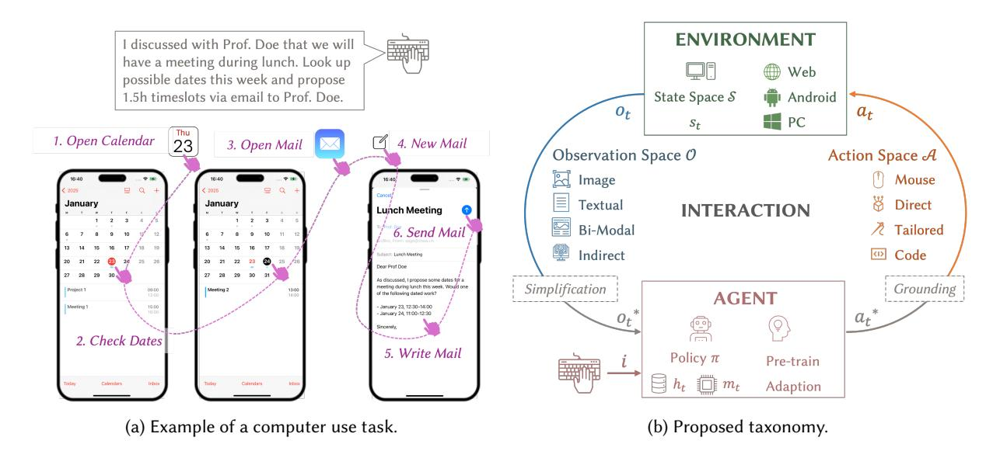

Fig. 1. Overview: (a) An example of a task for an ACU: A user specifies a task ("propose meeting dates by email") and the agent executes it. (b) We structure the literature on ACUs based on three key perspectives corresponding to the main differentiating aspects: (1) The shared domain properties across computer environments (e.g., Web, Android). (2) The means of interaction between the agent and the environment as manifested in the observation and action spaces. (3) The agent components: how an agent acts through a policy while tracking the past in memory and how an agent learns to act.

agent theory [\(Russell and Norvig 2022;](#page-36-0) [Sutton and Barto 2018\)](#page-36-3), enabling a holistic and technology-agnostic analysis of the ACU landscape (see Figure [1b](#page-2-0) for an overview).

Applying this taxonomical framework to current research, we identify several critical research gaps. First, many agents rely heavily on structurally inconsistent observations (e.g., unrealistically sanitized HTML), limiting their ability to generalize and scale to real-world applications. Second, current learning strategies are costly and inefficient, often relying on simulations, requiring substantial labeled data, or struggling to adapt to specific environments. Third, agents have a very limited ability to plan and execute complex multi-step tasks reliably. Fourth, existing benchmarks focus on real-world perception but lack sufficient task complexity to fully assess agent capabilities. Fifth, non-standard evaluation practices hinder meaningful comparison across different publications. Sixth, a mismatch exists between the assumptions regarding ACUs and their operational environments made during research and the actual conditions encountered during real-world deployment.

To address these challenges, we propose several directions. Observing and acting on uniform visual inputs provides more robust generalization than observing inconsistent textual inputs, e.g., HTML content. To overcome inefficiencies in learning, we highlight the need for cost-effective strategies and discuss promising directions for more scalable adaptation. To improve planning capabilities, we suggest exploring advances in reasoning models and integrating robust planning algorithms. To close the gap in benchmarking ACUs, we advocate for the development of datasets that better capture task complexity alongside real-world perception. To enable meaningful evaluation, we assert that the task success rate following standardized measurement practices should become the norm for comparing agent capabilities. Finally, to bridge the gap between research assumptions and real-world conditions, we identify several key discrepancies and propose research directions to address them.

This survey aims to foster advancements in the field of ACUs by providing a principled and comprehensive overview of the domain. Specifically, our contributions are as follows: (1) The introduction of a comprehensive

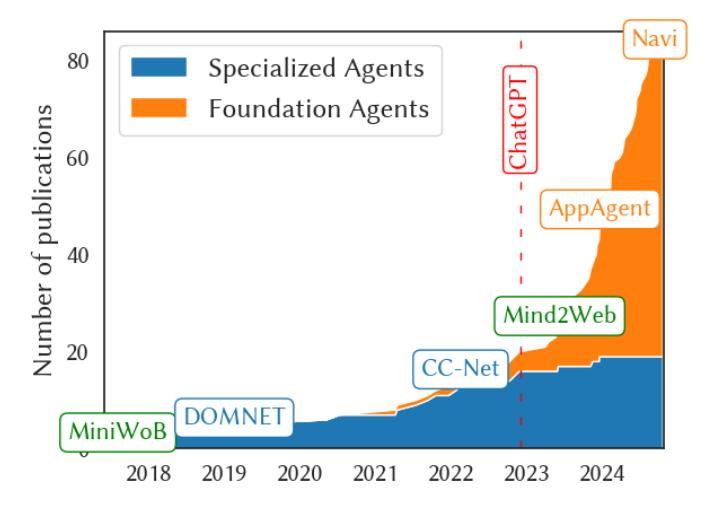

Fig. 2. ACU publications over time. Boxes highlight seminal milestones. The advent of ChatGPT marks a shift from RL-focused agents to those primarily relying on foundation model reasoning.

taxonomy for ACUs, (2) the classification of 87 ACUs and 33 datasets within this framework, (3) the identification of six critical research gaps, and (4) the proposal of strategic directions to address these challenges.

## 1.1 Relation to Other Surveys

In contrast to existing surveys, our review examines ACUs from a technology-agnostic perspective and introduces a unifying framework that bridges diverse domains, methodologies, and technologies. This broader scope allows us to introduce a novel, unifying taxonomy for ACUs that is compatible across a wide range of agent types —something previous work could not realize due to their limited scope. Specifically, existing surveys have the following limitations:

Limitation in learning strategies: [C. Zhang, S. He, et al.](#page-37-3) [\(2024\)](#page-37-3) and [S. Wang et al.](#page-37-4) [\(2024\)](#page-37-4) focus only on computer use for foundation-model-based agents, without discussing other learning frameworks such as pure reinforcement learning as the core principle of design. In contrast, other surveys (e.g., [Arulkumaran et al. 2017;](#page-31-2) [Moerland et al. 2023\)](#page-35-2) focus only on general reinforcement learning-based agents.

Limited scope within computer use: [B. Wu et al.](#page-37-5) [\(2024\)](#page-37-5) discuss only mobile agents, neglecting other computer domains. While their survey provides a comprehensive review of some aspects of computer use, it focuses on a specific subpart of the field. To discuss future research directions comprehensively, it is important to analyze the field as a whole.

Lack of computer use specificity: Other reviews (e.g., [Arulkumaran et al. 2017;](#page-31-2) [L. Wang et al. 2024\)](#page-37-6) provide a comprehensive overview of agents based on a specific technology but do not focus on the domain of computer use and all its intricacies.

Adjacent research areas with limited relevance for agentic computer use: Another set of surveys (e.g., [X. Li 2023;](#page-34-1) [Yu et al. 2023\)](#page-37-7) concentrate on related topics, such as GUI testing, but do not cover agent-based

interactions. Other reviews (e.g., [Chakraborti et al. 2020;](#page-32-2) [Syed et al. 2020\)](#page-36-4) focus on robotic process automation using scripted software robots (also called agents) to automate predefined workflows.

[M. Gao et al.](#page-33-4) [\(2024\)](#page-33-4) provide a valuable overview with a similar scope. In contrast, we go considerably deeper into key aspects, offering a more comprehensive analysis and novel insights, based on a taxonomy built upon existing intelligent agent theory [\(Russell and Norvig 2022;](#page-36-0) [Sutton and Barto 2018\)](#page-36-3) that is useful to find related work down to intricate questions of agent design. We posit that a comprehensive and in-depth review of the field is essential to systematically uncover the limitations of current agents and identify how diverse technologies and methodologies can inform one another to advance the state of the art.

## 1.2 Survey Methodology

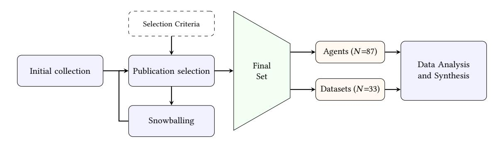

Fig. 3. Visual overview of the survey methodology phases, detailing the selection logic and synthesis process.

The field of ACUs is fragmented and lacks a unified terminology, making a classic systematic review infeasible. We therefore employed an iterative, semi-structured collection process combining expert knowledge with snowball sampling techniques. As visualized in Figure [3,](#page-4-0) our methodology comprised the following phases:

Initial collection: Based on domain expertise and exploratory keyword-based searches, we compiled an initial set of candidate publications. Given the rapid evolution of this domain, we included both peer-reviewed and preprint works to reflect the state-of-the-art. We conducted a semi-structured search using Google Scholar and Semantic Scholar, combining keywords such as "AI agent", "LLM/LVM agent", and "computer use". We only collect the papers from the last 7 years (2018-2024).

Publication selection: After initial collection, we filtered the literature and included publications after carefully reviewing their titles, abstracts, and additional parts of their content for fit, using the criteria catalog described below. The selection was conducted by two researchers independently, followed by a consensus discussion. Since some publications are preprints, we evaluated them by using domain knowledge and checked their consistency with emerging trends to mitigate quality concerns.

Snowballing: We used backward snowballing for adding references and forward snowballing for determining saturation: For each selected publication, we analyzed its references (backward), and for randomly selected works, we analyzed citations (forward) and checked whether additional relevant works could be identified. We iteratively repeated this process until no additional relevant papers emerged, ensuring thematic saturation.

Data Analysis and Synthesis: To develop the taxonomy, we employed an inductive approach. We extracted key attributes from the final set of papers (e.g., input modalities, action spaces, evaluation metrics) and grouped them into high-level dimensions. This process was iterative; as new properties emerged during data extraction, the taxonomic dimensions were refined to ensure they covered both agent architectures and dataset characteristics comprehensively.

The selection criteria for the collection process for both agent and dataset papers are defined as follows:

Deep learning focus: We only included agents utilizing deep learning for computer use, excluding traditional rule-based systems.

Computer use focus: We distinguish between passive advice and active execution. We exclude instructionbased agents (chatbots) that access external tools but only provide text advice or instructions for a human to follow (e.g., [Z. Guo et al. 2024;](#page-33-5) [Z. Li et al. 2024;](#page-34-2) [Qin et al. 2024;](#page-35-3) [Q. Tang et al. 2023;](#page-36-5) [R. Yang et al. 2023\)](#page-37-8). In contrast, we include agents that generate executable code (e.g., Python/Selenium scripts). Although these agents output text (code), this code acts as a dynamic action space that is executed by an interpreter to directly manipulate the interface, thereby satisfying our definition of autonomous computer use.

Common computer applications focus: We exclude agents playing video games (e.g., [Baker et al. 2022;](#page-31-0) [Zhu](#page-38-0) [et al. 2023\)](#page-38-0), controlling server facilities (e.g., [Fulpagare et al. 2022;](#page-32-3) [Ran et al. 2019\)](#page-35-4), coding agents (e.g., [Qian](#page-35-5) [et al. 2024;](#page-35-5) [Ross et al. 2023\)](#page-36-6) or software testing (e.g., [Degott et al. 2019;](#page-32-4) [Koroglu et al. 2018;](#page-34-3) [M. Pan et al. 2020\)](#page-35-6). We only include datasets that provide instructions and require agents to fulfill these instructions through computer interactions.

The final set of publications was curated through a multi-stage screening process and agreement through team discussion to ensure comprehensive coverage of the field. Our selection criteria are prioritized by scholarly impact (high citations or benchmark leadership), representation of key application domains (e.g., Web, Android), and diverse coverage across taxonomic dimensions outlined in Figure [4.](#page-8-0)

From the identified publications, we classify 87 as ACU agents and 33 as computer use datasets. We deliberately separate these two categories in our analysis because they serve distinct roles in the ecosystem: agents represent the methodological solutions and architectures, while datasets provide the evaluation environments and benchmarks. Analyzing them separately allows us to derive specific taxonomies for architectural properties (e.g., learning paradigms, see Appendix [F.1](#page-46-0)[–F.2\)](#page-49-0) versus environmental properties (e.g., observation spaces, see Appendix [F.3\)](#page-52-0).

Nevertheless, we note several limitations: (i) In our review, about 1/3 of the cited works are preprints. While they reflect emerging trends, they may lack validation and introduce concerns about quality. Readers should interpret these works cautiously; (ii) keyword search and manual screening, even when combined with snowballing, might have overlooked relevant papers; (iii) the focus on deep learning excludes traditional machine learning and rule-based approaches; and (iv) selection involves subjective judgment. To mitigate these limitations, we took several steps. For the inclusion of preprints, we cross-referenced findings with peer-reviewed literature when possible. To address potential gaps from keyword search and manual screening, we iteratively refined our search strategy and complemented it with citation tracking. Although our focus excluded traditional machine learning and rule-based approaches, we clearly defined this scope upfront to maintain consistency. Finally, to reduce subjective bias in selection, we employed a consensus-based review process, where disagreements were discussed and resolved collectively by multiple reviewers.

## 1.3 Survey Structure

Due to the developing nature of this field, individual ACUs that stand for important strands do not yet stand out; rather, many agents only employ certain aspects of what contributes to the full picture of ACUs. Hence, most subsequent chapters of this review put individual elements of the taxonomy at the center rather than individual ACUs, giving representative exemplary or specific ACUs as references for each aspect. A notable exception will be Section [5.2,](#page-18-0) where individual agents are most prominently portrayed, as it discusses their core development paradigm. Otherwise, a structuring of the field by agents can be found in the tables in the Appendix [F.](#page-45-0)

The survey is structured as follows: In Section 2, we formalize the problem of agents for computer use and introduce respective terminology as a precursor to introducing the perspectives of the proposed taxonomy. Then, we look into each perspective in detail in the three subsequent chapters: In Section 3, we discuss the composition of commonly used domains (domain perspective); in Section 4, we analyze the interaction between the agent and the environment through the observation and action space (interaction perspective); in Section 5, we dissect the components of an agent, how an agent acts, and how an agent learns to act (agent perspective). Then, in Section 6, we summarize existing datasets used to train or evaluate agents, and we examine metrics and methodologies used to evaluate an agent's performance in Section 7. Finally, we conclude by summarizing our findings and providing directions for future research in Section 8.

To complement the main text, the Appendix provides several in-depth analyses: In Section A, we examine trends and distributions in the literature, including common choices of observation modalities, action spaces, and learning strategies; Sections B and C contrast different observations and provide examples of code-based actions; Sections D and E discuss challenges in deploying ACUs, such as mismatches between environment properties assumed in research and found in real-world settings; Section F presents a structured overview of existing agents and datasets, classifying them according to our proposed taxonomy.

### 2 The Field of ACUs

This section formalizes ACUs and outlines our taxonomy perspectives.

### 2.1 **Definitions**

In the following, we describe ACUs using well-established intelligent agent notation (Russell and Norvig 2022; Sutton and Barto 2018) to provide a consistent basis for discussion in the upcoming sections. Human users interact with ACUs by issuing a text-based instruction i, which the agent must fulfill through actions in a computer environment. To illustrate this interaction model, Figure 1b visualizes the key components of an ACU and its interface with the environment, including how it perceives observations and selects actions.

At each time t, the computer environment is in a state  $s_t \in S$ . The ACU receives only a partial view, called an observation  $o_t \in O$ . S denotes the state and O the observation space, respectively. For example,  $o_t$  could be a screenshot of the current screen, only showing the foreground application, whereas  $s_t$  would encompass all running computer processes. Based on  $o_t$  and instruction i, the ACU selects an action  $a_t \in \mathcal{A}$  (action space), such as a mouse click, keypress, or a higher-level command (e.g., Shi et al. 2017; Z. Wang et al. 2024).

In practice, ACUs often simplify observations, denoted  $o_t \to o_t^*$ , to reduce complexity by, for example, downscaling or cropping UI screenshots (e.g., Q. Chen et al. 2024). Besides using simplified observation, ACUs can also predict abstract actions. Such actions must be converted in a grounding process  $a_t^* \to a_t$  from abstract actions  $a_t^*$  into executable actions  $a_t \in \mathcal{A}$ . Grounding is typically applied when a large language model (LLM) is used for planning, requiring the agent to convert high-level descriptions such as click submit button into executable commands such as click(x,y), where x and y are screen coordinates of the submit button (e.g., D. Gao et al. 2024).

The ACU's behavior is defined by a (typically stochastic) policy  $\pi$ . In its simplest form, the policy determines the action solely based on the current observation  $o_t$  and the instruction i:

$$a_t \sim \pi(\cdot \mid o_t, i) \tag{1}$$

Interacting over several steps yields a trajectory  $\tau = ((o_0, a_0), (o_1, a_1), ...)$ , ending when the instruction is fulfilled or a step limit is reached. Effective computer control often requires remembering previous observations  $(o_0, ..., o_{t-1})$ , making adding a memory component to the policy essential.

## 2.2 A Comprehensive Taxonomy

Figure [4](#page-8-0) introduces our proposed taxonomy, which is organized around three complementary perspectives (each of which is explored in detail in the following sections). The domain perspective (Section [3\)](#page-7-0) focuses on the properties and interfaces of computer environments. It identifies commonalities in observation and action types across domains. The interaction perspective (agent ↔ environment) (Section [4\)](#page-10-0) describes how agents interact with their environments. It formalizes the observation space O and action space A used by ACUs and discusses techniques for simplifying observations and action grounding. The agent perspective (Section [5\)](#page-16-0) examines the internal structure of an ACU. We distinguish two main agent designs, identify three typical learning phases, and outline core components for acting, memory, and planning.

Our taxonomy builds on the agent-environment framework central to intelligent agent theory [\(Russell and](#page-36-0) [Norvig 2022;](#page-36-0) [Sutton and Barto 2018\)](#page-36-3) and adopts well-established, domain-agnostic concepts, such as observation spaces and policies, whenever possible. ACU-specific characteristics are categorized based on determining overarching patterns and concepts across the ACU literature.

## 3 Domain Perspective

The most common domains in the literature are Web, Android, and personal computers. Although these domains often overlap in terms of functionality, such as when users access web browsers on Android devices or manage emails via web interfaces on desktop computers, existing research typically distinguishes them based on their primary interaction environment. Each domain presents a distinct interaction interface, such as HTML-based pages in the Web, touch screens in Android, and window-based GUIs in desktop environments. To bridge these differences, we propose to group these interfaces into common types of observations and actions. These shared abstractions allow us to define a unifying perspective across domains, providing a foundation for transferable methods and cross-domain generalization. We categorize domain-specific kinds of observations into the following types:

Image screen representation: Observations in the form of screenshots—either full screen, partial, or multiview pixel images—common in all domains (e.g., [Niu et al. 2024;](#page-35-7) [Y. Song, Bian, Y. Tang, G. Ma, et al. 2024;](#page-36-8) [C. Zhang, L. Li, et al. 2024\)](#page-37-10).

Textual screen representation: Structured textual representations of the screen such as HTML markup in the Web domain, the Android view hierarchy, or the UI automation tree in Windows. They allow agents to interact with interfaces at a semantic level (e.g., [Kim et al. 2023;](#page-34-0) [Wen, Y. Li, et al. 2024;](#page-37-11) [C. Zhang, L. Li, et al.](#page-37-10) [2024\)](#page-37-10).

Indirect representation: Non-visual observations providing contextual or system-level information beyond what is currently rendered on screen, such as file system contents or network state (e.g., [Y. Guo et al. 2024;](#page-33-6) [Y. Song, Xiong, et al. 2023;](#page-36-9) [Z. Wu et al. 2024\)](#page-37-12).

Representative examples of each observation type across domains are summarized in Table [1.](#page-9-0)

Similarly, we group domain-specific action types into:

Mouse/touch and keyboard: Low-level screen coordinate-based actions such as moving the cursor, tapping on coordinates, or typing text using the keyboard. These simulate typical human input across platforms (e.g., [Humphreys et al. 2022;](#page-33-1) [Rahman et al. 2024;](#page-35-8) [J. Wang et al. 2024\)](#page-37-13).

Direct UI access: Actions targeted at specific UI elements using structured identifiers (like HTML tags or accessibility IDs) (e.g., [Branavan et al. 2009;](#page-32-0) [Gur, Nachum, et al. 2023;](#page-33-7) [C. Zhang, Z. Yang, et al. 2023\)](#page-37-14).

Task-tailored actions: High-level actions that encapsulate multi-step behaviors, such as "go to home screen" or "send email," into single commands tailored to specific tasks (e.g., [Bonatti et al. 2024;](#page-32-7) [Nakano et al. 2022;](#page-35-9) [Z. Wang et al. 2024\)](#page-37-9).

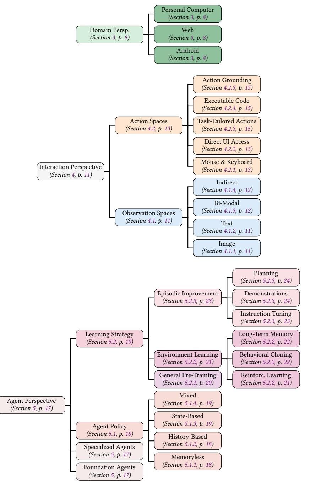

Fig. 4. The taxonomy of instruction-based ACUs is structured by three main perspectives and their components. The respective colors will be used throughout this paper to help easily associate content with each component.

Table 1. Our classification of observation types across the different domains, along with relevant examples for each domain.

| Observation types                                                                                       | Web                                                                       | Android                                                                                                            | Personal computer                                                            |  |  |  |  |  |
|---------------------------------------------------------------------------------------------------------|---------------------------------------------------------------------------|--------------------------------------------------------------------------------------------------------------------|------------------------------------------------------------------------------|--|--|--|--|--|
| Image screen representation Website (e.g., Niu et al. 2024), browser window (Zhou et al. 2024) |                                                                           | Phone screen (e.g., Y. Song, Bian, Y. Tang, G. Ma, et al. 2024)                                              | Foreground application (C. Zhang, L. Li, et al. 2024), computer screen |  |  |  |  |  |
| Textual screen representation                                                                           | HTML (e.g., Kim et al. 2023), accessibility tree (Zhou et al. 2024) | Android view hierarchy (e.g., Wen, Y. Li, et al. 2024), accessibility tree (e.g., Y. Li, Du, et al. 2024) | UI automation tree (e.g., C. Zhang, L. Li, et al. 2024)                   |  |  |  |  |  |
| Indirect representation                                                                                 | Network traffic (e.g., Y. Song, Xiong, et al. 2023)                    | -                                                                                                                  | Read files (e.g., Y. Guo et al. 2024)                                     |  |  |  |  |  |

Table 2. Our classification of action types across the different domains, along with relevant examples for each domain.

| Action types          | Web Android                    |                                 |                                   |  |  |
|-----------------------|-----------------------------------|---------------------------------|-----------------------------------|--|--|
| Mouse/touch/keyboard  | Mouse/touch/keyboard (e.g.,       | Touch and keyboard (e.g.,       | Mouse and keyboard (e.g.,         |  |  |
|                       | Humphreys et al. 2022)            | J. Wang et al. 2024)            | Rahman et al. 2024)               |  |  |
| Direct UI access      | HTML elements (e.g., Gur,         | Android elements (e.g.,         | Custom (e.g., Branavan et al.     |  |  |
|                       | Nachum, et al. 2023)              | C. Zhang, Z. Yang, et al. 2023) | 2009), UI automation API (e.g.,   |  |  |
|                       |                                   |                                 | C. Zhang, L. Li, et al. 2024)     |  |  |
| Task-tailored actions | Find on page (Nakano et al.       | Go back (C. Zhang, Z. Yang,     | Switch application (Bonatti       |  |  |
|                       | 2022)                             | et al. 2023)                    | et al. 2024), send email          |  |  |
|                       |                                   |                                 | (Z. Wang et al. 2024)             |  |  |
| Executable code       | JavaScript, Python (e.g., H. Sun  | Android debug bridge (e.g.,     | UI automation API (e.g., Z. Wu    |  |  |
|                       | et al. 2023), Selenium web driver | S. Deng et al. 2024)            | et al. 2024), Bash (e.g., Z. Song |  |  |
|                       | (e.g., Gur, Furuta, et al. 2024)  |                                 | et al. 2024)                      |  |  |

Executable code: Agents may interact programmatically with their environments by generating code (e.g., Python, Bash, JavaScript) and executing it with a corresponding interpreter (e.g., [S. Deng et al. 2024;](#page-32-8) [Gur,](#page-33-8) [Furuta, et al. 2024;](#page-33-8) [H. Sun et al. 2023\)](#page-36-10).

Table [2](#page-9-1) provides cited examples for each action type and domain.

## 3.1 Recommendations

Our analysis of the domains of the reviewed agents (see Appendix Figure [13\)](#page-38-4) reveals that most of the ACU literature focuses on the Web and Android domains. In contrast, the personal computer domain, despite its significant practical relevance in workplace automation and productivity applications, remains underexplored: Only 10 out of our 87 ACUs target desktop environments. We recommend that desktop environments should get more attention in research, as desktop environments not only offer high potential for impactful automation, but also present unique research challenges, such as handling more complex applications, overlapping windows, and orchestrating inter-application workflows reliant on the shared, user-navigable file system.

## **4** Interaction Perspective (Agent ↔ Environment)

The interaction perspective examines how agents interact with environments through observation and action types, building on the cross-domain abstractions introduced in Section 3.

## 4.1 Observation Spaces

Observation spaces O of ACUs typically comprise image screen representations, textual screen representations, or indirect observations. Similar to the previous chapter, we classify the observation type used by the reviewed 87 ACUs (see Appendix Table 6). Our analysis shows textual observations are the most common observation type with 35 ACUs relying only on textual representations (see Appendix Figure 15), reflecting the influence of LLMs over the last years. However, we identify a trend towards image screen representation, with image observations even being the most common observation type in 2024 (see Appendix Figure 15), partly driven by advances in vision language models (VLM).

4.1.1 Image Screen Representation. Image-based observations (e.g., screenshots) are used across Web (e.g., B. Zheng et al. 2024), Android (e.g., C. Zhang, Z. Yang, et al. 2023), and desktop environments (e.g., D. Gao et al. 2024). Using screenshots aligns with human visual perception, offering broad applicability since most applications provide a graphical interface.

Besides capturing the entire screen, there exist different approaches for taking screenshots. Some approaches only use parts of the screen, such as the active application (D. Gao et al. 2024), while others extend it beyond the visible viewpoint by rendering the entire application as an image (Q. Chen et al. 2024), whereas humans have to scroll.

To reduce the computational load of processing large images, screenshot observations  $o_t$  are typically simplified  $o_t \rightarrow o_t^*$  by downsampling their resolution (e.g., Q. Chen et al. 2024; Toyama et al. 2021). Rahman et al. (2024) even combine high-resolution and low-resolution screenshots to have a compact view but still access image details if needed.

Another challenge is to feed the textual instruction i into vision-only agents. Typically, the instruction is either encoded separately and added in the embedding space (e.g., Baechler et al. 2024) or visually rendered atop of each screenshot (e.g., Shaw et al. 2023).

According to our analysis in Appendix Section Section D, a common assumption within the field of ACUs is that the environment remains static between actions, resulting in the prevailing practice of capturing screenshots only after actions. However, real-world applications exhibit dynamic behavior, necessitating continuous monitoring and the capacity to react to asynchronous events (e.g., the arrival of a new email). This area is currently underexplored in ACU research.

4.1.2 Textual Screen Representation. Agents using textual screen representations operate across diverse platforms, including the Web (via HTML) (e.g., Kim et al. 2023), Android (via view hierarchies) (e.g., Shvo et al. 2021), and desktop systems (via the Windows UI automation tree) (e.g., C. Zhang, L. Li, et al. 2024). However, not all textual representations are equally robust; HTML and Android view hierarchies tend to be well-structured and consistent, as they are generated through standardized frameworks that a majority of developers follow. In contrast, the Windows UI automation tree is often of lower quality (due to a variety of UI toolkits or legacy applications), leading to incomplete or semantically sparse UI descriptions. Therefore, textual representations are typically only used for Web, Android, and very specific desktop applications.

Textual representations, particularly HTML, are often verbose, as they include styling metadata in addition to content. Processing raw text (e.g., Assouel et al. 2023; Kim et al. 2023) is therefore generally restricted to artificial environments with minimal markup, such as the MiniWoB++ benchmark (see Section 6). In more realistic environments, textual representations are typically simplified through a combination of the following strategies:

**Heuristic pruning:** Selects only the most essential attributes such as id, class, or name for each element while removing others (e.g., T. Li, G. Li, Z. Deng, et al. 2023; Tao et al. 2024).

**Elements filtering:** Keeps only specific elements, such as leaf elements (e.g., Gur, Rückert, et al. 2019), or those considered most relevant to fulfill a given instruction i (e.g., X. Deng et al. 2023; L. Zheng, R. Wang, et al. 2024).

**Representation embedding:** Uses an embedding model to compress HTML into a vector representation (e.g., Gur, Rückert, et al. 2019; Jia et al. 2019; E. Z. Liu et al. 2018).

**Text summarization:** Utilizes an auxiliary model to compress the HTML into an abstract text summary (e.g., L. Zheng, R. Wang, et al. 2024).

A key advantage of using HTML is its alignment with the pretraining data of LLMs, enabling LLM-based agents to exhibit a general understanding of it. To leverage this alignment in the Android domain, B. Wang et al. (2023) propose to map the Android view hierarchy to simplified HTML, an approach later adopted by subsequent works (e.g., S. Deng et al. 2024).

This mapping approach has also been extended to image-based agents, where screenshots are translated into textual representations to align with text foundation models. The process, applied in Web (e.g., Cho et al. 2024), Android (e.g., Y. Li, Du, et al. 2024), and desktop environments (e.g., D. Gao et al. 2024), typically involves two steps: First, object detection is used to detect UI elements, and then an additional model is used to extract an element's properties, such as its text and type.

- 4.1.3 Bi-Modal Screen Representation. Bi-modal observations combine both image and textual inputs, and have been explored across domains such as Web (e.g., H. He et al. 2024), Android (e.g., L. Sun et al. 2022), and desktop systems (e.g., C. Zhang, L. Li, et al. 2024), aiming to unify complementary information streams. Typically, the two modalities have modality-specific encoders that embed the two types of observations before they are combined in the embedding space (e.g., Furuta, K.-H. Lee, et al. 2024). The potential of bi-modal agents leveraging the advantages of both modalities is an open research question, as more information can also lead to distracting information overload through irrelevant content and has not yet been proven to be considerably more effective on current benchmarks.
- 4.1.4 Indirect Observation. Some agents do not directly observe screen representation but have actions or routines to collect information about the current computer state  $s_t$  (e.g., Z. Guo et al. 2024; Kong et al. 2023; Qin et al. 2024). For example, Y. Guo et al. (2024) use a content reader routine that at each time step t reads information from a PowerPoint file as observation  $o_t$ . Y. Song, Xiong, et al. (2023) execute a REST-API call as an action  $a_t$ , and use the API response as the next observation  $o_{t+1}$ . Similarly, Z. Wang et al. (2024) use task-tailored actions to directly read information from files, e.g., read\_excel\_file, or use application-specific actions, e.g., an action list\_emails in an email application.
- 4.1.5 Recommendations. ACU agents commonly rely on either image-based or textual screen observations, each offering distinct advantages. Textual representations encode rich semantic information such as element attributes and hierarchical structures. For example, a form element might include a semantic identifier such as email-sender, or a table may be represented as a hierarchy of rows and cells. However, we hypothesize that agent behaviors trained on such structured representations are often brittle when applied across diverse applications, such as different websites. This brittleness arises from a dependency on optional semantic information, which is frequently absent, incomplete, inconsistent, or ambiguous in real-world settings. For example, a form might lack a descriptive id attribute, or tables may be implemented using non-standard constructs. As a result, agents leveraging this information may develop scenario-specific heuristics (shortcuts, cp. Geirhos et al. (2020)) that do not generalize well beyond the training data.

In contrast, image-based screen representations tend to exhibit greater consistency across scenarios due to widely adopted design conventions. This consistency suggests that image-based observations can support the development of more robust and generalizable agent behavior. Based on this reasoning, we argue that versatile ACUs should rely on visual perception to enhance generalization and applicability in all scenarios where humans also operate computers. A detailed comparison of textual versus image-based screen representations is provided in Appendix Section [B.](#page-38-2)

Our analysis of datasets supports our suspicion of brittle behavior for text-based agents. In the Web domain, MiniWoB++ [\(E. Z. Liu et al. 2018;](#page-34-6) [Shi et al. 2017\)](#page-36-7) provides an artificial environment with unrealistic uniform HTML representations across its tasks. In such sanitized settings, textual agents achieve strong performance, as shown by [Humphreys et al.](#page-33-1) [\(2022\)](#page-33-1), where removing the textual modality of a bi-model input resulted in a 75% drop in performance. However, in benchmarks based on realistic websites like Mind2Web [\(X. Deng et al. 2023\)](#page-32-9), success rates for text-based agents fall below 10% [\(X. Deng et al. 2023;](#page-32-9) [Furuta, K.-H. Lee, et al. 2024;](#page-32-11) [Gur, Furuta,](#page-33-8) [et al. 2024\)](#page-33-8), while image-based agents leveraging large vision models (e.g., GPT-4V) achieve significantly higher success rates of up to 38% [\(B. Zheng et al. 2024\)](#page-37-15), hinting on the importance of visual input in real-world settings.

A similar shift is observable in the Android domain: while early systems favored textual representations [\(Shvo](#page-36-14) [et al. 2021;](#page-36-14) [B. Wang et al. 2023\)](#page-37-17), recent image-based agents such as [\(C. Zhang, Z. Yang, et al. 2023\)](#page-37-14) outperform them in more dynamic or complex applications.

## 4.2 Action Spaces

As introduced in Section [3,](#page-7-0) ACUs can utilize four main types of actions: mouse/touch and keyboard actions, direct UI access, task-tailored actions, and executable code. In the following, we discuss each of these action spaces, while Table [6](#page-46-1) provides the corresponding details for each ACU.

4.2.1 Mouse/Touch and Keyboard. Mouse, touch, and keyboard actions align closely with human interaction patterns, facilitating data collection and training [\(Humphreys et al. 2022\)](#page-33-1). Both mouse actions (e.g., click(x,y)) and touch actions (e.g., tap(x,y)) require absolute screen coordinates (x,y), making them conceptually identical for ACUs[1](#page-12-3) . Figure [5](#page-13-0) summarizes approaches for predicting screen coordinates. Some methods make discrete predictions, by either predicting a position on a low-resolution coordinate grid (e.g., [Shi et al. 2017;](#page-36-7) [Toyama et al.](#page-36-12) [2021\)](#page-36-12), predicting two interdependent discrete values for the x and y coordinates (e.g., [Humphreys et al. 2022\)](#page-33-1), or generating discrete tokens through a text generation model (e.g., [Hong et al. 2024\)](#page-33-12). Other approaches use continuous values by predicting two interdependent continuous coordinate values (e.g., [Toyama et al. 2021\)](#page-36-12). It remains unclear whether one prediction strategy is universally superior; instead, the choice usually depends on the agent architecture and task.

Keyboard actions (e.g., type(text)) are typically used to input text into a previously selected UI element. While earlier methods relied on predefined text fragments (e.g., [Humphreys et al. 2022\)](#page-33-1) or extracted text from the instruction (e.g., [Gur, Rückert, et al. 2019\)](#page-33-9) as input, in most of the current systems, ACUs generate the text using a language model (e.g., [Hong et al. 2024\)](#page-33-12), as this provides the required freedom to type diverse texts. Beyond typing, keyboard actions are frequently used for special commands, such as navigating via pressing arrow keys (e.g., [T. Li, G. Li, Z. Deng, et al. 2023\)](#page-34-5) or using shortcuts such as select all, copy, or paste (e.g., [Cho et al. 2024\)](#page-32-10).

4.2.2 Direct UI Access. Direct UI access actions such as click(e) or type(e, text) target a specific UI element e observed by the agent. Agents typically identify these elements e by either predicting unique identifiers like HTML id tags (e.g., [T. Li, G. Li, Z. Deng, et al. 2023\)](#page-34-5), XPath[2](#page-12-4) descriptions [\(Kim et al. 2023\)](#page-34-0) (for an example of

1For humans, mouse actions are relative (to the current cursor position) and touch actions are absolute.

2https://www.w3.org/TR/xpath-31/

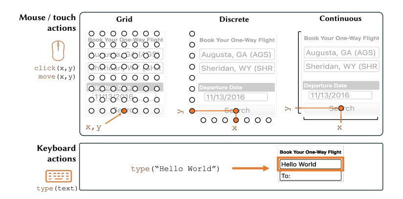

Fig. 5. Common mouse and keyboard actions, highlighting coordinate prediction.

predicting click(id=search) based on <button id="search"> see Figure [6\)](#page-13-1), or by scoring and selecting from all visible elements (e.g., [Jia et al. 2019;](#page-33-2) [Y. Li, Du, et al. 2024\)](#page-34-4).

To simplify selection, agents may restrict referenceable elements to leaf nodes in the user interface tree (e.g., [E. Z. Liu et al. 2018\)](#page-34-6) or pre-filter them with an auxiliary model that can preselect potential candidate elements (e.g., [X. Deng et al. 2023\)](#page-32-9). For specific tasks such as web navigation, agents may be limited by design to selecting hyperlinks only [\(Q. Chen et al. 2024;](#page-32-5) [Zaheer et al. 2022\)](#page-37-18).

After selecting an element, optional text input follows similar generation strategies as got keyboard input, including generating free-form text (e.g., [T. Li, G. Li, Z. Deng, et al. 2023\)](#page-34-5), selecting predefined fragments (e.g., [Shvo et al. 2021\)](#page-36-14), or extracting text from the instruction (e.g., [Jia et al. 2019\)](#page-33-2).

By classifying each reviewed ACU, we identify direct UI access as the most widely adopted action space in the literature (see Appendix Figure [16\)](#page-40-0). We believe this dominance is due to its balance between generality and learnability. Unlike coordinate-based mouse or touch actions, which require fine-grained spatial reasoning and introduce high-dimensional prediction challenges, direct UI access operates over a lower-dimensional and semantically meaningful action space. By allowing agents to refer to structured element identifiers (e.g., id, XPath, or other selectors), this form of interaction abstracts away spatial complexity while still supporting a broad range of tasks. However, as it requires an identifier for the UI elements, it is primarily compatible with text observations and, as discussed in the previous section, does therefore not scale well to the desktop domain. Also, it typically only works well for simplified, well-structured UIs that are often not available for real-world use cases but common for earlier benchmarks (see Section [6\)](#page-25-0).

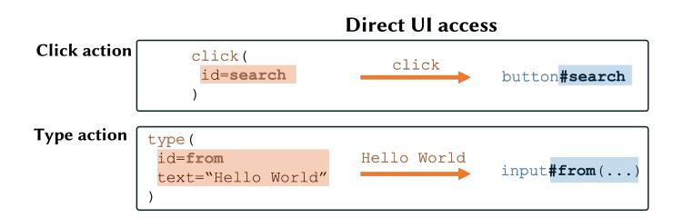

Fig. 6. Common direct UI access actions, referencing the HTML element by its id attribute.

4.2.3 Task-Tailored Actions. Task-tailored actions are environment-specific commands for common operations. For instance, [Z. Wang et al.](#page-37-9) [\(2024\)](#page-37-9) define application-specific actions such as create\_event for a calendar application and send\_email for an email client. These high-level actions reduce learning complexity as they typically correspond to an entire trajectory of clicking actions. Nevertheless, the downside is that they require additional engineering as these subroutines are often hand-crafted (e.g., [Tan et al. 2024;](#page-36-17) [Z. Wang et al. 2024\)](#page-37-9).

We consider most task-specific actions as a shortcut that might help to improve on narrowly designed benchmarks, but are not helpful for building general ACUs, especially when the actions are highly task-specific. However, a few task-tailored actions demonstrate broader applicability and merit inclusion due to their capacity to generalize across tasks within a given domain. For example, [Bonatti et al.](#page-32-7) [\(2024\)](#page-32-7) define the action open\_application, which enables an agent to open and switch between applications on a Windows operating system. Similarly, [Nakano et al.](#page-35-9) [\(2022\)](#page-35-9) define a search action, which allows the agent to navigate to specific text positions within a website. These actions exemplify a favorable trade-off between general-purpose utility and domain-relevant specialization, particularly when integrated with more comprehensive action spaces.

4.2.4 Executable Code. Agents may also generate code, executed by interpreters like Python or Bash. Executable code varies in its structure and the level of abstraction provided by its application programming interface (API):

Structure of generated code:

Straight-line code consists of a sequence of statements without control flow (e.g., [Tao et al. 2024\)](#page-36-15). It is akin to predicting a single or multiple actions.

Control-flow code includes control flow mechanisms such as conditional statements (e.g., if), loops (e.g., for), and function definitions. Complex code can represent the agent's entire execution plan [\(H. Sun et al.](#page-36-10) [2023\)](#page-36-10), where the agent dynamically adjusts its plan based on precondition checks failing.

API abstraction level utilized by generated code:

General-purpose API: Some agents use an API with functions akin to general-purpose actions like clicking elements or screen coordinates. For example, [Gur, Furuta, et al.](#page-33-8) [\(2024\)](#page-33-8) use the Selenium web driver API[3](#page-14-3) to provide such low-level interactions.

Task-tailored API: Other agents use an API of hand-engineered functions tailored to tasks. For example, [Y. Guo et al.](#page-33-6) [\(2024\)](#page-33-6) define functions like insert\_rounded\_rectangle(...) for their PowerPoint agent.

See Appendix Figure [22](#page-43-0) for both code structure and API abstraction examples. Executable code is generated using either general foundation models (e.g., [Y. Guo et al. 2024\)](#page-33-6) or specialized models (e.g., [Gur, Furuta, et al.](#page-33-8) [2024\)](#page-33-8). Foundation models often come pre-trained on well-established APIs like Selenium web driver, while hand-engineered functions are typically introduced through contextual prompts or, alternatively, by using an API selector to first retrieve relevant functions [\(Y. Song, Xiong, et al. 2023\)](#page-36-9).

An open question is the benefits of using executable code over other action types. [W. Chen, X. Ma, et al.](#page-32-12) [\(2023\)](#page-32-12) and [L. Gao et al.](#page-33-13) [\(2023\)](#page-33-13) found that producing straight-line code instead of predicting actions as strings can reduce hallucinations when using GPT-3. However, [Assouel et al.](#page-31-4) [\(2023\)](#page-31-4) suggested that this advantage disappears when using GPT-4, indicating that the benefits of executable code over other action types diminish with more advanced models.

4.2.5 Action Grounding. Action grounding ∗ → refers to the process of converting an abstract action, such as click submit button, into an executable action, such as click(e), where e represents the specific UI element. Grounding is typically required when a text foundation model generates an abstract, text-based plan that must be transformed into a sequence of executable actions (e.g., [D. Gao et al. 2024;](#page-32-6) [Kim et al. 2023\)](#page-34-0). Two common strategies include:

3<https://www.selenium.dev/documentation/webdriver/>

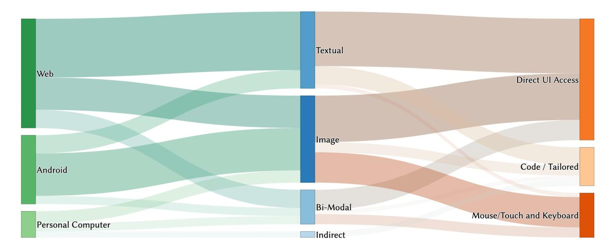

Fig. 7. Sankey diagram showing the connections between domains (left) and observation spaces (middle), and between observation and action spaces (right). The path width represents the number of papers within this survey associated with the corresponding topic.

Prediction-based grounding: Given an abstract action, a grounding model predicts the corresponding UI element. For example, for the abstract action navigate to settings, [Y. Li, J. He, et al.](#page-34-8) [\(2020\)](#page-34-8) predict click(e) where e refers to the settings app icon.

Rule-based grounding: A rule-based module matches an abstract action ∗ to the actionable UI element. For example, [Y. Song, Bian, Y. Tang, G. Ma, et al.](#page-36-8) [\(2024\)](#page-36-8) use text matching rules to achieve this mapping, whereas [S.](#page-34-9) [Lee et al.](#page-34-9) [\(2023\)](#page-34-9) first predict abstract template actions containing placeholders (e.g., click(text="[contact\_name]")), followed by rule-based grounding substituting the placeholders with context-specific values derived from the user instruction .

Grounding is not limited to textual models but is also used in vision-based agents. These vision-based agents rely on grounding because current vision models struggle to predict screen coordinates accurately. Several strategies for grounding in vision models have been explored and discussed by [B. Zheng et al.](#page-37-15) [\(2024\)](#page-37-15). The most successful one is set-of-mark prompting [\(J. Yang et al. 2023\)](#page-37-19), where actionable elements are annotated with bounding boxes and unique identifiers, enabling the agent to access them directly using the identifier instead of relying on coordinate prediction. However, this prompting strategy requires identifying the actionable elements, which is done by either using an additional textual screen representation with positional data (e.g., [Y. Li, C. Zhang,](#page-34-10) [et al. 2024;](#page-34-10) [C. Zhang, Z. Yang, et al. 2023;](#page-37-14) [B. Zheng et al. 2024\)](#page-37-15) or extracting them from the screenshot via a specialized model (e.g., [Y. Lu et al. 2024\)](#page-35-10). Although the latter approach offers flexibility, it is often imprecise, leading to suboptimal performance [\(Bonatti et al. 2024\)](#page-32-7).

Despite the success of set-of-mark prompting, we posit that this grounding step may be a temporary workaround, designed to compensate for the limitations of current vision foundation models, which have not yet been trained sufficiently to predict screen coordinates directly. Recent studies suggest that learning visual grounding via coordinate prediction is feasible and straightforward [\(Cheng et al. 2024;](#page-32-13) [Dardouri et al. 2024\)](#page-32-14) and may eventually render the need for set-of-mark prompting unnecessary.

4.2.6 Recommendations. Different action types demand distinct observational inputs. Coordinate-based actions (e.g., mouse clicks) depend on spatial information, whereas direct UI actions (e.g., button presses) must be

able to reference UI elements. Consequently, coordinate-based actions naturally align with visual input, while element-based actions align with text-based input.

Nevertheless, our analysis shows many deviations from this expected alignment through modality bridging. For instance, many vision-based agents employ direct UI access actions (see Figure 7). While such strategies can be effective, we argue that they are short-term workarounds tailored to existing technological constraints, introducing unnecessary long-term architectural complexity.

Historically, during the dominance of text-only LLMs, many ACUs converted screenshots into textual representations to maintain compatibility (e.g., Y. Song, Bian, Y. Tang, G. Ma, et al. 2024; Wen, Y. Li, et al. 2024). More recently, techniques such as set-of-mark prompting have been adopted to compensate for shortcomings in precise coordinate prediction (e.g., C. Zhang, Z. Yang, et al. 2023; B. Zheng et al. 2024). These workarounds are likely to diminish in relevance as vision foundation models improve in spatial and semantic grounding.

Expanding on the premise that image-based observations offer a more coherent and spatially continuous representation of the user interface, we propose that **versatile ACUs should rely on mouse**, **touch**, **and keyboard actions** as these actions align naturally with visual observations. Moreover, these actions can still be combined with higher-level subroutines (e.g., application switching) that abstract common interaction patterns into single actions.

## 5 Agent Perspective

While previous sections described the agent's external environment and interactions, this section examines the internal structure of ACUs. Here, we focus on two prevalent agent types: *Foundation agents* (based on foundation models) and *specialized agents* (based on domain-specific design).

**Foundation Agent:** A foundation agent (e.g., B. Zheng et al. 2024) uses a *general pre-trained* foundation model (such as an LLM or VLM) as its policy  $\pi$ . While currently dominated by LLMs and VLMs, this category encompasses any architecture leveraging broad pre-training for zero-shot or few-shot transfer, including vision-language-action (VLA) models or diffusion models. These agents employ the model's broad knowledge and in-context learning capabilities for *episodic improvement* (see Sections 5.2.1 and 5.2.3). For example, a text-based foundation model receives a textual observation  $o_t$  alongside a prompt specifying its role as agent, a description of available UI actions  $\mathcal{A}$ , and the instruction i. The model then *generates* an action  $a_t$  that is executed in the environment.

**Specialized Agent:** A specialized agent (e.g., Humphreys et al. 2022) employs a *custom* network architecture as its policy  $\pi$ , which *predicts* actions  $a_t \in \mathcal{A}$  based on a given observation  $o_t$  and instruction i, relying on the possibilities of the predefined output options. For example, the architecture might process an image  $o_t$  and a text instruction i as inputs through encoder networks and predict logits for each action type (such as clicking) alongside additional outputs (such as screen coordinates (x,y)). Learning typically involves *environment learning* techniques such as reinforcement learning (see Section 5.2.2).

Specialized agents work particularly well on narrow tasks and when the task conditioning of humans (the instruction) is limited (e.g., fill out a simple form given a user ID). In such cases, specialized agents often perform robustly and are computationally efficient due to their smaller parameter count (e.g., Humphreys et al. 2022). However, in multi-step tasks with diverse observation spaces or strong instruction-based conditioning, agents clearly benefit from general pre-training and reasoning techniques such as Chain-of-Thought (CoT) (e.g., Zhou et al. 2024).

Table 3 summarizes the key characteristics of the two common agent designs, highlighting their differences in architecture, action type, memory of information from past episodes, and learning strategy.

Table 3. Properties of the two common ACU types.

| ACU Agent Types   | Architecture | Action     | Memory        | <b>Learning Strategy</b> |
|-------------------|--------------|------------|---------------|--------------------------|
| Foundation agent  | LLM / VLM    | Generation | history-based | General + Episodic       |
| Specialized agent | Custom       | Prediction | state-based   | Environment learning     |

## 5.1 Policy – How to Act

The policy  $\pi$  defines how an agent selects actions (Sutton and Barto 2018, Chapter 1.3). For computer control, we distinguish three types of policies: Memoryless policies that act only on the current input; history-based policies that use explicit past observation and/or action sequences; and state-based policies that aggregate information about the past in an internal memory. Among them, history-based policies are the main research focus in the surveyed reviews, with almost 60 out of the reviewed 87 ACUs using some form of history in their policy (see Appendix Figure 17 and Table 7).

5.1.1 Memoryless Policies. Memoryless policies (e.g., Q. Chen et al. 2024) ignore past observations and actions and act solely on the current observation  $o_t$ :

$$a_t \sim \pi(\cdot \mid o_t, i) \tag{2}$$

Memoryless policies are often insufficient for real-world control scenarios where context across time is critical and selecting an appropriate next action  $a_t$  requires information about past observations  $o_{t-n}, ..., o_{t-1}$  and/or actions  $a_{t-n}, ..., a_{t-1}$ . For instance, in the context of purchasing multiple items from an online store, an agent must remember which items were already added to the shopping cart. Still, since memoryless can be sufficient for specific tasks, their simplicity is sometimes leveraged in model design (e.g., Shvo et al. 2021).

5.1.2 History-based Policies. History-based policies track the past by adding observations and actions in a continuously growing sequence, called history  $h_t = (o_0, \ldots, o_{t-1}, a_0, \ldots, a_{t-1})$  (e.g., B. Zheng et al. 2024). For example, a vision-only agent's history consists of all the screenshots it perceived and the actions it performed during an episode. When predicting the next action  $a_t$ , the agent retrieves relevant information from its history  $h_t$ :

$$a_t \sim \pi(\cdot \mid o_t, i, h_t) \tag{3}$$

Foundation agents commonly follow this pattern, as foundation models typically come with a context window to track past information, a specific instance of a policy history. A key challenge with history-based approaches lies in the high dimensionality of observations  $o_t$  (often screenshots or long textual descriptions). They either do not fit into the limited context windows of foundation models or, if they fit, they are computationally very expensive due to the large amount of required tokens. Therefore, the history  $h_t$  is often approximated as  $h_t^*$ . Common simplifications include:

**Actions only:** Keep only the past actions  $h_t^* = (a_0, \dots, a_{t-1})$  and discard the observations (e.g., B. Zheng et al. 2024). In extreme cases, retain only the last action  $h_t^* = (a_{t-1})$  (e.g., D. Gao et al. 2024).

**Selective observations** Retain certain previous observations  $o_{< t}$ , such as keeping the last two screenshots with all actions as  $h_t^* = (o_{t-2}, o_{t-1}, a_0, \dots, a_{t-1})$  (Furuta, K.-H. Lee, et al. 2024).

**Embedded summaries:** Create embeddings of the last observations  $h_t^* = (\tilde{o}_{t-4}, \dots, \tilde{o}_{t-1}, a_0, \dots, a_{t-1})$  (Q. Lu et al. 2024).

**Text summaries:** Summarize past observations into text, enabling to keep the entire summarized observation history alongside raw actions  $h_t^* = (\tilde{o}_0, \dots, \tilde{o}_{t-1}, a_0, \dots, a_{t-1})$  (L. Zheng, R. Wang, et al. 2024).

These strategies reduce token usage but risk omitting essential information, as the function for reducing information is not optimized for the given task. While suitable for simple GUIs, they are likely to limit performance in tasks requiring longer-term reasoning.

5.1.3 State-based Policies. In contrast, state-based policies rely on a compact internal memory  $m_t$ , often referred to as a Markov state, that is of fixed dimensionality and used during the action selection process (e.g., Humphreys et al. 2022):

$$a_t \sim \pi(\cdot \mid o_t, i, m_t) \tag{4}$$

This internal state  $m_t$  is updated at each time step via a deterministic state-update function, typically of the form  $m_{t+1} = f_m(o_t, m_t)$ . In practice,  $f_m$  is commonly implemented as a learnable function, such as a recurrent neural network, enabling the agent to track task-relevant aspects of the history in a compressed representation for improved decision-making (e.g., Humphreys et al. 2022).

While foundation models typically employ history-based policies, specialized agents often rely on state-based policies. A notable exception is C. Zhang, Z. Yang, et al. (2023), who propose a foundation agent with a state-based policy using an external text-based state  $m_t$ . The foundation model not only generates the next action  $a_t$  but also the next state  $m_{t+1}$  given the current state  $m_t$  and observation  $o_t$ , effectively operating as both policy and state-update function.

- 5.1.4 Mixed Policies. Mixed policies are hybrid approaches that combine history and state. For example, Bonatti et al. (2024) prompt their internal foundation model with the past actions and the last observation  $h_t^* = (o_{t-1}, a_0, \ldots, a_{t-1})$ , while keeping an external text-based state  $m_t$ . Similarly, Iki and Aizawa (2022) feed the current observation  $o_t$ , the last action  $h_t^* = (a_{t-1})$ , and an external text-based state  $m_t$  into a fine-tuned model to predict the next action  $a_t$  as well as state  $m_{t+1}$ .
- 5.1.5 Recommendations. Most state-of-the-art approaches leverage foundation models that use history-based policies. Nevertheless, processing the full, unfiltered episode history at every decision step is computationally inefficient and, in many cases, infeasible. This limitation necessitates some form of history simplification for history-based policies. A common approach involves retaining only past actions while discarding observations. Although effective for current benchmarks, this method deliberately omits observation information that is essential for solving more complex tasks requiring reasoning over temporally distributed observations.

Other history simplification strategies are either manually crafted (e.g., Cho et al. 2024) or based on generic summarization models (e.g., L. Zheng, R. Wang, et al. 2024), both lacking adaptability to environments. We posit that the ability to act effectively in complex environments inherently involves the capacity to learn what historical information is relevant and what can be safely ignored. Therefore, we argue that **history simplification should be a learnable component of the agent**, integral to achieving robust and generalizable behavior for complex tasks. The literature on *world models* is herein closely related (cp. Ha and Schmidhuber (2018), LeCun (2022), Hafner et al. (2025)).

Notably, specialized agents employ state-based policies, wherein past information is compressed into a Markovian state via a learnable state-update function. This function can be interpreted as a form of learned history simplification. This conceptual link between specialized and foundation agents, revealed by our taxonomy, may inspire future history simplification research for foundation agents.

## 5.2 Learning Strategy - How to Learn to Act

An agent's learning strategy can involve up to three stages (not all ACUs utilize every stage):

**General pre-training:** The agent acquires broad, environment-agnostic knowledge. Examples include foundation models learning general-purpose capabilities or vision backbones learning image representations.

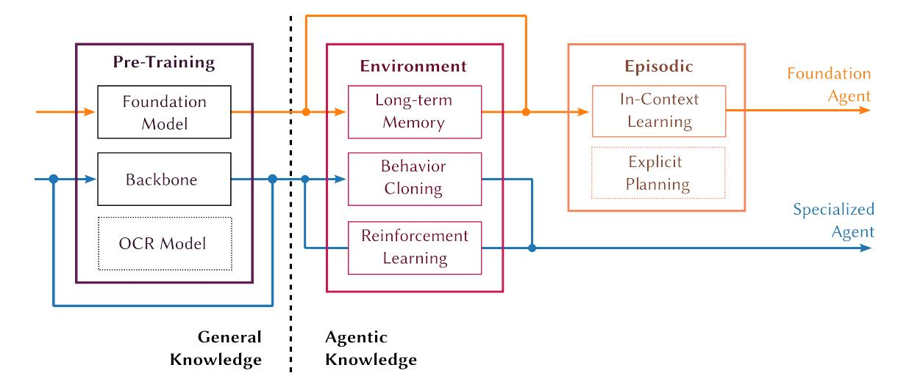

Fig. 8. Overview of learning steps and strategies: Pre-training involves acquiring broad, environment-agnostic knowledge. Environment learning and episodic improvement hone a ACU's agentic capabilities. A combination of these steps defines a learning strategy. ACUs typically follow one of two strategies: (1) Specialized agents (blue) start from scratch or use a pre-trained backbone, learn to act in a specific environment through behavioral cloning (BC) or reinforcement learning (RL) ; (2) foundation agents (orange) begin with a general-purpose foundation model, optionally storing successful episodes for future demonstration retrieval, and employ in-context learning.

Environment learning: The agent learns to adapt to a specific computer environment. This involves explicit parameter (weight) updates or implicit methods, such as storing environment experiences for later retrieval.

Episodic improvement: The agent refines its performance within the current episode through methods such as instruction tuning or few-shot learning [\(Brown et al. 2020\)](#page-32-15). Unlike the previous steps, this step does not result in persistent learning, as changes are discarded post-episode.

Figure [8](#page-19-1) illustrates how these steps sequentially combine into learning strategies for both foundation and specialized agents. Our analysis of learning strategies shows that the combination of general pre-training with prompting is the most common strategy (see Appendix Figure [18\)](#page-41-1). The following sections explore each learning step in detail, emphasizing current practices and highlighting exceptions.

5.2.1 Leveraging General Pre-Training. General pre-training serves as an initialization stage for an agent. This initial knowledge can be modified and adapted through environment learning (e.g., fine-tuning, see Section [5.2.2\)](#page-20-0) or preserved and utilized via episodic improvement (e.g., prompting, see Section [5.2.3\)](#page-22-0).

Foundation agents primarily rely on the former approach. They leverage foundation models with broad knowledge and in-context learning capabilities [\(Brown et al. 2020\)](#page-32-15). These capabilities can eliminate the need for environment-specific fine-tuning, allowing agents to operate in computer environments using only the foundation model's broad knowledge and instructions provided through prompts to adapt to specific environments (e.g., [Kim et al. 2023\)](#page-34-0). For example, GPT-4 [\(OpenAI et al. 2024\)](#page-35-12), when prompted as a web agent, can complete tasks such as filling out forms or navigating website links [\(B. Zheng et al. 2024\)](#page-37-15).

In contrast, specialized agents are either trained from scratch (e.g., [Humphreys et al. 2022\)](#page-33-1) or initialized with a pre-trained backbone (e.g., an image encoder) to accelerate learning the observation space [\(T. Li, G. Li,](#page-34-12) [J. Zheng, et al. 2024\)](#page-34-12). These agents typically require additional fine-tuning to adapt to computer environments (see Section [5.2.2\)](#page-20-0). The foundation model or backbone choice depends on the observation space, action space, and

specific task requirements. For example, [B. Zheng et al.](#page-37-15) [\(2024\)](#page-37-15) use GPT-4 [\(OpenAI et al. 2024\)](#page-35-12) as a multi-modal foundation model for their bi-modal agent. [Gur, Furuta, et al.](#page-33-8) [\(2024\)](#page-33-8) employ a coding-proficient foundation model [\(Chung et al. 2024\)](#page-32-16) to generate executable code. [Shaw et al.](#page-36-13) [\(2023\)](#page-36-13) fine-tune a vision backbone for their vision-based agent. [Iki and Aizawa](#page-33-14) [\(2022\)](#page-33-14) fine-tune a text backbone for their text-based agent. [Y. Song, Bian, Y.](#page-36-8) [Tang, G. Ma, et al.](#page-36-8) [\(2024\)](#page-36-8) use pre-trained object detection and OCR models to convert screenshots into text-based observations for direct UI access actions. [Gur, Furuta, et al.](#page-33-8) [\(2024\)](#page-33-8) pre-train an LLM from scratch only on HTML data while utilizing an HTML-specific local and global attention mechanism.

5.2.2 Environment Learning. Environment learning involves adaptation to computer environments through experience. Three main approaches are used: reinforcement learning, behavioral cloning, and long-term memory. Among them, behavioral cloning is the most frequently used strategy (see Appendix Figure [19\)](#page-41-2).

Many foundation agents bypass the environment learning step, relying solely on their pre-trained, out-ofthe-box capabilities by using prompting strategies. While these capabilities can be remarkably effective (e.g., [B. Zheng et al. 2024\)](#page-37-15), the absence of environment learning limits these agents, as they lack mechanisms to adapt or improve their performance within specific computer environments.

Reinforcement Learning. In reinforcement learning (RL), an agent acts in an environment and learns to maximize a cumulative reward by trial and error [\(Sutton and Barto 2018\)](#page-36-3). For computer use tasks, such environments are hand-crafted simulations, called controlled environments, designed to mimic real-world computer settings while providing a reward signal for guidance. RL has been implemented with various algorithms, including approximate policy iteration [\(Humphreys et al. 2022\)](#page-33-1), policy gradients [\(Shi et al. 2017\)](#page-36-7), and bootstrapping with tree search [\(Shaw et al. 2023\)](#page-36-13).

Agents in simpler environments may rely on brute-force exploration to learn directly from random behavior (e.g., [Shvo et al. 2021;](#page-36-14) [Toyama et al. 2021\)](#page-36-12). However, in most computer environments, rewards are sparse as they are only given upon completing the assigned instruction (e.g., [Shi et al. 2017\)](#page-36-7), such as submitting a flight booking form after filling out all details correctly. Sparse rewards make learning from an initial random behavior often unsuccessful, as an agent is unlikely to predict a long action sequence by random chance [\(Humphreys et al.](#page-33-1) [2022\)](#page-33-1). One strategy to mitigate sparse rewards is to begin by training an agent on human-labeled demonstrations (behavioral cloning), providing it with enough competence to start finding and learning from rewards (e.g., [Humphreys et al. 2022;](#page-33-1) [Shi et al. 2017\)](#page-36-7). Relatedly, [E. Z. Liu et al.](#page-34-6) [\(2018\)](#page-34-6) use human-labeled demonstrations to constrain the action space by defining sets of valid actions based on similarity to demonstrated actions, increasing the likelihood of reward discovery.

Without demonstrations, reward shaping [\(Ng et al. 1999\)](#page-35-13) can artificially reduce sparsity by providing intermediate guidance, as shown by [Gur, Rückert, et al.](#page-33-9) [\(2019\)](#page-33-9) and [Y. Li and Riva](#page-34-13) [\(2021\)](#page-34-13). Alternatively, the task complexity can be adaptively adjusted. [Gur, Jaques, et al.](#page-33-17) [\(2021\)](#page-33-17), for instance, introduce a controlled environment that enables autonomous curriculum learning [\(Bengio et al. 2009\)](#page-32-17) by automatically changing a task's complexity. Similarly, [Gur, Rückert, et al.](#page-33-9) [\(2019\)](#page-33-9) employ curriculum learning by gradually moving an agent's starting point away from the goal state as it gains competence.

The key advantage of RL is its ability to autonomously explore environments and effectively navigate a dynamic dataset. However, RL's reliance on controlled environments limits its application to broad computer use tasks, as rewards must be defined and action consequences suppressed (i.e., ensure that actions within the simulation have no real-world consequences). The development of such environments can be very tedious, typically preventing current ACUs from acquiring broad knowledge by solely using RL. Nevertheless, AndroidEnv [\(Toyama et al.](#page-36-12) [2021\)](#page-36-12) combats this limitation by simulating a complete, virtual Android environment on top of which tasks can be configured by defining instructions and rewards.

Behavioral Cloning. In behavioral cloning (BC) (Pomerleau 1988), an agent learns to mimic a shown behavior through supervised learning. The shown behavior is usually a sequence of recorded observations and actions of a human completing a computer use task given an instruction i.

Unlike RL, learning via BC does not require the agent to execute actions in the environment, making it applicable in *uncontrolled* environments (trained based on observation-action pairs instead of a simulation). For example, Z. Zhang and A. Zhang (2024) fine-tune a model on Android demonstrations from the work of Rawles, A. Li, et al. (2023), while Hong et al. (2024) combine Android demonstrations provided by Rawles, A. Li, et al. (2023) with Web demonstrations taken from the work of X. Deng et al. (2023).

BC methods vary in training strategies and data collection. For example, Gur, Nachum, et al. (2023) train the entire model, Hong et al. (2024) only update specific components, while W. Li et al. (2024) use low-rank adaption (E. J. Hu et al. 2021) to fine-tune a foundation model. Datasets are typically human-labeled (e.g., Humphreys et al. 2022), but autonomous data collection methods also exist. For instance, Furuta, K.-H. Lee, et al. (2024) use rejection sampling to identify successful trajectories from another agent's actions in a controlled environment, leveraging the environment's rewards for validation. Similarly, Lai et al. (2024) iteratively collect successful demonstrations for improving their agent.

While BC can be used independently to train ACUs, it can also be used as a pre-trained step, with the ACU being fine-tuned afterward using RL to improve performance. Typically, RL further enhances the agent by exploring aspects missing from the behavioral data. For instance, Humphreys et al. (2022) demonstrate that after training their agent on 2.4 million human-labeled actions, RL increases the task success rate from approximately 30% to over 95%. Nonetheless, some agents rely entirely on BC, which can suffice for simpler tasks (e.g., Gur, Nachum, et al. 2023).

Long-Term Memory. Foundation models exhibit strong few-shot learning capabilities (Brown et al. 2020), enabling foundation agents to enhance action prediction by incorporating successful demonstrations as examples directly into their context (see Section 5.2.3). This paradigm is also known as in-context learning (ICL). Long-term memory extends ICL by first allowing the agent to execute and store successful trajectories in an external memory, and then later retrieve previous trajectories from this memory as examples of how a specific (sub-)task can be solved. Importantly, since the examples are collected by the agent itself rather than provided by a human, the

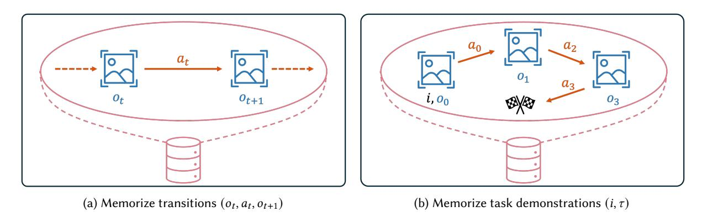

Fig. 9. Two kinds of experiences an agent can store in its long-term memory. (a) The agent memorizes the pre- and post-action observations as environment transitions  $(o_t, a_t, o_{t+1})$ . (b) The agent memorizes an instruction with a successful action-observation episode  $(i, \tau)$ 

agent learns to improve its capabilities over time and adapts *autonomously* to an environment (we discuss human prompt designs in the next section). Figure 9 illustrates the two main types of experiences:

**Environment transitions:** The agent memorizes environment transitions as triples ( $o_t$ ,  $a_t$ ,  $o_{t+1}$ ), where  $a_t$  represents the action taken, and  $o_t$ ,  $o_{t+1}$  capture the pre- and post-action observations, respectively. For example, the agent might store the consequence of its actions, such as "clicking on the calculator app ( $a_t$ ) on the home screen ( $o_t$ ) opens the calculator app ( $o_{t+1}$ )." Wen, Y. Li, et al. (2024) collect such transitions for Android apps in an offline phase by random exploration. They describe and summarize these transitions using an LLM, enabling the agent to enrich actionable elements with outcome information. For example, a more options button could be annotated to reveal specific hidden menu items, informing the agent what to expect if this button is clicked. Autonomous transition memories can also be combined with human demonstrations, as shown by C. Zhang, Z. Yang, et al. (2023) and Y. Li, C. Zhang, et al. (2024).

**Task demonstrations:** The agent memorizes task demonstrations by storing a tuple  $(i, \tau_i)$  containing the instruction i and a successful demonstration  $\tau_i = (o_0, a_0, \ldots, o_t, a_t)$  of solving i. Since only successful attempts are informative for the agent, the agent must have a mechanism to filter *successful* trajectories. A common approach is to use a controlled environment's feedback and only to store trajectories that yield a high reward (e.g., Tao et al. 2024). To manage memory constraints, trajectories  $\tau_i$  are typically simplified to  $\tau_i^* = (\tilde{o}_0, a_0, \ldots, \tilde{o}_t, a_t)$  (where  $\tilde{o}_i$  is a simplification of  $o_i$ ) before being stored. For instance, Y. Deng et al. (2024) only keep the actions  $\tau_i^* = (a_0, \ldots, a_t)$ , while H. Sun et al. (2023) store the complete executable program that solves i. These simplifications mirror history simplifications  $(h_t \to h_t^*)$ , as the history  $h_t$  is a (partial) trajectory. An alternative approach for discovering successful trajectories is programming by demonstration. Here, a human supervises the agent, intervenes if necessary, and demonstrates the correct solution for i, enabling online learning. Y. Song, Bian, Y. Tang, G. Ma, et al. (2024) propose this method to summarize the corrected behavior for future retrieval.

A limitation of memory-based approaches is their reliance on storing specific instances rather than learning abstract generalizations. To mitigate this, S. Lee et al. (2023) organize memories into a graph where observations are nodes, actions are edges, and both are generalized to unify related experiences. For example, an action a = click(text=Bob) is generalized to  $a^* = \text{click(text=[contact name])}$ . When retrieving memories, the graph is searched, and parameterized actions are instantiated based on the current state  $(o_t, i)$ , grounding parameters like [contact name] to specific values. However, it still remains challenging to map specific trajectory instances to general concepts and to later retrieve and adapt helpful general concepts for specific tasks.

5.2.3 Episodic Improvement. Episodic improvement refers to an agent's ability to enhance its performance within a single episode by reasoning over its current context, without retaining knowledge across episodes. This effectively trades test-time computing for improved task execution.

Foundation agents commonly achieve episodic improvement through in-context learning (Brown et al. 2020). ICL encompasses techniques such as *instruction tuning*, where guidance is provided to the model through the prompt, and few-shot learning, which gives examples of successful trajectories as *demonstrations* to the agent.

In contrast, current specialized agents typically do not employ episodic improvement. However, analogous mechanisms exist, such as search-based planning in game-playing agents, which simulate future outcomes to guide action selection (Silver et al. 2017). Such approaches can be considered as a more traditional reasoning within agents.

*In-Context Learning through Instruction Tuning.* Foundation models are often adapted to specific tasks through *prompt engineering.* Typically, these prompts are designed by humans to adapt a foundation model to specific environmental conditions (e.g., B. Zheng et al. 2024) and can include guidance on valid actions, previous history,

**Prompt Snippet** Category Action Generation [...] you can click an object by referring to its id, such as 'click id=..., [...]' (T. Li, G. Li, Z. Deng, et al. 2023) Provide history  $h_t$ Previous Actions: {PREVIOUS ACTIONS} (B. Zheng et al. 2024) Prescribe a role Imagine that you are  $imitating\ humans\ doing\ web\ navigation\ [\dots]$ (B. Zheng et al. 2024) Elicit intermediate thoughts [...] think about what the current webpage is [...] analyze each step of the previous action history [...] based on your analysis [...] decide on the following action [...] (B. Zheng et al. 2024) Provide general guidelines To be successful [...] only issue a valid action [...] only issue one action [...] (B. Zheng et al. 2024)

Table 4. Example snippets of actual prompts.

assumed roles, or intermediate reasoning steps. Table 4 exemplifies some snippets taken from the (much longer) prompts in the literature (for more details, refer to Table 6 in Zheng at al. (B. Zheng et al. 2024)).

While most prompts are human-authored, some methods automate prompt construction. For example, H. Sun et al. (2023) uses a second model as a planner to autonomously generate prompts for the agent. This strategy, known as self-prompting, involves using multiple instances of the foundation model, each fulfilling different roles and interacting with one another through iterative prompting (e.g., Z. Song et al. 2024).

With the rise of vision-language models, visual prompt engineering has emerged. This includes techniques such as extending screenshots to incorporate user instructions (K. Lee et al. 2023), overlaying bounding boxes on actionable UI elements (e.g., Bonatti et al. 2024), and adding unique identifiers for visual grounding (e.g., C. Zhang, L. Li, et al. 2024).

In-Context Learning through Demonstrations. Few-shot learning enhances agent performance by providing example trajectories,  $\tau_1, \tau_2, \ldots$ , which demonstrate successful task execution. Figure 10 illustrates four common techniques for collecting and providing demonstrations to the agent. These common sourcing strategies include:

**Human-crafted:** For a given class of tasks, a fixed set of human-crafted demonstrations  $\{\tau_1, \tau_2, \ldots\}$  is provided to the foundation model (e.g., Kim et al. 2023).

**Semantic retrieval:** Based on the semantic similarity of the instruction *i* compared to previous instructions, an agent retrieves human-crafted demonstrations from a database (e.g., Cho et al. 2024).

Auxiliary model: A secondary agent is first used to generate a large set of demonstrations, after which the agent retrieves those demonstrations that are semantically relevant to the current instruction i.

**Agent-collected:** The agent autonomously collects its own demonstrations, referred to as *long-term memory*, by searching through its past experiences (Section 5.2.2).

Given the limitations of context length, a provided trajectory  $\tau = ((o_0, a_0), (o_1, a_1), ...)$  is typically compressed  $\tau \to \tau^*$ , analogous to history simplification ( $h_t \to h_t^*$ , Section 5.1.2).

In addition to the trajectory, a demonstration may include rationales for each action taken (e.g., Cho et al. 2024). These rationales, inspired by chain-of-thought prompting (H. Liu et al. 2023), can aid the agent when making similar decisions. Such reasoning can be written by humans (e.g., B. Wang et al. 2023) or generated autonomously by another model (e.g., Cho et al. 2024; Sodhi et al. 2023).

Episodic Improvement through Planning. ACUs are goal-driven and often require planning to fulfill complex instructions i (Russell and Norvig 2022, Chapter 2.4). Most specialized agents perform implicit planning in their

latent space, a process [T. Li, G. Li, Z. Deng, et al.](#page-34-5) [\(2023\)](#page-34-5) called iterative planning, where future states or action consequences are not explicitly constructed.

Agents based on foundation models typically generate explicit plans in text form. One common method is chain-of-thought prompting [\(H. Liu et al. 2023\)](#page-35-15), which guides the model to produce intermediate reasoning steps before deciding on an action, improving the agent's performance (e.g., [Rawles, A. Li, et al. 2023;](#page-36-18) [J. Zhang et al.](#page-37-21) [2024\)](#page-37-21). Another method involves decomposing an instruction into sequential sub-tasks, such as breaking down the task Book an economy class flight from Hangzhou to Beijing into steps like Open the Alipay app and Input "Hangzhou" as the departure city [\(Guan et al. 2023\)](#page-33-19).

Plans can be refined iteratively. For instance, after initial prompting, agents may either follow their initial plan rigidly (e.g., [Kim et al. 2023\)](#page-34-0) or adapt it based on new observations (e.g., [H. Sun et al. 2023\)](#page-36-10). Another refinement [\(Kim et al. 2023\)](#page-34-0) is done by prompting their foundation model to critique and refine its generated plans recursively. Although this can yield minor improvements, [\(Kambhampati 2024\)](#page-33-20) argues that the benefits of self-critiquing may be limited.

These prompt-based planning strategies are considered informal planning, as they are based on the text output of foundation models, as opposed to internally simulating various action trajectories before deciding on one. In contrast, formal planning can be implemented based on a search algorithm. For instance, [Koh, McAleer, et al.](#page-34-17) [\(2024\)](#page-34-17) simulate actions in a controlled environment and search through potential future states (observations) to better inform decision-making for the next action. This approach shows significant performance gains, with task success rates improving by 50% at a search depth of 5. Building on this, [Chae et al.](#page-32-19) [\(2024\)](#page-32-19) fine-tune a model to predict the effects of actions on current observations, allowing for better decision-making without relying on an external simulator.

5.2.4 Recommendations. The landscape of learning strategies for ACUs is notably diverse. Historically, RL and BC dominated as the primary paradigms. More recently, the emergence of foundation agents has shifted attention toward prompt-based learning. Despite this evolution, our analysis reveals that the field has yet to converge on a unified framework (see Appendix Figure [18\)](#page-41-1).

To enable a technology-agnostic characterization, we categorized learning paradigms into three sequential steps: pre-training, environment learning, and episodic improvement. Our analysis reveals a research gap in an effective and practical environment learning paradigm for foundation agents: Long-term memory approaches, while practical, often suffer from poor generalization. Storing raw trajectories is less beneficial than

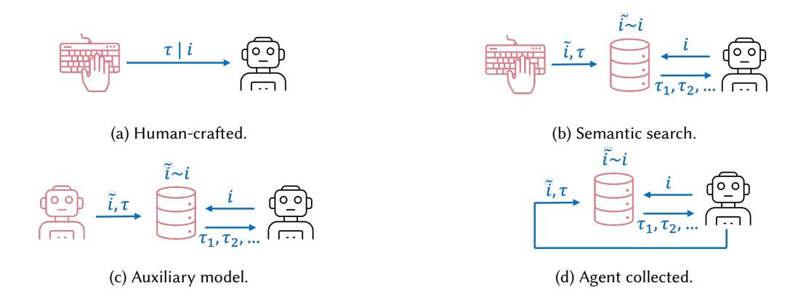

Fig. 10. The four most common few-shot learning strategies for ACUs.

capturing underlying concepts, which remains highly challenging within this approach. In contrast, reinforcement learning (RL) and behavioral cloning (BC) provide strong learning signals and enable concept abstraction, but they are highly resource-intensive, requiring either high-fidelity simulation environments or curated and labeled datasets for effective fine-tuning.

To address this bottleneck, we recommend research into the direction of introducing a self-supervised fine-tuning stage between general pre-training and resource-intensive environment learning. This intermediate stage would align general-purpose foundation models more closely to computer use contexts analogous to the role of RLHF in aligning LLMs with human preferences [\(Ziegler et al. 2020\)](#page-38-5) or GRPO in improving reasoning [\(Shao et al. 2024\)](#page-36-21). Such an alignment stage would equip models with domain-specific inductive biases, enabling faster and more robust adaptation during subsequent environment learning phases [\(Ouyang et al. 2022\)](#page-35-1).

Our analysis also identifies planning as a major limitation in current ACU architectures. LLMs exhibit limited long-horizon planning capabilities [\(Valmeekam, Marquez, et al. 2023\)](#page-36-22), and the dynamics of the environment are often unknown, which hinders direct adaptation of symbolic approaches. Thus, we argue that planning in ACUs remains an open and pressing research challenge. However, we identify two promising research directions for addressing this gap: First, recent developments in reasoning-oriented LLMs, such as OpenAI o1, demonstrate promising capabilities in planning and long-horizon decision-making [\(Tan et al. 2024;](#page-36-17) [Valmeekam,](#page-36-23) [Stechly, et al. 2024\)](#page-36-23). Adapting these capabilities for ACUs—and demonstrating robust planning performance in dynamic digital environments—is a critical next step. Second, hybrid systems that combine symbolic planning with learned models of perception and action outcomes, such as those proposed by [Koh, McAleer, et al.](#page-34-17) [\(2024\)](#page-34-17), offer a compelling alternative. These methods draw from classical planning algorithms [\(Russell and Norvig 2022,](#page-36-0) Chapter 11) while leveraging neural components for generalization and flexibility. Although these approaches extend beyond the ACU domain, we argue that ACUs provide an ideal testbed due to their complexity and fully digital nature. The integration of neuro-symbolic methods with agentic foundation models may pave the way for more sophisticated, adaptive, and general-purpose computer use agents.

## 6 Computer Use Datasets

In this section, we focus on important computer use datasets and do not cover datasets used for general pretraining of foundation models or those only partially relevant for computer use, such as question answering (e.g., [Hudson and Manning 2019\)](#page-33-21) and tool usage datasets (e.g., [Patil et al. 2023\)](#page-35-16). Table [8](#page-52-1) provides an overview of all considered computer use datasets and their key properties.

To illustrate the evolution of these datasets, Figure [11](#page-26-0) presents a timeline of their development across three major domains: Web, Android, and personal computers. The figure reflects a general trend toward increasing task complexity and realism over time, highlighting how research has shifted from simplified environments toward real-world applications and large-scale demonstrations.

## 6.1 Dataset Types

ACUs leverage two types of computer use datasets:

Controlled Environments: A controlled environment is a simulated setting, meaning an agent can act freely without consequences, as the simulation can always be reset. These environments support reinforcement learning, given they provide an additional reward signal (e.g., [Humphreys et al. 2022\)](#page-33-1). Furthermore, they can be utilized to collect long-term memories in a safe simulation phase (e.g., [Wen, Y. Li, et al. 2024\)](#page-37-11) and to plan at inference time by simulating potential actions [\(Koh, McAleer, et al. 2024\)](#page-34-17).

Offline Dataset: An offline dataset is collected by instructing humans on a computer task while recording observations and executed actions. The agent only sees the recorded interaction during training, meaning it never acts in the underlying environment, making training safe from consequences. Offline datasets can

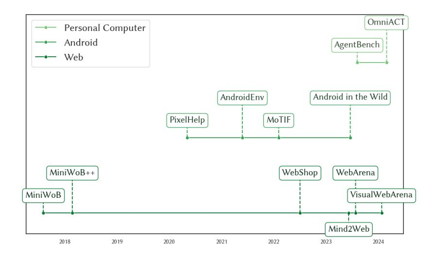

Fig. 11. Development of datasets across domains over time. In general, complexity increases over time. For the Web domain: MiniWoB [\(Shi et al. 2017\)](#page-36-7) and MiniWoB++ [\(E. Z. Liu et al. 2018\)](#page-34-6) contain 100 tasks on a simplified UI. WebShop [\(Yao et al. 2022\)](#page-37-22) is a more realistic single webshop application focusing on realistic product diversity. Mind2Web [\(X. Deng et al. 2023\)](#page-32-9) contains 2350 demonstrations across 137 actual websites. WebArena [\(Zhou et al. 2024\)](#page-38-3) is a controlled environment of 4 realistic web applications. VisualWebArena [\(Koh, Lo, et al. 2024\)](#page-34-18) extends WebArena with 910 more visual tasks and an additional application. For the Android domain: PixelHelp [\(Y. Li, J. He, et al. 2020\)](#page-34-8) contains step-by-step instructions across 4 applications. AndroidEnv [\(Toyama et al. 2021\)](#page-36-12) provides a framework to define custom tasks in Android applications. MoTIF [\(Burns et al.](#page-32-20) [2022\)](#page-32-20) contains 756 demonstrations across 125 applications. Android in the Wild [\(Rawles, A. Li, et al. 2023\)](#page-36-18) provides over 700, 000 demonstrations across 357 applications. For the personal computer domain: AgentBench [\(X. Liu et al. 2023\)](#page-35-17) is a benchmark framework that spans operating systems, databases, web, and gaming tasks, including existing benchmarks like WebShop or Mind2Web. OmniACT [\(Kapoor et al. 2024\)](#page-34-19) contains 9802 tasks labeled with straight-line code actions spanning 57 applications on Windows, MacOS, Linux, and the Web.

be utilized for few-shot learning (e.g., [X. Deng et al. 2023\)](#page-32-9) or fine-tuning an agent (e.g., [Rahman et al. 2024\)](#page-35-8) in an uncontrolled environment like a productive website. Furthermore, an offline dataset of a controlled environment can be used for initial behavioral cloning to combat sparse rewards [\(Humphreys et al. 2022\)](#page-33-1).

Both dataset types have distinct characteristics. Controlled environments are costly to create because they involve engineering simulations that mimic real-world behaviors, but the agent can explore all aspects of the environment autonomously. In contrast, offline datasets can be recorded in any environment, but are incomplete as not every possible interaction is captured. Furthermore, offline datasets only show a single trajectory to achieve an instruction, but maybe multiple ones exist.

## 6.2 Domains, Observation and Action Spaces

By analyzing the domains of our 33 reviewed datasets, we find that the majority of existing datasets are from the Web domain (e.g., [Zhou et al. 2024\)](#page-38-3) and Android domain (e.g., [Rawles, A. Li, et al. 2023\)](#page-36-18), while the personal computer domain (e.g., [Hong et al. 2024\)](#page-33-12) receives less attention (see Appendix Figure [14\)](#page-39-1).

The types of observations and actions available in these datasets vary depending on the domain and data collection method. For observations, some datasets provide only image screen representations (e.g., [Rawles, A. Li,](#page-36-18) [et al. 2023\)](#page-36-18), some only textual screen representations (e.g., [Pasupat et al. 2018\)](#page-35-18), while others offer both (e.g., [X. Chen et al. 2021\)](#page-32-21). Regarding actions, some datasets focus solely on mouse/touch and keyboard actions (e.g., [Kapoor et al. 2024\)](#page-34-19), some provide direct UI actions (e.g., [Q. Chen et al. 2024\)](#page-32-5), while others focus on task-tailored actions (e.g., [X. Liu et al. 2024\)](#page-35-19). Table [8](#page-52-1) provides an overview. In many cases, additional observation and action types can be generated through post-processing efforts. For instance, HTML representations can be rendered through a web browser to provide image-based screen representations.

## 6.3 Dataset Complexity

Several factors, including the size of the state, observation, and action spaces, and the diversity of the tasks, influence the complexity of a computer use dataset.

Controlled environments are often simplified and less diverse compared to offline datasets. For instance, in MiniWoB++ [\(Shi et al. 2017\)](#page-36-7), all tasks are performed within a uniform, simplified website design with minimal graphical user interface (GUI) elements and clean HTML. Similarly, WebShop [\(Yao et al. 2022\)](#page-37-22) is limited to a single, simplified webshop application. While WebArena [\(Zhou et al. 2024\)](#page-38-3) offers more realistic web environments, it is limited to four tasks.

Offline datasets tend to feature more realistic observations, with the diversity depending on the variety of scenarios, such as how many websites were included. For example, Mind2Web [\(X. Deng et al. 2023\)](#page-32-9) records tasks from 137 websites across 31 categories, providing substantial diversity. Similarly, Android in the Wild [\(J. Zhang](#page-37-21) [et al. 2024\)](#page-37-21) records tasks spanning 357 Android apps or websites.

The complexity of tasks varies greatly across datasets. For example, MiniWoB++ [\(Shi et al. 2017\)](#page-36-7) includes 100 tasks with randomized text and an average of 3.6 actions per task, ranging from simple actions like clicking a button to more complex tasks like filling out a form to book a flight. WebShop [\(Yao et al. 2022\)](#page-37-22) offers 12,000 crowd-sourced instructions, all related to shopping, with an average of 11.3 actions per task. Mind2Web [\(X. Deng](#page-32-9) [et al. 2023\)](#page-32-9) provides 2,000 tasks averaging 7.3 actions, while WebArena [\(Zhou et al. 2024\)](#page-38-3) features 812 tasks, some requiring actions across applications, such as the task to create a Reddit account mirroring a GitLab profile.

Generally, the complexity of newer datasets increases as agents become more capable. A straightforward way to do this is to make observations and tasks more diverse and challenging. For example, WebArena [\(Zhou et al.](#page-38-3) [2024\)](#page-38-3) has a more realistic observation space than MiniWoB++ [\(Shi et al. 2017\)](#page-36-7), and tasks require more actions to be achieved. However, there are many other ways to increase complexity: VisualWebArena [\(Koh, Lo, et al. 2024\)](#page-34-18) adds images as part of the instruction, such as asking an agent to create a post selling a product shown in an image. AgentStudio [\(L. Zheng, Huang, et al. 2024\)](#page-37-23) provides video-based observations, requiring agents to process dynamic, time-dependent information. MT-Mind2Web [\(Y. Deng et al. 2024\)](#page-32-18) extends Mind2Web by introducing multi-turn tasks, where users give sequential instructions to the agent, requiring a more nuanced agent behavior. MoTIF [\(Burns et al. 2022\)](#page-32-20) introduces infeasible instructions in its offline dataset, challenging agents to recognize unachievable tasks.

## 6.4 Recommendations

A key limitation of current datasets lies in their insufficient trajectory complexity. They have limited structural and causal dependencies between actions in a task sequence. Complex tasks often require agents to execute actions in a specific causal order, where later actions depend on the outcomes of earlier ones. For instance, proposing a meeting time requires first retrieving the user's availability. In contrast, filling form fields can often be performed in any sequence. We recommend that future ACU datasets increase trajectory complexity by designing tasks that require longer, causally dependent action sequences.

Although trajectory complexity is crucial, observation, action, and task diversity should not be neglected, as broader observation and action types (e.g., dealing with various UI components) and more diverse tasks within

Fig. 12. Task-level metrics measure performance across individual tasks (instructions). Step-level metrics measure performance across individual steps (actions).

and across applications are essential for accurately reflecting real-world usage and improving the generality of agents.

## 7 Agent Evaluation

Various evaluation metrics are used in the current literature. We identify three groups of evaluation metrics (see also Figure [12\)](#page-28-1): Task-level metrics, step-level metrics, and other metrics.

## 7.1 Task-Level Metrics

Task-level metrics focus on the overall effectiveness of an agent in achieving an instruction . Task success rate is the most common task-level metric, which measures the overall success rate of completing an entire task [\(X. Deng et al. 2023;](#page-32-9) [J. Zhang et al. 2024\)](#page-37-21). For controlled environments, the environment state indicates successful task completion. For offline datasets, an agent predicting the full trajectory correctly counts as successful task completion, termed offline task success rate (also called complete match (e.g., [Y. Li, J. He, et al. 2020\)](#page-34-8)).

The offline task success rate underestimates the actual task success rate, as it only considers a single recorded trajectory, whereas alternative valid trajectories may exist. Consequently, it serves as a lower bound on the true task success rate. To obtain a more accurate estimate, the online task success rate can be used. To measure online task success rate, the agent must be deployed in its original environment, typically the live websites from which the offline dataset was collected. Human evaluators then determine whether the agent successfully completes the task [\(T. J.-J. Li, Azaria, et al. 2017;](#page-34-20) [Y. Song, Xiong, et al. 2023;](#page-36-9) [B. Zheng et al. 2024\)](#page-37-15). Notably, [B. Zheng et al.](#page-37-15) [\(2024\)](#page-37-15) report that their agent's success rate increased from 12% to 36% when evaluated online, highlighting the limitations of relying solely on offline trajectories. However, the reproducibility of the online task success rate poses a challenge, due to potential changes in the online environment and the potential for error in human evaluation [\(Reason 1990\)](#page-36-24).

Other, less common task-level metrics exist, often providing a more nuanced assessment of the agent's capabilities. Task progress measures the average task completion progress, meaning how far the agent, on average, is to complete a task (e.g., [Sodhi et al. 2023;](#page-36-20) [J. Zhang et al. 2024\)](#page-37-21). Average reward captures the average reward obtained across episodes within a controlled environment (e.g., [Jia et al. 2019\)](#page-33-2).

## 7.2 Step-Level Metrics

Step-level metrics focus on the overall effectiveness of an agent in predicting actions (steps) across tasks. Step success rate is the most common step-level metric, which assesses the accuracy of action prediction (e.g., [X. Deng](#page-32-9) [et al. 2023\)](#page-32-9). In the literature, step success rate is also called partial match (e.g., [Y. Li, J. He, et al. 2020\)](#page-34-8) or action accuracy (e.g., [Wen, Y. Li, et al. 2024\)](#page-37-11).

Each step (action) is part of a trajectory (a sequence of multiple actions), which in turn represents a single task in the dataset (comprising multiple tasks). Consequently, step-level metrics must define how to average step scores both within their trajectory and across tasks, similar to other fields like multi-class classification, where metrics are averaged within classes and across samples [\(Grandini et al. 2020\)](#page-33-22). Two natural approaches for averaging exist:

Macro averaging: Step scores are averaged first within their respective trajectory and then across tasks. As a result, each step score is weighted by the inverse of its corresponding trajectory's length.

Micro averaging: Step scores are averaged across all steps (of all trajectories). This assigns equal weight to each step score regardless of trajectory length.

For computer use, macro averaging seems to be the prevailing approach, established by Mind2Web [\(X. Deng](#page-32-9) [et al. 2023\)](#page-32-9) and adopted by subsequent work (e.g., [L. Zheng, R. Wang, et al. 2024\)](#page-37-16).

Other less common step-level metrics include the action F1 score (e.g., [T. Li, G. Li, J. Zheng, et al. 2024\)](#page-34-12), action recall (e.g., [Y. Li and Riva 2021\)](#page-34-13), or measuring only if parts of the action are correct, like the element accuracy for direct UI access actions (e.g., [X. Deng et al. 2023\)](#page-32-9). Finally, all step-level metrics only exist for offline datasets, as controlled environments' rewards do not indicate the correctness of individual actions.

## 7.3 Other Metrics

Other metrics in the literature measure performance indicators other than an agent's capabilities. [Y. Song, Xiong,](#page-36-9) [et al.](#page-36-9) [\(2023\)](#page-36-9) evaluate agent efficiency by measuring the number of API calls required to execute an instruction successfully, emphasizing minimal resource usage during task execution. [C. Zhang, L. Li, et al.](#page-37-10) [\(2024\)](#page-37-10) incorporate a safeguard mechanism to seek user confirmation before executing critical actions (e.g., delete) to build a safer and more trustworthy agent. The safeguard rate measures how accurately the agent identifies sensitive actions and requests user confirmation.

## 7.4 Recommendations

A standardized evaluation protocol is currently absent in the ACU literature. A key challenge lies in the prevalent use of custom datasets or modified benchmarks to highlight specific strengths (e.g., [J. Wang et al. 2024;](#page-37-13) [Wen,](#page-37-11) [Y. Li, et al. 2024\)](#page-37-11), which limits comparability across studies. For instance, in the MiniWoB++ benchmark [\(E. Z. Liu](#page-34-6) [et al. 2018;](#page-34-6) [Shi et al. 2017\)](#page-36-7), different studies have adopted varying subsets of tasks, complicating cross-study comparisons. [Humphreys et al.](#page-33-1) [\(2022\)](#page-33-1) evaluated agents on all 104[4](#page-29-0) tasks, while [L. Zheng, R. Wang, et al.](#page-37-16) [\(2024\)](#page-37-16) used 64 tasks and [Kim et al.](#page-34-0) [\(2023\)](#page-34-0) selected 55. Despite these differences between ACU evaluations, average task performance is compared directly, undermining fair assessment. For example, [L. Zheng, R. Wang, et al.](#page-37-16) [\(2024,](#page-37-16) Figure 3) and [Kim et al.](#page-34-0) [\(2023,](#page-34-0) Figure 4 (b)) compared their average task performance on a subset of tasks with an ACU evaluated on the full benchmark.

Moreover, no consensus exists on how to measure agent performance. Among the available performance metrics, the task success rate best reflects practical agent capabilities, as it evaluates whether an agent completes a task in its entirety. In contrast, step-level metrics measure the performance across individual steps and can be misleading when assessing actual agent competence, as a single error in a lengthy action trajectory may

4MiniWoB++ currently includes 100 tasks, excluding four that violate the static assumption.

have substantial real-world consequences but only a minor influence on step-level metrics. Accordingly, we recommend that for evaluating performance, ACU publications should report the task success rate as the primary metric on established and complete benchmarks.

While task success rate can be reliably measured in controlled environments, it is challenging for offline datasets. Reporting the offline task success rate provides only a lower bound and might underestimate agent performance; reporting the online task success rate is labor-intensive and suffers from limited reproducibility due to evolving online environment conditions and different evaluation procedures. In such offline dataset settings, the step success rate can serve as a reproducible proxy that must be interpreted with caution: First, it is a conservative estimate of actual step correctness, as alternative valid actions are often not captured in the dataset and penalized as errors. Second, higher step-level accuracy does not necessarily translate to higher task-level performance.

For evaluations on offline dataset benchmarks, we recommend reporting both the step success rate as a reproducible proxy metric and, where possible, the online task success rate as a measure of actual agent performance. To improve comprehensibility and traceability, the online evaluation protocol should be thoroughly documented, including details such as the date of the evaluation and any strategies used to mitigate human error [\(Reason](#page-36-24) [1990\)](#page-36-24).

Finally, ACUs must be capable of predicting a deliberate stop action to signal task completion. This capability is critical both for practical deployment and for correctly identifying when a task has been completed (e.g., [J. Wang et al. 2024\)](#page-37-13). We therefore recommend requiring a stop action in ACU evaluations whenever feasible and suggest that future benchmarks enforce this requirement. For example, controlled environments could reward agents only after they reach the goal state and explicitly issue the stop action.

## 8 Conclusions

Agents for Computer Use (ACUs) represent a rapidly advancing frontier in AI, offering both significant research challenges and substantial practical impact. While specialized designs remain viable for narrow, efficiency-critical tasks, the field is undergoing a paradigm shift toward foundation agents to enable the open-ended reasoning required for general computer use. Despite the accelerated progress driven by foundation models, many core challenges remain unresolved. This work identifies these challenges based on a unifying taxonomy that organizes ACU research across key concepts and establishes a shared vocabulary. Our taxonomy is structured around three complementary perspectives: The domain perspective, which characterizes the computing environment; the interaction perspective, which defines the observation and action spaces; and the agent perspective, which concerns internal structure and learning dynamics. This framework bridges previously disconnected lines of work, from reinforcement learning to prompting-based agents, and provides a technology-agnostic basis for comparison and analysis.

By applying our taxonomy to 87 ACUs across 33 datasets, we uncover several fundamental limitations in the current landscape of ACU research. Specifically, we identify: (1) reliance on structurally inconsistent input modalities that hinder generalization; (2) inefficient learning strategies; (3) limited capabilities in planning for executing complex, multi-step tasks successfully; (4) benchmarks that prioritize perception realism over task complexity; (5) inconsistent evaluation metrics that obstruct comparability; and (6) a disconnect between experimental assumptions and real-world deployment conditions.

To overcome these limitations and advance the ACU field, we recommend: (a) adopting image-based observation spaces to support consistent and robust perception; (b) pursuing cost-efficient learning strategies that allow better scalability and adaptability; (c) advancing policy architectures that support long-horizon reasoning and planning; (d) constructing benchmarks that integrate both realistic perception and task complexity; (e) standardizing evaluation metrics, especially success rates, to enable fair comparisons; and (f) grounding research in realistic assumptions by closely examining deployment conditions.

While limitations (1)–(5) and recommendations (a)–(e) are discussed throughout the main text, the limitation (6) and the recommendation (f) concern real-world discrepancies that are not addressed in the current literature. First, most ACU systems are built for idealized settings, assuming a deterministic, static, stationary, and episodic environment. However, real computing environments are dynamic, meaning agents must adapt their strategy based on changing perceptions due to other running processes, e.g., notifications obscuring the view. Furthermore, real-world environments are non-stationary, meaning an environment changes over time due to, e.g., application updates (see Appendix Section [D](#page-42-0) for a detailed discussion on such environment discrepancies). Second, there are unique privacy considerations: Traditional user education techniques fail, as users cannot control what an autonomous agent might observe and send to an ACU model provider (see Appendix Section [E.1](#page-44-1) for a detailed discussion). Third, safety considerations are systematically underexplored. Current research focuses solely on full autonomy, but conditional autonomy can increase safety, such as an ACU handing back control to the user for critical decisions (see Appendix Section [E.2](#page-44-2) for a detailed discussion).

While our taxonomy offers a structured overview, it has several limitations. We did not include a comprehensive comparison of agent capabilities, as many ACUs support only a subset of benchmarks or tasks within benchmarks and report different metrics, making it infeasible. We also do not explore how specific design choices, such as the selection of a foundation model or RL algorithms, affect performance. The scope is limited to agents using text-based instructions. Although our taxonomy is compatible with dynamic observation-action loops (e.g., those involving video inputs), we focus on static interaction patterns and do not evaluate the taxonomy in dynamic settings such as AndroidWorld [\(Rawles, Clinckemaillie, et al. 2024\)](#page-36-25). Furthermore, we intentionally focus on fully disclosed contributions, which excludes some of the recent commercial systems. While we ground our framework in established concepts, some components, such as our definition of agent learning, are computer use specific; it remains open how the field will evolve with respect to them.

Nonetheless, our taxonomy and associated analysis offer a valuable foundation for organizing and advancing ACU research. By integrating diverse perspectives and identifying shared challenges, this work supports a more cohesive, forward-looking research agenda. We hope this work fosters the development of ACUs that are robust, adaptive, and ready for deployment in real-world computing environments, and that the structure and terminology we introduce bring coherence to this currently fragmented field.

## Acknowledgments

The authors P. Sager and B. Meyer contributed equally to this work. The work is funded in part by the Canton of Zurich, Switzerland, through the Digitalization Initiative of the Canton of Zurich (DIZH) Fellowship project 'Stability of self-organizing net fragments as inductive bias for next-generation deep learning.'

## References

- H. Abukadah, M. Fereidouni, and A. Siddique. 2024. "Mapping Natural Language Intents to User Interfaces through Vision-Language Models." In: Proc. of the 18th ICSC. IEEE, Laguna Hills, CA, USA, 237–244. doi[:10.1109/ICSC59802.2024.00045.](https://doi.org/10.1109/ICSC59802.2024.00045)
- Anthropic. 2024. Introducing computer use, a new Claude 3.5 Sonnet, and Claude 3.5 Haiku. (2024). [https://www.anthropic.com/news/3-5-mode](https://www.anthropic.com/news/3-5-models-and-computer-use) [ls-and-computer-use.](https://www.anthropic.com/news/3-5-models-and-computer-use)
- K. Arulkumaran, M. P. Deisenroth, M. Brundage, and A. A. Bharath. 2017. "Deep reinforcement learning: A brief survey." IEEE Signal Processing Magazine, 34, 6, 26–38. doi[:10.1109/MSP.2017.2743240.](https://doi.org/10.1109/MSP.2017.2743240)
- R. Assouel et al.. 2023. "The unsolved challenges of LLMs as generalist web agents: A case study." In: Proc. of the 37th Int. Conf. on NeurIPS: Foundation Models for Decision Making Workshop. Curran Associates, Inc., New Orleans, LA, USA. [https://openreview.net/forum?id=jt3il4f](https://openreview.net/forum?id=jt3il4fC5B) [C5B.](https://openreview.net/forum?id=jt3il4fC5B)
- G. Baechler et al.. 2024. "ScreenAI: A Vision-Language Model for UI and Infographics Understanding." In: Proc. of the 33rd IJCAI. IJCAI, Jeju, Korea, 3058–3068. isbn: 978-1-9567-9204-1. doi[:10.24963/ijcai.2024/339.](https://doi.org/10.24963/ijcai.2024/339)
- B. Baker, I. Akkaya, P. Zhokhov, J. Huizinga, J. Tang, A. Ecoffet, B. Houghton, R. Sampedro, and J. Clune. 2022. "Video PreTraining (VPT): Learning to Act by Watching Unlabeled Online Videos." In: Proc. of the 36th Int. Conf. on NeurIPS. Vol. 35. Curran Associates, Inc., New Orleans, LA, USA, 24639–24654.

- Y. Bengio, J. Louradour, R. Collobert, and J. Weston. 2009. "Curriculum learning." In: Proc. of the 26th ICML. PMLR, Montreal, QC, Canada, 41–48. doi[:10.1145/1553374.1553380.](https://doi.org/10.1145/1553374.1553380)
- W. E. Bishop, A. Li, C. Rawles, and O. Riva. 2024. Latent State Estimation Helps UI Agents to Reason. (2024). doi[:10.48550/arXiv.2405.11120.](https://doi.org/10.48550/arXiv.2405.11120)
- R. Bonatti et al.. 2024. Windows Agent Arena: Evaluating Multi-Modal OS Agents at Scale. (2024). doi[:10.48550/arXiv.2409.08264.](https://doi.org/10.48550/arXiv.2409.08264)
- S. Branavan, H. Chen, L. Zettlemoyer, and R. Barzilay. 2009. "Reinforcement Learning for Mapping Instructions to Actions." In: Proc. of the Joint Conf. of the 47th Annual Meeting of the ACL and the 4th IJCNLP. ACL, Suntec, Singapore, 82–90.
- T. Brown et al.. 2020. "Language Models are Few-Shot Learners." In: Proc. of the 33rd Int. Conf. on NeurIPS. Vol. 33. Curran Associates, Inc., Vancouver, Canada, 1877–1901. doi[:10.18653/v1/N19-1423.](https://doi.org/10.18653/v1/N19-1423)
- A. Burns, D. Arsan, S. Agrawal, R. Kumar, K. Saenko, and B. A. Plummer. 2022. "A dataset for interactive vision-language navigation with unknown command feasibility." In: Proceedings of the ECCV. Springer Nature Switzerland, Tel Aviv, Israel, 312–328. doi[:10.1007/978-3-031-](https://doi.org/10.1007/978-3-031-20074-8_18) [20074-8\\_18.](https://doi.org/10.1007/978-3-031-20074-8_18)
- H. Chae, N. Kim, K. T.-i. Ong, M. Gwak, G. Song, J. Kim, S. Kim, D. Lee, and J. Yeo. 2024. Web Agents with World Models: Learning and Leveraging Environment Dynamics in Web Navigation. (2024). doi[:10.48550/arXiv.2410.13232.](https://doi.org/10.48550/arXiv.2410.13232)
- T. Chakraborti, V. Isahagian, R. Khalaf, Y. Khazaeni, V. Muthusamy, Y. Rizk, and M. Unuvar. 2020. "From Robotic Process Automation to Intelligent Process Automation: Emerging Trends." In: Business Process Management: Blockchain and Robotic Process Automation Forum. Springer International Publishing, Seville, Spain, 215–228. doi[:10.1007/978-3-030-58779-6\\_15.](https://doi.org/10.1007/978-3-030-58779-6_15)
- D. Chen et al.. 2024. GUI-WORLD: A dataset for GUI-oriented multimodal LLM-based agents. (2024). doi[:10.48550/arXiv.2406.10819.](https://doi.org/10.48550/arXiv.2406.10819)
- Q. Chen, D. Pitawela, C. Zhao, G. Zhou, H.-T. Chen, and Q. Wu. 2024. "WebVLN: Vision-and-Language Navigation on Websites." Proc. of the AAAI Conf. on AI, 38, 2, 1165–1173. doi[:10.1609/aaai.v38i2.27878.](https://doi.org/10.1609/aaai.v38i2.27878)
- W. Chen, X. Ma, X. Wang, and W. W. Cohen. 2023. "Program of Thoughts Prompting: Disentangling Computation from Reasoning for Numerical Reasoning Tasks." TMLR, 2023. [https://openreview.net/forum?id=YfZ4ZPt8zd.](https://openreview.net/forum?id=YfZ4ZPt8zd)
- W. Chen, J. Cui, et al.. 2024. GUICourse: From general vision language models to versatile GUI agents. (2024). doi[:10.48550/arXiv.2406.11317.](https://doi.org/10.48550/arXiv.2406.11317)
- X. Chen, Z. Zhao, L. Chen, J. Ji, D. Zhang, A. Luo, Y. Xiong, and K. Yu. 2021. "WebSRC: A Dataset for Web-Based Structural Reading Comprehension." In: Proc. of the Conf. on EMNLP. ACL, Punta Cana, Dominican Republic, 4173–4185. doi[:10.18653/v1/2021.emnlp-main.343.](https://doi.org/10.18653/v1/2021.emnlp-main.343)
- K. Cheng, Q. Sun, Y. Chu, F. Xu, L. YanTao, J. Zhang, and Z. Wu. 2024. "SeeClick: Harnessing GUI grounding for advanced visual GUI agents." In: Proc. of the 62nd Annual Meeting of the ACL. ACL, Bangkok, Thailand, 9313–9332. doi[:10.18653/v1/2024.acl-long.505.](https://doi.org/10.18653/v1/2024.acl-long.505)
- J. Cho, J. Kim, D. Bae, J. Choo, Y. Gwon, and Y.-D. Kwon. 2024. CAAP: Context-aware action planning prompting to solve computer tasks with front-end UI only. (2024). doi[:10.48550/arXiv.2406.06947.](https://doi.org/10.48550/arXiv.2406.06947)
- H. W. Chung et al.. 2024. "Scaling Instruction-Finetuned Language Models." JMLR, 25, 70, 1–53.
- T. Dardouri, L. Minkova, J. L. Espejel, W. Dahhane, and E. H. Ettifouri. 2024. Visual Grounding for Desktop Graphical User Interfaces. (2024). doi[:10.48550/arXiv.2407.01558.](https://doi.org/10.48550/arXiv.2407.01558)
- E. David. 2025. Introducing computer use, a new Claude 3.5 Sonnet, and Claude 3.5 Haiku. (2025). [https://venturebeat.com/ai/openais-agentic-er](https://venturebeat.com/ai/openais-agentic-era-begins-chatgpt-tasks-offers-job-scheduling-reminders-and-more/) [a-begins-chatgpt-tasks-of fers-job-scheduling-reminders-and-more/.](https://venturebeat.com/ai/openais-agentic-era-begins-chatgpt-tasks-offers-job-scheduling-reminders-and-more/)
- C. Degott, N. P. Borges Jr., and A. Zeller. 2019. "Learning user interface element interactions." In: Proc. of the 28th ACM SIGSOFT Int. Symposium on Software Testing and Analysis. ACM, Beijing China, 296–306. doi[:10.1145/3293882.3330569.](https://doi.org/10.1145/3293882.3330569)
- S. Deng et al.. 2024. "Mobile-Bench: An evaluation benchmark for LLM-based mobile agents." In: Proc. of the 62nd Annual Meeting of the ACL. ACL, Bangkok, Thailand, 8813–8831. doi[:10.18653/v1/2024.acl-long.478.](https://doi.org/10.18653/v1/2024.acl-long.478)
- X. Deng, Y. Gu, B. Zheng, S. Chen, S. Stevens, B. Wang, H. Sun, and Y. Su. 2023. "Mind2Web: Towards a generalist agent for the web." In: Proc. of the 37th Int. Conf. on NeurIPS. Curran Associates, Inc., New Orleans, LA, USA, 28091–28114.
- Y. Deng, X. Zhang, W. Zhang, Y. Yuan, S.-K. Ng, and T.-S. Chua. 2024. "On the multi-turn instruction following for conversational web agents." In: Proc. of the 62nd Annual Meeting of the ACL. ACL, Bangkok, Thailand, 8795–8812. doi[:10.18653/v1/2024.acl-long.477.](https://doi.org/10.18653/v1/2024.acl-long.477)
- T. Ding. 2024. MobileAgent: Enhancing mobile control via human-machine interaction and SOP integration. (2024). doi[:10.48550/arXiv.2401.04124.](https://doi.org/10.48550/arXiv.2401.04124)
- N. Dorka, J. Marecki, and A. Anwar. 2024. Training a Vision Language Model as Smartphone Assistant. (2024). doi[:10.48550/arXiv.2404.08755.](https://doi.org/10.48550/arXiv.2404.08755)
- A. Drouin et al.. 2024. "WorkArena: How Capable Are Web Agents at Solving Common Knowledge Work Tasks?" In: Proc. of the 41st ICML. PMLR, Vienna, Austria, 11642–11662.
- M. Fereidouni and A. B. Siddique. 2024. Search beyond queries: Training smaller language models for web interactions via reinforcement learning. (2024). doi[:10.48550/arXiv.2404.10887.](https://doi.org/10.48550/arXiv.2404.10887)
- Y. Fulpagare, K.-R. Huang, Y.-H. Liao, and C.-C. Wang. 2022. "Optimal energy management for air cooled server fans using deep reinforcement learning control method." Energy and Buildings, 277, 112542. doi[:10.1016/j.enbuild.2022.112542.](https://doi.org/10.1016/j.enbuild.2022.112542)
- H. Furuta, K.-H. Lee, O. Nachum, Y. Matsuo, A. Faust, S. S. Gu, and I. Gur. 2024. "Multimodal web navigation with instruction-finetuned foundation models." In: Proc. of the 12th ICLR. OpenReview.net, Singapore. [https://openreview.net/forum?id=upKyBTClJm.](https://openreview.net/forum?id=upKyBTClJm)
- H. Furuta, Y. Matsuo, A. Faust, and I. Gur. 2023. Exposing limitations of language model agents in sequential-task compositions on the web. (2023). doi[:10.48550/arXiv.2311.18751.](https://doi.org/10.48550/arXiv.2311.18751)
- D. Gao et al.. 2024. ASSISTGUI: Task-oriented desktop graphical user interface automation. (2024). doi[:10.48550/arXiv.2312.13108.](https://doi.org/10.48550/arXiv.2312.13108)

- L. Gao, A. Madaan, S. Zhou, U. Alon, P. Liu, Y. Yang, J. Callan, and G. Neubig. 2023. "PAL: Program-aided language models." In: Proc. of the 40th ICML. PMLR, Honolulu, Hawaii, USA, 10764–10799.
- M. Gao et al.. 2024. Generalist Virtual Agents: A Survey on Autonomous Agents Across Digital Platforms. (2024). doi[:10.48550/arXiv.2411.10943.](https://doi.org/10.48550/arXiv.2411.10943)
- R. Geirhos, J.-H. Jacobsen, C. Michaelis, R. Zemel, W. Brendel, M. Bethge, and F. A. Wichmann. 2020. "Shortcut learning in deep neural networks." Nature Machine Intelligence, 2, 11, 665–673.
- Google Deepmind. 2024. Project Mariner: A research prototype exploring the future of human-agent interaction, starting with your browser. [https://deepmind.google/technologies/project-mariner/.](https://deepmind.google/technologies/project-mariner/) Accessed 24 January 2025. (2024).
- M. Grandini, E. Bagli, and G. Visani. 2020. Metrics for multi-class classification: an overview. (2020). doi[:10.48550/arXiv.2008.05756.](https://doi.org/10.48550/arXiv.2008.05756)
- S. Grigorescu, B. Trasnea, T. Cocias, and G. Macesanu. 2020. "A Survey of Deep Learning Techniques for Autonomous Driving." Journal of Field Robotics, 37, 3, 362–386. doi[:10.1002/rob.21918.](https://doi.org/10.1002/rob.21918)
- Y. Guan, D. Wang, Z. Chu, S. Wang, F. Ni, R. Song, L. Li, J. Gu, and C. Zhuang. 2023. "Intelligent Virtual Assistants with LLM-based Process Automation." In: Proc. of the 30th ACM SIGKDD Conf. on Knowledge Discovery and Data Mining. ACM, Barcelona, Spain, 5018–5027. isbn: 9798400704901. doi[:10.1145/3637528.3671646.](https://doi.org/10.1145/3637528.3671646)
- Y. Guo, Z. Zhang, Y. Liang, D. Zhao, and N. Duan. 2024. "PPTC benchmark: Evaluating large language models for PowerPoint task completion." In: Findings of the ACL. ACL, Bangkok, Thailand, 8682–8701. doi[:10.18653/v1/2024.findings-acl.514.](https://doi.org/10.18653/v1/2024.findings-acl.514)
- Z. Guo, S. Cheng, H. Wang, S. Liang, Y. Qin, P. Li, Z. Liu, M. Sun, and Y. Liu. 2024. "StableToolBench: Towards stable large-scale benchmarking on tool learning of large language models." In: Findings of the ACL. ACL, Bangkok, Thailand, 11143–11156. doi[:10.18653/v1/2024.findings-a](https://doi.org/10.18653/v1/2024.findings-acl.664) [cl.664.](https://doi.org/10.18653/v1/2024.findings-acl.664)
- I. Gur, H. Furuta, A. V. Huang, M. Safdari, Y. Matsuo, D. Eck, and A. Faust. 2024. "A real-world webagent with planning, long context understanding, and program synthesis." In: Proc. of the 12th ICLR. OpenReview.net, Singapore. [https://openreview.net/forum?id=3XBcMeh](https://openreview.net/forum?id=3XBcMehKcH) [KcH.](https://openreview.net/forum?id=3XBcMehKcH)
- I. Gur, N. Jaques, Y. Miao, J. Choi, M. Tiwari, H. Lee, and A. Faust. 2021. "Environment Generation for Zero-Shot Compositional Reinforcement Learning." In: Proc. of the 34th Int. Conf. on NeurIPS. Vol. 34. Curran Associates, Inc., virtual, 4157–4169.
- I. Gur, O. Nachum, Y. Miao, M. Safdari, A. Huang, A. Chowdhery, S. Narang, N. Fiedel, and A. Faust. 2023. "Understanding HTML with large language models." In: Empirical Methods in Natural Language Processing. ACL, Singapore, 2803–2821. doi[:10.18653/v1/2023.findings-emnlp](https://doi.org/10.18653/v1/2023.findings-emnlp.185) [.185.](https://doi.org/10.18653/v1/2023.findings-emnlp.185)
- I. Gur, U. Rückert, A. Faust, and D. Hakkani-Tür. 2019. "Learning to navigate the web." In: Proc. of the 7th ICLR. OpenReview.net, New Orleans, LA, USA. [https://openreview.net/pdf?id=BJemQ209FQ.](https://openreview.net/pdf?id=BJemQ209FQ)
- D. Ha and J. Schmidhuber. 2018. "Recurrent World Models Facilitate Policy Evolution." In: Proc. of the 32st Int. Conf. on NeurIPS. Vol. 31. Curran Associates, Inc., Montréal, Quebec, Canada.
- D. Hafner, J. Pasukonis, J. Ba, and T. Lillicrap. Apr. 2025. "Mastering diverse control tasks through world models." Nature, 640, 8059, (Apr. 2025), 647–653. doi[:10.1038/s41586-025-08744-2.](https://doi.org/10.1038/s41586-025-08744-2)
- H. He, W. Yao, K. Ma, W. Yu, Y. Dai, H. Zhang, Z. Lan, and D. Yu. 2024. "WebVoyager: Building an end-to-end web agent with large multimodal models." In: Proc. of the 62nd Annual Meeting of the ACL. ACL, Bangkok, Thailand, 6864–6890. doi[:10.18653/v1/2024.acl-long.371.](https://doi.org/10.18653/v1/2024.acl-long.371)
- Z. He, S. Sunkara, X. Zang, Y. Xu, L. Liu, N. Wichers, G. Schubiner, R. Lee, and J. Chen. 2021. "ActionBert: Leveraging User Actions for Semantic Understanding of User Interfaces." Proc. of the AAAI Conf. on AI, 35, 7, 5931–5938. doi[:10.1609/aaai.v35i7.16741.](https://doi.org/10.1609/aaai.v35i7.16741)
- W. Hong et al.. 2024. "CogAgent: A visual language model for GUI agents." In: Proc. of the IEEE/CVF Conf. on CVPR. IEEE, Seattle, WA, USA, 14281–14290. doi[:10.1109/CVPR52733.2024.01354.](https://doi.org/10.1109/CVPR52733.2024.01354)
- E. J. Hu, Y. Shen, P. Wallis, Z. Allen-Zhu, Y. Li, S. Wang, L. Wang, and W. Chen. 2021. LoRA: Low-Rank Adaptation of Large Language Models. (2021). doi[:10.48550/arXiv.2106.09685.](https://doi.org/10.48550/arXiv.2106.09685)
- S. Hu, M. Ouyang, D. Gao, and M. Z. Shou. 2024. The Dawn of GUI Agent: A Preliminary Case Study with Claude 3.5 Computer Use. (2024). doi[:10.48550/arXiv.2411.10323.](https://doi.org/10.48550/arXiv.2411.10323)
- D. A. Hudson and C. D. Manning. 2019. "Gqa: A new dataset for real-world visual reasoning and compositional question answering." In: Proc. of the IEEE/CVF Conf. on CVPR. IEEE, Long Beach, CA, USA, 6700–6709. doi[:10.1109/CVPR.2019.00686.](https://doi.org/10.1109/CVPR.2019.00686)
- J. Humble and D. Farley. 2011. Continuous delivery: reliable software releases through build, test, and deployment automation. (7th edition ed.). A Martin Fowler Signature Book. Addison-Wesley, Boston, MA, USA. isbn: 978-0-321-60191-9.
- P. C. Humphreys et al.. 2022. "A data-driven approach for learning to control computers." In: Proc. of the 39th ICML. PMLR, Baltimore, Maryland, USA, 9466–9482.
- T. Iki and A. Aizawa. 2022. Do BERTs learn to use browser user interface? Exploring multi-step tasks with unified vision-and-language BERTs. (2022). doi[:10.48550/arXiv.2203.07828.](https://doi.org/10.48550/arXiv.2203.07828)
- S. Jia, J. Kiros, and J. Ba. 2019. "DOM-Q-NET: Grounded RL on structured language." In: Proc. of the 7th ICLR. OpenReview.net, New Orleans, LA, USA. [https://openreview.net/forum?id=HJgd1nAqFX.](https://openreview.net/forum?id=HJgd1nAqFX)
- S. Kambhampati. 2024. "Can Large Language Models Reason and Plan?" Annals of the New York Academy of Sciences, nyas.15125. doi[:10.1111](https://doi.org/10.1111/nyas.15125) [/nyas.15125.](https://doi.org/10.1111/nyas.15125)

- R. Kapoor, Y. P. Butala, M. Russak, J. Y. Koh, K. Kamble, W. Alshikh, and R. Salakhutdinov. 2024. "OmniACT: A Dataset and Benchmark for Enabling Multimodal Generalist Autonomous Agents for Desktop and Web." In: Proceedings of the ECCV. Springer-Verlag, Milan, Italy, 161–178. isbn: 978-3-031-73112-9. doi[:10.1007/978-3-031-73113-6\\_10.](https://doi.org/10.1007/978-3-031-73113-6_10)
- J. Kil, C. H. Song, B. Zheng, X. Deng, Y. Su, and W.-L. Chao. 2024. "Dual-view visual contextualization for web navigation." In: Proc. of the IEEE/CVF Conf. on CVPR. IEEE, Seattle WA, USA, 14445–14454.
- G. Kim, P. Baldi, and S. McAleer. 2023. "Language models can solve computer tasks." In: Proc. of the 37th Int. Conf. on NeurIPS. Curran Associates, Inc., New Orleans, LA, USA, 39648–39677.
- J. Y. Koh, R. Lo, et al.. 2024. "VisualWebArena: Evaluating multimodal agents on realistic visual web tasks." In: Proc. of the 62nd Annual Meeting of the ACL. ACL, Bangkok, Thailand, 881–905. doi[:10.18653/v1/2024.acl-long.50.](https://doi.org/10.18653/v1/2024.acl-long.50)
- J. Y. Koh, S. McAleer, D. Fried, and R. Salakhutdinov. 2024. Tree Search for Language Model Agents. (2024). doi[:10.48550/arXiv.2407.01476.](https://doi.org/10.48550/arXiv.2407.01476)
- Y. Kong et al.. 2023. "TPTU-v2: Boosting Task Planning and Tool Usage of Large Language Model-based Agents in Real-world Systems." In: Proc. of the Conf. on EMNLP: Industry Track. ACL, Singapore, 371–385. doi[:10.18653/v1/2024.emnlp-industry.27.](https://doi.org/10.18653/v1/2024.emnlp-industry.27)
- Y. Koroglu, A. Sen, O. Muslu, Y. Mete, C. Ulker, T. Tanriverdi, and Y. Donmez. 2018. "QBE: QLearning-based exploration of Android applications." In: Proc. of the 11th ICST. IEEE, New York, NY, USA, 105–115. doi[:10.1109/ICST.2018.00020.](https://doi.org/10.1109/ICST.2018.00020)
- H. Lai et al.. 2024. AutoWebGLM: Bootstrap and reinforce a large language model-based web navigating agent. (2024). doi[:10.48550/arXiv.2404.03](https://doi.org/10.48550/arXiv.2404.03648) [648.](https://doi.org/10.48550/arXiv.2404.03648)
- Y. LeCun. 2022. "A Path Towards Autonomous Machine Intelligence." Open Review. [https://openreview.net/pdf?id=BZ5a1r-kVsf.](https://openreview.net/pdf?id=BZ5a1r-kVsf)
- J. Lee, T. Min, M. An, D. Hahm, H. Lee, C. Kim, and K. Lee. 2024. Benchmarking Mobile Device Control Agents across Diverse Configurations. (2024). doi[:10.48550/arXiv.2404.16660.](https://doi.org/10.48550/arXiv.2404.16660)
- K. Lee et al.. 2023. "Pix2Struct: Screenshot parsing as pretraining for visual language understanding." In: Proc. of the 40th ICML. PMLR, Honolulu, Hawaii, USA.
- S. Lee, J. Choi, J. Lee, H. Choi, S. Y. Ko, S. Oh, and I. Shin. 2023. Explore, Select, Derive, and Recall: Augmenting LLM with Human-like Memory for Mobile Task Automation. (2023). doi[:10.48550/arXiv.2312.03003.](https://doi.org/10.48550/arXiv.2312.03003)
- P. Lewis et al.. 2020. "Retrieval-augmented generation for knowledge-intensive nlp tasks." In: Proc. of the 34th Int. Conf. on NeurIPS. Vol. 33. Curran Associates, Inc., virtual, 9459–9474.
- T. Li, G. Li, J. Zheng, P. Wang, and Y. Li. 2024. "MUG: Interactive multimodal grounding on user interfaces." In: Findings of the ACL: EACL 2024. ACL, St. Julian's, Malta, 231–251.
- T. Li, G. Li, Z. Deng, B. Wang, and Y. Li. 2023. "A zero-shot language agent for computer control with structured reflection." In: Proc. of the Conf. on EMNLP. ACL, Singapore, 11261–11274. doi[:10.18653/v1/2023.findings-emnlp.753.](https://doi.org/10.18653/v1/2023.findings-emnlp.753)
- T. J.-J. Li, A. Azaria, and B. A. Myers. 2017. "SUGILITE: Creating multimodal smartphone automation by demonstration." In: Proc. of the Conf. on CHI. ACM, Denver, CO, USA, 6038–6049. isbn: 978-1-4503-4655-9. doi[:10.1145/3025453.3025483.](https://doi.org/10.1145/3025453.3025483)
- T. J.-J. Li, T. Mitchell, and B. Myers. 2020. "Interactive task learning from GUI-grounded natural language instructions and demonstrations." In: Proc. of the 58th Annual Meeting of the ACL: System Demonstrations. ACL, Online, 215–223. doi[:10.18653/v1/2020.acl-demos.25.](https://doi.org/10.18653/v1/2020.acl-demos.25)
- W. Li. 2021. Learning UI Navigation through Demonstrations composed of Macro Actions. (2021). doi[:10.48550/arXiv.2110.08653.](https://doi.org/10.48550/arXiv.2110.08653)
- W. Li, W. Bishop, A. Li, C. Rawles, F. Campbell-Ajala, D. Tyamagundlu, and O. Riva. 2024. On the effects of data scale on computer control agents. (2024). doi[:10.48550/arXiv.2406.03679.](https://doi.org/10.48550/arXiv.2406.03679)
- X. Li. 2023. "GUI Testing for Android Applications: A Survey." In: Proc. of the 7th ICCSM. IEEE, Paris, France, 6–10. doi[:10.1109/ICCSM60247.2](https://doi.org/10.1109/ICCSM60247.2023.00010) [023.00010.](https://doi.org/10.1109/ICCSM60247.2023.00010)
- Y. Li, C. Zhang, W. Yang, B. Fu, P. Cheng, X. Chen, L. Chen, and Y. Wei. 2024. AppAgent v2: Advanced Agent for Flexible Mobile Interactions. (2024). doi[:10.48550/arXiv.2408.11824.](https://doi.org/10.48550/arXiv.2408.11824)
- Y. Li, J. He, X. Zhou, Y. Zhang, and J. Baldridge. 2020. "Mapping natural language instructions to mobile UI action sequences." In: Proc. of the 58th Annual Meeting of the ACL. ACL, Online, 8198–8210. doi[:10.18653/v1/2020.acl-main.729.](https://doi.org/10.18653/v1/2020.acl-main.729)
- Y. Li, Y. Du, K. Zhou, J. Wang, X. Zhao, and J.-R. Wen. 2024. "UINav: A Practical Approach to Train On-Device Automation Agents." In: Proc. of the NAACL: Human Language Technologies (NAACL). Vol. 6. ACL, Rochester, New York, USA, 36–51. doi[:10.18653/v1/2024.naacl-industry.4.](https://doi.org/10.18653/v1/2024.naacl-industry.4)
- Y. Li and O. Riva. 2021. "Glider: A reinforcement learning approach to extract UI scripts from websites." In: Proc. of the 44th Int. ACM SIGIR Conf. on Research and Development in Information Retrieval. ACM, New York, NY, USA, 1420–1430. doi[:10.1145/3404835.3462905.](https://doi.org/10.1145/3404835.3462905)
- Z. Li, Y. Li, H. Ye, and Y. Zhang. 2024. "Towards Autonomous Tool Utilization in Language Models: A Unified, Efficient and Scalable Framework." In: Proc. of the Joint Int. Conf. on LREC-COLING. ACL, Torino, Italia, 16422–16432.
- Y. Liang. 2023. "TaskMatrix.AI: Completing tasks by connecting foundation models with millions of APIs." Intelligent Computing, 3, 0063. doi[:10.34133/icomputing.0063.](https://doi.org/10.34133/icomputing.0063)
- J. Lin, H. Geng, and A. Leon-Garcia. 2021. "Automating web-based infrastructure management via contextual imitation learning." In: Proc. of the 22nd Asia-Pacific Network Operations and Management Symposium. IEEE, Tainan, Taiwan, 184–189. doi[:10.23919/APNOMS52696.2021.9](https://doi.org/10.23919/APNOMS52696.2021.9562616) [562616.](https://doi.org/10.23919/APNOMS52696.2021.9562616)
- E. Z. Liu, K. Guu, P. Pasupat, T. Shi, and P. Liang. 2018. "Reinforcement learning on web interfaces using workflow-guided exploration." In: Proc. of the 6th ICLR. OpenReview.net, Vancouver, BC, Canada. [https://openreview.net/forum?id=ryTp3f -0-.](https://openreview.net/forum?id=ryTp3f-0-)

- H. Liu, C. Sferrazza, and P. Abbeel. 2023. Chain of Hindsight Aligns Language Models with Feedback. (2023). doi[:10.48550/arXiv.2302.02676.](https://doi.org/10.48550/arXiv.2302.02676)
- X. Liu et al.. 2023. AgentBench: Evaluating LLMs as Agents. (2023). doi[:10.48550/arXiv.2308.03688.](https://doi.org/10.48550/arXiv.2308.03688)
- X. Liu et al.. 2024. "AgentBench: Evaluating LLMs as Agents." In: Proc. of the 12th ICLR. OpenReview.net, Singapore. [https://openreview.net/fo](https://openreview.net/forum?id=zAdUB0aCTQ) [rum?id=zAdUB0aCTQ.](https://openreview.net/forum?id=zAdUB0aCTQ)
- R. Lo, A. Sridhar, F. Xu, H. Zhu, and S. Zhou. 2023. "Hierarchical Prompting Assists Large Language Model on Web Navigation." In: Findings of the ACL: EMNLP 2023. ACL, Singapore, 10217–10244. doi[:10.18653/v1/2023.findings-emnlp.685.](https://doi.org/10.18653/v1/2023.findings-emnlp.685)
- Q. Lu et al.. 2024. GUI odyssey: A comprehensive dataset for cross-app GUI navigation on mobile devices. (2024). doi[:10.48550/arXiv.2406.08451.](https://doi.org/10.48550/arXiv.2406.08451)
- Y. Lu, J. Yang, Y. Shen, and A. Awadallah. 2024. OmniParser for Pure Vision Based GUI Agent. (2024). doi[:10.48550/arXiv.2408.00203.](https://doi.org/10.48550/arXiv.2408.00203)
- X. H. Lù, Z. Kasner, and S. Reddy. 2024. "WebLINX: Real-World Website Navigation with Multi-Turn Dialogue." In: Proc. of the 41st ICML. PMLR, Vienna, Austria, 33007–33056.
- M. Lutz, A. Bohra, M. Saroyan, A. Harutyunyan, and G. Campagna. 2024. WILBUR: Adaptive in-context learning for robust and accurate web agents. (2024). doi[:10.48550/arXiv.2404.05902.](https://doi.org/10.48550/arXiv.2404.05902)
- K. Ma, H. Zhang, H. Wang, X. Pan, W. Yu, and D. Yu. 2024. LASER: LLM Agent with State-Space Exploration for Web Navigation. (2024). doi[:10.48550/arXiv.2309.08172.](https://doi.org/10.48550/arXiv.2309.08172)
- X. Ma, Z. Zhang, and H. Zhao. 2024. "CoCo-Agent: A comprehensive cognitive MLLM agent for smartphone GUI automation." In: Findings of the ACL. ACL, Bangkok, Thailand, 9097–9110. doi[:10.18653/v1/2024.findings-acl.539.](https://doi.org/10.18653/v1/2024.findings-acl.539)
- S. Mazumder and O. Riva. 2021. "FLIN: A Flexible Natural Language Interface for Web Navigation." In: Proc. of the NAACL: Human Language Technologies (NAACL). ACL, Online, 2777–2788. doi[:10.18653/v1/2021.naacl-main.222.](https://doi.org/10.18653/v1/2021.naacl-main.222)
- V. Mnih, K. Kavukcuoglu, D. Silver, A. Graves, I. Antonoglou, D. Wierstra, and M. Riedmiller. 2013. Playing Atari with Deep Reinforcement Learning. (2013). doi[:10.48550/arXiv.1312.5602.](https://doi.org/10.48550/arXiv.1312.5602)
- T. M. Moerland, J. Broekens, A. Plaat, and C. M. Jonker. 2023. "Model-based reinforcement learning: A survey." Foundations and Trends in Machine Learning, 16, 1, 1–118. doi[:10.1561/2200000086.](https://doi.org/10.1561/2200000086)
- S. Murty, C. Manning, P. Shaw, M. Joshi, and K. Lee. 2024. BAGEL: Bootstrapping agents by guiding exploration with language. (2024). doi[:10.48550/arXiv.2403.08140.](https://doi.org/10.48550/arXiv.2403.08140)
- R. Nakano et al.. 2022. WebGPT: Browser-assisted question-answering with human feedback. (2022). doi[:10.48550/arXiv.2112.09332.](https://doi.org/10.48550/arXiv.2112.09332)
- S. Neel and P. Chang. 2024. Privacy Issues in Large Language Models: A Survey. (2024). doi[:10.48550/arXiv.2312.06717.](https://doi.org/10.48550/arXiv.2312.06717)
- A. Y. Ng, D. Harada, and S. Russell. 1999. "Policy invariance under reward transformations: Theory and application to reward shaping." In: Proc. of the 16th ICML. Morgan Kaufmann Publishers Inc., San Francisco, CA, USA, 278–287. isbn: 1558606122.
- R. Niu, J. Li, S. Wang, Y. Fu, X. Hu, X. Leng, H. Kong, Y. Chang, and Q. Wang. 2024. "ScreenAgent: A Vision Language Model-driven Computer Control Agent." In: Proc. of the 33rd IJCAI. IJCAI, Jeju, Korea, 6433–6441. isbn: 978-1-9567-9204-1. doi[:10.24963/ijcai.2024/711.](https://doi.org/10.24963/ijcai.2024/711)
- S. Nong, J. Zhu, R. Wu, J. Jin, S. Shan, X. Huang, and W. Xu. 2024. MobileFlow: A Multimodal LLM For Mobile GUI Agent. (2024). doi[:10.48550/a](https://doi.org/10.48550/arXiv.2407.04346) [rXiv.2407.04346.](https://doi.org/10.48550/arXiv.2407.04346)
- OpenAI et al.. 2024. GPT-4 Technical Report. (2024). doi[:10.48550/arXiv.2303.08774.](https://doi.org/10.48550/arXiv.2303.08774)
- L. Ouyang et al.. 2022. "Training language models to follow instructions with human feedback." In: Proc. of the 36th Int. Conf. on NeurIPS. Vol. 35. Curran Associates, Inc., New Orleans, LA, USA, 27730–27744.
- J. Pan, Y. Zhang, N. Tomlin, Y. Zhou, S. Levine, and A. Suhr. 2024. Autonomous evaluation and refinement of digital agents. (2024). doi[:10.48550](https://doi.org/10.48550/arXiv.2404.06474) [/arXiv.2404.06474.](https://doi.org/10.48550/arXiv.2404.06474)
- M. Pan, A. Huang, G. Wang, T. Zhang, and X. Li. 2020. "Reinforcement learning based curiosity-driven testing of Android applications." In: Proc. of the 29th ACM SIGSOFT Int. Symposium on Software Testing and Analysis. ACM, New York, NY, USA, 153–164. doi[:10.1145/3395363.3397354.](https://doi.org/10.1145/3395363.3397354)
- P. Pasupat, T.-S. Jiang, E. Liu, K. Guu, and P. Liang. 2018. "Mapping natural language commands to web elements." In: Proc. of the Conf. on EMNLP. ACL, Brussels, Belgium, 4970–4976. doi[:10.18653/v1/D18-1540.](https://doi.org/10.18653/v1/D18-1540)
- S. G. Patil, T. Zhang, X. Wang, and J. E. Gonzalez. 2023. Gorilla: Large language model connected with massive apis. (2023). doi[:10.48550/arXiv.2](https://doi.org/10.48550/arXiv.2305.15334) [305.15334.](https://doi.org/10.48550/arXiv.2305.15334)
- D. A. Pomerleau. 1988. "ALVINN: An autonomous land vehicle in a neural network." In: Proc. of the 2nd Int. Conf. on NeurIPS. Vol. 1. Morgan Kaufmann, Denver, CO, USA.
- P. Putta, E. Mills, N. Garg, S. Motwani, C. Finn, D. Garg, and R. Rafailov. 2024. Agent Q: Advanced Reasoning and Learning for Autonomous AI Agents. (2024). doi[:10.48550/arXiv.2408.07199.](https://doi.org/10.48550/arXiv.2408.07199)
- C. Qian et al.. 2024. "ChatDev: Communicative agents for software development." In: Proc. of the 62nd Annual Meeting of the ACL. ACL, Bangkok, Thailand, 15174–15186. doi[:10.18653/v1/2024.acl-long.810.](https://doi.org/10.18653/v1/2024.acl-long.810)
- Y. Qin et al.. 2024. "ToolLLM: Facilitating Large Language Models to Master 16000+ Real-world APIs." In: Proc. of the 12th ICLR. OpenReview.net, Singapore. [https://openreview.net/forum?id=dHng2O0Jjr.](https://openreview.net/forum?id=dHng2O0Jjr)
- A. Rahman, R. Chawla, M. Kumar, A. Datta, A. Jha, M. NS, and I. Bhola. 2024. V-Zen: Efficient GUI Understanding and Precise Grounding With A Novel Multimodal LLM. (2024). doi[:10.48550/arXiv.2405.15341.](https://doi.org/10.48550/arXiv.2405.15341)
- Y. Ran, H. Hu, X. Zhou, and Y. Wen. 2019. "DeepEE: Joint optimization of job scheduling and cooling control for data center energy efficiency using deep reinforcement learning." In: Proc. of the 39th ICDCS. IEEE, Dallas, TX, USA, 645–655. doi[:10.1109/ICDCS.2019.00070.](https://doi.org/10.1109/ICDCS.2019.00070)

- C. Rawles, S. Clinckemaillie, et al.. 2024. AndroidWorld: A dynamic benchmarking environment for autonomous agents. (2024). doi[:10.48550/ar](https://doi.org/10.48550/arXiv.2405.14573) [Xiv.2405.14573.](https://doi.org/10.48550/arXiv.2405.14573)
- C. Rawles, A. Li, D. Rodriguez, O. Riva, and T. Lillicrap. 2023. Android in the Wild: A Large-Scale Dataset for Android Device Control. (2023). doi[:10.48550/arXiv.2307.10088.](https://doi.org/10.48550/arXiv.2307.10088)
- J. Reason. 1990. Human error. Cambridge University Press, Cambridge, United Kingdom.
- S. I. Ross, F. Martinez, S. Houde, M. Muller, and J. D. Weisz. 2023. "The programmer's assistant: Conversational interaction with a large language model for software development." In: Proc. of the 28th Int. Conf. on IUI. ACM, Sydney, NSW, Australia, 491–514. doi[:10.1145/3581641.3584037.](https://doi.org/10.1145/3581641.3584037)
- S. J. Russell and P. Norvig. 2022. Artificial Intelligence: A Modern Approach. (Fourth edition, global edition ed.). Pearson Series in Artificial Intelligence, Harlow, United Kingdom. isbn: 978-1-2924-0113-3.
- J. Schmidhuber. 1990. "An on-line algorithm for dynamic reinforcement learning and planning in reactive environments." In: 1990 IJCNN international joint conference on neural networks. IEEE. IEEE, San Diego, CA, USA, 253–258.
- Z. Shao et al.. 2024. DeepSeekMath: Pushing the Limits of Mathematical Reasoning in Open Language Models. (2024). doi[:10.48550/arXiv.2402.03](https://doi.org/10.48550/arXiv.2402.03300) [300.](https://doi.org/10.48550/arXiv.2402.03300)
- P. Shaw, M. Joshi, J. Cohan, J. Berant, P. Pasupat, H. Hu, U. Khandelwal, K. Lee, and K. N. Toutanova. 2023. "From pixels to UI actions: Learning to follow instructions via graphical user interfaces." In: Proc. of the 37th Int. Conf. on NeurIPS. Curran Associates, Inc., New Orleans, LA, USA, 34354–34370.
- T. Shi, A. Karpathy, L. Fan, J. Hernandez, and P. Liang. 2017. "World of Bits: An open-domain platform for web-based agents." In: Proc. of the 34th ICML. PMLR, Sydney, NSW, Australia, 3135–3144.
- M. Shvo, Z. Hu, R. T. Icarte, I. Mohomed, A. Jepson, and S. A. McIlraith. 2021. "AppBuddy: Learning to accomplish tasks in mobile apps via reinforcement learning." Proc. of the Canadian Conf. on AI. doi[:10.21428/594757db.e57f0d1e.](https://doi.org/10.21428/594757db.e57f0d1e)
- D. Silver et al.. 2017. "Mastering the game of Go without human knowledge." Nature, 550, 7676, 354–359. doi[:10.1038/nature24270.](https://doi.org/10.1038/nature24270)
- P. Sodhi, S. R. K. Branavan, and R. McDonald. 2023. HeaP: Hierarchical Policies for Web Actions using LLMs. (2023). doi[:10.48550/arXiv.2310.03720.](https://doi.org/10.48550/arXiv.2310.03720)
- Y. Song, W. Xiong, et al.. 2023. RestGPT: Connecting Large Language Models with Real-World RESTful APIs. (2023). doi[:10.48550/arXiv.2306.06624.](https://doi.org/10.48550/arXiv.2306.06624)
- Y. Song, Y. Bian, Y. Tang, and Z. Cai. 2023. Navigating Interfaces with AI for Enhanced User Interaction. (2023). doi[:10.48550/arXiv.2312.11190.](https://doi.org/10.48550/arXiv.2312.11190)
- Y. Song, Y. Bian, Y. Tang, G. Ma, and Z. Cai. 2024. "VisionTasker: Mobile Task Automation Using Vision-Based UI Understanding and LLM Task Planning." In: Proc. of the 37th Annual Symposium on UIST. ACM, New York, NY, USA, 1–17. isbn: 9798400706288. doi[:10.1145/365477](https://doi.org/10.1145/3654777.3676386) [7.3676386.](https://doi.org/10.1145/3654777.3676386)
- Z. Song, Y. Li, M. Fang, Z. Chen, Z. Shi, Y. Huang, and L. Chen. 2024. MMAC-Copilot: Multi-modal agent collaboration operating system copilot. (2024). doi[:10.48550/arXiv.2404.18074.](https://doi.org/10.48550/arXiv.2404.18074)
- H. Sun, Y. Zhuang, L. Kong, B. Dai, and C. Zhang. 2023. "AdaPlanner: Adaptive planning from feedback with language models." In: Proc. of the 37th Int. Conf. on NeurIPS. Curran Associates, Inc., New Orleans, LA, USA, 58202–58245.
- L. Sun, X. Chen, L. Chen, T. Dai, Z. Zhu, and K. Yu. 2022. "META-GUI: Towards Multi-modal Conversational Agents on Mobile GUI." In: Proc. of the Conf. on EMNLP. ACL, Abu Dhabi, United Arab Emirates, 6699–6712. doi[:10.18653/v1/2022.emnlp-main.449.](https://doi.org/10.18653/v1/2022.emnlp-main.449)
- R. S. Sutton. July 1991. "Dyna, an integrated architecture for learning, planning, and reacting." SIGART Bull., 2, 4, (July 1991), 160–163. doi[:10.1145/122344.122377.](https://doi.org/10.1145/122344.122377)
- R. S. Sutton and A. G. Barto. 2018. Reinforcement Learning: An Introduction. (Second Edition ed.). The MIT Press, Cambridge, MA, USA. isbn: 978-0262039246.
- R. Syed et al.. 2020. "Robotic Process Automation: Contemporary Themes and Challenges." Computers in Industry. doi[:10.1016/j.compind.2019](https://doi.org/10.1016/j.compind.2019.103162) [.103162.](https://doi.org/10.1016/j.compind.2019.103162)
- W. Tan et al.. 2024. Towards General Computer Control: A Multimodal Agent for Red Dead Redemption II as a Case Study. (2024). doi[:10.48550/ar](https://doi.org/10.48550/arXiv.2403.03186) [Xiv.2403.03186.](https://doi.org/10.48550/arXiv.2403.03186)
- Q. Tang, Z. Deng, H. Lin, X. Han, Q. Liang, B. Cao, and L. Sun. 2023. ToolAlpaca: Generalized Tool Learning for Language Models with 3000 Simulated Cases. (2023). doi[:10.48550/arXiv.2306.05301.](https://doi.org/10.48550/arXiv.2306.05301)
- H. Tao, S. T V, M. Shlapentokh-Rothman, and D. Hoiem. 2024. "WebWISE: Web Interface Control and Sequential Exploration with Large Language Models." In: Proc. of the NAACL: Human Language Technologies. ACL, Mexico City, Mexico, 3693–3711. doi[:10.18653/v1/2024.find](https://doi.org/10.18653/v1/2024.findings-naacl.234) [ings-naacl.234.](https://doi.org/10.18653/v1/2024.findings-naacl.234)
- D. Toyama, P. Hamel, A. Gergely, G. Comanici, A. Glaese, Z. Ahmed, T. Jackson, S. Mourad, and D. Precup. 2021. AndroidEnv: A Reinforcement Learning Platform for Android. (2021). doi[:10.48550/arXiv.2105.13231.](https://doi.org/10.48550/arXiv.2105.13231)
- L. Tuggener, P. Sager, Y. Taoudi-Benchekroun, B. F. Grewe, and T. Stadelmann. 2024. "So you want your private LLM at home? A survey and benchmark of methods for efficient GPTs." In: Proc. of the 11th SDS. IEEE, Zurich, Switzerland, 205–212.
- K. Valmeekam, M. Marquez, S. Sreedharan, and S. Kambhampati. 2023. "On the planning abilities of large language models-a critical investigation." Advances in Neural Information Processing Systems, 36, 75993–76005.
- K. Valmeekam, K. Stechly, and S. Kambhampati. 2024. "LLMs Still Can't Plan; Can LRMs? A Preliminary Evaluation of OpenAI's o1 on PlanBench." arXiv preprint arXiv:2409.13373.
- S. G. Venkatesh, P. Talukdar, and S. Narayanan. 2023. UGIF: UI grounded instruction following. (2023). doi[:10.48550/arXiv.2211.07615.](https://doi.org/10.48550/arXiv.2211.07615)

- B. Wang, G. Li, and Y. Li. 2023. "Enabling Conversational Interaction with Mobile UI using Large Language Models." In: Proc. of the Conf. on CHI. ACM, Hamburg, Germany, 1–17. isbn: 978-1-4503-9421-5. doi[:10.1145/3544548.3580895.](https://doi.org/10.1145/3544548.3580895)
- J. Wang, H. Xu, J. Ye, M. Yan, W. Shen, J. Zhang, F. Huang, and J. Sang. 2024. Mobile-Agent: Autonomous Multi-Modal Mobile Device Agent with Visual Perception. (2024). doi[:10.48550/arXiv.2401.16158.](https://doi.org/10.48550/arXiv.2401.16158)
- L. Wang et al.. 2024. "A survey on large language model based autonomous agents." Frontiers of Computer Science, 18, 6, 186345. doi[:10.1007/s1](https://doi.org/10.1007/s11704-024-40231-1) [1704-024-40231-1.](https://doi.org/10.1007/s11704-024-40231-1)
- S. Wang et al.. 2024. GUI Agents with Foundation Models: A Comprehensive Survey. (2024). doi[:10.48550/arXiv.2411.04890.](https://doi.org/10.48550/arXiv.2411.04890)
- Z. Wang, Y. Cui, L. Zhong, Z. Zhang, D. Yin, B. Y. Lin, and J. Shang. 2024. OfficeBench: Benchmarking Language Agents across Multiple Applications for Office Automation. (2024). doi[:10.48550/arXiv.2407.19056.](https://doi.org/10.48550/arXiv.2407.19056)
- J. Wei et al.. 2022. "Emergent Abilities of Large Language Models." TMLR. [https://openreview.net/forum?id=yzkSU5zdwD.](https://openreview.net/forum?id=yzkSU5zdwD)
- H. Wen, Y. Li, et al.. 2024. "AutoDroid: LLM-powered task automation in Android." In: Proc. of the 30th Int. Conf. on Mobile Computing and Networking. ACM, New York, NY, USA, 543–557. doi[:10.1145/3636534.3649379.](https://doi.org/10.1145/3636534.3649379)
- H. Wen, Y. Li, et al.. 2023. Empowering LLM to use Smartphone for Intelligent Task Automation. (2023). doi[:10.48550/arXiv.2308.15272.](https://doi.org/10.48550/arXiv.2308.15272)
- H. Wen, H. Wang, J. Liu, and Y. Li. 2024. DroidBot-GPT: GPT-powered UI Automation for Android. (2024). doi[:10.48550/arXiv.2304.07061.](https://doi.org/10.48550/arXiv.2304.07061)
- B. Wu, Y. Li, M. Fang, Z. Song, Z. Zhang, Y. Wei, and L. Chen. 2024. Foundations and Recent Trends in Multimodal Mobile Agents: A Survey. (2024). doi[:10.48550/arXiv.2411.02006.](https://doi.org/10.48550/arXiv.2411.02006)
- Q. Wu, W. Xu, W. Liu, T. Tan, J. Liu, A. Li, J. Luan, B. Wang, and S. Shang. 2024. MobileVLM: A Vision-Language Model for Better Intra- and Inter-UI Understanding. Miami, Florida, USA, (2024). doi[:10.18653/v1/2024.findings-emnlp.599.](https://doi.org/10.18653/v1/2024.findings-emnlp.599)
- Z. Wu, C. Han, Z. Ding, Z. Weng, Z. Liu, S. Yao, T. Yu, and L. Kong. 2024. OS-Copilot: Towards Generalist Computer Agents with Self-Improvement. (2024). doi[:10.48550/arXiv.2402.07456.](https://doi.org/10.48550/arXiv.2402.07456)
- T. Xie et al.. 2024. OSWorld: Benchmarking Multimodal Agents for Open-Ended Tasks in Real Computer Environments. (2024). doi[:10.48550/arXiv](https://doi.org/10.48550/arXiv.2404.07972) [.2404.07972.](https://doi.org/10.48550/arXiv.2404.07972)
- N. Xu, S. Masling, M. Du, G. Campagna, L. Heck, J. Landay, and M. Lam. 2021. "Grounding Open-Domain Instructions to Automate Web Support Tasks." In: Proc. of the NAACL: Human Language Technologies (NAACL). ACL, Online, 1022–1032. doi[:10.18653/v1/2021.naacl-main.80.](https://doi.org/10.18653/v1/2021.naacl-main.80)
- A. Yan et al.. 2023. GPT-4V in Wonderland: Large Multimodal Models for Zero-Shot Smartphone GUI Navigation. (2023). doi[:10.48550/arXiv.2311](https://doi.org/10.48550/arXiv.2311.07562) [.07562.](https://doi.org/10.48550/arXiv.2311.07562)
- J. Yang, H. Zhang, F. Li, X. Zou, C. Li, and J. Gao. 2023. Set-of-mark prompting unleashes extraordinary visual grounding in GPT-4V. (2023). doi[:10.48550/arXiv.2310.11441.](https://doi.org/10.48550/arXiv.2310.11441)
- R. Yang, L. Song, Y. Li, S. Zhao, Y. Ge, X. Li, and Y. Shan. 2023. "GPT4Tools: Teaching large language models to use tools via self-instruction." In: Proc. of the 37th Int. Conf. on NeurIPS. Curran Associates, Inc., New Orleans, LA, USA, 71995–72007.
- Y. Yang, K. Caluwaerts, A. Iscen, T. Zhang, J. Tan, and V. Sindhwani. 2020. "Data efficient reinforcement learning for legged robots." In: Proc. of the Conf. on Robot Learning. Vol. 100. PMLR, Cambridge, MA, USA, 1–10.
- S. Yao, H. Chen, J. Yang, and K. Narasimhan. 2022. "WebShop: Towards Scalable Real-World Web Interaction with Grounded Language Agents." In: Proc. of the 36th Int. Conf. on NeurIPS. Vol. 35. Curran Associates, Inc., New Orleans, LA, USA, 20744–20757.
- S. Yu, C. Fang, Z. Tuo, Q. Zhang, C. Chen, Z. Chen, and Z. Su. 2023. Vision-Based Mobile App GUI Testing: A Survey. (2023). doi[:10.48550/arXiv](https://doi.org/10.48550/arXiv.2310.13518) [.2310.13518.](https://doi.org/10.48550/arXiv.2310.13518)
- M. Zaheer et al.. 2022. "Learning to Navigate Wikipedia by Taking Random Walks." In: Proc. of the 35th Int. Conf. on NeurIPS. Vol. 35. Curran Associates, Inc., New Orleans, LA, USA, 1529–1541.
- C. Zhang, S. He, et al.. 2024. Large Language Model-Brained GUI Agents: A Survey. (2024). doi[:10.48550/arXiv.2411.18279.](https://doi.org/10.48550/arXiv.2411.18279)
- C. Zhang, L. Li, et al.. 2024. UFO: A UI-Focused Agent for Windows OS Interaction. (2024). doi[:10.48550/arXiv.2402.07939.](https://doi.org/10.48550/arXiv.2402.07939)
- C. Zhang, Z. Yang, J. Liu, Y. Han, X. Chen, Z. Huang, B. Fu, and G. Yu. 2023. AppAgent: Multimodal Agents as Smartphone Users. (2023). doi[:10.48550/arXiv.2312.13771.](https://doi.org/10.48550/arXiv.2312.13771)
- D. Zhang et al.. 2024. MobileEnv: Building Qualified Evaluation Benchmarks for LLM-GUI Interaction. (2024). doi[:10.48550/arXiv.2305.08144.](https://doi.org/10.48550/arXiv.2305.08144)
- J. Zhang, J. Wu, Y. Teng, M. Liao, N. Xu, X. Xiao, Z. Wei, and D. Tang. 2024. "Android in the Zoo: Chain-of-Action-Thought for GUI Agents." In: Findings of the ACL: EMNLP 2024. ACL, Miami, Florida, USA, 12016–12031. doi[:10.18653/v1/2024.findings-emnlp.702.](https://doi.org/10.18653/v1/2024.findings-emnlp.702)
- Y. Zhang, Z. Ma, Y. Ma, Z. Han, Y. Wu, and V. Tresp. 2024. WebPilot: A Versatile and Autonomous Multi-Agent System for Web Task Execution with Strategic Exploration. (2024). doi[:10.48550/arXiv.2408.15978.](https://doi.org/10.48550/arXiv.2408.15978)
- Z. Zhang and A. Zhang. 2024. "You only look at screens: Multimodal chain-of-action agents." In: Findings of the ACL. ACL, Bangkok, Thailand, 3132–3149. doi[:10.18653/v1/2024.findings-acl.186.](https://doi.org/10.18653/v1/2024.findings-acl.186)
- B. Zheng, B. Gou, J. Kil, H. Sun, and Y. Su. 2024. "GPT-4V(ision) is a generalist web agent, if grounded." In: Proc. of the 41th ICML. PMLR, Vienna, Austria, 61349–61385.
- L. Zheng, Z. Huang, Z. Xue, X. Wang, B. An, and S. Yan. 2024. AgentStudio: A toolkit for building general virtual agents. (2024). doi[:10.48550/ar](https://doi.org/10.48550/arXiv.2403.17918) [Xiv.2403.17918.](https://doi.org/10.48550/arXiv.2403.17918)
- L. Zheng, R. Wang, X. Wang, and B. An. 2024. "Synapse: Trajectory-as-Exemplar Prompting with Memory for Computer Control." In: Proc. of the 12th ICLR. OpenReview.net, Singapore. [https://openreview.net/forum?id=Pc8AU1aF5e.](https://openreview.net/forum?id=Pc8AU1aF5e)

- S. Zhou et al.. 2024. "WebArena: A Realistic Web Environment for Building Autonomous Agents." In: Proc. of the 12th ICLR. OpenReview.net, Singapore. [https://openreview.net/forum?id=oKn9c6ytLx.](https://openreview.net/forum?id=oKn9c6ytLx)
- X. Zhu et al.. 2023. Ghost in the Minecraft: Generally Capable Agents for Open-World Environments via Large Language Models with Text-based Knowledge and Memory. (2023). doi[:10.48550/arXiv.2305.17144.](https://doi.org/10.48550/arXiv.2305.17144)
- D. M. Ziegler, N. Stiennon, J. Wu, T. B. Brown, A. Radford, D. Amodei, P. Christiano, and G. Irving. 2020. Fine-Tuning Language Models from Human Preferences. (2020). doi[:10.48550/arXiv.1909.08593.](https://doi.org/10.48550/arXiv.1909.08593)

## A Trends and distributions in ACU Literature

Based on the information that we collect from the reviewed literature (see details in Section [F\)](#page-45-0), we further analyze the statistics of important topics related to ACU. Specifically, we identify the frequencies, trends, and distributions to highlight key insights. An interactive versions of the plots presented below are available on our project page at [https://sagerpascal.github.io/agents-for-computer-use.](https://sagerpascal.github.io/agents-for-computer-use)

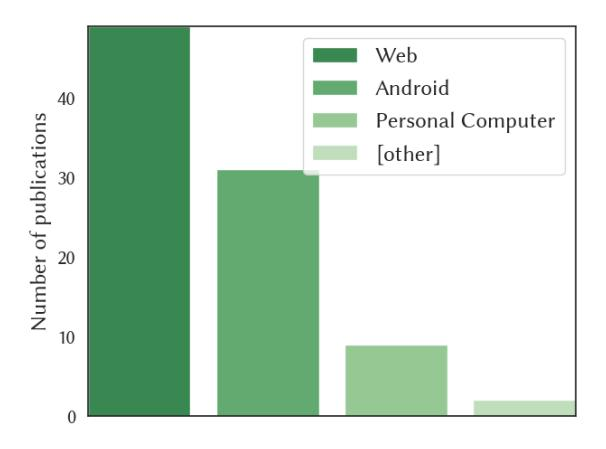

Fig. 13. Number of ACU publications across domains, showing a strong preference for web-based platforms, followed by Android and personal computers.

## B Image vs. Textual Screen Representation

Most ACUs either use image or text observations, or a combination of them. In the following, we provide a comparison between image and textual screen observations. In Figure [20,](#page-42-1) we illustrate that textual screen representations offer unique strengths, particularly in exposing hidden semantics and structural relationships. However, these strengths are often undermined by practical drawbacks (see Figure [21\)](#page-42-2), such as verbosity and inconsistency, especially when deployed in real-world environments. These findings are in line with the works of [\(Cheng et al. 2024;](#page-32-13) [Z. He et al. 2021;](#page-33-23) [T. Li, G. Li, Z. Deng, et al. 2023;](#page-34-5) [B. Wang et al. 2023;](#page-37-17) [B. Zheng et al. 2024\)](#page-37-15) and can be summarized as follows:

Advantages of textual screen representations are:

Revealing visually hidden information: Textual representations can explicitly show information that may be visually hidden in images, such as items within a collapsed drop-down menu.

Inherent hierarchical structure: Textual representations, like the Document Object Model (DOM) tree, are structured in a hierarchical tree, facilitating a clearer understanding of relationships between elements (e.g., [Jia et al. 2019\)](#page-33-2).

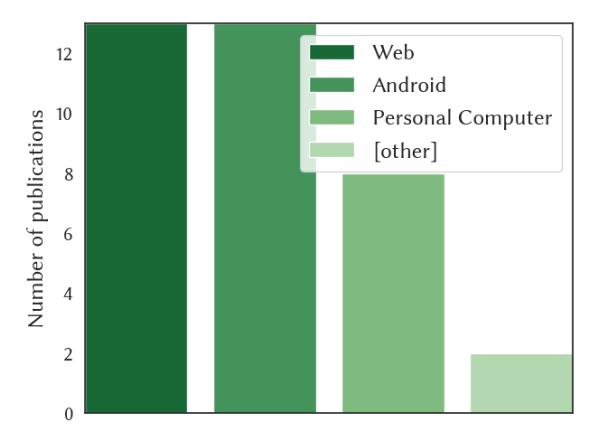

Fig. 14. Dataset counts across domains. The distribution of datasets shows that most datasets analyzed in this study are from the Web and Android domains.

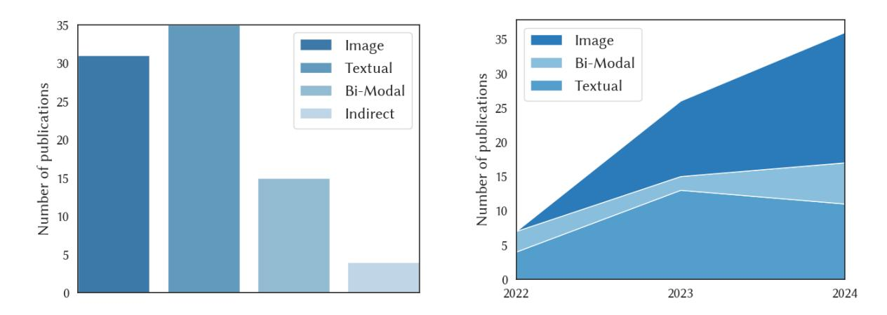

Fig. 15. (left) Frequencies over all years and (right) trends as a stacked area plot of publications of observation spaces. It shows rapid growth in image and bi-modal.

**Explicit semantic information:** Textual representations often include semantic information in element attributes that are not visible in images, such as id tags. For example, the id attribute in <input id="flight-from"> indicates that the input field corresponds to the flight departure location (example taken from the MiniWoB++ benchmark (Shi et al. 2017)).

**Disadvantages** of textual screen representations are:

**Reduced information density:** Some text formats, particularly raw HTML, can introduce verbosity that reduces the overall information density.

**Structural inconsistency:** Visually similar content can be rendered using different underlying structures. For example, a button might be implemented with either a <button> or a  tag. Similarly, visually similar components can have vastly different underlying code due to different implementation choices, such

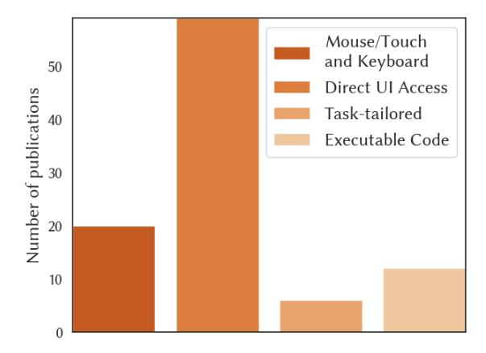

Fig. 16. Frequencies of action spaces. Agents with multiple action types are counted once.

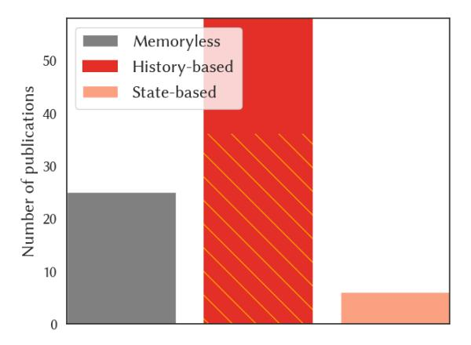

Fig. 17. Frequencies of policy types. Orange strips indicate agents that only track past actions.

as the selected styling framework (e.g., Bootstrap[5](#page-40-2) vs. Tailwind CSS[6](#page-40-3) ) and HTML-generating framework (e.g., Angular[7](#page-40-4) vs. React[8](#page-40-5) ).

Omission of visual information: Textual representations often lack information about spatial relationships and positioning that can be critical in understanding the screen's layout.

Lack of textual representation: Some screen components, such as embedded plugins, may not have an alternative textual screen representation. Certain applications may entirely lack any alternative textual screen representation.

5<https://getbootstrap.com/>

6<https://tailwindcss.com/>

7<https://angular.dev/>

8<https://react.dev/>

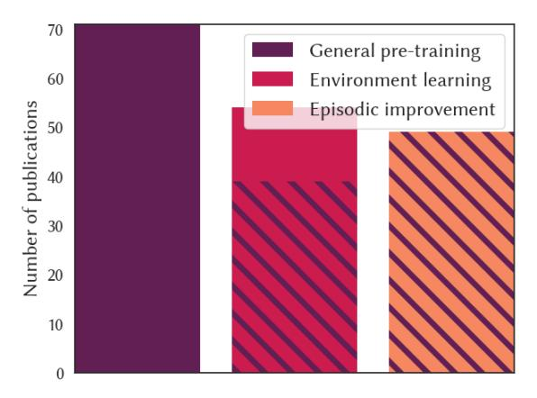

Fig. 18. Frequencies of learning strategies. Purple stripes indicate initial pre-training.

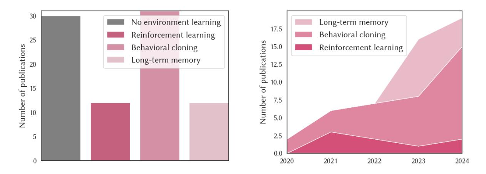

Fig. 19. (Left) Frequencies over all years and (right) usage trends as staked area plot of environment learning strategies over the last 5 years. It shows that behavioral cloning is the most adopted method.

Some of these disadvantages can be mitigated through engineering solutions. For instance, the absence of visual positioning can be addressed by incorporating absolute or relative screen coordinates into the textual screen representation (e.g., E. Z. Liu et al. 2018; Shi et al. 2017), or by embedding elements with information from nearby neighboring elements (E. Z. Liu et al. 2018). Additionally, the verbosity inherent in raw text can be reduced by simplifying the observations  $o_t \rightarrow o_t^*$ . However, these mitigation strategies usually do not fully overcome the inherent limitations observed in practice.

## C Code Generation Example

As illustrated in Figure 22, executable code actions generated by agents can vary significantly in both structural complexity and abstraction level. Specifically, we distinguish between straight-line execution versus control-flow logic, and the use of task-tailored APIs versus general-purpose APIs.

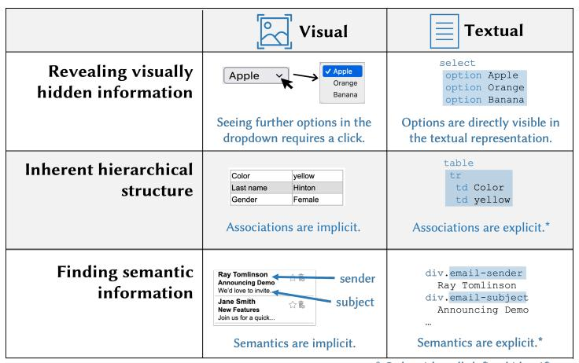

\* Only with well-defined identifiers

Fig. 20. Advantages of textual screen representations.

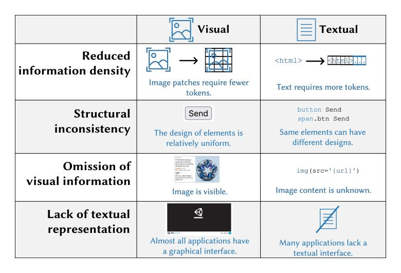

Fig. 21. Disadvantages of textual screen representations.

## D The Nature of Computer Environments

In Table 5, we classify computer environments according to the framework established by Russell and Norvig (2022, Chapter 2.3). We distinguish between the computer environment typically found in research (middle column) and the actual computer environment in a productive setting (right column).

Determinism is often assumed, meaning that for a state  $s_t$  and action  $a_t$ , only one possible outcome  $s_{t+1}$  exists. While this holds for many interface-driven tasks, real environments may contain stochastic elements, such as randomized content (e.g., shuffle button in a music app) or latency effects, that introduce variability. The assumption of episodicity simplifies credit assignment, but computer environments are inherently sequential. States may depend on long-term history across sessions, requiring agents to model extended temporal dependencies beyond the task-specific trajectories. Research environments are often considered static, where only agent actions

Fig. 22. Two examples of executable Python code actions. Two different structures (straight-line or with control flow) and API abstraction levels (task-tailored or general-purpose) are shown.

Table 5. Properties of common computer environments, assembled from [Russell and Norvig](#page-36-0) [\(2022,](#page-36-0) Chapter 2) and [Sutton and Barto](#page-36-3) [\(2018,](#page-36-3) Chapter 2.3). The middle and right columns compare common assumptions in research to actual computer environments.

| Property              | Research computer environment | Actual computer environment |
|-----------------------|----------------------------------|--------------------------------|
| Observability         | Partially observable             | Partially observable           |
| Number of agents      | Single-agent                     | Single-agenta                  |
| Determinism           | Deterministic                    | Primarily deterministicb       |
| Episodicity           | Episodic                         | Sequential                     |
| Dynamism              | Staticc                          | Dynamic                        |
| Stationarity          | Stationary                       | Non-stationary                 |
| Environment knowledge | Initially unknown                | Initially unknown              |

a Assuming the user hands control to the agent and does not intervene.

cause changes. In contrast, real environments are dynamic—background processes, user actions, or updates can alter state independently, requiring robustness to asynchronous events [\(Humble and Farley 2011\)](#page-33-24). Stationarity, another common assumption, implies stable dynamics over time. Yet actual environments are non-stationary due to software updates, configuration changes, or shifting data, which challenges long-term generalization. Lastly, computer environments are typically assumed to have unknown dynamics, meaning an agent does not initially know the effect of an action. While technically true, some agents leverage pre-training to learn conventions and begin with anticipatory knowledge (see Section [5.2.1\)](#page-19-0). For example, they might learn that clicking a 'submit' button typically submits a form.

b Computer use is primarily deterministic due to user-friendly design principles, but can be stochastic.

c [Toyama et al.](#page-36-12) [\(2021\)](#page-36-12) is an exception providing a dynamic Android environment.

## E Challenges for Deployment and Application

Current research in agents for computer use focuses on enhancing their autonomous capabilities across various domains and benchmarks. However, deploying these agents in production introduces several additional challenges.

## E.1 Technical Challenges and Considerations

A production setting entails a specific environment, such as a business application, that the agent must be able to control. However, effectively adapting an agent to a production environment remains an open research question. Besides efficient environment learning, a production setting holds additional challenges, including diverse user hardware. For instance, ACUs must scope with different screen resolutions, multi-monitor setups, as well as different device configurations, including a wide range of Android distributions, home screen setups, or color schemes [\(J. Lee et al. 2024\)](#page-34-21). Additionally, a production environment is non-stationary as applications undergo continuous enhancement [\(Humble and Farley 2011\)](#page-33-24), changing their interfaces and behavior. A production-ready agent must be able to handle those ever-changing circumstances, either autonomously or through continuous updates implemented by its developers.

Speed, Cost, and Availability. While current research primarily focuses on an agent's autonomous capabilities, practical deployment demands careful consideration of prediction speed, operational costs, and availability. Faster prediction time leads to less latency and a better user experience. Costs can be monetary through API calls to third-party foundation models or hardware considerations for local agents. In terms of potential monetary costs, solving a single task costs roughly \$0.28 when assuming to use a state-of-the-art foundation model, processing 765 image tokens (high-resolution screenshot), 600 text tokens (agent prompt and user instruction), 1000 text output tokens (reasoning and action prediction), and 7 actions per task (as in [X. Deng et al. 2023\)](#page-32-9) and current API pricing (December 2024). Furthermore, reliance on external resources introduces dependencies that can impact availability, such as requiring a stable internet connection and the reliable operation of third-party services.

Privacy. While LLMs can run on local machines [\(Tuggener et al. 2024\)](#page-36-26), many state-of-the-art models such as GPT-4V [OpenAI et al.](#page-35-12) [\(2024\)](#page-35-12) are only available through an API. Agents relying on external resources, such as proprietary foundation models, introduce privacy concerns. Individuals and companies may be reluctant to send screenshots of their applications, which may show sensitive data, to an external server streamed over the internet. This raises similar data privacy challenges observed in other foundation model applications [\(Neel and](#page-35-20) [Chang 2024\)](#page-35-20). However, a crucial difference emerges with agents: traditional user education on data-sharing practices becomes insufficient, as users cannot fully control an agent's access to information when it operates autonomously on their devices. For example, an agent in financial reporting might inadvertently open, observe, and thus transmit sensitive financial documents without the user's explicit consent and in contradiction to contractual or legal requirements.

## E.2 Safety Considerations

Despite advances in autonomous agent development, current systems often lack the reliability and comprehensiveness required for safe real-world deployment. The consequences of an agent's unintentional, erroneous actions can differ depending on the domain, ranging from minor disruptions, such as playing the wrong music video, to more severe issues, like the unauthorized disclosure of confidential medical records. For production, the risk of erroneous actions must be balanced with the agent's capabilities and the benefits of automation. This balance can be achieved by adjusting design parameters: The agent's level of autonomy and the scope of its deployment.

Reducing Automation. Most ACU research is about full automation, meaning the agent is in control, and it is assumed no human is in the loop. To decrease the risk of erroneous actions, agents can operate in conditional automation, meaning the agent is in control, but it can hand back control to the user for critical actions. For example, [Y. Li, C. Zhang, et al.](#page-34-10) [\(2024\)](#page-34-10) let their agent determine critical actions, such as validating payments. However, this approach still risks the agent overlooking critical actions, which can be avoided in use cases like payment by requiring external validation through a separate payment processing system inaccessible to the agent. In contrast, [B. Wang et al.](#page-37-17) [\(2023\)](#page-37-17) also allows agent-initiated conversations, allowing them to solicit information. A further restriction would be running the agent in partial automation, meaning the human is in control and hands it to an agent only to fulfill a straightforward sub-task. For example, web browsers providing auto-fill functions for typical web forms can be considered partial, non-instruction-based agents for computer use. An even further automation restriction is agents only assisting users, meaning the human stays in control the whole time while the agent provides only suggestions. This design is typical for non-instruction-based agents for computer use like GitHub CoPilot[9](#page-45-1) or Grammarly[10](#page-45-2) .

Managing the Scope of the Production Environment. To decrease the risk of erroneous actions, the scope of the production environment can be constrained. For a given use case, the action space A can be restricted by removing high-risk actions, such as disabling critical deletion operations. This can be achieved, for instance, by limiting the agent's file system permissions. Additionally, safety checks can be implemented to autonomously verify the feasibility and safety of actions prior to execution, effectively providing guardrails for the agent [\(Liang](#page-34-22) [2023\)](#page-34-22). Similarly, the state space S can be reduced to simplify the operational environment. For example, a web agent's access could be restricted to a predefined set of curated websites instead of granting access to the entire web. In the context of personal computers, the operational domain could be narrowed to specific applications, such as those within an office productivity suite. These constraints not only limit the agent's potential behaviors but also simplify environment learning and enable more accurate assessments of the agent's capabilities.

## E.3 Adapting Generally Capable Agents

Leading AI companies, such as Anthropic, have begun advancing into the realm of ACUs, offering generally capable, out-of-the-box solutions [\(S. Hu et al. 2024\)](#page-33-25). However, we anticipate that truly general autonomous instruction-based ACUs – defined as those with capabilities, resilience, and safety comparable to highly skilled human computer users across most domains – are unlikely to emerge in the next two years, given the current state-of-the-art, for example, the unavailability of massive and challenging training data.

This projection highlights a critical research question: How can generally capable agents be effectively adapted to address specific organizational use cases? For example, enabling an agent to autonomously, safely, and reliably control a unique business application currently requires comprehensive customization. It involves tailoring pre-trained, capable agents to meet the precise needs of a given use case, thereby warranting extensive on-task training experience.

For pure text-based agents, the parallel challenge of adopting a generalist model to organizational needs and know-how is currently approached using retrieval-augmented generation (RAG) strategies, where foundation models are equipped with use-case-specific knowledge by grounding them in internal documents [\(P. Lewis et al.](#page-34-23) [2020\)](#page-34-23). Similarly, the focus in adapting ACUs would lie in achieving robust, organization-specific adaptation starting from a general-purpose, pre-trained agent – yet a similar process or framework has yet to be developed.

## F Structured Overview of Existing Work

For this review, we identified 87 ACUs and 33 datasets and categorized them according to the introduced taxonomy. Here, we present a detailed list of the identified literature and their classification. A more detailed version of

9<https://github.com/features/copilot>

10<https://grammarly.com/>

the tables presented in this section are available on our project page at [https://sagerpascal.github.io/agents-for](https://sagerpascal.github.io/agents-for-computer-use)[computer-use.](https://sagerpascal.github.io/agents-for-computer-use)

## F.1 Environment and Interaction Perspective

Table 6. Literature overview: Domain and interaction types. ✓ indicates full presence of an aspect; (✓) indicates partial presence; empty means absence.

| Paper                                                                                                                                                                                                                                                                                                                                                                                                                       | Domain |       |                        |      | Observation Space            |                          |                       |          | Action Space      |                        |          |                    |  |
|-----------------------------------------------------------------------------------------------------------------------------------------------------------------------------------------------------------------------------------------------------------------------------------------------------------------------------------------------------------------------------------------------------------------------------|--------|-------|------------------------|------|------------------------------|--------------------------|-----------------------|----------|-------------------|------------------------|----------|--------------------|--|
|                                                                                                                                                                                                                                                                                                                                                                                                                             |        | Image | Textual to Image | HTML | Hierarchy View Android | Tree Automation UI | Tree Accessibility | Indirect | Keyboard Mouse | Access UI Direct | Tailored | Code Executable |  |
| H. He et al. (2024), Niu et al. (2024), and Shaw et al. (2023)                                                                                                                                                                                                                                                                                                                                                              | Web    | ✓     |                        |      |                              |                          |                       |          | ✓                 |                        |          |                    |  |
| Koh, McAleer, et al. (2024) and J. Pan et al. (2024)                                                                                                                                                                                                                                                                                                                                                                        | Web    | ✓     |                        |      |                              |                          |                       |          |                   | ✓                      |          |                    |  |
| Iki and Aizawa (2022)                                                                                                                                                                                                                                                                                                                                                                                                       | Web    |       | ✓                      |      |                              |                          |                       |          | ✓                 |                        |          |                    |  |
| Fereidouni and Siddique (2024), Guan et al. (2023), and Lo et al. (2023)                                                                                                                                                                                                                                                                                                                                                 | Web    |       | ✓                      |      |                              |                          |                       |          |                   | ✓                      |          |                    |  |
| Cho et al. (2024)                                                                                                                                                                                                                                                                                                                                                                                                           | Web    |       | ✓                      |      |                              |                          |                       |          | ✓                 | ✓                      |          |                    |  |
| X. Deng et al. (2023), Y. Deng et al. (2024), Gur, Jaques, et al. (2021), Gur, Nachum, et al. (2023), Gur, Rückert, et al. (2019), Jia et al. (2019), Kim et al. (2023), Lai et al. (2024), T. Li, G. Li, Z. Deng, et al. (2023), Y. Li and Riva (2021), E. Z. Liu et al. (2018), Lutz et al. (2024), K. Ma et al. (2024), Murty et al. (2024), Sodhi et al. (2023), and L. Zheng, R. Wang, et al. (2024) | Web    |       |                        | ✓    |                              |                          |                       |          |                   | ✓                      |          |                    |  |
| Putta et al. (2024) and Xu et al. (2021)                                                                                                                                                                                                                                                                                                                                                                                    | Web    |       |                        | ✓    |                              |                          |                       |          |                   |                        | ✓        |                    |  |
| Furuta, Matsuo, et al. (2023), Gur, Furuta, et al. (2024), H. Sun et al. (2023), and Tao et al. (2024)                                                                                                                                                                                                                                                                                                                   | Web    |       |                        | ✓    |                              |                          |                       |          |                   |                        |          | ✓                  |  |
| Nakano et al. (2022)                                                                                                                                                                                                                                                                                                                                                                                                        | Web    |       |                        | ✓    |                              |                          |                       |          |                   | ✓                      | ✓        |                    |  |
| Zaheer et al. (2022)                                                                                                                                                                                                                                                                                                                                                                                                        | Web    |       |                        | (✓)  |                              |                          |                       |          |                   | ✓                      |          |                    |  |
| Zhou et al. (2024)                                                                                                                                                                                                                                                                                                                                                                                                          | Web    |       |                        |      |                              |                          | ✓                     |          |                   | ✓                      |          |                    |  |
| Y. Zhang et al. (2024)                                                                                                                                                                                                                                                                                                                                                                                                      | Web    |       |                        |      |                              |                          | ✓                     |          |                   | ✓                      |          | ✓                  |  |
| Humphreys et al. (2022), Lin et al. (2021), and Shi et al. (2017)                                                                                                                                                                                                                                                                                                                                                        | Web    | ✓     |                        | ✓    |                              |                          |                       |          | ✓                 |                        |          |                    |  |

Table 6 – continued from previous page

| Paper                                                                                                                                                     | Domain       |       |                        |      | Observation Space            |                          |                       |          | Action Space      |                        |          |                    |  |
|-----------------------------------------------------------------------------------------------------------------------------------------------------------|--------------|-------|------------------------|------|------------------------------|--------------------------|-----------------------|----------|-------------------|------------------------|----------|--------------------|--|
|                                                                                                                                                           |              | Image | Textual to Image | HTML | Hierarchy View Android | Tree Automation UI | Tree Accessibility | Indirect | Keyboard Mouse | Access UI Direct | Tailored | Code Executable |  |
| Furuta, KH. Lee, et al. (2024), Kil et al. (2024), Lù et al. (2024), Mazumder and Riva (2021), and B. Zheng et al. (2024)                           | Web          | ✓     |                        | ✓    |                              |                          |                       |          |                   | ✓                      |          |                    |  |
| Chae et al. (2024)                                                                                                                                        | Web          |       |                        | ✓    |                              |                          | ✓                     |          |                   | ✓                      |          |                    |  |
| Q. Lu et al. (2024), J. Wang et al. (2024), J. Zhang et al. (2024), and Z. Zhang and A. Zhang (2024)                                                   | Android      | ✓     |                        |      |                              |                          |                       |          | ✓                 |                        |          |                    |  |
| Ding (2024), T. JJ. Li, Mitchell, et al. (2020), Nong et al. (2024), L. Sun et al. (2022), Wen, Y. Li, et al. (2024), and Q. Wu et al. (2024)       | Android      | ✓     |                        |      |                              |                          |                       |          |                   | ✓                      |          |                    |  |
| Dorka et al. (2024)                                                                                                                                       | Android      | ✓     |                        |      |                              |                          |                       |          | ✓                 | ✓                      |          |                    |  |
| Abukadah et al. (2024), W. Li (2021), X. Ma et al. (2024), Y. Song, Bian, Y. Tang, and Cai (2023), and Y. Song, Bian, Y. Tang, G. Ma, et al. (2024) | Android      |       | ✓                      |      |                              |                          |                       |          |                   | ✓                      |          |                    |  |
| Rawles, A. Li, et al. (2023)                                                                                                                              | Android      |       | ✓                      |      |                              |                          |                       |          | ✓                 | ✓                      |          |                    |  |
| Y. Li, J. He, et al. (2020) and Wen, H. Wang, et al. (2024)                                                                                               | Android      |       |                        |      | ✓                            |                          |                       |          |                   | ✓                      |          |                    |  |
| Bishop et al. (2024) and W. Li et al. (2024)                                                                                                              | Android      |       |                        |      |                              |                          | ✓                     |          | ✓                 |                        |          |                    |  |
| S. Lee et al. (2023) and Y. Li, Du, et al. (2024)                                                                                                         | Android      |       |                        |      |                              |                          | ✓                     |          |                   | ✓                      |          |                    |  |
| Y. Li, C. Zhang, et al. (2024) and C. Zhang, Z. Yang, et al. (2023)                                                                                    | Android      | ✓     |                        |      | ✓                            |                          |                       |          |                   | ✓                      |          |                    |  |
| B. Wang et al. (2023)                                                                                                                                     | Android      |       |                        | (✓)  | ✓                            |                          |                       |          |                   | ✓                      |          |                    |  |
| S. Deng et al. (2024)                                                                                                                                     | Android      |       |                        | (✓)  | ✓                            |                          |                       |          |                   | ✓                      |          | ✓                  |  |
| Cheng et al. (2024) and Hong et al. (2024)                                                                                                                | Web, Android | ✓     |                        |      |                              |                          |                       |          | ✓                 |                        |          |                    |  |
| Y. Lu et al. (2024)                                                                                                                                       | Web, Android |       | ✓                      |      |                              |                          |                       |          |                   | ✓                      |          |                    |  |
| Rahman et al. (2024)                                                                                                                                      | PC           | ✓     |                        |      |                              |                          |                       |          | ✓                 |                        |          |                    |  |
| D. Gao et al. (2024)                                                                                                                                      | PC           | ✓     |                        |      |                              |                          |                       |          | ✓                 |                        |          | ✓                  |  |
| Z. Song et al. (2024)                                                                                                                                     | PC           | ✓     |                        |      |                              |                          |                       |          |                   | ✓                      |          | ✓                  |  |

Table 6 – continued from previous page

| Paper                                        | Domain       | Observation Space Action Space |                        |      |                              |                          |                       |          |                   |                        |          |                    |
|----------------------------------------------|--------------|-----------------------------------|------------------------|------|------------------------------|--------------------------|-----------------------|----------|-------------------|------------------------|----------|--------------------|
|                                              |              | Image                             | Textual to Image | HTML | Hierarchy View Android | Tree Automation UI | Tree Accessibility | Indirect | Keyboard Mouse | Access UI Direct | Tailored | Code Executable |
| Z. Wang et al. (2024)                        | PC           |                                   |                        |      |                              |                          |                       | ✓        |                   |                        | ✓        |                    |
| Y. Guo et al. (2024) and Z. Wu et al. (2024) | PC           |                                   |                        |      |                              |                          |                       | ✓        |                   |                        |          | ✓                  |
| C. Zhang, L. Li, et al. (2024)               | PC           | ✓                                 |                        |      |                              | ✓                        |                       |          |                   | ✓                      | ✓        |                    |
| Bonatti et al. (2024)                        | Web, PC      | ✓                                 |                        | ✓    |                              | ✓                        |                       |          |                   | ✓                      | ✓        | ✓                  |
| Yan et al. (2023)                            | Android, iOS | ✓                                 |                        |      |                              |                          |                       |          |                   | ✓                      |          |                    |
| Y. Song, Xiong, et al. (2023)                | API          |                                   |                        |      |                              |                          |                       | ✓        |                   |                        |          | ✓                  |

## F.2 Agent Perspective

Table 7. Literature overview: Core agent design principles. PT = general pre-training; EL = environment learning; EI = episodic improvement; BC = behavioral cloning; RL = reinforcement learning; LTM = long-term memory;  $\checkmark$  indicates the full presence of an aspect; ( $\checkmark$ ) indicates the presence of an aspect with variations; empty means the aspect is absent.

| Paper                                                                                                                                                                                                       | Туре             | e                 | Po         | olicy         |             | P                | Г        |          | EL |          |                    | EI       |          |
|-------------------------------------------------------------------------------------------------------------------------------------------------------------------------------------------------------------|------------------|-------------------|------------|---------------|-------------|------------------|----------|----------|----|----------|--------------------|----------|----------|
|                                                                                                                                                                                                             | Foundation agent | Specialized agent | Memoryless | History-based | State-based | Foundation model | Backbone | ВС       | RL | LTM      | Instruction tuning | Few-shot | Planning |
| B. Wang et al. (2023)                                                                                                                                                                                       | ✓                |                   | ✓          |               |             | ✓                |          |          |    |          | ✓                  | ✓        |          |
| Niu et al. (2024)                                                                                                                                                                                           | ✓                |                   | ✓          |               |             | ✓                |          |          |    |          | ✓                  |          | ✓        |
| Ding (2024)                                                                                                                                                                                                 | ✓                |                   | ✓          |               |             | ✓                |          |          |    |          | ✓                  |          |          |
| S. Lee et al. (2023) and H. Sun et al. (2023)                                                                                                                                                               | ✓                |                   | ✓          |               |             | ✓                |          |          |    | <b>√</b> | ✓                  | ✓        | <b>√</b> |
| Tao et al. (2024)                                                                                                                                                                                           | ✓                |                   | ✓          |               |             | ✓                |          |          |    | <b>√</b> | ✓                  | ✓        |          |
| Z. Wu et al. (2024)                                                                                                                                                                                         | ✓                |                   | ✓          |               |             | ✓                |          |          |    | ✓        | ✓                  |          |          |
| Nong et al. (2024)                                                                                                                                                                                          | ✓                |                   | ✓          |               |             | ✓                | ✓        |          |    |          | ✓                  |          | ✓        |
| Cho et al. (2024), S. Deng et al. (2024), Kim et al. (2023), Koh, McAleer, et al. (2024), Sodhi et al. (2023), Tan et al. (2024), Y. Zhang et al. (2024), and Zhou et al. (2024)                            | ✓                |                   |            | ✓             |             | ✓                |          |          |    |          | 1                  | ✓        | <b>√</b> |
| Bishop et al. (2024) and L. Zheng, R. Wang, et al. (2024)                                                                                                                                                   | ✓                |                   |            | <b>√</b>      |             | ✓                |          |          |    |          | ✓                  | ✓        |          |
| Chae et al. (2024) and Y. Song, Xiong, et al. (2023)                                                                                                                                                        | ✓                |                   |            | <b>√</b>      |             | <b>√</b>         |          |          |    |          | ✓                  |          | ✓        |
| Cheng et al. (2024), Y. Guo et al. (2024), T. Li, G. Li, Z. Deng, et al. (2023), K. Ma et al. (2024), J. Wang et al. (2024), Z. Wang et al. (2024), Wen, H. Wang, et al. (2024), and B. Zheng et al. (2024) | ✓                |                   |            | ✓             |             | ✓                |          |          |    |          | ✓                  |          |          |
| X. Deng et al. (2023), W. Li et al. (2024), Lù et al. (2024), Murty et al. (2024), and J. Zhang et al. (2024)                                                                                               | ✓                |                   |            | ✓             |             | ✓                |          | <b>√</b> |    |          | <b>✓</b>           | ✓        |          |
| Lai et al. (2024) and X. Ma et al. (2024)                                                                                                                                                                   | ✓                |                   |            | ✓             |             | ✓                |          | ✓        |    |          | ✓                  |          |          |
| Y. Deng et al. (2024), Y. Li, C. Zhang, et al. (2024), Lutz et al. (2024), and Wen, Y. Li, et al. (2024)                                                                                                    | ✓                |                   |            | ✓             |             | ✓                |          |          |    | ✓        | ✓                  | ✓        |          |
| D. Gao et al. (2024)                                                                                                                                                                                        | ✓                |                   |            | <b>✓</b>      |             | ✓                | ✓        |          |    |          | ✓                  | ✓        | ✓        |
| Furuta, Matsuo, et al. (2023) and Gur, Furuta, et al. (2024)                                                                                                                                                | <b>√</b>         |                   |            | <b>√</b>      |             | ✓                | <b>√</b> |          |    |          | ✓                  | ✓        |          |
| Guan et al. (2023)                                                                                                                                                                                          | ✓                |                   |            | <b>√</b>      |             | <b>✓</b>         | <b>√</b> |          |    |          | <b>✓</b>           |          | <b>√</b> |

Table 7 – continued from previous page

| Paper                                                                                                                                      | Type                                        |            | Policy        |             |                     | PT       |    | EL |     |                       | EI             |          |
|--------------------------------------------------------------------------------------------------------------------------------------------|---------------------------------------------|------------|---------------|-------------|---------------------|----------|----|----|-----|-----------------------|----------------|----------|
|                                                                                                                                            | agent agent Foundation Specialized | Memoryless | History-based | State-based | model Foundation | Backbone | BC | RL | LTM | tuning Instruction | Demonstrations | Planning |
| Y. Lu et al. (2024) and Y. Song, Bian, Y. Tang, and Cai (2023)                                                                             | ✓                                           |            | ✓             |             | ✓                   | ✓        |    |    |     | ✓                     |                |          |
| Rawles, A. Li, et al. (2023)                                                                                                               | ✓                                           |            | ✓             |             | ✓                   | ✓        | ✓  |    |     | ✓                     | ✓              | ✓        |
| Y. Song, Bian, Y. Tang, G. Ma, et al. (2024)                                                                                               | ✓                                           |            | ✓             |             | ✓                   | ✓        |    |    | ✓   | ✓                     | ✓              |          |
| J. Pan et al. (2024)                                                                                                                       | ✓                                           |            |               | ✓           | ✓                   |          | ✓  |    |     | ✓                     |                |          |
| C. Zhang, Z. Yang, et al. (2023)                                                                                                           | ✓                                           |            |               | ✓           | ✓                   |          |    |    | ✓   | ✓                     | ✓              |          |
| C. Zhang, L. Li, et al. (2024)                                                                                                             | ✓                                           |            | ✓             | ✓           | ✓                   |          |    |    |     | ✓                     | ✓              | ✓        |
| Bonatti et al. (2024)                                                                                                                      | ✓                                           |            | ✓             | ✓           | ✓                   |          |    |    |     | ✓                     |                |          |
| Xu et al. (2021)                                                                                                                           | (✓)                                         | ✓          |               |             | ✓                   |          |    |    |     |                       |                |          |
| Z. Song et al. (2024)                                                                                                                      | (✓)                                         | ✓          |               |             | ✓                   |          | ✓  |    |     |                       |                | ✓        |
| Abukadah et al. (2024)                                                                                                                     | (✓)                                         | ✓          |               |             | ✓                   | ✓        | ✓  |    |     |                       |                |          |
| Z. Zhang and A. Zhang (2024)                                                                                                               | (✓)                                         |            | ✓             |             | ✓                   |          | ✓  |    |     |                       |                | ✓        |
| Gur, Nachum, et al. (2023), H. He et al. (2024), Hong et al. (2024), Q. Lu et al. (2024), Rahman et al. (2024), and Q. Wu et al. (2024) | (✓)                                         |            | ✓             |             | ✓                   |          | ✓  |    |     |                       |                |          |
| Putta et al. (2024)                                                                                                                        | (✓)                                         |            | ✓             |             | ✓                   |          |    | ✓  |     |                       |                | ✓        |
| Lo et al. (2023)                                                                                                                           | (✓)                                         |            | ✓             |             | ✓                   |          |    |    | ✓   |                       |                |          |
| Fereidouni and Siddique (2024) and Nakano et al. (2022)                                                                                    | (✓)                                         |            | ✓             |             | ✓                   |          | ✓  | ✓  |     |                       |                |          |
| Dorka et al. (2024), Furuta, KH. Lee, et al. (2024), and Kil et al. (2024)                                                              | (✓)                                         |            | ✓             |             | ✓                   | ✓        | ✓  |    |     |                       |                |          |
| E. Z. Liu et al. (2018)                                                                                                                    | ✓                                           | ✓          |               |             |                     |          |    |    |     |                       |                |          |
| T. JJ. Li, Mitchell, et al. (2020), Y. Li, J. He, et al. (2020), and Zaheer et al. (2022)                                               | ✓                                           | ✓          |               |             |                     |          | ✓  |    |     |                       |                |          |
| Gur, Jaques, et al. (2021), Gur, Rückert, et al. (2019), Jia et al. (2019), and Y. Li and Riva (2021)                                   | ✓                                           | ✓          |               |             |                     |          |    | ✓  |     |                       |                |          |
| W. Li (2021) and Shi et al. (2017)                                                                                                         | ✓                                           | ✓          |               |             |                     |          | ✓  | ✓  |     |                       |                |          |
| Mazumder and Riva (2021)                                                                                                                   | ✓                                           | ✓          |               |             |                     | ✓        |    |    |     |                       |                |          |
| Y. Li, Du, et al. (2024)                                                                                                                   | ✓                                           | ✓          |               |             |                     | ✓        | ✓  |    |     |                       |                |          |

Table 7 – continued from previous page

| Paper                                      |                     | Type Policy       |            |               |             | PT                  | EL       |    |    |     |                       |                |          |
|--------------------------------------------|---------------------|----------------------|------------|---------------|-------------|---------------------|----------|----|----|-----|-----------------------|----------------|----------|
|                                            | agent Foundation | agent Specialized | Memoryless | History-based | State-based | model Foundation | Backbone | BC | RL | LTM | tuning Instruction | Demonstrations | Planning |
| Shaw et al. (2023)                         |                     | ✓                    | ✓          |               |             |                     | ✓        | ✓  | ✓  |     |                       |                |          |
| Lin et al. (2021) and L. Sun et al. (2022) |                     | ✓                    |            | ✓             |             |                     |          | ✓  |    |     |                       |                |          |
| Yan et al. (2023)                          |                     | ✓                    |            | ✓             |             |                     |          | ✓  |    | ✓   |                       |                |          |
| Humphreys et al. (2022)                    |                     | ✓                    |            |               | ✓           |                     |          | ✓  | ✓  |     |                       |                |          |
| Iki and Aizawa (2022)                      |                     | ✓                    |            | ✓             | ✓           |                     | ✓        | ✓  |    |     |                       |                |          |

## F.3 Datasets

Table 8. Literature overview: Datasets. OS = observation space; AS = action space. ✓ indicates the presence of an aspect; empty means the aspect is absent.

| Paper                                               | Domain                 |                           | Type OS         |       |         |       |        | AS       |      |
|-----------------------------------------------------|------------------------|---------------------------|--------------------|-------|---------|-------|--------|----------|------|
|                                                     |                        | Environment Controlled | Dataset Offline | Image | Textual | Mouse | Direct | Tailored | Code |
|                                                     | Established benchmarks |                           |                    |       |         |       |        |          |      |
| MiniWoB (Shi et al. 2017)                           | Web                    | ✓                         |                    | ✓     | ✓       | ✓     |        |          |      |
| MiniWoB++ (E. Z. Liu et al. 2018)                   | Web                    | ✓                         |                    |       | ✓       |       | ✓      |          |      |
| WebShop (Yao et al. 2022)                           | Web                    | ✓                         | ✓                  |       | ✓       |       | ✓      | ✓        |      |
| Mind2Web (X. Deng et al. 2023)                      | Web                    |                           | ✓                  |       | ✓       | ✓     |        |          |      |
| WebArena (Zhou et al. 2024)                         | Web                    |                           | ✓                  | ✓     | ✓       | ✓     |        |          |      |
| VisualWebArena (Koh, Lo, et al. 2024)            | Web                    |                           | ✓                  | ✓     | ✓       |       | ✓      |          |      |
| PixelHelp (Y. Li, J. He, et al. 2020)               | Android                |                           | ✓                  | ✓     | ✓       | ✓     | ✓      |          |      |
| AndroidEnv (Toyama et al. 2021)                     | Android                | ✓                         |                    |       | ✓       |       | ✓      |          |      |
| MoTIF (Burns et al. 2022)                           | Android                |                           | ✓                  | ✓     | ✓       | ✓     |        |          |      |
| Android in the Wild (Rawles, A. Li, et al. 2023) | Android                |                           | ✓                  | ✓     |         | ✓     |        |          |      |
| AgentBench (X. Liu et al. 2023)                     | PC                     | ✓                         |                    |       |         |       |        | ✓        |      |
| OmniACT (Kapoor et al. 2024)                        | PC                     |                           | ✓                  | ✓     | ✓       | ✓     |        |          |      |
|                                                     | Other datasets         |                           |                    |       |         |       |        |          |      |
| RUSS (Xu et al. 2021)                               | Web                    | ✓                         | ✓                  |       | ✓       |       | ✓      |          |      |
| gMiniWoB (Gur, Jaques, et al. 2021)                 | Web                    | ✓                         |                    | ✓     | ✓       |       | ✓      |          |      |
| WebVLN (Q. Chen et al. 2024)                        | Web                    |                           | ✓                  | ✓     | ✓       |       | ✓      |          |      |
| MT-Mind2Web (Y. Deng et al. 2024)                   | Web                    | ✓                         |                    |       | ✓       |       | ✓      |          |      |
| WorkArena (Drouin et al. 2024)                      | Web                    |                           | ✓                  | ✓     | ✓       | ✓     | ✓      |          |      |
| AutoWebBench (Lai et al. 2024)                      | Web                    |                           | ✓                  | ✓     | ✓       |       | ✓      |          |      |
| QBE-F-Droid (Koroglu et al. 2018)                   | Android                |                           | ✓                  |       | ✓       |       | ✓      |          |      |
| AppBuddy (Shvo et al. 2021)                         | Android                | ✓                         |                    |       | ✓       |       | ✓      |          |      |
| Meta-GUI (L. Sun et al. 2022)                       | Android                |                           | ✓                  | ✓     | ✓       |       | ✓      |          |      |
| UGIF (Venkatesh et al. 2023)                        | Android                |                           | ✓                  | ✓     | ✓       |       | ✓      |          |      |
| Mobile-Env (D. Zhang et al. 2024)                   | Android                |                           | ✓                  | ✓     | ✓       | ✓     |        |          |      |
|                                                     | Android                |                           | ✓                  | ✓     |         |       | ✓      |          |      |

Table 8 – continued from previous page

| Paper                                         | Domain  |                           | Type               |       | OS      |       |        | AS       |      |
|-----------------------------------------------|---------|---------------------------|--------------------|-------|---------|-------|--------|----------|------|
|                                               |         | Environment Controlled | Dataset Offline | Image | Textual | Mouse | Direct | Tailored | Code |
| Android in the zoo (J. Zhang et al. 2024)  | Android |                           | ✓                  | ✓     |         |       | ✓      |          |      |
| GUIAct (W. Chen, Cui, et al. 2024)            | Android |                           | ✓                  | ✓     |         |       | ✓      |          |      |
| AssistGUI (D. Gao et al. 2024)                | PC      |                           | ✓                  | ✓     | ✓       | ✓     |        |          |      |
| ScreenAgent (Niu et al. 2024)                 | PC      | ✓                         |                    | ✓     |         | ✓     |        |          |      |
| OSWorld (Xie et al. 2024)                     | PC      |                           | ✓                  | ✓     | ✓       | ✓     |        |          |      |
| AgentStudio (L. Zheng, Huang, et al. 2024) | PC      |                           | ✓                  |       |         | ✓     |        |          | ✓    |
| PPTC (Y. Guo et al. 2024)                     | PC      |                           | ✓                  |       | ✓       |       |        |          | ✓    |
| RestBench (Y. Song, Xiong, et al. 2023)    | API     |                           | ✓                  |       |         |       |        |          | ✓    |
| GUI-World (D. Chen et al. 2024)               | Multi   |                           | ✓                  | ✓     |         | ✓     |        |          |      |

Received 11 June 2025; accepted 24 February 2026