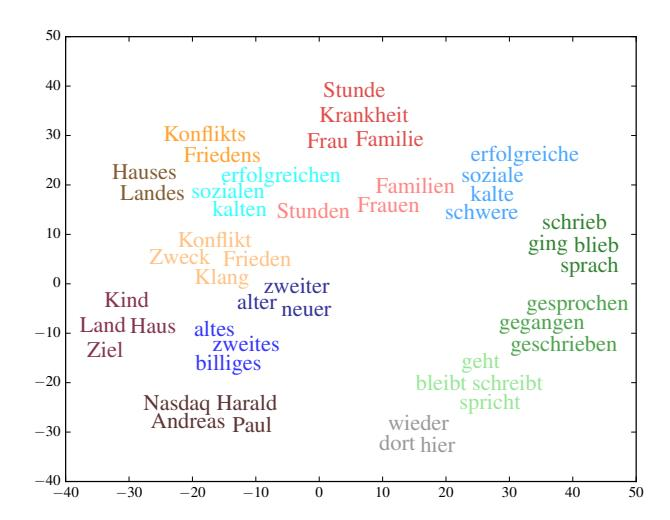
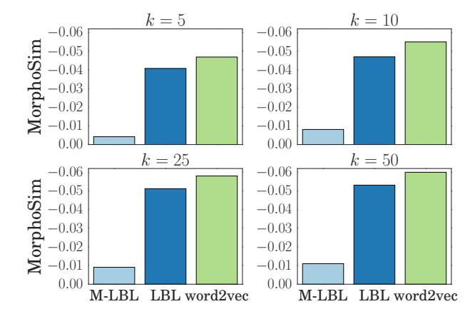

# Morphological Word Embeddings

## Ryan Cotterell1,2

Department of Computer Science1 Johns Hopkins University, USA ryan.cotterell@jhu.edu

## Hinrich Schütze2

Center for Information and Language Processing2 University of Munich, Germany

inquiries@cislmu.org

## Abstract

Linguistic similarity is multi-faceted. For instance, two words may be similar with respect to semantics, syntax, or morphology *inter alia*. Continuous word-embeddings have been shown to capture most of these shades of similarity to some degree. This work considers guiding word-embeddings with morphologically annotated data, a form of semisupervised learning, encouraging the vectors to encode a word's morphology, i.e., words close in the embedded space share morphological features. We extend the log-bilinear model to this end and show that indeed our learned embeddings achieve this, using German as a case study.

## 1 Introduction

Word representation is fundamental for NLP. Recently, continuous word-embeddings have gained traction as a general-purpose representation framework. While such embeddings have proven themselves useful, they typically treat words holistically, ignoring their internal structure. For morphologically impoverished languages, i.e., languages with a low morpheme-per-word ratio such as English, this is often not a problem. However, for the processing of morphologically-rich languages exploiting wordinternal structure is necessary.

Word-embeddings are typically trained to produce representations that capture linguistic similarity. The general idea is that words that are close in the embedding space should be close in meaning. A key issue, however, is that meaning is a multifaceted concept and thus there are multiple axes, along which two words can be similar. For example, ice and cold are *topically* related, ice and fire are *syntactically* related as they are both nouns, and ice and icy are *morphologically* related as they are both derived from the same root. In this work, we are interested in distinguishing between these various axes and guiding the embeddings such that similar embeddings are morphologically related.

We augment the log-bilinear model (LBL) of Mnih and Hinton (2007) with a multi-task objective. In addition to raw text, our model is trained on a corpus annotated with morphological tags, encouraging the vectors to encode a word's morphology. To be concrete, the first task is language modeling the traditional use of the LBL—and the second is akin to unigram morphological tagging. The LBL, described in section 3, is fundamentally a language model (LM)—word-embeddings fall out as low dimensional representations of context used to predict the next word. We extend the model to jointly predict the next morphological tag along with the next word, encouraging the resulting embeddings to encode morphology. We present a novel metric and experiments on German as a case study that demonstrates that our approach produces wordembeddings that better preserve morphological relationships.

## 2 Related Work

Here we discuss the role morphology has played in language modeling and offer a brief overview of various approaches to the larger task of computational morphology.

#### 2.1 Morphology in Language Modeling

Morphological structure has been previously integrated into LMs. Most notably, Bilmes and Kirch-

| ARTICLE            | ADJECTIVE      | NOUN         |
|--------------------|----------------|--------------|
| ART.DEF.NOM.SG.FEM | ADJ.NOM.SG.FEM | N.NOM.SG.FEM |
| die                | größte         | Stadt        |
| the                | biggest        | city         |

Table 1: A sample German phrase in TIGER (Brants et al., 2004) annotation with an accompanying English translation. Each word is annotated with a complex morphological tag and its corresponding coarsegrained POS tag. For instance, Stadt is annotated with N.NOM.SG.FEM indicating that it is a *noun* in the *nominative* case and also both *singular* and *feminine*. Each tag is composed of meaningful *sub-tag units* that are shared across whole tags, e.g., the feature NOM fires on both adjectives and nouns.

hoff (2003) introduced *factored LMs*, which effectively add tiers, allowing easy incorporation of morphological structure as well as part-of-speech (POS) tags. More recently, Müller and Schütze (2011) trained a class-based LM using common suffixes often indicative of morphology—achieving stateof-the-art results when interpolated with a Kneser-Ney LM. In neural probabilistic modeling, Luong et al. (2013) described a recursive neural network LM, whose topology was derived from the output of MORFESSOR, an unsupervised morphological segmentation tool (Creutz and Lagus, 2005). Similarly, Qiu et al. (2014) augmented WORD2VEC (Mikolov et al., 2013) to embed morphs as well as whole words—also taking advantage of MORFES-SOR. LMs were tackled by dos Santos and Zadrozny (2014) with a convolutional neural network with a k-best max-pooling layer to extract character level n-grams, efficiently inserting orthographic features into the LM—use of the vectors in down-stream POS tagging achieved state-of-the-art results in Portuguese. Finally, most similar to our model, Botha and Blunsom (2014) introduced the additive logbilinear model (LBL++). Best summarized as a neural factored LM, the LBL++ created separate embeddings for each constituent morpheme of a word, summing them to get a single word-embedding.

### 2.2 Computational Morphology

Our work is also related to morphological tagging, which can be thought of as ultra-fine-grained POS tagging. For morphologically impoverished languages, such as English, it is natural to consider a small tag set. For instance, in their universal POS tagset, Petrov et al. (2011) propose the coarse tag NOUN to represent all substantives. In inflectionally-rich languages, like German, considering other nominal attributes, e.g., case, gender and number, is also important. An example of an annotated German phrase is found in table 1. This often leads to a large tag set; e.g., in the morphological tag set of Hajic (2000), English had 137 tags whereas ˇ morphologically-rich Czech had 970 tags!

Clearly, much of the information needed to determine a word's morphological tag is encoded in the word itself. For example, the suffix ed is generally indicative of the past tense in English. However, distributional similarity has also been shown to be an important cue for morphology (Yarowsky and Wicentowski, 2000; Schone and Jurafsky, 2001). Much as contextual signatures are reliably exploited approximations to the semantics of the lexicon (Harris, 1954)—*you shall know the meaning of the word by the company it keeps* (Firth, 1957)—they can be similarly exploited for morphological analysis. This is not an unexpected result—in German, e.g., we would expect nouns that follow an adjective in the genitive case to also be in the genitive case themselves. Much of what our model is designed to accomplish is the isolation of the components of the contextual signature that are indeed predictive of morphology.

### 3 Log-Bilinear Model

The LBL is a generalization of the well-known loglinear model. The key difference lies in how it deals with features—instead of making use of handcrafted features, the LBL *learns* the features along with the weights. In the language modeling setting, we define the following model,

$$p(w \mid h) \stackrel{\text{def}}{=} \frac{\exp\left(s_{\theta}(w, h)\right)}{\sum_{w'} \exp\left(s_{\theta}(w', h)\right)},\tag{1}$$

where w is a word, h is a history and sθ is an energy function. Following the notation of Mnih and Teh (2012), in the LBL we define

$$s_{\theta}(w,h) \stackrel{\text{def}}{=} \left(\sum_{i=1}^{n-1} C_i r_{h_i}\right)^T q_w + b_w, \qquad (2)$$

where n-1 is the history length and the parameters  $\theta$  consist of C, a matrix of context specific weights, R, the context word-embeddings, Q, the target word-embeddings, and b, a bias term. Note that a subscripted matrix indicates a vector, e.g.,  $q_w$  indicates the target word-embedding for word w and  $r_{h_i}$  is the embedding for the ith word in the history. The gradient, as in all energy-based models, takes the form of the difference between two expectations (LeCun et al., 2006).

## 4 Morph-LBL

We propose a multi-task objective that jointly predicts the next word w and its morphological tag t given a history h. Thus we are interested in a joint probability distribution defined as

$$p(w, t \mid h) \propto \exp((f_t^T S + \sum_{i=1}^{n-1} C_i r_{h_i})^T q_w + b_w)$$
(3

where  $f_t$  is a hand-crafted feature vector for a morphological tag t and S is an additional weight matrix. Upon inspection, we see that

$$p(t \mid w, h) \propto \exp(S^T f_t q_w)$$
 (4)

Hence given a fixed embedding  $q_w$  for word w, we can interpret S as the weights of a conditional log-linear model used to predict the tag t.

Morphological tags lend themselves to easy featurization. As shown in table 1, the morphological tag ADJ.NOM.SG.FEM decomposes into subtag units ADJ, NOM, SG and FEM. Our model includes a binary feature for each sub-tag unit in the tag set and only those present in a given tag fire; e.g.,  $F_{\rm ADJ.NOM.SG.FEM}$  is a vector with exactly four non-zero components.

#### 4.1 Semi-Supervised Learning

In the fully supervised case, the method we proposed above requires a corpus annotated with morphological tags to train. This conflicts with a key use case of word-embeddings—they allow the easy incorporation of large, unannotated corpora into supervised tasks (Turian et al., 2010). To resolve this, we train our model on a partially annotated corpus. The key idea here is that we only need a partial set of labeled data to steer the embeddings to ensure they

Figure 1: Projections of our 100 dimensional embeddings onto  $\mathbb{R}^2$  through t-SNE (Van der Maaten and Hinton, 2008). Each word is given a distinct color determined by its morphological tags. We see clear clusters reflecting morphological tags and coarse-grained POS—verbs are in various shades of green, adjectives in blue, adverbs in grey and nouns in red and orange. Moreover, we see similarity across coarse-grained POS tags, e.g., the genitive adjective <code>sozialen</code> lives near the genitive noun <code>Friedens</code>, reflecting the fact that "sozialen Friedens" 'social peace' is a frequently used German phrase.

capture morphological properties of the words. We marginalize out the tags for the subset of the data for which we do not have annotation.

#### 5 Evaluation

In our evaluation, we attempt to intrinsically determine whether it is indeed true that words similar in the embedding space are morphologically related. Qualitative evaluation, shown in figure 1, indicates that this is the case.

#### 5.1 MorphoSim

We introduce a new evaluation metric for morphologically-driven embeddings to quantitatively score models. Roughly, the question we want to evaluate is: are words that are similar in the embedded space also morphologically related? Given a word w and its embedding  $q_w$ , let  $\mathcal{M}_w$  be the set of morphological tags associated with w represented by bit vectors. This is a set because words may have several morphological parses. Our

measure is then defined below,

$$\mathsf{MORPHOSIM}(w) \stackrel{\mathsf{def}}{=} - \sum_{w' \in \mathcal{K}_{w}} \min_{m_w, m_{w'}} d_h(m_w, m_{w'})$$

where  $m_w \in \mathcal{M}_w$ ,  $m_{w'} \in \mathcal{M}_{w'}$ ,  $d_h$  is the Hamming distance and  $\mathcal{K}_w$  is a set of words close to w in the embedding space. We are given some freedom in choosing the set  $\mathcal{K}_w$ —in our experiments we take  $\mathcal{K}_w$  to be the k-nearest neighbors (k-NN) in the embedded space using cosine distance. We report performance under this evaluation metric for various k. Note that MORPHOSIM can be viewed as a soft version of k-NN—we measure not just whether a word has the same morphological tag as its neighbors, but rather has a *similar* morphological tag.

Metrics similar to MORPHOSIM have been applied in the speech recognition community. For example, Levin et al. (2013) had a similar motivation for their evaluation of fixed-length acoustic embeddings that preserve linguistic similarity.

#### **6** Experiments and Results

To show the potential of our approach, we chose to perform a case study on German, a morphologically-rich language. We conducted experiments on the TIGER corpus of newspaper German (Brants et al., 2004). To the best of our knowledge, no previous word-embedding techniques have attempted to incorporate *morphological tags* into embeddings in a supervised fashion. We note again that there has been recent work on incorporating *morphological segmentations* into embeddings—generally in a pipelined approach using a segmenter, e.g., MOR-FESSOR, as a preprocessing step, but we distinguish our model through its use of a different view on morphology.

We opted to compare Morph-LBL with two fully unsupervised models: the original LBL and WORD2VEC (code.google.com/p/word2vec/, Mikolov et al. (2013)). All models were trained on the first 200k words of the train split of the TIGER corpus; Morph-LBL was given the correct morphological annotation for the first 100k words. The LBL and Morph-LBL models were implemented in Python using THEANO (Bastien et al., 2012). All vectors had dimensionality 200. We used the Skip-Gram model of the WORD2VEC toolkit with context n=5. We initialized parameters of LBL

|           | Morph-LBL | LBL   | WORD2VEC |
|-----------|-----------|-------|----------|
| All Types | 81.5%     | 22.1% | 10.2%    |
| No Tags   | 44.8%     | 15.3% | 14.8%    |

Table 2: We examined to what extent the individual embeddings store morphological information. To quantify this, we treated the problem as supervised multi-way classification with the embedding as the input and the morphological tag as the output to predict. Note that "All Types" refers to all types in the training corpus and "No Tags" refers to the subset of types, whose morphological tag was *not* seen by Morph-LBL at training time.

and Morph-LBL randomly and trained them using stochastic gradient descent (Robbins and Monro, 1951). We used a history size of n = 4.

#### **6.1** Experiment 1: Morphological Content

We first investigated whether the embeddings learned by Morph-LBL do indeed encode morphological information. For each word, we selected the most frequently occurring morphological tag for that word (ties were broken randomly). We then treated the problem of labeling a word-embedding with its most frequent morphological tag as a multiway classification problem. We trained a k nearest neighbors classifier where k was optimized on development data. We used the scikit-learn library (Pedregosa et al., 2011) on all types in the vocabulary with 10-fold cross-validation, holding out 10% of the data for testing at each fold and an additional 10% of training as a development set. The results displayed in table 2 are broken down by whether MorphLBL observed the morphological tag at training time or not. We see that embeddings from Morph-LBL do store the proper morphological analysis at a much higher rate than both the vanilla LBL and WORD2VEC.

Word-embeddings, however, are often trained on massive amounts of unlabeled data. To this end, we also explored on how WORD2VEC itself encodes morphology, when trained on an order of magnitude more data. Using the same experimental setup as above, we trained WORD2VEC on the *union* of the TIGER German corpus and German section of Europarl (Koehn, 2005) for a total of  $\approx$  45 million tokens. Looking only at those types found in TIGER, we found that the k-NN classifier predicted the cor-

Figure 2: Results for the MORPHOSIM measure for  $k \in \{5, 10, 25, 50\}$ . Lower MORPHOSIM values are better—they indicate that the nearest neighbors of each word are closer morphologically.

rect tag with  $\approx 22\%$  accuracy (not shown in the table).

#### **6.2 Experiment 2: MORPHODIST**

We also evaluated the three types of embeddings using the MORPHOSIM metric introduced in section 5.1. This metric roughly tells us how similar each word is to its neighbors, where distance is measured in the Hamming distance between morphological tags. We only evaluated on words that MorphLBL did *not* observe at training time to get a fair idea of how well our model has managed to encode morphology purely from the contextual signature. Figure 2 reports results for  $k \in \{5, 10, 25, 50\}$  nearest neighbors. We see that the values of k studied do not affect the metric—the closest 5 words are about as similar as the closest 50 words. We see again that the Morph-LBL embeddings generally encode morphology better than the baselines.

#### 6.3 Discussion

The superior performance of Morph-LBL over both the original LBL and WORD2VEC under both evaluation metrics is not surprising as we provide our model with annotated data at training time. That the LBL outperforms WORD2VEC is also not surprising. The LBL looks at a local history thus making it more amenable to learning syntactically-aware embeddings than WORD2VEC, whose skip-grams often look at non-local context.

What is of interest, however, is Morph-LBL's ability to robustly maintain morphological relationships only making use of the distributional signature, without word-internal features. This result shows that in large corpora, a large portion of morphology can be extracted through contextual similarity.

#### 7 Conclusion and Future Work

We described a new model, Morph-LBL, for the semi-supervised induction of morphologically guided embeddings. The combination of morphologically annotated data with raw text allows us to train embeddings that preserve morphological relationships among words. Our model handily outperformed two baselines trained on the same corpus.

While contextual signatures provide a strong cue for morphological proximity, orthographic features are also requisite for a strong model. Consider the words loving and eating. Both are likely to occur after is/are and thus their local contextual signatures are likely to be similar. However, perhaps an equally strong signal is that the two words end in the same substring ing. Future work will handle such integration of character-level features.

We are interested in the application of our embeddings to morphological tagging and other tasks. Word-embeddings have proven themselves as useful features in a variety of tasks in the NLP pipeline. Morphologically-driven embeddings have the potential to leverage raw text in a way state-of-theart morphological taggers cannot, improving tagging performance downstream.

#### Acknowledgements

This material is based upon work supported by a Fulbright fellowship awarded to the first author by the German-American Fulbright Commission and the National Science Foundation under Grant No. 1423276. The second author was supported by Deutsche Forschungsgemeinschaft (grant DFG SCHU 2246/10-1). We thank Thomas Müller for several insightful discussions on morphological tagging and Jason Eisner for discussions about experimental design. Finally, we thank the anonymous reviewers for their many helpful comments.

## References

- Frédéric Bastien, Pascal Lamblin, Razvan Pascanu, James Bergstra, Ian J. Goodfellow, Arnaud Bergeron, Nicolas Bouchard, and Yoshua Bengio. 2012. Theano: new features and speed improvements. Deep Learning and Unsupervised Feature Learning NIPS 2012 Workshop.
- Jeff A/ Bilmes and Katrin Kirchhoff. 2003. Factored language models and generalized parallel backoff. In *HLT-NAACL*.
- Jan A. Botha and Phil Blunsom. 2014. Compositional Morphology for Word Representations and Language Modelling. In *ICML*.
- Sabine Brants, Stefanie Dipper, Peter Eisenberg, Silvia Hansen-Schirra, Esther König, Wolfgang Lezius, Christian Rohrer, George Smith, and Hans Uszkoreit. 2004. TIGER: Linguistic interpretation of a German corpus. *Research on Language and Computation*, 2(4):597–620.
- Mathias Creutz and Krista Lagus. 2005. Unsupervised Morpheme Segmentation and Morphology Induction from Text Corpora using Morfessor. *Publications in Computer and Information Science, Report A*, 81.
- Cıcero Nogueira dos Santos and Bianca Zadrozny. 2014. Learning character-level representations for part-ofspeech tagging. In *ICML*.
- John Rupert Firth. 1957. *Papers in linguistics, 1934–1951*. Oxford University Press.
- Jan Hajic. 2000. Morphological tagging: Data vs. dictio- ˇ naries. In *HLT-NAACL*.
- Zellig Harris. 1954. Distributional Structure. *Word*.
- Philipp Koehn. 2005. Europarl: A parallel corpus for statistical machine translation. In *MT Summit*, volume 5, pages 79–86.
- Yann LeCun, Sumit Chopra, Raia Hadsell, M Ranzato, and F Huang. 2006. A Tutorial on Energy-based Learning. *Predicting Structured Data*.
- Keith Levin, Katharine Henry, Aren Jansen, and Karen Livescu. 2013. Fixed-dimensional acoustic embeddings of variable-length segments in low-resource settings. In *Automatic Speech Recognition and Understanding (ASRU)*, pages 410–415. IEEE.
- Minh-Thang Luong, Richard Socher, and C Manning. 2013. Better word representations with recursive neural networks for morphology. In *CoNLL*, volume 104.
- Tomas Mikolov, Kai Chen, Greg Corrado, and Jeffrey Dean. 2013. Efficient estimation of word representations in vector space. In *ICRL*.
- Andriy Mnih and Geoffrey Hinton. 2007. Three new graphical models for statistical language modelling. In *ICML*.

- Andriy Mnih and Yee Whye Teh. 2012. A fast and simple algorithm for training neural probabilistic language models. In *ICML*.
- Thomas Müller and Hinrich Schütze. 2011. Improved modeling of out-of-vocabularly words using morphological classes. In *ACL*.
- Fabian Pedregosa, Gaël Varoquaux, Alexandre Gramfort, Vincent Michel, Bertrand Thirion, Olivier Grisel, Mathieu Blondel, Peter Prettenhofer, Ron Weiss, Vincent Dubourg, et al. 2011. Scikit-learn: Machine learning in Python. *The Journal of Machine Learning Research*, 12:2825–2830.
- Slav Petrov, Dipanjan Das, and Ryan McDonald. 2011. A universal part-of-speech tagset. In *LREC*.
- Siyu Qiu, Qing Cui, Jiang Bian, Bin Gao, and Tie-Yan Liu. 2014. Co-learning of word representations and morpheme representations. In *COLING*.
- Herbert Robbins and Sutton Monro. 1951. A Stochastic Approximation Method. *The Annals of Mathematical Statistics*, pages 400–407.
- Patrick Schone and Daniel Jurafsky. 2001. Knowledgefree induction of inflectional morphologies. In *ACL*.
- Joseph Turian, Lev Ratinov, and Yoshua Bengio. 2010. Word representations: A simple and general method for semi-supervised learning. In *ACL*.
- Laurens Van der Maaten and Geoffrey Hinton. 2008. Visualizing Data using t-SNE. *Journal of Machine Learning Research*, 9(2579-2605):85.
- David Yarowsky and Richard Wicentowski. 2000. Minimally supervised morphological analysis by multimodal alignment. In *ACL*.