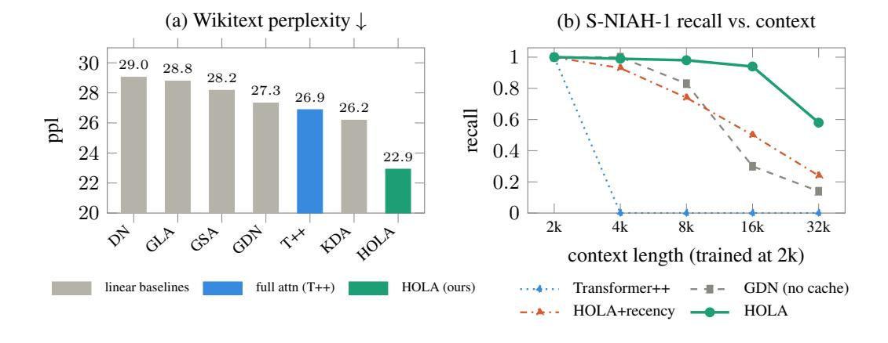
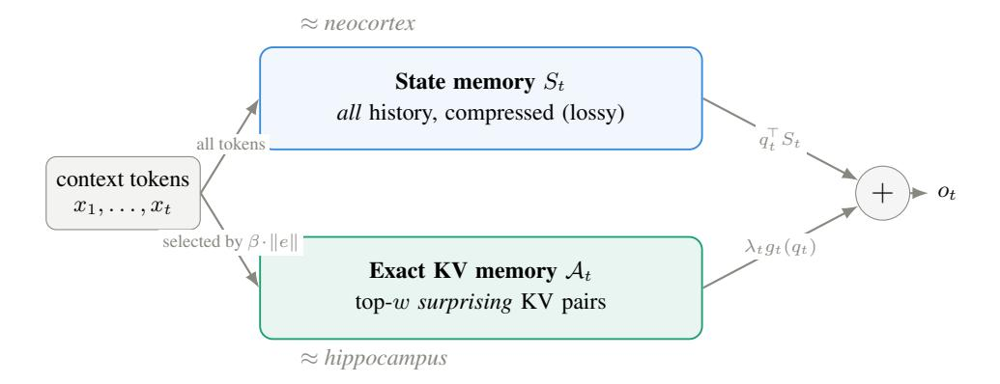

# A HIPPOCAMPUS FOR LINEAR ATTENTION

AN EXACT MEMORY FOR WHAT THE RECURRENT STATE FORGETS

### Wanyun Cui

Shanghai University of Finance and Economics

# ABSTRACT

Linear-attention and state-space language models compress the prefix into a fixedsize recurrent state, yielding O(1) memory at the cost of a lossy exact memory: when many key–value associations compete, earlier facts are overwritten and needle recall degrades. Inspired by Complementary Learning Systems, we give linear attention a hippocampal complement. HOLA (Hippocampal Linear Attention) keeps the usual delta-rule state as a compressive memory and adds a bounded exact KV cache, forming a semiparametric test-time memory: the state models linearly compressible structure, while the cache stores associations that should not be forced through that state. The cache writes without a learned eviction module, keeping tokens with large β · ∥e∥, the prediction residual actually committed to the state; a decoupled RMSNorm-γ cache read then turns these exact KV pairs into sharp retrieval rather than soft averaging. At 340M parameters trained on 15B SlimPajama tokens, HOLA lowers Wikitext perplexity from 27.32 to 22.92 (−16.1%), below a full-attention Transformer++ (26.88), and improves LAM-BADA perplexity from 30.95 to 30.26. It also achieves the best linear in-context retrieval and remains much more robust than GDN or a matched HOLA+recency cache on RULER needle-in-a-haystack recall out to 32k tokens (16× its training length).

Figure 1: HOLA lowers perplexity and improves length-robust needle recall. (a) At 340M, HOLA reduces Wikitext perplexity from 27.3 to 22.9 (−16.1%), below full-attention Transformer++ (26.9). (b) On RULER S-NIAH-1, HOLA remains stronger than GDN and HOLA+recency as context grows to 32k tokens.

# 1 INTRODUCTION

The human brain does not rely on a single memory. A hippocampus-centered system can record a specific, novel event in one shot and later recall it precisely [\(Tse et al.,](#page-11-0) [2007\)](#page-11-0), while a neocortexcentered system slowly distills generalizable structure across many experiences [\(Frankland & Bon](#page-10-0)[tempi,](#page-10-0) [2005\)](#page-10-0); Complementary Learning Systems (CLS) theory [\(McClelland et al.,](#page-10-1) [1995;](#page-10-1) [Kumaran](#page-10-2) et al., 2016) argues that the two *must* be separate — a system built for slow, compressive generalization would suffer *catastrophic interference* if forced to write single facts quickly, and so cannot also serve fast, exact, one-shot memory. Efficient language models are missing exactly this complementarity.

Linear attention is precisely such a "neocortex": a superb compressor, but a leaky exact memory. DeltaNet, Gated DeltaNet (GDN), and related linear-attention / state-space models (Katharopoulos et al., 2020; Gu & Dao, 2023; Yang et al., 2024a;c) replace softmax attention's growing key-value cache with a fixed-size recurrent state S, summarizing all history in O(1) memory and processing a sequence in sub-quadratic time. The state is updated online — the delta rule writes the residual between each new value and the state's current prediction — making it an efficient running summary. But a fixed-size state is a lossy memory: it holds only a bounded number of distinct key \rightarrow value associations before new writes overwrite old ones along shared key directions. This shows up exactly where it hurts: multi-item associative recall (Arora et al., 2023), passkey / needle-in-a-haystack retrieval (Mohtashami & Jaggi, 2023), and copying a specific distant token verbatim (Jelassi et al., 2024). There, full softmax attention — which keeps every token exactly, at O(T) memory and  $O(T^2)$  compute — remains the gold standard. The question becomes: can we keep linear attention's cost while recovering its lost exact recall? CLS points to the answer — give this neocortex a hippocampus: a separate, exact, budget-limited episodic memory that preferentially stores surprise. We formalize this complement as semiparametric test-time memory regression: the recurrent state is the parametric estimator for linearly compressible structure, and a bounded exact cache is the non-parametric correction over KV pairs the state should not be forced to absorb. This framework dictates two design choices: what to store (the surprising items) and how to read it (exact retrieval, not soft averaging).

What to store: a surprise signal the model already computes. A budget-limited episodic memory is only useful if it keeps the *right* tokens — the surprising ones, which the compressed state could not absorb. The obvious choice is instead to keep the most *recent* tokens, a sliding window, as most linear-attention hybrids do (Xiao et al., 2024; Zhang et al., 2023; Du et al., 2025; Wang et al., 2025; Fang et al., 2025); but recency cannot represent information that is far away yet still must be recalled exactly — once it slides out of the window it is as lost as if the state had overwritten it. Our key observation is that a delta-rule model already measures how surprising each token is to its state: if the state predicts the token's value poorly and the model strongly commits the correction, that token is exactly the kind of support point the non-parametric cache should keep. We use this intrinsic write magnitude as the cache's eviction score, retaining tokens that changed the state most rather than tokens that are merely recent. A matched control confirms the intended separation: at 340M, importance eviction beats a recency cache on perplexity and long-context retrieval, while commonsense remains within single-seed noise (Sec. 4).

How to read: retrieval, not averaging. An exact copy buys nothing if it is read like another linear summary. Directly reusing the L2-normalized queries and keys used by DeltaNet/GDN makes cache logits too small, so the cache softmax is nearly uniform and the exact memory degenerates into a lossy average. A simple fix is to use Qwen3-style RMSNorm- $\gamma$  (Qwen Team, 2025) on the cache path only, decoupled from the state update. This restores sharp, near-argmax retrieval while preserving the unit-norm keys required for the delta rule's stable state update.

Together, these ideas give **Hippocampal Linear Attention (HOLA)**, which recovers the exact recall the state loses (Fig. 1). At 340M parameters trained on 15B SlimPajama tokens, the model reaches the lowest perplexity of every model we compare — below a full-attention Transformer++ (Wikitext 22.9 vs. 26.9) — and, unlike GDN, stays length-robust on hard RULER recall out to 32k tokens ( $16 \times 10^{-2}$  its 2k training length), where the recurrent state saturates and GDN decays.

#### Contributions.

- 1. A hippocampal exact memory for linear attention, motivated by CLS. We argue that a fixed recurrent state is a neocortex-like compressor but a leaky exact memory, and add a bounded, hippocampus-like KV store for precise one-shot associations.
- 2. A semiparametric test-time memory framework. We formalize memory readout as test-time regression over prefix key-value observations: pure GDN is the parametric estimator  $q^{T}S_{t}$ , full

attention is an unbounded non-parametric kernel estimator, and HOLA is the bounded semiparametric case.

- 3. A concrete write/read algorithm. The cache writes by an intrinsic surprise signal already computed by the delta rule — the committed residual update to the state — and reads by a decoupled RMSNorm-γ cache path that makes exact KV pairs retrievable rather than softly averaged.
- 4. Large empirical gains in perplexity and retrieval. At 340M, HOLA sharply lowers Wikitext perplexity relative to the same-backbone GDN anchor (27.32 → 22.92), falls below a fullattention Transformer++ (26.88), achieves the best linear in-context retrieval, and remains much more robust than GDN or a recency cache on long-context needle recall.

# 2 RELATED WORK

Our work connects three threads: linear-time recurrent attention, hybrid exact-memory mechanisms for efficient language models, and semiparametric memory.

Linear-time recurrent attention. Linear attention [\(Katharopoulos et al.,](#page-10-3) [2020\)](#page-10-3), state-space models [\(Gu & Dao,](#page-10-4) [2023;](#page-10-4) [Dao & Gu,](#page-9-3) [2024\)](#page-9-3), and the DeltaNet family [\(Schlag et al.,](#page-10-8) [2021;](#page-10-8) [Yang et al.,](#page-11-2) [2024c\)](#page-11-2) replace softmax attention's growing KV cache with a fixed-size recurrent state. Gated DeltaNet (GDN) [\(Yang et al.,](#page-11-1) [2024a\)](#page-11-1) strengthens DeltaNet with data-dependent decay, and GLA [\(Yang et al.,](#page-11-6) [2024b\)](#page-11-6), GSA [\(Zhang et al.,](#page-11-7) [2024\)](#page-11-7), and Kimi Delta Attention (KDA) [\(Kimi Team](#page-10-9) [et al.,](#page-10-9) [2025\)](#page-10-9) are representative modern linear-attention baselines. This fixed state is efficient but lossy: as an associative memory, it has bounded capacity before new writes interfere with old ones [\(Hopfield,](#page-10-10) [1982;](#page-10-10) [Ramsauer et al.,](#page-10-11) [2021\)](#page-10-11). Based and Zoology [\(Arora et al.,](#page-9-4) [2024;](#page-9-4) [2023\)](#page-9-0) make this recall–throughput trade-off explicit, showing that efficient recurrent models lag softmax attention on multi-item associative recall. HOLA keeps the recurrent backbone, but adds a bounded exact memory for the KV pairs the state should not be forced to compress.

Hybrid exact memory for efficient LMs. Many efficient LMs recover some exact recall by pairing a recurrent/SSM backbone with softmax attention. Inter-layer hybrids such as Jamba [\(Lieber](#page-10-12) [et al.,](#page-10-12) [2024\)](#page-10-12), Samba [\(Ren et al.,](#page-10-13) [2024\)](#page-10-13), and Griffin [\(De et al.,](#page-9-5) [2024\)](#page-9-5) mix recurrent layers with local attention layers; layer-internal hybrids such as NHA [\(Du et al.,](#page-9-1) [2025\)](#page-9-1), RAttention [\(Wang](#page-11-5) [et al.,](#page-11-5) [2025\)](#page-11-5), and AHN [\(Fang et al.,](#page-9-2) [2025\)](#page-9-2) combine recurrent memory with a recent-token window or learned compressed store. These designs differ architecturally, but their lossless component is primarily recency-based: once an old token leaves the window, it must be represented by the compressed state. HOLA instead makes the exact memory selective over the prefix, retaining surprising KV pairs even when they are far from the current query.

The closest work is LTE [\(He & Garner,](#page-10-14) [2025\)](#page-10-14), which also augments GDN with a bounded evictable KV cache. The main difference is how the cache is selected and integrated: LTE learns eviction scores with an additional CNN module and alternates GDN with sparse-attention layers, whereas HOLA uses the delta rule's own write magnitude as a parameter-free surprise score and attaches the cache inside every recurrent layer. Thus LTE shows that evictable caches can help delta-rule models, while HOLA argues that the recurrent update itself already exposes the right signal for what an exact memory should keep.

Semiparametric and retrieval-augmented memory. Semiparametric language models pair parametric sequence modeling with explicit non-parametric memory, as in kNN-LM [\(Khandelwal et al.,](#page-10-15) [2020\)](#page-10-15), RETRO [\(Borgeaud et al.,](#page-9-6) [2022\)](#page-9-6), Memorizing Transformers [\(Wu et al.,](#page-11-8) [2022\)](#page-11-8), and SPALM [\(Yogatama et al.,](#page-11-9) [2021\)](#page-11-9). Those systems retrieve from an external or long-lived datastore. Our setting is in-sequence and test-time: the parametric part is the recurrent state St, the non-parametric part is a bounded set of exact in-context KV pairs, and the readout interpolates between the two. This semiparametric view also places softmax attention and GDN on the same spectrum: full attention is an unbounded non-parametric estimator over all prefix tokens, while GDN is the purely parametric state estimator.

### 3 Method

We derive HOLA from the delta-rule update equation: a single equation tells us both why a cache is necessary (Sec. 3.2) and what to store in it (Sec. 3.3); we then address how to read it (Sec. 3.4) and the full layer (Sec. 3.5). Figure 2 gives an overview.

Figure 2: **HOLA:** semiparametric test-time memory. Every token updates the recurrent state memory ( $\approx$  neocortex; lossy, O(1)), while the tokens with large delta-rule write magnitude  $\beta \cdot \|e\|$  are additionally kept as exact KV pairs in a bounded exact-KV memory ( $\approx$  hippocampus). The read-out follows the semiparametric form  $o_t = q_t^\top S_t + \lambda_t g_t(q_t)$ : a compressive state estimate plus a non-parametric exact-KV read, instantiated with a sharpened softmax in Sec. 3.4.

#### 3.1 BACKGROUND: THE DELTA RULE AND ITS LOSSINESS

DeltaNet compresses history into a  $(d_k, d_v)$  matrix S, an online associative memory: the read-out for key  $k, k^\top S$ , gives its currently associated value. Let token t have query/key/value  $q_t, k_t, v_t$  (with  $q_t, k_t$  L2-normalized to unit norm) and write strength  $\beta_t \in [0,1]$ . The delta rule updates by "predict, then write the residual":

$$S_t = S_{t-1} + \beta_t k_t e_t^{\mathsf{T}}, \qquad e_t = v_t - k_t^{\mathsf{T}} S_{t-1}, \qquad o_t^{\mathsf{state}} = q_t^{\mathsf{T}} S_t.$$
 (1)

Here  $e_t$  is the *residual* (innovation): the part of  $v_t$  that S cannot already predict along  $k_t$ . Writing the residual (rather than  $v_t$ ) suppresses repeated same-key interference.

It is lossy. S is fixed-size, of rank at most  $d_k$ : once the number of distinct associations exceeds capacity, new writes *overwrite* old ones along shared key directions, and a distant (k, v) can no longer be recovered exactly from S. This is the "neocortex-like" deficiency of Sec. 1 — good at generalizing, unable to keep distant exact detail. The next three subsections build HOLA on top; the specific backbone we use (GDN) is deferred to Sec. 3.5.

#### 3.2 SEMIPARAMETRIC MEMORY AS TEST-TIME REGRESSION

The previous subsection shows why a fixed recurrent state is lossy. We now give the framework that turns this observation into a design principle: memory readout is a test-time regression problem, and HOLA is a bounded semiparametric estimator for it.

**Definition 1 (test-time memory regression).** For a layer at position t, let the causally available key-value observations be  $\mathcal{D}_t = \{(k_i, v_i)\}_{i \leq t}$ . A test-time memory regression (TMR) mechanism is a memory state  $\mathcal{M}_t$  together with two operations

$$\mathcal{M}_t = \text{Write}(\mathcal{M}_{t-1}, k_t, v_t), \qquad o_t = \text{Read}(q_t, \mathcal{M}_t) = \hat{f}_t(q_t),$$

where  $\hat{f}_t$  is an estimator, built from  $\mathcal{D}_t$ , of the context-specific map  $f_t: q \mapsto v$ . The choice of memory state  $\mathcal{M}_t$  and estimator class  $\hat{f}_t$  specifies the memory mechanism.

Definition 1 makes the comparison clean. GDN is a TMR mechanism whose memory state is only a fixed-size matrix  $\mathcal{M}_t = S_t$  and whose read operation is linear,

$$o_t = \text{Read}(q_t, S_t) = \hat{f}_{\text{state},t}(q_t) = q_t^{\top} S_t.$$
 (2)

Here  $S_t$  is a *test-time* parameter: it is updated online from the context by the delta rule, not learned as an additional model weight. It is cheap and captures the linearly compressible part of the key-value map, but it cannot interpolate all observations in  $\mathcal{D}_t$  once the context exceeds its capacity.

**Definition 2 (semiparametric TMR).** A TMR mechanism from Definition 1 is semiparametric if its memory decomposes as  $\mathcal{M}_t = (S_t, \mathcal{A}_t)$ , where  $S_t$  is a fixed-size parametric state and  $\mathcal{A}_t \subseteq \mathcal{D}_t$  is a set of exact KV pairs kept non-parametrically. Its Write operation updates both components,

$$(S_t, \mathcal{A}_t) = \text{Write}((S_{t-1}, \mathcal{A}_{t-1}), k_t, v_t),$$

where the state update changes the parametric estimator and the KV-set update may admit or evict exact KV pairs. Its Read operation returns

$$o_t = \operatorname{Read}(q_t, \mathcal{M}_t) = \hat{f}_t(q_t) = q_t^{\mathsf{T}} S_t + \lambda_t g_t(q_t).$$
 (3)

Here  $\lambda_t$  is a read-side mixing coefficient, and  $g_t$  is a non-parametric model over the exact KV pairs in  $A_t$ .

This form also locates full softmax attention. It is the non-parametric TMR instance obtained by disabling the state term and using all causally available observations as exact KV pairs, i.e., set  $A_t = \mathcal{D}_t$ . In that case the non-parametric model  $g_t$  is exactly the softmax kernel estimator,

$$g_{\text{attn},t}(q) = \sum_{(k_i, v_i) \in \mathcal{D}_t} \frac{\exp(q^\top k_i / \sqrt{d})}{\sum_{(k_i, v_i) \in \mathcal{D}_t} \exp(q^\top k_i / \sqrt{d})} v_i, \tag{4}$$

i.e. a Nadaraya–Watson kernel estimator (Nadaraya, 1964; Watson, 1964). It can recover exact items because every token remains an exact KV pair, but the KV set grows with context length.

HOLA is the bounded semiparametric TMR instance. We take  $S_t$  to be the full GDN recurrent state and keep a bounded set of exact KV pairs selected from  $\mathcal{D}_t$  by the score in Sec. 3.3. Under this framework, HOLA has two design questions: which exact KV pairs to keep (Sec. 3.3), and how sharp the kernel read should be (Sec. 3.4).

### 3.3 What to store: the write magnitude $\beta \cdot ||e||$ is "surprise"

We should store the tokens that are least well represented by the state memory. The *same update* equation already says which. Write the update as

$$S_t = S_{t-1} + \Delta_t, \qquad \Delta_t = \beta_t k_t e_t^{\mathsf{T}} \quad \text{(rank-1)}.$$
 (5)

The token's entire effect on S is this one rank-1 matrix  $\Delta_t$ . How much a token "writes" is naturally the size of  $\Delta_t$ ; for a rank-1 matrix the Frobenius norm factorizes, and with  $||k_t|| = 1$  collapses to a scalar:

$$m_t = \|\Delta_t\|_F = \beta_t \|k_t\| \|e_t\| = \beta_t \|e_t\|.$$
 (6)

We write this as  $\beta \cdot \|e\|$  and use it directly as the eviction score. Its meaning is immediate:  $m_t$  is how much the token changed S. A large change means the token brought information S could not predict (large residual  $e_t$ , i.e. the innovation in the Kalman (Kalman, 1960) sense; the delta rule is the Widrow–Hoff/LMS rule (Widrow & Hoff, 1960), where e is its error term) and that the model actually wrote it in (large  $\beta_t$ ). A token with small residual is already well predicted by the state, so storing a verbatim copy is wasteful; a token with large committed residual is exactly where the compressed state needed the most help. In short, we spend the limited exact memory where the state-memory representation is weakest.

Cache = the top-w tokens seen so far by  $\beta \cdot ||e||$ . Each layer keeps a persistent exact cache of capacity w (default w=64). Its members are the exact (k, v) copies of the w highest-m tokens in the causal history observed so far – keep what wrote most to S, regardless of distance. Because  $m_t$  is

fixed when the token is written, the same top-w set can be maintained online or selected blockwise without order dependence; training and inference therefore use the same cache semantics.

**Versus recency.** Sliding-window memories, as used in StreamingLLM (Xiao et al., 2024), NHA (Du et al., 2025), and RAttention (Wang et al., 2025), choose exact KV pairs by position. This is useful for local context, but it cannot keep an old item solely because it remains important. Selection by  $\beta \cdot ||e||$  instead keeps surprising KV pairs across distance, compensating the state-memory failure described in Sec. 3.1. An ablation (Sec. 4) shows why the product matters: the residual alone (||e||) or the write strength alone ( $\beta ||v||$ ) each underperform; their product is best.

For the read in Sec. 3.4, we denote the bounded visible KV set by  $\mathcal{V}_t$ . Its main persistent component is the top-w exact cache above; in implementation we also include the causal tokens in the current processing block and one null sink. These additions are bounded bookkeeping for causal block processing and stability; the persistent exact memory is selected by  $\beta \cdot ||e||$ .

#### 3.4 How to read: retrieval, not soft averaging

An exact copy is worthless if *read* like a linear attention. If the cache reuses the backbone's unit-L2-normalized q,k (Yang et al., 2024c;a), the effective logit is  $\tau \cdot (1/\sqrt{d})\cos \approx 0.83\cos$  (a learned  $\tau \approx 6.6$ , head dimension d), ranging only over  $\pm 0.83$ : the softmax is nearly uniform — among w=64 entries a perfectly matching key receives only  $\sim 3.5\%$  of the mass. The cache degenerates into yet another soft-averaging lossy summary (explaining why a naive cache barely helps).

Sharpening via a decoupled RMSNorm- $\gamma$ . We apply Qwen3-style RMSNorm with a learnable  $\gamma$  to the *cache-path* q,k (keeping the norm at  $\sqrt{d} \approx 11$  rather than 1) and fix  $\tau = 1$ . The cache read is then a sharpened softmax attention over  $\mathcal{V}_t$ :

$$o_t^{\text{cache}} = \sum_{j \in \mathcal{V}_t} \operatorname{softmax}_j \left( \tilde{q}_t^{\top} \tilde{k}_j / \sqrt{d} \right) v_j, \qquad \tilde{q} = \operatorname{RMSNorm}_{\gamma}(q), \quad \tilde{k} = \operatorname{RMSNorm}_{\gamma}(k). \quad (7)$$

Since  $\|\tilde{q}\| \approx \|\tilde{k}\| \approx \sqrt{d}$ , the effective logit is  $\approx \sqrt{d}\cos \approx 11\cos$  (vs.  $0.83\cos$  for unit-L2), so the cache finally performs near-argmax retrieval. This change acts only on the cache read and is decoupled from the state-update path — the q,k feeding S remain unit-L2-normalized. Decoupling is necessary: the delta rule relies on  $\|k\| = 1$  to keep the update operator  $I - \beta kk^{\top}$  within [0,1] eigenvalues (stable); a  $\sqrt{d}$  norm in the state update would give eigenvalues  $1 - \beta d$  and diverge. The learnable  $\gamma$  self-moderates sharpness: versus a fixed high temperature it reaches lower perplexity while avoiding "the state grows lazy and far recall collapses" (Sec. 4). Empirically, **sharpening is the single largest lever in the design** (perplexity  $70 \rightarrow 60$ ,  $\sim 2 \times$  multi-key capacity).

#### 3.5 Instantiation

**Instantiation (GDN).** The derivation used only the delta rule. We instantiate on the strongest linear backbone, Gated DeltaNet, which adds a data-dependent decay gate  $\alpha_t \in (0,1]$  (selective forgetting), making the prediction  $\alpha_t k^\top S_{t-1}$  and the residual  $e_t = v_t - \alpha_t k^\top S_{t-1}$ . The gate is *orthogonal* to our method and  $\beta \cdot \|e\|$  is unchanged; all experiments use GDN.

Overhead over GDN. HOLA is almost iso-parametric with its GDN backbone. At 340M (L=24, H=4, d=256), the only learned cache-specific parameters are the cache-path Q/K RMSNorm scales plus a per-head sink and cache gate: L(2d+2H)=24(512+8)=12,480 trainable scalars, less than 0.004% of the full model (the frozen temperature adds only LH=96 stored scalars). The cache itself is inference state rather than model weights: in bf16 decoding it stores at most (w+C) K/V pairs per layer, about  $24 \cdot 320 \cdot 4 \cdot 256 \cdot 2 \cdot 2 \approx 31$  MB plus negligible scores. Measured peak GPU allocation (weights included, bs= 1 decode) is therefore close to GDN and flat with context: 0.75 GB for HOLA versus 0.72 GB for GDN at both 32k and 128k. Thus the gains do not come from a larger parametric model, and the exact-memory overhead over GDN is small ( $\approx 5\%$  peak memory).

Table 1: 340M / SlimPajama-15B / ctx-2048 main comparison ( $\downarrow$ /↑ lower/higher better). Commonsense is broken out per task (ARCe, PIQA, Wino, LMBa = accuracy; ARCc, Hella = acc\_norm), and Avg. is their six-task mean. Borrowed rows are from recipe-matched papers (Transformer++/GLA/GSA (Du et al., 2025); DeltaNet/GDN (Tumma et al., 2026); KDA is Kimi Delta Attention (Kimi Team et al., 2025), with numbers borrowed from Tumma et al., 2026); their pertask values reproduce each source's reported commonsense average exactly. Bold = best per column among the sub-quadratic models (Transformer++ excluded, as it is a different, quadratic-cost class). "HOLA+recency" is our own matched position-eviction variant (HOLA's cache but with recency instead of  $\beta \cdot ||e||$  eviction), with retrieval via the corrected full-recompute evaluation path. Commonsense differences among our three models (GDN / HOLA+recency / HOLA) are within single-seed noise (<0.7 on the six-task average); the cache's gains are in perplexity and retrieval.

|                                                                                                             | LM ppl↓               |                         | Commonsense ↑           |                                  |                                |                                |                         |                         | Retrieval ↑             |                     |                              |
|-------------------------------------------------------------------------------------------------------------|-----------------------|-------------------------|-------------------------|----------------------------------|--------------------------------|--------------------------------|-------------------------|-------------------------|-------------------------|---------------------|------------------------------|
| Model (source)                                                                                              | Wiki                  | LMB                     | ARCe                    | ARCc                             | Hella                          | PIQA                           | Wino                    | LMBa                    | Avg.                    | FDA                 | SWDE                         |
| Transformer++ full-attn (Du et al., 2025)                                                                   | 26.88                 | 42.15                   | 44.91                   | 25.94                            | 34.95                          | 64.31                          | 51.07                   | 32.84                   | 42.34                   | 46.1                | 25.9                         |
| DeltaNet (Tumma et al., 2026) GLA (Du et al., 2025) GSA (Du et al., 2025) KDA (Tumma et al., 2026) | 28.17 26.18        | 39.00 42.57 31.37 | 44.53 45.50 45.45 | 23.55 22.27 24.23 22.70 | 34.84 35.00 <b>36.06</b> | 63.93 64.85 <b>66.00</b> | 51.38 50.43 52.25 | 32.27 30.78 34.04 | 41.54 41.80 42.75 | 11.3 6.4 13.9 | 27.1 16.8 16.9 34.1 |
| GDN (Tumma et al., 2026) GDN (ours, anchor)                                                              | _,.00                 | 31.39 30.95          | /                       |                                  |                                |                                |                         | 34.50 34.02          | 42.73 42.54          | 13.6 11.7        | 29.4 29.0                 |
| HOLA+recency HOLA (ours)                                                                                 | 25.04 <b>22.92</b> | 32.33 <b>30.26</b>   | <b>46.13</b> 46.00      |                                  |                                |                                |                         | <b>34.72</b> 34.54      | <b>43.17</b> 42.85      | 16.9 <b>20.1</b> | 29.9 <b>35.9</b>          |

#### 4 EXPERIMENTS

### 4.1 SETUP

**Architecture.** We use the GDN architecture at 340M (Yang et al., 2024a):  $d_{\rm model} = 1024$ , 24 layers, 4 heads × head-dim 256, expand\_v=1, hidden\_ratio=4, conv 4, tied embeddings, and vocabulary 32000. HOLA adds a per-layer cache: window w=64, chunk C=256, eviction score  $\beta \cdot \|e\|$ , cache normalization RMSNorm- $\gamma$ ,  $\tau=1$  frozen, gate init -4. The GDN baseline and HOLA *share an identical backbone*; the only difference is the cache, so internal comparisons are strictly controlled.

**Training recipe.** We follow the Preconditioned-DeltaNet 340M recipe (Tumma et al., 2026): SlimPajama 15.0B tokens (Soboleva et al., 2023), Mistral tokenizer (Jiang et al., 2023), context 2048; AdamW (Loshchilov & Hutter, 2019) (peak lr  $4\times10^{-4}$ , wd 0.01, cosine, warmup 1000, grad-clip 1.0), batch 0.5M tokens, 1 epoch. This recipe match enables reuse of the published DeltaNet/KDA/GDN baseline rows. Trained on  $8\times$ A800.

**Baselines.** We train our own GDN anchor and HOLA for the controlled same-backbone comparison, and borrow recipe-matched architecture rows for Transformer++, GLA, and GSA from Du et al. (2025), and DeltaNet, KDA, and GDN from Tumma et al. (2026); KDA itself is from Kimi Linear (Kimi Team et al., 2025).

**Evaluation.** (1) Language modeling: Wikitext-103 perplexity, LAMBADA. (2) Commonsense (zero-shot): ARC-e/c, PIQA, HellaSwag, WinoGrande, BoolQ, SciQ, OpenBookQA, LAMBADA-acc. (3) In-context retrieval: FDA, SWDE, SQuAD. (4) Long context: RULER (Hsieh et al., 2024) (2k→32k; multi-key MK, multi-value MV, multi-query MQ, variable tracking VT) and passkey/needle.

#### 4.2 Main results: Language modeling, commonsense, retrieval

Table 1 reports the main comparison. The effect is large on the two axes the cache is designed to improve: **HOLA sharply lowers perplexity and substantially boosts in-context retrieval**. Wikitext perplexity drops from  $27.32 \rightarrow 22.92$  relative to our same-backbone GDN anchor (-16.1%), and even falls below the full-attention Transformer++ (26.88). Retrieval improves just as strongly: FDA rises  $11.7 \rightarrow 20.1$  (+72% relative) and SWDE  $29.0 \rightarrow 35.9$  (+24%), the best among linear models, while commonsense remains competitive on the six-task average.

- Perplexity: HOLA's Wiki 22.92 is a large drop from the same-backbone GDN anchor (27.32→ 22.92, −16.1%), below the strongest published sub-quadratic baseline (KDA 26.18), and even below the full-attention Transformer++ (26.88); LAMBADA perplexity is also the lowest in the table (30.26).
- Commonsense: the six-task average is effectively a tie among the strong models HOLA 42.85, the HOLA+recency control 43.17, KDA 42.75, and GDN ∼42.7 all sit within ∼0.6 (above Transformer++ 42.34); commonsense is not where the cache mechanism separates the models (perplexity and retrieval are). Over the 9-task accuracy mean, HOLA 0.446 vs. GDN 0.440 (BoolQ 0.548→0.584, +3.5pt; WinoGrande, LAMBADA-acc, and HellaSwag also higher).
- Retrieval: on in-context exact extraction HOLA beats *all linear* baselines by a wide margin FDA 11.7 → 20.1 (+72% rel.), SWDE 29.0 → 35.9 (+24%), SQuAD 32.5 → 33.8. This is the cache's intended regime: preserving exact tokens that the recurrent state would otherwise compress away. Only the full-attention Transformer++ (FDA 46.1) still leads pure extraction.

### 4.3 CONSISTENCY ACROSS SCALE

Table [2](#page-7-0) asks whether the perplexity gain is confined to a single model size. Across 46M, 170M, and 340M, each comparison uses a matched GDN-vs-HOLA backbone within the same scale; App. [A](#page-11-13) lists the architecture, corpus, and context length for each run. The gain is consistent: HOLA lowers Wikitext perplexity by 15–16% relative to the same-backbone GDN anchor at every scale.

Table 2: HOLA vs. same-backbone GDN, Wikitext perplexity across scales.

| Scale | GDN ppl ↓ | HOLA ppl ↓ |
|-------|-----------|------------|
| 46M   | 71.0      | 59.5       |
| 170M  | 35.98     | 30.51      |
| 340M  | 27.32     | 22.92      |

### 4.4 LONG-CONTEXT RETRIEVAL

We evaluate on the official RULER benchmark [\(Hsieh et al.,](#page-10-21) [2024\)](#page-10-21) (synthetic tasks, our Mistral tokenizer, limit 100) at 2k/4k/8k/16k/32k — up to 16× the 2k training length. On the headline single needle-in-a-haystack task, S-NIAH-1, the recurrent state (GDN) collapses with length while HOLA stays robust, with a matched HOLA+recency cache in between (Figure [1b](#page-0-0)): at 32k, HOLA reaches 0.58 vs. HOLA+recency 0.24 vs. GDN 0.14 — a +0.44 margin over the state, and +0.64 at 16k.

The advantage extends to most above-floor RULER cells (Table [3\)](#page-8-0), grouped into single-needle (S-NIAH-1/2/3) and multi-needle (multi-key/-value/-query): HOLA wins the harder single-needle variants by wide margins where they are not floored (S-NIAH-2 at 8k, 0.35 vs. 0.09) and most multineedle cells (multi-value 0.28 vs. 0.17 at 2k), with a few near-tie exceptions. We also include a fullattention Transformer++ as a 2k full-attention ceiling: within its training length it is the strongest model (exact softmax retrieval), but this RoPE checkpoint is not a length-extrapolating baseline and every shown task drops to 0 at 4k and beyond — exactly the regime where HOLA remains useful.

### 4.5 ABLATIONS

HOLA+recency vs. importance eviction (340M, matched memory). The sharpest test of contribution 1 is a matched control — the identical architecture (w=64, same chunk, sharpened read, gate, and kernel), changing *only* the eviction signal: *position* (keep the most recent w) vs. *surprise* (keep top-w by β·∥e∥). We report the HOLA+recency control as a first-class row throughout, and importance wins on the axes the cache is designed to affect: lower perplexity (Wiki 25.04 → 22.92; Table [1\)](#page-6-1) and far stronger long-context retrieval (Figure [1b](#page-0-0), Table [3;](#page-8-0) S-NIAH-1 at 32k, HOLA+recency 0.24 vs. HOLA 0.58). Most tellingly, the recency cache barely improves on no cache at all on the far needle: at 32k it recalls only 0.24, marginally above the no-cache state (GDN 0.14) and far below importance eviction (HOLA 0.58) — a recency window gives little far-needle benefit, because

Table 3: RULER accuracy (340M), compact 2k–8k multi-task snapshot. Transformer++ is the full-attention ceiling (RoPE, max position 8192); we compare three sub-quadratic models (GDN / HOLA+recency / HOLA). Single-needle = S-NIAH-1/2/3 (columns 1–3); multi-needle = multikey-1 (MK1), multi-value (MV), multi-query (MQ). Bold = best *sub-quadratic* model per cell. Transformer++ is strongest within its 2k training length but collapses to 0 under RoPE extrapolation at 4k+, where HOLA degrades gracefully. The 16k/32k S-NIAH-1 trend is shown in Fig. [1b](#page-0-0).

|     |               |      | Single-needle |      | Multi-needle |      |      |  |
|-----|---------------|------|---------------|------|--------------|------|------|--|
| len | model         | 1    | 2             | 3    | MK1          | MV   | MQ   |  |
|     | Transformer++ | 1.00 | 1.00          | 0.79 | 0.71         | 0.34 | 0.33 |  |
|     | GDN           | 1.00 | 0.38          | 0.26 | 0.17         | 0.17 | 0.24 |  |
| 2k  | HOLA+recency  | 1.00 | 0.83          | 0.89 | 0.26         | 0.21 | 0.22 |  |
|     | HOLA          | 1.00 | 1.00          | 0.96 | 0.25         | 0.28 | 0.18 |  |
|     | Transformer++ | 0.00 | 0.00          | 0.00 | 0.00         | 0.00 | 0.00 |  |
|     | GDN           | 1.00 | 0.52          | 0.23 | 0.17         | 0.14 | 0.19 |  |
| 4k  | HOLA+recency  | 0.93 | 0.27          | 0.38 | 0.13         | 0.17 | 0.17 |  |
|     | HOLA          | 0.99 | 0.89          | 0.43 | 0.30         | 0.28 | 0.26 |  |
|     | Transformer++ | 0.00 | 0.00          | 0.00 | 0.00         | 0.00 | 0.00 |  |
| 8k  | GDN           | 0.83 | 0.09          | 0.07 | 0.03         | 0.07 | 0.02 |  |
|     | HOLA+recency  | 0.74 | 0.04          | 0.02 | 0.05         | 0.03 | 0.01 |  |
|     | HOLA          | 0.98 | 0.35          | 0.05 | 0.11         | 0.16 | 0.08 |  |

the needle slides out of it, whereas surprise-based eviction keeps it. For a bounded exact memory, *what* to cache matters more than *how recent*. [1](#page-8-1)

Eviction signal (Table [4\)](#page-8-2). We isolate the eviction rule with the same 46M backbone, cache size, and flat cache read, and evaluate the two axes a bounded cache is meant to balance: whether the state still carries a far needle after the cache window has moved on, and how many exact key– value facts the cache can retain within its span. The far-needle column uses a lightweight passkeystyle probe inspired by [Mohtashami & Jaggi](#page-10-5) [\(2023\)](#page-10-5): we place a numeric key at a controlled depth in a 4k context, teacher-force the answer tokens after the query, and report next-token accuracy. Pure residual surprise, ∥e∥, is not enough; it lacks the write-strength utility signal and performs poorly on the far needle. Multiplying by the GDN write gate gives β · ∥e∥, the actual delta-rule update magnitude, which is best or tied-best on every diagnostic column while also giving the lowest WikiText perplexity.

Table 4: Eviction-signal diagnostic (46M, flat read). Far is teacher-forced passkey accuracy at depth 0.1 in a 4k context; multi-key columns report associative-recall capacity for 1/2/4 facts; perplexity is WikiText-103 test.

| Eviction score               |     |      |      |      |      | has β? far d=0.1 1 key 2 keys 4 keys Wiki PPL ↓ |
|------------------------------|-----|------|------|------|------|-------------------------------------------------|
| GDN (no cache)               | –   | 0.55 | 0.78 | 0.45 | 0.41 | 70.21                                           |
| cumulative attention (H2O) – |     | 0.43 | 0.97 | 0.69 | 0.55 | 71.45                                           |
| residual ∥e∥                 | no  | 0.22 | 0.71 | 0.61 | 0.48 | 70.50                                           |
| β∥v∥                         | yes | 0.42 | 0.97 | 0.72 | 0.54 | 70.76                                           |
| β·∥e∥ (ours)                 | yes | 0.67 | 0.97 | 0.74 | 0.56 | 70.10                                           |

Sharpened read (Table [5\)](#page-9-7). With the eviction rule fixed to β·∥e∥, the decisive read-side change is not a larger fixed temperature but the normalization used to form cache logits. Unit-L2 queries and keys make the cache read too flat, so the cache behaves like a soft average. RMSNorm-γ keeps the natural √ d logit scale while letting the model tune it, turning the same bounded cache into an exact local memory: it lowers WikiText perplexity by more than ten points and sharply improves multi-key capacity, without losing the far-needle behavior of the recurrent state.

1 For the recency control, we use full recomputation to avoid implementation-path confounds; this is the path used for the PPL, commonsense, retrieval, and RULER numbers we report.

Table 5: Cache-read normalization (46M). The GDN and unit-L2 rows repeat the flat-read anchors from Table [4](#page-8-2) where columns overlap; the RMSNorm-γ row is a three-seed mean. Far is teacherforced passkey accuracy at depth 0.1 in a 4k context; mean is the passkey average over depths; capacity reports multi-key associative recall.

| Read / model             |       |      | Wiki PPL ↓ far d=0.1 passkey mean 1 key 4 keys 8 keys 16 keys |      |      |      |      |
|--------------------------|-------|------|---------------------------------------------------------------|------|------|------|------|
| GDN (no cache)           | 70.21 | 0.55 | 0.60                                                          | 0.78 | 0.41 | 0.35 | 0.31 |
| β·∥e∥ + unit-L2 read     | 70.10 | 0.67 | 0.67                                                          | 0.97 | 0.56 | 0.41 | 0.31 |
| β·∥e∥ + RMSNorm-γ (ours) | 59.5  | 0.75 | 0.69                                                          | 0.97 | 0.77 | 0.67 | 0.41 |

# 5 CONCLUSION AND LIMITATIONS

Conclusion. Starting from a semiparametric test-time regression view — a linear-attention recurrent state is the parametric estimator for compressible key–value structure, but needs a bounded set of exact KV pairs for exact associations — we attached a hippocampus-like KV cache to every layer of Gated DeltaNet. The cache is guided by two design choices: (i) eviction driven by a *parameterfree, intrinsic* surprise signal β·∥e∥ (the delta-rule write magnitude) — keep what wrote most to the state, not what is most recent; and (ii) a read sharpened by a *decoupled* RMSNorm-γ, so the cache performs exact retrieval rather than soft averaging. At 340M parameters trained on 15B SlimPajama tokens, HOLA improves language modeling and recall together: lowest perplexity of all compared models (Wikitext 22.92, below a full-attention Transformer++), best linear in-context retrieval, and competitive commonsense (six-task average); it is length-robust on RULER needle-in-a-haystack recall out to 32k (16× the training length), holding 0.58 where the recurrent baseline collapses to 0.14 and the 2k-trained full-attention checkpoint reaches 0. The perplexity advantage holds from 46M to 340M. The take-away: *a linear-attention model's own update rule already diagnoses what it fails to remember; spending a small exact memory on exactly those "surprising" tokens recovers the long-range exact recall it loses.*

Limitations. The cache is deliberately bounded: it spans only w+C+1≈321 tokens, so in very long or needle-dense contexts it cannot retain every relevant item, and single-needle recall is 0.58 rather than perfect at 32k. HOLA also narrows, but does not close, the gap to full attention on pure token-exact extraction such as FDA, where every token can matter. Finally, the main-scale results are single-seed up to 340M; while the matched recency comparison and 46M diagnostics support the β · ∥e∥ eviction rule, we have not run a matched-memory comparison against learned eviction modules such as LTE's CNN.

# REFERENCES

Simran Arora, Sabri Eyuboglu, et al. Zoology: Measuring and improving recall in efficient language models. *arXiv:2312.04927*, 2023.

Simran Arora, Sabri Eyuboglu, et al. Simple linear attention language models balance the recallthroughput tradeoff. In *ICML*, 2024. arXiv:2402.18668.

Sebastian Borgeaud et al. Improving language models by retrieving from trillions of tokens. In *ICML*, 2022. arXiv:2112.04426.

Tri Dao and Albert Gu. Transformers are SSMs: Generalized models and efficient algorithms through structured state space duality. In *ICML*, 2024. arXiv:2405.21060.

Soham De et al. Griffin: Mixing gated linear recurrences with local attention for efficient language models. *arXiv:2402.19427*, 2024.

Jusen Du, Jiaxi Hu, Tao Zhang, Weigao Sun, and Yu Cheng. Native hybrid attention for efficient sequence modeling. *arXiv:2510.07019*, 2025.

Yunhao Fang, Weihao Yu, Shu Zhong, Qinghao Ye, Xuehan Xiong, and Lai Wei. Artificial hippocampus networks for efficient long-context modeling. *arXiv:2510.07318*, 2025.

- Paul W. Frankland and Bruno Bontempi. The organization of recent and remote memories. *Nature Reviews Neuroscience*, 6(2):119–130, 2005.
- Albert Gu and Tri Dao. Mamba: Linear-time sequence modeling with selective state spaces. *arXiv:2312.00752*, 2023.
- Mutian He and Philip N. Garner. Alleviating forgetfulness of linear attention by hybrid sparse attention and contextualized learnable token eviction. *arXiv:2510.20787*, 2025.
- John J. Hopfield. Neural networks and physical systems with emergent collective computational abilities. *PNAS*, 79(8):2554–2558, 1982.
- Cheng-Ping Hsieh et al. RULER: What's the real context size of your long-context language models? *arXiv:2404.06654*, 2024.
- Samy Jelassi, David Brandfonbrener, Sham M. Kakade, and Eran Malach. Repeat after me: Transformers are better than state space models at copying. In *ICML*, 2024. arXiv:2402.01032.
- Albert Q. Jiang et al. Mistral 7b. *arXiv:2310.06825*, 2023.
- Rudolph E. Kalman. A new approach to linear filtering and prediction problems. *Journal of Basic Engineering*, 82(1):35–45, 1960.
- Angelos Katharopoulos, Apoorv Vyas, Nikolaos Pappas, and François Fleuret. Transformers are RNNs: Fast autoregressive transformers with linear attention. In *ICML*, 2020. arXiv:2006.16236.
- Urvashi Khandelwal, Omer Levy, Dan Jurafsky, Luke Zettlemoyer, and Mike Lewis. Generalization through memorization: Nearest neighbor language models. In *ICLR*, 2020. arXiv:1911.00172.
- Kimi Team, Yu Zhang, Zongyu Lin, Xingcheng Yao, et al. Kimi Linear: An expressive, efficient attention architecture. *arXiv:2510.26692*, 2025.
- Dharshan Kumaran, Demis Hassabis, and James L. McClelland. What learning systems do intelligent agents need? complementary learning systems theory updated. *Trends in Cognitive Sciences*, 20(7):512–534, 2016.
- Opher Lieber et al. Jamba: A hybrid transformer-mamba language model. *arXiv:2403.19887*, 2024.
- Ilya Loshchilov and Frank Hutter. Decoupled weight decay regularization. In *ICLR*, 2019. arXiv:1711.05101.
- James L. McClelland, Bruce L. McNaughton, and Randall C. O'Reilly. Why there are complementary learning systems in the hippocampus and neocortex: insights from the successes and failures of connectionist models of learning and memory. *Psychological Review*, 102(3):419–457, 1995.
- Amirkeivan Mohtashami and Martin Jaggi. Landmark attention: Random-access infinite context length for transformers. *arXiv:2305.16300*, 2023.
- Elizbar A. Nadaraya. On estimating regression. *Theory of Probability and Its Applications*, 9(1): 141–142, 1964.
- Qwen Team. Qwen3 technical report. *arXiv:2505.09388*, 2025.
- Hubert Ramsauer et al. Hopfield networks is all you need. In *ICLR*, 2021. arXiv:2008.02217.
- Liliang Ren et al. Samba: Simple hybrid state space models for efficient unlimited context language modeling. *arXiv:2406.07522*, 2024.
- Imanol Schlag, Kazuki Irie, and Jürgen Schmidhuber. Linear transformers are secretly fast weight programmers. In *ICML*, 2021. arXiv:2102.11174.
- Daria Soboleva et al. SlimPajama: A 627b token cleaned and deduplicated version of RedPajama. <https://www.cerebras.net/blog/slimpajama>, 2023.

Dorothy Tse, Rosamund F. Langston, Masaki Kakeyama, Ingrid Bethus, Patrick A. Spooner, Emma R. Wood, Menno P. Witter, and Richard G. M. Morris. Schemas and memory consolidation. *Science*, 316(5821):76–82, 2007.

Neehal Tumma, Noel Loo, and Daniela Rus. Preconditioned DeltaNet: Curvature-aware sequence modeling for linear recurrences. *arXiv:2604.21100*, 2026.

Bailin Wang, Chang Lan, Chong Wang, and Ruoming Pang. RATTENTION: Towards the minimal sliding window size in local-global attention models. *arXiv:2506.15545*, 2025.

Geoffrey S. Watson. Smooth regression analysis. *Sankhya: The Indian Journal of Statistics, Series A*, 26(4):359–372, 1964.

Bernard Widrow and Marcian E. Hoff. Adaptive switching circuits. In *IRE WESCON Convention Record*, 1960.

Yuhuai Wu, Markus N. Rabe, DeLesley Hutchins, and Christian Szegedy. Memorizing transformers. In *ICLR*, 2022. arXiv:2203.08913.

Guangxuan Xiao, Yuandong Tian, Beidi Chen, Song Han, and Mike Lewis. Efficient streaming language models with attention sinks. In *ICLR*, 2024. arXiv:2309.17453.

Songlin Yang, Jan Kautz, and Ali Hatamizadeh. Gated delta networks: Improving mamba2 with delta rule. *arXiv:2412.06464*, 2024a.

Songlin Yang, Bailin Wang, Yikang Shen, Rameswar Panda, and Yoon Kim. Gated linear attention transformers with hardware-efficient training. In *ICML*, 2024b. arXiv:2312.06635.

Songlin Yang, Bailin Wang, Yu Zhang, et al. Parallelizing linear transformers with the delta rule over sequence length. In *NeurIPS*, 2024c. arXiv:2406.06484.

Dani Yogatama, Cyprien de Masson d'Autume, and Lingpeng Kong. Adaptive semiparametric language models. *Transactions of the ACL (TACL)*, 2021. arXiv:2102.02557.

Yu Zhang, Songlin Yang, Ruijie Zhu, Yue Zhang, Leyang Cui, Yiqiao Wang, Bolun Wang, Freda Shi, Bailin Wang, Wei Bi, Peng Zhou, and Guohong Fu. Gated slot attention for efficient lineartime sequence modeling. *arXiv:2409.07146*, 2024.

Zhenyu Zhang et al. H2O: Heavy-hitter oracle for efficient generative inference of large language models. In *NeurIPS*, 2023. arXiv:2306.14048.

# A SCALE CONFIGURATIONS

Table [6](#page-11-14) lists the architecture, corpus size, and context length for the scaling comparison in Table [2.](#page-7-0) Within each row, GDN and HOLA use the same backbone and training recipe; HOLA only adds the bounded exact KV cache.

Table 6: Scale configurations for Table [2.](#page-7-0)

| Scale | dmodel | layers | corpus      | train tokens | ctx  |
|-------|--------|--------|-------------|--------------|------|
| 46M   | 512    | 12     | FineWeb-Edu | 0.5B         | 4096 |
| 170M  | 1024   | 12     | SlimPajama  | 6.22B        | 2048 |
| 340M  | 1024   | 24     | SlimPajama  | 15.0B        | 2048 |

For 170M and 340M, the architecture family follows the GDN recipe: 4 heads × head-dim 256, expand\_v=1, hidden\_ratio=4, conv 4, tied embeddings, vocabulary 32000, Mistral tokenizer, and AdamW with peak lr 4×10−4 . The 46M row uses a smaller 12-layer, dmodel=512 architecture trained on FineWeb-Edu for 0.5B tokens at ctx 4096; this is the scale used for the component studies in Tables [4](#page-8-2)[–5.](#page-9-7)

HOLA cache hyperparameters: evict=betae, window=64, chunk=256, gate\_init=−4.0, cache\_norm=rms, tau\_init=1.0, tau\_freeze=true, cache\_kernel=sdpa. The GDN baseline shares all other settings within each row.