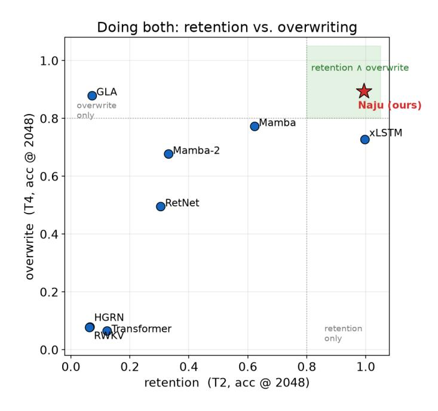
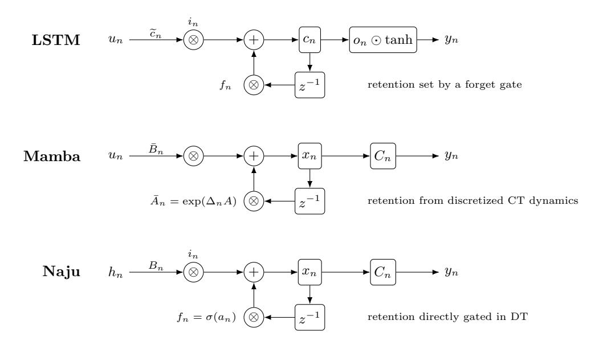
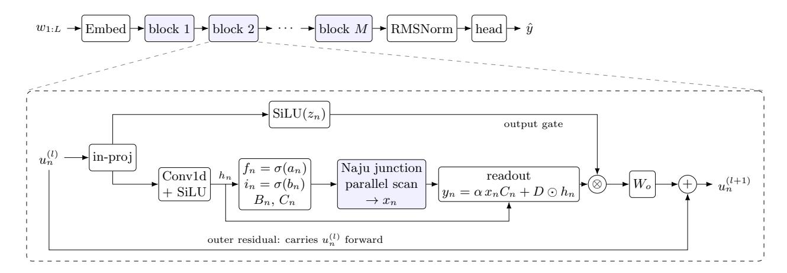

# Naju: A Native Discrete State-Space Model with Independent Retention and Writing for Long-Sequence Memory

Hyuk Lim and Seunghyun Yoon Korea Institute of Energy Technology (KENTECH) hlim@kentech.ac.kr, syoon@kentech.ac.kr

July 24, 2026

#### Abstract

Long-sequence memory tracking places two opposing demands on a recurrent state: near-lossless retention of stored bindings over long horizons, and active overwriting of stale ones. In our diagnostic suite, the strongest efficient baselines tend to solve only one side well. We show that a native discrete state-space model (SSM) can do both at once. Continuous-time-parameterized SSMs such as Mamba obtain their discrete recurrence by zero-order-hold discretization of a continuous-time system; we argue that this detour is unnecessary for memory tracking and parameterize the discrete transition directly. Naju (Native Adaptive Junction Unit) factorizes the recurrent update, schematically x<sup>n</sup> = fn⊙xn−1+in⊙(Bnun), into an explicit discrete pole (a learned forget gate fn), an independent write gain in, and input-dependent write/read maps. Since the sigmoid pole satisfies 0 < f<sup>n</sup> < 1, each frozen local coordinate is Schur-stable by construction, and the full time-varying recurrence satisfies a fading-memory/BIBO bound under uniform boundedness assumptions, with no stability regularizer. We formalize the key structural limitation of coupled designs: any non-expansive complementary single-gate recurrence ties the effective retention r and write gain w through |r|+w ≤ 1, so near-complete retention forces weak writing; decoupling f<sup>n</sup> from i<sup>n</sup> removes this constraint. Empirically, Naju is the only evaluated model that is strong on both axes at 4× the training length (retention 0.99 ∧ overwrite 0.89), while the strongest baselines specialize in one side. Beyond the diagnostic suite, at a matched 1.2B-token budget on WikiText-103, Naju achieves the lowest perplexity at dmodel = 256 across context lengths from 1,024 to 4,096, and remains competitive with the Transformer while outperforming both Mamba generations as the model width scales to 1,024. It also achieves the highest average among the fully evaluated models in our budget-matched Long Range Arena comparison and, at dmodel = 256, outperforms both Mamba generations under matched recurrentstate budgets on multi-query associative recall, while retaining the linear-time, linear-memory scaling of an SSM. Together, these results support a simple principle for long-sequence memory in discrete state spaces: give retention and writing their own gates—one to hold and an independent one to write—so that a single fixed-size recurrent state can both preserve and update its bindings over long sequences.

## 1 Introduction

Transformers dominate modern sequence modeling, but full self-attention scales quadratically with sequence length, limiting its use in long-context settings. State space models (SSMs), most notably Mamba [\[9\]](#page-30-0), provide an alternative with linear-time sequence mixing through input-dependent state transitions implemented by hardware-aware parallel scans. Most SSMs begin from a continuous-time system,

$$\dot{h}(\tau) = Ah(\tau) + Bu(\tau), \qquad y(\tau) = Ch(\tau), \tag{1}$$

and obtain a discrete recurrence through zero-order-hold (ZOH) discretization. Given a step size ∆n,

$$\bar{A}_n = \exp(\Delta_n A), \qquad \bar{B}_n = (\Delta_n A)^{-1} \left( \exp(\Delta_n A) - I \right) \Delta_n B.$$
 (2)

Selective SSMs make ∆n, Bn, and C<sup>n</sup> functions of the input. This continuous-time construction provides a principled route to stable and structured dynamics. For the token, event, and state-update sequences ultimately processed by the model, however, the operational object is the discrete recurrence

$$x_n = \bar{A}_n x_{n-1} + \bar{B}_n u_n. \tag{3}$$

This raises a basic design question: for discrete sequence memory, should the recurrent transition itself be parameterized directly?

We study this question in the setting of *long-sequence memory tracking*: storing many bindings and later recalling, updating, or overwriting them after long intervals. This setting arises in practical workloads rather than only in synthetic recall tasks. Long-session dialogue agents must preserve user facts and instructions while processing many intervening turns; entity-consistent generation and summarization require a binding introduced once to survive until it is queried or revised; repository-level code models encounter identifiers defined once and referenced far later; and streaming analysis of system logs, security events, or industrial telemetry must maintain the latest state of an entity amid large numbers of unrelated updates. These applications share two demands under a fixed state budget: important bindings must be retained with little attenuation, yet stale bindings must be overwritten decisively when their values change.

The first demand is governed by the recurrent pole—the multiplicative factor that controls the temporal decay of the previous state. For a scalar frozen recurrence with retention f, the contribution of a stored value after L steps is proportional to  $f^L$ . Retaining at least a fraction  $\rho$  therefore requires

$$f \ge \rho^{1/L},\tag{4}$$

or equivalently 1-f=O(1/L) for a nonvanishing retained contribution over increasing horizons. Long-range memory consequently requires an effective pole extremely close to one. A continuous-time SSM can enter this regime because  $\bar{A}_n = \exp(\Delta_n A) \to I$  as  $\Delta_n \to 0$ . Under ZOH, however, the same step size also affects the discretized input map:

$$\bar{A}_n = I + \Delta_n A + O(\Delta_n^2), \qquad \bar{B}_n = \Delta_n B + O(\Delta_n^2).$$
 (5)

Thus, in the small-step regime, moving the transition toward identity also reduces the immediate write scale unless other parameters compensate for it. The issue is not that a ZOH-based model is incapable of retaining or writing, but that retention and input injection are influenced by the same discretization variable. This creates an optimization geometry in which the two functions are not directly controlled by independent parameters.

A second form of coupling arises when explicit temporal control is added on top of an SSM transition through a complementary gate,

$$x_n = (1 - g_n) \odot (\bar{A}_n x_{n-1}) + g_n \odot (\bar{B}_n u_n), \qquad g_n = \sigma(\cdot).$$
 (6)

Here, the effective recurrent transition is  $(1 - g_n) \odot \bar{A}_n$ . Because  $1 - g_n < 1$  for finite logits, the gate introduces an additional subunit factor into the retention path. More importantly, the same scalar or channel-wise variable controls two opposing quantities: increasing  $g_n$  strengthens writing but suppresses retention through  $1 - g_n$ , whereas decreasing  $g_n$  strengthens retention but attenuates the current write. Such a gate can alternate between retaining and updating, but it cannot choose the retention and write gains independently at the same step.

We therefore propose **Naju**, a native-discrete selective state-space layer in which the recurrent pole and write gain are parameterized separately:

$$x_n = f_n \odot x_{n-1} + i_n \odot (B_n h_n), \qquad (7)$$

where  $f_n = \sigma(\cdot)$  is the forget gate and  $i_n = \sigma(\cdot)$  is an independent input gate. There is no continuous-time generator, step size  $\Delta_n$ , matrix exponential, or ZOH map:  $f_n$  is itself the discrete recurrent pole. The model can therefore represent a near-identity transition with  $f_n \to 1$  without forcing the write gain  $i_n$  toward zero. Conversely, it can overwrite stale state by setting  $f_n \to 0$  and  $i_n \to 1$ . More generally, it can preserve existing state while adding new information by allowing both gates to be large.

Naju adopts the retain/write separation associated with the LSTM memory cell, but it does not simply insert an LSTM cell into an SSM block. In an LSTM, the gates update a cell state whose contents are exposed



<span id="page-2-0"></span>Figure 1: Retention and overwriting at length 2048. Extrapolation accuracy on retention (T2, scattered key–value recall; x-axis) and overwriting (T4, hard state tracking; y-axis) under the shared training protocol and the stated model configurations. Among the tested baselines, xLSTM provides strong retention but weaker overwriting, whereas GLA provides strong overwriting but weak long-distance retention. Mamba and Mamba-2 do not reach either extreme simultaneously. Naju occupies the top-right region by independently controlling its forget and input gates.

through a nonlinear hidden-state transformation. In Naju, the forget gate is the pole of a diagonal selective SSM state, inBnu<sup>n</sup> is an input-dependent state write, and C ⊤ <sup>n</sup> x<sup>n</sup> is an input-dependent state readout. The retain/write junction is therefore realized as a native-discrete, selective, and associative-scan-compatible state-space recurrence.

Direct discrete-time modeling alone is not unique to Naju. Gated linear recurrences such as HGRN, RetNet, the LRU family, and Griffin's RG-LRU also avoid a continuous-time discretization step. Their mechanisms, however, differ from the combination studied here. Complementary-gated recurrences directly tie the write coefficient to the retention gate; LRU-style models use a retention-dependent normalization such as p 1 − λ<sup>2</sup> n ; and fixed- or structured-decay models do not provide an independent pair of input-dependent retain and write gates acting on a selective state. Naju combines three properties that are not jointly present in these models: the forget gate is the discrete pole itself, the write gain is independently learned, and input-dependent B<sup>n</sup> and C<sup>n</sup> selectively write to and read from the state.

This distinction is central to long-sequence memory tracking because retention and overwriting impose different requirements. Holding a binding across a long interval requires f<sup>n</sup> to remain close to one over the relevant steps. Replacing a stale binding requires the model to suppress the old state and inject the new value, corresponding to f<sup>n</sup> → 0 and i<sup>n</sup> → 1. A complementary gate can move between these modes but imposes a fixed relationship between them. Naju instead learns the two decisions separately and can allocate different channels and time steps to preservation, accumulation, or replacement.

Figure [1](#page-2-0) illustrates the resulting empirical distinction. At length 2048, the strongest tested baselines tend to specialize in one side of the problem: xLSTM attains retention accuracy of 1.00 but overwriting accuracy of 0.73, whereas GLA attains overwriting accuracy of 0.88 but retention accuracy of only 0.07. Mamba obtains 0.62/0.77 on the two axes. Naju reaches 0.99/0.89, making it the only tested model in the high-retention, high-overwriting region. We use this ability to perform both functions within one recurrent state as the central empirical criterion of the paper.

Our contributions are as follows:

- 1. We characterize two sources of retain—write coupling in efficient recurrent sequence models. In the small-step regime of ZOH-discretized SSMs, the step size that moves the transition toward identity also scales the discretized input map. In complementary temporal gating, the same variable strengthens retention while suppressing writing. We formalize how these parameterizations affect the long-range memory kernel and associative recall.
- 2. We introduce Naju, a native-discrete selective state-space layer whose forget gate is the recurrent pole and whose input gate independently controls writing. Naju combines independent retain/write gains with input-dependent state-write and state-read maps  $B_n$  and  $C_n$ , generated with short causal local context, while preserving a diagonal recurrence compatible with associative parallel scans.
- 3. We analyze Naju as a discrete dynamical system. Under frozen gates, each state coordinate is a first-order discrete IIR filter whose pole is exactly the corresponding forget-gate value. For the time-varying recurrence, we establish a fading-memory and BIBO-stability bound under uniformly bounded gate logits, input drives, and readout parameters, without requiring an additional stability regularizer. We also relate the resulting recurrence to the gated-RNN limit of selective SSMs.
- 4. We show empirically that, among the tested models, Naju is uniquely strong at both long-range retention and active overwriting. It achieves nearly distance-uniform associative recall with approximately 1.1M parameters and occupies the top-right retention–overwriting region at length 2048. The advantage also transfers beyond diagnostic tasks: under a shared six-layer,  $d_{\text{model}} = 256$  language-modeling protocol on WikiText-103, Naju obtains a test perplexity of  $26.20 \pm 0.17$ , compared with  $28.31 \pm 0.17$  for Mamba-2, while retaining linear-time recurrent execution.

### 2 Related Work

### 2.1 Structured and Selective State Space Models

State space models (SSMs) represent a sequence through a recurrent state update and a state-dependent readout. Modern structured SSMs make this formulation practical for long sequences by imposing diagonal or otherwise structured transition operators that admit efficient convolutional or parallel-scan implementations. H3 [8] adapts structured SSMs to language modeling and identifies associative recall as a central limitation of time-invariant SSMs. It supplements the recurrent state with a shift operation so that nearby tokens can interact before being written into memory.

Mamba [9] introduces input-dependent selectivity into the SSM recurrence and implements it with a hardware-aware scan. Its model is parameterized through continuous-time dynamics and discretized at each token, with the input-dependent step size  $\Delta_n$  jointly affecting the discrete transition  $\bar{A}_n$  and input map  $\bar{B}_n$ , while  $B_n$  and  $C_n$  provide additional input-dependent write and read selectivity. Mamba-2 and structured state-space duality [5] further connect selective SSMs with structured masked attention and reorganize the computation for improved hardware efficiency.

Naju retains the selective write/read structure of this family but parameterizes the recurrent dynamics directly in discrete time. Its forget gate  $f_n$  is the discrete recurrent pole rather than a factor derived from  $\exp(\Delta_n A)$ , and its independently parameterized input gate  $i_n$  controls the magnitude of the selective write. Naju therefore changes the parameterization of the recurrent core rather than replacing selective state maps or scan-based execution.

### 2.2 Gated Recurrent and Linear-Time Sequence Models

The separation of memory retention and input writing originates in gated recurrent architectures. An LSTM updates its memory cell according to

$$c_n = f_n \odot c_{n-1} + i_n \odot \widetilde{c}_n,$$
  

$$h_n = o_n \odot \tanh(c_n),$$
(8)

where the forget and input gates separately control retention and writing. This separation improves memory control compared with a vanilla RNN, whose retention and input processing are entangled in a dense nonlinear hidden-state transition.

Recent linear-time architectures revisit gated recurrence using simpler or more structured state updates. RetNet [\[21\]](#page-31-0) uses multiplicative retention to obtain parallel, recurrent, and chunkwise computation forms. RWKV [\[15,](#page-31-1) [16\]](#page-31-2) combines recurrent weighted key–value aggregation with token-shift and channel-mixing mechanisms. GLA [\[23\]](#page-31-3) introduces data-dependent multiplicative gates into a linear-attention state, whereas HGRN [\[17\]](#page-31-4) uses a gated linear recurrence with hierarchically constrained retention. These models demonstrate that explicit control of recurrent decay is important for efficient long-context processing, although their state organizations and write mechanisms differ.

The LRU [\[14\]](#page-31-5) shows that carefully parameterized stable diagonal linear recurrences can perform strongly on long-range benchmarks. Its transition is linear and time invariant, and a retention-dependent normalization is used to balance state propagation and input injection. Griffin's RG-LRU [\[7\]](#page-30-3), subsequently used in RecurrentGemma [\[4\]](#page-30-4), makes both the recurrence coefficient and an input gate data dependent. A representative scalar form of its update is

$$h_n = \lambda_n \odot h_{n-1} + \sqrt{1 - \lambda_n^2} \odot (i_n \odot u_n). \tag{9}$$

The input gate i<sup>n</sup> provides data-dependent write control, but the admissible write amplitude remains modulated by the retention-dependent envelope p 1 − λ<sup>2</sup> n . Consequently, as λ<sup>n</sup> approaches one, the normalized input contribution approaches zero regardless of the value of in. This is a deliberate normalization and stabilization choice rather than an absence of input gating, but it differs from Naju's independently parameterized retention and write gains.

xLSTM [\[3\]](#page-30-5) is closest to Naju in its explicit use of distinct forget and input gates. Its sLSTM and mLSTM variants extend the LSTM framework with exponential gating, normalization states, and scalar or matrixvalued memories. These mechanisms enable expressive recurrent memory but introduce a different state structure and stabilization procedure. Naju instead uses a sigmoid-gated diagonal recurrence whose local pole lies in (0, 1) for finite logits and whose state update remains affine and compatible with an associative scan.

Naju can be related to the LSTM principle without being identified with a conventional LSTM cell. Its recurrent core is

$$x_n = f_n \odot x_{n-1} + i_n \odot (B_n h_n),$$
  

$$y_n = \alpha C_n^{\mathsf{T}} x_n + D h_n.$$
(10)

Here, x<sup>n</sup> is a diagonal SSM state, B<sup>n</sup> and C<sup>n</sup> are input-dependent selective write/read maps, and α is a constant gain on the state-readout path. Thus, the LSTM and Naju recurrences share the principle of separately parameterized retention and writing, but they differ in the memory carrier, readout mechanism, and computation graph. Under frozen parameters, each Naju state coordinate is a first-order discrete IIR filter, and the full time-varying update remains an affine diagonal scan.

The output modulation in Naju is provided by a GLU/SwiGLU-style branch [\[6,](#page-30-6) [19\]](#page-31-6), as commonly used in modern sequence blocks. This branch plays a role analogous to output gating without changing the affine recurrent state update. Naju therefore combines forget-, input-, and output-like control while preserving a selective SSM-style memory carrier and an associative-scan-compatible recurrence.

## 2.3 Hybrid and Long-Context Architectures

Hybrid architectures combine recurrent or state-space layers with attention to balance efficient sequence processing and content-based retrieval. Griffin/Hawk [\[7\]](#page-30-3) combines RG-LRU blocks with local attention, while Jamba [\[11\]](#page-30-7) interleaves Transformer attention and Mamba layers. These architectures show that recurrent sequence mixers can be effective components of larger systems when complemented by local or sparse attention.

Naju addresses a complementary question. Rather than adding attention around an existing recurrent layer, it modifies the recurrent parameterization itself. The objective is to determine whether a nativediscrete selective recurrence with separately parameterized retain and write gains can provide both long-range preservation and decisive state replacement. We therefore evaluate the recurrent core directly on associative

| Model<br>family                                              | Memory carrier                             | Retention                                                       | Input writing                                                                                | Key distinction from<br>Naju                                                              |
|--------------------------------------------------------------|--------------------------------------------|-----------------------------------------------------------------|----------------------------------------------------------------------------------------------|-------------------------------------------------------------------------------------------|
| LSTM                                                         | Nonlinear cell<br>state cn                 | Independent forget<br>gate fn                                   | Independent input gate<br>applied to a nonlinear<br>candidate                                | No selective SSM<br>write/read maps; nonlinear<br>hidden-state readout                    |
| Mamba                                                        | Selective SSM<br>state                     | A¯n<br>= exp(∆nA)<br>after discretization                       | Discretized selective<br>map B¯nun                                                           | ∆n<br>participates in both the<br>discrete transition and<br>input map                    |
| HGRN and<br>related<br>complementary<br>gated<br>recurrences | Vector or<br>structured<br>recurrent state | Data-dependent<br>retention gate                                | Write coefficient<br>coupled to the retention<br>gate, often through a<br>complementary term | Retention and writing are<br>not independently<br>parameterized                           |
| LRU /<br>RG-LRU                                              | Diagonal linear<br>recurrent state         | Stable diagonal<br>coefficient,<br>optionally data<br>dependent | Input gate with<br>retention-dependent<br>normalization                                      | The write amplitude has a<br>retention-dependent<br>envelope                              |
| xLSTM                                                        | Scalar or<br>matrix-valued<br>LSTM memory  | Independent<br>exponential forget<br>gate                       | Independent<br>exponential input gate<br>with normalization<br>states                        | Different memory structure,<br>normalization, and<br>nonlinear output mechanism           |
| Naju                                                         | Diagonal selective<br>SSM state            | Forget gate fn<br>used<br>directly as the<br>discrete pole      | Independent gate in<br>applied to the selective<br>write Bnun                                | Native-discrete pole,<br>independent retain/write<br>gains, and selective Bn<br>and<br>Cn |

Table 1: Structural positioning of Naju relative to representative recurrent sequence models. The table distinguishes independently parameterized gates from write mechanisms whose scale remains coupled to retention through a complementary coefficient, discretization variable, or normalization envelope. These categories describe parameterization rather than absolute expressive limitations: sufficiently flexible models may compensate through other parameters, layers, or channels.

recall, state tracking, length extrapolation, language modeling, and throughput, without attributing its memory behavior to an interleaved attention mechanism.

## 3 Method: Naju, a Native Discrete SSM

We index sequence positions by n = 1, 2, . . . , L, where L is the sequence length, and layers by l = 1, 2, . . . , M. Unless otherwise stated, the equations below describe a single layer, and the layer superscript is included only when needed. Naju maintains a diagonal recurrent state for each expanded channel.

## 3.1 Discrete SSM Background

For a single channel, a diagonal state-space layer maintains a recurrent state x<sup>n</sup> ∈ R <sup>d</sup>state and applies

$$x_n = \bar{A}_n x_{n-1} + \bar{B}_n u_n, \qquad y_n = C_n^{\top} x_n.$$
 (11)

Here, A¯ <sup>n</sup> is the discrete transition, B¯ <sup>n</sup> maps the current input into the state, and C<sup>n</sup> reads from the state. In continuous-time-parameterized SSMs such as Mamba, the discrete recurrence is obtained by first defining a continuous-time state-space system and then applying a discretization rule. Under zero-orderhold (ZOH) discretization, the discrete transition is

$$\bar{A}_n = \exp\left(\Delta_n A\right),\tag{12}$$



Figure 2: Comparison of the recurrent junctions in LSTM, Mamba, and Naju. Each recurrence contains an additive node combining a retained state with a current write. LSTM controls cell-state retention with a forget gate. Mamba obtains its discrete transition from a continuous-time-parameterized SSM, for example,  $\bar{A}_n = \exp(\Delta_n A)$ . Naju instead uses the learned forget gate  $f_n$  directly as the discrete pole and controls writing with a separate input gate  $i_n$ . The figure compares only the recurrent updates: readout gains, feedthrough paths, and outer residual connections are omitted. For Naju,  $h_n$  denotes the convolved content drive defined in Eq. (25).

and the corresponding input map can be written as

$$\bar{B}_n = \left(\int_0^{\Delta_n} \exp\left((\Delta_n - s)A\right) ds\right) B_n. \tag{13}$$

Mamba introduces selectivity by making  $\Delta_n$ ,  $B_n$ , and  $C_n$  input dependent. Consequently, the discrete transition and input map vary with the token while retaining the continuous-time-to-discrete construction.

Naju takes a different route. Rather than defining a continuous-time operator and discretizing it at every step, Naju parameterizes the recurrence directly in discrete time. Its memory retention is controlled by a learned forget gate  $f_n$ , which acts directly as the discrete pole, while state writing is controlled separately by an input gate  $i_n$ . Thus, Naju uses neither a learned step size  $\Delta_n$  nor a ZOH discretization map.

### <span id="page-6-3"></span>3.2 Native Discrete Recurrence and Readout

The name **Naju** stands for *Native Adaptive Junction Unit*. It is *native discrete* because its recurrence is parameterized directly in discrete time, without introducing a continuous-time transition operator or a zero-order-hold discretization step. It is *adaptive* because its retention and write strengths vary with the input. The term *junction* refers to the additive point at which the retained state and newly written content meet.

Naju is defined by two central equations. For layer l, the recurrent state is updated as

<span id="page-6-0"></span>
$$x_n^{(l)} = f_n^{(l)} \odot x_{n-1}^{(l)} + i_n^{(l)} \odot \left( h_n^{(l)} \left( B_n^{(l)} \right)^\top \right), \tag{14}$$

where

<span id="page-6-2"></span>
$$f_n^{(l)} = \sigma\left(a_n^{(l)}\right), \qquad i_n^{(l)} = \sigma\left(b_n^{(l)}\right). \tag{15}$$

After the recurrent scan, the state is read out as

<span id="page-6-1"></span>
$$y_n^{(l)} = \alpha x_n^{(l)} C_n^{(l)} + D^{(l)} \odot h_n^{(l)}.$$
(16)

| Symbol                 | Shape                                                       | Meaning                                                                                      |
|------------------------|-------------------------------------------------------------|----------------------------------------------------------------------------------------------|
| $h_n^{(l)}$            | $\mathbb{R}^{d_{\mathrm{inner}}}$                           | Convolved content drive supplied to the write and feedthrough paths.                         |
| $x_n^{(l)}$            | $\mathbb{R}^{d_{\mathrm{inner}} \times d_{\mathrm{state}}}$ | Recurrent memory; each expanded channel maintains a $d_{\mathrm{state}}$ -dimensional state. |
| $f_n^{(l)}, i_n^{(l)}$ | $(0,1)^{d_{\mathrm{inner}}}$                                | Independent retain and write gates, broadcast across the state dimension.                    |
| $B_n^{(l)}, C_n^{(l)}$ | $\mathbb{R}^{d_{\text{state}}}$                             | Token-dependent state-space write and read directions.                                       |
| $\alpha$               | $\mathbb{R}_{>0}$                                           | Constant gain applied to the recurrent-memory readout.                                       |
| $D^{(l)}$              | $\mathbb{R}^{d_{\mathrm{inner}}}$                           | Learned token-independent feedthrough gain.                                                  |
| $y_n^{(l)}$            | $\mathbb{R}^{d_{\text{inner}}}$                             | Local output before the block output projection.                                             |

<span id="page-7-0"></span>Table 2: Core notation for the Naju state update and readout.

Table 2 summarizes only the quantities that appear directly in Eqs. (14)–(16). We use  $d_{\text{inner}} = Ed_{\text{model}}$ , with E = 2 in the main experiments.

Equation (14) consists of a retain branch and a write branch. The retain branch,  $f_n^{(l)} \odot x_{n-1}^{(l)}$ , propagates the previous state. The forget gate  $f_n^{(l)}$  is therefore the token-dependent discrete pole of the recurrence: values close to one preserve stored information, whereas values close to zero suppress the previous state. The write branch,

$$i_n^{(l)} \odot \left( h_n^{(l)} \left( B_n^{(l)} \right)^{\top} \right),$$
 (17)

injects the current content into the state. The drive  $h_n^{(l)}$  contains the local content to be written, while  $B_n^{(l)}$  determines the state-space direction of the write. Their outer product satisfies

$$h_n^{(l)} \left( B_n^{(l)} \right)^{\top} \in \mathbb{R}^{d_{\text{inner}} \times d_{\text{state}}},$$
 (18)

matching the shape of the recurrent state. The gate  $i_n^{(l)}$  independently controls the write magnitude for each expanded channel. The independence of  $f_n^{(l)}$  and  $i_n^{(l)}$  permits distinct memory operations. When  $f_n^{(l)}$  is large and  $i_n^{(l)}$  is small, the unit approximately holds its state. When  $f_n^{(l)}$  is small and  $i_n^{(l)}$  is large, it suppresses stale state and writes new content. When both gates are large, it can add new evidence while preserving previously stored information. Retention and writing are therefore separate decisions rather than complementary outcomes of a single gate.

In Eq. (16), the product  $C_n^{(l)} x_n^{(l)}$  denotes contraction over the  $d_{\text{state}}$  dimension:

$$x_n^{(l)} C_n^{(l)} \in \mathbb{R}^{d_{\text{inner}}}.$$
 (19)

The token-dependent vector  $C_n^{(l)}$  determines how the current state is queried, while  $\alpha$  controls the scale of the resulting recurrent-memory contribution. The feedthrough term

$$D^{(l)} \odot h_n^{(l)} \tag{20}$$

provides a direct route from the current content drive to the local output. The parameter  $D^{(l)}$  is learned but token independent and acts diagonally across expanded channels. This path allows local information to be exposed without first storing and retrieving it through the recurrent state.

Neither  $\alpha$  nor  $D^{(l)}$  enters Eq. (14). They therefore do not alter the recurrent pole or the memory dynamics. The pole is determined by  $f_n^{(l)}$ , whereas  $\alpha$  and  $D^{(l)}$  control the relative scales of the memory-mediated and direct output paths. In a local transfer-function interpretation,  $f_n^{(l)}$  determines the pole, while the direct feedthrough term contributes to the zero structure.

Relation to LSTM. Equation (14) shares the abstract retain/write pattern of the LSTM memory update

$$c_n = f_n \odot c_{n-1} + i_n \odot \widetilde{c}_n, \tag{21}$$

but its memory carrier and computation graph are different. Naju maintains a diagonal selective SSM state rather than an LSTM cell exposed through a nonlinear hidden-state transformation. Its write content is the

selective outer product  $h_n B_n^{\top}$  rather than a dense nonlinear candidate cell, and its state is queried through the token-dependent read vector  $C_n$ . Naju should therefore be understood as an SSM-style realization of retain/write decoupling rather than as a conventional LSTM cell.

Native-discrete SSM interpretation. The roles of the principal quantities are explicit:  $f_n$  controls temporal retention,  $i_n$  controls write magnitude,  $B_n$  determines the state-space write direction, and  $C_n$  determines the state-space read direction. The scalar  $\alpha$  and feedthrough gain D affect the output scale but not the state recurrence. Compared with continuous-time-parameterized selective SSMs, the principal structural difference is that retention is not mediated by  $\exp(\Delta_n A)$  or by another discretization map. Instead, the discrete pole is parameterized directly by  $f_n$  and varies with the token.

**Associative scan.** Despite its input-dependent retain and write terms, the recurrence preserves the affine form required for an associative parallel scan. Define the token-wise affine element

$$p_n = (f_n, w_n), \qquad w_n = i_n \odot (h_n B_n^{\top}). \tag{22}$$

Two consecutive recurrence elements compose according to

$$(f_b, w_b) \circ (f_a, w_a) = (f_b \odot f_a, w_b + f_b \odot w_a). \tag{23}$$

This operator is associative because elementwise multiplication is associative and distributive over addition. Consequently, the full state sequence can be computed using a parallel prefix scan while producing the same result as the sequential recurrence.

#### 3.3 Selective Parameterization

We now specify how the content drive, retain/write gates, and selective write/read vectors are generated from the block input. Each Naju block first projects the residual-stream input into two expanded branches:

<span id="page-8-2"></span>
$$\left(\tilde{u}_n^{(l)}, z_n^{(l)}\right) = \text{split}\left(W_{\text{in}}^{(l)} u_n^{(l)}\right). \tag{24}$$

The first branch,  $\tilde{u}_n^{(l)}$ , generates the content drive used by the recurrent update, whereas  $z_n^{(l)}$  is reserved for output modulation in Section 3.4.

The content branch is processed by a short depthwise causal convolution and a SiLU nonlinearity:

<span id="page-8-0"></span>
$$h_n^{(l)} = \text{SiLU}\left(\text{DWConv}^{(l)}\left(\tilde{u}^{(l)}\right)_n\right),$$
 (25)

where

$$SiLU(x) = x \sigma(x). \tag{26}$$

Because the convolution is depthwise and causal, each expanded channel incorporates only its own recent history and no future positions. This gives  $h_n^{(l)}$  a short local context before it is used to generate the recurrent write, gates, and selective vectors. Related local-mixing mechanisms have been used in H3 [8] and Mamba [9] to expose nearby token interactions before the recurrent update.

The retain and write decisions are generated from the shared content drive:

<span id="page-8-1"></span>
$$a_n^{(l)} = W_f^{(l)} h_n^{(l)} + \text{DWConv}_f^{(l)} \left( h^{(l)} \right)_n + f_{\text{bias}}^{(l)},$$

$$b_n^{(l)} = W_i^{(l)} h_n^{(l)} + \text{DWConv}_i^{(l)} \left( h^{(l)} \right)_n + i_{\text{bias}}^{(l)}.$$
(27)

The corresponding gates are given in Eq. (15). The linear terms in Eq. (27) transform the current content representation, while the bias-free depthwise convolutions provide each gate with an additional short history specific to that expanded channel. The forget gate  $f_n^{(l)}$  determines the token-dependent discrete pole, and the input gate  $i_n^{(l)}$  independently determines the write magnitude.

The selective write and read directions are generated from the same content drive:

<span id="page-9-1"></span>
$$\left(B_n^{(l)}, C_n^{(l)}\right) = \operatorname{split}\left(W_{BC}^{(l)} h_n^{(l)}\right). \tag{28}$$

Here,  $B_n^{(l)}$  determines the state-space direction into which the current content is written, whereas  $C_n^{(l)}$  determines the direction along which the recurrent state is read. Both vectors vary with the token and are shared across expanded channels at that token.

Combining Eqs. (25)–(28) with the state update gives

$$x_n^{(l)} = f_n^{(l)} \odot x_{n-1}^{(l)} + i_n^{(l)} \odot \left( h_n^{(l)} \left( B_n^{(l)} \right)^\top \right). \tag{29}$$

Thus, Naju makes four token-dependent decisions from a shared locally informed representation: how much state to retain, how strongly to write, where in the state space to write, and how to read the resulting state. The recurrent update nevertheless remains diagonal and affine, preserving compatibility with an associative scan.

### <span id="page-9-0"></span>3.4 Block Output

The recurrent output from Eq. (16) is combined with the second branch of the input projection through multiplicative output modulation:

<span id="page-9-2"></span>
$$u_n^{(l+1)} = W_o^{(l)} \left( y_n^{(l)} \odot \text{SiLU} \left( z_n^{(l)} \right) \right) + u_n^{(l)}.$$
 (30)

The vector  $z_n^{(l)}$  is generated together with the content branch in Eq. (24). After the SiLU nonlinearity, it modulates the recurrent output elementwise before the output projection  $W_o^{(l)}$ . This follows the GLU/SwiGLU-style multiplicative organization used in modern sequence blocks [6, 19].

The term  $\operatorname{SiLU}(z_n^{(l)})$  is more precisely an *output-modulation branch* than a probabilistic gate: unlike the sigmoid gates  $f_n^{(l)}$  and  $i_n^{(l)}$ , it is not restricted to the interval (0,1). Its role is to control which expanded-channel features of  $y_n^{(l)}$  are emitted through the output projection, without modifying the recurrent state itself.

The block contains two nonrecurrent routes for current information. The first is the feedthrough term inside the local readout,

$$D^{(l)} \odot h_n^{(l)}, \tag{31}$$

which is modulated and projected together with the recurrent-memory readout. The second is the outer residual connection in Eq. (30), which adds the original block input  $u_n^{(l)}$  directly to the projected sequence-mixer output. The feedthrough therefore provides a learnable local route within the sequence mixer, whereas the residual connection preserves a clean identity path across layers.

Complete block computation. Equations (14)–(30) define the complete Naju block used in the main experiments. Its computation can be summarized as

$$u_n^{(l)} \longrightarrow \left(h_n^{(l)}, z_n^{(l)}\right) \longrightarrow \left(f_n^{(l)}, i_n^{(l)}, B_n^{(l)}, C_n^{(l)}\right) \longrightarrow x_n^{(l)} \longrightarrow y_n^{(l)} \longrightarrow u_n^{(l+1)}. \tag{32}$$

The only temporally recurrent quantity is  $x_n^{(l)}$ . The projections, depthwise convolutions, gates, selective vectors, readout, and output modulation are token-wise or short-context feedforward computations around that state.

Functionally,  $f_n^{(l)}$  and  $i_n^{(l)}$  provide retain and write control analogous to the forget and input gates of an LSTM. The SiLU $(z_n^{(l)})$  branch provides gate-like output modulation, but it is not an LSTM output gate and does not alter the recurrent state. Consequently, Naju retains an affine diagonal state-space recurrence while providing separate control over retention, writing, selective reading, and block output.



<span id="page-10-0"></span>Figure 3: Naju architecture. The full model (top) stacks M Naju blocks between a token embedding and a final prediction head; one block is expanded below. The block input  $u_n^{(l)}$  is projected into a content branch  $h_n^{(l)}$  and an output-modulation branch  $z_n^{(l)}$ . The content branch generates the token-dependent retain/write gates  $f_n^{(l)}$  and  $i_n^{(l)}$  and the selective write/read vectors  $B_n^{(l)}$  and  $C_n^{(l)}$ , which define the native-discrete recurrence in Eq. (14). The resulting state is combined with the direct feedthrough path according to Eq. (16). The  $z_n^{(l)}$  branch modulates this local output before the output projection, and the outer residual connection preserves an identity path across blocks. Only  $x_n^{(l)}$  is temporally recurrent; the remaining components are token-wise or short-context computations around the recurrent state.

Figure 3 shows the complete Naju block and the stacking of M blocks into the full model. Each block consists of the native-discrete Naju junction wrapped by input projection, short depthwise causal convolutions, selective parameter generation, output modulation, output projection, and a residual connection. The complete model otherwise follows a standard sequence architecture with token embeddings, M Naju blocks, RMSNorm, and a final prediction head.

## 4 Memory-Kernel and Pole-Gain Analysis

#### 4.1 Memory-Kernel View of Retain-Write Decoupling

For clarity, we omit the layer index and analyze one expanded channel. The corresponding state update is

<span id="page-10-1"></span>
$$x_n = f_n x_{n-1} + i_n B_n h_n, (33)$$

where  $x_n, B_n, C_n \in \mathbb{R}^{d_{\text{state}}}$  and  $f_n, i_n, h_n, D \in \mathbb{R}$ . The full recurrence applies the same analysis independently to all expanded channels.

Unrolled memory dynamics. Unrolling Eq. (33) gives

<span id="page-10-2"></span>
$$x_{n} = \left(\prod_{j=1}^{n} f_{j}\right) x_{0} + \sum_{m=1}^{n} \left[ \left(\prod_{j=m+1}^{n} f_{j}\right) i_{m} B_{m} h_{m} \right], \tag{34}$$

where an empty product is defined as one. Define the post-write retention factor

<span id="page-10-3"></span>
$$R_{m \to n} = \prod_{j=m+1}^{n} f_j, \qquad R_{n \to n} = 1.$$
 (35)

The contribution written at position m and remaining in the state at position n is therefore

$$x_{m \to n} = R_{m \to n} i_m B_m h_m. \tag{36}$$

This expression separates the roles of the recurrent components. The drive h<sup>m</sup> supplies the content amplitude, B<sup>m</sup> determines the state-space direction of the write, i<sup>m</sup> controls how strongly the content is written, and Rm→<sup>n</sup> determines how much of that write survives until position n.

Output memory kernel. For the same channel, the readout is

$$y_n = \alpha C_n^{\mathsf{T}} x_n + Dh_n. \tag{37}$$

Substituting Eq. [\(34\)](#page-10-2) yields

$$y_n = \alpha \left( \prod_{j=1}^n f_j \right) C_n^{\top} x_0 + \sum_{m=1}^n \alpha R_{m \to n} i_m C_n^{\top} B_m h_m + Dh_n.$$
 (38)

The causal memory kernel from position m to position n is thus

<span id="page-11-0"></span>
$$K_{n,m} = \begin{cases} \alpha R_{m \to n} i_m C_n^{\top} B_m, & m \le n, \\ 0, & m > n. \end{cases}$$

$$(39)$$

Accordingly,

$$y_n = \alpha \left( \prod_{j=1}^n f_j \right) C_n^{\top} x_0 + \sum_{m=1}^n K_{n,m} h_m + Dh_n.$$
 (40)

For a past token m < n, its contribution reaches the output only through the recurrent-memory path:

$$y_{m \to n} = K_{n,m} h_m. \tag{41}$$

For the current token, Rn→<sup>n</sup> = 1, so the output contains both the state-mediated write and the direct feedthrough:

$$y_{n\to n} = \left(\alpha \, i_n C_n^\top B_n + D\right) h_n. \tag{42}$$

Retain–write decoupling. The kernel in Eq. [\(39\)](#page-11-0) makes the retain–write separation explicit. The tokendependent retention coefficient f<sup>j</sup> determines the survival product

$$R_{m \to n} = \prod_{j=m+1}^{n} f_j, \tag{43}$$

whereas i<sup>m</sup> controls the write amplitude at the moment token m is stored. The vectors B<sup>m</sup> and C<sup>n</sup> determine the state-space write and read directions, respectively, and α controls the overall scale of the memorymediated output. This survival product also connects the kernel view to the local pole interpretation. If the retention coefficients are frozen to a constant f<sup>j</sup> = f after a write at position m, then

$$R_{m \to n} = f^{n-m}. (44)$$

Equivalently, the stored contribution from position m evolves according to

$$x_{m \to n} = f x_{m \to n-1}, \qquad n > m, \tag{45}$$

whose transfer denominator is 1 − fz<sup>−</sup><sup>1</sup> and whose discrete-time pole is located at z = f. In the full time-varying recurrence, f<sup>n</sup> can therefore be interpreted as a token-dependent local retention factor, while products of these factors determine how long each stored contribution survives. The direct feedthrough term Dh<sup>n</sup> affects only the instantaneous output and does not alter either the recurrent retention dynamics or the retain–write decomposition.

The retain–write decomposition acts directly on a selective SSM-style state: f<sup>n</sup> controls temporal retention, inBnh<sup>n</sup> defines the selective write, and C<sup>n</sup> determines how the stored state is queried. Unlike continuous-time-parameterized selective SSMs, Naju does not obtain its retention factor through exp(∆nA) or another discretization map. Instead, the discrete retention coefficient is parameterized directly by fn, while the recurrence remains affine, diagonal, and compatible with an associative scan.

Complementary single-gate coupling. The benefit of independent retain and write gates can be seen by considering a complementary single-gate recurrence,

$$x_n = (1 - g_n)\lambda_n x_{n-1} + g_n v_n, \qquad 0 < g_n < 1, \tag{46}$$

where λ<sup>n</sup> is an underlying transition coefficient and v<sup>n</sup> is the candidate write. Its effective retention and write coefficients are

$$r_n = (1 - g_n)\lambda_n, \qquad w_n = g_n. \tag{47}$$

If the underlying transition is non-expansive, |λn| ≤ 1, then

<span id="page-12-0"></span>
$$|r_n| + w_n = (1 - g_n)|\lambda_n| + g_n \le (1 - g_n) + g_n = 1.$$
(48)

Consequently,

$$|r_n| \ge 1 - \epsilon \implies w_n \le \epsilon,$$
 (49)

and

<span id="page-12-1"></span>
$$w_n \ge 1 - \epsilon \implies |r_n| \le \epsilon.$$
 (50)

Thus, a complementary gate can alternate between retaining and updating, but it cannot choose the two gains independently at the same step.

Naju removes this structural constraint through x<sup>n</sup> = fnxn−<sup>1</sup> + inBnhn, for which r<sup>n</sup> = f<sup>n</sup> and w<sup>n</sup> = in. Because f<sup>n</sup> and i<sup>n</sup> are generated independently, near-unit retention does not impose an upper bound on the write gate.

Relation to the gated-RNN limit of selective SSMs. The connection to selective SSMs is formal rather than purely analogical. Theorem 1 of Mamba [\[9\]](#page-30-0) shows that, under the scalar specialization

$$d_{\text{state}} = 1, \qquad A = -1, \qquad B = 1,$$
 (51)

the ZOH-discretized selective recurrence reduces to

$$s_n = (1 - g_n)s_{n-1} + g_n u_n, \qquad g_n = \sigma(\operatorname{Linear}(u_n)). \tag{52}$$

In this specialization, the same gate controls the complementary pair

$$retention = 1 - g_n, write = g_n, (53)$$

which is precisely the coupling characterized in Eqs. [\(48\)](#page-12-0)–[\(50\)](#page-12-1).

Naju starts from a directly parameterized discrete recurrence rather than obtaining the gate through ZOH discretization, and replaces the complementary pair (1 − gn, gn) with the independent pair (fn, in). The scalar gated-RNN specialization is recovered by setting

$$f_n = 1 - g_n, i_n = g_n, B_n = 1, h_n = u_n.$$
 (54)

Naju relaxes these constraints while retaining the input-dependent selective write and read directions B<sup>n</sup> and Cn.

This comparison concerns the gated-RNN specialization of the selective SSM, rather than the full expressive class of Mamba-style models. It identifies the precise point of contact: Naju preserves the selective SSM state and scan-compatible affine structure while replacing complementary retention and writing with independently controlled native-discrete gains.

## <span id="page-12-3"></span>4.2 Frozen-Gate Transfer Function

The native-discrete form of Naju admits a simple local transfer-function interpretation. Although the complete layer is input dependent and therefore time varying, its behavior can be analyzed locally by freezing the gates and selective parameters over a short region. For one expanded channel and one state coordinate, the locally frozen dynamics reduce to the scalar recurrence

<span id="page-12-2"></span>
$$x[n] = fx[n-1] + iBh[n], y[n] = \alpha Cx[n] + Dh[n], (55)$$

where f, i, B, C, and D are treated as constants within the local region. The scalar h[n] denotes the corresponding component of the convolved content drive h (l) <sup>n</sup> . The term Dh[n] is a direct feedthrough term and does not enter the recurrent state update.

**Transfer function.** Taking the z-transform of Eq. (55) under zero initial state gives

$$X(z) = fz^{-1}X(z) + iBH_{\rm in}(z), \tag{56}$$

where  $H_{\rm in}(z)$  denotes the transform of h[n]. Solving for the state gives

$$X(z) = \frac{iB}{1 - fz^{-1}} H_{\rm in}(z). \tag{57}$$

Note that the transform variable z used above is the standard z-domain variable and is unrelated to the output-modulation branch  $z_n^{(l)}$  in Eq. (24). The local transfer function from the content drive to the readout is therefore

<span id="page-13-0"></span>
$$\mathcal{H}(z) = \frac{Y(z)}{H_{\text{in}}(z)} = D + \frac{\alpha i CB}{1 - f z^{-1}} = \frac{D(1 - f z^{-1}) + \alpha i CB}{1 - f z^{-1}}.$$
 (58)

Equivalently, multiplying the numerator and denominator by z gives

<span id="page-13-1"></span>
$$\mathcal{H}(z) = \frac{(D + \alpha iCB)z - Df}{z - f}.$$
 (59)

When the direct feedthrough path is removed, the transfer function reduces to

$$\mathcal{H}_{D=0}(z) = \frac{\alpha i CB}{1 - f z^{-1}} = \frac{\alpha i CB z}{z - f}.$$
(60)

**Pole and gain interpretation.** Equations (58) and (59) show that each locally frozen Naju coordinate behaves as a first-order discrete IIR filter with a direct feedthrough path. Its recurrent pole is located at

$$z = f. (61)$$

Thus, the forget gate determines the local memory dynamics. The input gate i controls the write gain, while B and C determine the local write and read gains. The scalar  $\alpha$  controls the overall scale of the state-mediated readout.

The direct term D modifies the numerator and therefore the zero structure of the transfer function. It does not modify the recurrent pole because it does not enter the state recurrence. Except in degenerate cases where the recurrent term vanishes or an exact pole–zero cancellation occurs, the pole remains at z = f.

#### Memory time scale. Because

$$f = \sigma(a) \in (0, 1) \tag{62}$$

for finite logits, the locally frozen pole lies inside the unit circle. A stored contribution is multiplied by  $f^k$  after k recurrent steps. When f approaches one, the pole approaches z=1, producing a near-integrator regime in which stored information decays slowly over finite horizons. When f is small, the pole approaches the origin and the recurrent state rapidly forgets past content.

A natural summary of this decay rate is the e-folding memory time constant

<span id="page-13-2"></span>
$$\tau_e(f) = \frac{1}{-\log f} \approx \frac{1}{1 - f}, \qquad f \to 1.$$
 (63)

After approximately  $\tau_e(f)$  steps, the magnitude of a stored contribution has decayed to  $e^{-1} \approx 0.37$  of its original value. For example, if f = 0.999, then  $\tau_e \approx 999.5$  steps. A stored contribution retains approximately 36.8% of its original magnitude after 1,000 steps and 13.5% after 2,000 steps.

Thus, a pole close to one supports long but gradually decaying memory; the time constant is not a finite horizon at which the stored contribution abruptly vanishes. This example describes the locally frozen dynamics, while the full Naju model uses token-dependent values of  $f_n$  whose products determine the actual retention over a sequence.

## <span id="page-14-1"></span>4.3 Stability as a Consequence

The pole and memory-kernel views make stability a direct consequence of the Naju parameterization. Under the locally frozen analysis of Section [4.2,](#page-12-3) the only recurrent pole of each scalar coordinate is z = f. Because the forget gate is parameterized as

$$f = \sigma(a) \in (0, 1) \tag{64}$$

for every finite logit a, each locally frozen coordinate is Schur stable: its recurrent pole lies strictly inside the unit circle. The direct feedthrough term Dh[n] affects only the instantaneous readout and the numerator of the transfer function. Since it does not enter the state recurrence, it cannot move the recurrent pole or alter recurrent stability.

For the full time-varying recurrence, consider one scalar state coordinate,

$$x_n = f_n x_{n-1} + v_n, v_n = i_n B_n h_n.$$
 (65)

Pointwise finiteness of the forget logits is not sufficient to guarantee a uniform stability bound, because the logits could remain finite at each step while approaching infinity along the sequence. We therefore assume that the forget logits are uniformly upper bounded:

$$a_n \le A_{\max} < \infty$$
 for all  $n$ . (66)

This gives 0 < f<sup>n</sup> = σ(an) ≤ ρ := σ(Amax) < 1. The retention product in Eq. [\(35\)](#page-10-3) then satisfies

$$R_{m \to n} = \prod_{j=m+1}^{n} f_j \le \rho^{n-m}.$$
 (67)

Thus, the influence of a write at position m decays geometrically with its distance from position n. If the write drive and readout quantities are also uniformly bounded, the recurrent state and output remain bounded.

<span id="page-14-0"></span>Theorem 1 (Fading-memory/BIBO bound under uniformly bounded gates). Consider one scalar coordinate of the Naju recurrence x<sup>n</sup> = fnxn−<sup>1</sup> + v<sup>n</sup> with f<sup>n</sup> = σ(an) and v<sup>n</sup> = in(Bnhn). Suppose there exist finite constants Amax, Mv, M<sup>C</sup> , MD, and M<sup>h</sup> such that a<sup>n</sup> ≤ Amax, |vn| ≤ Mv, |Cn| ≤ M<sup>C</sup> , |D| ≤ MD, and |hn| ≤ M<sup>h</sup> for all n. Then, with ρ = σ(Amax) < 1 and the constant readout gain α > 0,

$$|x_n| \le \rho^n |x_0| + \frac{M_v}{1-\rho}, \qquad |y_n| \le \alpha M_C \left(\rho^n |x_0| + \frac{M_v}{1-\rho}\right) + M_D M_h,$$

so the coordinate satisfies a fading-memory/BIBO bound with no stability regularizer; the diagonal vector case follows coordinatewise.

This property does not require an additional stability regularizer. It follows from using the sigmoid forget gate directly as the discrete retention coefficient. The pole can approach the unit circle arbitrarily closely, supporting near-lossless retention over a finite horizon, but it cannot equal or exceed one for finite logits. Naju is therefore stable without being restricted to an exact lossless integrator. A proof of Theorem [1](#page-14-0) is provided in Appendix [A.](#page-31-7)

Readout gain and dimension correction. Theorem [1](#page-14-0) also clarifies the role of the readout gain α. Because α appears only in the output equation, it does not affect the recurrent pole, the state trajectory, or recurrent stability. Instead, it controls the scale and optimization sensitivity of the state-readout pathway.

For one expanded channel, the recurrent contribution is

$$r_n = C_n^{\top} x_n = \sum_{k=1}^{d_{\text{state}}} C_{n,k} x_{n,k}.$$
 (68)

Under the standard initialization assumption that the coordinate-wise terms have comparable scale and are approximately uncorrelated, the root-mean-square magnitude of this sum grows as

$$RMS\left(C_n^{\top} x_n\right) = \mathcal{O}\left(\sqrt{d_{\text{state}}}\right). \tag{69}$$

Without correction, increasing dstate can therefore enlarge the state-mediated output and its corresponding gradients even though the recurrent dynamics themselves remain unchanged.

We compensate for this width-dependent readout scale by using

<span id="page-15-0"></span>
$$\alpha = \frac{1}{\sqrt{d_{\text{state}}}}. (70)$$

This parameter-free normalization cancels the leading <sup>√</sup> dstate dependence and keeps the state-readout pathway on a comparable scale as the state dimension changes. Unlike a global learning-rate adjustment, α specifically rescales the recurrent readout relative to the direct and residual pathways.

Unless otherwise stated, Eq. [\(70\)](#page-15-0) is used as the dimension-corrected readout gain in the main experiments. This choice is an optimization and scale-normalization convention rather than a stability requirement: Theorem [1](#page-14-0) holds for any fixed α > 0.

## 5 Experiments

## <span id="page-15-1"></span>5.1 Diagnostic Suite for Retention–Overwrite Trade-offs

We evaluate Naju with a controlled diagnostic suite designed to expose a central tension in long-sequence state models: the same recurrent state must sometimes preserve old information over long distances, but at other times must overwrite stale information with newer content. The core suite consists of four synthetic long-sequence tasks, labeled T1–T4. These tasks cover associative recall, length extrapolation, and state tracking: T1 and T2 are key-value recall probes in the spirit of associative recall / multi-query recall benchmarks for efficient sequence models [\[1,](#page-30-8) [2\]](#page-30-9); and T3 and T4 evaluate current-state tracking, following the motivation that sequence models should maintain and update latent states rather than only retrieve fixed facts [\[12\]](#page-30-10).

The four tasks are deliberately organized into two groups. T1 and T2 measure retention: facts are written once and never updated, so the model is rewarded for preserving bindings over increasingly long distances. T3 and T4 measure overwriting: an entity receives repeated updates, and only the latest value is correct, so the model must suppress stale answers and replace old content with new content. Thus, the task suite probes whether a model can balance long-range preservation with selective replacement, rather than optimizing only one side of the trade-off.

T1 Key-value retrieval. A sequence contains several facts of the form (KEY entity IS value SEP), followed by a query (QUES KEY entity EOS). The label is the queried entity's value, and the queried fact is placed in an early, middle, or late region of the sequence for distance-resolved evaluation for distance-resolved accuracy. This task probes basic associative recall. Example:

KEY a IS 3 SEP KEY b IS 7 SEP QUES KEY a EOS 
$$\rightarrow$$
 3.

T2 Scattered key-value retrieval. This task has the same semantic structure as T1, but facts are scattered across the sequence behind padding gaps. As the sequence length increases, the query-to-fact distance also increases. The model is trained on short sequences and evaluated on longer sequences, making T2 the primary length-extrapolation probe for retention. Example:

KEY a IS 3 SEP 
$$\langle \operatorname{pad} \times k \rangle$$
 KEY b IS 7 SEP  $\langle \operatorname{pad} \times k \rangle$  QUES KEY a EOS  $\to$  3,

where the gap k, and therefore the distance from the queried fact to the query, grows at test time.

T3 Current-state tracking. An entity receives several updates among distractors, and the model must report the latest valid value. Each update has the form (CONN entity LIKES value SEP), where the connective CONN is INIT, LATER, or FINAL for the target entity's first, middle, or last update. The query is (QUES entity NOW EOS). This task measures stale-answer suppression and basic overwriting. Example:

```
INIT x LIKES 3 SEP . . . LATER x LIKES 5 SEP . . . FINAL x LIKES 8 SEP . . . QUES x NOW EOS → 8.
```

Here 3 and 5 are stale values, and the model must return the value associated with the latest valid update.

T4 Recency-only current-state tracking. This task hardens T3 along several axes. First, the finalupdate marker is removed: every target update uses the same LATER connective, so the latest value must be identified by recency rather than by pattern-matching a FINAL token. Second, the target's updates are scattered across the sequence, so the distance from the latest update to the query grows. Third, the value pool is enlarged, increasing the output space. Finally, the model is trained on short sequences and evaluated on longer sequences. T4 is therefore the strongest stress test for overwriting under length extrapolation. Example:

LATER x LIKES 3 SEP . . . LATER x LIKES 5 SEP . . . LATER x LIKES 8 SEP . . . QUES x NOW EOS → 8,

where 8 must be identified as the most recent write by recency alone, at test-time distances beyond those seen during training.

All four tasks are evaluated as single-answer classification rather than autoregressive generation. The model reads the full sequence, and a linear head applied to the final EOS position predicts one value from the value vocabulary. A prediction is counted as correct when it matches the sampled label. Accuracy is measured over freshly sampled held-out sequences with unseen entity–value bindings and is also reported by distance bucket when applicable. For length-extrapolation results, the model is trained at length 512 and tested at longer lengths such as 1024 and 2048, so the relevant fact or latest update lies farther from the query than any dependency observed during training.

Together, the four tasks make the retention–overwrite trade-off explicit: a strong preservation bias is expected to favor T1/T2 but may retain stale values in T3/T4, whereas an aggressive update bias may produce the opposite trade-off—the tension that motivates the decoupled Naju junction, where f<sup>n</sup> controls retention through the memory kernel and i<sup>n</sup> the strength of new writes. The following experiments therefore evaluate not only whether a model can remember, but whether it can balance remembering with selective overwriting.

## 5.2 Compared Models and Training Setup

We compare Naju against a Transformer encoder, standard Mamba with the official selective-scan implementation, Mamba-2, GLA, RetNet, xLSTM, RWKV, and HGRN. Unless otherwise noted, models use dmodel = 128, 4 layers, and expansion factor 2. The standard Mamba baseline uses dmodel = 256 and dstate = 16, following the configuration used in the reference implementation for this benchmark. Because this gives Mamba a different model width from the other baselines, we report parameter counts alongside all main results. For SSM-style models with selective state maps, the write and read parameters are input-dependent where applicable.

The Naju configuration uses dmodel = 128, 4 layers, expansion factor 2, and dstate = 64, with the readout exactly as in Section [3.2:](#page-6-3) the feedthrough D is a learned per-channel constant, initialized to the small value Dinit = 0.01 so that the direct route starts nearly silent and the recurrent memory path dominates early training, and the readout gain is fixed at the parameter-free α = 1/ √ dstate (Eq. [\(70\)](#page-15-0)), which compensates for the leading <sup>√</sup> dstate growth of the state-readout scale under the initialization assumptions of Section [4.3.](#page-14-1)

For the Naju gates, we use a preserve-first initialization. Specifically, the per-channel gate biases f (l) bias and i (l) bias of Eq. [\(27\)](#page-8-1) are initialized to the constants b<sup>f</sup> and b<sup>i</sup> (the two knobs swept in Section [6\)](#page-20-0),

$$b_f = +5, \qquad b_i = -2,$$

so that initially σ(b<sup>f</sup> ) ≈ 0.993 and σ(bi) ≈ 0.12. Thus, before learning input-specific deviations, Naju is strongly biased toward retaining existing memory and writing conservatively. This initialization encourages long-range retention at the start of training while leaving both gates free to learn token-dependent retain and write behavior. The same initialization is used across all tasks.

| Setting               | Value                     |
|-----------------------|---------------------------|
| Optimizer             | AdamW                     |
| Learning rate         | 3 × 10−4                  |
| Weight decay          | 10−4                      |
| Batch size            | 32                        |
| LR schedule           | cosine with linear warmup |
| Warmup ratio          | 0.05 of total steps       |
| Epochs                | 50                        |
| Gradient clipping     | 1.0                       |
| Train sequence length | 512                       |

<span id="page-17-0"></span>Table 3: Shared training protocol. Every compared model is trained with these shared optimization settings; only the architecture and explicitly stated per-model hyperparameters differ. The standard Mamba baseline uses dmodel = 256 and dstate = 16 as stated in the text.

Training protocol. All compared models use the shared optimization protocol summarized in Table [3;](#page-17-0) architecture-specific settings are stated explicitly. No stability regularizer, auxiliary loss, or task-specific regularizer is added. Each model is trained with the task loss only. Headline results are reported as mean±std over 5 seeds at a matched training budget; remaining numbers are single-seed results where noted.

Compute environment. Experiments are run on a single NVIDIA RTX 5090 (32 GB) using PyTorch 2.7.1 with bfloat16 autocast. The PyTorch build uses CUDA 12.6, while the installed driver supports CUDA 12.8. Unless otherwise stated, runtime and memory measurements are collected on an otherwise idle GPU after warm-up and are reported over repeated runs using the same model configurations as the corresponding result tables. All completed runs use a single GPU; configurations that exceed the available memory are reported explicitly as OOM.

## <span id="page-17-1"></span>5.3 Retention versus Overwriting

The four diagnostic tasks separate into two saturated axes and two contested ones. On associative recall (T1) and current-state tracking (T3) at the training length, every capable model reaches ≈100%, so these tasks do not discriminate among the strong models. The discrimination comes from length extrapolation on the two opposing demands a memory places on the state: T2 (scattered key-value) isolates near-lossless retention—bindings never change, so holding everything is optimal—while T4 (recency-only current-state tracking) isolates active overwriting—an entity is rewritten repeatedly and only the latest value counts, so stale state must be forgotten. Table [4](#page-18-0) reports all four tasks at the longest evaluated length (2048, 4× the training distance); the per-length breakdowns and per-model analysis are in Appendix [B.](#page-32-0)

The two axes split the baselines. On retention-oriented T2, Naju (0.99) and xLSTM (1.00) remain near perfect at length 2048. In contrast, the Mamba baselines degrade as the padded retrieval distance increases (Mamba 0.62; Mamba-2 0.33), while GLA, RWKV, and HGRN fall near chance despite stronger performance on the contiguous T1 task. On overwrite-oriented T4, the ranking changes substantially: Naju (0.89), GLA (0.88), Mamba (0.77), and xLSTM (0.73) perform best.

The contrast across the two axes is informative. xLSTM provides nearly perfect retention but weaker overwriting (1.00/0.73), whereas GLA performs strongly on overwriting but fails to retain information across long padded distances (0.07/0.88). Naju remains strong on both axes (0.99/0.89) and achieves the highest worst-axis accuracy, min(T2, T4) = 0.89, among the compared models. This result is consistent with the intended role of Naju's decoupled forget and input gates: retention and writing can be adjusted independently rather than being forced into a complementary trade-off.

The ranking is not explained by recurrent-state size alone. Mamba-2 matches Naju's per-layer state size (16,384) but obtains 0.33 on T2, and increasing Mamba's state size does not improve performance in the matched factorial experiment under the evaluated settings (Table [5\)](#page-19-0). Naju also uses approximately 1.09M parameters, compared with 1.84M for Mamba.

| Model                 | Config.     | Memory   | Params | State§ | T1        | T2‡       | T3        | T4‡       |
|-----------------------|-------------|----------|--------|--------|-----------|-----------|-----------|-----------|
| Transformer           | d 256, h 4  | KV cache | 4.29M  | O(L)   | 0.11      | 0.12      | 0.06      | 0.07      |
| ,→ train / val @512   |             |          |        |        | 0.72/0.13 | 0.99/0.13 | 0.73/0.72 | 0.71/0.12 |
| Transformer (150 ep.) | d 256, h 4  | KV cache | 4.29M  | O(L)   | 0.11      | 0.11      | 0.06      | 0.06      |
| ,→ train / val @512   |             |          |        |        | 0.98/0.14 | 1.00/0.13 | 0.93/0.92 | 1.00/0.13 |
| HGRN                  | d 128       | scalar   | 0.29M  | 128    | 0.11      | 0.06      | 1.00      | 0.08      |
| GLA                   | d 128, h 4  | matrix   | 0.31M  | 2,048  | 1.00      | 0.07      | 1.00      | 0.88      |
| RWKV                  | d 128, h 4  | matrix   | 0.51M  | 2,048  | 0.10      | 0.06      | 0.95      | 0.08      |
| RetNet                | d 128, h 4  | matrix   | 0.56M  | 8,192  | 1.00      | 0.30      | 0.74      | 0.50      |
| xLSTM                 | d 128, h 4  | matrix   | 0.46M  | 16,384 | 1.00      | 1.00      | 0.95      | 0.73      |
| Mamba                 | d 256, N 16 | vector   | 1.84M  | 8,192  | 1.00      | 0.62      | 1.00      | 0.77      |
| Mamba-2               | d 128, N 64 | vector   | 0.50M  | 16,384 | 1.00      | 0.33      | 0.99      | 0.68      |
| Naju (ours)           | d 128, N 64 | vector   | 1.09M  | 16,384 | 1.00      | 0.99      | 0.94      | 0.89      |

<span id="page-18-0"></span>Table 4: Summary of the diagnostic suite. Main rows report length-2048 accuracy after training at length 512 (mean over 5 seeds). The indented Transformer rows report final-epoch train / best-validation accuracy at length 512; the 150-epoch run uses three times the standard training budget. The ‡ columns denote the contested retention and overwriting axes. Bold marks the two highest mean accuracies on each contested axis, T2 and T4. Model configuration abbreviations and per-layer state sizes are defined in the text; full per-length results and standard deviations are reported in Appendix [B](#page-32-0) (Tables [16–](#page-33-0)[19\)](#page-35-0).

Diagnosing the Transformer results. The unusually low Transformer scores at length 2048 are not explained by a single optimization failure. The training-length diagnostics reveal two distinct failure modes. On T1, T2, and T4, extending training from 50 to 150 epochs raises training accuracy to 0.98–1.00, while validation accuracy at length 512 remains near chance (0.13–0.14). Thus, the model can memorize the finite training set but does not learn the underlying entity–value rule, and tripling the training budget does not close this generalization gap. On T3, by contrast, training and validation accuracy rise together to 0.93 and 0.92, respectively, showing that the Transformer can fit and generalize within the training-length distribution. Its accuracy nevertheless falls to 0.06 at length 2048, indicating a separate failure of length extrapolation. These diagnostics support interpreting the low Transformer results as task-dependent generalization and extrapolation failures rather than insufficient convergence alone.

## 5.4 Robustness of the Comparison: Mamba Width and State

The main comparison evaluates Mamba using its reference configuration, dmodel = 256 and dstate = 16, which has roughly twice as many parameters as the default Naju model. A natural concern is that Mamba's weaker performance on retention-oriented T2 and overwrite-oriented T4 may be specific to this width and state-size choice. To test this possibility, we evaluate the full factorial combination

$$d_{\text{model}} \in \{128, 256\}, \quad d_{\text{state}} \in \{16, 32, 64\},$$

on the two contested tasks. Table [5](#page-19-0) reports length-2048 extrapolation accuracy over five seeds for T2 scattered key–value retrieval and T4 recency-only current-state tracking. We additionally include Naju configurations at the corresponding model widths and state sizes. T1 and T3 are omitted because the Mamba configurations evaluated in this sweep saturate those tasks at 1.00 and therefore provide little discrimination.

Width–state robustness. Three observations emerge from the factorial comparison. First, Mamba's T2 performance varies only moderately across the evaluated width and state configurations, ranging from 0.47 to 0.73, whereas all Naju configurations remain near perfect at 0.99–1.00. Thus, the retention gap in the main comparison is not attributable to a single unfavorable Mamba configuration. Second, the configuration that performs best on one contested axis does not necessarily perform best on the other. For example, Mamba d 128/N 16 achieves strong mean T4 accuracy (0.90) but lower T2 accuracy (0.47), while larger-state configurations improve T2 only partially and show greater seed variability on T4. None of the evaluated Mamba configurations simultaneously matches default Naju on both axes. Third, Naju remains strong across

| Config                      | Params | T2 @2048              | T4 @2048              |  |  |  |  |  |
|-----------------------------|--------|-----------------------|-----------------------|--|--|--|--|--|
| Mamba (exp(∆nA) transition) |        |                       |                       |  |  |  |  |  |
| d 128/N 16                  | 0.55M  | 0.47 ±0.16 (min 0.31) | 0.90 ±0.11 (min 0.69) |  |  |  |  |  |
| d 128/N 32                  | 0.60M  | 0.55 ±0.09 (min 0.48) | 0.68 ±0.20 (min 0.42) |  |  |  |  |  |
| d 128/N 64                  | 0.70M  | 0.68 ±0.21 (min 0.40) | 0.76 ±0.34 (min 0.10) |  |  |  |  |  |
| d 256/N 16 ⋆                | 1.96M  | 0.62 ±0.30 (min 0.07) | 0.77 ±0.27 (min 0.29) |  |  |  |  |  |
| d 256/N 32                  | 2.06M  | 0.67 ±0.24 (min 0.33) | 0.84 ±0.27 (min 0.31) |  |  |  |  |  |
| d 256/N 64                  | 2.26M  | 0.73 ±0.33 (min 0.07) | 0.68 ±0.38 (min 0.10) |  |  |  |  |  |
| Naju (ours)                 |        |                       |                       |  |  |  |  |  |
| d 128/N 32                  | 1.09M  | 0.99 ±0.00 (min 0.98) | 0.83 ±0.13 (min 0.70) |  |  |  |  |  |
| d 128/N 64 (default)        | 1.15M  | 0.99 ±0.00 (min 0.99) | 0.89 ±0.06 (min 0.80) |  |  |  |  |  |
| d 256/N 32                  | 4.04M  | 1.00 ±0.00 (min 1.00) | 0.78 ±0.23 (min 0.52) |  |  |  |  |  |
| d 256/N 64                  | 4.18M  | 1.00 ±0.00 (min 0.99) | 0.80 ±0.24 (min 0.52) |  |  |  |  |  |

<span id="page-19-0"></span>Table 5: Mamba width–state factorial on the two contested tasks. Length-2048 extrapolation accuracy is reported as mean±std over seeds 1–5, with the worst seed in parentheses. Row labels use the abbreviations of Table [4.](#page-18-0) The <sup>⋆</sup> row is the Mamba configuration used in the main comparison. Parameter counts differ slightly from Table [4](#page-18-0) because T2 and T4 use larger task vocabularies. All Naju rows use the same final readout recipe at each width and state size.

the tested state sizes. At dmodel = 128, increasing dstate from 32 to 64 preserves near-perfect T2 accuracy and raises mean T4 accuracy from 0.83 to 0.89. The default configuration therefore provides the best observed balance between retention and overwriting, achieving 0.99 on T2 and 0.89 on T4.

Overall, the factorial sweep confirms that Naju's joint retention–overwrite performance is robust to the width and state-size choices used in the comparison. The result supports the intended role of independently parameterized retain and write gates without requiring a detailed architecture-specific explanation of Mamba's behavior.

## 5.5 Efficiency: Compute and Memory

Throughput and memory. We benchmark forward latency and peak memory at a matched width (dmodel = 256, 4 layers, batch size 8) over sequence lengths 512–32768 (Table [6\)](#page-20-1). The Transformer is evaluated using both standard math attention and flash/SDPA attention. The evaluated recurrent and SSM implementations, excluding the parallel xLSTM implementation described below, exhibit approximately linear latency growth with sequence length, whereas attention retains quadratic compute complexity. Flash attention avoids materializing the full L×L attention matrix, but its latency becomes comparable to matchedwidth Naju at length 4096 (22.0 vs. 21.5 ms) and reaches 1,038 ms at length 32768, compared with 173.3 ms for Naju. Standard math attention and the evaluated xLSTM implementation run out of memory at length 8192. At length 4096, xLSTM uses 20,384 MB, compared with 806 MB for matched-width Naju.

Within the linear-scaling group, HGRN and GLA achieve the lowest measured forward latency, while Mamba and Mamba-2 remain faster than the current matched-width Naju implementation. Naju uses the native CUDA scan described in Appendix [E](#page-37-0) and maintains linear latency scaling, requiring 173.3 ms at length 32768, compared with 78.9 ms for Mamba and 52.9 ms for Mamba-2. Thus, matched-width Naju is approximately 2.2× slower than Mamba and 3.3× slower than Mamba-2 at the longest measured length. Its peak memory at the same length is 6,092 MB, compared with 4,968 MB for Mamba and 3,988 MB for Mamba-2. The additional memory is consistent with Naju's independent gate activations and larger recurrent state, although the benchmark does not isolate the contribution of each component.

The larger parameter count of matched-width Naju is primarily attributable to its independent retain and write parameterizations. In the current implementation, the f- and i-gate branches each use a full dinner × dinner projection, whereas Mamba uses a lower-rank parameterization for its step-size branch. The rank-32 gate ablation reduces Naju latency only modestly (Section [7.3\)](#page-25-0), suggesting that the scan execution path, rather than the full-rank gate projections alone, accounts for most of the remaining latency gap. This is an implementation-level difference rather than an asymptotic one.

(a) Forward latency (ms / batch)

| Model                     | Params | Scaling       | 512 | 1024 | 2048 | 4096  | 8192 | 16k   | 32k   |
|---------------------------|--------|---------------|-----|------|------|-------|------|-------|-------|
| Transformer (math attn.)  | 11.81M | 2<br>O(L<br>) | 1.3 | 3.3  | 14.9 | 54.1  | —    | —     | —     |
| Transformer (flash attn.) | 11.81M | 2<br>O(L<br>) | 1.2 | 2.7  | 7.1  | 22.0  | 75.7 | 274.8 | 1,038 |
| HGRN                      | 1.32M  | O(L)          | 1.7 | 1.7  | 1.7  | 3.1   | 7.6  | 17.2  | 34.0  |
| GLA                       | 1.34M  | O(L)          | 2.7 | 2.6  | 2.6  | 3.3   | 7.6  | 16.9  | 34.2  |
| RWKV                      | 1.75M  | O(L)          | 2.5 | 2.5  | 3.4  | 7.5   | 17.2 | 37.9  | 76.0  |
| RetNet                    | 2.38M  | O(L)          | 2.8 | 2.8  | 2.9  | 5.8   | 12.1 | 24.7  | 49.0  |
| xLSTM                     | 1.92M  | 2<br>O(L<br>) | 3.6 | 11.9 | 41.0 | 151.9 | —    | —     | —     |
| Mamba                     | 2.01M  | O(L)          | 1.3 | 2.3  | 4.3  | 8.6   | 18.5 | 39.0  | 78.9  |
| Mamba-2                   | 2.00M  | O(L)          | 1.8 | 1.8  | 2.3  | 4.9   | 10.5 | 25.6  | 52.9  |
| Naju (ours, N 64)         | 4.23M  | O(L)          | 2.9 | 5.3  | 10.4 | 21.5  | 44.0 | 87.1  | 173.3 |
| Naju (ours, d 128, N 64)  | 1.18M  | O(L)          | 1.7 | 2.6  | 4.7  | 9.4   | 19.7 | 39.9  | 80.0  |

#### (b) Peak memory (MB)

| Model                     | Params | Scaling       | 512 | 1024  | 2048  | 4096   | 8192  | 16k   | 32k   |
|---------------------------|--------|---------------|-----|-------|-------|--------|-------|-------|-------|
| Transformer (math attn.)  | 11.81M | 2<br>O(L<br>) | 173 | 400   | 2,329 | 8,873  | oom   | oom   | oom   |
| Transformer (flash attn.) | 11.81M | 2<br>O(L<br>) | 144 | 207   | 333   | 584    | 1,088 | 2,095 | 4,110 |
| HGRN                      | 1.32M  | O(L)          | 68  | 98    | 156   | 274    | 509   | 1,248 | 2,189 |
| GLA                       | 1.34M  | O(L)          | 70  | 102   | 165   | 291    | 544   | 1,317 | 2,327 |
| RWKV                      | 1.75M  | O(L)          | 106 | 171   | 301   | 561    | 1,081 | 2,126 | 4,203 |
| RetNet                    | 2.38M  | O(L)          | 94  | 145   | 247   | 451    | 858   | 1,936 | 3,560 |
| xLSTM                     | 1.92M  | 2<br>O(L<br>) | 529 | 1,554 | 5,417 | 20,384 | oom   | oom   | oom   |
| Mamba                     | 2.01M  | O(L)          | 119 | 196   | 350   | 657    | 1,273 | 2,505 | 4,968 |
| Mamba-2                   | 2.00M  | O(L)          | 104 | 166   | 289   | 536    | 1,029 | 2,015 | 3,988 |
| Naju (ours, N 64)         | 4.23M  | O(L)          | 145 | 239   | 428   | 806    | 1,561 | 3,071 | 6,092 |
| Naju (ours, d 128, N 64)  | 1.18M  | O(L)          | 87  | 135   | 231   | 424    | 811   | 1,583 | 3,127 |

<span id="page-20-1"></span>Table 6: Forward latency and peak GPU memory versus sequence length. All matched-width rows use 4 layers, batch size 8, and dmodel = 256; the additional d = 128 Naju row reports its diagnostic-task configuration. Measurements are collected on one otherwise idle RTX 5090. Each latency cell reports the mean of 20 forward iterations after 5 warm-up iterations. Scaling denotes the sequence-length complexity of the evaluated parallel forward implementation. Dashes in (a) indicate configurations that do not fit in memory, reported as oom in (b). Transformer parameter counts include the learned position table used in this benchmark.

## <span id="page-20-0"></span>6 Sensitivity and Ablation Studies

Because retention in Naju is controlled by the per-channel forget gate f<sup>n</sup> = σ(an) with a learnable bias, its initial memory behavior depends strongly on the two gate-bias initializations and on the dimension and scaling of the recurrent state. This section studies those choices. The experiments vary one primary design choice at a time, with selected state-size comparisons included to test whether the observed trends persist at the enlarged default state (all runs use Naju at dmodel=128, train at length 512, and report length-extrapolated accuracy; except for the knob under study, the base fixes bf=5, bi=−2, dstate=64 with the parameter-free 1/ √ dstate readout normalization of Eq. [\(70\)](#page-15-0) and the diagonal feedthrough D initialized at 0.01). The summary is twofold: the preserve-first decoupled gate is robust, with each bias playing a distinct role (Section [6.1\)](#page-20-2); and the readout normalization substantially improves the reliability and worstseed performance of the enlarged default state (Section [6.2\)](#page-22-0).

## <span id="page-20-2"></span>6.1 Sensitivity to Gate-Bias Initialization

Forget-bias b<sup>f</sup> sweep at fixed bi. We systematically sweep b<sup>f</sup> ∈ {4, 5, 6} at fixed b<sup>i</sup> = −2 and dstate ∈ {32, 64} over five seeds using the final default base, including normalized readout and feedthrough D initialized to 0.01 (Table [7\)](#page-21-0).

At dstate = 64, b<sup>f</sup> = 5 provides the best overall balance of mean T4 extrapolation accuracy, worst-seed

| dstate | bf     | T2@2048                  | T4@512                   | T4@2048                  | worst        | successful seeds |
|--------|--------|--------------------------|--------------------------|--------------------------|--------------|------------------|
| 32     | 4      | 0.99 ±0.00               | 0.98 ±0.01               | 0.87 ±0.08               | 0.75         | 5/5              |
|        | 5<br>6 | 0.99 ±0.00<br>0.99 ±0.00 | 0.98 ±0.01<br>0.99 ±0.00 | 0.83 ±0.11<br>0.88 ±0.09 | 0.70<br>0.72 | 5/5<br>5/5       |
| 64     | 4<br>5 | 0.99 ±0.01<br>0.99 ±0.00 | 0.99 ±0.01<br>0.99 ±0.00 | 0.80 ±0.14<br>0.89 ±0.05 | 0.55<br>0.80 | 5/5<br>5/5       |
|        | 6      | 0.99 ±0.01               | 0.81 ±0.27               | 0.60 ±0.27               | 0.15         | 3/5              |

<span id="page-21-0"></span>Table 7: Forget-bias sweep at the default base (bi=−2, normalized readout, feedthrough D initialized at 0.01), mean±std over 5 seeds: retention (T2 kv spread at 2048) and overwriting (T4 st hard at the training length 512 and at 2048). worst is the minimum seed on T4@2048; successful seeds counts runs whose validation accuracy at length 512 exceeds 0.9.

| bi | σ(bi) | T2@2048    | T4@512     | T4@2048    | worst | successful seeds |
|----|-------|------------|------------|------------|-------|------------------|
| −1 | 0.27  | 1.00 ±0.00 | 0.93 ±0.10 | 0.78 ±0.17 | 0.46  | 4/5              |
| −2 | 0.12  | 0.99 ±0.00 | 0.99 ±0.00 | 0.89 ±0.05 | 0.80  | 5/5              |
| −3 | 0.05  | 0.99 ±0.01 | 0.98 ±0.02 | 0.86 ±0.11 | 0.73  | 5/5              |
| −4 | 0.02  | 1.00 ±0.00 | 0.99 ±0.01 | 0.81 ±0.11 | 0.66  | 5/5              |

<span id="page-21-1"></span>Table 8: Input-gate bias sweep at the default base (bf=5, dstate=64, normalized readout, feedthrough D initialized at 0.01), mean±std over 5 seeds: retention (T2 kv spread at 2048) and overwriting (T4 st hard at the training length 512 and at 2048). worst is the minimum seed on T4@2048; successful seeds counts runs whose validation accuracy at length 512 exceeds 0.9.

performance, and training reliability, achieving 0.89 ± 0.05 at length 2048, with all five seeds reaching the training-length validation threshold. The smaller bias b<sup>f</sup> = 4 remains stable at length 512, but its mean T4 accuracy decreases to 0.80 at length 2048. The larger bias b<sup>f</sup> = 6 exhibits substantially greater seed sensitivity, with only three of five seeds reaching the validation threshold and a worst-seed T4 accuracy of 0.15.

This degradation coincides with the longer initial e-folding time constant of b<sup>f</sup> = 6: Eq. [\(63\)](#page-13-2) gives approximately 404 steps, compared with approximately 149 steps for b<sup>f</sup> = 5. This suggests that an excessively near-lossless initialization can make early optimization less robust. At dstate = 32, all three biases train reliably and obtain similar mean T4 performance, indicating that the sensitivity becomes more pronounced at the enlarged state size. We therefore select b<sup>f</sup> = 5 as the default because it provides the strongest and most reliable retention–overwrite balance at dstate = 64.

Input-bias b<sup>i</sup> sweep at fixed b<sup>f</sup> . We isolate the input-gate bias by sweeping b<sup>i</sup> ∈ {−1, −2, −3, −4} at fixed b<sup>f</sup> = 5 and dstate = 64 over five seeds using the default base, including normalized readout and feedthrough D initialized to 0.01 (Table [8\)](#page-21-1).

Retention is largely insensitive to the input-bias initialization: T2 accuracy remains between 0.99 and 1.00 across the sweep. In contrast, T4 exhibits the best overall performance at b<sup>i</sup> = −2, which achieves 0.89±0.05 at length 2048 and a worst-seed accuracy of 0.80. The stronger initial write bias b<sup>i</sup> = −1 produces greater training and extrapolation variability, with only four of five seeds reaching the training-length validation threshold. Weaker write biases remain reliable at the training length but gradually reduce extrapolation performance, reaching 0.86 at b<sup>i</sup> = −3 and 0.81 at b<sup>i</sup> = −4.

Together with the forget-bias sweep in Table [7,](#page-21-0) these results support distinct initialization roles for the two gates. The forget bias primarily sets the initial retention time scale, whereas the input bias controls the initial strength of new writes. We therefore use b<sup>i</sup> = −2 as the default because it provides the strongest and most reliable overwrite performance while preserving near-perfect retention.

| $d_{\rm state}$ | Readout gain                                     | <b>T2</b> @2048 | <b>T4</b> @512  | <b>T4</b> @2048 | worst | successful seeds |
|-----------------|--------------------------------------------------|-----------------|-----------------|-----------------|-------|------------------|
| $b_f = 5$       | $(\sigma(b_f) \approx 0.993,  \tau_e \approx 14$ | .9)             |                 |                 |       |                  |
| 32              | $\alpha = 1/\sqrt{d_{\mathrm{state}}}$           | $0.99 \pm 0.00$ | $0.98 \pm 0.01$ | $0.83 \pm 0.11$ | 0.70  | 5/5              |
|                 | $\alpha = 1$                                     | $0.99 \pm 0.00$ | $0.99 \pm 0.01$ | $0.88 \pm 0.11$ | 0.67  | 5/5              |
| 64              | $\alpha = 1/\sqrt{d_{\rm state}}$ (default)      | $0.99 \pm 0.00$ | $0.99 \pm 0.00$ | $0.89 \pm 0.05$ | 0.80  | $\mathbf{5/5}$   |
|                 | $\alpha = 1$                                     | $0.99 \pm 0.00$ | $0.95\pm\!0.09$ | $0.80 \pm 0.17$ | 0.48  | 4/5              |
| $b_f = 6$       | $(\sigma(b_f) \approx 0.998,  \tau_e \approx 40$ | 4)              |                 |                 |       |                  |
| 32              | $\alpha = 1/\sqrt{d_{\mathrm{state}}}$           | $0.99 \pm 0.00$ | $0.99 \pm 0.00$ | $0.88 \pm 0.09$ | 0.72  | 5/5              |
|                 | $\alpha = 1$                                     | $1.00 \pm 0.00$ | $0.99 \pm 0.00$ | $0.87 \pm 0.10$ | 0.68  | 5/5              |
| 64              | $\alpha = 1/\sqrt{d_{\mathrm{state}}}$           | $0.99 \pm 0.01$ | $0.81 \pm 0.27$ | $0.60 \pm 0.27$ | 0.15  | 3/5              |
|                 | $\alpha = 1$                                     | $0.98 \pm 0.01$ | $0.92 \pm 0.09$ | $0.73 \pm 0.19$ | 0.49  | 3/5              |

<span id="page-22-1"></span>Table 9: Readout gain versus state size. Results are mean $\pm$ std over five seeds on T2 and T4, using  $b_i = -2$  and feedthrough D initialized to 0.01. worst is the minimum-seed T4 accuracy at length 2048, and success counts runs whose validation accuracy at length 512 exceeds 0.9. Bold marks the highest T4 result within each forget-bias block; the shaded row is the default.

### <span id="page-22-0"></span>6.2 Readout Normalization versus State Size

Joint state-size and readout-gain comparison. We cross the state size  $d_{\text{state}} \in \{32, 64\}$  with the dimension-corrected readout gain  $\alpha = 1/\sqrt{d_{\text{state}}}$  and the unnormalized alternative  $\alpha = 1$  at forget biases  $b_f \in \{5, 6\}$ . All configurations use  $b_i = -2$ , feedthrough D initialized to 0.01, and five random seeds (Table 9). Because T2 remains near saturated (0.98–1.00) throughout the sweep, the main discrimination comes from T4, which tests overwriting under length extrapolation.

Normalization improves the enlarged state at  $b_f = 5$ . At  $d_{\text{state}} = 32$ , the two readout gains perform similarly:  $\alpha = 1/\sqrt{d_{\text{state}}}$  obtains  $0.83 \pm 0.11$  on T4 at length 2048, compared with  $0.88 \pm 0.11$  for  $\alpha = 1$ . At the enlarged  $d_{\text{state}} = 64$  state, however, the dimension-corrected gain improves both mean performance and seed robustness. It raises T4 accuracy from  $0.80 \pm 0.17$  to  $0.89 \pm 0.05$ , improves the worst seed from 0.48 to 0.80, and increases the number of successful runs from 4/5 to 5/5.

This result is consistent with the readout-scale argument of Section 4.3: under the initialization assumptions used there, the unnormalized state readout grows with  $\sqrt{d_{\text{state}}}$ , whereas  $\alpha = 1/\sqrt{d_{\text{state}}}$  compensates for this leading dimension-dependent factor. The gain does not change the recurrent pole or the BIBO stability result; it specifically rescales the state-readout pathway relative to the direct and residual pathways.

Interaction with the forget bias. The normalization is a targeted correction rather than a universal improvement. At  $b_f = 6$  and  $d_{\text{state}} = 32$ , the two gains produce nearly identical T4 results (0.88  $\pm$  0.09 versus 0.87  $\pm$  0.10). At  $d_{\text{state}} = 64$ , neither gain yields reliable training: both configurations have only 3/5 successful seeds, and the unnormalized variant obtains a higher mean T4 accuracy than the normalized one (0.73  $\pm$  0.19 versus 0.60  $\pm$  0.27). Thus, readout rescaling alone does not resolve the sensitivity associated with the more near-unit initialization  $b_f = 6$ , whose initial e-folding time constant is approximately 404 steps, compared with approximately 149 steps for  $b_f = 5$ .

Overall, the sweep identifies  $b_f = 5$ ,  $b_i = -2$ ,  $d_{\rm state} = 64$ , and  $\alpha = 1/\sqrt{d_{\rm state}}$  as the most reliable joint setting for the contested retention and overwriting tasks. This configuration preserves near-perfect T2 performance while obtaining the strongest mean and worst-seed T4 results in the sweep. We therefore use it as the default in the main experiments. The comparison with  $\alpha = 1$  should be interpreted as an optimization-robustness ablation rather than a recurrent-stability ablation.

## 7 Beyond the Diagnostic Suite

The diagnostic suite isolates two gate-level demands—retention and overwriting—under controlled, sparsely supervised conditions. We next examine whether the resulting behavior extends beyond these synthetic

| Model                             | N      | State/layer @d 256 | d 64           | d 128          | d 256      | d 512      | kv256@d 512 |
|-----------------------------------|--------|--------------------|----------------|----------------|------------|------------|-------------|
| Attention<br>xLSTM                | —<br>— | 512L<br>65,536     | 1.000<br>0.716 | 1.000<br>0.898 | —<br>0.990 | —<br>0.992 | —<br>0.946  |
| Mamba                             | 16     | 8,192              | 0.501          | 0.707          | 0.828      | 0.879      | 0.345       |
| Mamba-2                           | 16     | 8,192              | 0.669          | 0.816          | 0.800      | 0.837      | 0.243       |
| Naju (ours)                       | 16     | 8,192              | 0.649          | 0.724          | 0.871      | 0.877      | 0.345       |
| + optimizer-matched gate reparam. |        |                    | 0.757          | 0.844          | 0.866      | 0.877      | 0.346       |
| Mamba                             | 64     | 32,768             | 0.698          | 0.633          | 0.798      | 0.828      | 0.210       |
| Mamba-2                           | 64     | 32,768             | 0.853          | 0.896          | 0.909      | 0.922      | 0.523       |
| Naju (ours)                       | 64     | 32,768             | 0.786          | 0.831          | 0.947      | 0.887      | 0.384       |
| + optimizer-matched gate reparam. |        |                    | 0.790          | 0.863          | 0.936      | 0.962      | 0.753       |

<span id="page-23-0"></span>Table 10: MQAR accuracy under the canonical Zoology protocol. Each entry is the best result over the learning-rate sweep. Evaluation includes extrapolation to length 1024 with up to 256 key–value pairs. State/layer reports recurrent-state elements at dmodel = 256; attention instead uses a sequence-dependent KV cache of 2Ldmodel = 512L elements. The final column reports the hardest slice, with 256 pairs at length 1024. Indented rows use the optimizer-matched gate reparameterization while leaving the Naju recurrence unchanged. Bold marks the best recurrent result within each N block and column; attention is excluded from this comparison.

diagnostics to three external evaluations: multi-query associative recall (MQAR), which probes associativerecall capacity and width–state scaling; the Long Range Arena (LRA), which evaluates long-range sequence modeling across multiple task domains; and WikiText-103 language modeling, which tests whether the retain–write separation transfers to natural-language prediction under a shared causal language-modeling protocol.

## 7.1 Multi-Query Associative Recall

Protocol. Multi-query associative recall (MQAR) is an established benchmark of associative-recall capacity. A sequence presents key–value pairs from a vocabulary of 8,192 tokens, with each key written once, and the model must return the corresponding value at subsequent query positions. In the taxonomy of Section [5.1,](#page-15-1) MQAR primarily evaluates retention: bindings are not updated, and therefore the selectiveoverwriting demand of T4 is absent. Unlike T2, however, MQAR provides dense supervision at multiple query positions and explicitly varies the number of simultaneously stored bindings.

We use the canonical Zoology protocol: training mixes sequence lengths 64–256 and 4–64 key–value pairs, whereas evaluation includes extrapolation to length 1024 with 256 pairs. All models are evaluated in the same two-layer harness. Each configuration is run with four learning rates, and the best single-seed result is reported. Across the standard Naju rows, the gate biases, readout normalization, and feedthrough configuration remain fixed: b<sup>f</sup> = 5, b<sup>i</sup> = −2, α = 1/ √ dstate, and a learned diagonal D initialized to 0.01. Model width and state size N vary as shown in Table [10.](#page-23-0)

Results. Three observations emerge from Table [10.](#page-23-0) First, Naju generally improves over the state-matched Mamba baseline. At N = 16, default Naju exceeds Mamba at widths 64, 128, and 256, while the two models are effectively tied at d = 512 (0.877 versus 0.879). At N = 64, default Naju exceeds Mamba at all four evaluated widths, with a substantial advantage at d = 256 (0.947 versus 0.798).

Second, Mamba-2 is the stronger baseline at small widths. At N = 64, it leads default Naju at d = 64 and d = 128, whereas Naju overtakes it at d = 256 (0.947 versus 0.909). At d = 512, however, default Naju decreases to 0.887, suggesting that the gate parameterization becomes harder to optimize as the model width increases.

Third, increasing the state size from N = 16 to N = 64 improves Naju at every evaluated width. At the matched state budget of 32,768 elements and d = 256, Naju achieves the strongest result among the three SSM models: 0.947, compared with 0.909 for Mamba-2 and 0.798 for Mamba.

The matrix-memory xLSTM remains the strongest recurrent model at the larger widths, obtaining 0.990 at d = 256 and 0.992 at d = 512. Attention achieves perfect accuracy in the reported small-width settings using a sequence-dependent KV cache.

Optimizer-matched gate reparameterization. The decrease of default Naju from 0.947 at d=256 to 0.887 at d=512 motivates a width-aware treatment of the gate parameterization. Naju's full-width gate projections read the  $d_{\rm inner}$ -dimensional content branch, so their optimization scale changes as the width increases.

In the reparameterized rows, the gate logits are divided by  $\sqrt{d_{\rm inner}}$ , while the corresponding weights are initialized  $\sqrt{d_{\rm inner}}$  larger so that the initial function is unchanged. To compensate for this parameterization change, the learning rate of the gate parameter group is multiplied by  $\sqrt{d_{\rm inner}}$ , whereas its weight decay and Adam  $\varepsilon$  are divided by  $\sqrt{d_{\rm inner}}$ . The architecture and recurrent equations remain unchanged.

This correction has little effect where the default parameterization already trains well, but substantially improves the widest N=64 model. At d=512, accuracy rises from 0.887 to 0.962, and accuracy on the hardest  $kv_{256}$  slice rises from 0.384 to 0.753. The improvement indicates that the default model's degradation at large width is primarily an optimization-scaling issue rather than a limitation of the recurrence or state capacity.

What MQAR does and does not show. MQAR evaluates retention and associative capacity, but it does not test whether stale bindings can be selectively replaced. The benchmark is therefore complementary to the diagnostic suite rather than a substitute for it. For example, xLSTM performs strongly on MQAR but obtains lower T4 overwrite accuracy in Table 4. Conversely, the relative rankings of Naju and Mamba-2 change across MQAR, scattered long-range retention, and recency-based overwriting.

Accordingly, the MQAR results support a narrower conclusion: Naju is competitive in associative recall at a fixed recurrent-state budget, benefits consistently from increasing N, and scales to the strongest SSM result at d = 256. The diagnostic suite supplies the separate evidence that this retention capacity can coexist with selective overwriting.

#### 7.2 Long Range Arena

**Protocol.** We evaluate the five core Long Range Arena tasks [22] at their full sequence lengths: ListOps (L = 2,000), byte-level text classification (Text, L = 4,000), byte-level document matching (Retrieval, two documents of 4,000 bytes), sequential CIFAR (Image, L = 1,024), and Pathfinder (L = 1,024).

The goal is a controlled comparison of sequence mixers rather than a leaderboard claim. Naju, Mamba (N=64), Mamba-2 (N=64), and xLSTM use the same six-layer bidirectional backbone with  $d_{\rm model}=128$ , batch size 32, and AdamW with learning rate  $3\times 10^{-4}$  and 10% warmup. Models are trained for 50 epochs, except Retrieval, which uses 30 epochs. We use no early stopping or data augmentation. Naju, Mamba, and Mamba-2 are evaluated over three seeds; xLSTM uses one seed because its per-epoch wall-clock cost is substantially higher.

The evaluated parallel xLSTM implementation materializes quadratic intermediate tensors and exceeds the available GPU memory on ListOps, Text, and Retrieval. It is therefore evaluated only on Image and Pathfinder, whose sequence length is 1,024. Naju uses block-level gradient checkpointing on Retrieval; this changes memory use through recomputation but does not change the forward computation. Published Transformer and S4 results are included only as contextual reference points because they use different model configurations and training recipes.

**Results.** Naju achieves the highest average accuracy among the models evaluated under the shared training recipe, with an average of 0.725, compared with 0.696 for Mamba and 0.691 for Mamba-2. The gains are concentrated on ListOps and sequential CIFAR. On ListOps, Naju reaches 0.554, compared with 0.464 for Mamba and 0.473 for Mamba-2. On Image, it reaches 0.561, compared with 0.513 and 0.468, respectively.

The three scan-based models perform similarly on Text and Retrieval. Mamba-2 obtains the highest Text accuracy at 0.887, while Naju achieves the highest Retrieval accuracy at 0.911; both differences are small. Pathfinder also shows comparable performance across the recurrent models, with xLSTM, Naju, Mamba-2, and Mamba obtaining 0.738, 0.730, 0.719, and 0.711, respectively.

| Model                                                                       | ListOps<br>2,000 | Text<br>4,000 | Retrieval<br>2×4,000 | Image<br>1,024 | Pathf.<br>1,024 | Avg   |  |  |
|-----------------------------------------------------------------------------|------------------|---------------|----------------------|----------------|-----------------|-------|--|--|
| xLSTM                                                                       | oom              | oom           | oom                  | 0.461          | 0.738           | —     |  |  |
| Mamba (N 64)                                                                | 0.464±.010       | 0.885±.001    | 0.907±.003           | 0.513±.002     | 0.711±.032      | 0.696 |  |  |
| Mamba-2 (N 64)                                                              | 0.473±.008       | 0.887±.004    | 0.909±.001           | 0.468±.010     | 0.719±.004      | 0.691 |  |  |
| Naju (ours)                                                                 | 0.554±.012       | 0.868±.003    | 0.911±.002           | 0.561±.005     | 0.730±.028      | 0.725 |  |  |
| Published reference results (different configurations and training recipes) |                  |               |                      |                |                 |       |  |  |
| Transformer [22]                                                            | 0.364            | 0.643         | 0.575                | 0.424          | 0.714           | 0.544 |  |  |
| S4 [10]                                                                     | 0.596            | 0.868         | 0.909                | 0.887          | 0.942           | 0.840 |  |  |

<span id="page-25-1"></span>Table 11: Full-length Long Range Arena results. Test accuracy is reported as mean±std over three seeds for Naju, Mamba, and Mamba-2. xLSTM is evaluated with one seed because of its substantially higher training cost. Bold marks the best model evaluated under our shared training recipe for each task. The xLSTM oom entries indicate that the evaluated parallel implementation does not fit in GPU memory at those sequence lengths. Avg is the unweighted mean over the five tasks and is omitted for xLSTM because only two tasks complete. The bottom rows reproduce published reference results obtained with different model configurations and training recipes and are therefore not directly budget-matched baselines.

ListOps provides the clearest connection to the diagnostic suite. Solving nested expressions requires a model to maintain intermediate results, update them as subexpressions close, and prevent obsolete partial computations from dominating the final representation. This is related to, but not identical to, the stale-state suppression tested by T4. Naju's ListOps improvement is therefore consistent with its strong state-update behavior in the diagnostic suite, although LRA does not isolate retention and overwriting as cleanly as the synthetic tasks.

Scope. The published S4 results are higher on several tasks, particularly Image and Pathfinder, but they were obtained under a different model configuration and training recipe. We therefore interpret Table [11](#page-25-1) as evidence that Naju remains competitive beyond the controlled diagnostic suite under one shared experimental protocol, rather than as a state-of-the-art claim on the LRA leaderboard.

## <span id="page-25-0"></span>7.3 Subword Language Modeling on WikiText-103

Protocol. To test whether retain–write decoupling carries over from diagnostics and long-range classification to real natural language, we train causal language models on WikiText-103 [\[13\]](#page-30-12) using the raw corpus with GPT-2 BPE [\[18\]](#page-31-9), a vocabulary of 50,257, and one end-of-text token per article. The resulting training set contains 117.9M tokens.

All models share the same language-modeling shell: tied input and output embeddings, six pre-norm residual blocks, and dmodel = 256. They differ in the sequence mixer: Naju, Mamba, Mamba-2, or a Transformer using rotary attention [\[20\]](#page-31-10) and a 4× feed-forward expansion. The recurrent mixers use no explicit positional encoding, whereas the Transformer uses RoPE.

The primary experiments use context length 1024. We additionally train separate runs at context lengths 2048 and 4096 using the same model configurations and token budget. Training is matched by tokens rather than optimizer steps: every run processes 32,768 target tokens per update and 1.2B tokens in total using AdamW, BF16, a cosine schedule, and 5% linear warmup. For each model, the learning rate is selected by validation perplexity from a shared four-point grid using a 250M-token pilot (Appendix [D\)](#page-37-1). The selected L = 1024 learning rate is reused without retuning for the L = 2048 and L = 4096 experiments. Checkpoints are selected using validation perplexity, and the test set is evaluated once after model selection. We report mean±std over three seeds; models with the same seed receive identical batch sequences.

Results. Naju obtains the lowest validation and test perplexity among the evaluated models at all three context lengths. At L = 1024, its test perplexity is 26.20 ± 0.17, compared with 26.53 ± 0.12 for the Transformer, 27.37 ± 0.15 for state-matched Mamba with N = 64, and 28.31 ± 0.17 for Mamba-2. The

| L    | Model              | Params (mixer) | LR     | Val PPL ↓ | Test PPL ↓ |
|------|--------------------|----------------|--------|-----------|------------|
| 1024 | Transformer (RoPE) | 17.6M (4.7M)   | 2×10−3 | 26.45±.12 | 26.53±.12  |
|      | Mamba (N 16)       | 15.5M (2.6M)   | 4×10−3 | 28.28±.12 | 28.38±.10  |
|      | Mamba (N 64)       | 15.9M (3.1M)   | 4×10−3 | 27.23±.18 | 27.37±.15  |
|      | Mamba-2 (N 64)     | 15.5M (2.6M)   | 4×10−3 | 28.15±.14 | 28.31±.17  |
|      | Naju (ours)        | 18.8M (6.0M)   | 4×10−3 | 26.06±.10 | 26.20±.17  |
| 2048 | Transformer (RoPE) | 17.6M (4.7M)   | 2×10−3 | 25.72±.04 | 25.69±.06  |
|      | Mamba (N 16)       | 15.5M (2.6M)   | 4×10−3 | 27.67±.06 | 27.79±.12  |
|      | Mamba (N 64)       | 15.9M (3.1M)   | 4×10−3 | 26.50±.04 | 26.61±.06  |
|      | Mamba-2 (N 64)     | 15.5M (2.6M)   | 4×10−3 | 27.46±.10 | 27.56±.10  |
|      | Naju (ours)        | 18.8M (6.0M)   | 4×10−3 | 25.38±.20 | 25.53±.19  |
| 4096 | Transformer (RoPE) | 17.6M (4.7M)   | 2×10−3 | 25.34±.12 | 25.40±.11  |
|      | Mamba (N 16)       | 15.5M (2.6M)   | 4×10−3 | 27.36±.07 | 27.55±.05  |
|      | Mamba (N 64)       | 15.9M (3.1M)   | 4×10−3 | 26.17±.24 | 26.29±.25  |
|      | Mamba-2 (N 64)     | 15.5M (2.6M)   | 4×10−3 | 27.16±.05 | 27.23±.12  |
|      | Naju (ours)        | 18.8M (6.0M)   | 4×10−3 | 25.08±.05 | 25.18±.07  |

<span id="page-26-0"></span>Table 12: WikiText-103 language modeling (raw corpus, GPT-2 BPE): validation and test perplexity at a matched budget of 1.2B training tokens (mean±std over three seeds). All models share width, depth, context, tokens per update, and the learning-rate candidate grid (Appendix [D\)](#page-37-1); parameter counts differ because the mixer parameterizations differ and are reported as total (mixer-only). The L=2048 and L=4096 blocks train at longer context with the same tokens per update and the same 1.2B budget; each model keeps its L=1024 learning rate.

corresponding margins are 0.33, 1.17, and 2.11 PPL, respectively, and are larger than the reported seed-level standard deviations.

Increasing Mamba's state size from N = 16 to N = 64 improves its test perplexity from 28.38 to 27.37, but a 1.17-PPL gap to Naju remains at the same state size. Mamba-2 provides the highest throughput among these state-space baselines but obtains higher perplexity than state-matched Mamba in this experiment. These comparisons indicate that Naju's result is not explained by recurrent-state size alone. They should not, however, be read as a parameter-matched comparison: Naju contains 18.8M total parameters, compared with 17.6M for the Transformer and 15.5–15.9M for the Mamba variants.

Longer-context training improves every model while preserving the overall ordering. At L = 2048, Naju reaches a test perplexity of 25.53, compared with 25.69 for the Transformer and 26.61 for the strongest Mamba configuration. At L = 4096, Naju obtains 25.18, compared with 25.40 and 26.29, respectively. The Naju–Transformer margin therefore changes from 0.33 PPL at L = 1024 to 0.16 at L = 2048 and 0.22 at L = 4096, while the margin over state-matched Mamba remains approximately 1.1 PPL.

Overall, the WikiText-103 results show that the benefit of the Naju recurrence extends beyond controlled recall and state-tracking tasks. At matched width, training-token budget, and language-modeling shell, Naju provides the lowest perplexity among the evaluated sequence mixers at this model and data scale, although it also uses a larger mixer parameterization.

Width scaling. Table [13](#page-27-0) examines width scaling from d = 256 to 512 and 1024 at fixed context length L = 1024, state size N = 64, and a matched training budget of 1.2B tokens. The wider models reuse the learning rate selected at d = 256, so the results characterize scaling under a fixed optimization recipe rather than independently tuned performance at each width.

At d = 256, Naju obtains the lowest test perplexity, reaching 26.20 compared with 26.53 for the Transformer, 27.37 for Mamba, and 28.31 for Mamba-2. At d = 512, Naju and the Transformer become nearly tied (20.49 versus 20.41), while both remain ahead of Mamba (21.00) and Mamba-2 (21.62). At d = 1024, the Transformer achieves the best result (17.50), followed by Naju (17.82) and Mamba-2 (18.34). Thus, Naju's advantage at d = 256 does not widen as model width increases: the Transformer benefits more strongly from width scaling in this experiment, Naju remains the strongest recurrent model at all three evaluated widths, although the Transformer becomes best overall at d=1024. Mamba-2 also improves consistently with width,

| d    | Model              | Params (mixer) | LR     | Val PPL ↓ | Test PPL ↓ |
|------|--------------------|----------------|--------|-----------|------------|
| 256  | Transformer (RoPE) | 17.6M (4.7M)   | 2×10−3 | 26.45±.12 | 26.53±.12  |
|      | Mamba (N 64)       | 15.9M (3.1M)   | 4×10−3 | 27.23±.18 | 27.37±.15  |
|      | Mamba-2 (N 64)     | 15.5M (2.6M)   | 4×10−3 | 28.15±.14 | 28.31±.17  |
|      | Naju (ours)        | 18.8M (6.0M)   | 4×10−3 | 26.06±.10 | 26.20±.17  |
| 512  | Transformer (RoPE) | 44.6M (18.9M)  | 2×10−3 | 20.15±.05 | 20.41±.01  |
|      | Mamba (N 64)       | 36.8M (11.1M)  | 4×10−3 | 20.71±.12 | 21.00±.11  |
|      | Mamba-2 (N 64)     | 35.7M (9.9M)   | 4×10−3 | 21.29±.06 | 21.62±.13  |
|      | Naju (ours)        | 48.6M (22.9M)  | 4×10−3 | 20.21±.04 | 20.49±.07  |
| 1024 | Transformer (RoPE) | 127.0M (75.5M) | 2×10−3 | 17.12±.08 | 17.50±.09  |
|      | Mamba (N 64)       | 93.2M (41.8M)  | 4×10−3 | 21.24±.66 | 21.69±.61  |
|      | Mamba-2 (N 64)     | 90.3M (38.8M)  | 4×10−3 | 17.99±.10 | 18.34±.09  |
|      | Naju (ours)        | 141.3M (89.9M) | 4×10−3 | 17.45±.03 | 17.82±.07  |

<span id="page-27-0"></span>Table 13: WikiText-103 width scaling at fixed context. Validation and test perplexity are reported at context length L = 1024 and a matched budget of 1.2B training tokens (mean±std over three seeds). The d = 256 block repeats the corresponding results from Table [12.](#page-26-0) For d ∈ {512, 1024}, all models are widened while depth, context length, target tokens per update (32,768), and total training tokens remain fixed. Each model reuses the learning rate selected at d = 256, so the wider results measure scaling under a fixed optimization recipe rather than per-width retuning. Parameter counts are reported as total parameters, with mixer-only parameters in parentheses. The N = 16 Mamba configuration is omitted to focus on the state-matched N = 64 comparison; its d = 256 result is reported in Table [12.](#page-26-0)

whereas Mamba improves at d = 512 but degrades at d = 1024 with substantially larger seed variation.

This table fixes the recurrent state size at N = 64 and therefore isolates the width axis only. It does not determine whether increasing N could provide additional gains for Naju or the Mamba variants. In particular, the relative ordering at larger widths may depend jointly on model width, state size, and width-specific optimization, which motivates treating width and state scaling as complementary rather than interchangeable sources of capacity.

Finally, the comparison is matched in width, context, and training-token budget, but not in parameter count. Naju has the largest mixer parameterization at each width, whereas Mamba and Mamba-2 use fewer total and mixer parameters.

Training throughput. The quality gains in Table [12](#page-26-0) come with a higher training cost. Table [14](#page-28-0) reports training throughput and peak memory under the corresponding WikiText-103 configurations. Measurements are collected on one otherwise idle RTX 5090 after 50 warm-up steps; each reported value is the mean over the following 200 training steps, with timing variation across measurement windows below 0.2%. The Naju measurements in Table [14](#page-28-0) use the fused chunk-parallel backend described in Appendix [E,](#page-37-0) for which only the carry between chunk boundaries remains sequential. The remaining efficiency gap therefore reflects interchunk carry propagation, recurrent readout overhead, and incomplete fusion with the surrounding mixer operations.

At L = 1024, increasing Mamba's state size from N = 16 to N = 64 reduces throughput from 389.3K to 315.3K tokens/s. At the matched state size N = 64, eager-mode Naju reaches 258.3K tokens/s, corresponding to 0.82× the throughput of Mamba and 0.56× that of Mamba-2. Mamba-2 remains the fastest recurrent mixer throughout the evaluated context lengths.

Compilation recovers a substantial portion of Naju's eager-mode overhead. At L = 1024, torch.compile raises Naju throughput from 258.3K to 321.3K tokens/s, an improvement of approximately 24%, while state-matched Mamba improves from 315.3K to 348.6K tokens/s, approximately 11%. The Mamba–Naju throughput ratio therefore narrows from 1.22× in eager mode to 1.08× after compilation.

Compiled Naju remains nearly constant as context length increases, reaching 318.4K and 314.8K tokens/s at L = 2048 and 4096, respectively. Compiled Mamba reaches 321.7K and 312.3K tokens/s at the same lengths. Thus, at L = 4096, compiled Naju matches and slightly exceeds the state-matched Mamba implementation, although the difference is small. These results indicate that a meaningful part of Naju's eager-mode cost comes from implementation and kernel-fusion overhead rather than from its asymptotic sequence complexity.

| L    | Model                     | Train tokens/s | ms / micro-step | Peak mem (MB) |
|------|---------------------------|----------------|-----------------|---------------|
| 1024 | Transformer (math attn.)  | 242.5K         | 33.8            | 7,818         |
|      | Transformer (flash attn.) | 411.6K         | 19.9            | 6,004         |
|      | Mamba (N 16)              | 389.3K         | 21.0            | 5,912         |
|      | Mamba (N 64)              | 315.3K         | 26.0            | 5,950         |
|      | + torch.compile           | 348.6K         | 23.5            | 5,891         |
|      | Mamba-2 (N 64)            | 465.6K         | 17.6            | 5,619         |
|      | + torch.compile           | 479.9K         | 17.1            | 5,558         |
|      | Naju (ours, N 64)         | 258.3K         | 31.7            | 6,276         |
|      | + torch.compile           | 321.3K         | 25.5            | 6,177         |
| 2048 | Transformer (math attn.)  | 168.8K         | 48.5            | 9,627         |
|      | Transformer (flash attn.) | 396.4K         | 20.7            | 6,004         |
|      | Mamba (N 16)              | 379.9K         | 21.6            | 5,909         |
|      | Mamba (N 64)              | 293.7K         | 27.9            | 5,941         |
|      | + torch.compile           | 321.7K         | 25.5            | 5,884         |
|      | Mamba-2 (N 64)            | 466.1K         | 17.6            | 5,610         |
|      | + torch.compile           | 479.2K         | 17.1            | 5,557         |
|      | Naju (ours, N 64)         | 258.5K         | 31.7            | 6,276         |
|      | + torch.compile           | 318.4K         | 25.7            | 6,177         |
| 4096 | Transformer (math attn.)  | 102.7K         | 79.8            | 13,254        |
|      | Transformer (flash attn.) | 366.6K         | 22.3            | 6,007         |
|      | Mamba (N 16)              | 374.2K         | 21.9            | 5,909         |
|      | Mamba (N 64)              | 286.0K         | 28.6            | 5,941         |
|      | + torch.compile           | 312.3K         | 26.2            | 5,884         |
|      | Mamba-2 (N 64)            | 463.6K         | 17.7            | 5,610         |
|      | + torch.compile           | 477.8K         | 17.1            | 5,557         |
|      | Naju (ours, N 64)         | 257.2K         | 31.8            | 6,276         |
|      | + torch.compile           | 314.8K         | 26.0            | 6,177         |

<span id="page-28-0"></span>Table 14: WikiText-103 training efficiency. All measurements use BF16 on one otherwise idle RTX 5090. Micro-batch sizes are 8, 4, and 2 at L = 1024, 2048, and 4096, respectively, so each micro-step contains the same number of target tokens; AdamW updates are performed after four micro-steps. Each cell is the mean over 200 measured training steps following 50 warm-up steps. Indented rows use torch.compile with max-autotune. Bold highlights the long-context point at which compiled Naju slightly exceeds compiled, state-matched Mamba; it does not indicate the fastest model overall.

Gate-rank ablation. Naju has linear sequence-length scaling, but its eager-mode implementation has a larger execution constant than the optimized Mamba kernels. To distinguish the cost of the gate projections from that of recurrent execution, we factorize the two full-width gate projections to ranks 64 and 32 (Table [15\)](#page-29-0). The rank-32 variant removes approximately 87% of the gate-projection FLOPs and reduces the mixer-only parameter count from 6.0M to 3.2M. Nevertheless, training throughput changes by less than 1%, while forward latency improves by at most approximately 10% over sequence lengths 2,048–32,768.

These results indicate that the gate projections are not the dominant runtime cost at the evaluated width dmodel = 256. Their capacity is nonetheless important: the rank-64 and rank-32 variants increase test perplexity by 0.6 and 0.8, respectively. Thus, the full-width retain and write gates perform qualitybearing computation that cannot be removed without degrading language-modeling accuracy. Because gateprojection cost grows quadratically with width, however, this runtime conclusion is specific to the evaluated configuration.

| Model            | Params (mixer) | LR     | Val PPL ↓ | Test PPL ↓ | Tok/s  | ms/µstep | Mem (MB) |
|------------------|----------------|--------|-----------|------------|--------|----------|----------|
| Naju (full-rank) | 18.8M (6.0M)   | 4×10−3 | 26.06±.10 | 26.20±.17  | 258.3K | 31.7     | 6,276    |
| Naju (rank-64)   | 16.5M (3.6M)   | 4×10−3 | 26.63±.08 | 26.80±.13  | 260.8K | 31.4     | 6,246    |
| Naju (rank-32)   | 16.1M (3.2M)   | 4×10−3 | 26.92±.11 | 27.00±.12  | 260.7K | 31.4     | 6,233    |

<span id="page-29-0"></span>Table 15: Gate-rank ablation on WikiText-103. Efficiency is measured at L = 1024 under the protocol of Table [14.](#page-28-0) Factorizing the retain- and write-gate projections to ranks 64 and 32 removes approximately 75% and 87% of their projection FLOPs and reduces the mixer-only parameter count by 2.4M and 2.8M, respectively. Throughput and memory change by less than 1% at dmodel = 256, while test perplexity increases by 0.6 and 0.8. The runtime conclusion is specific to the evaluated width because gate-projection cost grows quadratically with width.

## 8 Conclusion

We presented Naju, a native discrete selective state space model that decouples retention from writing. In Naju, the learned forget gate directly parameterizes the discrete recurrent pole, while an independent input gate controls the write gain. This removes the structural constraint of complementary single-gate updates, in which stronger writing necessarily reduces retention. At four times the training length, Naju achieves 0.99 accuracy on the retention-intensive T2 task and 0.89 on the overwrite-intensive T4 task, providing the strongest joint balance between the two axes among the evaluated models.

The frozen-gate analysis gives the recurrence a direct first-order discrete-filter interpretation: the forget gate determines the pole and the input gate determines the write gain. Because the sigmoid-parameterized pole lies in (0, 1), each frozen local system is Schur stable by construction. Under uniformly bounded gate logits and bounded inputs and readouts, the time-varying recurrence additionally satisfies a fading-memory and BIBO bound without requiring an explicit stability regularizer.

The empirical benefits extend beyond the controlled diagnostic suite. At dmodel = 256 and a matched 1.2B-token training budget on WikiText-103, Naju obtains the lowest perplexity among the evaluated Transformer, Mamba, and Mamba-2 mixers across training contexts L ∈ {1024, 2048, 4096}. The width-scaling experiments provide a more qualified picture: Naju leads at d = 256, remains close to the Transformer at d = 512, and is surpassed by the Transformer at d = 1024. Thus, the observed advantage does not increase uniformly with model scale, and the relative ordering depends on context length, model width, state size, and optimization. The comparison is also width- and token-budget-matched rather than parameter-matched, because Naju uses a larger mixer parameterization.

On the systems side, Naju retains linear time and memory complexity in sequence length. Its affine recurrence admits an exact chunk-parallel decomposition in which intra-chunk computation is evaluated in parallel and only the carry between chunks remains recurrent. The fused chunk backend substantially reduces scan time while preserving pilot validation perplexity, demonstrating implementation headroom without changing the recurrence itself. The gate-rank ablation further shows that reducing the gate-projection FLOPs has little effect on runtime at dmodel = 256 but degrades language modeling quality. This indicates that the full-width retain and write gates perform quality-bearing computation, while a substantial portion of the measured execution overhead arises from the recurrent scan and its surrounding operations rather than from gate arithmetic alone.

Naju still compresses the entire history into a fixed-size recurrent state and therefore does not provide unbounded exact recall. Its contribution is instead to make fixed-state memory more effective by supporting long retention and selective overwriting within the same recurrence. For applications that also require direct access to an unbounded set of past tokens, hybrid architectures that combine recurrent and attention layers, such as Jamba [\[11\]](#page-30-7) and Griffin [\[7\]](#page-30-3), provide a natural extension. Further directions include contentaddressed erasure for more precise far-distance overwriting, state- and width-aware optimization, and lowerrank or structured gate parameterizations that improve efficiency at larger widths while preserving the quality contribution of decoupled gating.

## References

- <span id="page-30-8"></span>[1] Simran Arora, Sabri Eyuboglu, Aman Timalsina, Isys Johnson, Michael Poli, James Zou, Atri Rudra, and Christopher R´e. Zoology: Measuring and improving recall in efficient language models. arXiv preprint arXiv:2312.04927, 2023. URL <https://arxiv.org/abs/2312.04927>.
- <span id="page-30-9"></span>[2] Simran Arora, Sabri Eyuboglu, Michael Zhang, Aman Timalsina, Silas Alberti, Dylan Zinsley, James Zou, Atri Rudra, and Christopher R´e. Simple linear attention language models balance the recallthroughput tradeoff. In International Conference on Machine Learning (ICML), 2024. URL [https:](https://arxiv.org/abs/2402.18668) [//arxiv.org/abs/2402.18668](https://arxiv.org/abs/2402.18668).
- <span id="page-30-5"></span>[3] Maximilian Beck, Korbinian P¨oppel, Markus Spanring, Andreas Auer, Oleksandra Prudnikova, Michael Kopp, G¨unter Klambauer, Johannes Brandstetter, and Sepp Hochreiter. xLSTM: Extended long shortterm memory. arXiv preprint arXiv:2405.04517, 2024. URL <https://arxiv.org/abs/2405.04517>.
- <span id="page-30-4"></span>[4] Aleksandar Botev, Soham De, Samuel L. Smith, Anushan Fernando, George-Cristian Muraru, et al. RecurrentGemma: Moving past transformers for efficient open language models. arXiv preprint arXiv:2404.07839, 2024.
- <span id="page-30-2"></span>[5] Tri Dao and Albert Gu. Transformers are SSMs: Generalized models and efficient algorithms through structured state space duality. In International Conference on Machine Learning (ICML), 2024. URL <https://arxiv.org/abs/2405.21060>.
- <span id="page-30-6"></span>[6] Yann N Dauphin, Angela Fan, Michael Auli, and David Grangier. Language modeling with gated convolutional networks. In International Conference on Machine Learning (ICML), 2017. URL [https:](https://arxiv.org/abs/1612.08083) [//arxiv.org/abs/1612.08083](https://arxiv.org/abs/1612.08083).
- <span id="page-30-3"></span>[7] Soham De, Samuel L Smith, Anushan Fernando, Aleksandar Botev, George Cristian-Muraru, Albert Gu, Ruba Haroun, Leonard Berrada, Yutian Chen, Srivatsan Srinivasan, Guillaume Desjardins, Arnaud Doucet, David Budden, Yee Whye Teh, Razvan Pascanu, Nando De Freitas, and Caglar Gulcehre. Griffin: Mixing gated linear recurrences with local attention for efficient language models. arXiv preprint arXiv:2402.19427, 2024. URL <https://arxiv.org/abs/2402.19427>.
- <span id="page-30-1"></span>[8] Daniel Y. Fu, Tri Dao, Khaled K. Saab, Armin W. Thomas, Atri Rudra, and Christopher R´e. Hungry Hungry Hippos: Towards language modeling with state space models. In International Conference on Learning Representations (ICLR), 2023.
- <span id="page-30-0"></span>[9] Albert Gu and Tri Dao. Mamba: Linear-time sequence modeling with selective state spaces. arXiv preprint arXiv:2312.00752, 2023. URL <https://arxiv.org/abs/2312.00752>.
- <span id="page-30-11"></span>[10] Albert Gu, Karan Goel, and Christopher R´e. Efficiently modeling long sequences with structured state spaces. In International Conference on Learning Representations (ICLR), 2022. URL [https:](https://arxiv.org/abs/2111.00396) [//arxiv.org/abs/2111.00396](https://arxiv.org/abs/2111.00396).
- <span id="page-30-7"></span>[11] Opher Lieber, Barak Lenz, Hofit Bata, Gal Cohen, Jhonathan Osin, Itay Dalmedigos, Erez Safahi, Shaked Meirom, Yonatan Belinkov, Shai Shalev-Shwartz, Omri Abend, Raz Alon, Tomer Asida, Amir Bergman, Roman Glozman, Michael Gokhman, Avashalom Manevich, Nir Ratner, Noam Rozen, Erez Shwartz, Mor Zusman, and Yoav Shoham. Jamba: A hybrid transformer-mamba language model. arXiv preprint arXiv:2403.19887, 2024. URL <https://arxiv.org/abs/2403.19887>.
- <span id="page-30-10"></span>[12] Bingbin Liu, Jordan T Ash, Surbhi Goel, Akshay Krishnamurthy, and Cyril Zhang. Transformers learn shortcuts to automata. In International Conference on Learning Representations (ICLR), 2023. URL <https://arxiv.org/abs/2210.10749>.
- <span id="page-30-12"></span>[13] Stephen Merity, Caiming Xiong, James Bradbury, and Richard Socher. Pointer sentinel mixture models. In International Conference on Learning Representations, 2017. URL [https://arxiv.org/abs/1609.](https://arxiv.org/abs/1609.07843) [07843](https://arxiv.org/abs/1609.07843).

- <span id="page-31-5"></span>[14] Antonio Orvieto, Samuel L. Smith, Albert Gu, Anushan Fernando, Caglar Gulcehre, Razvan Pascanu, and Soham De. Resurrecting recurrent neural networks for long sequences. In International Conference on Machine Learning (ICML), 2023.
- <span id="page-31-1"></span>[15] Bo Peng, Eric Alcaide, Quentin Anthony, Alon Albalak, Samuel Arcadinho, Stella Biderman, Huanqi Cao, Xin Cheng, Michael Chung, Matteo Grella, Kranthi Kiran GV, Xuzheng He, Haowen Hou, Jiaju Lin, Przemyslaw Kazienko, Jan Kocon, Jiaming Kong, Bartlomiej Koptyra, Hayden Lau, Krishna Sri Ipsit Mantri, Ferdinand Mom, Atsushi Saito, Guangyu Song, Xiangru Tang, Bolun Wang, Johan S. Wind, Stanislaw Wozniak, Ruichong Zhang, Zhenyuan Zhang, Qihang Zhao, Peng Zhou, Jian Zhu, and Rui-Jie Zhu. RWKV: Reinventing RNNs for the transformer era. Findings of the Association for Computational Linguistics: EMNLP, 2023. URL <https://arxiv.org/abs/2305.13048>.
- <span id="page-31-2"></span>[16] Bo Peng, Daniel Goldstein, Quentin Anthony, Alon Albalak, Eric Alcaide, Stella Biderman, Eugene Cheah, Xingjian Du, Teddy Ferdinan, Haowen Hou, Przemyslaw Kazienko, Kranthi Kiran GV, Jan Kocon, Bartlomiej Koptyra, Satyapriya Krishna, Ronald McClelland Jr., Niklas Muennighoff, Fares Obeid, Atsushi Saito, Guangyu Song, Haoqin Tu, Stanislaw Wozniak, Ruichong Zhang, Bingchen Zhao, Qihang Zhao, Peng Zhou, Jian Zhu, and Rui-Jie Zhu. Eagle and finch: RWKV with matrix-valued states and dynamic recurrence. arXiv preprint arXiv:2404.05892, 2024. URL [https://arxiv.org/](https://arxiv.org/abs/2404.05892) [abs/2404.05892](https://arxiv.org/abs/2404.05892).
- <span id="page-31-4"></span>[17] Zhen Qin, Songlin Yang, and Yiran Zhong. Hierarchically gated recurrent neural network for sequence modeling. In Advances in Neural Information Processing Systems (NeurIPS), 2023. URL [https:](https://arxiv.org/abs/2311.04823) [//arxiv.org/abs/2311.04823](https://arxiv.org/abs/2311.04823).
- <span id="page-31-9"></span>[18] Alec Radford, Jeffrey Wu, Rewon Child, David Luan, Dario Amodei, and Ilya Sutskever. Language models are unsupervised multitask learners. OpenAI blog, 1(8), 2019.
- <span id="page-31-6"></span>[19] Noam Shazeer. GLU variants improve transformer. arXiv preprint arXiv:2002.05202, 2020. URL <https://arxiv.org/abs/2002.05202>.
- <span id="page-31-10"></span>[20] Jianlin Su, Murtadha Ahmed, Yu Lu, Shengfeng Pan, Wen Bo, and Yunfeng Liu. RoFormer: Enhanced transformer with rotary position embedding. Neurocomputing, 568, 2024. URL [https://doi.org/10.](https://doi.org/10.1016/j.neucom.2023.127063) [1016/j.neucom.2023.127063](https://doi.org/10.1016/j.neucom.2023.127063).
- <span id="page-31-0"></span>[21] Yutao Sun, Li Dong, Shaohan Huang, Shuming Ma, Yuqing Xia, Jilong Xue, Jianyong Wang, and Furu Wei. Retentive network: A successor to transformer for large language models. arXiv preprint arXiv:2307.08621, 2023. URL <https://arxiv.org/abs/2307.08621>.
- <span id="page-31-8"></span>[22] Yi Tay, Mostafa Dehghani, Samira Abnar, Yikang Shen, Dara Bahri, Philip Pham, Jinfeng Rao, Liu Yang, Sebastian Ruder, and Donald Metzler. Long range arena: A benchmark for efficient transformers. In International Conference on Learning Representations (ICLR), 2021. URL [https://arxiv.org/abs/](https://arxiv.org/abs/2011.04006) [2011.04006](https://arxiv.org/abs/2011.04006).
- <span id="page-31-3"></span>[23] Songlin Yang, Bailin Wang, Yikang Shen, Rameswar Panda, and Yoon Kim. Gated linear attention transformers with hardware-efficient training. In International Conference on Machine Learning (ICML), 2024. URL <https://arxiv.org/abs/2312.06635>.

## <span id="page-31-7"></span>A Proof of the Fading-Memory and BIBO Bounds

We prove the bound for one expanded channel with a dstate-dimensional state vector. Consider

$$x_n = f_n \odot x_{n-1} + v_n, \qquad f_n = \sigma(a_n),$$

where xn, fn, an, v<sup>n</sup> ∈ R <sup>d</sup>state . Assume that the forget logits are uniformly upper-bounded coordinatewise: there exists Amax < ∞ such that

$$a_{n,k} \le A_{\max}$$
 for all  $n$  and  $k$ .

Then

$$0 < f_{n,k} < \rho := \sigma(A_{\text{max}}) < 1$$
 for all  $n$  and  $k$ .

Assume also that

$$||v_n||_2 \le M_v$$
 for all  $n$ .

Unrolling the recurrence gives

$$x_n = \left( \bigodot_{j=1}^n f_j \right) \odot x_0 + \sum_{m=1}^n \left( \bigodot_{j=m+1}^n f_j \right) \odot v_m,$$

where the empty Hadamard product is the all-ones vector. Since every coordinate of  $f_j$  is at most  $\rho$ ,

$$||x_n||_2 \le \rho^n ||x_0||_2 + \sum_{m=1}^n \rho^{n-m} ||v_m||_2$$

$$\le \rho^n ||x_0||_2 + M_v \sum_{m=1}^n \rho^{n-m}$$

$$\le \rho^n ||x_0||_2 + \frac{M_v}{1-\rho}.$$

Thus, the state is uniformly bounded for every bounded initial state and uniformly bounded write sequence. Moreover, the contribution of the write at time m to the state at time n is

$$\left(\bigcup_{j=m+1}^n f_j\right) \odot v_m,$$

and satisfies

$$\left\| \left( \bigcap_{j=m+1}^{n} f_j \right) \odot v_m \right\|_2 \le \rho^{n-m} \|v_m\|_2.$$

Hence, the influence of a past write decays geometrically with its temporal distance. This establishes the fading-memory bound.

For the corresponding single-channel readout,

$$y_n = \alpha C_n^{\top} x_n + Dh_n$$

assume that

$$||C_n||_2 \le M_C, \qquad |D| \le M_D, \qquad |h_n| \le M_h.$$

Then, by the Cauchy–Schwarz inequality,

$$|y_n| = |\alpha C_n^{\top} x_n + Dh_n|$$

$$\leq \alpha ||C_n||_2 ||x_n||_2 + |D| |h_n|$$

$$\leq \alpha M_C \left( \rho^n ||x_0||_2 + \frac{M_v}{1 - \rho} \right) + M_D M_h.$$

Therefore, the output is uniformly bounded for every bounded initial state and uniformly bounded write and readout sequences. In particular, for  $x_0 = 0$ , every uniformly bounded input sequence produces a uniformly bounded output sequence, establishing BIBO stability.

## <span id="page-32-0"></span>B Per-Task Results with Length Extrapolation

This appendix expands the summary of Table 4 into full per-task results. For each diagnostic task, we report accuracy at lengths 512, 1024, and 2048 as mean±std over five seeds. The organization proceeds from associative recall (T1 and T2) to current-state tracking (T3 and T4).

| Model                    | Params | 512         | 1024       | 2048       |
|--------------------------|--------|-------------|------------|------------|
| Transformer              | 4.29M  | 0.13 ±0.01  | 0.12 ±0.00 | 0.11 ±0.01 |
| ,→ train / best-val @512 |        | 0.72 / 0.13 |            |            |
| Transformer (150 ep.)    | 4.29M  | 0.13 ±0.01  | 0.11 ±0.02 | 0.11 ±0.01 |
| ,→ train / best-val @512 |        | 0.98 / 0.14 |            |            |
| Mamba                    | 1.84M  | 1.00 ±0.00  | 1.00 ±0.00 | 1.00 ±0.00 |
| Mamba-2                  | 0.50M  | 1.00 ±0.00  | 1.00 ±0.00 | 1.00 ±0.00 |
| HGRN                     | 0.29M  | 0.11 ±0.01  | 0.12 ±0.00 | 0.11 ±0.01 |
| GLA                      | 0.31M  | 1.00 ±0.00  | 1.00 ±0.00 | 1.00 ±0.00 |
| RWKV                     | 0.51M  | 0.10 ±0.04  | 0.11 ±0.03 | 0.10 ±0.03 |
| RetNet                   | 0.56M  | 1.00 ±0.00  | 1.00 ±0.00 | 1.00 ±0.00 |
| xLSTM                    | 0.46M  | 1.00 ±0.00  | 1.00 ±0.00 | 1.00 ±0.00 |
| Naju (ours)              | 1.09M  | 1.00 ±0.00  | 1.00 ±0.00 | 1.00 ±0.00 |

<span id="page-33-0"></span>Table 16: Key-value retrieval (T1) test accuracy, mean±std over 5 seeds (train @ 512, evaluated at 512/1024/2048). Naju, Mamba, GLA, RetNet, and xLSTM solve it; Transformer, HGRN, and RWKV do not at this matched budget. The (150 ep.) row is an extended 150-epoch budget (5 seeds; cf. Table [18\)](#page-34-0). The extended budget does not rescue the Transformer here: train accuracy reaches ≈1.0 while test stays at chance—memorization, not slow convergence. Indented sub-rows: final-epoch train / best-validation accuracy at the training length.

## B.1 Associative Recall

Table [16](#page-33-0) reports key-value retrieval accuracy on T1. Naju, Mamba, Mamba-2, GLA, RetNet, and xLSTM maintain near-perfect accuracy through length 2048, whereas the Transformer, HGRN, and RWKV remain near chance under the matched training budget. T1 therefore confirms that several recurrent mechanisms can solve the contiguous retrieval setting; the scattered T2 task below is needed to distinguish their retention under substantially longer query-to-fact distances.

## B.2 Long-Range Retention via Length Extrapolation

| Model (train @ 512)      | 512         | 1024       | 2048       |
|--------------------------|-------------|------------|------------|
| Transformer              | 0.12 ±0.00  | 0.13 ±0.01 | 0.12 ±0.01 |
| ,→ train / best-val @512 | 0.99 / 0.13 |            |            |
| Transformer (150 ep.)    | 0.13 ±0.01  | 0.11 ±0.02 | 0.11 ±0.01 |
| ,→ train / best-val @512 | 1.00 / 0.13 |            |            |
| Mamba                    | 0.67 ±0.33  | 0.67 ±0.33 | 0.62 ±0.30 |
| Mamba-2                  | 0.63 ±0.35  | 0.56 ±0.33 | 0.33 ±0.17 |
| HGRN                     | 0.06 ±0.00  | 0.07 ±0.00 | 0.06 ±0.00 |
| GLA                      | 0.08 ±0.00  | 0.08 ±0.00 | 0.07 ±0.00 |
| RWKV                     | 0.06 ±0.00  | 0.06 ±0.00 | 0.06 ±0.00 |
| RetNet                   | 0.91 ±0.08  | 0.51 ±0.06 | 0.30 ±0.03 |
| xLSTM                    | 1.00 ±0.00  | 1.00 ±0.00 | 1.00 ±0.00 |
| Naju (ours)              | 1.00 ±0.00  | 1.00 ±0.00 | 0.99 ±0.00 |

<span id="page-33-1"></span>Table 17: Length extrapolation on the scattered key-value task T2 (32 facts spread across the sequence; chance = 1/16), mean±std over 5 seeds; trained at 512 and tested longer without retraining. Only Naju (ours) and xLSTM stay flat at distance (both ≈1.00 at 2048); Mamba/Mamba-2/RetNet solve the training length but degrade sharply under extrapolation (0.62/0.33/0.30), and GLA/RWKV/HGRN/Transformer are at chance. The (150 ep.) row is an extended 150-epoch budget (5 seeds), which does not help—train accuracy ≈1.0 with test at chance (memorization). Indented sub-rows: final-epoch train / best-validation accuracy at the training length.

Scattered associative recall (T2). The contiguous task above saturates near the ceiling for several models, so it does not clearly separate their long-range retention behavior. We therefore use the scattered key-value task T2, in which 32 facts are distributed throughout the sequence with padding gaps and queried at the end. Models are trained at length 512 and evaluated without retraining at lengths 512, 1024, and 2048.

Table [17](#page-33-1) shows a clear separation. Naju and xLSTM remain near perfect at length 2048, whereas Mamba, Mamba-2, and RetNet degrade as the query-to-fact distance increases. GLA, HGRN, RWKV, and the Transformer remain near chance on T2. In particular, GLA solves the contiguous T1 task but fails when the facts are scattered over longer distances. These results are consistent with insufficient retention across the intervening gaps, although the experiment does not by itself isolate the architecture-specific cause of the degradation. Naju retains the scattered bindings with essentially no loss through four times the training length.

## B.3 Current-State Tracking and Overwriting

| Model (train @ 512)      | 512         | 1024       | 2048       |  |
|--------------------------|-------------|------------|------------|--|
| Transformer              | 0.71 ±0.35  | 0.07 ±0.00 | 0.07 ±0.00 |  |
| ,→ train / best-val @512 | 0.73 / 0.72 |            |            |  |
| Transformer (150 ep.)    | 0.92 ±0.08  | 0.07 ±0.01 | 0.06 ±0.01 |  |
| ,→ train / best-val @512 | 0.93 / 0.92 |            |            |  |
| Mamba                    | 1.00 ±0.00  | 1.00 ±0.00 | 1.00 ±0.00 |  |
| Mamba-2                  | 1.00 ±0.00  | 1.00 ±0.00 | 0.99 ±0.01 |  |
| HGRN                     | 1.00 ±0.00  | 1.00 ±0.00 | 1.00 ±0.00 |  |
| GLA                      | 1.00 ±0.00  | 1.00 ±0.00 | 1.00 ±0.00 |  |
| RWKV                     | 0.97 ±0.05  | 0.96 ±0.08 | 0.95 ±0.10 |  |
| RetNet                   | 1.00 ±0.00  | 0.92 ±0.02 | 0.74 ±0.03 |  |
| xLSTM                    | 1.00 ±0.00  | 1.00 ±0.00 | 0.95 ±0.02 |  |
| Naju (ours)              | 1.00 ±0.00  | 1.00 ±0.00 | 0.94 ±0.01 |  |

<span id="page-34-0"></span>Table 18: Current-state tracking (T3) accuracy, mean±std over 5 seeds (train @ 512, evaluated at 512/1024/2048). Most recurrent models solve it and hold under extrapolation; RetNet decays with distance. The Transformer is highly seed-variable within the matched 50-epoch budget (0.71±0.35 at the training length: it groks on some seeds and stays near chance on others); with the extended 150-epoch budget (the 150 ep. row, 5 seeds) it mostly groks the training length (0.92±0.08 at 512), confirming slow convergence—but it still fails to extrapolate (0.07/0.06 at 1024/2048), so the gap is a length-generalization failure, not merely an optimization one. Indented sub-rows: final-epoch train / best-validation accuracy at the training length—unlike T1/T2/T4, train and validation rise together here.

Marked current-state tracking (T3). T3 evaluates whether a model can maintain the current value of an entity when the answer-determining update is explicitly marked. Table [18](#page-34-0) shows that most recurrent models solve this easier setting and extrapolate well beyond the training length. Mamba, Mamba-2, HGRN, and GLA remain near perfect through length 2048, while RWKV, xLSTM, and Naju retain accuracies of 0.95, 0.95, and 0.94, respectively. RetNet degrades more substantially, from 1.00 at length 512 to 0.74 at length 2048.

The Transformer shows a different failure mode. Under the matched 50-epoch budget, its training-length performance is highly seed-variable. Extending training to 150 epochs raises both training and validation accuracy at length 512, showing that the training-length task can eventually be learned. However, its accuracy remains near chance at lengths 1024 and 2048. The remaining failure is therefore one of length extrapolation rather than merely slow optimization. Overall, T3 shows that when the relevant update is explicitly identified, many recurrent architectures can preserve the current value over long distances.

Recency-only current-state tracking (T4). T4 removes the explicit marker and repeatedly updates an entity, so the model must infer which relevant update is the most recent and suppress stale values. Events

| Model (train @ 512)      | 512         | 1024       | 2048       |  |
|--------------------------|-------------|------------|------------|--|
| Transformer              | 0.11 ±0.01  | 0.06 ±0.00 | 0.07 ±0.00 |  |
| ,→ train / best-val @512 | 0.71 / 0.12 |            |            |  |
| Transformer (150 ep.)    | 0.12 ±0.00  | 0.07 ±0.00 | 0.06 ±0.01 |  |
| ,→ train / best-val @512 | 1.00 / 0.13 |            |            |  |
| Mamba                    | 0.84 ±0.21  | 0.82 ±0.25 | 0.77 ±0.27 |  |
| Mamba-2                  | 0.91 ±0.08  | 0.85 ±0.12 | 0.68 ±0.15 |  |
| HGRN                     | 0.13 ±0.02  | 0.11 ±0.02 | 0.08 ±0.01 |  |
| GLA                      | 0.98 ±0.01  | 0.96 ±0.02 | 0.88 ±0.03 |  |
| RWKV                     | 0.12 ±0.02  | 0.10 ±0.02 | 0.08 ±0.02 |  |
| RetNet                   | 0.84 ±0.02  | 0.70 ±0.03 | 0.50 ±0.04 |  |
| xLSTM                    | 0.94 ±0.07  | 0.88 ±0.11 | 0.73 ±0.15 |  |
| Naju (ours)              | 0.99 ±0.00  | 0.98 ±0.02 | 0.89 ±0.05 |  |

<span id="page-35-0"></span>Table 19: Recency-only current-state tracking T4 (no final-update marker; scattered events; train @ 512, length extrapolation), mean±std over 5 seeds. Overwriting is required: Naju (ours, 0.89), GLA (0.88), Mamba (0.77, high-variance), and xLSTM (0.73) are the strongest at 2048; RWKV/HGRN/Transformer collapse. Together with T2, Naju is strong on both retention and overwriting; xLSTM comes closest but overwrites markedly less well (0.73). The (150 ep.) row is an extended 150-epoch budget (5 seeds); as on T1/T2, it does not rescue T4 (train ≈1.0, test at chance). Indented sub-rows: final-epoch train / best-validation accuracy at the training length.

are scattered throughout the sequence, making the task jointly require selective overwriting and subsequent retention of the updated value.

At length 2048, Naju and GLA obtain comparable mean accuracies of 0.89 and 0.88, followed by Mamba at 0.77 and xLSTM at 0.73. Mamba also shows substantial seed variability (±0.27). The ranking therefore differs markedly from T2: GLA performs strongly on overwriting but poorly on retention, whereas xLSTM performs strongly on retention but less strongly on overwriting. Taken together, Naju provides the strongest observed balance, with a worst-axis accuracy of

$$\min(\text{T2}, \text{T4}) = \min(0.99, 0.89) = 0.89$$

at length 2048. This joint comparison is summarized in Section [5.3](#page-17-1) and Figure [1.](#page-2-0)

Residual difficulty at long overwrite distances. Bucketing the T4 examples by the distance from the answer-determining update to the query shows that the most difficult regime is the far bucket. The model must suppress earlier values and then retain the latest value across many intervening distractor events. This contrasts with T2, where bindings are written once and never replaced. The remaining T4 error therefore identifies headroom in combining precise overwriting with long-distance retention, rather than in retention alone.

## C Recurrent State Sizes of the Compared Models

This appendix derives the State column of Table [4.](#page-18-0) We count the principal recurrent memory carried per layer during sequential operation. This quantity excludes short convolution buffers and small architecturespecific auxiliary states, and should not be confused with the peak training memory in Table [6,](#page-20-1) which is dominated by activations and backend-specific intermediates.

### Formulas by architecture family.

• Vector SSMs (Mamba, Mamba-2, Naju): each of the dinner = E dmodel channels carries a dstatedimensional state,

$$S = d_{\text{inner}} d_{\text{state}} = E d_{\text{model}} d_{\text{state}},$$

with expansion E = 2 throughout.

| Model       | Configuration                                  | Computation | State/layer |
|-------------|------------------------------------------------|-------------|-------------|
| Transformer | dmodel<br>= 256, h = 4                         | 2L · 256    | O(L)        |
| Mamba       | dmodel<br>= 256, dstate<br>= 16                | 512 × 16    | 8,192       |
| Mamba-2     | dmodel<br>= 128, dstate<br>= 64                | 256 × 64    | 16,384      |
| HGRN        | dmodel<br>= 128, expand 1                      | 128 × 1     | 128         |
| GLA         | dmodel<br>= 128, h = 4, κk<br>= 0.5, κv<br>= 1 | 4 × 16 × 32 | 2,048       |
| RWKV        | dmodel<br>= 128, h = 4, κk<br>= 0.5, κv<br>= 1 | 4 × 16 × 32 | 2,048       |
| RetNet      | dmodel<br>= 128, h = 4, κk<br>= 1, κv<br>= 2   | 4 × 32 × 64 | 8,192       |
| xLSTM       | dmodel<br>= 128, h = 4, proj. 2                | 4 × 64 × 64 | 16,384      |
| Naju (ours) | dmodel<br>= 128, dstate<br>= 64                | 256 × 64    | 16,384      |

Table 20: Principal per-layer recurrent memory at the configurations used in the diagnostic suite. The counts exclude short convolution buffers and small architecture-specific auxiliary states. In particular, the evaluated mLSTM also carries a vector normalizer and scalar stabilization state, which are small relative to its matrix memory. The Transformer entry instead reports the sequence-length-dependent KV cache.

• Matrix-valued recurrent memories (GLA, RWKV, RetNet, xLSTM): each of h heads carries a (dk/h) × (dv/h) matrix state,

$$S = h \cdot \frac{d_k}{h} \cdot \frac{d_v}{h} = \frac{d_k d_v}{h},$$

where d<sup>k</sup> = κkdmodel and d<sup>v</sup> = κvdmodel are the key and value widths used by the evaluated implementations.

• Element-wise recurrences (HGRN): one scalar recurrent state per channel,

$$S = d_{\text{model}}.$$

• Softmax attention (Transformer): no fixed-size recurrent memory exists. During autoregressive inference, the KV cache stores the keys and values of all preceding tokens,

$$S(L) = 2L d_{\text{model}}$$

per layer, and therefore grows as O(L). At L = 2048 and dmodel = 256, this corresponds to 1,048,576 floats, which is 64× the principal recurrent state of Naju in the evaluated configuration.

State size alone does not explain the suite ranking. Mamba-2, xLSTM, and Naju each have a principal recurrent state of 16,384 values per layer in the evaluated configurations, but exhibit substantially different T2 and T4 behavior. At length 2048, Mamba-2 obtains 0.33 on T2, xLSTM obtains 1.00 on T2 and 0.73 on T4, and Naju obtains 0.99 and 0.89, respectively. Conversely, GLA uses a smaller matrix state but achieves 0.88 on T4. Thus, state size alone does not determine the retention–overwrite ranking; the state-update and gating mechanisms also play an important role. State size can still affect associative-recall capacity, so capacity-oriented benchmarks such as MQAR complement the mechanism-oriented diagnostic suite.

State memory versus training memory. The figures above describe the principal memory carried during sequential inference. Peak training memory in Table [6](#page-20-1) is instead determined largely by activations and backend-specific parallel intermediates. The evaluated parallel xLSTM implementation materializes L × L decay and query–key intermediates and runs out of memory at L = 8192, despite having a principal recurrent-state size comparable to Naju's. This is an implementation-specific training-memory result rather than a limitation implied by the recurrent mLSTM state itself. In contrast, the evaluated scan-based SSM implementations avoid materializing an L×L intermediate and exhibit linear memory scaling with sequence length.

| Model          | 10−3  | 2×10−3 | 3×10−3 | 4×10−3 | 5×10−3 | 6×10−3 | 7×10−3 | 8×10−3 |
|----------------|-------|--------|--------|--------|--------|--------|--------|--------|
| Transformer    | 33.59 | 31.27  | 31.37  | –      | –      | –      | –      | –      |
| Mamba (N 16)   | 38.41 | 34.02  | 32.44  | 31.76  | 32.88  | –      | –      | –      |
| Mamba (N 64)   | –     | –      | 33.24  | 32.31  | 31.90  | 31.47  | 31.36  | 31.27  |
| Mamba-2 (N 64) | 36.34 | 32.92  | 31.97  | 31.50  | 33.19  | –      | –      | –      |
| Naju (N 64)    | 35.84 | 32.36  | 31.10  | 30.83  | 31.56  | –      | –      | –      |

<span id="page-37-2"></span>Table 21: WikiText-103 learning-rate pilot. Best validation perplexity after 250M training tokens on the full validation set. Underline marks the lowest pilot perplexity among the rates evaluated in each row, and bold marks the learning rate used in the final 1.2B-token runs. Dashes denote rates that were not evaluated. Each model uses its lowest-validation pilot rate except Mamba with N = 64. For this state-size comparison, we retain the 4×10−<sup>3</sup> rate selected for Mamba with N = 16, so that increasing N is not accompanied by a simultaneous change in the optimization configuration.

## <span id="page-37-1"></span>D WikiText-103 Learning-Rate Selection

We select learning rates using a 250M-token pilot run with seed 1 under the protocol of Section [7.3.](#page-25-0) The primary candidate grid is

$$\{10^{-3}, 2 \times 10^{-3}, 3 \times 10^{-3}, 4 \times 10^{-3}\}$$
.

Additional higher rates are evaluated for the recurrent models when the pilot curve is still improving near the upper end of the primary grid. Blank entries in Table [21](#page-37-2) indicate learning rates that were not evaluated. Model selection uses validation perplexity only; test perplexity is never used to select a learning rate.

## <span id="page-37-0"></span>E The Native CUDA Scan

This appendix describes three Naju scan implementations: a Triton reference backend, a Blackwell-optimized sequential CUDA backend (blackwell seq) used for the forward-latency measurements in Table [6,](#page-20-1) and a fused chunk-parallel backend used for the training-efficiency measurements in Table [14.](#page-28-0) The sequential CUDA implementation also serves as a numerical reference and fallback for the chunk-parallel backend. The three backends implement the same diagonal affine scan core,

$$x_n = f_n \odot x_{n-1} + i_n \odot (h_n B_n^\top).$$

The corresponding recurrent-memory readout is y mem <sup>n</sup> = αxnCn, while the feedthrough term D ⊙h<sup>n</sup> and the surrounding output modulation and projection are applied consistently across backends.

Triton reference backend. The Triton implementation evaluates the recurrence sequentially and stores the state trajectory in HBM for use during backward propagation. Its simple implementation serves as the numerical reference, but the materialized state history incurs substantial memory traffic.

Blackwell-optimized sequential CUDA backend. The blackwell seq backend evaluates the recurrence one position at a time in a fused CUDA kernel. The running state is kept in registers, and the backward pass reconstructs intermediate states from sparse checkpoints rather than storing the complete trajectory. This backend is optimized for forward-only execution and is used in Table [6.](#page-20-1)

Fused chunk-parallel backend. The chunk-parallel backend partitions the sequence into chunks of length Q = 64. Within each chunk, affine state propagation and output computation are evaluated using parallel matrix operations; only the carry between chunk boundaries remains sequential. The backward pass applies the corresponding reverse-time affine recurrence analytically. This backend is used for the training-efficiency measurements in Table [14.](#page-28-0)

All three implementations preserve the same Naju recurrence and agree with the reference outputs and gradients within the evaluated floating-point tolerance.