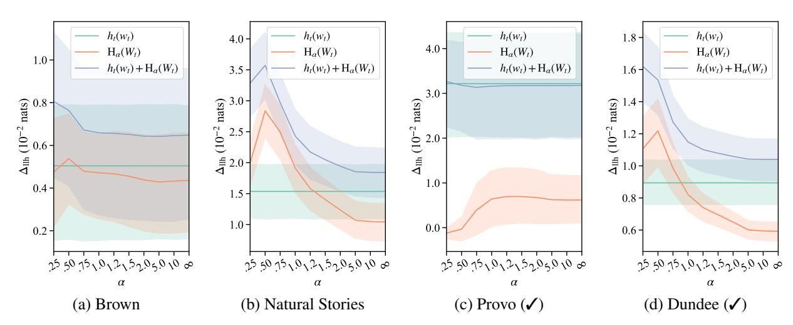
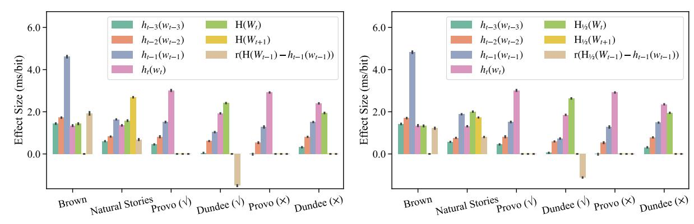
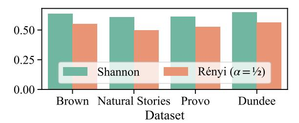

# On the Effect of Anticipation on Reading Times

Tiago Pimentel Clara Meister Ethan G. Wilcox Roger P. Levy Ryan Cotterell University of Cambridge ETH Zürich MIT [tp472@cam.ac.uk](mailto:tp472@cam.ac.uk) [clara.meister@inf.ethz.ch](mailto:clara.meister@inf.ethz.ch) [ethan.wilcox@inf.ethz.ch](mailto:ethan.wilcox@inf.ethz.ch) [rplevy@mit.edu](mailto:rplevy@mit.edu) [ryan.cotterell@inf.ethz.ch](mailto:ryan.cotterell@inf.ethz.ch)

## Abstract

Over the past two decades, numerous studies have demonstrated how less predictable (i.e., higher surprisal) words take more time to read. In general, these studies have implicitly assumed the reading process is purely *responsive*: Readers observe a new word and allocate time to process it as required. We argue that prior results are also compatible with a reading process that is at least partially *anticipatory*: Readers could make predictions about a future word and allocate time to process it based on their expectation. In this work, we operationalize this anticipation as a word's contextual entropy. We assess the effect of anticipation on reading by comparing how well surprisal and contextual entropy predict reading times on four naturalistic reading datasets: two self-paced and two eye-tracking. Experimentally, across datasets and analyses, we find substantial evidence for effects of contextual entropy over surprisal on a word's reading time (RT): in fact, entropy is sometimes better than surprisal in predicting a word's RT. Spillover effects, however, are generally not captured by entropy, but only by surprisal. Further, we hypothesize four cognitive mechanisms through which contextual entropy could impact RTs—three of which we are able to design experiments to analyze. Overall, our results support a view of reading that is not just responsive, but also anticipatory.[1](#page-0-0)

### 1 Introduction

Language comprehension—and, by proxy, the reading process—is assumed to be incremental and dynamic in nature: Readers take in one word at a time, process it, and then move on to the next word [\(Hale,](#page-14-0) [2001,](#page-14-0) [2006;](#page-14-1) [Rayner and Clifton,](#page-15-0) [2009;](#page-15-0) [Boston et al.,](#page-13-0) [2011\)](#page-13-0). As each word requires a different amount of processing effort, readers must dynamically allocate differing amounts of time to

words as they read. Indeed, this effect has been confirmed by a number of studies, which show a word's reading time is a monotonically increasing function of the word's length and surprisal [\(Hale,](#page-14-0) [2001;](#page-14-0) [Smith and Levy,](#page-16-0) [2008;](#page-16-0) [Shain,](#page-15-1) [2019,](#page-15-1) *inter alia*).

Most prior work (e.g., [Levy,](#page-14-2) [2008;](#page-14-2) [Demberg](#page-13-1) [and Keller,](#page-13-1) [2008;](#page-13-1) [Fernandez Monsalve et al.,](#page-13-2) [2012;](#page-13-2) [Wilcox et al.,](#page-16-1) [2020\)](#page-16-1), however, focuses on the responsive nature of the reading process, i.e., prior work looks solely at how a reader's behavior is influenced by attributes of words which have already been observed. Such analyses make the assumption that readers dynamically allocate resources to predict future words' identities in advance, but that the distribution of those predictions do not themselves directly affect reading behavior. However, a closer analysis of RT data shows the above theory might not capture the whole picture. In addition to being responsive, reading behavior may also be anticipatory: Readers' predictions may influence reading behavior for a word regardless of its actual identity.

Theoretically, anticipatory reading behavior may be an adaptive response to oculomotor constraints, as it takes time both to identify a word and to program a motor response to move beyond it. An example of anticipatory behavior is that the eyes often skip over words while reading—a decision that must be made while the word's identity remains uncertain [\(Ehrlich and Rayner,](#page-13-3) [1981;](#page-13-3) [Schotter et al.,](#page-15-2) [2012\)](#page-15-2). We identify four mechanisms that are anticipatory in nature and may impact reading behaviors:

- (i) word skipping: readers may completely omit fixating on a word;
- (ii) budgeting: readers may pre-allocate RTs for a word before reaching it;
- (iii) preemptive processing: readers may start processing a future word based on their expectations (and before knowing its identity);
- (iv) uncertainty cost: readers may incur an additional processing load when in high uncertainty contexts.

In this work, we look beyond responsiveness, investigating anticipatory reading behaviors and the

1Code is available at [https://github.com/rycolab/](https://github.com/rycolab/anticipation-on-reading-times) [anticipation-on-reading-times](https://github.com/rycolab/anticipation-on-reading-times).

mechanisms above. Specifically, we look at how a reader's expectation about a word's surprisal operationalized as that word's contextual entropy—affects the time taken to read it. For various reasons, however, a reader's anticipation may not exactly match a word's expected surprisal value, which would make the contextual entropy a poor operationalization of anticipation. Rather, readers may rely on skewed approximations instead, e.g., anticipating that the next word's surprisal is simply the surprisal of the most likely next word. We use the Rényi entropy (a generalization of Shannon's entropy) to operationalize these different skewed expectation strategies. We then design several experiments to investigate the mechanisms above, analyzing the relationship between readers' expectations about a word's surprisal and its observed RTs.

We run our analyses in four naturalistic datasets: two self-paced reading and two eye-tracking. In line with prior work, we find a significant effect of a word's surprisal on its RTs across all datasets, reaffirming the responsive nature of reading. In addition, we find the word's contextual entropy to be a significant predictor of its RTs in three of the four analyzed datasets—in fact, in two of these, entropy is a more powerful predictor than surprisal; see Table [3.](#page-7-0) Unlike surprisal however, in general, entropy does not predict spillover effects. We further find that a specific Rényi entropy (with α = 1/2) consistently leads to stronger predictors than the Shannon entropy. Our finding suggests readers may anticipate a future word's surprisal to be a function of the number of plausible word-level continuations (as opposed to the actual expected surprisal).

### 2 Predicting Reading Behavior

One behavior of interest in psycholinguistics is reading time (RT) allocation, i.e., how much time a reader spends processing each word in a text. RTs and other eye movement measures, such as word skipping ([§5.4\)](#page-6-0), are important for psycholinguistics because they offer insights into the mechanisms driving the reading process. Indeed, there exists a vast literature of such analyses [\(Rayner,](#page-15-3) [1998;](#page-15-3) [Hale,](#page-14-0) [2001,](#page-14-0) [2003,](#page-14-3) [2016;](#page-14-4) [Keller,](#page-14-5) [2004;](#page-14-5) [van Schijn](#page-15-4)[del and Linzen,](#page-15-4) [2018;](#page-15-4) [Shain,](#page-15-1) [2019,](#page-15-1) [2021;](#page-15-5) [Shain and](#page-16-2) [Schuler,](#page-16-2) [2021,](#page-16-2) [2022;](#page-16-3) [Wilcox et al.,](#page-16-1) [2020;](#page-16-1) [Meister](#page-14-6) [et al.,](#page-14-6) [2021,](#page-14-6) [2022;](#page-14-7) [Kuribayashi et al.,](#page-14-8) [2021,](#page-14-8) [2022;](#page-14-9) [Hoover et al.,](#page-14-10) [2022,](#page-14-10) *inter alia*).[2](#page-1-0)

The standard procedure for reading behavior analysis is to first choose a set of variables x ∈ R d which is believed to impact reading—e.g., we could choose xt = [|wt |, u(wt)]⊺ , where |wt | is the length of word wt and u(wt) is its frequency (quantified as its unigram log-probability). These variables are then used to fit a regressor fϕ(x) of a reading measure y:

$$y(w_t \mid \boldsymbol{w}_{< t}) \sim f_{\boldsymbol{\phi}}(\mathbf{x}_t)$$
 (1)

where fϕ : R d → R, ϕ are learned parameters, and y will be either reading times or word skipping ratio here. We then evaluate this regressor by looking at its performance, which is typically operationalized as the average log-likelihood assigned by fϕ(x) to held out data [\(Goodkind and](#page-14-11) [Bicknell,](#page-14-11) [2018;](#page-14-11) [Wilcox et al.,](#page-16-1) [2020\)](#page-16-1).

When comparing different theories of the reading process, each may predict a different architecture fϕ or set of variables x which should be used in eq. [\(1\)](#page-1-1). We can then compare these theories by looking at the performance of their associated regressors. Specifically, we take a model that leads to higher log-likelihoods on held out data as evidence in favor of its corresponding theory about underlying cognitive mechanisms. Further, model fϕ(x) can then be used to understand the relationship between the employed predictors x and RTs.

#### 2.1 Responsive Reading

One of the most studied variables in the above paradigm is surprisal, which measures a word's information content. Surprisal theory [\(Hale,](#page-14-0) [2001;](#page-14-0) [Levy,](#page-14-2) [2008\)](#page-14-2) posits that a word's surprisal should directly impact its processing cost. Intuitively, this makes sense: The higher a word's information content, the more resources it should take to process that word. Surprisal theory has since sparked a line of research exploring the relationship between surprisal and processing cost, where a word's processing cost is typically quantified as its RT.[3](#page-1-2)

Formally, the surprisal (or information content) of a word is defined as its in-context negative loglikelihood [\(Shannon,](#page-16-4) [1948\)](#page-16-4), which we denote as

$$h_t(w) \stackrel{\text{def}}{=} H(W_t = w \mid \boldsymbol{W}_{< t} = \boldsymbol{w}_{< t})$$
 (2a)

$$= -\log_2 p(w \mid \boldsymbol{w}_{< t}) \tag{2b}$$

For more comprehensive introductions to computational reading time analyses see [Rayner](#page-15-3) [\(1998\)](#page-15-3); [Rayner et al.](#page-15-6) [\(2005\)](#page-15-6).

3[Levy](#page-14-12) [\(2005\)](#page-14-12), for instance, showed that a word's surprisal quantifies a change in the reader's belief over sentence continuations. He then posited this change in belief may be reflected as processing cost.

where p is the ground-truth probability distribution over natural language utterances. We resort to ht(w) as a convenient shorthand that avoids notational clutter. In words, eq. [\(2\)](#page-1-3) states that a word is more surprising—and thus conveys more information—if it is less likely, and vice versa.

Time and again, the surprisal has proven to be a strong predictor in RT analyses [\(Smith and Levy,](#page-16-0) [2008,](#page-16-0) [2013;](#page-16-5) [Goodkind and Bicknell,](#page-14-11) [2018;](#page-14-11) [Wilcox](#page-16-1) [et al.,](#page-16-1) [2020;](#page-16-1) [Shain et al.,](#page-16-6) [2022,](#page-16-6) *inter alia*). Importantly, surprisal (as well as other properties of a word, like frequency or length) is a quantity that can only feasibly impact readers' behaviors after they have encountered the word in question.[4](#page-2-0) Thus, by limiting their analyses to such characteristics, these prior works assume RT allocation happens *after* word identification, being thus responsive to the context a reader finds themselves in and happening on demand as needed for processing a word.

#### 2.2 Anticipatory Reading

Not all reading behaviors, however, can be characterized as reactive. As a concrete example, readers often skip words—a decision which must be made while the next word's identity is unknown. Furthermore, prior work has shown that the uncertainty over a sentence's continuations impacts RTs (where this uncertainty is quatified as contextual entropy, as we make explicit later; [Roark et al.,](#page-15-7) [2009;](#page-15-7) [An](#page-13-4)[gele et al.,](#page-13-4) [2015;](#page-13-4) [van Schijndel and Schuler,](#page-15-8) [2017;](#page-15-8) [van Schijndel and Linzen,](#page-15-9) [2019\)](#page-15-9). Both of these observations offer initial evidence that some form of anticipatory planning is being performed by the reader, influencing the way that they read a text.

The presence of such forms of anticipatory processing suggests that, beyond a word's surprisal, a reader's predictions about a word may influence the time they take to process it. A word's RT, for instance, could be (at least partly) planned before arriving at it, based on the reader's expectation of the amount of work necessary for processing that word. This expectation has a formal definition, the contextual entropy, which is defined as follows:

$$H(W_t \mid \boldsymbol{W}_{< t} = \boldsymbol{w}_{< t}) \stackrel{\text{def}}{=} \underset{w \sim p(\cdot \mid \boldsymbol{w}_{< t})}{\mathbb{E}} [h_t(w)]$$
 (3a)

$$= -\sum_{w \in \overline{\mathcal{W}}} p(w \mid \boldsymbol{w}_{< t}) \log_2 p(w \mid \boldsymbol{w}_{< t}) \quad (3b)$$

where Wt denotes a W-valued random variable, which takes on values w ∈ W with distribution p(· | w<t). Specifically, we assume a (potentially infinite) vocabulary W, which we augment to include a special EOS ̸∈ W token that indicates the end of an utterance. To that end, we define W def = W ∪ {EOS}. When clear from context, we shorten H(Wt | W<t = w<t) to simply H(Wt).

Prior work has also investigated the role of entropy in RTs. [Hale](#page-14-3) [\(2003,](#page-14-3) [2006\)](#page-14-1), for instance, investigated the role of entropy reduction on reading times; [Hale](#page-14-3) defines entropy reduction as the change in the conditional entropy over sentence parses induced by word t, which is a different measure than the word entropy we investigate here. More recently, other work [\(Roark et al.,](#page-15-7) [2009;](#page-15-7) [van Schi](#page-15-8)[jndel and Schuler,](#page-15-8) [2017;](#page-15-8) [Aurnhammer and Frank,](#page-13-5) [2019\)](#page-13-5) investigated the role of successor entropy (i.e., word (t + 1)'s entropy) on RTs. [Linzen and](#page-14-14) [Jaeger](#page-14-14) [\(2014\)](#page-14-14) investigated both entropy reduction, total future entropy (i.e., the conditional entropy over sentence parses), and single step syntactic entropy (i.e., the entropy over the next step in a syntactic derivation). In this work, we are instead interested in the role of the entropy of word t itself because of its theoretical motivation as the expected processing difficulty under surprisal theory.

Similarly to us, [Cevoli et al.](#page-13-6) [\(2022\)](#page-13-6) also studies the role of the entropy of word t on RTs for word t; more specifically, [Cevoli et al.](#page-13-6) analyze *prediction error costs* by investigating how surprisal and entropy interact in predicting RTs. Finally, [Smith](#page-16-7) [and Levy](#page-16-7) [\(2010\)](#page-16-7) also investigate how word t's contextual entropy influences RTs, but while further conditioning a reader's predictions on a noisy version of word t's visual signal.

## 2.3 Skewed Anticipations

Eq. [\(3\)](#page-2-1) assumes readers will use the expectation to estimate what the surprisal of the anticipated word wt will be, while knowing only its context w<t. However, a reader may employ a different strategy when making anticipatory predictions. One possibility, for instance, is that readers could be overly confident, and trust their best (i.e., most likely) guess when making this prediction. In this case, readers would instead anticipate a subsequent word's surprisal to be:

$$H_{\infty}(W_t \mid \boldsymbol{W}_{< t} = \boldsymbol{w}_{< t}) \stackrel{\text{def}}{=} \min_{w \in \overline{W}} h_t(w)$$
 (4a)

$$= \min_{w \in \overline{\mathcal{W}}} -\log_2 p(w \mid \boldsymbol{w}_{< t}) \tag{4b}$$

4This follows from standard theories of causality. [Granger](#page-14-13) [\(1969\)](#page-14-13), for instance, posits that future material cannot influence present behavior.

where we use the notation H∞ to describe this quantity for reasons that will become clear later in this section. Another possibility is that readers could ignore each word's specific probability value when anticipating future surprisals, focusing instead on the number of competing possible words with non-zero probability:[5](#page-3-0)

$$H_0(W_t \mid \boldsymbol{W}_{< t} = \boldsymbol{w}_{< t}) \stackrel{\text{def}}{=} -\log_2 \frac{1}{|\text{supp}(p)|}$$
 (5)

where supp(p) def = {w ∈ W | p(w | w<t) > 0}. As the subscript notation suggests, the above anticipatory predictions can be written in a unified framework using the contextual Rényi entropy [\(Rényi,](#page-15-10) [1961\)](#page-15-10), which is defined as

$$\mathbf{H}_{\alpha}(W_{t} \mid \boldsymbol{W}_{< t} = \boldsymbol{w}_{< t}) \qquad (6)$$

$$\stackrel{\text{def}}{=} \lim_{\beta \to \alpha} \frac{1}{1 - \beta} \log_{2} \sum_{w \in \overline{\mathcal{W}}} \left( p(w \mid \boldsymbol{w}_{< t}) \right)^{\beta}$$

Again, we will shorten Hα(Wt | W<t = w<t) to Hα(Wt). Notably, with different values of α, the Rényi entropy leads to different interpretations of a reader's anticipation strategies. The Rényi entropy is equivalent to eq. [\(5\)](#page-3-1) when α = 0, which measures the size of the support of p(· | w<t), or equivalently, the number of competing (word-level) continuations at a timestep. Further, the Rényi entropy is equivalent to eq. [\(4\)](#page-2-2) when α = ∞, which measures the surprisal of the word with maximal probability in a context. Finally, through L'Hôpital's rule, it is equivalent to eq. [\(3\)](#page-2-1), the Shannon entropy, when α = 1. In general, however, Rényi entropy does not have as clear of an intuitive meaning when α /∈ {0, 1, ∞}. Notably, the Rényi entropy with α = 1/2 will be relevant in our results' section. In this case, it can be thought of as measuring a softened version of a distribution p's support.

### 3 Anticipatory Mechanisms

In this paper, we are mainly interested in the effect of anticipations on RTs, where we operationalize anticipation in terms of contextual (Rényi) entropy, as defined above. We consider four main mechanisms under which anticipation could affect RTs: word skipping, budgeting, preemptive processing, uncertainty cost. We discuss each of these in turn.

Word skipping. The first way in which anticipation could affect RTs is by allowing readers to skip words entirely, allocating the word a reading time of zero. A reader must, by definition, decide whether or not to skip a word *before* fixating on it. We hypothesize the reader may thus decide to skip a word when they are confident in its identity, i.e., when the word's contextual entropy is low.[6](#page-3-2) If this hypothesis is true, then contextual entropy should be a good predictor of when a reader skips words.

Budgeting. The reading process can be described as a sequence of fixations and saccades.[7](#page-3-3) Saccades, however, do not happen instantly: On average, they must be planned at least 125 milliseconds in advance [\(Reichle et al.,](#page-15-11) [2009\)](#page-15-11). Further, there is an average eye-to-brain delay of 50ms [\(Pollatsek et al.,](#page-15-12) [2008\)](#page-15-12). We may thus estimate that the effects of a word's surprisal, as well as other word properties such as frequency, in RT allocation will only show up 175ms after that word is fixated, or later.[8](#page-3-4) Considering this delay on saccade execution, it is not unreasonable that RTs could be decided (or budgeted) further in advance, when the reader still does not know word wt's identity. If a reader indeed budgets reading times beforehand, RTs should be at least in part—predictable from the contextual entropy. Processing costs, however, may still be driven by surprisal. In this case, we might observe budgeting effects: e.g., if a reader *under*-budgets RTs for a word, i.e., if the word's contextual entropy is smaller than its actual surprisal, we may see a compensation, which could manifest as larger spillover effects in the following word.

Preemptive Processing. Recent work (e.g., [Willems et al.,](#page-16-8) [2015;](#page-16-8) [Goldstein et al.,](#page-13-7) [2022\)](#page-13-7) suggests that—especially for low entropy contexts—the brain starts preemptively processing future words before reaching them.[9](#page-3-5) Thus, shorter reading times in low entropy words at time t + 1 may be compensated by longer times in the previ-

5While most state-of-the-art language models cannot assign zero probabilities to a word due to their use of a softmax in their final layers it is plausible that humans could.

6This is under the assumption that the reader is not able to identify upcoming words through their parafoveal vision.

7 Fixations are when the gaze focuses on a word; saccades are rapid eye movements shifting gaze from a point to another. In self-paced reading, saccades are similar to mouse clicks.

8Again, this assumes that the reader has not identified the word parafoveally. A second caveat regarding this analysis is that, once a saccade is initiated, there is an initial period during which it can be canceled or reprogrammed to target a different location [\(Van Gisbergen et al.,](#page-16-9) [1987\)](#page-16-9).

9 Specifically, they show the brain's processing load before a word's onset correlates negatively with its entropy.

ous word wt . However, recent work investigating the effect of successor entropy, i.e., word (t + 1)'s entropy, on RTs has found conflicting results.[10](#page-4-0) Also on the topic of preprocessing, [Smith and](#page-16-0) [Levy](#page-16-0) [\(2008\)](#page-16-0) derive from first principles what a reader's optimal preprocessing effort should be for any given context: Under their assumption that reading times should be scale-free and that readers optimally trade off preprocessing and reading costs, a reader should always allocate a *constant* amount of resources for preprocessing future words.[11](#page-4-1) We will investigate the effect of successor entropy on RTs in [§5.6.](#page-9-0)

Uncertainty Cost. Finally, uncertainty about a word's identity, as quantified by its contextual entropy, may cause an increase in processing load directly. For example, keeping a large number of competing word continuations under consideration may require additional cognitive resources, impacting the reader's processing load beyond the effect of the observed word's surprisal. We know, however, no way of testing this hypothesis directly under our experimental setup. Therefore, we will not analyze this mechanism specifically; only studying it in our main experiment ([§5.2\)](#page-6-1), where it is measured in aggregate with other mechanisms.

## 4 Experimental Setup

## 4.1 Estimators

Unfortunately, we cannot compute the values discussed in [§2,](#page-1-4) as we do not have access to the true natural language distribution p(· | w<t). We can, however, estimate these values using a language model pθ(· | w<t). We will thus use pθ in place of p in order to estimate all the information-theoretic quantities in [§2.](#page-1-4) Using language model-based estimators is standard practice when investigating the relationship between RTs and informationtheoretic quantities, e.g., surprisal.

Language Models. We use GPT-2 small [\(Radford et al.,](#page-15-13) [2019\)](#page-15-13) as our language model pθ in all experiments.[12](#page-4-2) Although some work has shown that a language model's quality correlates with its psychometric predictive power [\(Goodkind](#page-14-11)

[and Bicknell,](#page-14-11) [2018;](#page-14-11) [Wilcox et al.,](#page-16-1) [2020\)](#page-16-1), both [Shain et al.](#page-16-6) [\(2022\)](#page-16-6) and [Oh and Schuler](#page-15-14) [\(2022\)](#page-15-14) have more recently found that GPT-2 small's surprisal estimates are actually more predictive of RTs than those of both larger versions of GPT-2 and GPT-3. We note, however, that GPT-2 predicts subwords at each time-step, rather than predicting full words. Thus, to get word-level surprisal, we must sum over the subwords' surprisal estimates. In some cases, many distinct subword sequences may represent a single word. In this case, we only consider the *canonical* subword sequence output by GPT-2's tokenizer. Estimating the contextual entropy per word is harder because computing it requires summing over the entire vocabulary W, whose cardinality can be infinite. We approximate the contextual entropy by computing the entropy over the subwords instead.[13](#page-4-3) In practice, this is equivalent to computing a lower bound on the true contextual entropies, as we show in App. [B.](#page-11-1)

#### 4.2 Data

We perform our analyses on two eye-tracking and two self-paced reading datasets. The self-paced reading corpora we study are the Natural Stories Corpus [\(Futrell et al.,](#page-13-8) [2018\)](#page-13-8) and the Brown Corpus [\(Smith and Levy,](#page-16-5) [2013\)](#page-16-5). The eye-tracking corpora are the Provo Corpus [\(Luke and Christian](#page-14-15)[son,](#page-14-15) [2018\)](#page-14-15) and the Dundee Corpus [\(Kennedy et al.,](#page-14-16) [2003\)](#page-14-16). We refer readers to App. [C](#page-12-0) for more details on these corpora, as well as dataset statistics and preprocessing steps. For the eye-tracking data, we focus our analyses on Progressive Gaze Duration: A word's RT is taken to be the sum of all fixations on it before a reader first passes it, i.e., we only consider fixations in a reader's first forward pass. Further, for our first set of experiments, we consider a skipped word's RT to be zero (following [Rayner](#page-15-15) [et al.,](#page-15-15) [2011\)](#page-15-15);[14](#page-4-4) we denote these datasets as Provo (✓) and Dundee (✓). In later experiments, we discard skipped words, denoting these datasets with an (✗) instead. Following prior work (e.g., [Wilcox](#page-16-1) [et al.,](#page-16-1) [2020\)](#page-16-1), we average RT measurements across

10While [Roark et al.](#page-15-7) [\(2009\)](#page-15-7) and [van Schijndel and Schuler](#page-14-11) [\(2017\) have found that successor entropy has a positive impact](#page-14-11) on RTs, i.e., that when wt+1 [has lower entropy, word](#page-14-11) wt takes [a shorter time to be read, both](#page-14-11) [Linzen and Jaeger](#page-14-14) [\(2014\)](#page-14-14) and [Aurnhammer and Frank](#page-13-5) [\(2019\) have found no effect.](#page-14-11)

11[We give the full derivation—including the necessary](#page-14-11) [assumptions—in App.](#page-14-11) [A](#page-11-0) for completeness.

12We make use of [Wolf et al.'s \(2020\) library.](#page-14-11)

13There are many ways to estimate the Rényi entropy, e.g., one could also have estimated the Rényi entropy by assuming a fixed finite vocabulary W, and then computed the probability of the words' canonical tokenizations.

14This choice goes against the more common practice of simply discarding skipped words from the analyses. Our experimental paradigm is based on two factors. First, we are interested in word skipping as a mechanism by which anticipation impacts RTs. Second, we want to make the eye-tracking setting more closely comparable to the self-paced reading, where fully skipping a word is not possible.

readers, analyzing one RT value per word token.

#### 4.3 Linear Modeling

Prior work has shown the surprisal–RT relationship to be mostly linear (Smith and Levy, 2008, 2013; Shain et al., 2022). Assuming this linearity extends to the contextual entropy–RT relationship, we restrict our predictive function to be linear:  $f_{\phi}(\mathbf{x}) = \phi^{\mathsf{T}}\mathbf{x}$ , where  $\phi$  is a column vector which parameterizes  $f_{\phi}$ . Further, given data  $\mathcal{D} = \{(\mathbf{x}_n, y_n)\}_{n=1}^N$ , regressor  $f_{\phi}(\mathbf{x})$ 's average log-likelihood on  $\mathcal{D}$  is given by

$$llh(f_{\phi}(\mathbf{x})) = \frac{1}{N} \log \prod_{n=1}^{N} \frac{e^{-\frac{\left(y_n - f_{\phi}(\mathbf{x}_n)\right)^2}{2\sigma^2}}}{\sqrt{2\pi\sigma^2}}$$

$$= -\frac{1}{N} \sum_{n=1}^{N} \left(\log \sqrt{2\pi\sigma^2} + \frac{\left(y_n - f_{\phi}(\mathbf{x}_n)\right)^2}{2\sigma^2}\right)$$

$$= -\log \sqrt{2\pi\sigma^2} - \sum_{n=1}^{N} \frac{\left(y_n - f_{\phi}(\mathbf{x}_n)\right)^2}{2N\sigma^2}$$
(7)

assuming Gaussian errors with variance  $\sigma^2 > 0.16$ 

#### 4.4 Evaluation

We evaluate the different sentence processing hypotheses by looking at the predictive power of their associated regressors. Predictive power is quantified as the log-likelihood on held-out data. We use 10-fold cross-validation, estimating our regressors, given in eq. (1), using 9 folds of the data at a time, and evaluating them on the 10th fold. Further, as is standard in RT analyses, we test the predictive power of a hypothesis by comparing a target model against a baseline model. These models differ only in that the target model contains a predictor of interest, whereas the baseline model does not. Our metric of interest is thus the difference in log-likelihood of held-out data between the two models:17

$$\Delta_{\text{llh}} = \text{llh}(f_{\phi}(\mathbf{x}^{\text{model}})) - \text{llh}(f_{\phi}(\mathbf{x}^{\text{base}}))$$
 (8)

which, when positive, indicates the target model explains this data better than the base model.

|                 |               | Surprisal     |           |         |  |  |  |  |  |  |
|-----------------|---------------|---------------|-----------|---------|--|--|--|--|--|--|
|                 | $w_{t\!-\!3}$ | $w_{t\!-\!2}$ | $w_{t-1}$ | $w_t$   |  |  |  |  |  |  |
| Brown           | 0.33***       | 0.47***       | 2.58***   | 0.50*   |  |  |  |  |  |  |
| Natural Stories | 0.20*         | 0.34*         | 1.05***   | 1.54*** |  |  |  |  |  |  |
| Provo (🗸)       | 0.07          | 0.18          | 0.83*     | 3.22**  |  |  |  |  |  |  |
| Dundee (✓)      | -0.00         | 0.04**        | 0.25***   | 0.89*** |  |  |  |  |  |  |

$$\mathbf{x}_t^{\text{model}} = \mathbf{x}_t^{\text{cmn}} \oplus \mathbf{x}_t^{\text{surp}} \quad \text{ vs. } \quad \mathbf{x}_t^{\text{base}} = \mathbf{x}_t^{\text{cmn}} \oplus \mathbf{x}_t^{\text{surp} \neq t'}$$

Table 1:  $\Delta_{\rm llh}$  (in  $10^{-2}$  nats) when comparing a model with all surprisal terms against baselines from which a single surprisal term was removed. Green indicates a significantly positive impact of surprisal on the model's predictive power.

### 5 Experiments and Results

#### 5.1 Experiment #1: Confirmatory Analysis

In the first experiment, we confirm prior results that show the predictive power of surprisal on RTs. First, we define the following sets of predictors:

$$\mathbf{x}_t^{\mathrm{cmn}} = [|w_t|, u(w_t), \dots, |w_{t-3}|, u(w_{t-3})]^{\mathsf{T}}$$
 (9a)

$$\mathbf{x}_{t}^{\text{surp}} = [h_{t}(w_{t}), \dots, h_{t-3}(w_{t-3})]^{\mathsf{T}}$$
 (9b)

$$\mathbf{x}_{t}^{\text{surp}\neq t} = [h_{t-1}(w_{t-1}), \dots, h_{t-3}(w_{t-3})]^{\mathsf{T}}$$
 (9c)

where  $|w_t|$  is the word length in characters and  $u(w_t)$  is the unigram frequency of the  $t^{\rm th}$  word. Notably, we include predictors for words  $w_{t-1}$ ,  $w_{t-2}$ , and  $w_{t-3}$  because prior work has shown that a word's RT is impacted not only by its own surprisal, but also by the surprisal of previous words. These effects are referred to as **spillover effects**. We then estimate the  $\Delta_{\rm llh}$  between

$$\mathbf{x}_t^{\text{model}} = \mathbf{x}_t^{\text{cmn}} \oplus \mathbf{x}_t^{\text{surp}} \tag{10}$$

$$\mathbf{x}_{t}^{\text{base}} = \mathbf{x}_{t}^{\text{cmn}} \oplus \mathbf{x}_{t}^{\text{surp} \neq t'} \tag{11}$$

where  $\oplus$  stands for the vertical concatenation of two vectors and  $t' \in \{t, t-1, t-2, t-3\}$ . In words,  $\mathbf{x}^{\text{model}}$  includes all surprisal predictors  $\mathbf{x}_t^{\text{surp}}$ , while for the baseline model  $\mathbf{x}^{\text{base}}$  we remove surprisal predictors one at a time. We present these results in Table 1. The results show that the surprisal of word  $w_t$  is a strong predictor of RTs in all four analyzed datasets. Additionally, we see significant spillover effects for the surprisal of three previous words in self-paced reading corpora, for the two previous words in Dundee, and for the single previous one in Provo. Interestingly, and consistent with prior work (Smith and Levy, 2008, 2013), we find that spillover effects are stronger than the current word's effect in Brown. On the other three datasets, however, we find the surprisal effect on the current word to be stronger than the spillover effects.

&lt;sup>15As both Shannon and Rényi entropies are linear functions of surprisal, we believe this assumption is justifiable.

 $^{16}\mbox{We}$  note that RTs cannot be negative, and thus prediction errors will not actually be Gaussian.

 $^{17}$ Significance is assessed using a paired permutation test. We correct for multiple hypothesis testing (Benjamini and Hochberg, 1995) and mark: in green significant  $\Delta_{\rm llh}$  where a variable adds predictive power (i.e., when the model with more predictors is better), in red significant  $\Delta_{\rm llh}$  where a variable leads to overfitting (i.e., when the model with more predictors is worse). \* p < 0.05, \*\* p < 0.01, \*\*\* p < 0.001.

|                          | $w_{t\!-\!3}$ | $w_{t\!-\!2}$ | $w_{t\!-\!1}$ | $w_t$   |  |
|--------------------------|---------------|---------------|---------------|---------|--|
| Replace Surprisa         | al with En    | $tropy^1$     |               |         |  |
| Brown                    | -0.30*        | -0.35**       | -1.68***      | -0.03   |  |
| Natural Stories          | -0.03         | -0.19*        | -0.41*        | 0.37    |  |
| Provo (🗸)                | -0.08         | 0.18          | -0.66*        | -2.58*  |  |
| Dundee (✓)               | -0.00         | 0.03*         | -0.21***      | -0.07   |  |
| Add Entropy 2 |               |               |               |         |  |
| Brown                    | -0.03*        | -0.01         | 0.04          | 0.15*   |  |
| Natural Stories          | 0.04          | 0.01          | 0.14***       | 0.89*** |  |
| Provo (🗸)                | -0.04*        | 0.16          | -0.03         | -0.06   |  |
| Dundee (✓)               | -0.00**       | 0.03**        | -0.00         | 0.25*** |  |

 $\begin{array}{l} ^{1} \mathbf{x}_{t}^{\text{model}} = \mathbf{x}_{t}^{\text{cmn}} \oplus \mathbf{x}_{t}^{\text{surp} \neq t'} \oplus [\mathbf{H}(W_{t'})]^{\mathsf{T}} \\ ^{2} \mathbf{x}_{t}^{\text{model}} = \mathbf{x}_{t}^{\text{cmn}} \oplus \mathbf{x}_{t}^{\text{surp}} \oplus [\mathbf{H}(W_{t'})]^{\mathsf{T}} \\ ^{\text{both}} \mathbf{x}_{t}^{\text{base}} = \mathbf{x}_{t}^{\text{cmn}} \oplus \mathbf{x}_{t}^{\text{surp}}, \end{array}$ 

Table 2:  $\Delta_{\rm llh}$  (in  $10^{-2}$  nats) achieved after either replacing a surprisal term in the baseline with Shannon's entropy (top), or adding the entropy as an extra predictor (bottom). Green indicates a significant gain in  $\Delta_{\rm llh}$ , red a significant loss.

#### 5.2 Experiment #2: Surprisal vs. Entropy

In the second experiment, we analyze the predictive power of the contextual Shannon entropy on RTs. Specifically, Table 2 presents the  $\Delta_{\rm llh}$ between the baseline model  $\mathbf{x}_t^{\text{base}} = \mathbf{x}_t^{\text{cmn}} \oplus \mathbf{x}_t^{\text{surp}}$ and two target models. The first is a model where the entropy term  $H(W_t)$  is added in addition to the predictors already present in  $x^{\text{base}}$ . The second is a model where the surprisal term  $h_t(w_t)$  is replaced by the entropy term  $H(W_t)$ . From Table 2, we see that adding the entropy of the current word significantly increases the predictive power in three out of the four analyzed datasets. Furthermore, replacing the surprisal predictor with the entropy only leads to a model with worse predictive power in one of the three analyzed datasets (in Provo). On the other three datasets, the entropy's predictive power is as good as the surprisal's—more precisely, they are not statistically different. Together, these results suggest that the reading process is both responsive and anticipatory.

Analyzing the impact of the previous words' entropies, i.e.,  $H(W_{t-1})$ ,  $H(W_{t-2})$ ,  $H(W_{t-3})$ , 18 on RTs, we see a somewhat different story. When adding spillover entropy terms as extra predictors we see no consistent improvements in predictive power. We observe a weak improvement on

self-paced reading datasets when adding  $H(W_{t-1})$  as a predictor, but, even then, the improvement is only significant on Natural Stories. We find a similarly weak effect when adding  $H(W_{t-2})$  on eye-tracking data, which is only significant on the Dundee corpus. This lack of predictive power further stands out when contrasted to surprisal spillover effects, which were mostly significant; see Table 1. Furthermore, replacing surprisal spillover terms with the corresponding entropy terms generally leads to models with weaker predictive power. Together, these results imply the effect of entropy (expected surprisal) on RTs is mostly local, i.e., the expectation over a word's surprisal impacts its RT, but not future words' RTs.

### 5.3 Experiment #3: Skewed Expectations

We now compare the effect of Rényi entropy with  $\alpha \neq 1$  on RTs. We follow a similar setup to before. Specifically, we compute the contextual Rényi entropy for several values of  $\alpha$ . We then train regressors where we either add the Rényi entropy as an additional predictor, or where we replace the current word's surprisal  $h_t(w_t)$  with the Rényi entropy. We then plot these values in Fig. 1. Analyzing this figure, we see that Provo again presents different trends from the other datasets. We also see a clear trend in the three other datasets: The predictive power of expectations seem to improve for smaller values of  $\alpha$ . More precisely, in Brown, Natural Stories and Dundee,  $\alpha = 1/2$  seems to lead to stronger predictive powers than  $\alpha > 1/2$ .

Based on these results, we then produce a similar table to the previous experiment's, but using the Rényi entropy with  $\alpha=1/2$  instead. These results are depicted in Table 3. Similarly to before, we still see a significant improvement in predictive powers on three of the datasets when adding the entropy as an extra predictor. Unlike before, however, replacing the surprisal predictors (for time step t) with Rényi entropy predictors significantly improves log-likelihoods in two of the analyzed datasets. In other words, the Rényi entropy has a stronger predictive power than the surprisal in both these datasets. We now move on to investigate why this is the case, analyzing the mechanisms proposed in §3.

#### 5.4 Experiment #4: Word Skipping

In §3, we discussed four potential mechanisms through which expectations could impact RTs. In this experiment, we analyze the impact of word-skipping effects on our results. We thus only con-

&lt;sup>18We term these predictors *spillover* entropy effects by analogy to the surprisal case. As before, we omit the conditioning factor on these entropies for notational succinctness, i.e., we write  $H(W_{t-1})$  instead of  $H(W_{t-1} \mid \boldsymbol{W}_{< t-1} = \boldsymbol{w}_{< t-1})$ .

Figure 1:  $\Delta_{\text{llh}}$  when adding either the current word's surprisal, Rényi entropy, or both on top of a baseline that includes the surprisal of previous words as predictors, i.e.,  $\mathbf{x}^{\text{base}} = \mathbf{x}_t^{\text{cmn}} \oplus \mathbf{x}^{\text{surp} \neq t}$ . Shaded regions correspond to 95% confidence intervals.

|            |             | Replace   | Surprisal v   | with Rényi l | Entropy 1 | Add Rényi Entropy 2 |                           |               |         |  |
|------------|-------------|-----------|---------------|--------------|----------------------|--------------------------------|---------------------------|---------------|---------|--|
|            |             | $w_{t-3}$ | $w_{t\!-\!2}$ | $w_{t-1}$    | $w_t$                | $w_{t\!-\!3}$                  | $w_{t\!-\!2}$             | $w_{t\!-\!1}$ | $w_t$   |  |
| Brown      |             | -0.35***  | -0.37**       | -1.76***     | 0.03                 | -0.01                          | 0.00                      | 0.14          | 0.26*   |  |
| Natural St | tories      | -0.16     | -0.27*        | -0.19        | 1.30**               | -0.00                          | 0.00 -0.00 0.44*** 2.04** |               | 2.04*** |  |
| Provo      | <b>(✓</b> ) | -0.05     | 0.47          | -0.89*       | -3.25**              | -0.01                          | 0.45*                     | -0.01         | -0.04   |  |
| Dundee     | <b>(✓</b> ) | 0.00      | 0.07*         | -0.25***     | 0.32*                | -0.00                          | 0.08*                     | 0.05          | 0.64*** |  |

Table 3:  $\Delta_{\text{llh}}$  (in  $10^{-2}$  nats) achieved after either replacing a surprisal term in the baseline with the contextual Rényi entropy ( $\alpha = 1/2$ ), or adding the Rényi entropy as an extra predictor.

sider the two eye-tracking datasets in this experiment, as self-paced reading does not allow for word skipping. We start this analysis by, similarly to previous experiments, looking at the  $\Delta_{\rm llh}$  between a baseline model and an additional model that captures our target effect. In contrast to previous experiments, though, we employ a logistic regressor that predicts whether or not a word was skipped during the readers' initial pass. Our prediction function can thus be written as

$$f_{\phi}(\mathbf{x}) = \sigma(\phi^{\mathsf{T}} \mathbf{x}) \tag{12}$$

where  $\phi$  is a column vector of the model's parameters and  $\sigma$  is the sigmoid function. Now, given data  $\mathcal{D} = \{(\mathbf{x}_n, y_n)\}_{n=1}^N$ , where y represents the ratio of readers who skipped a word, the average log-likelihood of this predictor on  $\mathcal{D}$  is:

$$llh(f_{\phi}(\mathbf{x})) = \frac{1}{\sum_{n=1}^{N} \frac{y_n \log f_{\phi}(\mathbf{x}_n) + (1 - y_n) \log(1 - f_{\phi}(\mathbf{x}_n))}{N}}$$

Notably, having y represent the ratio of readers who skipped a word—as opposed to the per-reader

binary skipped vs not distinction—is equivalent to averaging the predicted feature across readers, as we do when predicting reading times.

Table 4 presents our results. First, we see that surprisal is a significant predictor of whether or not a word is skipped in Dundee; however, it is not a significant predictor in Provo. Second, we find that in Dundee the predictive power over whether a word was skipped is significantly stronger when using the Rényi entropy of the current word than when using its surprisal. Finally, while we find an improvement in predictive power when adding entropy (in addition to surprisal) as a predictor, we find no significant improvement when starting with entropy and adding surprisal. This implies that, at least for Dundee, word-skipping effects are predicted solely by the entropy, with the surprisal of the current word adding no extra predictive power.

Note that we represented skipped words as having RTs of 0ms in our previous experiments on eye-tracking datasets. Thus, our previous results could be driven purely by word-skipping effects. We now run the same experiments as in §5.2 and §5.3, but with skipped words removed from our

|                        |                   |            | Provo             |      | Dundee     |                   |         |  |
|------------------------|-------------------|------------|-------------------|------|------------|-------------------|---------|--|
|                        |                   | $h_t(w_t)$ | $H_{\alpha}(W_t)$ | Both | $h_t(w_t)$ | $H_{\alpha}(W_t)$ | Both    |  |
| Cl                     | Ø                 | 2.60       | 1.76              | 2.86 | 1.30*      | 2.50***           | 2.62*** |  |
| Shannon $(\alpha = 1)$ | $h_t(w_t)$        | -          | -0.84             | 0.26 | -          | 1.20              | 1.32*** |  |
| $(\alpha - 1)$         | $H_{\alpha}(W_t)$ | -          | -                 | 1.10 | -          | -                 | 0.12    |  |
| Rényi $(\alpha = 1/2)$ | Ø                 | 2.60       | 0.84              | 2.66 | 1.30*      | 5.10***           | 5.14*** |  |
|                        | $h_t(w_t)$        | -          | -1.76             | 0.06 | -          | 3.79***           | 3.83*** |  |
|                        | $H_{\alpha}(W_t)$ | -          | -                 | 1.82 | -          | -                 | 0.04    |  |

Table 4:  $\Delta_{llh}$  (in  $10^{-4}$  nats) between a target model (with predictors on columns) vs baseline (with predictors on row) when predicting whether a word was skipped or not. All models also include the surprisal of the previous words as predictors as well as length and unigram frequencies

|                                                                        |                   | $w_{t\!-\!3}$ | $w_{t\!-\!2}$ | $w_{t\!-\!1}$ | $w_t$    |  |  |  |  |
|------------------------------------------------------------------------|-------------------|---------------|---------------|---------------|----------|--|--|--|--|
| $\underline{\underline{\text{Shannon}}} \text{ Entropy } (\alpha = 1)$ |                   |               |               |               |          |  |  |  |  |
| Replace 1                                                   | Provo             | 0.02          | -0.03         | -0.18         | -2.23*** |  |  |  |  |
|                                                                        | Dundee            | -0.01         | -0.02         | -0.15***      | -0.32**  |  |  |  |  |
| $\mathrm{Add}^2$                                                       | Provo             | -0.02         | -0.07         | 0.03          | -0.01    |  |  |  |  |
|                                                                        | Dundee            | -0.00*        | 0.01          | 0.01          | 0.17**   |  |  |  |  |
| Renyi Ent                                                              | ropy ( $\alpha =$ | 1/2)          |               |               |          |  |  |  |  |
| Replace 1                                                   | Provo             | 0.02          | 0.10          | -0.27         | -2.43**  |  |  |  |  |
|                                                                        | Dundee            | -0.01         | 0.01          | -0.19***      | -0.18    |  |  |  |  |
| Add 2                                                       | Provo             | -0.02         | 0.07          | 0.01          | 0.32     |  |  |  |  |
|                                                                        | Dundee            | -0.00*        | 0.05*         | 0.01          | 0.36***  |  |  |  |  |

 $\begin{array}{l} ^{1} \mathbf{x}_{t}^{\text{model}} = \mathbf{x}_{t}^{\text{cmn}} \oplus \mathbf{x}_{t}^{\text{surp} \neq t'} \oplus [\mathbf{H}_{\alpha}(W_{t'})]^{\intercal}, \\ ^{2} \mathbf{x}_{t}^{\text{model}} = \mathbf{x}_{t}^{\text{cmn}} \oplus \mathbf{x}_{t}^{\text{surp}} \oplus [\mathbf{H}_{\alpha}(W_{t'})]^{\intercal}, \\ ^{\text{both}} \mathbf{x}_{t}^{\text{base}} = \mathbf{x}_{t}^{\text{cmn}} \oplus \mathbf{x}_{t}^{\text{surp}} \end{array}$ 

Table 5:  $\Delta_{\rm llh}$  (in  $10^{-2}$  nats) when predicting RTs on eye-tracking datasets where skipped words were removed, i.e., Provo (X) and Dundee (X).

analysis. These results are presented in Table 5. In short, when skipped words are not considered, the Rényi entropy is no more predictive of RTs than the surprisal. In fact, the surprisal seems to be a slightly stronger predictor, albeit not significantly so in Dundee. However, adding the Rényi entropy as a predictor to a model which already has surprisal still adds significant predictive power in Dundee. In short, this table shows that, while partly driven by word skipping, there are still potentially other effects of anticipation on RTs.

#### 5.5 Experiment #5: Budgeting Effects

We now analyze budgeting effects. If RTs are affected by the entropy through a budgeting mechanism, we may expect to see budgeting spillover effects when a reader under-budgets—i.e., when the entropy is smaller than a word's surprisal, causing less time to be allocated to the word than required for processing. Here, we operationalize

**under-budgeting** as any positive difference between surprisal and entropy. Similarly, we may expect **over-budgeting** to lead to negative spillovereffects, since spending extra time in a word might allow the reader to start going through some of their processing debt (i.e., the still unprocessed spillover effects of that and of previous words). We operationalize several potential budgeting effects as:

$$h_{t-1}(w_{t-1}) - H(W_{t-1})$$
 ( $\Delta$ -budget) (14a)  
 $\mathbf{r}(h_{t-1}(w_{t-1}) - H(W_{t-1}))$  (under-budget) (14b)  
 $\mathbf{r}(H(W_{t-1}) - h_{t-1}(w_{t-1}))$  (over-budget) (14c)  
 $|h_{t-1}(w_{t-1}) - H(W_{t-1})|$  ( $|\cdot|$ -budget) (14d)

where  $\mathbf{r}(x) = \max(0,x)$ . We then compute the  $\Delta_{\mathrm{llh}}$  of adding these effects as predictors of RT on top of a baseline with the current word's entropy, as well as all four surprisal terms, as predictors  $\mathbf{x}_t^{\mathrm{base}} = \mathbf{x}^{\mathrm{cmn}} \oplus \mathbf{x}^{\mathrm{surp}} \oplus [\mathrm{H}_{\alpha}(W_t)]^\mathsf{T}$ . Unlike previous experiments, thus, our baseline here already contains the entropy as a predictor. Further, we show results for eye-tracking datasets both including  $(\checkmark)$  and excluding (x) skipped words for this and future analyses.

Table 6 presents these results. In short, we do find budgeting effects of word t-1 on RTs in our two analyzed self-paced reading datasets, and in Dundee ( $\checkmark$ ). We do not, however, find them on Dundee ( $\checkmark$ ). This may imply budgeting effects impact word skipping, but not actual RTs once the word is fixed. Further, we also find weak budgeting effects of word t-2 in our ( $\checkmark$ ) eye-tracking datasets; these, however, are only significant in Dundee. We conclude that these results do not provide concrete evidence of a budgeting mechanism influencing RTs, but only of it influencing word skipping instead. We will further analyze these effects in our discussion section ( $\S$ 6).

|           |                |                | $\Delta$ -budget |           | Over-budget |               | Under-budget |           |               | · -budget |           |               |               |
|-----------|----------------|----------------|------------------|-----------|-------------|---------------|--------------|-----------|---------------|-----------|-----------|---------------|---------------|
|           |                | $w_{t\!-\!3}$  | $w_{t\!-\!2}$    | $w_{t-1}$ | $w_{t-3}$   | $w_{t\!-\!2}$ | $w_{t-1}$    | $w_{t-3}$ | $w_{t\!-\!2}$ | $w_{t-1}$ | $w_{t-3}$ | $w_{t\!-\!2}$ | $w_{t\!-\!1}$ |
| Shannon   | Entrop         | $y(\alpha=1)$  |                  |           |             |               |              |           |               |           |           |               |               |
| Brown     |                | -0.03          | -0.01            | 0.02      | -0.01       | -0.01         | 0.07         | -0.02     | -0.01***      | -0.02**   | 0.01      | -0.01         | 0.03          |
| Natural S | tories         | 0.04           | 0.00             | 0.05      | -0.01       | -0.00         | 0.02         | 0.04      | -0.00         | 0.02      | -0.01     | -0.01         | -0.02*        |
| Provo     | $(\checkmark)$ | -0.04***       | 0.16             | -0.04     | -0.03**     | 0.06          | -0.03        | -0.03     | 0.07          | -0.02     | -0.01     | -0.04         | -0.01         |
| Dundee    | <b>( /</b> )   | -0.00          | 0.03**           | 0.01      | -0.00       | 0.02          | 0.04         | -0.00     | 0.01          | -0.00     | -0.00     | -0.00         | 0.03*         |
| Provo     | <b>(X</b> )    | -0.02***       | -0.05            | 0.07      | -0.01       | 0.05          | -0.02        | -0.04     | -0.06         | 0.10      | -0.03     | 0.04          | 0.03          |
| Dundee    | $(\mathbf{X})$ | -0.00**        | 0.01             | 0.00      | -0.00       | 0.01          | -0.00        | -0.00     | 0.00          | 0.02      | 0.00      | -0.00         | 0.02          |
| Renyi En  | tropy (        | $\alpha = 1/2$ |                  |           |             |               |              |           |               |           |           |               |               |
| Brown     |                | -0.00          | -0.00            | 0.11      | 0.01        | 0.00          | 0.14         | -0.01     | -0.01*        | -0.02     | 0.01      | 0.00          | 0.16          |
| Natural S | tories         | -0.00          | -0.01            | 0.21***   | -0.01       | -0.01*        | 0.23***      | 0.00      | -0.00         | -0.01     | -0.02     | -0.01*        | 0.21**        |
| Provo     | <b>( /</b> )   | -0.01          | 0.48*            | -0.03     | -0.01       | 0.42*         | -0.02        | -0.02     | 0.05          | -0.04**   | -0.02     | 0.26          | -0.01         |
| Dundee    | <b>(/</b> )    | -0.00          | 0.08*            | 0.09*     | -0.00       | 0.07*         | 0.10**       | -0.00***  | 0.01          | -0.00***  | -0.00     | 0.06          | 0.10**        |
| Provo     | $(\mathbf{X})$ | -0.01          | 0.10             | 0.04      | -0.03       | 0.15          | 0.01         | 0.03      | -0.03*        | 0.04      | -0.05     | 0.15          | -0.01         |
| Dundee    | (X)            | -0.00          | 0.04*            | 0.00      | -0.00       | 0.04*         | -0.00        | -0.00     | -0.00         | 0.01      | -0.00***  | 0.04*         | -0.00         |

 $\mathbf{x}_t^{\mathrm{base}} = \mathbf{x}_t^{\mathrm{cmn}} \oplus \mathbf{x}_t^{\mathrm{surp}} \oplus [\mathbf{H}_{\alpha}(W_t)]^{\mathsf{T}}$ 

Table 6:  $\Delta_{\rm llh}$  (in  $10^{-2}$  nats) achieved when predicting RTs after adding budgeting effect predictors on top of a baseline with entropy and surprisal as predictors.

#### 5.6 Experiment #6: Preemptive Processing

In our analysis of preemptive processing, we will analyze the impact of successor entropy, i.e.,  $H_{\alpha}(W_{t+1})$ , on RTs. While prior work has analyzed this impact, the results in the literature are contradictory. Table 7 presents the results of our analysis. In short, this table shows that the successor entropy is only significant in Natural Stories. 19 In contrast, the current word's contextual entropy is a significant predictor of RTs in 3/4 analyzed datasets, even when added to a model that already has the successor entropy. Further, while most of our results suggest readers rely on skewed expectations for their anticipatory predictions—i.e., the Rényi entropy with  $\alpha = 1/2$  is in general a stronger predictor than Shannon's entropy—the successor Shannon entropy seems more predictive of RTs than the Rényi. Our full model, though, still has a larger log-likelihood when using Rényi entropies. Overall, our results support the findings of Smith and Levy (2008), which suggests preemptive processing costs are constant with respect to the successor entropy. Thus, we conclude preemptive processing is likely not the main mechanism through which  $H(W_t)$  affects  $w_t$ 's reading times.

## 6 Discussion

We wrap-up our paper with an overall discussion of results. A key overall finding seen across Tables 2 and 3 is that effects of entropy (expected surprisal) are generally local, i.e., they are clearest

|                                  |              | En             | Entropy 1               |         | Successor Entropy 2 |  |  |  |
|----------------------------------|--------------|----------------|------------------------------------|---------|--------------------------------|--|--|--|
|                                  |              | Ø 3 | $[H_{\alpha}(W_{t+1})]^{\epsilon}$ | 4 Ø 3   | $[H_{\alpha}(W_t)]^5$          |  |  |  |
| Shannon Entropy ( $\alpha = 1$ ) |              |                |                                    |         |                                |  |  |  |
| Brown                            |              | 0.15*          | 0.14*                              | 0.01    | -0.01                          |  |  |  |
| Natural Stories                  |              | 0.89***        | 0.44*                              | 2.27*** | 1.83***                        |  |  |  |
| Provo                            | <b>( ✓</b> ) | -0.06          | -0.05                              | -0.06   | -0.06*                         |  |  |  |
| Dundee                           | <b>( ✓</b> ) | 0.25***        | 0.26***                            | -0.00   | -0.00                          |  |  |  |
| Provo                            | ( <b>X</b> ) | -0.01          | 0.01                               | -0.08*  | -0.06                          |  |  |  |
| Dundee                           | (X)          | 0.17**         | 0.16**                             | 0.02    | 0.00                           |  |  |  |
| Renyi Entropy ( $\alpha=1/2$ )   |              |                |                                    |         |                                |  |  |  |
| Brown                            |              | 0.26*          | 0.27*                              | -0.01   | -0.00                          |  |  |  |
| Natural Stories                  |              | 2.04***        | 1.52***                            | 1.95*** | 1.44***                        |  |  |  |
| Provo                            | <b>( ✓</b> ) | -0.04          | -0.01                              | -0.03   | -0.00                          |  |  |  |
| Dundee                           | <b>(✓</b> )  | 0.64***        | 0.64***                            | 0.00    | -0.00                          |  |  |  |
| Provo                            | ( <b>X</b> ) | 0.32           | 0.38                               | 0.06    | 0.12                           |  |  |  |
| Dundee                           | <b>(X</b> )  | 0.36***        | 0.34***                            | 0.03    | 0.01                           |  |  |  |

 $\begin{array}{l} ^{1}\mathbf{x}_{t}^{\mathrm{model}} = \mathbf{x}_{t}^{\mathrm{base}} \oplus [\mathbf{H}_{\alpha}(W_{t})]^{\intercal}, \quad ^{2}\mathbf{x}_{t}^{\mathrm{model}} = \mathbf{x}_{t}^{\mathrm{base}} \oplus [\mathbf{H}_{\alpha}(W_{t+1})]^{\intercal}, \\ ^{3}\mathbf{x}_{t}^{\mathrm{base}} = \mathbf{x}_{t}^{\mathrm{cmn}} \oplus \mathbf{x}_{t}^{\mathrm{surp}}, \quad ^{4}\mathbf{x}_{t}^{\mathrm{base}} = \mathbf{x}_{t}^{\mathrm{cmn}} \oplus \mathbf{x}_{t}^{\mathrm{surp}} \oplus [\mathbf{H}_{\alpha}(W_{t+1})]^{\intercal}, \\ ^{5}\mathbf{x}_{t}^{\mathrm{base}} = \mathbf{x}_{t}^{\mathrm{cmn}} \oplus \mathbf{x}_{t}^{\mathrm{surp}} \oplus [\mathbf{H}_{\alpha}(W_{t})]^{\intercal}, \end{array}$ 

Table 7:  $\Delta_{\text{llh}}$  (in  $10^{-2}$  nats) after adding the top predictor to a baseline with the predictors in the column. All models include surprisal as a predictor.

and most pronounced on current-word RTs. On the other hand, the effects of surprisal also show up on subsequent words, e.g., in spillover effects. This is consistent with our overall hypothesis that entropy effects capture **anticipatory** reading behavior.

To make this point more concrete, we plot the values of the parameters  $\phi$  from our best regressor per dataset in Fig. 2—showing the effect of predictor variables not-included in a dataset as zero. As the contextual Rényi entropy models yield overall higher data log-likelihoods, we focus on them here. Fig. 2 shows that—for Brown, Natural Stories and Dundee—not only does the entropy have similar (or stronger) psychometric predictive power than

&lt;sup>19We note this is the same dataset previously analyzed by van Schijndel and Linzen (2019), who found a significant effect of the successor entropy.

Figure 2: Size of the learned effects  $\phi$  for both surprisal and contextual entropy terms when using our best performing models in each dataset: (left) Shannon entropy; (right) Rényi entropy with  $\alpha = 1/2$ . Error bars represent the standard deviation of parameter estimates across the 10 cross-validation folds.

the surprisal, it also has a similar (or stronger) *effect size* on RTs. In other words, an increase of 1 bit in contextual entropy leads to a similar or larger increase in RTs than a 1 bit increase in surprisal.

Fig. 2 also shows that in Natural Stories—the only dataset where it is significant—the successor entropy has a larger effect on RTs than the surprisal, and its impact is positive. This suggests an increase in the next word's entropy may lead to an increase in the current word's RT. In turn, this could imply that readers preemptively process future words, and that they need more time to do this when there are more plausible future alternatives. Moreover, we see the successor Rényi entropy has a similar (or slightly smaller) effect on RTs than the current word's Rényi entropy. Why the successor entropy is only significant in the Natural Stories dataset is left as an open question.

Fig. 2 further shows the effect of over-budgeting on RTs in Brown, Natural Stories, and Dundee. 20 We see that our operationalization of overbudgeting leads to a negative effect on RTs in Dundee (1), but to no effect in Dundee (1). Together, these results suggest that when a reader over-budgets time for a word, they are more likely to skip the following one. In Brown and Natural Stories, however, over-budgeting seems to lead to a positive effect on the next word's RT. As this is only the case in self-paced reading datasets, we suspect this could be related to specific properties of this experimental setting, e.g., a reader's attention could break when they become idle due to over-budgeting RT for a specific word.

Finally, while we get roughly consistent effect

sizes for all predictors in Brown, Natural Stories and Dundee, results are different for Provo. While we note that Provo is the smallest of our analyzed datasets (in terms of its number of annotated word tokens; see Table 8 in App. C), this is likely not the whole story behind these different results. As it is non-trivial to diagnose the source of these differences, we leave this task open for future work.

#### 7 Limitations and Caveats

Throughout this paper, we have discussed the effect of anticipation on RTs (and on the reading process, more generally)—where we quantify a reader's anticipation as a contextual entropy. We do not, however, have access to the true distribution p, which is necessary to compute this entropy. Rather, we rely on a language model  $p_{\theta}$ to approximate it. How this approximation impacts our results is a non-trivial question—especially since we do not know which errors our estimator is likely to commit. If we assume  $p_{\theta}$  to be equivalent to p up to the addition of white-noise to its logits,  $^{21}$ for instance, we could have good estimates of the entropy (as the noise would be partially averaged out), while not-as-good estimates of the surprisal (since surprisal estimates would be affected by the entire noise in  $p_{\theta}(w_t \mid \boldsymbol{w}_{< t})$  estimates).22

&lt;sup>20While over-budgeting is not a significant predictor in Brown, it leads to slightly stronger models and we add it to this dataset's regressor for an improved comparison.

&lt;sup>21I.e.,  $p_{\theta}(\cdot \mid \boldsymbol{w}_{< t}) \propto p(\cdot \mid \boldsymbol{w}_{< t}) e^{\mathcal{N}(0; \sigma^2)}$ , where  $\mathcal{N}(0; \sigma^2)$  is a normally distributed, 0-mean noise with variance  $\sigma^2$ .

&lt;sup>22This can be made clearer if discussed in terms of the mean squared error of the surprisal and entropy estimates. The mean squared error of an estimator equals its squared bias plus its variance. Since contextual entropy is simply the average across surprisals, we should expect the bias term induced by the addition of white noise to be the same in our estimates of both entropy and surprisal. However, the variance term would be larger for surprisals. This could bias our analyses towards preferring the entropy as a predictor.

We believe this not to be the main reason behind our results for two reasons. First, if the entropy helped predict RTs simply because we have noisy versions of the surprisal in our estimates, the same should be true for predicting spillover effects, which are also predictable from surprisals. This is not the case, however: While the entropy, i.e., H(Wt), helps predict RTs, spillover entropies, e.g., H(Wt−1), do not. Second, even if our estimates are noisy, assuming that this noise is not unreasonably large, a noisy estimate of the surprisal should better approximate the true surprisal than an estimate of the contextual entropy. Since replacing the surprisal with the contextual entropy eventually leads to better predictions of RTs, this is likely not the only mechanism on which our results rely.

Another limitation of our work is that we always estimate the contextual entropy and surprisal of a word wt while considering its entire context w<t. Modeling surprisal and entropy effects while considering skipped words, however, would be an important future step for an analysis of anticipation in reading. As an example, [van Schijndel and](#page-15-16) [Schuler](#page-15-16) [\(2016\)](#page-15-16) show that when a word wt−1 is skipped, the subsequent word wt's RT is not only proportional to its own surprisal (i.e., ht(wt)), but to the sum of both these words surprisals (i.e., to ht(wt) + ht−1(wt−1)). They justify this by arguing that a reader would need to incorporate both words' information at once when reading. Another model of the reading process, however, could predict that readers simply marginalize over the word in the (t−1)th position, and compute the surprisal of word wt directly as:

$$\log p(w_t \mid \boldsymbol{w}_{< t-1}) = \log \sum_{w \in \mathcal{W}} p(w_t \mid \boldsymbol{w}_{< t-1} \circ w) p(w \mid \boldsymbol{w}_{< t-1})$$

We leave it to future work to disentangle the effects that using a model pθ—as well as the effects of skipped words—has on our results.

### 8 Conclusion

This work investigates the anticipatory nature of the reading process. We examine the relationship between expected information content—as quantified by contextual entropy—and RTs in four naturalistic datasets, specifically looking at the additional predictive power over surprisal that this quantity provides. While our results confirm the responsive

nature of reading, they also highlight its anticipatory nature. We observe that contextual entropy has significant predictive power for reading behavior most reliably on current-word processing—which gives us evidence of a non-trivial anticipatory component to reading.

## A [Smith and Levy'](#page-16-0)s [\(2008\)](#page-16-0) Constant Preemptive Processing Effort

Proposition 1. *Assume that the reading times and preprocessing effort (PE) are allocated as follows*

$$y(w \mid \boldsymbol{w}_{< t}) = \frac{h_t(w)}{\log_2 k}$$
 (16a)

$$pe(w \mid \boldsymbol{w}_{< t}) \propto k^{-y(w|\boldsymbol{w}_{< t})}$$
 (16b)

*where* y *represents reading times here, and* k > 1 *is a free parameter. Then, the total effort to preprocess all words in the vocabulary, i.e.,* P w∈W pe(w | w<t)*, is constant.*

*Proof.* By plugging in eq. [\(16a\)](#page-11-2) into eq. [\(16b\)](#page-11-3), and summing over the vocabulary, we find preprocessing costs should be proportional to constant. We show the manipulations below:

$$\sum_{w \in \overline{\mathcal{W}}} \operatorname{pe}(w \mid \boldsymbol{w}_{< t}) \propto \sum_{w \in \overline{\mathcal{W}}} k^{-\frac{h_t(w)}{\log_2 k}}$$
 (17a)

$$= \sum_{w \in \overline{\mathcal{W}}} k^{\log_k p(w|\boldsymbol{w}_{< t})} \tag{17b}$$

$$= \sum_{w \in \overline{\mathcal{W}}} p(w \mid \boldsymbol{w}_{< t}) = 1$$
 (17c)

This proves the result. ■

## B A Subword Bound on the Rényi Entropy

Theorem 1. *Let* p *be a language model with vocabulary* S*, an alphabet of subwords. Let* W ⊆ S∗ *be the set of words constructable with subwords drawn from* S*. Further, assume that, for every* w ∈ W*, there exists a* unique *tokenization of* w *into subwords* s1, . . . , sT ∈ S *whose concatenation is* w*, i.e.,* w = s1 · · · sT *. Due to this uniqueness assumption, we may regard* p *as either a distribution over* S ∗ *or* W∗ *. Then, for all* α ∈ R>0*, we have*

$$H_{\alpha}(W_t \mid \boldsymbol{W}_{< t} = \boldsymbol{w}_{< t})$$

$$\geq H_{\alpha}(S_t \mid \boldsymbol{W}_{< t} = \boldsymbol{w}_{< t})$$
(18)

*where* St *is an* S*-valued random variable that takes on the value of the first subword of the word in* t *th position, and* S def = S ∪ {EOS}*.*

*Proof.* Under the assumption that there exists a unique tokenization of each word  $w \in \mathcal{W}$ , we can partition the vocabulary  $\overline{\mathcal{W}}$  as follows:  $\overline{\mathcal{W}} = \bigcup_{s \in \overline{\mathcal{S}}} \overline{\mathcal{W}}_s$  where  $\overline{\mathcal{W}}_s$  is the set of words w which start with subword s. This allows us to rewrite the Rényi entropy as follows:

$$H_{\alpha}(W_t \mid \boldsymbol{W}_{< t} = \boldsymbol{w}_{< t}) \tag{19a}$$

$$= \frac{1}{1 - \alpha} \log \sum_{w \in \overline{W}} p(w \mid \boldsymbol{w}_{< t})^{\alpha}$$
 (19b)

$$= \frac{1}{1 - \alpha} \log \sum_{s \in \mathcal{S}} \sum_{w \in \overline{\mathcal{W}}_s} p(w \mid \boldsymbol{w}_{< t})^{\alpha}$$
 (19c)

$$\geq \frac{1}{1-\alpha} \log \sum_{s \in \mathcal{S}} \left( \sum_{w \in \overline{\mathcal{W}}_s} p(w \mid \boldsymbol{w}_{< t}) \right)^{\alpha}$$
 (19d)

$$= \frac{1}{1-\alpha} \log \sum_{s \in S} p(s \mid \boldsymbol{w}_{< t})^{\alpha}$$
 (19e)

$$= \mathbf{H}_{\alpha}(S_t \mid \boldsymbol{W}_{< t} = \boldsymbol{w}_{< t}) \tag{19f}$$

where we use the fact that  $p(s \mid \boldsymbol{w}_{< t}) = \sum_{w \in \overline{\mathcal{W}}_s} p(w \mid \boldsymbol{w}_{< t})$ . The step from eq. (19c) to eq. (19d) holds for  $\alpha \in \mathbb{R}_{>0} \setminus \{1\}$  because, for  $\alpha > 1$ , we have that  $\frac{1}{1-\alpha} < 0$  and  $x^{\alpha}$  is superadditive for  $x \geq 0$ . Similarly, for  $0 < \alpha < 1$ , we have that  $\frac{1}{1-\alpha} > 0$  and  $x^{\alpha}$  is subadditive for  $x \geq 0$ . Finally, for the case that  $\alpha = 1$ , we can apply the chain rule of entropy to write the joint entropy of  $W_t$  and  $S_t$  in two different ways:

$$\begin{aligned}
 & \text{H}_{1}(W_{t}, S_{t} \mid \boldsymbol{W}_{< t} = \boldsymbol{w}_{< t}) & \text{(20a)} \\
 & = \text{H}_{1}(W_{t} \mid \boldsymbol{W}_{< t} = \boldsymbol{w}_{< t}) & \text{(20b)} \\
 & + \underbrace{\text{H}_{1}(S_{t} \mid W_{t}, \boldsymbol{W}_{< t} = \boldsymbol{w}_{< t})}_{=0} & \\
 & = \text{H}_{1}(S_{t} \mid \boldsymbol{W}_{< t} = \boldsymbol{w}_{< t}) & \text{(20c)} \\
 & + \underbrace{\text{H}_{1}(W_{t} \mid S_{t}, \boldsymbol{W}_{< t} = \boldsymbol{w}_{< t})}_{\geq 0} & \\
 \end{aligned}$$

where  $H_1(S_t \mid W_t, \boldsymbol{W}_{< t} = \boldsymbol{w}_{< t}) = 0$  because  $S_t$  is deterministically derived from  $W_t$ . This implies

$$H_1(W_t \mid \boldsymbol{W}_{< t} = \boldsymbol{w}_{< t})$$

$$\geq H_1(S_t \mid \boldsymbol{W}_{< t} = \boldsymbol{w}_{< t})$$
(21)

This completes the proof for  $\alpha \in \mathbb{R}_{>0}$ .

| Dataset         | # RTs   | # Words | # Texts | # Readers |
|-----------------|---------|---------|---------|-----------|
| Brown           | 136,907 | 6,907   | 13      | 35        |
| Natural Stories | 848,767 | 9,325   | 10      | 180       |
| Provo (🗸)       | 225,624 | 2,422   | 55      | 84        |
| Dundee (✓)      | 463,236 | 48,404  | 20      | 9         |
| Provo (X)       | 125,884 | 2,422   | 55      | 84        |
| Dundee (X)      | 246,031 | 46,583  | 20      | 9         |

Table 8: Dataset statistics. # RTs represents the total number of RT measurements, while # Words is the number of RTs after averaging across readers.

#### **C** Datasets

Unless otherwise stated, we follow the data preprocessing steps (including cleaning and tokenization) performed by Meister et al. (2021). We use the following corpora in our experiments:

Brown Corpus. This corpus, first presented in (Smith and Levy, 2013), consists of moving-window self-paced RTs of selections from the Brown corpus of American English. The subjects were 35 UCSD undergraduate native English speakers, each reading short (292–902 word) passages. Comprehension questions were asked after reading, and participants were excluded if their performance was at chance.

**Natural Stories.** This corpus is based on 10 stories constructed to have unlikely, but still grammatically correct, sentences. As it includes psychometric data on sentences with rare constructions, this corpus gives us a broader understanding of how different sentences are processed. Self-paced RTs on these texts was collected from 180 native English speakers. We use this dataset's 2021 version, with fixes released by the authors.

**Provo Corpus.** This dataset consists of 55 paragraphs of English text from various sources and genres. A high-resolution eye tracker (1000 Hz) was used to collect eye movement data while reading from 84 native speakers of American English.

**Dundee Corpus.** We employ this corpus' English portion, which contains eye-tracking recordings (1000 Hz) of 10 native English-speakers. We drop all measurements from one of these readers (with ID sg), due to them not displaying any surprisal effects as reported by Smith and Levy (2013). Each participant reads 20 newspaper articles from *The Independent*, with a total of 2,377 sentences.

 $^{23} \text{Superadditivity means} \ f(a) + f(b) \leq f(a+b),$  while subadditivity means  $f(a) + f(b) \geq f(a+b).$  See https://math.stackexchange.com/questions/3736657/proof-of-xp-sub-super-additive for several simple proofs.

Figure 3: Spearman correlation between the surprisal and contextual entropies.

## D Surprisal vs. Entropy

Surprisal and contextual entropy are bound to be strongly related, as one is the other's expected value. To see the extent of their relation, we compute their Spearman correlation per dataset and display it in Fig. [3.](#page-13-10) This figure shows that these values are indeed strongly correlated, and that Shannon's entropy is more strongly correlated to the surprisal than the Rényi entropy with α = 1/2. Given that the Rényi entropy is in general a stronger predictor of RTs than the Shannon entropy, this finding provides further evidence that our results do not only rely on the entropy "averaging out" the noise in our surprisal's estimates.

### Acknowledgments

We thank Simone Teufel for conversations in early stages of this project. We also thank our action editor Ehud Reiter, and the reviewers for their detailed feedback on this paper. Tiago was supported by a Facebook PhD Fellowship. Clara was supported by the Google PhD Fellowship. Ethan was supported by an ETH Zürich Postdoctoral Fellowship. Roger was supported by NSF grant BCS-2121074 and a Newton Brain Science Award.

# Ethical Considerations

The authors foresee no ethical concerns with the research presented in this paper.

### References

Bernhard Angele, Elizabeth R. Schotter, Timothy J. Slattery, Tara L. Tenenbaum, Klinton Bicknell, and Keith Rayner. 2015. [Do successor effects](https://doi.org/https://doi.org/10.1016/j.jml.2014.11.003) [in reading reflect lexical parafoveal processing?](https://doi.org/https://doi.org/10.1016/j.jml.2014.11.003) [Evidence from corpus-based and experimental](https://doi.org/https://doi.org/10.1016/j.jml.2014.11.003) [eye movement data.](https://doi.org/https://doi.org/10.1016/j.jml.2014.11.003) *Journal of Memory and Language*, 79-80:76–96.

Christoph Aurnhammer and Stefan L. Frank. 2019. [Evaluating information-theoretic measures of](https://doi.org/https://doi.org/10.1016/j.neuropsychologia.2019.107198) [word prediction in naturalistic sentence reading.](https://doi.org/https://doi.org/10.1016/j.neuropsychologia.2019.107198) *Neuropsychologia*, 134:107198.

Yoav Benjamini and Yosef Hochberg. 1995. [Con](http://www.jstor.org/stable/2346101)[trolling the false discovery rate: A practical and](http://www.jstor.org/stable/2346101) [powerful approach to multiple testing.](http://www.jstor.org/stable/2346101) *Journal of the Royal Statistical Society. Series B (Methodological)*, 57(1):289–300.

Marisa Ferrara Boston, John T. Hale, Shravan Vasishth, and Reinhold Kliegl. 2011. [Parallel pro](https://doi.org/10.1080/01690965.2010.492228)[cessing and sentence comprehension difficulty.](https://doi.org/10.1080/01690965.2010.492228) *Language and Cognitive Processes*, 26(3):301– 349.

Benedetta Cevoli, Chris Watkins, and Kathleen Rastle. 2022. [Prediction as a basis for skilled](https://doi.org/10.1098/rsos.211837) [reading: insights from modern language models.](https://doi.org/10.1098/rsos.211837) *Royal Society Open Science*, 9(6):211837.

Vera Demberg and Frank Keller. 2008. [Data from](https://doi.org/https://doi.org/10.1016/j.cognition.2008.07.008) [eye-tracking corpora as evidence for theories](https://doi.org/https://doi.org/10.1016/j.cognition.2008.07.008) [of syntactic processing complexity.](https://doi.org/https://doi.org/10.1016/j.cognition.2008.07.008) *Cognition*, 109(2):193–210.

Susan F. Ehrlich and Keith Rayner. 1981. [Contex](https://doi.org/https://doi.org/10.1016/S0022-5371(81)90220-6)[tual effects on word perception and eye move](https://doi.org/https://doi.org/10.1016/S0022-5371(81)90220-6)[ments during reading.](https://doi.org/https://doi.org/10.1016/S0022-5371(81)90220-6) *Journal of Verbal Learning and Verbal Behavior*, 20(6):641–655.

Irene Fernandez Monsalve, Stefan L. Frank, and Gabriella Vigliocco. 2012. [Lexical surprisal as](https://aclanthology.org/E12-1041) [a general predictor of reading time.](https://aclanthology.org/E12-1041) In *Proceedings of the 13th Conference of the European Chapter of the Association for Computational Linguistics*, pages 398–408, Avignon, France. Association for Computational Linguistics.

Richard Futrell, Edward Gibson, Harry J. Tily, Idan Blank, Anastasia Vishnevetsky, Steven Piantadosi, and Evelina Fedorenko. 2018. [The natural](https://www.aclweb.org/anthology/L18-1012) [stories corpus.](https://www.aclweb.org/anthology/L18-1012) In *Proceedings of the Eleventh International Conference on Language Resources and Evaluation*. European Language Resources Association.

Ariel Goldstein, Zaid Zada, Eliav Buchnik, Mariano Schain, Amy Price, Bobbi Aubrey, Samuel A. Nastase, Amir Feder, Dotan Emanuel, Alon Cohen, Aren Jansen, Harshvardhan Gazula, Gina Choe, Aditi Rao, Catherine Kim, Colton

- Casto, Lora Fanda, Werner Doyle, Daniel Friedman, Patricia Dugan, Lucia Melloni, Roi Reichart, Sasha Devore, Adeen Flinker, Liat Hasenfratz, Omer Levy, Avinatan Hassidim, Michael Brenner, Yossi Matias, Kenneth A. Norman, Orrin Devinsky, and Uri Hasson. 2022. [Shared](https://doi.org/10.1038/s41593-022-01026-4) [computational principles for language process](https://doi.org/10.1038/s41593-022-01026-4)[ing in humans and deep language models.](https://doi.org/10.1038/s41593-022-01026-4) *Nature Neuroscience*, 25(3):369–380.
- Adam Goodkind and Klinton Bicknell. 2018. [Pre](https://doi.org/10.18653/v1/W18-0102)[dictive power of word surprisal for reading times](https://doi.org/10.18653/v1/W18-0102) [is a linear function of language model quality.](https://doi.org/10.18653/v1/W18-0102) In *Proceedings of the 8th Workshop on Cognitive Modeling and Computational Linguistics (CMCL 2018)*, pages 10–18, Salt Lake City, Utah. Association for Computational Linguistics.
- Clive W. J. Granger. 1969. [Investigating causal](http://www.jstor.org/stable/1912791) [relations by econometric models and cross](http://www.jstor.org/stable/1912791)[spectral methods.](http://www.jstor.org/stable/1912791) *Econometrica*, 37(3):424– 438.
- John Hale. 2001. [A probabilistic Earley parser as](https://aclanthology.org/N01-1021) [a psycholinguistic model.](https://aclanthology.org/N01-1021) In *Second Meeting of the North American Chapter of the Association for Computational Linguistics*, pages 1–8.
- John Hale. 2003. [The information conveyed by](https://doi.org/10.1023/A:1022492123056) [words in sentences.](https://doi.org/10.1023/A:1022492123056) *Journal of Psycholinguistic Research*, 32(2):101–123.
- John Hale. 2006. [Uncertainty about the rest of the](https://doi.org/10.1207/s15516709cog0000_64) [sentence.](https://doi.org/10.1207/s15516709cog0000_64) *Cognitive Science*, 30(4).
- John Hale. 2016. [Information-theoretical complex](https://doi.org/10.1111/lnc3.12196)[ity metrics.](https://doi.org/10.1111/lnc3.12196) *Language and Linguistics Compass*, 10(9):397–412.
- Jacob Louis Hoover, Morgan Sonderegger, Steven T. Piantadosi, and Timothy J. O'Donnell. 2022. [The plausibility of sampling as an algo](https://doi.org/10.31234/osf.io/qjnpv)[rithmic theory of sentence processing.](https://doi.org/10.31234/osf.io/qjnpv) *PsyArXiv preprint*.
- Frank Keller. 2004. [The entropy rate principle](https://aclanthology.org/W04-3241) [as a predictor of processing effort: An evalua](https://aclanthology.org/W04-3241)[tion against eye-tracking data.](https://aclanthology.org/W04-3241) In *Proceedings of the 2004 Conference on Empirical Methods in Natural Language Processing*, pages 317– 324, Barcelona, Spain. Association for Computational Linguistics.

- Alan Kennedy, Robin Hill, and Joel Pynte. 2003. The Dundee corpus. In *Proceedings of the 12th European Conference on Eye Movements*.
- Tatsuki Kuribayashi, Yohei Oseki, Ana Brassard, and Kentaro Inui. 2022. [Context limitations](https://aclanthology.org/2022.emnlp-main.712) [make neural language models more human-like.](https://aclanthology.org/2022.emnlp-main.712) In *Proceedings of the 2022 Conference on Empirical Methods in Natural Language Processing*, pages 10421–10436, Abu Dhabi, United Arab Emirates. Association for Computational Linguistics.
- Tatsuki Kuribayashi, Yohei Oseki, Takumi Ito, Ryo Yoshida, Masayuki Asahara, and Kentaro Inui. 2021. [Lower perplexity is not always human](https://doi.org/10.18653/v1/2021.acl-long.405)[like.](https://doi.org/10.18653/v1/2021.acl-long.405) In *Proceedings of the 59th Annual Meeting of the Association for Computational Linguistics and the 11th International Joint Conference on Natural Language Processing (Volume 1: Long Papers)*, pages 5203–5217, Online. Association for Computational Linguistics.
- Roger Levy. 2005. *[Probabilistic Models of Word](https://nlp.stanford.edu/~manning/dissertations/Levy-Roger-2005-thesis.pdf) [Order and Syntactic Discontinuity](https://nlp.stanford.edu/~manning/dissertations/Levy-Roger-2005-thesis.pdf)*. Ph.D. thesis, Stanford University, Stanford, CA, USA.
- Roger Levy. 2008. [Expectation-based syntactic](https://doi.org/10.1016/j.cognition.2007.05.006) [comprehension.](https://doi.org/10.1016/j.cognition.2007.05.006) *Cognition*, 106(3):1126–1177.
- Tal Linzen and Florian Jaeger. 2014. [Investigating](https://doi.org/10.3115/v1/W14-2002) [the role of entropy in sentence processing.](https://doi.org/10.3115/v1/W14-2002) In *Proceedings of the Fifth Workshop on Cognitive Modeling and Computational Linguistics*, pages 10–18, Baltimore, Maryland, USA. Association for Computational Linguistics.
- Steven G. Luke and Kiel Christianson. 2018. [The](https://doi.org/10.3758/s13428-017-0908-4) [Provo corpus: A large eye-tracking corpus with](https://doi.org/10.3758/s13428-017-0908-4) [predictability norms.](https://doi.org/10.3758/s13428-017-0908-4) *Behavior Research Methods*, 50(2):826–833.
- Clara Meister, Tiago Pimentel, Thomas Clark, Ryan Cotterell, and Roger Levy. 2022. [Ana](https://doi.org/10.18653/v1/2022.acl-short.3)[lyzing wrap-up effects through an information](https://doi.org/10.18653/v1/2022.acl-short.3)[theoretic lens.](https://doi.org/10.18653/v1/2022.acl-short.3) In *Proceedings of the 60th Annual Meeting of the Association for Computational Linguistics (Volume 2: Short Papers)*, pages 20– 28, Dublin, Ireland. Association for Computational Linguistics.
- Clara Meister, Tiago Pimentel, Patrick Haller, Lena Jäger, Ryan Cotterell, and Roger Levy. 2021. [Revisiting the uniform information density hy](https://arxiv.org/abs/2109.11635)[pothesis.](https://arxiv.org/abs/2109.11635) In *Proceedings of the 2021 Conference*

- *on Empirical Methods in Natural Language Processing*, Online. Association for Computational Linguistics.
- Byung-Doh Oh and William Schuler. 2022. [Why](https://doi.org/10.48550/ARXIV.2212.12131) [does surprisal from larger transformer-based lan](https://doi.org/10.48550/ARXIV.2212.12131)[guage models provide a poorer fit to human read](https://doi.org/10.48550/ARXIV.2212.12131)[ing times?](https://doi.org/10.48550/ARXIV.2212.12131) *arXiv preprint arXiv:2112.11446*.
- Alexander Pollatsek, Barbara Juhasz, Erik Reichle, Debra Machacek, and Keith Rayner. 2008. [Im](https://doi.org/10.1037/0096-1523.34.3.726)[mediate and delayed effects of word frequency](https://doi.org/10.1037/0096-1523.34.3.726) [and word length on eye movements in reading: A](https://doi.org/10.1037/0096-1523.34.3.726) [reversed delayed effect of word length.](https://doi.org/10.1037/0096-1523.34.3.726) *Journal of Experimental Psychology: Human Perception and Performance*, 34:726–750.
- Alec Radford, Jeffrey Wu, Rewon Child, David Luan, Dario Amodei, and Ilya Sutskever. 2019. [Language models are unsupervised multitask](https://openai.com/blog/better-language-models/) [learners.](https://openai.com/blog/better-language-models/) *OpenAI Blog*, 1(8):9.
- Keith Rayner. 1998. [Eye movements in reading](https://doi.org/10.1037/0033-2909.124.3.372) [and information processing: 20 years of research.](https://doi.org/10.1037/0033-2909.124.3.372) *Psychological Bulletin*, 124(3):372.
- Keith Rayner and Charles Clifton. 2009. [Language](https://doi.org/https://doi.org/10.1016/j.biopsycho.2008.05.002) [processing in reading and speech perception is](https://doi.org/https://doi.org/10.1016/j.biopsycho.2008.05.002) [fast and incremental: Implications for event](https://doi.org/https://doi.org/10.1016/j.biopsycho.2008.05.002)[related potential research.](https://doi.org/https://doi.org/10.1016/j.biopsycho.2008.05.002) *Biological Psychology*, 80(1):4–9.
- Keith Rayner, Barbara J. Juhasz, and Alexander Pollatsek. 2005. [Eye movements during read](https://doi.org/https://doi.org/10.1002/9780470757642.ch5)[ing.](https://doi.org/https://doi.org/10.1002/9780470757642.ch5) In *The Science of Reading: A Handbook*, chapter 5, pages 79–97. John Wiley & Sons, Ltd.
- Keith Rayner, Timothy J. Slattery, Denis Drieghe, and Simon P. Liversedge. 2011. [Eye movements](https://doi.org/https://doi.org/10.1037/a0020990) [and word skipping during reading: Effects of](https://doi.org/https://doi.org/10.1037/a0020990) [word length and predictability.](https://doi.org/https://doi.org/10.1037/a0020990) *Journal of Experimental Psychology: Human Perception and Performance*, 37(2):514–528.
- Erik D. Reichle, Tessa Warren, and Kerry Mc-Connell. 2009. [Using E-Z reader to model the](https://doi.org/10.3758/PBR.16.1.1) [effects of higher level language processing on](https://doi.org/10.3758/PBR.16.1.1) [eye movements during reading.](https://doi.org/10.3758/PBR.16.1.1) *Psychonomic Bulletin & Review*, 16(1):1–21.
- Alfréd Rényi. 1961. [On measures of entropy and](https://projecteuclid.org/ebooks/berkeley-symposium-on-mathematical-statistics-and-probability/Proceedings%20of%20the%20Fourth%20Berkeley%20Symposium%20on%20Mathematical%20Statistics%20and%20Probability,%20Volume%201:%20Contributions%20to%20the%20Theory%20of%20Statistics/chapter/On%20Measures%20of%20Entropy%20and%20Information/bsmsp/1200512181) [information.](https://projecteuclid.org/ebooks/berkeley-symposium-on-mathematical-statistics-and-probability/Proceedings%20of%20the%20Fourth%20Berkeley%20Symposium%20on%20Mathematical%20Statistics%20and%20Probability,%20Volume%201:%20Contributions%20to%20the%20Theory%20of%20Statistics/chapter/On%20Measures%20of%20Entropy%20and%20Information/bsmsp/1200512181) In *Proceedings of the Fourth Berkeley Symposium on Mathematical Statistics and Probability, Volume 1: Contributions to the Theory of Statistics*. The Regents of the University of California.

- Brian Roark, Asaf Bachrach, Carlos Cardenas, and Christophe Pallier. 2009. [Deriving lexical](https://aclanthology.org/D09-1034) [and syntactic expectation-based measures for](https://aclanthology.org/D09-1034) [psycholinguistic modeling via incremental top](https://aclanthology.org/D09-1034)[down parsing.](https://aclanthology.org/D09-1034) In *Proceedings of the 2009 Conference on Empirical Methods in Natural Language Processing*, pages 324–333, Singapore. Association for Computational Linguistics.
- Marten van Schijndel and Tal Linzen. 2018. [A](https://doi.org/10.18653/v1/D18-1499) [neural model of adaptation in reading.](https://doi.org/10.18653/v1/D18-1499) In *Proceedings of the 2018 Conference on Empirical Methods in Natural Language Processing*, pages 4704–4710, Brussels, Belgium. Association for Computational Linguistics.
- Marten van Schijndel and Tal Linzen. 2019. [Can](https://doi.org/10.7275/qtbb-9d05) [entropy explain successor surprisal effects in](https://doi.org/10.7275/qtbb-9d05) [reading?](https://doi.org/10.7275/qtbb-9d05) In *Proceedings of the Society for Computation in Linguistics (SCiL) 2019*, pages 1–7.
- Marten van Schijndel and William Schuler. 2016. [Addressing surprisal deficiencies in reading time](https://aclanthology.org/W16-4104) [models.](https://aclanthology.org/W16-4104) In *Proceedings of the Workshop on Computational Linguistics for Linguistic Complexity (CL4LC)*, pages 32–37, Osaka, Japan. The COLING 2016 Organizing Committee.
- Marten van Schijndel and William Schuler. 2017. [Approximations of predictive entropy correlate](https://cogsci.mindmodeling.org/2017/papers/0242/paper0242.pdf) [with reading times.](https://cogsci.mindmodeling.org/2017/papers/0242/paper0242.pdf) In *Proceedings of the Cognitive Science Society*, pages 1260–1265.
- Elizabeth R. Schotter, Bernhard Angele, and Keith Rayner. 2012. [Parafoveal processing in reading.](https://doi.org/10.3758/s13414-011-0219-2) *Attention, Perception, & Psychophysics*, 74(1):5– 35.
- Cory Shain. 2019. [A large-scale study of the ef](https://doi.org/10.18653/v1/N19-1413)[fects of word frequency and predictability in](https://doi.org/10.18653/v1/N19-1413) [naturalistic reading.](https://doi.org/10.18653/v1/N19-1413) In *Proceedings of the 2019 Conference of the North American Chapter of the Association for Computational Linguistics: Human Language Technologies, Volume 1 (Long and Short Papers)*, pages 4086–4094, Minneapolis, Minnesota. Association for Computational Linguistics.
- Cory Shain. 2021. [CDRNN: Discovering com](https://doi.org/10.18653/v1/2021.acl-long.288)[plex dynamics in human language processing.](https://doi.org/10.18653/v1/2021.acl-long.288) In *Proceedings of the 59th Annual Meeting of the Association for Computational Linguistics and the 11th International Joint Conference on Natural Language Processing (Volume 1: Long*

- *Papers)*, pages 3718–3734, Online. Association for Computational Linguistics.
- Cory Shain, Clara Meister, Tiago Pimentel, Ryan Cotterell, and Roger Levy. 2022. [Large-scale](https://doi.org/10.31234/osf.io/4hyna) [evidence for logarithmic effects of word pre](https://doi.org/10.31234/osf.io/4hyna)[dictability on reading time.](https://doi.org/10.31234/osf.io/4hyna) *PsyArXiv preprint*.
- Cory Shain and William Schuler. 2021. [Continuous-time deconvolutional regres](https://doi.org/https://doi.org/10.1016/j.cognition.2021.104735)[sion for psycholinguistic modeling.](https://doi.org/https://doi.org/10.1016/j.cognition.2021.104735) *Cognition*, 215:104735.
- Cory Shain and William Schuler. 2022. [A deep](https://doi.org/10.48550/ARXIV.2209.12128) [learning approach to analyzing continuous-time](https://doi.org/10.48550/ARXIV.2209.12128) [systems.](https://doi.org/10.48550/ARXIV.2209.12128) *arXiv preprint arXiv:2209.12128*.
- Claude E. Shannon. 1948. [A mathematical theory](https://doi.org/10.1002/j.1538-7305.1948.tb01338.x) [of communication.](https://doi.org/10.1002/j.1538-7305.1948.tb01338.x) *The Bell System Technical Journal*, 27(3):379–423.
- Nathaniel J. Smith and Roger Levy. 2008. [Optimal](http://www.mit.edu/~rplevy/papers/smith-levy-2008-cogsci.pdf) [processing times in reading: a formal model](http://www.mit.edu/~rplevy/papers/smith-levy-2008-cogsci.pdf) [and empirical investigation.](http://www.mit.edu/~rplevy/papers/smith-levy-2008-cogsci.pdf) In *Proceedings of the Cognitive Science Society*, volume 30, pages 595–600.
- Nathaniel J. Smith and Roger Levy. 2010. [Fixa](http://www.mit.edu/~rplevy/papers/smith-levy-2010-cogsci.pdf)[tion durations in first-pass reading reflect uncer](http://www.mit.edu/~rplevy/papers/smith-levy-2010-cogsci.pdf)[tainty about word identity.](http://www.mit.edu/~rplevy/papers/smith-levy-2010-cogsci.pdf) In *Proceedings of the Cognitive Science Society*, volume 32, pages 1313–1318.
- Nathaniel J. Smith and Roger Levy. 2013. [The](https://doi.org/https://doi.org/10.1016/j.cognition.2013.02.013) [effect of word predictability on reading time is](https://doi.org/https://doi.org/10.1016/j.cognition.2013.02.013) [logarithmic.](https://doi.org/https://doi.org/10.1016/j.cognition.2013.02.013) *Cognition*, 128(3):302–319.
- J.A.M. Van Gisbergen, A.J. Van Opstal, and J.G.H. Roebroek. 1987. [Stimulus-induced midflight](https://doi.org/https://doi.org/10.1016/B978-0-444-70113-8.50007-2) [modification of saccade trajectories.](https://doi.org/https://doi.org/10.1016/B978-0-444-70113-8.50007-2) In J.K. O'Regan and A. Levy-Schoen, editors, *Eye Movements from Physiology to Cognition*, pages 27–36. Elsevier, Amsterdam.
- Ethan Gotlieb Wilcox, Jon Gauthier, Jennifer Hu, Peng Qian, and Roger Levy. 2020. [On the pre](https://arxiv.org/abs/2006.01912)[dictive power of neural language models for hu](https://arxiv.org/abs/2006.01912)[man real-time comprehension behavior.](https://arxiv.org/abs/2006.01912) In *Proceedings of the Cognitive Science Society*.
- Roel M. Willems, Stefan L. Frank, Annabel D. Nijhof, Peter Hagoort, and Antal van den Bosch. 2015. [Prediction during natural language com](https://doi.org/10.1093/cercor/bhv075)[prehension.](https://doi.org/10.1093/cercor/bhv075) *Cerebral Cortex*, 26(6):2506–2516.

Thomas Wolf, Lysandre Debut, Victor Sanh, Julien Chaumond, Clement Delangue, Anthony Moi, Pierric Cistac, Tim Rault, Rémi Louf, Morgan Funtowicz, Joe Davison, Sam Shleifer, Patrick von Platen, Clara Ma, Yacine Jernite, Julien Plu, Canwen Xu, Teven Le Scao, Sylvain Gugger, Mariama Drame, Quentin Lhoest, and Alexander M. Rush. 2020. [Transformers: State-of-the](https://www.aclweb.org/anthology/2020.emnlp-demos.6)[art natural language processing.](https://www.aclweb.org/anthology/2020.emnlp-demos.6) In *Proceedings of the 2020 Conference on Empirical Methods in Natural Language Processing: System Demonstrations*, pages 38–45, Online. Association for Computational Linguistics.