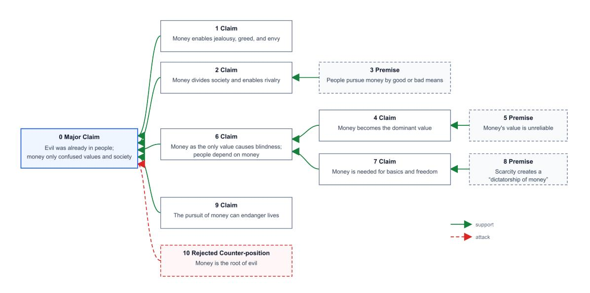
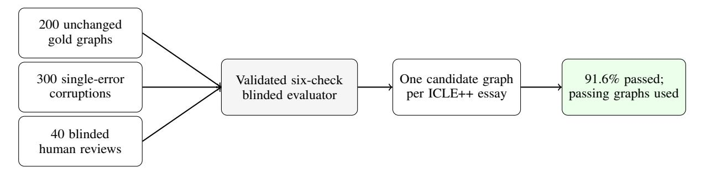

# The Utility of Argument Trees for Few-Shot Prompting in Cross-Prompt Persuasive Essay Scoring

## Anonymous ACL submission

## **<sup>001</sup>** Abstract

 We test whether argument trees improve few- shot, cross-prompt scoring of persuasive stu- dent essays. Each scoring prompt receives the essay and one automatically extracted tree con- taining a major claim, claims, premises, and support or attack links. We hold the nodes and edges fixed and render node text either as exact essay spans or as concise normalized propo- sitions that preserve source meaning while re- solving references and removing filler or rep- etition. A blinded graph-quality audit found that 91.6% of candidate graphs passed all six checks; failed graphs were excluded before scoring. Across ICLE++ experiments with three LLMs, normalized trees yield the clear- est, most consistent gains on three argument- related traits: THESIS CLARITY, ARGUMENT PERSUASIVENESS, and DEVELOPMENT. Ex- act spans yield smaller, mixed changes. The benefits therefore depend on both the target trait and node-text presentation.

### **<sup>023</sup>** 1 Introduction

 Although most automated essay scoring (AES) re- search has focused on supervised fine-tuning (SFT), zero- and few-shot prompting offers educators a more accessible alternative [\(Mizumoto and Eguchi,](#page-3-0) [2023;](#page-3-0) [Yancey et al.,](#page-4-0) [2023;](#page-4-0) [Wang et al.,](#page-4-1) [2024;](#page-4-1) [Man-](#page-3-1)[sour et al.,](#page-3-1) [2024;](#page-3-1) [Lee et al.,](#page-3-2) [2024;](#page-3-2) [Choi et al.,](#page-3-3) [2026\)](#page-3-3).

 However, even carefully engineered zero/few- shot AES prompts may correlate poorly with hu- man scores [\(Mansour et al.,](#page-3-1) [2024\)](#page-3-1). Their scores can also be poorly calibrated or systematically biased, including by essay length and toward the center of the scale [\(Li et al.,](#page-3-4) [2026\)](#page-3-4).

**036** With only a few demonstrations, however, **037** prompted models have little opportunity to learn **038** the essay representations available through SFT.

**039** We test which traits benefit from argument-tree **040** augmentation in few-shot, cross-prompt scoring of **041** *persuasive* essays. We also compare exact essay

spans with faithful normalized propositions from **042** the same extraction. Among syntactic, discourse, **043** and argumentative representations, we use argu- **044** ment structure because it is most relevant to persua- **045** sive essays. First, we extract one tree containing a **046** major claim, claims, premises, and directed support **047** or attack links, following [Stab and Gurevych](#page-3-5) [\(2014,](#page-3-5) **048** [2017\)](#page-3-6). We then provide the tree, essay, and five **049** most similar demonstrations to an LLM for scoring. **050** The two tree conditions have identical topology **051** and node types; only node text changes. Exact- **052** span nodes retain contiguous source text, whereas **053** normalized nodes state the same propositions con- **054** cisely and self-containedly. Following [Jo et al.](#page-3-7) **055** [\(2019\)](#page-3-7), normalization resolves references and re- **056** vises fragmented wording to form complete propo- **057** sitions. It remains narrower than free paraphrasing **058** and adds no evidence, warrants, or stronger reason- **059** ing. **060**

Pre-neural AES research extracted statistical tree **061** features, such as the number of supported claims, **062** [t](#page-3-8)o train supervised scorers for specific traits [\(Song](#page-3-8) **063** [et al.,](#page-3-8) [2014;](#page-3-8) [Persing and Ng,](#page-3-9) [2015;](#page-3-9) [Ghosh et al.,](#page-3-10) **064** [2016;](#page-3-10) [Al-Khatib et al.,](#page-3-11) [2016\)](#page-3-11). We instead place the **065** tree itself in the prompt and evaluate all 11 traits. **066** Earlier work also used within-prompt scoring; we **067** use cross-prompt scoring, with test prompts unseen **068** during training. **069**

### 2 Experiment Setup **<sup>070</sup>**

Dataset. We evaluate on the released ICLE++ **071** annotations [\(Li and Ng,](#page-3-12) [2024\)](#page-3-12), comprising 1006 **072** persuasive essays across 10 prompts. Each essay **073** has a score from 1 to 4, in half-point increments, **074** for OVERALL QUALITY and 10 analytic traits. **075** We classify THESIS CLARITY, PERSUASIVENESS, **076** and DEVELOPMENT as argument-related; the other **077** seven traits are not primarily argument-related. **078** This grouping organizes the analysis but does not **079** imply that the other traits are independent of argu- **080**

<span id="page-1-1"></span>

|                       | Thesis  | Persua-  |        | Prompt  |          |         |         | Sentence |        | Technical | Overall |
|-----------------------|---------|----------|--------|---------|----------|---------|---------|----------|--------|-----------|---------|
| Representation        | Clarity | siveness | Dev.   | Adhere. | Org.     | Cohere. | Cohesi. | Struct.  | Vocab. | Quality   | Quality |
|                       |         |          |        | G       | Semma    |         |         |          |        |           |         |
| Essay                 | 0.250   | 0.222    | 0.222  | 0.203   | 0.211    | 0.266   | 0.212   | 0.275    | 0.389  | 0.320     | 0.341   |
| Essay+Exact-Span Tree | 0.300   | 0.232    | 0.248  | 0.122   | 0.186    | 0.163   | 0.172   | 0.185    | 0.397  | 0.219     | 0.346   |
| $\Delta$              | +.050   | +.010    | +.026  | 081*    | 025      | 103*    | 040     | 090*     | +.008  | 101*      | +.005   |
| Essay+Normalized Tree | 0.412   | 0.390    | 0.366  | 0.184   | 0.173    | 0.363   | 0.194   | 0.227    | 0.311  | 0.239     | 0.350   |
| Δ                     | +.162*  | +.168*   | +.144* | 019     | 038      | +.097*  | 018     | 048      | 078*   | 081*      | +.009   |
|                       |         |          |        |         | Qwen     |         |         |          |        |           |         |
| Essay                 | 0.196   | 0.163    | 0.156  | 0.355   | 0.197    | 0.120   | 0.265   | 0.222    | 0.319  | 0.341     | 0.339   |
| Essay+Exact-Span Tree | 0.212   | 0.181    | 0.182  | 0.253   | 0.193    | 0.061   | 0.178   | 0.111    | 0.168  | 0.298     | 0.343   |
| $\Delta$              | +.016   | +.018    | +.026  | 102*    | 004      | 059*    | 087*    | 111*     | 151*   | 043*      | +.004   |
| Essay+Normalized Tree | 0.296   | 0.285    | 0.242  | 0.363   | 0.118    | 0.166   | 0.263   | 0.194    | 0.297  | 0.354     | 0.377   |
| Δ                     | +.100*  | +.122*   | +.086* | +.008   | 079*     | +.046   | 002     | 028      | 022    | +.013     | +.038   |
|                       |         |          |        | M       | inistral |         |         |          |        |           |         |
| Essay                 | 0.297   | 0.219    | 0.255  | 0.221   | 0.245    | 0.217   | 0.283   | 0.296    | 0.315  | 0.257     | 0.275   |
| Essay+Exact-Span Tree | 0.324   | 0.195    | 0.247  | 0.079   | 0.190    | 0.094   | 0.182   | 0.134    | 0.152  | 0.057     | 0.238   |
| Δ                     | +.027   | 024      | 008    | 143*    | 055*     | 123*    | 101*    | 161*     | 163*   | 200*      | 037     |
| Essay+Normalized Tree | 0.384   | 0.322    | 0.335  | 0.188   | 0.216    | 0.250   | 0.307   | 0.263    | 0.288  | 0.240     | 0.296   |
| $\Delta$              | +.087*  | +.103*   | +.080  | 034     | 029      | +.033*  | +.024   | 032      | 027    | 017       | +.022   |

Table 1: Cross-prompt QWK per trait. Exact-Span and Normalized Tree use the same nodes and edges but different node-text presentations.  $\Delta$  = difference from Essay; scores and deltas are rounded independently from unrounded values. \*p < 0.05 (paired t-test over the 10 held-out prompts). **Bold**: best score per trait in each model block.

ment structure. Appendix Table 3 gives the definitions and grouping; Appendix B gives the prompts, rubrics, and a note on the corpus-size discrepancy in the original report.

**Evaluation metric.** We report quadratic weighted kappa (QWK), the standard AES agreement metric; higher values indicate better agreement.

**Evaluation setting.** We used leave-one-promptout cross-validation: essays from one prompt were reserved for testing, and five demonstrations per test essay were retrieved only from the remaining prompts by cosine similarity in bge-m3 embedding space (Chen et al., 2025).

Essay representations. We compare three inputs: (1) the essay; (2) the essay with an *exact-span tree*; and (3) the essay with a *normalized tree*. Using the staged Stab and Gurevych method (Stab and Gurevych, 2017), we extracted one major claim, claims, premises, and directed support or attack links. GPT-5.6-Terra then normalized the node text while node identities, component types, and edges remained fixed. A blinded Gemini-3.6-Flash evaluator assessed each shared graph using six binary checks. Validation yielded a 4.0% false-alarm rate on 200 unchanged gold graphs, 0.90 macro-F1 on 300 single-error corruptions, and  $\kappa = 0.83$  against a blinded human review of 40 natural graphs. Of the candi-

<span id="page-1-0"></span>

| Quality category                | Candidate graphs |
|---------------------------------|------------------|
| Incorrect central claim         | 2.0%             |
| Unsupported or distorted node   | 2.7%             |
| Incorrect node role             | 1.5%             |
| Incorrect relation attachment   | 3.1%             |
| Incorrect direction or polarity | 1.2%             |
| Major argumentative omission    | 4.3%             |
| At least one issue              | 8.4%             |
| Passed all six checks           | 91.6%            |
| Mean failed checks per graph    | 0.15             |

Table 2: Category-level quality results for the candidate shared argument graphs. Categories overlap because a graph may fail multiple checks.

date graphs, 91.6% passed all checks. Only essays with a passing graph entered any scoring condition; failed graphs were not used. Table 2 reports one set of category-level results for the shared graphs. Appendix C.2 gives the full checklist, validation design, and supporting tables.

A separate, independent graph-quality study found that errors affecting the controlling interpretation, especially an incorrect central claim, were more consequential than isolated local relation errors. Appendix D reports the score differences and qualitative error hierarchy; this study was not part of the filtered scoring experiment reported above.

The exact-span tree uses contiguous essay text, preserving original wording, qualifications, repetition, and language errors. Following Jo et al.

[\(2019\)](#page-3-7), the normalized tree states the same propo- sitions concisely and self-containedly by resolving references and removing non-argumentative filler or repetition. It preserves polarity, uncertainty, attri- bution, argumentative weakness, and the source's level of support; it adds no evidence, warrants, or stronger reasoning. Appendix [C](#page-8-1) gives construction **133** details.

 Scoring models. We used three LLM scoring models: gemma-3-27b-it, Qwen3-32B-AWQ [\(Team et al.,](#page-3-14) [2025;](#page-3-14) [Team,](#page-3-15) [2025\)](#page-3-15), and Ministral-3-8B-Instruct-2512[1](#page-2-0) . For each representation, trait, and test essay, the model received the trait definition and five retrieved training-prompt demonstrations. Appendix [E](#page-13-1) gives the conversation design, prompts, and decoding settings.

## **<sup>143</sup>** 3 Results

**146**

**144** Table [1](#page-1-1) reports QWK for essay-only input and both **145** tree presentations. Stars mark significant differences from the same model's essay-only baseline.[2](#page-2-1)

 PMAES [\(Chen and Li,](#page-3-16) [2023\)](#page-3-16) studies supervised cross-prompt scoring; our experiment instead tests tree augmentation within the same five-shot LLM **150** scorer.

 Argument-related traits. The clearest pattern occurs for THESIS CLARITY, PERSUASIVENESS, and DEVELOPMENT (Appendix Table [3\)](#page-6-0). Normal- ized trees improve Gemma by 0.144–0.168 QWK, Qwen by 0.086–0.122, and Ministral by 0.080– 0.103. All three gains are significant for Gemma and Qwen; the THESIS CLARITY and PERSUA- SIVENESS gains are significant for Ministral. Ex- act spans change these traits by only −0.024 to +0.050. Thus, the same argument structure yields markedly different trait-level results under the two presentations.

 Other traits. Exact-span trees preserve more source detail but also repeat much of the essay. For traits grounded in local prose, their scores are often below the essay-only baseline; the largest numeri- cal differences occur for Ministral on SENTENCE STRUCTURE (−0.161), VOCABULARY (−0.163), and TECHNICAL QUALITY (−0.200). Normalized trees show a different pattern: COHERENCE in- creases for all three models, while several surface-form traits remain best scored from the essay. OVERALL QUALITY is numerically higher with **173** normalized trees for all three models. **174**

### 4 Discussion **<sup>175</sup>**

Argument trees help most when they expose infor- **176** mation relevant to the scored trait. The root isolates **177** the major claim for THESIS CLARITY; support and **178** attack links connect claims to reasons for PERSUA- **179** SIVENESS; and the tree shows how much support **180** the central argument receives for DEVELOPMENT. **181** Both presentations share these properties, but nor- **182** malized trees make each proposition compact and **183** self-contained and yield larger gains across all three **184** models. **185**

Exact spans preserve the essay's detail, qualifica- **186** tions, repetition, and linguistic form. Because the **187** prompt already includes the essay, they also dupli- **188** cate substantial source material. Normalized trees **189** preserve the propositions and relations while re- **190** ducing that duplication. Compact nodes may make **191** argumentative content easier to locate, whereas **192** repeated spans may spread attention across over- **193** lapping evidence or make repeated claims dispro- **194** portionately salient. Because the experiment does **195** not isolate prompt length from normalization, this **196** account does not establish causation. **197**

Model size may also shape the contrast. Minis- **198** tral, the smallest scoring model, shows the largest **199** numerical decreases under exact-span augmenta- **200** tion for most non-argument traits; normalized trees **201** recover much of that difference and improve all **202** three argument-related traits. This is consistent **203** with compact trees helping smaller models navi- **204** gate long essays, although we did not directly test **205** model capacity. Wording, syntax, and local dis- **206** course remain available only in the essay, so trees **207** should supplement rather than replace it. **208**

### 5 Conclusion **<sup>209</sup>**

To our knowledge, this is the first study of **210** argument-tree augmentation for *few-shot cross-* **211** *prompt* persuasive essay scoring to compare exact- **212** span and normalized presentations of the same **213** structure. Argument-tree utility depends on both **214** the target trait and proposition presentation. Nor- **215** malized trees provide the clearest gains for THE- **216** SIS CLARITY, PERSUASIVENESS, and DEVELOP- **217** MENT; exact spans preserve more source detail but **218** provide a less compact scoring signal. The essay **219** remains essential for traits grounded in wording **220** and local discourse. **221**

<span id="page-2-0"></span><sup>1</sup> [https://huggingface.co/mistralai/](https://huggingface.co/mistralai/Ministral-3-8B-Instruct-2512) [Ministral-3-8B-Instruct-2512](https://huggingface.co/mistralai/Ministral-3-8B-Instruct-2512)

<span id="page-2-1"></span><sup>2</sup>All statistical significance tests are paired t-tests (p < 0.05). See Appendix [F](#page-14-0) for details.

## **<sup>222</sup>** Limitations

 Our findings cover one persuasive-essay corpus, a five-shot cross-prompt setup, and three scoring models, so generalization remains untested. We consider only argument structure; syntax and dis- course may better preserve local language and dis- course cues. We neither test per-trait input selection nor ablate the root claim, node labels, and edges. The two tree presentations also differ in length and redundancy, so we cannot isolate those factors from normalization.

### **<sup>233</sup>** References

- <span id="page-3-11"></span>**234** Khalid Al-Khatib, Henning Wachsmuth, Johannes **235** Kiesel, Matthias Hagen, and Benno Stein. 2016. **236** [A news editorial corpus for mining argumentation](https://aclanthology.org/C16-1324/) **237** [strategies.](https://aclanthology.org/C16-1324/) In *Proceedings of COLING 2016, the* **238** *26th International Conference on Computational Lin-***239** *guistics: Technical Papers*, pages 3433–3443, Osaka, **240** Japan. The COLING 2016 Organizing Committee.
- <span id="page-3-13"></span>**241** Jianlv Chen, Shitao Xiao, Peitian Zhang, Kun Luo, Defu **242** Lian, and Zheng Liu. 2025. [M3-embedding: Multi-](https://arxiv.org/abs/2402.03216)**243** [linguality, multi-functionality, multi-granularity text](https://arxiv.org/abs/2402.03216) **244** [embeddings through self-knowledge distillation.](https://arxiv.org/abs/2402.03216) **245** *Preprint*, arXiv:2402.03216.
- <span id="page-3-16"></span>**246** [Y](https://doi.org/10.18653/v1/2023.acl-long.83)uan Chen and Xia Li. 2023. [PMAES: Prompt-](https://doi.org/10.18653/v1/2023.acl-long.83)**247** [mapping contrastive learning for cross-prompt au-](https://doi.org/10.18653/v1/2023.acl-long.83)**248** [tomated essay scoring.](https://doi.org/10.18653/v1/2023.acl-long.83) In *Proceedings of the 61st* **249** *Annual Meeting of the Association for Computational* **250** *Linguistics (Volume 1: Long Papers)*, pages 1489– **251** 1503, Toronto, Canada. Association for Computa-**252** tional Linguistics.
- <span id="page-3-3"></span>**253** Jaeyoon Choi, Tamara Tate, and Mark Warschauer. 2026. **254** Anchor is the key: Toward accessible automated **255** essay scoring with large language model through **256** prompting. *Assessing Writing*, 69:101053.
- <span id="page-3-10"></span>**257** Debanjan Ghosh, Aquila Khanam, Yubo Han, and **258** Smaranda Muresan. 2016. [Coarse-grained argumen-](https://doi.org/10.18653/v1/P16-2089)**259** [tation features for scoring persuasive essays.](https://doi.org/10.18653/v1/P16-2089) In *Pro-***260** *ceedings of the 54th Annual Meeting of the Associa-***261** *tion for Computational Linguistics (Volume 2: Short* **262** *Papers)*, pages 549–554, Berlin, Germany. Associa-**263** tion for Computational Linguistics.
- <span id="page-3-7"></span>**264** Yohan Jo, Jacky Visser, Chris Reed, and Eduard Hovy. **265** 2019. [A cascade model for proposition extraction in](https://doi.org/10.18653/v1/W19-4502) **266** [argumentation.](https://doi.org/10.18653/v1/W19-4502) In *Proceedings of the 6th Workshop* **267** *on Argument Mining*, pages 11–24, Florence, Italy. **268** Association for Computational Linguistics.
- <span id="page-3-2"></span>**269** Sanwoo Lee, Yida Cai, Desong Meng, Ziyang Wang, **270** and Yunfang Wu. 2024. [Unleashing large language](https://doi.org/10.18653/v1/2024.findings-emnlp.10) **271** [models' proficiency in zero-shot essay scoring.](https://doi.org/10.18653/v1/2024.findings-emnlp.10) In **272** *Findings of the Association for Computational Lin-***273** *guistics: EMNLP 2024*, pages 181–198, Miami, **274** Florida, USA. Association for Computational Lin-**275** guistics.

- <span id="page-3-4"></span>Qingquan Li, Shaoyu Dou, Kailai Shao, Chao Chen, **276** and Haixiang Hu. 2026. *[Evaluating Scoring Bias](https://doi.org/10.1007/978-981-92-0372-7_2)* **277** *[in LLM-as-a-Judge](https://doi.org/10.1007/978-981-92-0372-7_2)*, page 19–34. Springer Nature **278** Singapore. **279**
- <span id="page-3-12"></span>[S](https://doi.org/10.18653/v1/2024.naacl-long.468)hengjie Li and Vincent Ng. 2024. [ICLE++: Modeling](https://doi.org/10.18653/v1/2024.naacl-long.468) **280** [fine-grained traits for holistic essay scoring.](https://doi.org/10.18653/v1/2024.naacl-long.468) In *Pro-* **281** *ceedings of the 2024 Conference of the North Amer-* **282** *ican Chapter of the Association for Computational* **283** *Linguistics: Human Language Technologies (Volume* **284** *1: Long Papers)*, pages 8465–8486, Mexico City, **285** Mexico. Association for Computational Linguistics. **286**
- <span id="page-3-1"></span>Watheq Ahmad Mansour, Salam Albatarni, Sohaila **287** Eltanbouly, and Tamer Elsayed. 2024. [Can large](https://aclanthology.org/2024.lrec-main.247/) **288** [language models automatically score proficiency of](https://aclanthology.org/2024.lrec-main.247/) **289** [written essays?](https://aclanthology.org/2024.lrec-main.247/) In *Proceedings of the 2024 Joint* **290** *International Conference on Computational Linguis-* **291** *tics, Language Resources and Evaluation (LREC-* **292** *COLING 2024)*, pages 2777–2786, Torino, Italia. **293** ELRA and ICCL. **294**
- <span id="page-3-0"></span>[A](https://doi.org/10.1016/j.rmal.2023.100050)tsushi Mizumoto and Masaki Eguchi. 2023. [Exploring](https://doi.org/10.1016/j.rmal.2023.100050) **295** [the potential of using an ai language model for auto-](https://doi.org/10.1016/j.rmal.2023.100050) **296** [mated essay scoring.](https://doi.org/10.1016/j.rmal.2023.100050) *Research Methods in Applied* **297** *Linguistics*, 2(2):100050. **298**
- <span id="page-3-9"></span>[I](https://doi.org/10.3115/v1/P15-1053)saac Persing and Vincent Ng. 2015. [Modeling argu-](https://doi.org/10.3115/v1/P15-1053) **299** [ment strength in student essays.](https://doi.org/10.3115/v1/P15-1053) In *Proceedings of* **300** *the 53rd Annual Meeting of the Association for Com-* **301** *putational Linguistics and the 7th International Joint* **302** *Conference on Natural Language Processing (Vol-* **303** *ume 1: Long Papers)*, pages 543–552, Beijing, China. **304** Association for Computational Linguistics. **305**
- <span id="page-3-8"></span>Yi Song, Michael Heilman, Beata Beigman Klebanov, **306** and Paul Deane. 2014. [Applying argumentation](https://doi.org/10.3115/v1/W14-2110) **307** [schemes for essay scoring.](https://doi.org/10.3115/v1/W14-2110) In *Proceedings of the* **308** *First Workshop on Argumentation Mining*, pages 69– **309** 78, Baltimore, Maryland. Association for Computa- **310** tional Linguistics. **311**
- <span id="page-3-5"></span>[C](https://doi.org/10.3115/v1/D14-1006)hristian Stab and Iryna Gurevych. 2014. [Identifying](https://doi.org/10.3115/v1/D14-1006) **312** [argumentative discourse structures in persuasive es-](https://doi.org/10.3115/v1/D14-1006) **313** [says.](https://doi.org/10.3115/v1/D14-1006) In *Proceedings of the 2014 Conference on* **314** *Empirical Methods in Natural Language Processing* **315** *(EMNLP)*, pages 46–56, Doha, Qatar. Association for **316** Computational Linguistics. **317**
- <span id="page-3-6"></span>[C](https://doi.org/10.1162/COLI_a_00295)hristian Stab and Iryna Gurevych. 2017. [Parsing argu-](https://doi.org/10.1162/COLI_a_00295) **318** [mentation structures in persuasive essays.](https://doi.org/10.1162/COLI_a_00295) *Computa-* **319** *tional Linguistics*, 43(3):619–659. **320**
- <span id="page-3-14"></span>Gemma Team, Aishwarya Kamath, Johan Ferret, Shreya **321** Pathak, Nino Vieillard, Ramona Merhej, Sarah Perrin, **322** Tatiana Matejovicova, Alexandre Ramé, Morgane **323** Rivière, Louis Rouillard, Thomas Mesnard, Geoffrey **324** Cideron, Jean bastien Grill, Sabela Ramos, Edouard **325** Yvinec, Michelle Casbon, Etienne Pot, Ivo Penchev, **326** and 197 others. 2025. [Gemma 3 technical report.](https://arxiv.org/abs/2503.19786) **327** *Preprint*, arXiv:2503.19786. **328**
- <span id="page-3-15"></span>Qwen Team. 2025. [Qwen3 technical report.](https://arxiv.org/abs/2505.09388) *Preprint*, **329** arXiv:2505.09388. **330**

<span id="page-4-1"></span> [Y](https://doi.org/10.18653/v1/2024.findings-emnlp.520)upei Wang, Renfen Hu, and Zhe Zhao. 2024. [Be-](https://doi.org/10.18653/v1/2024.findings-emnlp.520) [yond agreement: Diagnosing the rationale align-](https://doi.org/10.18653/v1/2024.findings-emnlp.520) [ment of automated essay scoring methods based on](https://doi.org/10.18653/v1/2024.findings-emnlp.520) [linguistically-informed counterfactuals.](https://doi.org/10.18653/v1/2024.findings-emnlp.520) In *Findings of the Association for Computational Linguistics: EMNLP 2024*, pages 8906–8925, Miami, Florida, USA. Association for Computational Linguistics.

<span id="page-4-0"></span> Kevin P. Yancey, Geoffrey Laflair, Anthony Verardi, and Jill Burstein. 2023. [Rating short L2 essays on the](https://doi.org/10.18653/v1/2023.bea-1.49) [CEFR scale with GPT-4.](https://doi.org/10.18653/v1/2023.bea-1.49) In *Proceedings of the 18th Workshop on Innovative Use of NLP for Building Educational Applications (BEA 2023)*, pages 576– 584, Toronto, Canada. Association for Computational Linguistics.

## **<sup>345</sup>** A Case Study of Exact-Span and **<sup>346</sup>** Normalized Node Text

 This appendix illustrates both node-text presenta- tions using one ICLE++ essay. A detailed source span and concise normalized proposition occupy the same node in a shared reconstructed tree. The full normalized graph appears in compact JSON.

#### **352** A.1 Prompt and Essay

#### **353** Prompt.

**354** In the words of the old song: "Money is the root **355** of all evil."

#### **356** Essay.

 Money is the root of the evil Does it mean that the evil was born when money became the medium of payment? No. The evil was there - in people. Money just gave much more possibilities to grew up human vices such as jealousy, greediness, and **362** envy.

 Money came and society began to differ. People began to make money and to differ from each other. They began to distinguish as for how heavy money - bag they had. Money - market was born. It gave the possibility for such a inborn feature as a rivality is. Money makers began to look for whichever - good or bad - way of geeting money.

 Everything had to get its money form and such a relative value was getting to be the only value that people accepted. Everything, every work, ev- eryone is touched by money, is valued by money that became the most important value one meets on the way to the real thing, the work and the human being. Of course, people want to compare, to have knowledge of facts so that they do this through their money form of value. But they often forget that it is just a relative value given today, tomorrow it is different. It is not possible to rely **381** on it.

 Fortunately, a lot of people consider money form as the only value. It causes blindness - stupid- ity and simplicity. It is comfortable to live for money. People like money, want money and are dependent on it. One cannot have a bread with-out money. People are dependent on society they

live in. MiloÜ Forman said that money gives him **388** freedom. Does it mean freedom in the society? **389** I think so. One needs money to be free in ones **390** society, to enjoy ones life. One can eat whatever, **391** buy whatever, travel wherever, see whichever per- **392** formance or movie one wants. Simply - to be **393** happy and free. **394**

While people short of money have to check and **395** divide their money among many things they need, **396** want and they would like. So that they have to **397** realize prices, compare them and count and count. **398** To be in a dictatorship of money. When people **399** loose their freedom as for money, it is really the **400** evil thing. Secondly, it becomes the sense of life. **401** It is very simple and stupid. It is dangerous too. **402** People who in a hunt for money are loosing them **403** are near to loosing their lives. But the evil is in **404** people, money just caused confussion in us, in **405** values we have, in society we live in. **406**

#### A.2 Reconstructed Argument Tree **407**

Figure [1](#page-5-1) places the essay's position at the root, **408** supported by branches on social differentiation, ri- **409** valry, monetary valuation, dependence, and loss of **410** freedom. Node 10 is the opening counter-position **411** rejected by the essay; its attack edge distinguishes **412** it from the major claim. The condensed visual **413** preserves node identities and links, not the full ex- **414** perimental wording. **415**

#### A.3 One Node in the Two Presentations **416**

Node 4 illustrates the two conditions. The exact **417** span preserves the essay's wording and grammati- **418** cal form. The normalized version concisely states **419** the same proposition: money's relative value be- **420** came the dominant measure of things, work, and **421** people. **422**

Exact span. "Everything had to get its money **423** form and such a relative value was getting to be **424** the only value that people accepted. Everything, **425** every work, everyone is touched by money, is **426** valued by money that became the most important **427** value one meets on the way to the real thing, the **428** work and the human being." **429**

Normalized. "People treated money's relative **430** value as the only and most important value for **431** everything, work, and people." **432**

#### <span id="page-4-2"></span>A.4 Normalized JSON Representation **433**

The JSON below gives the normalized graph. **434** Within n, i, t, and y denote node ID, normalized **435** text, and type. Within a, c, p, and r denote conclu- **436** sion, supporting nodes, and relation type. **437**

```
{ 439
"n": [ 440
 {"i":0,"t":"Evil was already in people; money 441
    only caused confusion in us, our values, 442
    and our society.","y":"major_claim"}, 443
```

**438**

<span id="page-5-1"></span>

Figure 1: Condensed reconstructed CZPR2013 argument tree. Edges point from premises or claims to the claims they support. Node wording is shortened to fit the page; Appendix [A.4](#page-4-2) gives the full normalized text.

```
444 {"i":1,"t":"Money gave people more
445 possibilities to develop vices such as
446 jealousy, greed, and envy.","y":"claim"},
448 {"i":2,"t":"Money differentiated society by
449 wealth and made rivalry possible.","y":"
450 claim"},
451 {"i":3,"t":"Money makers sought money by
452 whatever good or bad means were
453 available.","y":"premise"},
454 {"i":4,"t":"People treated money's relative
455 value as the only and most important
456 value for everything, work, and people.",
457 "y":"claim"},
458 {"i":5,"t":"People compared things through
459 money even though its value changed and
460 could not be relied on.","y":"premise"},
461 {"i":6,"t":"Treating money as the only value
462 causes blindness, stupidity, and
463 simplicity; people are dependent on
464 money.","y":"claim"},
465 {"i":7,"t":"Money is described as necessary
466 for bread and, tentatively, for freedom
467 in society.","y":"claim"},
468 {"i":8,"t":"People short of money had to
469 divide, price, compare, and repeatedly
470 count what they needed and wanted,
471 living in a dictatorship of money.","y":
472 "premise"},
473 {"i":9,"t":"Money becomes a simple, dangerous
474 sense of life; people hunting money can
475 come near to losing their lives.","y":"
476 claim"},
477 {"i":10,"t":"Money is the root of evil.","y":
478 "claim"}
479 ],
480 "a": [
481 {"c":0,"p":[1,2,6,9],"r":"support"},
482 {"c":0,"p":[10],"r":"attack"},
483 {"c":2,"p":[3],"r":"support"},
484 {"c":6,"p":[4,7],"r":"support"},
485 {"c":4,"p":[5],"r":"support"},
486 {"c":7,"p":[8],"r":"support"}
487 ]
```

} **<sup>488</sup> <sup>489</sup>**

### <span id="page-5-0"></span>B ICLE++ **<sup>490</sup>**

In this section, we first present the ICLE++ trait **491** definitions and corpus statistics and then the rubrics **492** used to score the traits. **493**

Statistics. Table [4](#page-6-1) lists the 10 ICLE++ prompts, **494** essay counts, and average word counts. **495**

Corpus-size note. The original ICLE++ paper re- **496** ports that 1008 essays were selected for annotation **497** [\(Li and Ng,](#page-3-12) [2024\)](#page-3-12), but its 10 published per-prompt **498** counts, reproduced in Table [4,](#page-6-1) sum to 1006. The re- **499** leased annotations used in our experiments contain **500** those 1006 essays; accordingly, we report 1006 as **501** the experimental corpus size. **502**

Traits. Table [3](#page-6-0) defines OVERALL QUALITY and **503** the 10 analytic traits. Tables [5](#page-6-2)[–15](#page-7-0) give their rubrics. **504** Each trait is scored from 1 to 4 in half-point incre- **505** ments; higher scores indicate higher quality. All **506** essays use the same rubrics regardless of prompt. **507**

<span id="page-6-0"></span>

| Trait              | Analytic group   | Definition                                                                           |
|--------------------|------------------|--------------------------------------------------------------------------------------|
| OVERALL QUALITY    | Holistic         | The holistic score.                                                                  |
| PROMPT ADHERENCE   | Other            | How related the content of an essay is to the prompt for which it is written.        |
| THESIS CLARITY     | Argument-related | How clearly an author explains the thesis of her essay.                              |
| PERSUASIVENESS     | Argument-related | The convincingness of the argument an essay makes for its thesis.                    |
| DEVELOPMENT        | Argument-related | Whether the essay develops its main ideas with adequate elaboration and<br>examples. |
| COHERENCE          | Other            | Whether the essay demonstrates appropriate transitions between ideas.                |
| COHESION           | Other            | Whether the essay contains appropriate words and phrases between seg<br>ments.       |
| ORGANIZATION       | Other            | How well-structured the essay is.                                                    |
| SENTENCE STRUCTURE | Other            | Whether the essay shows appropriate complexity and variety in sentence<br>structure. |
| VOCABULARY         | Other            | Whether the essay shows appropriate word choice and contains advanced<br>vocabulary. |
| TECHNICAL QUALITY  | Other            | Whether the essay uses correct grammar, mechanics, spelling, and punc<br>tuation.    |

Table 3: The ICLE++ scoring dimensions, their analytic grouping in this paper, and their definitions. "Other" denotes traits not classified as primarily argument-related; it does not imply independence from argument structure.

<span id="page-6-1"></span>

| Prompt                                                                              | Avg. # Words | Languages | Essays |
|-------------------------------------------------------------------------------------|--------------|-----------|--------|
| Some people say that in our modern world, dominated by science and technology       | 575.8        | 13        | 310    |
| and industrialisation, there is no longer a place for dreaming and imagination.     |              |           |        |
| What is your opinion?                                                               |              |           |        |
| Most university degrees are theoretical and do not prepare students for the real    | 586.0        | 13        | 148    |
| world. They are therefore of very little value.                                     |              |           |        |
| The prison system is outdated. No civilized society should punish its criminals: it | 585.3        | 13        | 104    |
| should rehabilitate them.                                                           |              |           |        |
| In the words of the old song: "Money is the root of all evil."                      | 623.0        | 10        | 84     |
| In his novel Animal Farm, George Orwell wrote "All men are equal but some are       | 579.2        | 10        | 82     |
| more equal than others." How true is this today?                                    |              |           |        |
| Feminists have done more harm to the cause of women than good.                      | 583.8        | 10        | 64     |
| All armies should consist entirely of professional soldiers: there is no value in a | 564.8        | 10        | 62     |
| system of military service.                                                         |              |           |        |
| Television is the opium of the masses in modern society. Discuss.                   | 526.5        | 10        | 58     |
| Most University degrees are theoretical and do not prepare us for the real life. Do | 552.5        | 10        | 55     |
| you agree or disagree?                                                              |              |           |        |
| Crime does not pay.                                                                 | 579.0        | 10        | 39     |

Table 4: The 10 writing prompts in ICLE++.

<span id="page-6-2"></span>

| Score | Description                                                                                                              |
|-------|--------------------------------------------------------------------------------------------------------------------------|
| 4     | essay provides ample support for its claims, uses effective vocabulary and sentence variety, organizes ideas logically,  |
|       | develops them well, conveys them concisely, and connects them with smooth transitions                                    |
| 3.5   | essay offers generally sufficient support for its claims, uses appropriate vocabulary and sentence variety, organizes    |
|       | ideas logically, develops them well, conveys them concisely, and connects them with appropriate transitions              |
| 3     | essay supports its claims adequately but the support may not be even, develops and organizes ideas reasonably well       |
|       | but the transitions between ideas may not be smooth, shows adequate command of language to convey ideas clearly          |
| 2.5   | essay offers support that is of little relevance to its claims, provides limited logical development and organization of |
|       | ideas, shows problems in language, grammar and/or sentence structure that result in a lack of clarity                    |
| 2     | essay provides little or no relevant support for its claims, has ideas that are not developed, illogical, and/or poorly  |
|       | organized, and has problems in language, grammar and/or sentence structure that often obscure meaning                    |
| 1.5   | essay provides little or no support for its claims, has disorganized ideas, is overly short, and has enough problems in  |
|       | language, grammar and/or sentence structure that make the essay nearly impossible to understand                          |
| 1     | essay is off topic                                                                                                       |

Table 5: Description of each Overall Quality score.

| Score | Description                                        |
|-------|----------------------------------------------------|
| 4     | essay fully addresses the prompt and consistently  |
|       | stays on topic                                     |
| 3     | essay mostly addresses the prompt or occasionally  |
|       | wanders off topic                                  |
| 2     | essay does not fully address the prompt or consis  |
|       | tently wanders off topic                           |
| 1     | essay does not address the prompt at all or is com |
|       | pletely off topic                                  |

Table 6: Descriptions of the Prompt Adherence scores.

| Score | Description                                     |
|-------|-------------------------------------------------|
| 4     | essay presents a very clear thesis and requires |
|       | little or no clarification                      |
| 3     | essay presents a moderately clear thesis but    |
|       | could benefit from some clarification           |
| 2     | essay presents an unclear thesis and would      |
|       | greatly benefit from further clarification      |
| 1     | essay presents no thesis of any kind and it is  |
|       | difficult to see what the thesis could be       |

Table 7: Descriptions of the Thesis Clarity scores.

| Score | Description                                      |
|-------|--------------------------------------------------|
| 4     | essay makes a persuasive argument for its thesis |
|       | and would convince most readers                  |
| 3     | essay makes a decent argument for its thesis and |
|       | could convince some readers                      |
| 2     | essay makes a poor but understandable argu       |
|       | ment for its thesis or sometimes even argues     |
|       | against it                                       |
| 1     | essay does not make an argument or it is often   |
|       | unclear what the argument is                     |

Table 8: Descriptions of the Argument Persuasiveness scores.

| Score | Description                                        |
|-------|----------------------------------------------------|
| 4     | essay fully develops its main ideas with adequate  |
|       | elaboration and examples                           |
| 3     | essay develops most of its ideas but could benefit |
|       | from further elaboration and examples              |
| 2     | essay does not fully develop its ideas and would   |
|       | greatly benefit from further elaboration           |
| 1     | essay presents numerous undeveloped ideas          |
|       | with almost no elaboration or examples             |

Table 9: Descriptions of the Development scores.

| Score | Description                                     |
|-------|-------------------------------------------------|
| 4     | essay contains sensible transitions between     |
|       | ideas and is usually very understandable        |
| 3     | essay contains a few slightly confusing transi  |
|       | tions between ideas but is still understandable |
| 2     | essay contains multiple confusing transitions   |
|       | because it switches between ideas roughly       |
| 1     | essay contains few or no transitions and is a   |
|       | highly fragmented collection of separate ideas  |

Table 10: Descriptions of the Coherence scores.

| Score | Description                                         |
|-------|-----------------------------------------------------|
| 4     | essay contains appropriate transition words         |
|       | and phrases between paragraphs, sentences, and      |
|       | phrases, linking statements and ideas to show their |
|       | connections and aid understanding                   |
| 3     | essay contains some transition words or phrases     |
|       | but could somewhat benefit from their use           |
| 2     | essay contains few transition words or phrases      |
|       | and would greatly benefit from their use            |
| 1     | essay contains almost no transitions and requires   |
|       | their use to help understand connections            |

Table 11: Descriptions of the Cohesion scores.

| Score | Description                                        |
|-------|----------------------------------------------------|
| 4     | essay is well structured and is organized in a way |
|       | that logically develops an argument                |
| 3     | essay is fairly well structured but could some     |
|       | what benefit from reorganization                   |
| 2     | essay is poorly structured and would greatly ben   |
|       | efit from reorganization                           |
| 1     | essay is completely unstructured and requires      |
|       | major reorganization                               |

Table 12: Descriptions of the Organization scores.

| Score | Description                                   |
|-------|-----------------------------------------------|
| 4     | essay contains numerous varied sentence struc |
|       | tures of appropriate complexity               |
| 3     | essay contains somewhat varied sentence struc |
|       | tures of moderate complexity                  |
| 2     | essay contains limited sentence structures of |
|       | rather low complexity                         |
| 1     | essay excessively and inappropriately repeats |
|       | the same simple sentence structures           |

Table 13: Descriptions of the Sentence Structure scores.

| Score | Description                                   |
|-------|-----------------------------------------------|
| 4     | essay shows appropriate word choice and con   |
|       | tains advanced vocabulary                     |
| 3     | essay shows appropriate word choice and con   |
|       | tains intermediate vocabulary                 |
| 2     | essay shows limited word choice and contains  |
|       | only beginning vocabulary                     |
| 1     | essay excessively and inappropriately repeats |
|       | the same words and/or phrases                 |

Table 14: Descriptions of the Vocabulary scores.

<span id="page-7-0"></span>

| Score | Description                                      |
|-------|--------------------------------------------------|
| 4     | essay contains very few technical errors that do |
|       | not affect its overall readability               |
| 3     | essay contains some technical errors that make   |
|       | it only somewhat difficult to read               |
| 2     | essay contains many technical errors that make   |
|       | it significantly difficult to read               |
| 1     | essay contains numerous technical errors that    |
|       | make it extremely difficult to read              |

Table 15: Descriptions of the Technical Quality scores.

## <span id="page-8-1"></span>**<sup>508</sup>** C Argument Tree Construction and **<sup>509</sup>** Validation

#### **510** C.1 Shared Construction Pipeline

 We constructed one tree per essay and reused it [i](#page-3-6)n both augmented conditions, following [Stab and](#page-3-6) [Gurevych](#page-3-6) [\(2017\)](#page-3-6). We identified contiguous spans as one MAJOR CLAIM, CLAIMS, or PREMISES, then inferred directed SUPPORT and ATTACK links. Qwen3-32B-AWQ performed both extraction stages. We checked node references, acyclicity, and the presence of one major claim; invalid outputs were regenerated.

 The exact-span tree retains extracted wording and order, including qualifications, repetition, dis- fluency, and grammatical errors. The normalized tree changes only node text. Following [Jo et al.](#page-3-7) [\(2019\)](#page-3-7), GPT-5.6-Terra rewrote each node as a concise, self-contained proposition. It resolved pro- nouns and underspecified references and removed filler or repetition. Rewrites preserved negation, modality, uncertainty, attribution, scope, argumen- tative gaps, and the original level of support; they could not add facts, evidence, warrants, causal links, or stronger conclusions.

#### GPT-5.6-Terra Normalization Prompt

```
You are normalizing node text in an
    extracted argument tree.
```

Essay text: {essay\_text}

Exact-span argument tree: {argument\_graph}

#### Task:

Rewrite only each node's `t` value as a concise, self-contained proposition.

### Normalization rules:

- Preserve the proposition expressed by the source span.
- Resolve pronouns and underspecified references when the essay supplies the referent.
- Remove filler and repetition only when doing so does not change meaning.
- Repair fragmented wording only enough to form a complete proposition.
- Preserve negation, modality, uncertainty, attribution, scope, argumentative gaps, and the original level of support.
- Do not add facts, evidence, warrants, causal links, assumptions, or stronger conclusions.
- Do not merge, split, add, delete, or reorder nodes.
- Keep every node ID and component type

```
unchanged.
```

- Keep every edge endpoint, relation type, and edge order unchanged.

- Preserve the input JSON structure and key names.

```
Return JSON only in the same graph schema:
{{
  "n": [
    {{"i": <same integer>, "t":
    "<normalized proposition>", "y":
    "<same node type>"}}
  ],
  "a": [
    {{"c": <same conclusion ID>, "p":
    [<same supporting node IDs>], "r":
    "<same relation>"}}
  ]
}}
```

#### Requirements:

- Output valid JSON only.
- Change only node-text values under `t`.
- Preserve the exact number and order of nodes and edges.
- Recheck every normalized node against the essay before returning it.

Node identifiers, component labels, edge end- **534** points, relation types, node order, and JSON for- **535** matting are fixed across presentations. The con- **536** ditions therefore use the same extracted tree, not **537** different graph formalisms; only the node-text field **538** changes. **539**

#### <span id="page-8-0"></span>C.2 Graph-Quality Evaluation **540**

We used Gemini-3.6-Flash as a blinded evalua- **541** tor. It received the essay and candidate graph, but **542** not the generation procedure, node-text condition, **543** or scoring results. It answered the six checks in **544** Table [16;](#page-10-0) a graph was accurate only if it passed all **545** six. Only essays with a passing graph entered the **546** experiment, so failed graphs appeared in none of **547** the three conditions. For each failure, the evalua- **548** tor identified the relevant node or edge and quoted **549** essay evidence. Figure [2](#page-10-1) summarizes the audit. **550**

Because both presentations share node identities, **551** roles, and relations, we report quality once for the **552** shared graph. Normalized text remained subject to **553** the faithfulness check. **554**

#### Gemini Graph-Quality Judge Prompt

You are a blinded evaluator of an argument graph extracted from an essay.

Judge only the candidate graph against the essay. You are not given and must not infer the graph-generation procedure, node-text condition, or

```
essay-scoring results.
Essay text:
{essay_text}
Candidate argument graph:
{candidate_graph}
Apply exactly these six binary checks:
1. Central claim
Pass only if the graph's major-claim node
    correctly represents the essay's
    overall position.
2. Node faithfulness
Pass only if every node is supported by
    the essay and does not invent, omit
    from the proposition, or materially
    change its meaning. Apply this check
    to normalized node text as well as
    exact spans.
3. Node role
Pass only if each major claim, claim, and
    premise has the appropriate
    component type.
4. Relation attachment
Pass only if every premise or claim is
    attached to the claim it actually
    supports or attacks.
5. Relation direction and type
Pass only if every edge has the correct
    direction and is correctly labeled
    as support or attack.
6. Major coverage
Pass only if no central argumentative
    branch is omitted in a way that
    misrepresents the essay.
Evidence rules:
- Evaluate the graph itself even though
    the essay is available to the scorer.
- Do not reward fluent wording,
    compactness, graph size, or essay
    quality.
- For every failed check, identify the
    relevant node ID, edge, or omitted
    branch; give a concise reason; and
    quote the shortest essay span that
    supports the judgment.
- For every passed check, set `target`,
    `reason`, and `essay_evidence` to
    null.
Return JSON only with exactly this shape:
{{
  "checks": {{
    "central_claim": {{"pass": <true or
    false>, "target": <string or null>,
    "reason": <string or null>,
    "essay_evidence": <string or null>}},
    "node_faithfulness": {{"pass": <true
    or false>, "target": <string or
```

null>, "reason": <string or null>,

```
"essay_evidence": <string or null>}},
    "node_role": {{"pass": <true or
    false>, "target": <string or null>,
    "reason": <string or null>,
    "essay_evidence": <string or null>}},
    "relation_attachment": {{"pass":
    <true or false>, "target": <string
    or null>, "reason": <string or
    null>, "essay_evidence": <string or
    null>}},
    "relation_direction_type": {{"pass":
    <true or false>, "target": <string
    or null>, "reason": <string or
    null>, "essay_evidence": <string or
    null>}},
    "major_coverage": {{"pass": <true or
    false>, "target": <string or null>,
    "reason": <string or null>,
    "essay_evidence": <string or null>}}
  }},
  "passed_all": <true or false>
}}
Requirements:
- Output valid JSON only with the keys
    shown above.
- Set `passed_all` to true if and only
    if all six checks pass.
- Do not add an overall subjective
    quality score.
```

## C.3 Evaluator Validation **558**

We used a fixed binary rubric and three validation **559** sets. First, 200 unchanged human-annotated gold **560** graphs measured false alarms (Table [17\)](#page-10-2). Second, **561** we created 50 single-error corruptions per check, **562** or 300 graphs. The blinded evaluator's issue de- **563** tection and category selection appear in Tables [18](#page-11-0) **564** and [19.](#page-11-1) Third, one human reviewer scored 40 ran- **565** domly ordered pipeline outputs without seeing the **566** automated answers or scoring results (Table [20\)](#page-11-2). **567**

<span id="page-10-1"></span>

Figure 2: Graph-quality validation overview. The evaluator was validated independently before being applied to candidate shared graphs; only passing graphs entered the scoring experiment.

<span id="page-10-0"></span>

| Check                                | Pass condition                                                                             |
|--------------------------------------|--------------------------------------------------------------------------------------------|
| Central claim                        | The graph correctly represents the essay's overall position.                               |
| Node faithfulness                    | Every node is supported by the essay and does not invent or materially change its meaning. |
| Node role                            | Major claims, claims, and premises are assigned appropriate roles.                         |
| Relation attachment                  | Every premise is connected to the claim it actually supports or attacks.                   |
| Relation<br>direction<br>and<br>type | Edge direction and support/attack type are correct.                                        |
| Major coverage                       | No central argumentative branch is omitted in a way that misrepresents the essay.          |

Table 16: Binary checklist used for graph-quality evaluation.

<span id="page-10-2"></span>

| Measure                                  | Result          |
|------------------------------------------|-----------------|
| Checklist-item specificity               | 99.3%           |
| Gold graphs passing every check          | 192/200 (96.0%) |
| Gold graphs falsely marked with an issue | 8/200 (4.0%)    |
| Mean false failures per graph            | 0.05            |

Table 17: Evaluator results on unchanged gold graphs.

<span id="page-11-0"></span>

| Introduced issue                    | Corruption                                               | Precision | Recall | F1   |
|-------------------------------------|----------------------------------------------------------|-----------|--------|------|
| Incorrect central claim             | Replaced or reversed the main position                   | 0.96      | 0.94   | 0.95 |
| Unsupported or distorted<br>node    | Added an unsupported or meaning-changing proposition     | 0.92      | 0.88   | 0.90 |
| Incorrect node role                 | Changed a claim into a premise or a premise into a claim | 0.90      | 0.86   | 0.88 |
| Incorrect relation attach<br>ment   | Attached a premise to the wrong claim                    | 0.92      | 0.88   | 0.90 |
| Incorrect direction or po<br>larity | Reversed an edge or changed support to attack            | 0.96      | 0.94   | 0.95 |
| Major<br>argumentative<br>omission  | Removed a central argumentative branch                   | 0.87      | 0.82   | 0.84 |
| Macro average                       |                                                          | 0.92      | 0.89   | 0.90 |

Table 18: Per-category evaluator performance on 300 artificially corrupted gold graphs (50 per category).

<span id="page-11-1"></span>

| Measure                                  | Result          |
|------------------------------------------|-----------------|
| Detected that some issue existed         | 282/300 (94.0%) |
| Correctly identified issue type          | 266/300 (88.7%) |
| Macro-F1 across issue types              | 0.90            |
| Incorrectly reported an additional issue | 15/300 (5.0%)   |

Table 19: Aggregate results on artificially corrupted gold graphs.

<span id="page-11-2"></span>

| Measure                          | Result          |
|----------------------------------|-----------------|
| Checklist-level agreement        | 220/240 (91.7%) |
| Checklist macro-F1               | 0.89            |
| Graph-level agreement            | 37/40 (92.5%)   |
| Cohen's κ for any issue          | 0.83            |
| Precision for graphs with issues | 0.85            |
| Recall for graphs with issues    | 0.92            |
| Graph-level F1                   | 0.88            |

Table 20: Agreement between the automated evaluator and a blinded human review of 40 natural graphs.

| Validation                    | Sample size          | Main result                         |
|-------------------------------|----------------------|-------------------------------------|
| Fixed binary rubric           | Six pass/fail checks | No general subjective quality score |
| Unchanged gold graphs         | 200                  | 4.0% graph-level false-alarm rate   |
| Artificially corrupted graphs | 300                  | 0.90 macro-F1                       |
| Human-reviewed natural graphs | 40                   | 0.89 checklist macro-F1; κ = 0.83   |

Table 21: Summary of the automated evaluator validation.

### <span id="page-13-0"></span>**<sup>568</sup>** D Qualitative Graph-Quality Analysis

 In a separate, independent study conducted out- side the filtered scoring experiment, graph quality did not have a uniform relationship with scoring. Graphs with correct rather than incorrect central claims differed by +.337 QWK for THESIS CLAR- ITY, +.430 for PERSUASIVENESS, and +.356 for DEVELOPMENT, exceeding the normalized tree's mean gains of +.116, +.131, and +.103, respec-**577** tively.

 An incorrect root can organize otherwise faith- ful evidence around the wrong position and re- ceive disproportionate weight because the tree fore- grounds it. The reviewed cases suggest that node- faithfulness and coverage errors matter next be- cause they distort or omit evidence, whereas iso- lated attachment, direction, or polarity errors are often recoverable from the accompanying essay. Local errors are not irrelevant, but global semantic correctness appears more consequential than iso- lated structural correctness. A correct central claim is also insufficient when a dense tree duplicates or overemphasizes support. Together, the analyses suggest the following hierarchy: the controlling position, faithful and concise evidence, then exact local relations.

### <span id="page-13-1"></span>**<sup>594</sup>** E Scoring Model Details

 We used a separate conversation for each represen- tation, trait, and target essay because scoring all traits in one response performed worse in prelim- inary experiments. This also allowed representa- tion selection by trait. Models ran locally through vLLM on two NVIDIA RTX A6000 48GB GPUs at temperature 0.0. Prompts specified the trait and definition, target prompt, score labels, input-use instructions, and JSON format. Each conversation contained five retrieved training examples followed by the target; examples served as quality anchors, not a score prior.

 Output followed a JSON schema with one re- quired field, score, whose value was one of seven half-point labels: "1.0", "1.5", "2.0", "2.5", "3.0", "3.5", or "4.0". We parsed the response and converted the score string to a number.

#### Essay-only Scoring Prompt

You are scoring one ICLE essay trait from essay text examples.

Requested trait: `{trait\_name}`

**612**

```
Use only these raw scores: {score_values}.
Trait definition:
`{trait_name}`: {trait_definition}
Essay prompt for the target item:
{essay_prompt}
{conversation_note}
Input use:
- Score only the final user essay.
- Use the examples as quality anchors,
    not as a score prior.
- Compare the target essay's quality to
    the examples.
Scoring discipline:
- Do not default to the middle.
- Pick the nearest half-step from
    evidence.
- Before finalizing, test the adjacent
    lower and higher scores.
- Use middle scores only when evidence
    supports it.
- Penalize missing, thin, vague, or
    off-task evidence.
- Reward clear, specific, developed,
    well-controlled evidence.
Return JSON only with exactly this shape:
{{
  "score": "<one allowed score>"
}}
Requirements:
- Output valid JSON only.
- The only key must be `score`.
- The score string must be exactly one
    of: {score_values}.
```

The tree conditions used the same prompt; only **614** graph node text differed. **615**

```
Essay+Tree Scoring Prompt
You are scoring one ICLE essay trait from
    essay+tree examples.
Requested trait: `{trait_name}`
Use only these raw scores: {score_values}.
Trait definition:
`{trait_name}`: {trait_definition}
Essay prompt for the target item:
{essay_prompt}
{conversation_note}
Input use:
- Score only the final user item.
- Use both essay text and graph.
- Use both inputs. The graph helps reveal
    claims, reasons, support, and
    omissions.
- Use the graph actively to understand
```

```
the essay better, but prioritize the
    essay.
- The graph should not raise the score
    unless the essay itself contains the
    relevant explanation, support, or
    argumentative development.
- Score the original essay, not graph
    neatness.
- A clean graph is not evidence of a
    high-quality essay.
- A node or edge shows a point exists; it
    does not prove strong development.
- Use examples as quality anchors, not as
    a score prior.
- If essay and graph conflict, prefer the
    essay.
Scoring discipline:
- Do not default to the middle.
- Pick the nearest half-step from
    evidence.
- Before finalizing, test the adjacent
    lower and higher scores.
- Use middle scores only when evidence
    supports it.
- Penalize missing, thin, vague, or
    off-task evidence.
- Reward clear, specific, developed,
    well-controlled evidence.
Return JSON only with exactly this shape:
{{
  "score": "<one allowed score>"
}}
Requirements:
- Output valid JSON only.
- The only key must be `score`.
- The score string must be exactly one
    of: {score_values}.
```

## Conversational Few-Shot Format

```
System:
{one of the two scoring prompts above}
User:
Essay prompt:
{calibration_prompt_1}
Essay text:
{calibration_essay_1} [included in
    all conditions]
Argument graph:
{calibration_graph_1} [included
    for span-tree and normalized-tree
    conditions]
Assistant:
{
  "score": "{gold_score_1}"
}
...
User:
```

```
Essay prompt:
{calibration_prompt_5}
Essay text:
{calibration_essay_5} [included in
    all conditions]
Argument graph:
{calibration_graph_5} [included
    for span-tree and normalized-tree
    conditions]
Assistant:
{
 "score": "{gold_score_5}"
}
User:
Essay prompt:
{target_prompt}
Essay text:
{target_essay} [included in
    all conditions]
Argument graph:
{target_graph} [included
    for span-tree and normalized-tree
    conditions]
Assistant:
{
 "score": "{predicted_score}"
}
```

### <span id="page-14-0"></span>F Statistical Significance **<sup>620</sup>**

We used paired two-tailed t-tests across the 10 held- **621** out prompts, comparing each tree presentation with **622** the essay-only baseline for each trait and model. **623** The paired unit was prompt-level QWK. The three **624** argument-related traits form the primary analysis; **625** the other results show the broader trait pattern. Ta- **626** ble [22](#page-15-0) reports detailed p-values. **627**

**619**

**617**

**618**

<span id="page-15-0"></span>

| Comparison  | Clarity<br>of Thesis | Strength<br>of Arg. | Dev.  | Adherence<br>to Prompt | Org.  | Coherence | Cohesion | Sentence<br>Struct. | Vocab. | Technical<br>Quality | Overall<br>Quality |
|-------------|----------------------|---------------------|-------|------------------------|-------|-----------|----------|---------------------|--------|----------------------|--------------------|
|             |                      |                     |       |                        |       | Gemma     |          |                     |        |                      |                    |
| p: E+S vs E | 0.170                | 0.610               | 0.370 | 0.020                  | 0.500 | 0.008     | 0.080    | 0.030               | 0.780  | 0.020                | 0.900              |
| p: E+N vs E | 0.002                | < .001              | 0.002 | 0.500                  | 0.310 | 0.010     | 0.380    | 0.180               | 0.030  | 0.040                | 0.820              |
|             |                      |                     |       |                        |       | Qwen      |          |                     |        |                      |                    |
| p: E+S vs E | 0.580                | 0.280               | 0.260 | 0.010                  | 0.760 | 0.020     | 0.006    | 0.001               | < .001 | 0.030                | 0.810              |
| p: E+N vs E | 0.010                | < .001              | 0.008 | 0.780                  | 0.004 | 0.050     | 0.920    | 0.190               | 0.350  | 0.410                | 0.060              |
|             |                      |                     |       |                        |       | Ministral |          |                     |        |                      |                    |
| p: E+S vs E | 0.230                | 0.500               | 0.840 | < .001                 | 0.040 | < .001    | 0.004    | 0.005               | 0.012  | < .001               | 0.080              |
| p: E+N vs E | 0.006                | 0.020               | 0.080 | 0.180                  | 0.210 | 0.012     | 0.300    | 0.410               | 0.580  | 0.190                | 0.250              |

Table 22: Two-tailed paired t-test p-values: Essay+Exact-Span Tree vs. Essay (E+S vs E) and Essay+Normalized Tree vs. Essay (E+N vs E), per trait and condition.