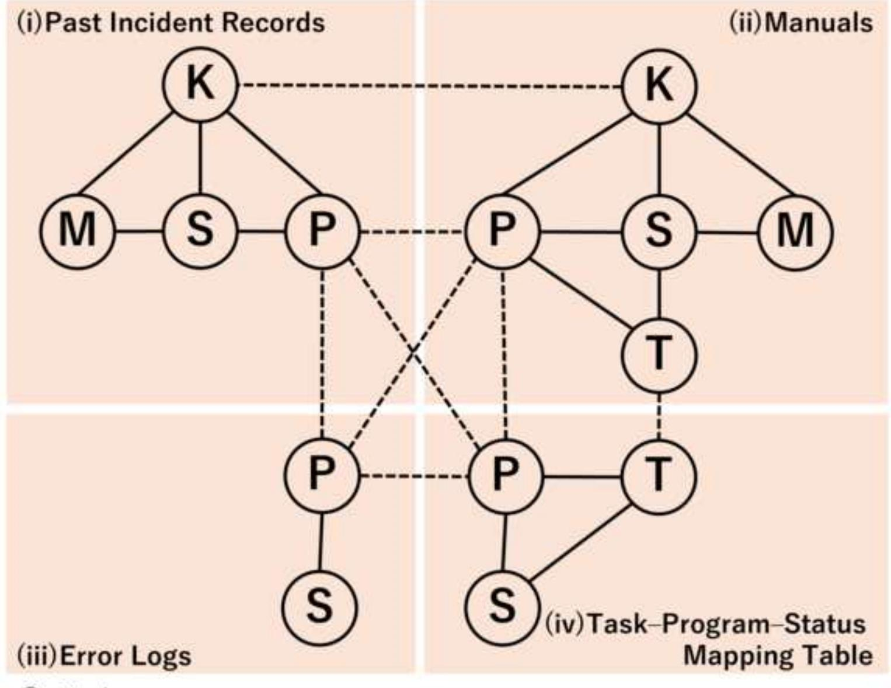

### PLOS One

### A Comparative Study of LLMs for Ontology-Based Knowledge Graph Construction and GraphRAG Performance

--Manuscript Draft--

| Manuscript Number:                                                                                                                                                                                                                                                                                 | PONE-D-26-10449                                                                                                                                                                                                                                                                                                                                                                                                                                                                                                                                                                                                                                                                                                                                                                                                                                                                                                                                                                                                                                                                                                                                                                                                                                                                                                                                                                                                                                                                                                                                                                                                                                                                                                                                                                                                                                                                                                       |
|----------------------------------------------------------------------------------------------------------------------------------------------------------------------------------------------------------------------------------------------------------------------------------------------------|-----------------------------------------------------------------------------------------------------------------------------------------------------------------------------------------------------------------------------------------------------------------------------------------------------------------------------------------------------------------------------------------------------------------------------------------------------------------------------------------------------------------------------------------------------------------------------------------------------------------------------------------------------------------------------------------------------------------------------------------------------------------------------------------------------------------------------------------------------------------------------------------------------------------------------------------------------------------------------------------------------------------------------------------------------------------------------------------------------------------------------------------------------------------------------------------------------------------------------------------------------------------------------------------------------------------------------------------------------------------------------------------------------------------------------------------------------------------------------------------------------------------------------------------------------------------------------------------------------------------------------------------------------------------------------------------------------------------------------------------------------------------------------------------------------------------------------------------------------------------------------------------------------------------------|
| Article Type:                                                                                                                                                                                                                                                                                      | Research Article                                                                                                                                                                                                                                                                                                                                                                                                                                                                                                                                                                                                                                                                                                                                                                                                                                                                                                                                                                                                                                                                                                                                                                                                                                                                                                                                                                                                                                                                                                                                                                                                                                                                                                                                                                                                                                                                                                      |
| Full Title:                                                                                                                                                                                                                                                                                        | A Comparative Study of LLMs for Ontology-Based Knowledge Graph Construction and GraphRAG Performance                                                                                                                                                                                                                                                                                                                                                                                                                                                                                                                                                                                                                                                                                                                                                                                                                                                                                                                                                                                                                                                                                                                                                                                                                                                                                                                                                                                                                                                                                                                                                                                                                                                                                                                                                                                                               |
| Short Title:                                                                                                                                                                                                                                                                                       | A Comparative Study of LLMs for Ontology-Based Knowledge Graph Construction and GraphRAG Performance                                                                                                                                                                                                                                                                                                                                                                                                                                                                                                                                                                                                                                                                                                                                                                                                                                                                                                                                                                                                                                                                                                                                                                                                                                                                                                                                                                                                                                                                                                                                                                                                                                                                                                                                                                                                               |
| Corresponding Author:                                                                                                                                                                                                                                                                              | Jun-ichiro Watanabe, Ph.D Hitachi, Ltd. Tokyo, JAPAN                                                                                                                                                                                                                                                                                                                                                                                                                                                                                                                                                                                                                                                                                                                                                                                                                                                                                                                                                                                                                                                                                                                                                                                                                                                                                                                                                                                                                                                                                                                                                                                                                                                                                                                                                                                                                                                            |
| Keywords:                                                                                                                                                                                                                                                                                          | LLMs; knowledge graphs; ontology; GraphRAG; chatbots                                                                                                                                                                                                                                                                                                                                                                                                                                                                                                                                                                                                                                                                                                                                                                                                                                                                                                                                                                                                                                                                                                                                                                                                                                                                                                                                                                                                                                                                                                                                                                                                                                                                                                                                                                                                                                                                  |
| Abstract:                                                                                                                                                                                                                                                                                          | Technical support for system failures requires rapid access to relevant information from various sources such as incident records, system manuals, and error logs in order to identify causes and provide appropriate responses. In practice, this information is scattered across documents, making timely and comprehensive retrieval difficult and often reliant on expert knowledge. Retrieval-Augmented Generation (RAG) has emerged as an effective technique for addressing queries that rely on domain-specific knowledge, and GraphRAG, which leverages knowledge graphs to integrate information across sources, is particularly suitable when such knowledge spans multiple documents. In GraphRAG, the quality of the knowledge graph constructed by a large language model (LLM) directly affects the accuracy of the generated responses. Despite this importance, few studies have quantitatively examined how differences among LLMs influence knowledge graph quality and downstream response performance. In this study, we compare GPT-4o and GPT-4.1 as LLMs for ontology based knowledge graph construction and evaluate their impact on the graph quality and GraphRAG-based response performance in enterprise system troubleshooting. Our results show that GPT-4.1 detects entities with fewer omissions than GPT-4o, whereas GPT-4o outperforms GPT-4.1 in extracting relationships between entities. Furthermore, user evaluations based on a five-level rubric indicate that the knowledge graph constructed with GPT-4o yields higher response accuracy than that constructed with GPT-4.1. These results, at least within the scope of this study, may contradict the general expectation that newer models such as GPT-4.1 would achieve higher accuracy in knowledge graph construction and downstream answer quality. |
| Order of Authors:                                                                                                                                                                                                                                                                                  | Jun-ichiro Watanabe, Ph.D                                                                                                                                                                                                                                                                                                                                                                                                                                                                                                                                                                                                                                                                                                                                                                                                                                                                                                                                                                                                                                                                                                                                                                                                                                                                                                                                                                                                                                                                                                                                                                                                                                                                                                                                                                                                                                                                                             |
|                                                                                                                                                                                                                                                                                                    | Fumimaro Odakura                                                                                                                                                                                                                                                                                                                                                                                                                                                                                                                                                                                                                                                                                                                                                                                                                                                                                                                                                                                                                                                                                                                                                                                                                                                                                                                                                                                                                                                                                                                                                                                                                                                                                                                                                                                                                                                                                                      |
|                                                                                                                                                                                                                                                                                                    | Tadashi Takeuchi, Ph.D                                                                                                                                                                                                                                                                                                                                                                                                                                                                                                                                                                                                                                                                                                                                                                                                                                                                                                                                                                                                                                                                                                                                                                                                                                                                                                                                                                                                                                                                                                                                                                                                                                                                                                                                                                                                                                                                                                |
| Additional Information:                                                                                                                                                                                                                                                                            |                                                                                                                                                                                                                                                                                                                                                                                                                                                                                                                                                                                                                                                                                                                                                                                                                                                                                                                                                                                                                                                                                                                                                                                                                                                                                                                                                                                                                                                                                                                                                                                                                                                                                                                                                                                                                                                                                                                       |
| Question                                                                                                                                                                                                                                                                                           | Response                                                                                                                                                                                                                                                                                                                                                                                                                                                                                                                                                                                                                                                                                                                                                                                                                                                                                                                                                                                                                                                                                                                                                                                                                                                                                                                                                                                                                                                                                                                                                                                                                                                                                                                                                                                                                                                                                                              |
| Financial Disclosure Enter a financial disclosure statement that describes the sources of funding for the work included in this submission. Review the submission guidelines for detailed requirements. View published research articles from PLOS ONE for specific examples. | The author(s) received no specific funding for this work.                                                                                                                                                                                                                                                                                                                                                                                                                                                                                                                                                                                                                                                                                                                                                                                                                                                                                                                                                                                                                                                                                                                                                                                                                                                                                                                                                                                                                                                                                                                                                                                                                                                                                                                                                                                                                                                             |

This statement is required for submission and will appear in the published article if the submission is accepted. Please make sure it is accurate.

#### Funded studies

Enter a statement with the following details:

- Initials of the authors who received each award •
- Grant numbers awarded to each author
- The full name of each funder
- URL of each funder website
- Did the sponsors or funders play any role in the study design, data collection and analysis, decision to publish, or preparation of the manuscript? •

Did you receive funding for this work?

#### Competing Interests

Use the instructions below to enter a competing interest statement for this submission. On behalf of all authors, disclose any [competing interests](http://journals.plos.org/plosone/s/competing-interests) that could be perceived to bias this work—acknowledging all financial support and any other relevant financial or nonfinancial competing interests.

This statement is required for submission and will appear in the published article if the submission is accepted. Please make sure it is accurate and that any funding sources listed in your Funding Information later in the submission form are also declared in your Financial Disclosure statement.

View published research articles from [PLOS ONE](http://journals.plos.org/plosone/) for specific examples.

The authors have declared that no competing interests exist.

# NO authors have competing interests Enter: The authors have declared that no competing interests exist. Authors with competing interests Enter competing interest details beginning with this statement: I have read the journal's policy and the authors of this manuscript have the following competing interests: [insert competing interests here] \* typeset Ethics Statement Enter an ethics statement for this submission. This statement is required if the study involved: • Human participants • Human specimens or tissue • Vertebrate animals or cephalopods • Vertebrate embryos or tissues • Field research Write "N/A" if the submission does not require an ethics statement. General guidance is provided below. Consult the [submission guidelines](http://journals.plos.org/plosone/s/submission-guidelines#loc-guidelines-for-specific-study-types) for detailed instructions. Make sure that all information entered here is included in the Methods section of the manuscript. N/A

#### Format for specific study types

#### Human Subject Research (involving human participants and/or tissue)

- Give the name of the institutional review board or ethics committee that approved the study •
- Include the approval number and/or a statement indicating approval of this research •
- Indicate the form of consent obtained (written/oral) or the reason that consent was not obtained (e.g. the data were analyzed anonymously) •

### Animal Research (involving vertebrate animals, embryos or tissues)

- Provide the name of the Institutional Animal Care and Use Committee (IACUC) or other relevant ethics board that reviewed the study protocol, and indicate whether they approved this research or granted a formal waiver of ethical approval •
- Include an approval number if one was obtained •
- If the study involved non-human primates, add additional details about animal welfare and steps taken to ameliorate suffering •
- If anesthesia, euthanasia, or any kind of animal sacrifice is part of the study, include briefly which substances and/or methods were applied •

#### Field Research

Include the following details if this study involves the collection of plant, animal, or other materials from a natural setting:

- Field permit number
- Name of the institution or relevant body that granted permission •

#### Data Availability

Authors are required to make all data underlying the findings described fully available, without restriction, and from the time of publication. PLOS allows rare exceptions to address legal and ethical concerns. See the [PLOS Data Policy](http://journals.plos.org/plosone/s/data-availability) and [FAQ](http://journals.plos.org/plosone/s/data-availability#loc-faqs-for-data-policy) for detailed information.

Yes - all data are fully available without restriction

A Data Availability Statement describing where the data can be found is required at submission. Your answers to this question constitute the Data Availability Statement and will be published in the article, if accepted.

Important: Stating 'data available on request from the author' is not sufficient. If your data are only available upon request, select 'No' for the first question and explain your exceptional situation in the text box.

Do the authors confirm that all data underlying the findings described in their manuscript are fully available without restriction?

Describe where the data may be found in full sentences. If you are copying our sample text, replace any instances of XXX with the appropriate details.

- If the data are held or will be held in a public repository, include URLs, accession numbers or DOIs. If this information will only be available after acceptance, indicate this by ticking the box below. For example: All XXX files are available from the XXX database (accession number(s) XXX, XXX.). •
- If the data are all contained within the manuscript and/or Supporting Information files, enter the following: All relevant data are within the manuscript and its Supporting Information files. •
- If neither of these applies but you are able to provide details of access elsewhere, with or without limitations, please do so. For example: •

Data cannot be shared publicly because of [XXX]. Data are available from the XXX Institutional Data Access / Ethics Committee (contact via XXX) for researchers who meet the criteria for access to confidential data.

The data underlying the results presented in the study are available from (include the name of the third party

All relevant data are within the manuscript and its Supporting Information files.

1

2

3

# A Comparative Study of LLMs for Ontology-Based

# Knowledge Graph Construction and GraphRAG

# Performance

- 4 Jun-ichiro Watanabe \*,¶, Fumimaro Odakura¶, Tadashi Takeuchi¶
- 5 Research & Development Group, Hitachi, Ltd., Tokyo, 185-8601 Japan
- 6 \* Corresponding author
- 7 Email: <u>junichiro.watanabe.ws@hitachi.com</u> (JW)
- 8 ¶ These authors contributed equally to this work.

# **Abstract**

 Technical support for system failures requires rapid access to relevant information from various sources such as incident records, system manuals, and error logs in order to identify causes and provide appropriate responses. In practice, this information is scattered across documents, making timely and comprehensive retrieval difficult and often reliant on expert knowledge. Retrieval-Augmented Generation (RAG) has emerged as an effective technique for addressing queries that rely on domain-specific knowledge, and GraphRAG, which leverages knowledge graphs to integrate information across sources, is particularly suitable when such knowledge spans multiple documents. In GraphRAG, the quality of the knowledge graph constructed by a large language model (LLM) directly affects the accuracy of the generated responses. Despite this importance, few studies have quantitatively examined how differences among LLMs influence knowledge graph quality and downstream response performance. In this study, we compare GPT-4o and GPT-4.1 as LLMs for ontology-based knowledge graph construction and evaluate their impact on the graph quality and GraphRAG-based response performance in enterprise system troubleshooting. Our results show that GPT-4.1 detects entities with fewer omissions than GPT-4o, whereas GPT-4o outperforms GPT-4.1 in extracting relationships between entities. Furthermore, user evaluations based on a five-level rubric indicate that the knowledge graph constructed with GPT-4o yields higher response accuracy than that constructed with GPT- 4.1. These results, at least within the scope of this study, may contradict the general expectation that newer models such as GPT-4.1 would achieve higher accuracy in knowledge graph construction and downstream answer quality.

# **Introduction**

 Technical support for queries arising during system failures requires rapid retrieval of relevant information from diverse sources—such as past incident reports, system manuals, and error logs—in order to identify causes and provide appropriate responses. For example, when users report issues following an abnormal system termination, system administrators must examine error logs and manuals to identify the cause and provide corrective instructions. However, this process is often time-consuming, as it involves searching through complex system specifications, analyzing lengthy logs, and reviewing extensive manuals. Moreover, when the required knowledge exceeds an administrator's expertise, additional consultation with experienced specialists possessing deep domain knowledge and practical troubleshooting experience is necessary. As the number of such experts continues to decline, the challenge of transferring operational know-how has become increasingly severe. Consequently, there is a strong demand for technologies that support query handling, and chatbots based on large  language models (LLMs) have attracted significant attention in recent years. Studies have compared the performance of multiple LLM-based chatbots, and several evaluations—such as comparative analyses using economics problems [1] and assessments in the medical domain [2]—have reported that GPT-4–based models consistently produce more accurate and stable responses than other models. Conversely, prior work has also identified limitations, including deficiencies in specialized knowledge and reasoning biases [3], as well as the potential for generating inappropriate or unsafe recommendations [4].

 Retrieval-Augmented Generation (RAG) [5] has been widely adopted as a technique that enables LLMs to incorporate external domain knowledge during answer generation. However, conventional vector-based RAG methods cannot explicitly represent structural relationships across documents, often resulting in missing information or reduced coherence in generated explanations. To address this limitation, graph-based RAG techniques [6–11] have been proposed. These GraphRAG approaches leverage knowledge graphs [12,13] to represent complex relationships among entities as nodes and edges, enabling context-aware graph traversal during retrieval. Studies have shown that this approach is particularly effective when domain knowledge is distributed across multiple information sources, enabling question answering systems to achieve improved multi- hop reasoning, structured retrieval, and response consistency [14]. For example, a study on LinkedIn's support tickets [15] reported substantial improvements in retrieval accuracy and answer quality using GraphRAG, reducing resolution time by 28.6%. Another study also utilized knowledge graphs and LLMs to improve the efficiency of incident classification and routing for IT service desks [16], demonstrating a reduction in triage time by 73% and an improvement in the first-contact resolution rate by 41%. Similar gains have been observed in education [17], recommendation systems [18], legal issues [19], healthcare [20], manufacturing [21], and a wider range of other domains [22–28]. Ontology-based approaches, in particular, have demonstrated benefits in improving inference quality and reducing hallucinations, as shown in OG-RAG [29], plugin ontology GraphRAG [30], ontology-based query check [31], and ontology-guided knowledge graph construction analyses [32].

 The quality of the knowledge graph is strongly influenced by the LLM used to construct it. A comparative study by Bhatt *et al.* has shown that GPT-4 generates more accurate knowledge graphs than LLaMA2 or BERT [33]. Chen *et al.* [34] also evaluated six LLMs (GPT-3.5, GPT-4o, GPT-o4-mini, Gemini-2.0/2.5-Flash, and LLaMA-3.1) for knowledge graph construction and found a clear correlation between model capability and graph quality, concluding that GPT-4-level models produce more accurate and interpretable knowledge graphs. With the release of GPT-4.1 in April 2025, further improvements in both knowledge graph construction and downstream response quality are expected. In this work, we verify these improvements by directly comparing GPT-4.1 against GPT-4o. More advanced models, such as GPT-5 (released in August 2025), provide enhanced inference capabilities and are primarily designed for use cases including complex document analysis  and coding assistance. Because such models continue to evolve rapidly with frequent updates and successive releases, they are outside the scope of this study. Nevertheless, future LLMs should be evaluated using methodologies similar to that presented in this paper.

 To date, few studies have quantitatively examined how differences among LLMs affect the accuracy of knowledge graph construction and, consequently, the quality of responses generated by GraphRAG-based chatbots. This study focuses on GPT-4o, which demonstrated the highest knowledge graph construction accuracy in prior evaluations, and the newly released model GPT-4.1, which features enhanced long-context capabilities and is expected to enable improved and more consistent knowledge graph construction. We conduct a comparative evaluation of these two models to assess their impact on both knowledge graph construction quality and the accuracy of GraphRAG-based response generation. We developed a GraphRAG- based troubleshooting chatbot for the Allocation Planning System (ALPS), an enterprise supply–demand coordination system currently in operation within our organization, leveraging knowledge graphs constructed using the two LLMs, and evaluated its response accuracy. Queries related to abnormal system terminations—caused by issues such as invalid input data, network communication failures, process coordination problems, and system data corrections—occur regularly in system operations. A GraphRAG-based chatbot is expected to effectively support responses to such queries and contribute to improved operational efficiency.

# **Materials and Methods**

### **Knowledge Graph Construction and Retrieval**

 GraphRAG-based answer generation consists of two core modules: 1) Ontology-based knowledge graph construction module—structuring large amounts of unorganized information into a knowledge graph, and 2) Graph-based retrieval module—extracting relevant information from the knowledge graph with high precision.

### Ontology-Based Knowledge Graph Construction

 The ontology-based knowledge graph construction module is designed to suppress noise (i.e., incorrect or irrelevant information) by requiring users to explicitly define the target knowledge structure as an ontology. We used GPT-4o and GPT- 4.1 as LLMs to extract entities and relationships between them according to the ontology, with the temperature parameter fixed at 0.0 to ensure deterministic output.

 The extraction process operates as follows. First, source documents are provided to the module as instances of LangChain's *Document* class [35]. Documents in formats such as CSV, TXT, or PDF are converted into this format using the appropriate *DocumentLoaders*. In parallel, an ontology definition file written in YAML format is supplied. This file specifies the entity classes (nodes), relationships (edges), and their semantic definitions to be extracted. Next, a data structure definition is automatically generated from the ontology definition file and, together with the document text, is passed to LangChain's *Structured output* interface. A tailored prompt instructs the LLM to extract entities and relationships strictly in accordance with the ontology. Finally, the extracted knowledge elements are converted into a knowledge graph representation in CSV format. This ontology-guided procedure ensures that only user-specified information is extracted and accurately reflected in the knowledge graph, thereby preventing the introduction of noise.

 Fig. 1 illustrates the ontology schema used in this study. To guide knowledge graph construction and ensure semantic consistency, we define an ontology consisting of five entity classes: *Key Phrase*, *Task Name*, *Program Name*, *Status*, and *Measure*, along with predefined relationships among them. A *Key Phrase* entity represents a concise description of an abnormal termination or operational request and is typically recorded in the corresponding column of incident records and manuals. A *Program Name* entity corresponds to the name of an executable program, while a *Task Name* entity represents a higher-level processing unit composed of multiple programs. A *Status* entity describes the cause or condition of a system error, and a *Measure* entity represents a concrete corrective action, such as skipping a process, reissuing data, registering records, or replacing datasets. *Key Phrase*, *Task Name*, and *Program Name* are all short, fixed words or phrases, while *Status* and *Measure* are free-form and include some standardized phrases.

**Fig 1. Ontology schema for knowledge graph construction.** The schema defines five entity classes (*Key Phrase*, *Task Name*, *Program Name*, *Status*, and *Measure*) and the semantic relationships among them.

 The ontology also defines semantic relationships among these entities. *Key Phrase* entities are linked to associated *Program Name*, *Status*, and *Measure* entities. *Program Name* entities are connected to *Status* entities representing execution errors, and *Status* entities are further linked to corresponding *Measure* entities. *Task Name* entities are connected to both *Program Name* and *Status* entities. Nodes with the exact same name (*Key Phrase*, *Task Name*, *Program Name*) are connected by *Similar* edges. To avoid graph congestion and inefficient traversal, *Similar* edges are only established between different  sources, not within the same source. Through these relationships, extracted nodes are interconnected within the knowledge graph.

 In practical query handling, system administrators are notified of system anomalies through automatically generated emails that briefly report abnormal terminations, as well as through direct chat messages from users. Based on the information provided in these emails and chats, administrators must investigate the underlying causes and derive appropriate *Measures*. In this study, to support such query handling, we construct a knowledge graph using the following four information sources, which differ in both the type and amount of information they contain:

#### (i) Past Incident Records

 This dataset contains 701 historical incident records from the past two years, summarizing causes and corresponding measures for abnormal terminations. The records are stored in CSV format and include *Key Phrases* that briefly describe and categorize the queries, *Program Names*, abnormal *Status* (phenomena and causes), and *Measures* taken. Additional attributes such as query type (e.g., abnormal or operation request), processing type (regular or ad hoc), and handling difficulty are also included. System administrators currently rely on these records to identify the causes of the system troubles, related programs, and appropriate measures.

#### (ii) Manuals

 Operation manuals describe procedures for handling operational requests and abnormal terminations for specific tasks. The manuals, covering 51 operational procedures and stored in CSV format, typically include *Key Phrases*, which are standardized phrases also recorded in Past Incident Records and used to concisely represent query topics. They also contain *Task Names* indicating the relevant operations and *Program Names* that execute those tasks. In addition, the manuals describe the target operational *Status*—namely, the system condition that the manual aims to achieve or restore, representing what is currently not functioning as intended—and the corresponding *Measures*, which specify the concrete procedures required to realize that *Status*.

#### (iii) Error Logs

 Error logs provide detailed runtime information for programs that terminate abnormally. They include timestamps, server names, *Program Names*, processing identifiers, and error messages representing termination *Status*.

#### (iv) Task–Program–Status Mapping Table

 During abnormal terminations, users typically report issues via an automatically generated notification email. This email includes the *Task Name* and a brief fixed *Status* message describing the abnormal condition (e.g., a predetermined phrase such as "*Abnormal data input*"), but it does not include the name of the program that caused the failure. As a result, the information contained in the email alone is insufficient to identify the cause of the abnormal termination and to determine an appropriate corrective measure. Since *Program Names* are present in all other sources, they serve as a key for integrating information. To enable this integration, we introduce an additional table that explicitly defines the relationships among *Task Names*, *Program Names*, and abnormal *Status*. By using this table, the information contained in the automatically generated email can be connected via the *Program Name* to other information sources. This enables the system to search across incident records, logs, and manuals to identify appropriate *Measures* corresponding to the abnormal *Status* reported in the email. The table, provided in CSV format, contains 857 mappings.

### Graph-Based Retrieval

 The graph-based retrieval module extracts information relevant to a user query by traversing the knowledge graph in accordance with the ontology. The retrieval process consists of the following steps.

 First, based on the input query and the ontology definition, the LLM identifies the relevant entity classes—such as *Key Phrase*, *Program Name*, or *Status*—as target classes for retrieving information related to the query. Next, query keywords corresponding to these target classes are extracted from the query text. Using the extracted keywords and the identified target classes, the module identifies starting nodes in the knowledge graph that are semantically similar to the query keywords. From these starting nodes, it traverses the graph to discover reachable paths to other nodes belonging to the target classes, following the ontology-defined relationships. This constrained traversal enables efficient multi-hop retrieval while preserving semantic consistency. Finally, the original query and the retrieved graph paths are provided to the LLM to generate the final response.

### **Chatbot**

 The chatbot system is built upon the Neo4j [36] graph database platform. The frontend is implemented with Streamlit [37], and the backend uses LangChain [35] to coordinate LLM operations and perform RAG using both Neo4j's graph-based retrieval and vector search. In preliminary testing, we qualitatively confirmed that when using GPT-4o, answers were simpler than when using GPT-4.1 and often did not contain necessary information, so we adopted GPT-4.1 as the LLM to be used in the chatbot for answer generation.

### **Evaluation**

### Accuracy of the Knowledge Graph

 To evaluate the accuracy of ontology-based knowledge graph construction, we compared how precisely GPT-4o and GPT-4.1 extracted the intended entities and relationships.

 We first evaluated whether the models correctly extracted the entities *Key Phrase*, *Task Name*, and *Program Name* as nodes. These entities have fixed and unambiguous names, which allowed their occurrences in the source data to be counted accurately. All of these entities were explicitly listed in the information sources. For each CSV-formatted source, the entries in the *Key Phrase*, *Task Name*, and *Program Name* columns were counted for each unique name and treated as the Ground Truth.

 The ontology definition explicitly specified that the corresponding entities were to be extracted from these CSV columns. For each of the two LLMs, we compared the names and counts of the extracted nodes against the Ground Truth. An extracted node was classified as a True Positive if its name matched a Ground Truth entry. If the extracted node name did not appear in the Ground Truth, it was classified as a False Positive. If an extracted node matched a Ground Truth entry but the extracted count was smaller than the Ground Truth count, the difference between the Ground Truth count and the extracted count was treated as False Negatives. Based on these classifications, Precision, Recall, and F1-scores were calculated to evaluate node extraction accuracy.

 Next, we evaluated whether the knowledge graph correctly captured the free-text information describing abnormal termination *Status* and the corresponding *Measure*. Because these items were written in an unstructured manner in the incident records or manuals, evaluating their extraction required a different procedure from that used for entities with fixed names, such as *Key Phrases* or *Program Names*. Therefore, based on actual query-handling cases by system administrators, we selected 20 representative knowledge items describing abnormal termination *Statuses* and corresponding *Measures*. For each item, we identified characteristic keywords that indicate the abnormal state or the corrective action, such as "double quotation error,"  "manual recovery," "connection failure," "restart," and "process skip." We then examined whether these keywords appeared in the free-text *Status* and *Measure* fields of the incident records or manuals and treated their occurrences as the Ground Truth. For each knowledge item, we formulated a Cypher query to test whether the knowledge graph contained the corresponding keywords and counted the number of matching nodes returned by the query. We then calculated Recall to evaluate how comprehensively these 20 representative *Status* and *Measure* knowledge items were captured in the knowledge graph. Precision and F1-scores were not reported for *Status* and *Measure* entities because False Positives could not be systematically identified for free-text descriptions.

 In addition to Precision, Recall, and F1-scores, we also reported the number of nodes for each entity type—*Key Phrase*, *Task Name*, *Program Name*, *Status*, and *Measure*—to provide an overall quantitative characterization of the constructed knowledge graphs.

 Finally, we assessed relationship extraction performance by counting the number of edges extracted for all defined relationship types (*Key Phrase*–*Program Name*, *Key Phrase*–*Status*, *Key Phrase*–*Measure*, *Task Name*–*Program Name*, *Task Name*–*Status*, *Program Name*–*Status*, and *Status*–*Measure*) in the constructed knowledge graphs. To further evaluate missed relationship extraction, we selected 40 representative relationships that collectively covered these relationship types. In the source documents, an entity could appear multiple times across different information sources and was not confined to a specific column in a CSV file. Consequently, relationships between entities could occur at multiple locations, making it impractical to enumerate all possible edges in advance and define a complete Ground Truth set. Therefore, we formulated Cypher queries to extract edges corresponding to the representative relationships from the constructed knowledge graphs. We compared, for GPT- 4o- and GPT-4.1-based graphs, the total number of extracted edges corresponding to the representative relationships to assess how extensively each knowledge graph captured relational information. Furthermore, we examined how many of the 40 representative relationships were successfully captured, where a relationship was regarded as extracted if at least one corresponding edge was found in the knowledge graph. Based on this second evaluation, we calculated Recall to quantify the degree of missed relationship extraction.

### Quality of Generated Answers

 We asked seven users, all of whom were system administrators responsible for operating ALPS, to use the chatbot and evaluate response accuracy. We used 31 representative queries covering 689 out of 701 total incidents (98.3% coverage)

 recorded in past records. These queries encompassed nearly all query categories, such as network errors, changes to email notification settings, access permission configurations, job linkage failures, and server restarts.

 The chatbot responses were evaluated using a five-level rubric [1,38] based on two criteria: accuracy of the conclusion and quality of the explanation provided, including the appropriateness of the reasoning and supporting evidence (Table 1). A score of 1 indicated the lowest response quality, while a score of 5 indicated the highest. For each query, the causes and measures identified by system administrators and recorded in the incident records were regarded as the correct answers and compared with the responses generated by the chatbot.

#### **Table 1. Response quality evaluation using rubric score.**

| Score | Accuracy of Conclusion                                                                      | Quality of Explanation                                                                                                                                             |
|-------|---------------------------------------------------------------------------------------------|--------------------------------------------------------------------------------------------------------------------------------------------------------------------|
| 1     | The main conclusion is incorrect, or the answer does not include the main conclusion. | The explanation includes irrelevant or misused reasons, or provides no reasoning.                                                                               |
| 2     | The main conclusion is incorrect, or the answer does not include the main conclusion. | The explanation includes relevant reasons appropriately, but the conclusion is incorrect or unclear.                                                            |
| 3     | The main conclusion is correct.                                                             | The explanation includes irrelevant or misused reasons.                                                                                                         |
| 4     | The main conclusion is correct.                                                             | The explanation includes relevant but misused reasons, or those that are not appropriate for system administrators, resulting in an inconclusive discussion. |
| 5     | The main conclusion is correct.                                                             | The explanation includes relevant reasons appropriately and supports the correct conclusion.                                                                 |

 Response quality is evaluated on a five-level rubric based on two criteria: the accuracy of the conclusion and the quality of the reasoning, evidence, and explanation provided. A score of 1 indicates the lowest quality, while a score of 5 indicates the highest.

### Statistical Analysis

 A t-test was used to compare the mean rubric scores. Results were considered statistically significant if the p-value was less than 0.05.

# **Results**

### 237 **Comparison of Knowledge Graphs**

238 The numbers of nodes and edges, as well as Precision, Recall, and F1-scores, were compared across the two models 239 (Table 2).

240 **Table 2. Comparison of knowledge graph construction metrics between GPT-4o and GPT-4.1.**

|                         |                            | GPT-4o | GPT-4.1 |
|-------------------------|----------------------------|--------|---------|
| Nodes                   |                            |        |         |
| Key Phrase              | Number                     | 960    | 1,361   |
|                         | Precision                  | 0.76   | 0.58    |
|                         | Recall                     | 0.92   | 0.95    |
|                         | F1                         | 0.83   | 0.72    |
| Task Name               | Number                     | 1,510  | 1,289   |
|                         | Precision                  | 0.66   | 0.78    |
|                         | Recall                     | 0.99   | 1.00    |
|                         | F1                         | 0.79   | 0.88    |
| Program Name            | Number                     | 1,590  | 1,492   |
|                         | Precision                  | 0.75   | 0.82    |
|                         | Recall                     | 0.89   | 0.90    |
|                         | F1                         | 0.82   | 0.85    |
| Status                  | Number                     | 2,837  | 2,972   |
|                         | Number (20 representative) | 191    | 215     |
|                         | Recall                     | 0.84   | 0.94    |
| Measure                 | Number                     | 1,476  | 1,452   |
|                         | Number (20 representative) | 347    | 357     |
|                         | Recall                     | 0.91   | 0.93    |
|                         | Total Number               | 8,373  | 8,566   |
| Edges                   |                            |        |         |
| Key Phrase-Program Name | Number                     | 1,425  | 835     |
| Key Phrase-Status       |                            | 2,173  | 1,736   |
| Key Phrase-Measure      |                            | 1,503  | 1,142   |
|                         |                            |        |         |

| Task Name-Program Name       |                                     | 743    | 491    |
|------------------------------|-------------------------------------|--------|--------|
| Task Name-Status             |                                     | 1,529  | 1,150  |
| Program Name-Status          |                                     | 1,585  | 1,447  |
| Status-Measure               |                                     | 1,787  | 1,649  |
|                              | Total Number                        | 10,745 | 8,450  |
|                              | Edges/Node                          | 1.28   | 0.99   |
| Similar                      | Number                              | 13,948 | 14,275 |
|                              | Total Number (Including Similar) | 24,693 | 22,725 |
|                              | Edges/Node (Including Similar)      | 2.95   | 2.65   |
| Representative Relationships | Number                              | 200    | 178    |
|                              | Extracted Relationships (of 40)     | 40     | 33     |
|                              | Recall                              | 1.00   | 0.83   |
|                              |                                     |        |        |

241 For the constructed knowledge graphs, the numbers of extracted nodes and edges, along with Precision, Recall, and F1- 242 scores, are compared between GPT-4o and GPT-4.1.

244 Regarding node extraction, GPT-4.1 extracted a larger number of *Key Phrase* and *Status* entities, whereas GPT-4o 245 extracted more *Task Name*, *Program Name*, and *Measure* entities. The total number of extracted nodes was 8,373 for GPT-4o 246 and 8,566 for GPT-4.1, indicating that GPT-4.1 yielded a slightly larger overall volume of node extractions.

 For *Key Phrase*, *Task Name*, and *Program Name* entities, Precision, Recall, and F1-scores were calculated to assess node extraction accuracy. Across all these entity types, GPT-4.1 consistently achieved higher Recall than GPT-4o, indicating fewer missed extractions. Only for *Key Phrase* entity, did GPT-4o achieve higher Precision and F1 scores, while GPT-4.1 maintained higher Recall. Considering that GPT-4.1 extracted a substantially larger number of *Key Phrase* nodes, it is likely that GPT-4.1 also identified semantically similar *Key Phrases* whose expressions partially differ from, but do not exactly match, the Ground Truth definitions. For *Task Name* and *Program Name* entities, GPT-4.1 achieved higher Precision, Recall, and F1- scores simultaneously. For the *Status* and *Measure* entities corresponding to the 20 representative knowledge items, GPT-4.1 achieved higher Recall than GPT-4o, indicating that it extracted the relevant entities with fewer missed detections and more comprehensive coverage of the required knowledge.

256 In contrast, for edge extraction, GPT-4o consistently extracted a larger number of edges than GPT-4.1 across all 257 relationship types. Specifically, the total number of extracted edges was 10,745 for GPT-4o, compared with 8,450 for GPT-

243

 4.1. The only exception was the *Similar* relationship, for which GPT-4.1 extracted more edges. This can be attributed to GPT- 4.1 extracting a larger number of *Key Phrase* nodes, which in turn increases the number of *Similar* edges linking identically named *Key Phrases* appearing across different information sources. Even when *Similar* edges are taken into account, the graph constructed with GPT-4o remains denser overall. The total number of edges including *Similar* relationships was 24,693 for GPT-4o and 22,725 for GPT-4.1. Accordingly, the average number of edges per node was higher for GPT-4o (2.95) than for GPT-4.1 (2.65), indicating that the knowledge graph constructed with GPT-4o exhibits richer connectivity among entities.

 The same trend can be seen for the 40 representative relationships. GPT-4o extracted 200 edges, compared with 178 edges extracted by GPT-4.1. Moreover, GPT-4o successfully extracted edges for all 40 relationships, whereas GPT-4.1 extracted edges for only 33, failing to extract any edges for the remaining seven relationships.

 These results show that GPT-4.1 has better coverage in node extraction, while GPT-4o extracts more relationships contained in the source documents.

### **Impact on Response Quality**

 Table 3 summarizes the user evaluation results of GraphRAG-based chatbot responses developed to support troubleshooting for the ALPS, comparing knowledge graphs constructed using GPT-4o and GPT-4.1 (See S1 Table for detailed user-level rubric scores).

**Table 3. User evaluation results of chatbot responses.**

| Queries | Mean of Rubric Score (SD) |                |  |
|---------|---------------------------|----------------|--|
|         | GPT-4o                    | GPT-4.1        |  |
| 1       | 3.86 (0.38)            | 3.43 (0.53)    |  |
| 2       | 3.71 (0.49)               | 3.86 (0.38) |  |
| 3       | 4.43 (0.79)            | 4.00 (0.82)    |  |
| 4       | 4.14 (1.07)               | 4.14 (1.07)    |  |
| 5       | 5.00* (0.00)           | 3.71 (1.38)    |  |
| 6       | 4.29 (0.76)               | 4.43 (0.79) |  |
| 7       | 4.57 (0.53)            | 4.29 (0.76)    |  |

| 8     | 4.29* (1.25) | 3.00 (0.58)    |
|-------|-----------------|----------------|
| 9     | 3.57 (0.98)     | 3.57 (0.79)    |
| 10    | 3.86 (0.69)  | 3.71 (0.76)    |
| 11    | 4.14 (1.21)     | 4.14 (1.22)    |
| 12    | 4.00* (1.00) | 1.86 (1.07)    |
| 13    | 3.57 (0.53)  | 3.43 (0.53)    |
| 14    | 4.43 (0.79)  | 4.00 (0.82)    |
| 15    | 1.86 (0.90)     | 2.14 (1.21) |
| 16    | 4.86 (0.38)  | 4.57 (0.53)    |
| 17    | 2.86 (0.69)     | 3.71** (0.49)  |
| 18    | 3.71* (1.60) | 1.71 (1.50)    |
| 19    | 3.00 (0.58)     | 3.14 (0.38) |
| 20    | 4.57 (0.79)  | 4.14 (0.69)    |
| 21    | 3.71 (0.76)  | 3.29 (0.49)    |
| 22    | 4.57 (0.79)     | 4.57 (0.53)    |
| 23    | 4.00 (0.82)     | 4.43 (0.79) |
| 24    | 4.29* (0.95) | 3.14 (0.38)    |
| 25    | 4.57 (0.53)  | 4.43 (0.53)    |
| 26    | 3.29 (0.95)  | 2.86 (0.69)    |
| 27    | 4.43 (0.79)  | 4.14 (0.90)    |
| 28    | 4.43 (0.79)     | 4.29 (0.95)    |
| 29    | 4.00 (1.29)  | 3.57 (0.53)    |
| 30    | 4.00 (0.82)     | 4.00 (0.58)    |
| 31    | 3.43 (0.98)     | 3.71 (1.11) |
| Total | 3.98** (1.02)   | 3.66 (1.06)    |

 Seven users participated in the evaluation. Each query was independently assessed using a five-level rubric for response quality. The mean and standard deviation (SD) of the rubric scores are shown. \* and \*\* indicate statistically significant differences in mean values at p < 0.05 and p < 0.01, respectively.

 Across the 31 evaluated queries, responses generated using the knowledge graph constructed with GPT-4o achieved higher mean rubric scores for 18 queries, with statistically significant differences observed in five queries (Queries 5, 8, 12, 18,

 and 24). In contrast, when using the knowledge graph constructed with GPT-4.1, higher mean rubric scores were observed for only seven of the 31 queries, and statistical significance was found for just one query (Query 17). Overall, when the chatbot used a knowledge graph constructed with GPT-4o, the mean rubric score was 3.98 (SD = 1.02). In contrast, when using a knowledge graph constructed with GPT-4.1, the mean score decreased to 3.66 (1.06), and this difference was statistically significant (p < 0.01). These results indicate that the GraphRAG-based chatbot leveraging a knowledge graph constructed with GPT-4o achieved higher response quality than that based on GPT-4.1.

# **Discussion**

 The experimental results reveal a fundamental trade-off in ontology-based knowledge graph construction associated with LLM selection. GPT-4.1 consistently achieved higher Recall across all entity types, indicating fewer omissions in node extraction and greater coverage of relevant information contained in the sources. This suggests that GPT-4.1 prioritizes exhaustive entity detection, which is advantageous when comprehensive entity coverage is critical. In contrast, GPT-4o constructed a knowledge graph with substantially richer relational structures. Although GPT-4o extracted fewer nodes overall, it consistently generated more edges across all relationship types, resulting in denser and more interconnected graph. Notably, GPT-4o successfully extracted all 40 representative relationships used in query handling, whereas GPT-4.1 failed to extract seven of them, indicating weaker preservation of relational dependencies across entities.

 This trade-off has important implications for GraphRAG-based query answering. While comprehensive entity coverage is valuable, GraphRAG fundamentally relies on relational connectivity to enable multi-hop traversal and coherent answer generation. Insufficient relationship extraction can fragment the graph structure, preventing the system from linking abnormal status, causes, and corrective measures into meaningful reasoning paths. The denser connectivity observed in GPT- 4o-based graph more accurately reflects the process by which system administrators gather information scattered across multiple documents to get answers. This structural advantage explains why, despite GPT-4.1's superior entity Recall, knowledge graph constructed with GPT-4o yielded higher response accuracy in user evaluations. In practical troubleshooting scenarios, missing relationships appear to be more detrimental than missing individual entities.

 Based on the results of this study, several factors may help explain GPT-4.1's comparatively weaker performance in relationship extraction. GPT-4.1 appears to be optimized for long-context understanding and more exhaustive entity coverage, as reflected in its higher Recall for both structured and free-text entities. However, relationship extraction requires inferring  and validating semantic dependencies among entities, often across multiple documents, which may not be equally emphasized in its optimization objectives. Moreover, GPT-4.1 tends to generate a broader set of candidate nodes—as evidenced, for example, by extracting more *Key Phrase* nodes—which may help reduce missed node extractions, while potentially increasing ambiguity in the establishment of precise inter-entity relationships.

 User evaluations demonstrated that the GraphRAG-based chatbot using the knowledge graph constructed with GPT- 4o achieved statistically significantly higher response accuracy than that using the GPT-4.1–constructed knowledge graph. Through a detailed analysis using Cypher queries, a closer examination of representative queries helps clarify how differences in extracting entities and relationships affect response quality. For example, for Query 8, "*Please explain the cause of logical deletion file movement and the corresponding measure*," the chatbot using the GPT-4o–constructed knowledge graph achieved significantly higher user scores, and clear differences were observed in relational connectivity. In the GPT-4o–constructed knowledge graph, a single *Task Name* node labeled "*Logical Deletion File Movement*" was extracted, along with 16 *Measure* nodes corresponding to the correct measure, "*Job re-execution*." One relationship was extracted between the *Task Name* node and a *Program Name* node. From this *Program Name* node, 16 relationships connected to *Status* nodes, and each *Status* node was further linked to the *Measure* nodes via 16 relationships. As a result, a complete traversal path—from the query keyword to the *Task Name*, through *Program Name* and *Status*, and finally to the appropriate *Measure*—was preserved, and the chatbot successfully derived the appropriate answer. In contrast, the knowledge graph constructed with GPT-4.1 extracted two *Task Name* nodes labeled "*Logical Deletion File Movement*." The number of *Measure* nodes labeled "*Job re-execution*" was 16, identical to the GPT-4o case. However, no relationship was extracted between the *Task Name* and *Program Name* nodes. Although 15 relationships were extracted between *Program Name* and *Status* nodes and another 15 between *Status* and *Measure* nodes, the absence of a *Task Name*–*Program Name* relationship prevented traversal from the query context to downstream nodes. Consequently, even though one more *Task Name* node (the search start node) was extracted than in the GPT-4o– constructed graph, the lack of this critical relational link disrupted the reasoning path required to identify the correct *Measure*.

 On the other hand, for Query 17, "*How can I add an email recipient?*", the chatbot using the GPT-4.1–constructed knowledge graph achieved significantly higher user scores. However, this result appears to be driven by the same reason as in Query 8, namely the availability of relational paths that reliably connect the query context to the corresponding *Measure* node. In this case, the total number of entities relevant to the query—including the *Key Phrase* entity "*Email Recipient Change*" that is semantically similar to the query keyword, and the associated *Program Name*, *Status*, and *Measure* entities—was comparable between the two knowledge graphs, with 42 nodes for GPT-4o and 40 for GPT-4.1. Similarly, the total number of relationships  among these four types of nodes was also nearly identical, with 54 relationships in the GPT-4o–based graph and 53 in the GPT- 4.1–based graph. A closer inspection, however, reveals that the number of relationships between *Key Phrase* and *Status* nodes and between *Status* and *Measure* nodes was higher in the GPT-4.1–based graph (14 and 18 relationships, respectively) than in the GPT-4o–based graph (11 and 17 relationships, respectively). In other words, when focusing only on the subgraph relevant to this specific query, the knowledge graph constructed with GPT-4.1 exhibits a slightly denser structure than that constructed with GPT-4o. As a result, the graph constructed by GPT-4.1 may have a larger number of traversal paths that can reach from a *Key Phrase* node via a *Status* node to the corresponding *Measure* node. This increased path redundancy made it more likely for the retrieval process to successfully reach the relevant *Measure* starting from the query keywords. Consequently, the chatbot was able to include the necessary information in its response, which likely led to an improved user rating score.

 These cases demonstrate that dense relational structures, which reliably preserve paths from the query context to the corresponding *Measure* nodes, are critical for improving the response accuracy of GraphRAG-based chatbots. Our study shows that GPT-4o is more effective than GPT-4.1 at extracting such relationships, resulting in superior downstream response performance despite GPT-4.1's higher entity Recall. These results are noteworthy because they appear to contradict the general expectation that knowledge graphs constructed with newer LLMs would achieve better downstream performance.

 This study has several limitations. The evaluation was conducted on a single enterprise system, and the assessment of *Status* and *Measure* extraction and relationship coverage relied on a limited set of representative knowledge items. In addition, the user evaluation involved a relatively small number of system administrators, and only two LLMs were examined. These factors may limit the generalizability of the results. As future work, we plan to deploy the proposed GraphRAG-based chatbot in real operational environments and have it used by a larger number of system administrators during actual query handling. This will enable large-scale evaluation and iterative improvement of both knowledge graph construction and response quality, as well as continuous assessment of newer LLMs.

# **Conclusion**

 This study investigated how differences among LLMs affect ontology-based knowledge graph construction and GraphRAG-based response performance in an enterprise troubleshooting setting. We compared GPT-4o and GPT-4.1 with respect to entity and relationship extraction, and downstream answer quality.

 The results reveal a clear trade-off between entity coverage and relational connectivity. GPT-4.1 achieved higher Recall across all entity types, indicating fewer missed extractions, whereas GPT-4o extracted a larger number of relationships, constructing a denser knowledge graph that more effectively captured the relationships required for query handling. Despite GPT-4.1's superior entity coverage, user evaluations showed higher response accuracy when using the knowledge graph constructed with GPT-4o. These results indicate that, for GraphRAG-based query handling, preserving dense relational structures is more critical than maximizing entity coverage alone, and that GPT-4o is more suitable than the newer GPT-4.1 for constructing knowledge graphs that support accurate responses.

 Thus, this study quantitatively demonstrates that different LLMs lead to substantially different characteristics in the constructed knowledge graphs, which in turn significantly affect the response accuracy of GraphRAG-based systems.

# **Acknowledgments**

- The authors thank Y. Ishii, S. Nishiyama, H. Asano, T. Suyama, and H. Katogi of Hitachi Vantara Ltd., as well as J.
- Ono of Hitachi Systems, Ltd., for providing the data used to construct the knowledge graphs and for evaluating the chatbot.
- We also thank M. Fukaya and T. Yoshihara for their valuable discussions and comments that contributed to this study.

# **References**

- 1. Hultberg PT, Santandreu Calonge D, Kamalov F, Smail L (2024) Comparing and assessing four AI chatbots' competence in economics. PLoS ONE 19(5): e0297804. https://doi.org/10.1371/journal.pone.0297804
- 2. Belge Bilgin G, et al. (2024) Performance of ChatGPT-4 and Bard chatbots in responding to common patient questions on prostate cancer 177 Lu-PSMA-617 therapy. Frontiers in Oncology 14: 1386718. https://doi.org/10.3389/fonc.2024.1386718
- 3. Chang Y, Huang SS, Hsu WY, Liu YC (2025) Evaluating chatbots in psychiatry: Rasch-based insights into clinical knowledge and reasoning. PLoS ONE 20(8): e0330303. https://doi.org/10.1371/journal.pone.0330303
- 4. Rossettini G, et al. (2025) Accuracy of ChatGPT-3.5, ChatGPT-4o, Copilot, Gemini, Claude, and Perplexity in advising on lumbosacral radicular pain against clinical practice guidelines: Cross-sectional study. Frontiers in Digital Health 7: 1574287. https://doi.org/10.3389/fdgth.2025.1574287
- 5. Gao Y, Xiong Y, Gao X, Jia K, Pan J, Bi Y, et al. (2024) Retrieval-augmented generation for large language models: A survey. arXiv:2312.10997.
- 6. Peng B, et al. (2024) Graph retrieval-augmented generation: A survey. arXiv:2408.08921.
- 7. Procko TT, Ochoa O (2024) Graph retrieval-augmented generation for large language models: A survey. In: Proceedings of AIxSET 2024. pp. 166–169. https://doi.org/10.1109/AIxSET62544.2024.00030
- 8. Zhang Q, et al. (2025) A survey of graph retrieval-augmented generation for customized large language models. arXiv:2501.13958.
- 9. Edge D, et al. (2024) From local to global: A graph RAG approach to query-focused summarization. arXiv:2404.16130.
- 10. Sun J, et al. (2024) Think-on-Graph: Deep and responsible reasoning of large language models on knowledge graph. arXiv:2307.07697.
- 11. Bandi A, Babu J, Muthyala SR (2024) Enhancing generative AI chatbot accuracy using knowledge graph. In: Proceedings of SEDE 2024. pp. 157–167.

- 12. Wang Y, et al. (2024) Knowledge graph prompting for multi-document question answering. In: Proceedings of the AAAI Conference on Artificial Intelligence 38(17): 19206–19214. https://doi.org/10.1609/aaai.v38i17.29889
- 13. Choi S, Jung Y (2025) Knowledge graph construction: Extraction, learning, and evaluation. Applied Sciences 15(7): 3727. https://doi.org/10.3390/app15073727
- 14. Han H, et al. (2025) RAG vs. GraphRAG: A systematic evaluation and key insights. arXiv:2502.11371.
- 15. Xu Z, et al. (2024) Retrieval-augmented generation with knowledge graphs for customer service question answering. arXiv:2404.17723.
- 16. Ananthakrishnan V, Rao SBS, Bhattacharyya S (2024) Generative knowledge-graph assistants for service-desk incident triage. Journal of Artificial Intelligence and Generative Science 5(1): 564–580. https://doi.org/10.60087/jaigs.v5i1.380
- 17. Abu-Rasheed H, et al. (2024) Supporting student decisions on learning recommendations: An LLM-based chatbot with knowledge graph contextualization for conversational explainability and mentoring. arXiv:2401.08517.
- 18. Wang S, et al. (2025) Knowledge graph retrieval-augmented generation for LLM-based recommendation. In: Proceedings of ACL 2025. pp. 27152–27168.
- 19. Barron RC, et al. (2025) Bridging legal knowledge and AI: Retrieval-augmented generation with vector stores, knowledge graphs, and hierarchical non-negative matrix factorization. arXiv:2502.20364.
- 20. Wu J, Zhu J, Qi Y, Chen J, Xu M, Menolascina F, et al. (2025) Medical Graph RAG: Evidence-based medical large language model via graph retrieval-augmented generation. In: Proceedings of the 63rd Annual Meeting of the Association for Computational Linguistics. pp. 28443–28467.
- 21. Khan MT, et al. (2025) Large language model powered decision support for a metal additive manufacturing knowledge graph. arXiv:2505.20308.
- 22. Knollmeyer S, et al. (2024) Document knowledge graph to enhance question answering with retrieval augmented generation. In: Proceedings of ETFA 2024. pp. 1–4. https://doi.org/10.1109/ETFA61755.2024.10711054
- 23. Gijre S, et al. (2024) Enhancing question-answering with knowledge graph retrieval and generation using LLMs. In: Proceedings of ICAIQSA 2024. pp. 1–6. https://doi.org/10.1109/ICAIQSA64000.2024.10882212
- 24. Procko TT, Ochoa O (2024) Graph retrieval-augmented generation for large language models: A survey. In: Proceedings of AIxSET 2024. pp. 166–169. https://doi.org/10.1109/AIxSET62544.2024.00030
- 25. Chinaksorn N, Wanvarie D (2025) LLM-RAG for financial question answering: A case study from SET50. In: Proceedings of ICAIIC 2025. pp. 952–957. https://doi.org/10.1109/ICAIIC64266.2025.10920730
- 26. Bhat V, et al. (2024) Retrieval augmented generation (RAG) based restaurant chatbot with AI testability. In: Proceedings of BigDataService 2024. pp. 1–10. https://doi.org/10.1109/BigDataService62917.2024.00008
- 27. Krataithong P, et al. (2025) Tourism chatbot framework: Enhancing visitor experience through GraphRAG and AI chatbot. In: Proceedings of ICCI 2025. pp. 1–6. https://doi.org/10.1109/ICCI64209.2025.10987390
- 28. Panagoulias DP, et al. (2025) LYRICEL: Knowledge graphs combined with large language models and machine learning for cross-cultural analysis of lyrics—The case of Greek songs. IEEE Access 13: 141985–142006. https://doi.org/10.1109/ACCESS.2025.3597213
- 29. Sharma K, Kumar P, Li Y (2025) OG-RAG: Ontology-grounded retrieval-augmented generation for large language models. arXiv:2412.15235.
- 30. Banf M, Kuhn J (2025) Tripartite-GraphRAG via plugin ontologies. arXiv:2504.19667.
- 31. Allemang D, Sequeda J (2024) Increasing the accuracy of LLM question-answering systems with ontologies. In: Proceedings of ISWC 2024. pp. 324–339.
- 32. da Cruz T, Tavares B, Belo F (2025) Ontology learning and knowledge graph construction: A comparison of approaches and their impact on RAG performance. arXiv:2511.05991.
- 33. Bhatt A, Vaghela N, Dudhia K (2024) Generating knowledge graphs from large language models: A comparative study of GPT-4, LLaMA 2, and BERT. arXiv:2412.07412.
- 34. Chen R, et al. (2025) Are large language models effective knowledge graph constructors? arXiv:2510.11297.
- 35. LangChain (2025) LangChain—Framework for developing applications powered by language models. Available from: https://www.langchain.com/
- 36. Neo4j (2025) Neo4j Graph Database & Analytics. Available from: https://neo4j.com/
- 37. Streamlit (2025) Streamlit—The fastest way to build data apps. Available from: https://streamlit.io/
- 38. Stevens DD (2023) Introduction to rubrics: An assessment tool to save grading time, convey effective feedback, and promote student learning. 2nd ed. New York: Routledge. https://doi.org/10.4324/9781003445432

# **Supporting information**

S1 Table. User-level rubric scores.

Supporting Information

Click here to access/download [Supporting Information](https://www2.cloud.editorialmanager.com/pone/download.aspx?id=43800226&guid=ab7b96de-27f2-45e4-bf4f-c34bbb123c74&scheme=1) S1.pdf