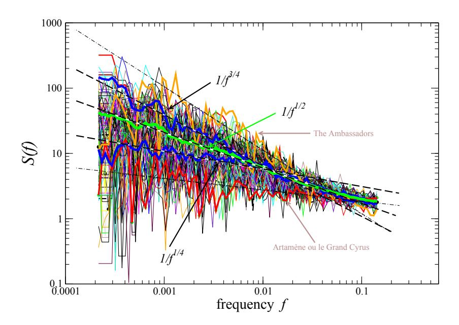
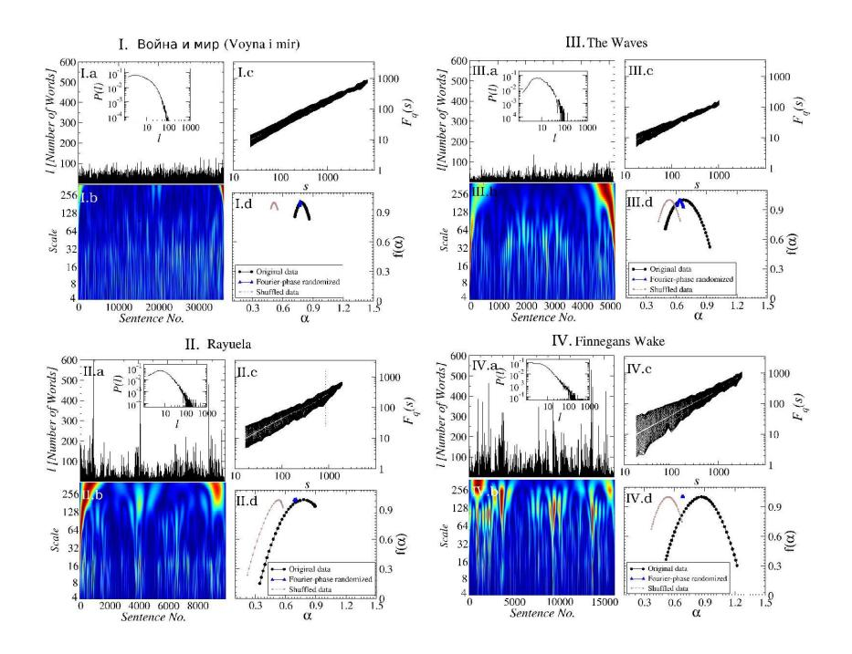
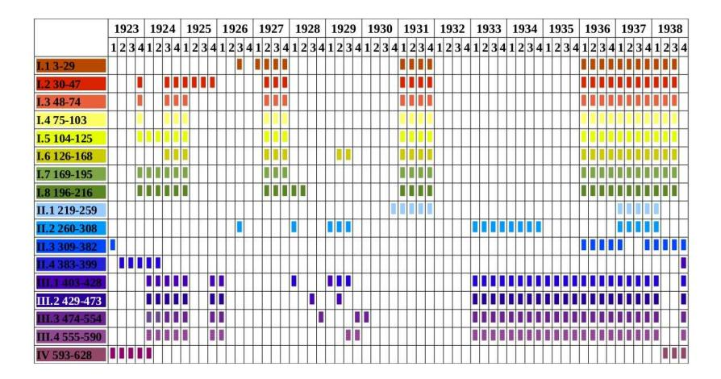
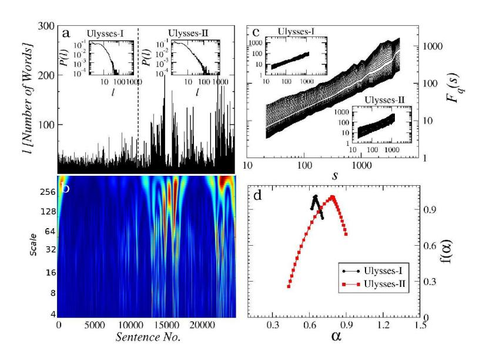
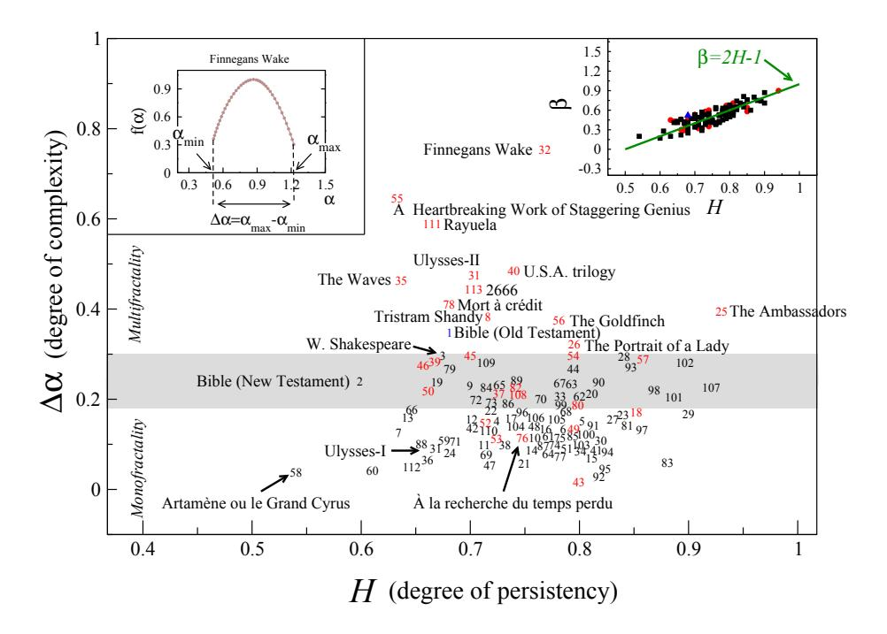
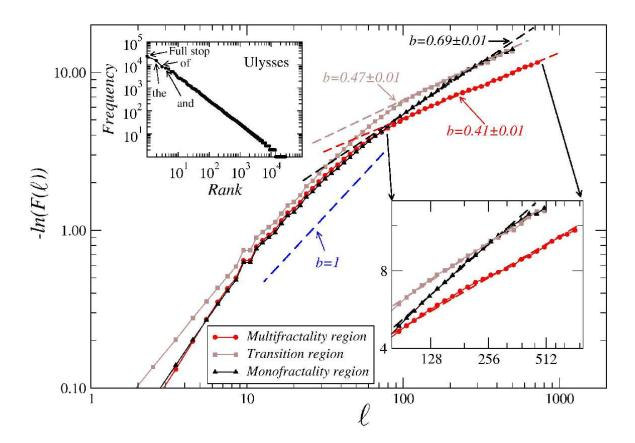
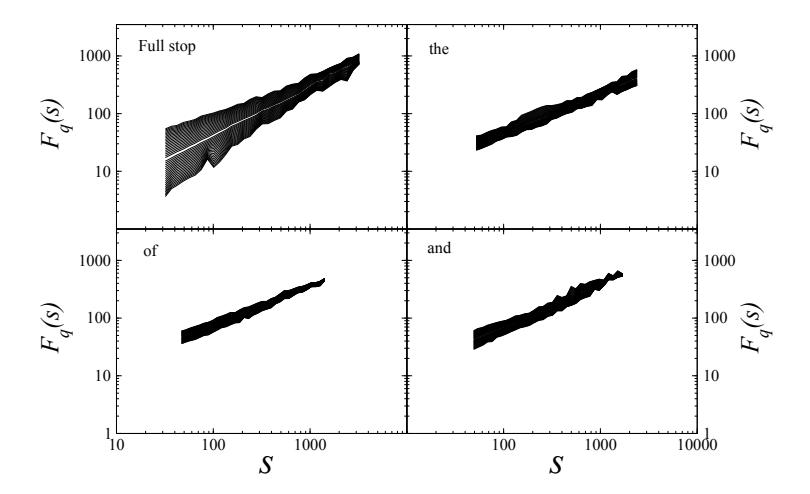
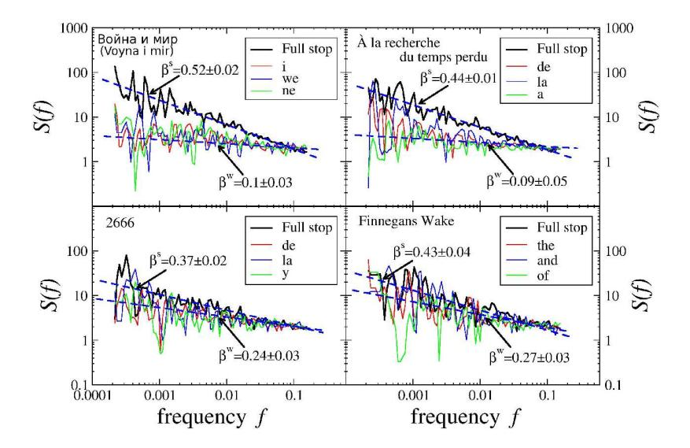

# Quantifying origin and character of long-range correlations in narrative texts

Stanis law Dro˙zd˙za,d,∗ , Pawe l O´swi¸ecimkaa , Andrzej Kuliga , Jaros law Kwapie´na , Katarzyna Bazarnikb , Iwona Grabska-Gradzi´nskac , Jan Rybickib , Marek Stanuszekd

### Abstract

In natural language using short sentences is considered efficient for communication. However, a text composed exclusively of such sentences looks technical and reads boring. A text composed of long ones, on the other hand, demands significantly more effort for comprehension. Studying characteristics of the sentence length variability (SLV) in a large corpus of world-famous literary texts shows that an appealing and aesthetic optimum appears somewhere in between and involves selfsimilar, cascade-like alternation of various lengths sentences. A related quantitative observation is that the power spectra S(f) of thus characterized SLV universally develop a convincing '1/f β ' scaling with the average exponent β ≈ 1/2, close to what has been identified before in musical compositions or in the brain waves. An overwhelming majority of the studied texts simply obeys such fractal attributes but especially spectacular in this respect are hypertext-like, "stream of consciousness" novels. In addition, they appear to develop structures characteristic of irreducibly interwoven sets of fractals called multifractals. Scaling of S(f) in the present context implies existence of the

Email address: stanislaw.drozdz@ifj.edu.pl (Stanis law Dro˙zd˙z)

aComplex Systems Theory Department, Institute of Nuclear Physics, Polish Academy of Sciences, ul. Radzikowskiego 152, 31-342 Krak´ow, Poland

b Institute of English Studies, Faculty of Philology, Jagiellonian University, ul. prof. S. Lojasiewicza 4, 30-348 Krak´ow, Poland

cFaculty of Physics, Astronomy and Applied Computer Science, Jagiellonian University, ul. Lojasiewicza 11, 30-348 Krak´ow, Poland

dFaculty of Physics, Mathematics and Computer Science, Cracow University of Technology, ul. Warszawska 24, 31-155 Krak´ow, Poland

∗Corresponding author

long-range correlations in texts and appearance of multifractality indicates that they carry even a nonlinear component. A distinct role of the full stops in inducing the long-range correlations in texts is evidenced by the fact that the above quantitative characteristics on the long-range correlations manifest themselves in variation of the full stops recurrence times along texts, thus in SLV, but to a much lesser degree in the recurrence times of the most frequent words. In this latter case the nonlinear correlations, thus multifractality, disappear even completely for all the texts considered. Treated as one extra word, the full stops at the same time appear to obey the Zipfian rank-frequency distribution, however.

Keywords: natural language, consciousness, correlations, multifractals, hypertext

# 1. Introduction

Mirroring cultural progress [\[13](#page-24-0), [1\]](#page-23-0) during their evolution natural languages - the most imaginative carriers of information, and the principal clue to the mind and to consciousness [\[24](#page-24-1)] - developed remarkable quantifiable patterns of behaviour such as hierarchical structure in their syntactic organization [\[32](#page-25-0), [39\]](#page-26-0), a corresponding lack of characteristic scale [\[41,](#page-26-1) [38\]](#page-26-2) as evidenced by the celebrated Zipf law [\[52](#page-27-0)], small world properties [\[22,](#page-24-2) [14,](#page-24-3) [33\]](#page-25-1), long-range correlations in the use of words [\[42,](#page-26-3) [7,](#page-23-1) [8](#page-23-2), [3\]](#page-23-3) or a stretched exponential distribution [\[36\]](#page-26-4) of word recurrence times [\[4\]](#page-23-4). A majority of such patterns are common to a large class of natural systems known as complex systems [\[46](#page-26-5), [34\]](#page-25-2). With no doubt, language constitutes a great complexity as it for language is especially true [\[28\]](#page-25-3) that "more is different" [\[5](#page-23-5)] and the capacity of language is to generate an infinite range of expressions from the finite set of elements [\[26](#page-25-4), [21](#page-24-4)]. Thus this suggests to inspect correlations also among the linguistic constructs longer than mere words. The most natural of them are sentences - strings of words structured according to syntactical principles [\[2](#page-23-6), [11](#page-23-7)]. Typically it is within a sentence that words acquire a specific meaning. Furthermore, in a text the sentence structure is expected to be correlated with the surrounding sentences as dictated by the intended information to be encoded, fluency, rhythm, harmony, intonation and possibly due to many other factors and feedbacks including the authors' preferences. Consequently, this may introduce even more complex correlations than those identified so far. In fact already the Hurst exponent based study [\[42\]](#page-26-3) of correlations among words in Shakespeare's plays and in Dickens' and Darwin's books suggests that the range of such correlations extends far beyond the span of sentences. Indeed, shuffling sentences by preserving their internal structure appears to bring the Hurst exponents to values even closer to the noise level as compared to their original values. This thus indicates that long-range correlations among words are induced by factors other than grammar as its range is restricted essentially to a sentence. As an indication for potential factors generating correlations far beyond the range of single sentences one should notice that the composition of sentences of varied length dictates the reading rhythm which involves sound and perception. This, therefore, opens up a possibility that the Weber-Fechner law [\[15](#page-24-5)] - stating that in perception it is the relative proportions that matter primarily, and not differences in absolute magnitudes - leaves its imprints also in the sentence arrangement by making some variant of the multiplicative cascade a likely component of the mechanism that amplifies the associative turns and thus induces correlations of significantly longer range than the ones due to grammar. There are, however, also 'coarse graining' constraints to such a mechanism as sentences cannot usually be expanded continuously but by adding clauses, so that syntactical rules are obeyed. The multifractal formalism [\[25](#page-25-5), [45\]](#page-26-6) offers a particularly appropriate framework to get insight into such effects and to quantify their relative significance and extent.

# 2. Materials and Methods

In order to study the long-range correlations among sentences, particularly those that refer to fractals and cascade effects, we select a corpus of 113 English, French, German, Italian, Polish, Russian, and Spanish literary texts of considerable size and for each individually form a series l(j) from the lengths of the consecutive sentences j expressed in terms of the number of words. Thus, a sentence is defined in purely orthographic terms, as a sequence of words starting with a capital letter and ending in a full stop. Equivalently, in a text, such a series can be considered a sequence of the recurrence times of the full stops. Based on this criterion an initial selection of sentences is performed automatically but then a further processing is executed, in some cases even manually, in order to identify such (not very frequent) instances where a full stop does not terminate a sentence, like for instance Mr., in initials, question or exclamation marks in parenthesis, etc. Since the present study has a statistical character, an additional criterion we impose specifies that each text contains no fewer than 5000 sentences. For the correlated series, as the ones to be studied here, such a lower bound on the number of sentences is dictated by requirements to obtain reliable results even on the level of the multifractal analysis [\[18\]](#page-24-6). A complete list of the titles included in this corpus is given in the Appendix.

The simplest, second-order linear characteristics are measured in terms of the power spectra S(f) of such series. Such spectra are calculated as Fourier Transform modulus squared

$$S(f) = |\sum_{j=1}^{j_{\text{max}}} l(j)e^{-2\pi i f j}|^2$$
 (1)

of the series l(j) representing lengths of the consecutive sentences j. A complementary approach towards higher order correlations consists in the wavelet decomposition of l(j). The corresponding 'mathematical microscope' wavelet coefficient maps Tψ(s, k) are obtained as

$$T_{\psi}(s,k) = (1/\sqrt{s}) \sum_{j=1}^{j_{\text{max}}} l(j)\psi((j-k)/s)$$
 (2)

where k represents the wavelet position in a text while s the wavelet resolution scale. The wavelet ψ used in the present study is a Gaussian third derivative. It is orthogonal - hence insensitive - to quadratic trends in a signal and thus effectively leads to their removal [\[43,](#page-26-7) [44\]](#page-26-8) as demanded by consistency with the other method described and used below.

The wavelet decomposition is optimal for visualization and, in principle, it is well suited to extract the multifractal characteristics [43]. However, the newer method, termed Multifractal Detrended Fluctuation Analysis (MFDFA) [30] is numerically more stable and often more accurate [44], though even here the convergence to a correct result is a delicate matter [18]. Accordingly, for a series l(j) of sentence lengths one evaluates its signal profile  $L(j) \equiv \sum_{k=1}^{j} [l(k) - \langle l \rangle]$ , where  $\langle \cdot \rangle$  denotes the series average and  $j = 1, ..., j_{\text{max}}$  with  $j_{\text{max}}$  standing for the number of sentences in a series. This profile is then divided into  $2M_s$  disjoint segments  $\nu$  of length s starting from both end points of the series. Next, the detrended variance

$$F^{2}(\nu, s) = \frac{1}{s} \sum_{k=1}^{s} \{ L((\nu - 1)s + k) - P_{\nu}^{(m)}(k) \}$$
 (3)

is determined, where a polynomial  $P_{\nu}^{(m)}$  of order m serves detrending. Finally, a q-th order fluctuation function

$$F_q(s) = \left\{ \frac{1}{2M_s} \sum_{s=1}^{2M_s} [F^2(\nu, s)]^{q/2} \right\}^{1/q}, \tag{4}$$

is calculated and its scale s dependence inspected. Scale invariance in a form

$$F_q(s) \sim s^{h(q)} \tag{5}$$

indicates the most general multifractal structure if the generalised Hurst exponent h(q) is explicitly q-dependent, while it is reduced to monofractal when h(q) becomes q-independent. The well-known Hurst exponent is identical to h(2). h(q) determines the Hölder exponents  $\alpha = h(q) + qh'(q)$  and the singularity spectrum

$$f(\alpha) = q[\alpha - h(q)] + 1, \tag{6}$$

the latter being the fractal dimension of the set of points with this particular  $\alpha$ . For a model multifractal series (like a binomial cascade),  $f(\alpha)$  typically assumes a shape resembling an inverted parabola whose widths  $\Delta \alpha = \alpha_{\rm max} - \alpha_{\rm min}$  is considered a measure of the degree of multifractality and thus often also of complexity.

### 3. Results and discussion

A highly significant result is obtained already by evaluating the power spectra S(f) according to Eq.[\(1\)](#page-3-0) of the series representing the sentence length variability (SLV) of all the text considered. As documented in Fig. [1,](#page-6-0) the overall trend of essentially all sample texts, and especially its average, shows a clear

$$S(f) = 1/f^{\beta} \tag{7}$$

scaling with β ≈ 1/2, in most cases over the entire range of about two orders of magnitude in frequencies f spanned by the number of sentences of a typical text here analyzed. Statistical significance of this result is inspected by randomly shuffling sentences within texts. For the so obtained randomized texts the calculated power spectra appear to be trivially fluctuating along a horizontal line (β = 0) on all the scales.

For the individual original texts β is seen to range between 1/4 and 3/4. This kind of scaling points to the existence of the power-law long-range temporal correlations in SLV - thus to its fractal organization - and indicates that it balances randomness and orderliness, just as it does for music, speech [\[49\]](#page-27-1), heart rate [\[31](#page-25-7)], cognition [\[23\]](#page-24-7), spontaneous brain activity [\[35\]](#page-25-8), and for other 'sounds of Nature' [\[9,](#page-23-8) [48\]](#page-27-2). From this perspective human writing appears to correlate with them. Even the range of the corresponding β-values from about 1/4 to 3/4 overlaps significantly (more on the Mozart's than Beethoven's side) with those (1/2 to 1) found [\[37\]](#page-26-9) for musical compositions. This perhaps provides a quantitative argument for our tendency to refer to writing as 'being composed' when we care about all its aspects including aesthetics and rhythm to be experienced in reading.

The two extremes in the corpus, explicitly indicated in Fig. [1,](#page-6-0) are The Ambassadors (upper) and Artam`ene ou le Grand Cyrus, the 17th century French novel sequence (lower), considered the longest novel ever published. The first of them appears to be most peculiar among all the texts as at the small frequencies it visibly departs from 1/f by bending down and displaying the two preferred

Figure 1: Power spectra S(f) of the sentence length variability for 113 world famous literary works. They are calculated from the series l(j) representing lengths of the consecutive sentences j expressed in terms of the number of words. S(f) is seen to display 1/fβ scaling. Middle solid line (green) denotes average over the individual power spectra, properly normalised, of all the corpus elements and it fits well by β=1/2. Boundaries of the dispersion in β are indicated by taking average over 10 corpus elements, with the largest β-values, which results in β=3/4 and over 10 its elements with the smallest β-values, which results in β=1/4. The two extremes in the corpus, explicitly indicated, are Henry James's The Ambassadors (upper) and Madeleine and/or Georges de Scud´ery's Artam`ene ou le Grand Cyrus, the 17th century novel sequence (lower), considered the longest novel ever published. The straight line fits to these two extremes are represented by the dash-dotted lines.

frequencies. This signals presence of the long-range oscillations with distinct periods in SLV of this particular novel. At the same time this same novel has the largest β = 0.9 ± 0.02 in the region of higher frequencies where 1/f scaling applies. The latter novel, on the other hand, with β = 0.2±0.02 appears closest to the white noise whose S(f) is flat. It is also appropriate to notice that at the largest frequencies, which corresponds to the smallest scales, the power spectra of all the texts have some tendency to flatten. This may suggest that the longrange coherence in its 1/f organization is somewhat perturbed on shorter scales by coarsening due to grammatical constraints.

Our central result relates, however, to the nonlinear characteristics that may manifest themselves in heterogeneous, self-similarly convoluted structures, undetectable by S(f). Such structures may demand using the whole spectrum of the scaling exponents and are then termed multifractals. That such structures in SLV may be present within the corpus analysed here can be inferred from Fig. [2,](#page-8-0) which shows four, somewhat distinct, categories of behaviour. A majority of the texts in our study resembles the case displayed in (I). SLV is here seen to be rather homogenously 'erratic' and, consequently, the distribution of cascades seen through the wavelet decomposition is largely uniform. The three other cases, (II), (III) and (IV), commonly considered representatives of the stream of consciousness (SoC) literary style that seeks "to depict the multitudinous thoughts and feelings which pass through the mind" [\[17](#page-24-8)], are visibly inhomogeneous in this respect, as SLV displays clusters of intermittent bursts of much longer sentences. Such structures are characteristic of multifractals and thus an appropriate subject of the analysis within the above formalism.

The fluctuation functions Fq(s) obtained according to Eq.[\(4\)](#page-4-0) display (Fig. [2\)](#page-8-0) a convincing scaling with different degree of q-dependence, however. This is corroborated by the corresponding singularity spectra f(α), which range from very narrow in Voyna i mir (I), indicating essentially monofractal structure, through significantly broader - thus already multifractal - but asymmetric, like the strongly left sided Rayuela (II) or right sided The Waves (III), up to the exceptionally broad and simultaneously almost symmetric case (IV) of Finnegans

Figure 2: Variety of multifractal sentence arrangements in literary texts: Four examples illustrating different fractal/multifractal characteristics identified within the corpus of the canonical literary texts: I, Voyna i mir (War and Peace) by Lev Tolstoy; II, Rayuela (Hopscotch) by Julio Cort´azar; III, The Waves by Virginia Woolf and IV, Finnegans Wake (FW) by James Joyce. The panels inside each contain correspondingly: (a) The series l(j) of the consecutive sentence lengths throughout the whole text. Insets illustrate the corresponding probability distributions P(l) of l(j); (b) Wavelet coefficient maps (Tψ (s, k)) obtained for l(j). The wavelet ψ used is a Gaussian third derivative. The horizontal axis represents the sentence position in a text while the vertical axis - the wavelet resolution scale s. Colour codes denote magnitude of the coefficient from the smallest (dark blue) to the largest (red); (c) q-th order fluctuation functions calculated according to Eq.[\(4\)](#page-4-0) using the detrending polynomial P (m) ν of second order (m=2), for q ∈ [−4, 4] and s ⊂ [20, jmax/5] (for Rayuela a consistent scaling regime stops somewhat earlier at s ≈ 1000 which is indicated by the vertical dotted line); (d) The resulting singularity spectra f(α) for (i) the series l(j) representing original texts (black), (ii) for their Fourier-phase randomised counterparts (blue); here f(α) is seen shrunk essentially to a point as is characteristic of a pure monofractal, and (iii) for their randomly shuffled counterparts (gray).

Wake (FW).

The left side of f(α) is determined by the positive q-values, which filter out larger events (here longer sentences), and its right side reflects behaviour for smaller events as filtered out by the negative q-values. Hence, asymmetry in f(α) signals non-uniformity of the underlying hypothesized cascade [\[19\]](#page-24-9). Rayuela is thus seen to be more multifractal in the composition of long sentences and almost monofractal on the level of small ones. To some extent the opposite applies to The Waves. In fact, these effects can be inferred already from the nonuniformities of the corresponding SLV wavelet decompositions (Fig. [2\)](#page-8-0). In this respect FW appears impressively consistent; being one of the most intriguing literary 'compositions' ever, mastered imaginatively in the SoC technique, freely exploring the mental labyrinth of dreams and thus often breaking conventional rules of syntax and of linguistic rigour. However, from the perspective of our formal quantitative approach, its architecture looks - or perhaps just is - a result of these factors - to be governed consistently by the same 'generators' on all scales of sentence length. An extra intellectual factor shaping FW is very likely to be also related to its top-bottom development - much like model mathematical cascades - as evidenced by its chronology of writing [\[12\]](#page-24-10) graphically sketched in Fig. [3.](#page-10-0)

The significance of the above results for the singularity spectra f(α) of the series l(j) representing the original texts has also been tested against the two corresponding surrogates. One standard surrogate in this kind of analysis is obtained by generating the Fourier-phase randomised counterparts of l(j). This destroys nonlinear correlations and makes probability distribution of fluctuations Gaussian-like, but preserves the linear correlations and, as it is clearly seen in Fig. [2,](#page-8-0) shrinks f(α) essentially to a point as is characteristic of a pure monofractal. Another surrogate is obtained by randomly shuffling the original series l(j). Consequently, any temporal correlations get destroyed but the probability distributions of fluctuations remain unchanged. The corresponding singularity spectra calculated according to the same MFDFA algorithm are also shown in Fig. [2](#page-8-0) (gray). Consistently with the lack of any temporal correlations

Figure 3: Chronological progress of James Joyces engineering work on writing FW, which he described as boring a mountain from two sides [\[20\]](#page-24-11). This chart may be also taken as a visualisation of Joyces dream about a Turk picking threads from heaps on his left and right sides, and weaving a fabric in the colours of the rainbow, which the writer interpreted as a symbolic picture of Books I and III of FW.

they all get shifted down to α ≈ 0.5 but some nonzero width of f(α) still remains to be observed. However, at least a large part of this remaining multifractality in this last case may be apparent due to a relatively small size of the samples. For the uncorrelated series the result of calculating the multifractal spectra is known [\[18](#page-24-6)] to end up in either mono-fractal for the series whose fluctuation probability distributions are L´evy-unstable, or in bi-fractal for those whose distributions are L´evy-stable. Contrary to the correlated series, the convergence to the ultimate correct results in this case is very slow. We also wish to note at this point that in spite of the Menzerath-Altmann law, all the relevant results shown here remain essentially unchanged if the sentence length is measured in terms of the number of characters instead of the number of words.

Another, even better known SoC novel by Joyce - Ulysses, which played a central role in formulating the scale-free word rank-frequency distribution law by Zipf - also deserves here an extended attention, however, for a different reason. For this novel, as illustrated in Fig. [4](#page-11-0) no unique multifractal scaling can be

Figure 4: Special case of Ulysses: The same convention as in Fig. [2](#page-8-0) is used here. The two additional insets in the panels a and c display results for Ulysses after bisecting it into halves. Ulysses- I corresponds to the text from the beginning to the end of Chapter 10 and Ulysses-II to the remaining text without its last two disproportionately long sentences.

attributed, and thus no f(α) assigned. The SLV inspected both in terms of the sentence length distribution and through its wavelet transform indicate clearly that Ulysses splits into two parts such that each of them may independently have well defined scaling properties. Indeed, by bisecting it approximately into halves (between Chapters 10 and 11) allows us again to comprise Ulysses within the present formalism. The first part appears essentially monofractal, while the other is clearly multifractal, though asymmetrically left-sided, just as Rayuela. In fact, this result provides a quantitative argument in favour of the "doubleness" of Ulysses [\[40\]](#page-26-10).

The results, represented in terms of the width ∆α = αmax − αmin of f(α), where αmax and αmin denote the beginning and the end of f(α) support, and of the Hurst exponents H = h(2) measuring the degree of persistence in SLV, for the whole studied corpus are collected in Fig. [5.](#page-13-0) The relation between the Hurst exponent H and the scaling exponent β in Eq. [\(7\)](#page-5-0) reads [\[27](#page-25-9)]:

$$\beta = 2H - 1. \tag{8}$$

As the upper-right inset to Fig. [5](#page-13-0) visibly documents this relation appears to be very satisfactorily fulfilled when comparing the results presented in Fig. [1](#page-6-0) versus the Hurst exponents in Fig. [5](#page-13-0) for all the texts studied which thus provides an independent test for correctness of the results presented. All the explicit values of H and β correspondingly, together with their error bars σH and σβ measured in terms of the mean standard deviations, are listed in the Appendix in parallel with the titles included in the corpus.

The 'scatter plot' shown in Fig. [5](#page-13-0) opens up room for many further interesting observations and hypotheses or even definite conclusions of general interest. Some of them can be straightforwardly listed as follows: (i) Essentially all the studied texts that are seen in the multifractality region are commonly classified as SoC literature. The only exception found here, the Old Testament, has not been considered before in this context. (ii) ∆α for all the texts that do not belong to SoC is located below the border of definite multifractality. Their complexity is thus poorer. (iii) Also, several texts, by some considered as SoC,

Figure 5: 'Scatter plot', which for a collection of 113 most representative literary works indicated by their numbers (the ones in red indicate those works that usually are considered as belonging to the SoC narrative) on our list (see Appendix) displays the width  $\Delta\alpha$  (schematically defined in the upper-left inset) and the Hurst exponent H. Shaded area marks the transition (uncertainty) region between fully developed multifractality and definite monofractality. We find it reasonable to assume that the shuffled series are mono-fractal (or at most bi-fractal) and that any trace of multifractality in this case is an artifact of the finiteness of a series. Therefore, the lower bound of the shaded area is determined as an average of  $\Delta\alpha$ 's for all the series (texts) shuffled. Due to the thickest tails in the probability distributions P(l) of l(j) in FW (seen in the inset to panel IV of Fig. 2), which after shuffling the corresponding series may yield the strongest apparent multifractality signal, the upper bound of the uncertainty region is taken as  $\Delta\alpha$  of the shuffled FW. The upper-right inset shows location of a pair of the H and  $\beta$  values for each book, represented by a point, relative to the straight line determined by Eq. (8).

Figure 6: Sentence length complementary cumulative distributions F(ℓ) = P r(l ≥ ℓ) for the whole corpus of 113 books considered but split into three groups according to their location in Fig. [5.](#page-13-0) Tails (ℓ > 100) of these distributions are fitted with the stretched exponential F(ℓ) = exp (−µℓb ) and the corresponding best fit b-values listed. The intermediate (10 < ℓ < 100) region is seen to obey a pure exponential (b = 1) dependence. Inset shows the Zipfian rank-frequency distribution plot for Ulysses where the full stops are treated as another word.

appear to be located significantly below this border. An important example of this is A la recherche du temps perdu ` by Marcel Proust (no. 76 in the list given in the Appendix), which is clearly monofractal. (iv) Artam`ene ou le Grand Cyrus is seen to have characteristics just opposite to FW. Here ∆α equals nearly zero and H gets shifted down towards 1/2, which complements its flat power spectrum seen in Fig. [1,](#page-6-0) to mean that the corresponding SLV is of the white noise type.

Finally, examples of the sentence lengths distributions shown in Fig. [2](#page-8-0) (Ia to IVa) indicate some differences among works, related more to the style than to the language. Those representing SoC kind of narrative have a clear tendency to develop thicker tails. In fact, attempts to exploit the sentence length distribution in stylometry and in authorship attribution have a long history [\[51,](#page-27-3) [50](#page-27-4), [47,](#page-26-11) [6\]](#page-23-9). In order to approach this issue quantitatively for the present corpus the complementary cumulative distributions F(ℓ) = P r(l ≥ ℓ) for all the texts collected separately from the three distinct regions identified through Fig. [5](#page-13-0) are displayed in Fig. [6.](#page-14-0) The tails of these distributions, starting at around l ≈ 100, appear to be well represented by the stretched exponential F(ℓ) = exp (−ℓ b ) with the smallest b parameter and thus the thickest tail for the SoC narrative, thus multifractal in SLV. This parameter remains, however, significantly smaller than unity even in the monofractal regime. This result closely resembles the stretched exponential distribution of recurrence times between words [\[4\]](#page-23-4). In a sense the sentence length can be interpreted as a recurrence time between the full stops and they, in a text, play at least as important role as words. Their large recurrence times appear to be governed by a similar distribution as the one for words. Interesting in this context, and also complementary, is observation documented in the upper-left inset of Fig. [6,](#page-14-0) that the full stops (dots, question and exclamation marks) treated as one more word in the rankfrequency dependance typically belong to the same Zipfian plot as worlds, as shown for the original Zipf's example of Ulysses.

These observations thus prompt a question if a series of recurrence times (measured in terms of the number of words) between the same words develop similar long-range correlations as the ones identified above for the full stops. For the lowest-rank - thus most frequent - words like English the, and, of or to (only for such words one obtains sufficiently long series) multifractality turns out to disappear in all the texts studied. This is true even for FW as the q-th order fluctuation functions Fq(s) calculated according to Eq.[\(4\)](#page-4-0), for this originally extreme case of multifractality and displayed in Fig. [7](#page-16-0) show. For the series of recurrence times of the words the, and and of the Fq(s) functions become very weakly q-dependent as is characteristic to monofractals. In fact even this monofractal scaling is here not fully convincing at some places. The longrange nonlinear correlations responsible for multifractality appear thus to be originating exclusively from the specific arrangement of the full stops in texts. The situation with the long-range linear correlations is not that extreme as some representative cases expressed in terms of the power spectra S(f) shown

Figure 7: The q-th order fluctuation functions calculated using the same algorithm and convention as in Fig. 2 for the sentence length variability (SLV), which is equivalent to the recurrence times of the full stops, versus the series of recurrence times of three different words, the, of and and considered separately, in Finnegans Wake by James Joyce.

in Fig. 8 illustrate it. These power spectra for other cases than SLV still show a trace of scaling of the form  $S(f) = 1/f^{\beta}$  with significantly smaller values of the  $\beta$ -parameter (denoted by  $\beta^s$  for SLV and by  $\beta^w$  for the word recurrence times), however, and larger dispersion of fluctuations along the fit which indicates a very weak character of the underlying long-range linear correlations. Very interestingly, however, for those texts that are multifractal on the level of SLV, the linear long-range correlations for the recurrence times between words do not depart so much from the correlations measured by SLV in the same texts and are significantly stronger than in the monofractal texts, as the examples in Fig. 8 show.

### Summary

The present analysis, based on a large corpus which includes world famous literary texts, uncovers the long-range correlations in their sentence arrangement. The linear component of these correlations universally reveals the scale-

Figure 8: Power spectra S(f) of the sentence length variability (scaling exponent β s ) and of the series of recurrence times for the three most frequent words in four texts representative for the present corpus. Straight line fits are indicated by the dashed lines. The S(f) for the recurrence times is fitted globally and the corresponding scaling exponent denoted by β w.

free '1/f β ' form as characteristic to many other 'sounds of Nature' and thus this observation may serve as an indicator of those factors that shape human language. The corresponding β-value typically range from about 1/4 to 3/4 and may thus serve also as a very useful and inspiring stylometry measure. As far as correlations in the sentence length variability are concerned, some texts within the present corpus exclusively belonging to the stream of consciousness narrative - develop even more complex scale-free patterns of the nonlinear character and heavy tailed intermittent bursts in SLV similar to the ones identified in other areas of human activity [\[10\]](#page-23-10). In quantitative terms this results in a whole spectrum of the scaling exponents as compactly grasped by the multifractal spectrum f(α), whose width reflects the degree of nonlinearity involved. A greater complexity of such hypertext-like narrative finds an interesting parallel in the biological dynamical system as documented [\[29](#page-25-10)] for the healthy human heartbeat, which develops broader multifractal spectra as compared to the heart disfunction. That the SoC kind of narrative should simultaneously activate greater variety of brain areas seems quite natural. Whether this indicates means to more efficient sharing of information also emerges as an intriguing perspective to study. A further argument in favour of such a likely correspondence is that hypertext is paralleled by the underlying architecture of World Wide Web, which proves easy-to-use and flexible in its self-similar traffic [\[16\]](#page-24-12) of sharing information over the Internet, indeed.

SLV is equivalent to variability of the recurrence times, measured in terms of the number of words between the full stops. Analogous variability of the recurrence times between words, which for statistical reasons can be studied for the most frequent ones, also involves '1/f β '-type long-range correlations but they appear significantly weaker than for the full stops. What is more, the nonlinear correlations inducing multifractal characteristics seem to take place exclusively on the level of SLV. Thus, even though the full stops together with words appear to belong to the same Zipfian distribution, they form a frame for long-range correlations in narrative texts. This frame seems to obey more strict universal principles of organization, likely shaped also by the factors listed in the introduction, and words have some more freedom in filling and complementing it as can be inferred from their weaker mutual correlations. Such a scenario offers one possible visualization of the results obtained.

Finally, the results presented - like imprints of the Weber-Fechner law through SLV cascades - appear largely consistent with the working hypothesis formulated in the introduction by listing factors that may induce long-range correlations during the process of the narrative text formation. In order to further illuminate on such issues some empirical study, like quantifying the vocal and perception characteristics of texts with varying strength of SLV correlations, would be crucially helpful and our results indicate direction.

# Acknowledgment

We thank Krzysztof Bartnicki (who translated FW into Polish) for constructive exchanges at the early stage of this Project.

### Appendix

List of the considered literary works.

| No.      | Title                                                                                                                                                                                                                                                                                                                                                                                                                                                                                                                                                                                                                                                                                                                      | Author                                                | Year              | Δα   | н    | $\sigma_{_H}$ | β    | $\sigma_{_{\!\scriptscriptstyle B}}$ |
|----------|----------------------------------------------------------------------------------------------------------------------------------------------------------------------------------------------------------------------------------------------------------------------------------------------------------------------------------------------------------------------------------------------------------------------------------------------------------------------------------------------------------------------------------------------------------------------------------------------------------------------------------------------------------------------------------------------------------------------------|-------------------------------------------------------|-------------------|------|------|---------------|------|--------------------------------------|
| 1        | Bible Old Testament (Canon order)                                                                                                                                                                                                                                                                                                                                                                                                                                                                                                                                                                                                                                                                                          |                                                       | (-3rd Cent, B.C.) | 0.34 | 0.68 | 0.09          | 0.52 | 0.05                                 |
| 2        | Bible New Testament (Canon order)                                                                                                                                                                                                                                                                                                                                                                                                                                                                                                                                                                                                                                                                                          |                                                       | (50-150)          | 0.23 | 0.60 | 0.05          | 0.17 | 0.06                                 |
| 3        | King John, King Henry VI Part 1-2, King Rehard III, King Richard III, King Rehard III, King Henry PVI Lor All 15. True. The Cornedy of Errors, Loves Labours Lost, The Tarming of The Shrew, The Two Gentlemen of Vetoria, A Médicammer Night's Discourage of Vetoria, A Médicammer Night's Discourage of Vetoria, A Médicammer Night's Discourage of Vetoria, A Médicammer Night's Discourage of Vetoria, A Medicammer Night's Discourage of Vetoria, Andrewson Company, Turk Well Measure of Measure, Cymbeline. The Winter's Tale. The Tempest, Shakespeare's Compaint, Tutus Androincius, Romos and Juliet, The Trapedy of Julius Classa. Troitis and Classada, Hanilet Prince of Demmer, Comologius, Ermon of Alberts | William Shakespeare                                   | (1591-1611)       | 0.30 | 0.67 | 0.09          | 0.42 | 0.03                                 |
| 4        | Leviathan                                                                                                                                                                                                                                                                                                                                                                                                                                                                                                                                                                                                                                                                                                                  | Thomas Hobbes                                         | (1651)            | 0.14 | 0.72 | 0.09          | 0.57 | 0.06                                 |
| 5        | Robinson Crusoe                                                                                                                                                                                                                                                                                                                                                                                                                                                                                                                                                                                                                                                                                                            | Daniel Defoe                                          | (1719)            | 0.14 | 0.80 | 0.09          | 0.5  | 0.09                                 |
| 6        | Clarissa, or, the History of a Young Lady                                                                                                                                                                                                                                                                                                                                                                                                                                                                                                                                                                                                                                                                                  | Samuel Richardson                                     | (1748)            | 0.12 | 0.79 | 0.05          | 0.61 | 0.03                                 |
| 7        | Memoirs of a Woman of Pleasure                                                                                                                                                                                                                                                                                                                                                                                                                                                                                                                                                                                                                                                                                             | John Cleland                                          | (1748-49)         | 0.12 | 0.63 | 0.01          | 0.2  | 0.09                                 |
| 8        | The Life and Opinions of Tristram Shandy, Gentleman                                                                                                                                                                                                                                                                                                                                                                                                                                                                                                                                                                                                                                                                        | Laurence Sterne                                       | (1759-1767)       | 0.36 | 0.72 | 0.09          | 0.32 | 0.09                                 |
| 9        | Sense and Sensibility                                                                                                                                                                                                                                                                                                                                                                                                                                                                                                                                                                                                                                                                                                      | Jane Austen                                           | (1811)            | 0.22 | 0.70 | 0.07          | 0.47 | 0.07                                 |
| 10       | Pride and Prejudice                                                                                                                                                                                                                                                                                                                                                                                                                                                                                                                                                                                                                                                                                                        | Jane Austen                                           | (1813)            | 0.10 | 0.76 | 0.05          | 0.39 | 0.07                                 |
| 11       | Emma                                                                                                                                                                                                                                                                                                                                                                                                                                                                                                                                                                                                                                                                                                                       | Jane Austen                                           | (1815)            | 0.09 | 0.71 | 0.09          | 0.39 | 0.08                                 |
| 12       | Oliver Twist                                                                                                                                                                                                                                                                                                                                                                                                                                                                                                                                                                                                                                                                                                               | Charles Dickens                                       | (1838)            | 0.15 | 0.70 | 0.01          | 0.34 | 0.05                                 |
| 13       | David Copperfield                                                                                                                                                                                                                                                                                                                                                                                                                                                                                                                                                                                                                                                                                                          | Charles Dickens                                       | (1850)            | 0.16 | 0.64 | 0.07          | 0.41 | 0.05                                 |
| 14       | Bleak House                                                                                                                                                                                                                                                                                                                                                                                                                                                                                                                                                                                                                                                                                                                | Charles Dickens                                       | (1853)            | 0.08 | 0.76 | 0.04          | 0.41 | 0.05                                 |
| 15       | A Tale of Two Cities                                                                                                                                                                                                                                                                                                                                                                                                                                                                                                                                                                                                                                                                                                       | Charles Dickens                                       | (1859)            | 0.07 | 0.81 | 0.01          | 0.57 | 0.07                                 |
| 16       | Great Expectations                                                                                                                                                                                                                                                                                                                                                                                                                                                                                                                                                                                                                                                                                                         | Charles Dickens                                       | (1861)            | 0.12 | 0.77 | 0.03          | 0.41 | 0.08                                 |
| 17       | Moby-Dick; or, The Whale                                                                                                                                                                                                                                                                                                                                                                                                                                                                                                                                                                                                                                                                                                   | Herman Melville                                       | (1851)            | 0.14 | 0.74 | 0.05          | 0.42 | 0.07                                 |
| 18       | Middlemarch: A Study of Provincial Life                                                                                                                                                                                                                                                                                                                                                                                                                                                                                                                                                                                                                                                                                    | George Eliot                                          | (1871-72)         | 0.16 | 0.85 | 0.02          | 0.64 | 0.05                                 |
| 19       | The Adventures of Tom Sawyer                                                                                                                                                                                                                                                                                                                                                                                                                                                                                                                                                                                                                                                                                               | Mark Twain                                            | (1876)            | 0.23 | 0.67 | 0.07          | 0.4  | 0.07                                 |
| 20       | Life on the Mississippi                                                                                                                                                                                                                                                                                                                                                                                                                                                                                                                                                                                                                                                                                                    | Mark Twain                                            | (1883)            | 0.20 | 0.81 | 0.03          | 0.52 | 0.05                                 |
| 22       | A Connecticut Yankee in King Arthur's Court The Adventures of Sherlock Holmes                                                                                                                                                                                                                                                                                                                                                                                                                                                                                                                                                                                                                                              | Mark Twain Sir Arthur Conan Doyle                  | (1889) (1892)  | 0.05 | 0.75 | 0.07          | 0.41 | 0.06                                 |
| 23       | The Picture of Dorian Grav                                                                                                                                                                                                                                                                                                                                                                                                                                                                                                                                                                                                                                                                                                 | Oscar Wilde                                           | (1890)            | 0.17 | 0.72 | 0.06          | 0.81 | 0.06                                 |
| 24       | Dracula                                                                                                                                                                                                                                                                                                                                                                                                                                                                                                                                                                                                                                                                                                                    | Bram Stoker                                           | (1897)            | 0.13 | 0.68 | 0.04          | 0.81 | 0.06                                 |
| 25       | The Ambassadors                                                                                                                                                                                                                                                                                                                                                                                                                                                                                                                                                                                                                                                                                                            | Henry James                                           | (1903)            | 0.39 | 0.00 | 0.01          | 0.32 | 0.00                                 |
| 26       | The Portrait of a Lady                                                                                                                                                                                                                                                                                                                                                                                                                                                                                                                                                                                                                                                                                                     | Henry James                                           | (1881)            | 0.32 | 0.80 | 0.02          | 0.54 | 0.02                                 |
| 27       | The Bostonians                                                                                                                                                                                                                                                                                                                                                                                                                                                                                                                                                                                                                                                                                                             | Henry James                                           | (1886)            | 0.15 | 0.83 | 0.02          | 0.71 | 0.07                                 |
| 28       | What Maisie Knew                                                                                                                                                                                                                                                                                                                                                                                                                                                                                                                                                                                                                                                                                                           | Henry James                                           | (1897)            | 0.28 | 0.84 | 0.02          | 0.65 | 0.08                                 |
| 29       | The Jungle                                                                                                                                                                                                                                                                                                                                                                                                                                                                                                                                                                                                                                                                                                                 | Upton Sinclair                                        | (1906)            | 0.16 | 0.90 | 0.09          | 0.87 | 0.07                                 |
| 30       | Dubliners                                                                                                                                                                                                                                                                                                                                                                                                                                                                                                                                                                                                                                                                                                                  | James Joyce                                           | (1914)            | 0.09 | 0.81 | 0.01          | 0.71 | 0.09                                 |
|          | Ulumon                                                                                                                                                                                                                                                                                                                                                                                                                                                                                                                                                                                                                                                                                                                     |                                                       |                   | 0.08 | 0.67 | 0.08          | 0.41 | 0.06                                 |
| 31       | Ulysses                                                                                                                                                                                                                                                                                                                                                                                                                                                                                                                                                                                                                                                                                                                    | James Joyce                                           | (1922)            | 0.47 | 0.70 | 0.04          | 0.53 | 0.07                                 |
| 32       | Finnegans Wake                                                                                                                                                                                                                                                                                                                                                                                                                                                                                                                                                                                                                                                                                                             | James Joyce                                           | (1939)            | 0.74 | 0.77 | 0.04          | 0.43 | 0.04                                 |
| 33       | The Voyage Out                                                                                                                                                                                                                                                                                                                                                                                                                                                                                                                                                                                                                                                                                                             | Virginia Woolf                                        | (1915)            | 0.18 | 0.78 | 0.05          | 0.6  | 0.07                                 |
| 34       | Night and Day                                                                                                                                                                                                                                                                                                                                                                                                                                                                                                                                                                                                                                                                                                              | Virginia Woolf                                        | (1919)            | 0.08 | 0.81 | 0.04          | 0.58 | 0.09                                 |
| 35       | The Waves                                                                                                                                                                                                                                                                                                                                                                                                                                                                                                                                                                                                                                                                                                                  | Virginia Woolf                                        | (1931)            | 0.45 | 0.64 | 0.07          | 0.43 | 0.07                                 |
| 36       | The Years                                                                                                                                                                                                                                                                                                                                                                                                                                                                                                                                                                                                                                                                                                                  | Virginia Woolf                                        | (1937)            | 0.05 | 0.66 | 0.07          | 0.46 | 0.07                                 |
| 37       | Pilgrimage vol,1-5                                                                                                                                                                                                                                                                                                                                                                                                                                                                                                                                                                                                                                                                                                         | Dorothy Richardson                                    | (1915-1920)       | 0.20 | 0.73 | 0.08          | 0.58 | 0.04                                 |
| 38       | The Secret Adversary                                                                                                                                                                                                                                                                                                                                                                                                                                                                                                                                                                                                                                                                                                       | Agatha Christie                                       | (1922)            | 0.09 | 0.73 | 0.03          | 0.38 | 0.06                                 |
| 39       | Manhattan Transfer                                                                                                                                                                                                                                                                                                                                                                                                                                                                                                                                                                                                                                                                                                         | John Dos Passos                                       | (1925)            | 0.27 | 0.67 | 0.08          | 0.29 | 0.07                                 |
| 40       | U,S,A, trilogy                                                                                                                                                                                                                                                                                                                                                                                                                                                                                                                                                                                                                                                                                                             | John Dos Passos                                       | (1930-36)         | 0.47 | 0.74 | 0.05          | 0.46 | 0.04                                 |
| 41       | Gone with the Wind                                                                                                                                                                                                                                                                                                                                                                                                                                                                                                                                                                                                                                                                                                         | Margaret Mitchell                                     | (1936)            | 0.08 | 0.81 | 0.04          | 0.64 | 0.06                                 |
| 42       | The Lord of the Rings                                                                                                                                                                                                                                                                                                                                                                                                                                                                                                                                                                                                                                                                                                      | John R, R, Tolkien                                    | (1954-55)         | 0.13 | 0.70 | 0.07          | 0.53 | 0.04                                 |
| 43       | Atlas Shrugged Catch-22                                                                                                                                                                                                                                                                                                                                                                                                                                                                                                                                                                                                                                                                                                 | Ayn Rand                                              | (1957)            | 0.01 | 0.80 | 0.07          | 0.64 | 0.05                                 |
|          |                                                                                                                                                                                                                                                                                                                                                                                                                                                                                                                                                                                                                                                                                                                            | Joseph Heller                                         | (1961)            | 0.26 | 0.79 | 0.02          | 0.47 |                                      |
| 45 46 | One Flew Over the Cuckoo's Nest                                                                                                                                                                                                                                                                                                                                                                                                                                                                                                                                                                                                                                                                                            | Ken Kesey                                             | (1962) (1973)  | 0.29 | 0.70 | 0.04          | 0.53 | 0.07                                 |
| 46       | Gravity's Rainbow The Illuminatus! Trilogy                                                                                                                                                                                                                                                                                                                                                                                                                                                                                                                                                                                                                                                                                 | Thomas Pynchon Robert Shea and Robert Anton Wilson | (1973)            | 0.27 | 0.67 | 0.06          | 0.39 | 0.05                                 |
| 48       | The Huminatus: mogy The Vampire Chronicles                                                                                                                                                                                                                                                                                                                                                                                                                                                                                                                                                                                                                                                                                 | Anne Rice                                             | (1974)            | 0.04 | 0.72 | 0.06          | 0.64 | 0.08                                 |
| 49       | Suttree                                                                                                                                                                                                                                                                                                                                                                                                                                                                                                                                                                                                                                                                                                                    | Comac McCarthy                                        | (1979)            | 0.13 | 0.76 | 0.06          | 0.64 | 0.03                                 |
| 50       | Beloved                                                                                                                                                                                                                                                                                                                                                                                                                                                                                                                                                                                                                                                                                                                    | Toni Morrison                                         | (1987)            | 0.12 | 0.66 | 0.01          | 0.57 | 0.05                                 |
| 51       | The Stand: The Complete & Uncut Edition                                                                                                                                                                                                                                                                                                                                                                                                                                                                                                                                                                                                                                                                                    | Stephen King                                          | (1978)            | 0.09 | 0.66 | 0.01          | 0.57 | 0.07                                 |
| 52       | The Stand: The Complete & Oncut Edition  The Butcher Boy                                                                                                                                                                                                                                                                                                                                                                                                                                                                                                                                                                                                                                                                   | Patrick McCabe                                        | (1992)            | 0.09 | 0.78 | 0.09          | 0.32 | 0.04                                 |
| 53       | Trainspotting                                                                                                                                                                                                                                                                                                                                                                                                                                                                                                                                                                                                                                                                                                              | Irvine Welsh                                          | (1992)            | 0.14 | 0.71 | 0.09          | 0.32 | 0.09                                 |
| 54       | Infinite Jest                                                                                                                                                                                                                                                                                                                                                                                                                                                                                                                                                                                                                                                                                                              | David Foster Wallace                                  | (1995)            | 0.29 | 0.72 | 0.03          | 0.58 | 0.08                                 |
| 55       | A Heartbreaking Work of Staggering Genius                                                                                                                                                                                                                                                                                                                                                                                                                                                                                                                                                                                                                                                                                  | David Foster Wallace Dave Eggers                      | (2000)            | 0.29 | 0.79 | 0.08          | 0.45 | 0.04                                 |
| 56       | The Goldfinch                                                                                                                                                                                                                                                                                                                                                                                                                                                                                                                                                                                                                                                                                                              | Dave Eggers Donna Tartt                            | (2013)            | 0.36 | 0.63 | 0.09          | 0.45 | 0.06                                 |
| 57       | The Goldmen                                                                                                                                                                                                                                                                                                                                                                                                                                                                                                                                                                                                                                                                                                                | Eleanor Catton                                        | (2013)            | 0.28 | 0.85 | 0.06          | 0.58 | 0.06                                 |
| ar.      | The Communes                                                                                                                                                                                                                                                                                                                                                                                                                                                                                                                                                                                                                                                                                                               | LIBORIO CONTOR                                        | (6023)            | 0.20 | 0.00 | 0.00          | 0.00 | 0.00                                 |

| No. | Original Title                                | Author                                | English Title, Year                                                 | Δα   | н    | $\sigma_{_{H}}$ | β    | $\sigma_{\beta}$ |
|-----|-----------------------------------------------|---------------------------------------|---------------------------------------------------------------------|------|------|-----------------|------|------------------|
| 58  | Artamène ou le Grand Cyrus                    | Madeleine & Georges de Scudéry        | (Artamène, or Cyrus the Great, 1649-53)                          | 0.03 | 0.54 | 0.04            | 0.2  | 0.02             |
| 59  | Les Liaisons dangereuses                      | Pierre Choderlos de Laclos            | (The Dangerous Liaisons, 1782)                                   | 0.09 | 0.68 | 0.05            | 0.41 | 0.06             |
| 60  | Le Rouge et le Noir                           | Stendhal (Henri Beyle)                | (The Red and the Black, 1830)                                    | 0.03 | 0.61 | 0.08            | 0.28 | 0.06             |
| 61  | La Comédie humaine                            | Honoré de Balzac                      | (The Human Comedy, 1830-39)                                      | 0.11 | 0.77 | 0.06            | 0.53 | 0.05             |
| 62  | Les Mystères de Paris                         | Eugène Sue                            | (The Mysteries of Paris, 1842-43)                                | 0.18 | 0.8  | 0.03            | 0.68 | 0.03             |
| 63  | Les Trois Mousquetaires                       | Alexandre Dumas                       | (The Three Musketeers, 1844)                                     | 0.22 | 0.79 | 0.07            | 0.49 | 0.07             |
| 64  | La Reine Margot                               | Alexandre Dumas                       | (Queen Margot, 1844-45)                                          | 0.08 | 0.77 | 0.08            | 0.42 | 0.07             |
| 65  | Le Comte de Monte-Cristo                      | Alexandre Dumas                       | (The Count of Monte Cristo, 1844-45)                             | 0.22 | 0.73 | 0.06            | 0.43 | 0.05             |
| 66  | Vingt ans après                               | Alexandre Dumas                       | (Twenty Years After, 1845)                                       | 0.17 | 0.65 | 0.07            | 0.41 | 0.06             |
| 67  | Le Vicomte de Bragelonne ou Dix ans plus tard | Alexandre Dumas                       | (The Vicomte of Bragelonne: Ten Years Later, 1847- 50)     | 0.23 | 0.78 | 0.08            | 0.45 | 0.05             |
| 68  | Le Collier de la reine                        | Alexandre Dumas                       | (The Queen's Necklace, 1849-50)                                  | 0.17 | 0.79 | 0.07            | 0.64 | 0.06             |
| 69  | Madame Bovary                                 | Gustave Flaubert                      | (1857)                                                              | 0.08 | 0.71 | 0.09            | 0.37 | 0.09             |
| 70  | Les Misérables                                | Victor Hugo                           | (1862)                                                              | 0.19 | 0.76 | 0.06            | 0.62 | 0.04             |
| 71  | Le Petit Chose                                | Alphonse Daudet                       | (Little Good-For- Nothing1868)                                   | 0.1  | 0.69 | 0.03            | 0.47 | 0.06             |
| 72  | Les Rougon-Macquart                           | Émile Zola                            | (1871-93)                                                           | 0.19 | 0.71 | 0.04            | 0.49 | 0.02             |
| 73  | Bel Ami                                       | Guy de Maupassant                     | (1885)                                                              | 0.19 | 0.72 | 0.06            | 0.29 | 0.07             |
| 74  | Aventures extraordinaires d'un savant russe   | Georges Le Faure & Henri de Graffigny | (1888)                                                              | 0.09 | 0.78 | 0.02            | 0.63 | 0.06             |
| 75  | Le Roman de Tristan et Iseut                  | Joseph Bédier                         | (Romance of Tristan and Iseult, 1900)                            | 0.1  | 0.78 | 0.05            | 0.58 | 0.05             |
| 76  | À la recherche du temps perdu                 | Marcel Proust                         | (In Search of Lost Time, 1913-27)                                | 0.1  | 0.75 | 0.03            | 0.44 | 0.01             |
| 77  | Voyage au bout de la nuit                     | Louis-Ferdinand Céline                | (Journey to the End of the Night, 1932)                          | 0.06 | 0.78 | 0.08            | 0.53 | 0.07             |
| 78  | Mort à crédit                                 | Louis-Ferdinand Céline                | (Death on Credit, 1936)                                          | 0.41 | 0.68 | 0.09            | 0.46 | 0.06             |
| 79  | La Condition Humaine                          | André Malraux                         | (Man's Fate, 1933)                                                  | 0.26 | 0.68 | 0.01            | 0.25 | 0.11             |
| 80  | Molloy, Malone Meurt, L'innommable            | Samuel Beckett                        | (Molloy (1951), Malone Dies (1953), The Unnamable, (1953)) | 0.18 | 0.79 | 0.08            | 0.67 | 0.06             |

| No. | Original Title        | Author        | English Title, Year           | Δα   | н    | $\sigma_{_{\!\scriptscriptstyle H}}$ | β    | $\sigma_{\rho}$ |
|-----|-----------------------|---------------|-------------------------------|------|------|--------------------------------------|------|-----------------|
| 81  | Der Zauberberg        | Thomas Mann   | (The Magic Mountain, 1924) | 0.14 | 0.84 | 0.07                                 | 0.69 | 0.05            |
| 82  | Berlin Alexanderplatz | Alfred Döblin | (1929)                        | 0.21 | 0.74 | 0.08                                 | 0.6  | 0.06            |

| No. | Original Title     | Author      | English Title, Year             | Δα   | Н    | $\sigma_{_H}$ | β    | $\sigma_{s}$ |
|-----|--------------------|-------------|---------------------------------|------|------|---------------|------|--------------|
| 83  | Il nome della rosa | Umberto Eco | (The Name of the Rose, 1980) | 0.05 | 0.88 | 0.01          | 0.75 | 0.08         |

| No. | Original Title                                                 | Author                           | English Title, Year                                                                           | Δα   | н    | $\sigma_{_{H}}$ | β    | $\sigma_{_{\beta}}$ |
|-----|----------------------------------------------------------------|----------------------------------|-----------------------------------------------------------------------------------------------|------|------|-----------------|------|---------------------|
| 84  | Trylogia                                                       | Henryk Sienkiewicz               | (The Trilogy, 1884- 88)                                                                    | 0.22 | 0.72 | 0.08            | 0.48 | 0.04                |
| 85  | Quo vadis: Powieść z czasów Nerona                             | Henryk Sienkiewicz               | (1895)                                                                                        | 0.11 | 0.79 | 0.04            | 0.53 | 0.07                |
| 86  | Nad Niemnem                                                    | Eliza Orzeszkowa                 | (On the Niemen, 1888)                                                                      | 0.18 | 0.73 | 0.03            | 0.53 | 0.04                |
| 87  | Lalka                                                          | Bolesław Prus                    | (The Doll, 1890)                                                                              | 0.09 | 0.77 | 0.04            | 0.52 | 0.05                |
| 88  | Ziemia Obiecana                                                | Władysław Reymont                | (The Promised Land, 1899)                                                                  | 0.08 | 0.66 | 0.03            | 0.22 | 0.05                |
| 89  | Chłopi                                                         | Władysław Reymont                | (The Peasants, 1904-09)                                                                    | 0.23 | 0.74 | 0.03            | 0.52 | 0.05                |
| 90  | Trylogia księżycowa                                            | Jerzy Żuławski                   | (The Lunar Trilogy, 1903)                                                                  | 0.23 | 0.82 | 0.03            | 0.74 | 0.04                |
| 91  | Popioly                                                        | Stefan Żeromski                  | (Ashes, 1902-03)                                                                              | 0.11 | 0.81 | 0.06            | 0.61 | 0.05                |
| 92  | Noce i dnie                                                    | Maria Dąbrowska                  | (Nights and Days, 1931-34)                                                                 | 0.02 | 0.82 | 0.05            | 0.65 | 0.05                |
| 93  | Ferdydurke                                                     | Witold Gombrowicz                | (1937)                                                                                        | 0.27 | 0.85 | 0.01            | 0.76 | 0.07                |
| 94  | Trylogia kosmiczna                                             | Krzysztof Boruń i Andrzej Trepka | (Cosmic Trilogy, 1954-59)                                                                  | 0.07 | 0.82 | 0.06            | 0.61 | 0.07                |
| 95  | Widnokrąg                                                      | Wiesław Myśliwski                | (1996)                                                                                        | 0.03 | 0.82 | 0.06            | 0.63 | 0.05                |
| 96  | Ostatnie rozdanie                                              | Wiesław Myśliwski                | (2013)                                                                                        | 0.16 | 0.75 | 0.01            | 0.45 | 0.07                |
| 97  | Tysiąc spokojnych miast, Pod Mocnym Aniołem, Miasto utrapienia | Jerzy Pilch                      | (A Thousand Peaceful Cities, 1997), (The Mighty Angel, 2000), (City of Woe, 2004) | 0.12 | 0.86 | 0.03            | 0.6  | 0.09                |
| 98  | Piaskowa Góra                                                  | Joanna Bator                     | (2009)                                                                                        | 0.21 | 0.87 | 0.01            | 0.8  | 0.07                |
| 99  | Ciemno, prawie noc                                             | Joanna Bator                     | (2012)                                                                                        | 0.17 | 0.79 | 0.08            | 0.57 | 0.05                |

| No. | Original Title           | Author                 | English Title, Year                   | Δα   | н    | $\sigma_{_H}$ | β    | $\sigma_{\rho}$ |
|-----|--------------------------|------------------------|---------------------------------------|------|------|---------------|------|-----------------|
| 100 | Преступление и наказание | Fyodor Dostoyevsky     | (Crime and Punishment, 1866)       | 0.1  | 0.8  | 0.08          | 0.54 | 0.08            |
| 101 | Идиот                    | Fyodor Dostoyevsky     | (The Idiot, 1869)                     | 0.19 | 0.89 | 0.09          | 0.74 | 0.06            |
| 102 | Бесы                     | Fyodor Dostoyevsky     | (Demons, 1872)                        | 0.27 | 0.9  | 0.02          | 0.71 | 0.07            |
| 103 | Братья Карамазовы        | Fyodor Dostoevsky      | (The Brothers Karamazov, 1880)     | 0.09 | 0.8  | 0.06          | 0.66 | 0.03            |
| 104 | Дневник писателя         | Fyodor Dostoyevsky     | (A Writer's Diary, 1873-1881)      | 0.14 | 0.74 | 0.01          | 0.55 | 0.06            |
| 105 | Война и мир              | Lev Tolstoy            | (War and Peace, 1869)              | 0.14 | 0.77 | 0.03          | 0.52 | 0.02            |
| 106 | Анна Каренина            | Lev Tolstoy            | (Anna Karenina, 1877)              | 0.15 | 0.76 | 0.08          | 0.38 | 0.06            |
| 107 | Воскресение              | Lev Tolstoy            | (Resurrection, 1899)                  | 0.22 | 0.92 | 0.02          | 0.77 | 0.07            |
| 108 | Петербургъ               | Andrei Bely            | (Petersburg, 1913)                    | 0.21 | 0.74 | 0.09          | 0.35 | 0.08            |
| 109 | Тихий Дон                | Mikhail Sholokhov      | (And Quiet Flows the Don, 1928-40) | 0.27 | 0.71 | 0.08          | 0.41 | 0.03            |
| 110 | Архипелаг ГУЛАГ          | Aleksandr Solzhenitsyn | (The Gulag Archipelago, 1973)      | 0.12 | 0.72 | 0.03          | 0.54 | 0.05            |

| No. | Original Title       | Author                 | English Title, Year                   | Δα   | н    | $\sigma_{\pi}$ | β    | $\sigma_{\beta}$ |
|-----|----------------------|------------------------|---------------------------------------|------|------|----------------|------|------------------|
| 111 | Rayuela              | Julio Cortázar         | (Hopscotch, 1963)                     | 0.58 | 0.66 | 0.05           | 0.46 | 0.06             |
| 112 | Cien años de soledad | Gabriel García Márquez | (One Hundred Years of Solitude, 1967) | 0.04 | 0.65 | 0.08           | 0.43 | 0.07             |
| 113 | 2666                 | Roberto Bolaño         | (2004)                                | 0.43 | 0.7  | 0.05           | 0.37 | 0.02             |

# References

- [1] N. Agmon, Y. Bloch, Statistics of language morphology change: from biconsonantal hunters to triconsonantal farmers, PLoS ONE 8(12) (2013) e83780.
- [2] A. Akmajian, R.A. Demers, A.K. Farmer, R.M. Harnish, Linguistics: An Introduction to Language and Communication, MIT Press, Cambridge, 2001.
- [3] E.G. Altmann, G. Cristadoro, M.D. Esposti, On the origin of long-range correlations in texts, Proc. Natl. Acad. Sci. 109 (2012) 11582-11587.
- [4] E.G. Altmann, J.B. Pierrehumbert, A.E. Motter, Beyond word frequency: bursts, lulls, and scaling in the temporal distributions of words, PLoS ONE 4(11) (2009) e7678.
- [5] P.W. Anderson, More is different, Science 177 (1972) 393-396.
- [6] M. Ausloos, Punctuation effects in english and esperanto texts, Physica A 389 (2000) 2835-2840.
- [7] M. Ausloos, Generalized Hurst exponent and multifractal function of original and translated texts mapped into frequency and length time series, Phys. Rev. E 86 (2012) 031108.
- [8] M. Ausloos, Measuring complexity with multifractals in texts: Translation effects, Chaos, Solitons and Fractals 45 (2012) 1349-1357.
- [9] P. Bak, How Nature works: the science of selforganized criticality, Springer-Verlag, New York, 1996.
- [10] A.L. Barab´asi, The origin of bursts and heavy tails in human dynamics, Nature 435 (2005) 207-211.
- [11] A. Bargiela, W. Homenda, Information structuring in natural language communication: Syntactical approach, Journal of Intelligent & Fuzzy Systems 17 (2006) 575-581.

- [12] K. Bazarnik, Joyce and Liberature, Litteraria Pragensia, Prague, 2011.
- [13] M.H. Christiansen, S. Kirby, Language evolution: consensus and controversies Trends Cogn. Sci. 7 (2003) 300-307.
- [14] J. Cong, H. Liu, Approaching human language with complex networks, Phys. Life Rev. 11 (2014) 598618.
- [15] S. Coren, L.M. Ward, J.T. Enns, Sensation and Perception, 6th ed. John Wiley & Sons, New York, 2002.
- [16] M. Crovella, A. Bestravros, Self-similarity in World Wide Web traffic: evidence and possible causes, IEEE/ACM Trans. Netw. 5 (1997) 835-846.
- [17] J. A. Cuddon, A Dictionary of Literary Terms, Penguin Books, Harmondsworth, 1984.
- [18] S. Dro˙zd˙z, J. Kwapie´n, P. O´swi¸ecimka, R. Rak, Quantitative features of multifractal subtleties in time series, EPL 88 (2009) 60003.
- [19] S. Dro˙zd˙z, P. O´swi¸ecimka, Detecting and interpreting distortions in hierarchical organization of complex time series, Phys. Rev. E 91 (2015) 030902(R).
- [20] R. Ellmann, James Joyce, Oxford University Press, Oxford, 1982.
- [21] R. Ferrer-i-Cancho, O. Riordan, B. Bolloba, The consequences of Zipfs law for syntax and symbolic reference, Proc. R. Soc. B. 272 (2005) 561565.
- [22] F. Ferrer-i-Cancho, R.V. Sole, The small world of human language, Proc. R. Soc. Lond. B. 268 (2001) 2261-2265.
- [23] D.L. Gilden, T. Thornton, M.W. Mallon, 1/f noise in human cognition, Science 267 (1995) 1837-1839.
- [24] S.A. Greenfield, The Private Life of the Brain: Emotions, Consciousness, and the Secret of the Self, Penguin Books, London, 2000.

- [25] T.C. Halsey, M.H. Jensen, L.P. Kadanoff, I. Procaccia, B.I. Shraiman, Fractal measures and their singularities: The characterization of strange sets, Phys. Rev. A 33 (1986) 1141-1151.
- [26] M.D. Hauser, N. Chomsky, W.T. Fitch, The faculty of language: What is it, who has it, and how did it evolve? Science 398 (2002) 1569-1579.
- [27] C. Heneghan, G. McDarby, Establishing the relation between detrended fluctuation analysis and power spectral density analysis for stochastic processes, Phys. Rev. E 62 (2000) 6103-6110.
- [28] L. Hrebicek, Principle of emergence and text in linguistics, J. Quant. Linguistics 6 (1999) 41-45.
- [29] P.Ch. Ivanov, L.A.N. Amaral, A.L. Goldberger, S. Havlin, M.G. Rosenblum, Z.R. Struzik, H.E. Stanley, Multifractality in human heartbeat dynamics, Nature 399 (1999) 461-465.
- [30] J.W. Kantelhardt, S.A. Zschiegner, A. Bunde, S. Havlin, E. Koscielny-Bunde, H.E. Stanley, Multifractal detrended fluctuation analysis of nonstationary time series, Physica A 316 (2002) 87-114.
- [31] M. Kobayashi, T. Musha, 1/f fluctuation of heartbeat period, IEEE Trans. Biomed. Eng. 29 (1982) 456-457.
- [32] N.L. Komarova, M.A. Nowak, Natural selection of the critical period for language acquisition Proc. R. Soc. Lond. B. 268 (2001) 1189-1196.
- [33] A. Kulig, S. Dro˙zd˙z, J. Kwapie´n, P. O´swi¸ecimka, Modeling the average shortest-path length in growth of word-adjacency networks, Phys. Rev. E 91 (2015) 032810.
- [34] J. Kwapie´n, S. Dro˙zd˙z, Physical approach to complex systems, Phys. Rep. 515 (2012) 115-226.
- [35] J. Kwapie´n, S. Dro˙zd˙z, L.C. Liu, A.A. Ioannides, Cooperative dynamics in auditory brain response, Phys. Rev. E 58 (1998) 6359-6367.

- [36] J. Laherrere, D. Sornette, Stretched exponential distributions in nature and economy: Fat tails with characteristic scales, Eur. Phys. J. B 2 (1998) 525-539.
- [37] D.J. Levitin, P. Chordia, V. Menon, Musical rhythm spectra from Bach to Joplin obey a 1/f power law, Proc. Natl. Acad. Sci 109 (2012) 3716-3720.
- [38] M.E.J. Newman, Power laws, Pareto distributions and Zipf's law, Contemporary Physics 46 (2005) 323-351.
- [39] M.A. Nowak, N.L. Komarova, P. Niyogi, Computational and evolutionary aspects of language, Nature 417 (2002) 611-617.
- [40] B. McHale, Constructing Postmodernism, Routledge, London, 1992.
- [41] M. Mitzenmacher, A brief history of generative models for power law and lognormal distributions, Internet Math. 1 (2004) 226-251.
- [42] M.A. Montemurro, P.A. Pury, Long-range fractal correlations in literary corpora, Fractals 10 (2002) 451-461.
- [43] J.F. Muzy, E. Bacry, A. Arneodo, The multifractal formalism revisited with wavelets, Internat. J. Bifur. Chaos 4 (1994) 245-302.
- [44] P. O´swi¸ecimka, J. Kwapie´n, S. Dro˙zd˙z, Wavelet versus detrended fluctuation analysis of multifractal structures, Phys. Rev. E 74 (2006) 016103.
- [45] G. Paladin, A. Vulpiani, Anomalous scaling laws in multifractal objects, Phys. Rep. 156 (1987) 147-225.
- [46] R.V. Sole, B. Corominas-Murtra, S. Valverde, L. Steels, Language networks: their structure, function, and evolution, Complexity 15(6) (2010) 20-26.
- [47] H.S. Sichel, On a distribution representing sentence-length in written prose, J. Roy.Stat. Soc. A 137 (1974) 25-34.

- [48] F.E. Theunissen, J.E. Elie, Neural processing of natural sounds, Nature Rev. Neuroscience 15 (2014) 355-366.
- [49] R.F. Voss, J. Clark, 1/f noise in music and speech, Nature 258 (1975) 317-318.
- [50] W.C. Wake, Sentence-length distributions of Greek authors, J. Roy. Stat. Soc. A 120 (1957) 331-346.
- [51] G.U. Yule, On sentence length as a statistical characteristic of style in prose with application to two cases of disputed authorship, Biometrika 30 (1938) 363-390.
- [52] G.K. Zipf, Human behavior and the principle of least effort, Addison-Wesley, Cambridge, 1949.