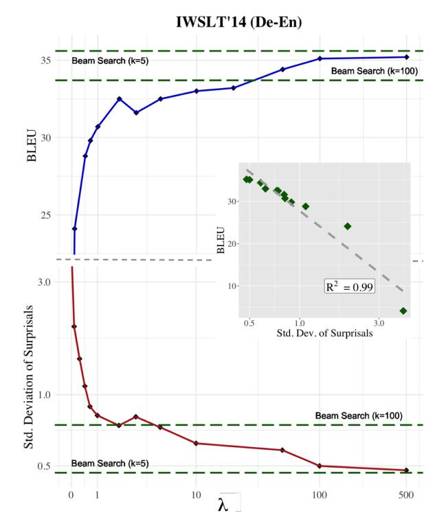
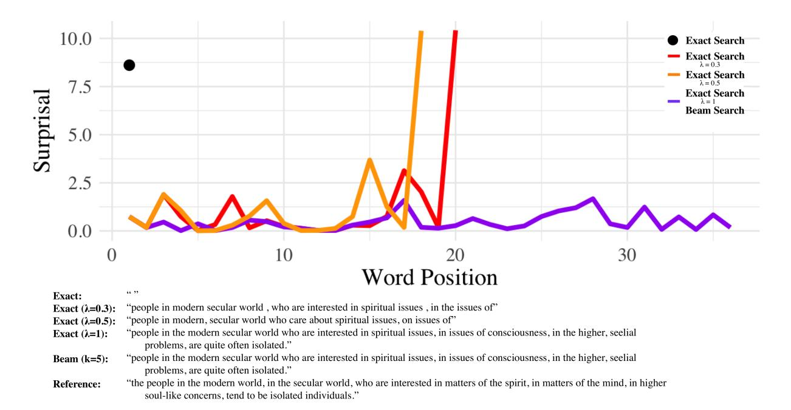
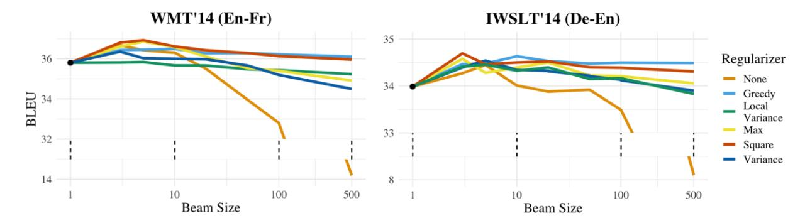
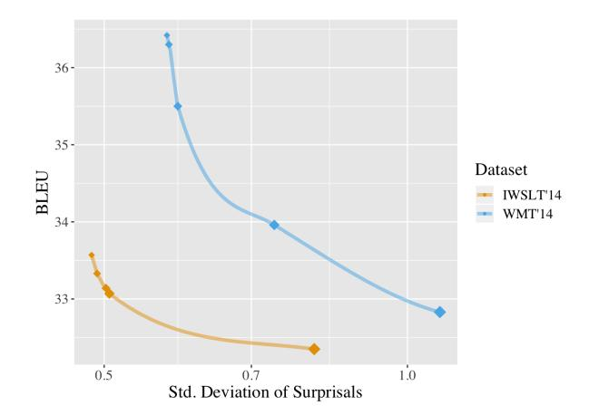

# If Beam Search is the Answer, What was the Question?

Clara Meister Tim Vieira Ryan Cotterell , ETH Zurich ¨ Johns Hopkins University University of Cambridge clara.meister@inf.ethz.ch tim.vieira@gmail.com ryan.cotterell@inf.ethz.ch

# Abstract

Quite surprisingly, exact maximum a posteriori (MAP) decoding of neural language generators frequently leads to low-quality results [\(Stahlberg and Byrne,](#page-10-0) [2019\)](#page-10-0). Rather, most state-of-the-art results on language generation tasks are attained using beam search despite its overwhelmingly high search error rate. This implies that the MAP objective alone does not express the properties we desire in text, which merits the question: if beam search is the answer, what was the question? We frame beam search as the exact solution to a different decoding objective in order to gain insights into *why* high probability under a model alone may not indicate adequacy. We find that beam search enforces *uniform information density* in text, a property motivated by cognitive science. We suggest a set of decoding objectives that explicitly enforce this property and find that exact decoding with these objectives alleviates the problems encountered when decoding poorly calibrated language generation models. Additionally, we analyze the text produced using various decoding strategies and see that, in our neural machine translation experiments, the extent to which this property is adhered to strongly correlates with BLEU. Our code is publicly available at [https://](https://github.com/rycolab/uid-decoding) [github.com/rycolab/uid-decoding](https://github.com/rycolab/uid-decoding).

## 1 Introduction

As a simple search heuristic, beam search has been used to decode models developed by the NLP community for decades. Indeed, it is noteworthy that beam search is one of the few NLP algorithms that has stood the test of time: It has remained a cornerstone of NLP systems since the 1970s [\(Reddy,](#page-10-1) [1977\)](#page-10-1). As such, it became the natural choice for decoding neural probabilistic text generators—whose design makes evaluating the full search space impossible [\(Kalchbrenner and](#page-9-0) [Blunsom,](#page-9-0) [2013;](#page-9-0) [Sutskever et al.,](#page-10-2) [2014;](#page-10-2) [Vinyals](#page-10-3) [and Le,](#page-10-3) [2015;](#page-10-3) [Yin et al.,](#page-11-0) [2016\)](#page-11-0). While there is no formal guarantee that beam search will return—

Figure 1: Average std. deviation σ of surprisals (per sentence) and corpus BLEU for translations generated using exact search over the MAP objective with a greedy regularizer (Eq. [\(11\)](#page-3-0)) with varying degrees of λ. References for beam search (k = 5 and k = 100) are included. Sub-graph shows the explicit relationship between BLEU and σ. λ and σ axes are log-scaled.

or even approximate—the highest-scoring candidate under a model, it has repeatedly proven its merit in practice [\(Serban et al.,](#page-10-4) [2017;](#page-10-4) [Edunov et al.,](#page-9-1) [2018;](#page-9-1) [Yang et al.,](#page-11-1) [2019\)](#page-11-1) and, thus, has largely been tolerated—even embraced—as NLP's go-to search heuristic. However, in the context of neural machine translation (NMT), a shocking empirical finding has emerged: Using beam search to decode sentences from neural text generators almost invariably leads to better text than using exact search (or beam search with a very large beam size). In fact, [Stahlberg and Byrne](#page-10-0) [\(2019\)](#page-10-0) report that exact search

returns the empty string in > 50% of cases,[1](#page-1-0) showing that the success of beam search does not stem from its ability to approximate exact decoding in practice, but rather due to a hidden inductive bias embedded in the algorithm. This inductive bias appears to be *paramount* for generating desirable text from neural probabilistic text generators. While several works explore this phenomenon [\(Murray](#page-9-2) [and Chiang,](#page-9-2) [2018;](#page-9-2) [Yang et al.,](#page-11-2) [2018;](#page-11-2) [Stahlberg](#page-10-0) [and Byrne,](#page-10-0) [2019;](#page-10-0) [Cohen and Beck,](#page-8-0) [2019\)](#page-8-0), no one has yet hypothesized what beam search's hidden inductive bias may be. Our work fills this gap.

We analyze the beam search blessing by reverse engineering an objective that beam search returns the exact solution for. Specifically, we introduce a regularizer for the the standard (MAP) decoding objective for text generation models such that the exact solution to this regularized objective is equivalent to the solution found by beam search under the unmodified objective. Qualitative inspection reveals that our "beam search regularizer" has a clear connection to a theory in cognitive science—the uniform information density hypothesis (UID; [Levy and Jaeger,](#page-9-3) [2007\)](#page-9-3). The UID hypothesis states that—subject to the constraints of the grammar—humans prefer sentences that distribute information (in the sense of information theory) equally across the linguistic signal, e.g., a sentence. In other words, human-produced text, regardless of language, tends to have evenly distributed surprisal, formally defined in information theory as negative log-probability. This connection suggests beam search has an interpretation as exact decoding, but with a UID-promoting regularizer that encourages evenly distributed surprisal in generated text. This insight naturally leads to the development of several new regularizers that likewise enforce the UID property.

Empirically, we experiment with our novel regularizers in the decoding of NMT models. We first observe a close relationship between the standard deviation of surprisals—an operationalization of UID—and BLEU, which suggests that high-quality text does indeed exhibit the UID property. Additionally, we find that even with exact search, our regularized objective leads to performance similar to beam search on standard NMT benchmarks. Both of these observations are reflected in Fig. [1.](#page-0-0) Lastly, we see that our regularizers alleviate the

text-quality degradation typically seen when decoding with larger beam sizes. We take all the above as evidence that our proposed explanation of beam search's inductive bias indeed elucidates *why* the algorithm performs so well as a search heuristic for language generation tasks.

# 2 Neural Probabilistic Text Generation

Probabilistic text generators define a probability distribution pθ(y | x) over an output space of hypotheses Y (to be defined in Eq. [\(1\)](#page-1-1)) conditioned on an input x. [2](#page-1-2) Modern generators are typically parameterized by a deep neural network—possibly recurrent—with a set of learned weights θ. In the case of text generation, the full set of possible hypotheses grows exponentially with the vocabulary size |V|. We consider the set of complete hypotheses, i.e., valid outputs, as

$$\mathcal{Y} := \{ \text{BOS} \circ \mathbf{v} \circ \text{EOS} \mid \mathbf{v} \in \mathcal{V}^* \} \tag{1}$$

where ◦ is string concatenation and V ∗ is the Kleene closure of V. In words, valid hypotheses are text, e.g., sentences or phrases, padded with distinguished tokens, BOS and EOS. In this work, we consider models that are locally normalized, i.e., the model pθ is defined as the product of probability distributions:

$$p_{\theta}(\mathbf{y} \mid \mathbf{x}) = \prod_{t=1}^{|\mathbf{y}|} p_{\theta}(y_t \mid \mathbf{x}, \mathbf{y}_{< t})$$
 (2)

where each pθ(· | x, y<t) is a distribution with support over V¯ := V ∪ {EOS} and y<1 = y0 := BOS.

The decoding objective for text generation aims to find the most-probable hypothesis among all candidate hypotheses, i.e. we aim to solve the following optimization problem:

$$\mathbf{y}^{\star} = \underset{\mathbf{y} \in \mathcal{Y}}{\operatorname{argmax}} \log p_{\theta}(\mathbf{y} \mid \mathbf{x}) \tag{3}$$

This is commonly known as maximum a posteriori (MAP) decoding since pθ is a probability model. While there exists a wealth of literature on decoding algorithms for statistical text generation models, e.g., phrase-based machine translation models, many of these methods cannot reasonably be used with neural models. Specifically, due to the non-Markovian structure of most neural text generators, dynamic-programming algorithms for searching

1This rate tends to decrease for larger models, although it is often still a considerable percentage.

2The input could be another sentence, a semantic structure or an image, to name a few examples.

over the exponentially large space are not efficient in this setting. Indeed, there are formal results that solving Eq. (3) with a recurrent neural network is NP-hard (Chen et al., 2018). Therefore decoding is performed almost exclusively with heuristic methods, such as beam search.

#### 2.1 Beam Search

Beam search is a form of pruned breadth-first search where the breadth is limited to  $k \in \mathbb{Z}_+$  (i.e., a maximum of k hypotheses) are expanded at each time step. We express beam search as the following recursion:

$$Y_0 = \{ BOS \} \tag{4}$$

$$Y_t = \underset{\substack{Y' \subseteq \mathcal{B}_t, \\ |Y'| = k}}{\operatorname{argmax}} \log p_{\theta}(Y' \mid \mathbf{x})$$
 (5)

where we define the candidate set at t > 0

$$\mathcal{B}_t = \left\{ \mathbf{y}_{t-1} \circ y \mid y \in \bar{\mathcal{V}} \text{ and } \mathbf{y}_{t-1} \in Y_{t-1} \right\} \quad (6)$$

For notational convenience, we define EOS  $\circ$  EOS = EOS. The above algorithm terminates after a fixed number of iterations  $n_{\max}$  and the set  $Y_{n_{\max}}$  is returned. We overload  $p_{\theta}(\cdot \mid \mathbf{x})$  to take a set of hypotheses as an argument instead of just a single hypothesis. In this case,  $p_{\theta}(Y \mid \mathbf{x}) \coloneqq \prod_{\mathbf{y} \in Y} p_{\theta}(\mathbf{y} \mid \mathbf{x})$ . Using a similar schema, the argmax may also operate over a different objective, e.g., log-probabilities combined with various rewards or penaties, such as those discussed in §2.2.

Beam search has a long history in sequence transduction. For example, many of the decoding strategies used in statistical machine translation (SMT) systems were variants of beam search (Och et al., 1999; Koehn et al., 2003; Koehn, 2004). As language generation systems moved away from phrase-based statistical approaches and towards neural models, beam search remained the de-facto decoding algorithm (Sutskever et al., 2014; Vinyals and Le, 2015). However, it has been observed that when used as a decoding algorithm for neural text generation, beam search (for small beams) typically has a large percentage of search errors

(Stahlberg and Byrne, 2019). Counterintuitively, it is widely known that increasing the beam size beyond 5 can hurt model performance in terms of downstream evaluation metrics (e.g., BLEU, ROUGE); while a number of prior works have referred to this phenomenon as a curse (Koehn and Knowles, 2017; Yang et al., 2018; Cohen and Beck, 2019), it should perhaps be seen as a blessing. Beam search typically generates well-formed and coherent text from probabilistic models, whose global optimum in many cases is the empty string, when they otherwise might fail to produce text at all. As we demonstrate in §4, this text also tends to be human-like. We will subsequently explore possible reasons as to why beam search leads to desirable text from models that are otherwise poorly calibrated, i.e., poor representations of the true distribution  $p(\mathbf{y} \mid \mathbf{x})$  (Guo et al., 2017).

### 2.2 Alternative Decoding Objectives

When the MAP objective (Eq. (3)) is used for decoding neural text generators, the results are generally not satisfactory. Among other problems, the generated texts are often short and defaults to high-frequency words (Cho et al., 2014; Vinyals and Le, 2015; Shen et al., 2016). Methods such as length and coverage normalization (Jean et al., 2015; Tu et al., 2016; Murray and Chiang, 2018), which augment the MAP objective with an additive term or multiplicative factor, have been adopted to alleviate these issues. For example, two such forms of length5 and coverage normalization use the following modified MAP objective respectively during decoding to produce higher-quality output:

$$\log p_{\theta}(\mathbf{y} \,|\, \mathbf{x}) + \lambda |\mathbf{y}| \tag{7}$$

$$\log p_{\theta}(\mathbf{y} | \mathbf{x}) + \lambda \sum_{i=1}^{|\mathbf{x}|} \log \min \left( 1, \sum_{j=1}^{|\mathbf{y}|} \alpha_{ij} \right)$$
 (8)

where  $\lambda > 0$  is the (tunable) strength of the reward and  $\alpha_{ij}$  is the attention weight (Bahdanau et al., 2015) from the  $j^{\text{th}}$  decoding step over the  $i^{\text{th}}$  input. Eq. (7) directly rewards longer outputs (He et al., 2016) while Eq. (8) aims to reward coverage of input words in a prediction using the attention mechanism of an encoder–decoder model as an oracle (Tu

 $^3$ If all hypotheses in  $Y_t$  end in EOS for some  $t < n_{\rm max}$ , then we may terminate beam search early as it is then gauranteed that  $Y_t = Y_{n_{\rm max}}$ . We do not consider further early-stopping methods for beam search (Huang et al., 2017; Yang et al., 2018; Meister et al., 2020) as they generally should not affect the *quality* of the decoded set.

&lt;sup>4There do exist objectives that take into account interactions between hypotheses in a set, e.g., diverse beam search (Vijayakumar et al., 2018), but we do not consider those here.

&lt;sup>5The predominant form of length normalization divides (log) sequence probability by the length of the hypothesis rather than using an additive reward as in (He et al., 2016). We present results from the former in our experiments as we find it empirically leads to better performance.

et al., 2016). While such methods help obtain state-of-the-art results in neural MT (Wu et al., 2016; Gehring et al., 2017; Ng et al., 2019), we view them as a patch to the observed problems. The fact that text quality still degrades with increased beam sizes when these rewards are used (Koehn and Knowles, 2017; Ott et al., 2018a) suggests that they do not address the inherent issues with text generation systems. We subsequently hypothesize about the nature of these issues and provide a set of linguistically motivated regularizers—inspired by beam search—that appear to alleviate them.

### 3 Deriving Beam Search

We introduce a **regularized decoding** framework. The idea is simple; we seek to solve the *regularized* optimization problem to decode

$$\mathbf{y}^{\star} = \underset{\mathbf{y} \in \mathcal{Y}}{\operatorname{argmax}} \left( \log p_{\theta}(\mathbf{y} \mid \mathbf{x}) - \lambda \cdot \mathcal{R}(\mathbf{y}) \right) \quad (9)$$

for a strategically chosen  $\mathcal{R}(\cdot)$ . Clearly, for certain  $\mathcal{R}(\cdot)$ , we recover the decoding objectives discussed in §2.2. The question we ask in this work is the following: If we want to view beam search as an exact-decoding algorithm, which  $\mathcal{R}(\cdot)$  should we choose to recover beam search?

We discovered an elegant answer rooted in information theory and cognitive science (the connections are discussed in-depth in  $\S4$ ). We first define the model's time-dependent surprisals, which are an information-theoretic concept that characterizes the amount of new information expressed at time t:

$$u_0(BOS) = 0$$
  
 $u_t(y) = -\log p_{\theta}(y \mid \mathbf{x}, \mathbf{y}_{\leq t}), \text{ for } t \geq 1$  (10)

Note that minimally surprising means maximally probable. For the special case of greedy decoding, where k=1, the following choice of regularizer recovers beam search for sufficiently large  $\lambda$ :

$$\mathcal{R}_{\text{greedy}}(\mathbf{y}) = \sum_{t=1}^{|\mathbf{y}|} \left( u_t(y_t) - \min_{y' \in \mathcal{V}} u_t(y') \right)^2 \tag{11}$$

The intuition behind Eq. (11) is to encourage locally optimal decisions: Every local surprise  $u_t$  should be close to the minimally surprising choice. In the limiting case where locally optimal decisions are not just encouraged, but rather enforced, we recover greedy search.

Formally, we have the following theorem:

**Theorem 3.1.** The argmax of  $\log p_{\theta}(\mathbf{y} \mid \mathbf{x}) - \lambda \cdot \mathcal{R}_{greedy}(\mathbf{y})$  is exactly computed by greedy search in the limiting case as  $\lambda \to \infty$ .

*Proof.* By induction. In App. A. 
$$\Box$$

Theorem 3.1 establishes that greedy search is the limiting case of a regularizer that seeks to encourage decisions to have high-probability *locally*. In contrast, the optimal MAP solution will generally not have this property. This is because a globally optimal MAP decoder may require a locally suboptimal decision for the sake of being able to make a **compensatory decision** later that leads to global optimality.6

We now consider the generalization of greedy search (k=1) to full beam search  $(k\geq 1)$ . Recall that beam search returns not just a single output, but rather a *set* of outputs. Thus, we must consider the set-decoding objective

$$Y^* = \underset{\substack{Y \subseteq \mathcal{Y}, \\ |Y| = k}}{\operatorname{argmax}} \left( \log p_{\theta}(Y \mid \mathbf{x}) - \lambda \cdot \mathcal{R}(Y) \right)$$
 (12)

where, as before, we have used our overloaded notation  $p_{\theta}(\cdot \mid \mathbf{x})$  to score sets of hypotheses. Similarly to  $\mathcal{R}_{\text{greedy}}$ , we formulate a greedy set-regularizer to recover beam search:

$$\mathcal{R}_{\text{beam}}(Y) = \sum_{t=1}^{n_{\text{max}}} \left( u_t(Y_t) - \min_{\substack{Y' \subseteq \mathcal{B}_t, \\ |Y'| = k}} u_t(Y') \right)^2$$
(13)

where  $Y_t = \{\mathbf{y}_{1:t} \mid \mathbf{y} \in Y\}$  corresponds to the set of hypotheses expanded by t steps.7 Note that we additionally overload surprisal to operate on sets,  $u_t(Y) = \sum_{y \in Y} u_t(y)$ . We prove an analogous theorem to Theorem 3.1 for this regularizer.

**Theorem 3.2.** The argmax of  $\log p_{\theta}(Y \mid \mathbf{x}) - \lambda \cdot \mathcal{R}(Y)$  is computed by beam search with beam size of k = |Y| as  $\lambda \to \infty$ .

*Proof.* The proof follows from the same argument as Theorem 3.1, albeit with sets instead of an individual hypothesis. □

&lt;sup>6Indeed, we only have formal guarantees for greedy algorithms when local optimality translates into global optimality (Kleinberg and Tardos, 2005, Chapter 4).

&lt;sup>7This includes both incomplete hypotheses of length t and complete hypotheses that have reached EOS at step  $\leq t$ .

Note that in the (predominant) case where we want to return a single candidate sentence as the output rather than an entire set—as would be generated by Eq. [\(12\)](#page-3-4)—we can take the highest-probability sequence in the chosen set Y ? as our decoded output. The objective in Eq. [\(12\)](#page-3-4) boils down to a subset selection problem which, given the size of Y, is a computationally prohibitive optimization problem. Nonetheless, we can use it to analyze the properties enforced on generated text by beam search.

## 4 From Beam Search to UID

The theoretical crux of this paper hinges on a proposed relationship between beam search and the uniform information density hypothesis [\(Levy,](#page-9-14) [2005;](#page-9-14) [Levy and Jaeger,](#page-9-3) [2007\)](#page-9-3), a concept from cognitive science:

Hypothesis 4.1. *"Within the bounds defined by grammar, speakers prefer utterances that distribute information uniformly across the signal (information density). Where speakers have a choice between several variants to encode their message, they prefer the variant with more uniform information density (ceteris paribus)" [\(Jaeger,](#page-9-15) [2010\)](#page-9-15).*

At its core, the theory seeks to explain various aspects of human language processing in terms of information theory; it is often applied to an area of psycholinguistics known as sentence processing where the UID hypothesis is used to explain experimental data [\(Hale,](#page-9-16) [2001\)](#page-9-16). As the UID hypothesis concerns a cognitive process (virtually) independent of the language in use, the theory should hold across languages [\(Jaeger and Tily,](#page-9-17) [2011\)](#page-9-17).

To see the hypothesis in action, consider the classic case of syntactic reduction from [Levy and](#page-9-3) [Jaeger](#page-9-3) [\(2007\)](#page-9-3):

(1) How big is [NP the familyi [RC (that) you cook for −i]]?

In the above example, the sentence does not require the relativizer *that* at the start of the relative clause (denoted by RC); it would also be syntactically correct without it. However, many would agree that the relativizer makes the text qualitatively better. The information-theoretic explanation of this perception is that without the relativizer, the first word of a relative clause conveys two pieces of information simultaneously: the onset of a relative clause and part of its internal contents. Including the relativizer spreads this information across two

words, thereby distributing information across the sentence more uniformly and avoiding instances of high surprisal—which, from a psycholinguistic perspective, are displeasing. In short, the relativizer helps to ensure the UID property of the sentence.

Importantly, the preference suggested by the UID hypothesis is between possible utterances (i.e., outputs) where grammaticality and information content are held constant. Any violation of these assumptions presents confounding factors when measuring, or optimizing, the information density of the generated text. In our setting, there is reason to believe that grammaticallity and information content are approximately held constant while selecting between hypothesis. First, the high-probability outputs of neural generation models tend to be grammatical [\(Holtzman et al.,](#page-9-18) [2020\)](#page-9-18). Second, because decoding is conditioned on a specific input x, the conditional probability model pθ(y | x) is able to assign high-probability to outputs y that are plausible outputs (e.g., translations) of the given x. Thus, even though the various y are not constrained to be sematically equivalent to one another, they tend to express similar information because they are at least relevant to the same x. This is why our regularized optimization problem Eq. [\(9\)](#page-3-5) combines an information-density regularizer with log pθ(y | x): the term log pθ(y | x) rewards grammaticallity and content relevance, whereas the information-density regularizer encourages the human preferences posited by the UID hypothesis. The parameter λ allows the preferences to be calibrated to perform well on downstream evaluation metrics, such as BLEU and ROUGE.

## 4.1 The UID Bias in Beam Search

It may not be immediately obvious how the UID hypothesis relates to beam search. After all, beam search narrows the scope of the search to only the lowest surprisal candidates at each time step, which does not clearly lead to a uniform distribution of surprisals in the final decoded sequences. The connection is best seen visually.

Fig. [2](#page-5-0) shows the time-dependent surprisals ut under the model of several candidate translations (German to English). Recall that we have ut(y) ∈ [0, ∞) and that the standard decoding objective explicitly minimizes the sum of surprisals, i.e., maximizes log-probability. Therefore, the only way the distribution of a solution can become distinctly nonuniform is when there are several high-surprisal

Figure 2: Surprisals (according to pθ) by time step of sequences generated with various decoding strategies. Values of λ indicate the greedy regularizer was used with the corresponding λ value. Note that beam search (k=5) and exact search (λ = 1.0) return the same prediction in this example, and thus, are represented by the same line.

decisions in the mix; we observe this in the orange and red curves. Intuitively, this corresponds to the notion of compensation discussed earlier: a globally optimal decoding scheme may select a high-surprisal step at some point in order to shorten the length of the path or to take a low-surprisal step later on. We observe an extreme example of this behavior above: Selecting the EOS character at the first step leads to a very non-uniform distribution, i.e., the degenerate distribution, which, violates our operationalization of UID described subsequently. In summary, we see that as λ is decreased, the decoded sentences obey the UID property less strictly. Indeed, setting λ = 0, i.e., exact inference of the MAP objective, results in the empty string.

A number of successful sampling methods (pnucleus sampling [\(Holtzman et al.,](#page-9-18) [2020\)](#page-9-18) and topk sampling [\(Fan et al.,](#page-9-19) [2018\)](#page-9-19)) enforce the UID property in generated text by the same logic as above. Both methods eliminate many of the highsurprisal choices at any given decoding step by narrowing the set of tokens that may be chosen.

### 4.2 Cognitive Motivation for Beam Search

The goal of this work is to expose a possible inductive bias of beam search. We now exhibit our primary hypothesis

Hypothesis 4.2. *Beam search is a cognitively motivated search heuristic for decoding language gen-* *eration models. The success of beam search on such tasks is, in part, due to the fact that it inherently biases the search procedure towards text that humans prefer.*

The foundation of the argument for this hypothesis follows naturally from the previous sections: First, we demonstrated in [§3](#page-3-6) that beam search is an exact decoding algorithm for a certain regularized objective—to wit, the one in Eq. [\(9\)](#page-3-5). Qualitatively, we related the behavior of the regularizer to the UID hypothesis from cognitive science. As a final step, we next provide operationalizations of UID—in the form of regularizers within our regularized decoding framework—through which we can empirically test the validity of this hypothesis.

# 5 Generalized UID Decoding

If beam search is trying to optimize for UID, can we beat it at its own game? This section develops a battery of possible sentence-level UID measures, which can be used as regularizers in our regularized decoding framework and compared experimentally on downstream evaluation metrics.

Variance Regularizer. We first consider the variance regularizer from [Jain et al.](#page-9-20) [\(2018\)](#page-9-20). In essence, UID concerns the distribution of information over the course (i.e., time steps) of a sentence. A natural

measure for this is variance of the surprisals.

$$\mathcal{R}_{\text{var}}(\mathbf{y}) = \frac{1}{|\mathbf{y}|} \sum_{t=1}^{|\mathbf{y}|} \left( u_t(y_t) - \mu \right)^2$$
 (14)

where  $\mu = 1/|\mathbf{y}| \sum_{t=1}^{|\mathbf{y}|} u_t(y_t)$ . This regularizer, in contrast to Eq. (11), is a much more straightforward encoding of the UID: it directly operationalizes UID through variance.

**Local Consistency.** Next we consider a local consistency regularizer, also taken from Jain et al. (2018), that encourages adjacent surprisals to have similar magnitude:

$$\mathcal{R}_{\text{local}}(\mathbf{y}) = \frac{1}{|\mathbf{y}|} \sum_{t=1}^{|\mathbf{y}|} \left( u_t(y_t) - u_{t-1}(y_{t-1}) \right)^2$$
(15)

Again, this is a straightforward encoding of the UID: if every surprisal is similar to its neighbor, it will be close to uniform. Note that both of the above regularizers are defined for all decoding steps t>0 since we define  $u_0(y_0)=0$ ,  $y_0=$  BOS for all valid hypotheses.

Max Regularizer. We propose a UID-inspired regularizer of our own design that exploits the nature of MAP decoding, for which the overarching goal is to find a solution with low surprisal. In this setting, one strategy is to penalize decisions that move the distribution away from 0, the lowest possible surprisal. This suggests

$$\mathcal{R}_{\max}(\mathbf{y}) = \max_{t=1}^{|\mathbf{y}|} u_t(y_t)$$
 (16)

would regularize for UID. Such a regularizer would also directly penalize extreme compensation during decoding (discussed in §3). It is worth noting that this regularizer has a connection to entropy regularization, which can be seen by looking at the formula for Rényi entropy.

**Squared Regularizer.** Finally, we consider a novel squared penalty, that, again, exploits the goal of MAP decoding. If we wish to keep everything uniform, we can try to push all surprisals close to 0, but this time with a squared penalty:

$$\mathcal{R}_{\text{square}}(\mathbf{y}) = \sum_{t=1}^{|\mathbf{y}|} u_t(y_t)^2$$
 (17)

Experimentally, we expect to see the following: If encouraging decoded text to exhibit UID is helpful—and our logic in constructing regularizers is sound—all the regularizers (Eq. (14) to (17)) should lead to roughly the same performance under exact decoding and beam search with large beam widths. Such results would not only validate the connection between UID and high-quality text; comparable performance of optimal beam search8 and exact search under our regularized objective would provide explicit evidence for our declarative explanation of the inductive bias in beam search.

## 6 Experiments

We explore how encouraging uniform information density in text generated by neural probabalistic text generators affects its downstream quality. To this end, we decode NMT models using the regularized objective (Eq. (9)) with our UID regularizers. We perform exact decoding for a range of  $\lambda$  and observe how text quality (quantified by BLEU (Papineni et al., 2002) using the SacreBLEU (Post, 2018) system) and the distribution of surprisal changes. We additionally evaluate our regularizers under the beam search decoding strategy to see if penalizing violations of UID alleviates the text-quality degradation typically seen with increased beam widths.

Experiments are performed using models trained on the IWSLT'14 De-En (Cettolo et al., 2012) and WMT'14 En-Fr (Bojar et al., 2014) datasets. For reproducibility, we use the model provided by fairseq (Ott et al., 2019) for the WMT'14 task; we use the data pre-processing scripts and recommended hyperparameter settings provided by fairseq for training a model on the IWSLT'14 De-En dataset. We use the Newstest'14 dataset as the test set for the WMT'14 model. All model and data information can be found on the fairseq NMT repository. 10

#### **6.1 Exact Decoding**

To perform exact decoding of neural probabilistic text generators, we build on the decoding framework of Stahlberg et al. (2017), albeit using Dijkstra's algorithm (Dijkstra, 1959) instead of depth-first search as we find it decreases decoding time. Note that Dijkstra's algorithm is guaranteed to find the global optimum when path cost is monotoni-

&lt;sup>8By optimal beam search, we mean beam search using the beam width that empirically leads to the best results.

&lt;sup>9This model uses a transformer architecture (Vaswani et al., 2017) and was trained as in Ott et al. (2018b).

10https://github.com/pytorch/fairseq/
tree/master/examples/translation

Figure 3: BLEU as a function of beam width for various regularizers. We choose  $\lambda$  for each regularizer by best performance on validation sets (see App. B). y-scales are broken to show minimum BLEU values. x-axis is log-scaled.

cally increasing, which is the case for hypotheses under the scoring scheme used by neural probabilistic text generators (see Meister et al. (2020) for more detailed discussion). While the variance and local consistency regularizers Eq. (14) and (15) break this monotonicity property, we can still guarantee optimality by using a stopping criterion similar to the one proposed by Yang et al. (2018). Explicitly, we check if the top-scoring complete hypothesis has a greater score than the maximum possible score of any hypothesis in the queue. All scores are bounded due to the maximum-length criterion. Additionally, we lower-bound each search by the score of the empty string to decrease the memory footprint, i.e., we stop considering hypotheses whose scores (or maximum possible score in the case of Eq. (14) and (15)) drop below that of the empty string at any time step.

Fig. 1 demonstrates how the addition of the greedy UID regularizer (Eq. (11)) to the regularized MAP objective (Eq. (9)) affects characteristics of the global optimum under the model as we vary  $\lambda$ . Notably, increasing the strength of the regularizer appears to alleviate the text quality degradation seen with exact search, leading to results that approach the BLEU of those generated using optimal beam search. Fig. 1 also shows a strong inverse relationship between BLEU and average standard deviation (per sentence) of surprisals. We take these observations as empirical validation of Hyp. 4.2.

#### 6.2 Regularized Beam Search

We next look at how the regularized decoding objective affects text generated using beam search. As previously noted, text quality generally degrades with increased beam size when using the standard MAP objective; this phenomenon is demonstrated in Fig. 3. UID regularization appears to alleviate

|                       | k = 5 | k = 10 | k = 100 | k = 500 |
|-----------------------|-------|--------|---------|---------|
| No Regularization     | 36.42 | 36.30  | 32.83   | 14.66   |
| Squared Regularizer   | 36.92 | 36.42  | 36.13   | 35.96   |
| Greedy Regularizer    | 36.45 | 36.49  | 36.22   | 36.15   |
| Combined Regularizers | 36.69 | 36.65  | 36.48   | 36.35   |
| Length Normalization  | 36.02 | 35.94  | 35.80   | 35.11   |

Table 1: BLEU scores on first 1000 samples of Newstest2014 for predictions generated with various decoding strategies. Best scores per beam size are bolded.

this problem. Notably, the greedy and squared regularizer aid performance for larger beam sizes more so than other regularizers, for which we still see a slight drop in performance for larger beam sizes. This drop is negligible compared to the one observed for unregularized beam search—a drop which is also frequently observed for length-normalized decoding (Koehn and Knowles, 2017). While intuitively, variance and local variance are the purest encodings of UID, they perform the poorest of the regularizers. Arguably, this may be due to the fact that they do not simultaneously (as the other regularizers do) penalize for high surprisal.

We additionally decode with a combination of the UID regularizers in tandem. We collectively tune the  $\lambda$  value for each of the regularizers on validation sets. We report performance in Tab. 1 and see that results outperform standard and length-normalized, i.e. score divided by sequence length, beam search with noticeable improvements for larger beams. Search details and parameter settings may be found in App. B. Notably, combining multiple UID regularizers does not lead to as great an increase in performance as one might expect, which hints that a single method for enforcing UID is sufficient for promoting quality in generated text.

# 7 Related Work

Neural probabilistic text generators are far from perfect; prior work has shown that they often generate text that is generic [\(Vinyals and Le,](#page-10-3) [2015;](#page-10-3) [Li et al.,](#page-9-21) [2016\)](#page-9-21), unnatural [\(Holtzman et al.,](#page-9-18) [2020\)](#page-9-18), and sometimes even non-existent [\(Stahlberg and](#page-10-0) [Byrne,](#page-10-0) [2019\)](#page-10-0). In the context of the degenerate behavior of these models, the beam search curse—a specific phenomenon where using a larger beam size leads to worse performance—has been analyzed by a number of authors [\(Koehn and Knowles,](#page-9-8) [2017;](#page-9-8) [Murray and Chiang,](#page-9-2) [2018;](#page-9-2) [Yang et al.,](#page-11-2) [2018;](#page-11-2) [Stahlberg and Byrne,](#page-10-0) [2019;](#page-10-0) [Jean et al.,](#page-9-10) [2015;](#page-9-10) [Tu](#page-10-8) [et al.,](#page-10-8) [2016;](#page-10-8) [He et al.,](#page-9-11) [2016;](#page-9-11) [Cohen and Beck,](#page-8-0) [2019\)](#page-8-0). Many of these authors attribute the performance drop (as search becomes better) to an inherent bias in neural sequence models to pefer shorter sentences. Other authors have ascribed fault to the model architectures, or how they are trained [\(Cho](#page-8-2) [et al.,](#page-8-2) [2014;](#page-8-2) [Bengio et al.,](#page-8-7) [2015;](#page-8-7) [Sountsov and](#page-10-18) [Sarawagi,](#page-10-18) [2016;](#page-10-18) [Vinyals et al.,](#page-10-19) [2017;](#page-10-19) [Ott et al.,](#page-10-11) [2018a;](#page-10-11) [Kumar and Sarawagi,](#page-9-22) [2019\)](#page-9-22). To remedy the problem, a large number of regularized decoding objectives and modified training techniques have been proposed. In contrast, this work analyzes the behavior of neural text generators from a different angle: We provide a plausible answer—inspired by psycholinguistic theory—as to *why* beam search (with small beams) leads to high-quality text, rather than another explanation of why exact search performs so badly.

## 8 Conclusion

We analyze beam search as a decoding strategy for text generation models by framing it as the solution to an exact decoding problem. We hypothesize that beam search has an inductive bias which can be linked to the promotion of uniform information density (UID), a theory from cognitive science regarding even distribution of information in linguistic signals. We observe a strong relationship between variance of surprisals (an operationalization of UID) and BLEU in our experiments with NMT models. With the aim of further exploring decoding strategies for neural text generators in the context of UID, we design a set of objectives to explicitly encourage uniform information density in text generated from neural probabalistic models and find that they alleviate the quality degradation typically seen with increased beam widths.

# Acknowledgments

We would like to thank Ari Holtzman and Jason Eisner for useful feedback and discussion that helped improve this work.

# References

Dzmitry Bahdanau, Kyunghyun Cho, and Yoshua Bengio. 2015. [Neural machine translation by jointly](http://arxiv.org/abs/1409.0473) [learning to align and translate.](http://arxiv.org/abs/1409.0473) In *3rd International Conference on Learning Representations*.

Samy Bengio, Oriol Vinyals, Navdeep Jaitly, and Noam Shazeer. 2015. [Scheduled sampling for se](http://dl.acm.org/citation.cfm?id=2969239.2969370)[quence prediction with recurrent neural networks.](http://dl.acm.org/citation.cfm?id=2969239.2969370) In *Advances in Neural Information Processing Systems 28*.

Ondˇrej Bojar, Christian Buck, Christian Federmann, Barry Haddow, Philipp Koehn, Johannes Leveling, Christof Monz, Pavel Pecina, Matt Post, Herve Saint-Amand, Radu Soricut, Lucia Specia, and Alesˇ Tamchyna. 2014. [Findings of the 2014 workshop](http://www.aclweb.org/anthology/W/W14/W14-3302) [on statistical machine translation.](http://www.aclweb.org/anthology/W/W14/W14-3302) In *Proceedings of the Workshop on Statistical Machine Translation*, Baltimore, Maryland, USA. Association for Computational Linguistics.

Mauro Cettolo, Christian Girardi, and Marcello Federico. 2012. Wit3 : Web inventory of transcribed and translated talks. In *Proceedings of the Conference of the European Association for Machine Translation (EAMT)*.

Yining Chen, Sorcha Gilroy, Andreas Maletti, Jonathan May, and Kevin Knight. 2018. [Recurrent neural](https://doi.org/10.18653/v1/N18-1205) [networks as weighted language recognizers.](https://doi.org/10.18653/v1/N18-1205) In *Proceedings of the 2018 Conference of the North American Chapter of the Association for Computational Linguistics: Human Language Technologies, Volume 1 (Long Papers)*, pages 2261–2271, New Orleans, Louisiana. Association for Computational Linguistics.

Kyunghyun Cho, Bart van Merrienboer, Dzmitry Bah- ¨ danau, and Yoshua Bengio. 2014. [On the properties](https://doi.org/10.3115/v1/W14-4012) [of neural machine translation: Encoder–decoder ap](https://doi.org/10.3115/v1/W14-4012)[proaches.](https://doi.org/10.3115/v1/W14-4012) In *Proceedings of SSST-8, Eighth Workshop on Syntax, Semantics and Structure in Statistical Translation*, pages 103–111, Doha, Qatar. Association for Computational Linguistics.

Eldan Cohen and Christopher Beck. 2019. [Empirical](http://proceedings.mlr.press/v97/cohen19a.html) [analysis of beam search performance degradation in](http://proceedings.mlr.press/v97/cohen19a.html) [neural sequence models.](http://proceedings.mlr.press/v97/cohen19a.html) In *Proceedings of the International Conference on Machine Learning*, volume 97, Long Beach, California, USA. PMLR.

Edsger W. Dijkstra. 1959. A note on two problems in connexion with graphs. *Numerische Mathematik*, 1(1).

- Sergey Edunov, Myle Ott, Michael Auli, and David Grangier. 2018. [Understanding back-translation at](https://doi.org/10.18653/v1/D18-1045) [scale.](https://doi.org/10.18653/v1/D18-1045) In *Proceedings of the 2018 Conference on Empirical Methods in Natural Language Processing*, pages 489–500, Brussels, Belgium. Association for Computational Linguistics.
- Angela Fan, Mike Lewis, and Yann Dauphin. 2018. [Hierarchical neural story generation.](http://arxiv.org/abs/1805.04833) *CoRR*, abs/1805.04833.
- Jonas Gehring, Michael Auli, David Grangier, Denis Yarats, and Yann N. Dauphin. 2017. Convolutional sequence to sequence learning. In *Proceedings of the International Conference on Machine Learning - Volume 70*, ICML'17. JMLR.org.
- Chuan Guo, Geoff Pleiss, Yu Sun, and Kilian Q. Weinberger. 2017. On calibration of modern neural networks. In *Proceedings of the International Conference on Machine Learning*, ICML'17. JMLR.org.
- John Hale. 2001. [A probabilistic Earley parser as a psy](https://www.aclweb.org/anthology/N01-1021)[cholinguistic model.](https://www.aclweb.org/anthology/N01-1021) In *Second Meeting of the North American Chapter of the Association for Computational Linguistics*.
- Wei He, Zhongjun He, Hua Wu, and Haifeng Wang. 2016. Improved neural machine translation with smt features. In *Proceedings of the Thirtieth AAAI Conference on Artificial Intelligence*, AAAI'16. AAAI Press.
- Ari Holtzman, Jan Buys, Maxwell Forbes, and Yejin Choi. 2020. [The curious case of neural text degener](http://arxiv.org/abs/1904.09751)[ation.](http://arxiv.org/abs/1904.09751) *International Conference on Learning Representations*.
- Liang Huang, Kai Zhao, and Mingbo Ma. 2017. [When](https://doi.org/10.18653/v1/D17-1227) [to finish? optimal beam search for neural text gen](https://doi.org/10.18653/v1/D17-1227)[eration \(modulo beam size\).](https://doi.org/10.18653/v1/D17-1227) In *Proceedings of the 2017 Conference on Empirical Methods in Natural Language Processing*, pages 2134–2139, Copenhagen, Denmark. Association for Computational Linguistics.
- T. Florian Jaeger. 2010. Redundancy and reduction: Speakers manage syntactic information density. *Cognitive Psychology*, 61(1).
- T. Florian Jaeger and Harry Tily. 2011. [On language](https://doi.org/10.1002/wcs.126) ['utility': Processing complexity and communicative](https://doi.org/10.1002/wcs.126) [efficiency.](https://doi.org/10.1002/wcs.126) *Wiley Interdisciplinary Reviews: Cognitive Science*, 2.
- Ayush Jain, Vishal Singh, Sidharth Ranjan, Rajakrishnan Rajkumar, and Sumeet Agarwal. 2018. [Uni](https://www.aclweb.org/anthology/W18-4605)[form information density effects on syntactic choice](https://www.aclweb.org/anthology/W18-4605) [in Hindi.](https://www.aclweb.org/anthology/W18-4605) In *Proceedings of the Workshop on Linguistic Complexity and Natural Language Processing*, pages 38–48, Santa Fe, New-Mexico. Association for Computational Linguistics.
- Sebastien Jean, Orhan Firat, Kyunghyun Cho, Roland ´ Memisevic, and Yoshua Bengio. 2015. [Montreal](https://doi.org/10.18653/v1/W15-3014) [neural machine translation systems for WMT'15.](https://doi.org/10.18653/v1/W15-3014) In

- *Proceedings of the Tenth Workshop on Statistical Machine Translation*, pages 134–140, Lisbon, Portugal. Association for Computational Linguistics.
- Nal Kalchbrenner and Phil Blunsom. 2013. [Recurrent](https://www.aclweb.org/anthology/W13-3214) [convolutional neural networks for discourse compo](https://www.aclweb.org/anthology/W13-3214)[sitionality.](https://www.aclweb.org/anthology/W13-3214) In *Proceedings of the Workshop on Continuous Vector Space Models and their Compositionality*, pages 119–126, Sofia, Bulgaria. Association for Computational Linguistics.
- Jon Kleinberg and Eva Tardos. 2005. ´ *Algorithm Design*. Addison-Wesley Longman Publishing Co., Inc., USA.
- Philipp Koehn. 2004. Pharaoh: A beam search decoder for phrase-based statistical machine translation models. In *Machine Translation: From Real Users to Research*, Berlin, Heidelberg. Springer Berlin Heidelberg.
- Philipp Koehn and Rebecca Knowles. 2017. [Six chal](https://doi.org/10.18653/v1/W17-3204)[lenges for neural machine translation.](https://doi.org/10.18653/v1/W17-3204) In *Proceedings of the First Workshop on Neural Machine Translation*, pages 28–39, Vancouver. Association for Computational Linguistics.
- Philipp Koehn, Franz J. Och, and Daniel Marcu. 2003. [Statistical phrase-based translation.](https://www.aclweb.org/anthology/N03-1017) In *Proceedings of the 2003 Human Language Technology Conference of the North American Chapter of the Association for Computational Linguistics*, pages 127–133.
- Aviral Kumar and Sunita Sarawagi. 2019. [Calibration](http://arxiv.org/abs/1903.00802) [of encoder decoder models for neural machine trans](http://arxiv.org/abs/1903.00802)[lation.](http://arxiv.org/abs/1903.00802) *CoRR*, abs/1903.00802.
- Roger Levy. 2005. *Probabilistic Models of Word Order and Syntactic Discontinuity*. Ph.D. thesis, Stanford, CA, USA.
- Roger P. Levy and T. F. Jaeger. 2007. [Speakers op](http://papers.nips.cc/paper/3129-speakers-optimize-information-density-through-syntactic-reduction.pdf)[timize information density through syntactic reduc](http://papers.nips.cc/paper/3129-speakers-optimize-information-density-through-syntactic-reduction.pdf)[tion.](http://papers.nips.cc/paper/3129-speakers-optimize-information-density-through-syntactic-reduction.pdf) In B. Scholkopf, J. C. Platt, and T. Hoffman, ¨ editors, *Advances in Neural Information Processing Systems 19*. MIT Press.
- Jiwei Li, Michel Galley, Chris Brockett, Jianfeng Gao, and Bill Dolan. 2016. [A diversity-promoting ob](https://doi.org/10.18653/v1/N16-1014)[jective function for neural conversation models.](https://doi.org/10.18653/v1/N16-1014) In *Proceedings of the 2016 Conference of the North American Chapter of the Association for Computational Linguistics: Human Language Technologies*, pages 110–119, San Diego, California. Association for Computational Linguistics.
- Clara Meister, Tim Vieira, and Ryan Cotterell. 2020. [Best-first beam search.](https://arxiv.org/abs/2007.03909) *Transactions of the Association for Computational Linguistics*.
- Kenton Murray and David Chiang. 2018. [Correct](https://doi.org/10.18653/v1/W18-6322)[ing length bias in neural machine translation.](https://doi.org/10.18653/v1/W18-6322) In *Proceedings of the Third Conference on Machine Translation: Research Papers*, pages 212–223, Belgium, Brussels. Association for Computational Linguistics.

- Nathan Ng, Kyra Yee, Alexei Baevski, Myle Ott, Michael Auli, and Sergey Edunov. 2019. [Facebook](https://doi.org/10.18653/v1/W19-5333) [FAIR's WMT19 news translation task submission.](https://doi.org/10.18653/v1/W19-5333) In *Proceedings of the Fourth Conference on Machine Translation (Volume 2: Shared Task Papers, Day 1)*, pages 314–319, Florence, Italy. Association for Computational Linguistics.
- Franz Josef Och, Christoph Tillmann, and Hermann Ney. 1999. [Improved alignment models for statisti](https://www.aclweb.org/anthology/W99-0604)[cal machine translation.](https://www.aclweb.org/anthology/W99-0604) In *1999 Joint SIGDAT Conference on Empirical Methods in Natural Language Processing and Very Large Corpora*.
- Myle Ott, Michael Auli, David Grangier, and Marc'Aurelio Ranzato. 2018a. Analyzing uncertainty in neural machine translation. *ICML*.
- Myle Ott, Sergey Edunov, Alexei Baevski, Angela Fan, Sam Gross, Nathan Ng, David Grangier, and Michael Auli. 2019. fairseq: A fast, extensible toolkit for sequence modeling. In *Proceedings of NAACL-HLT 2019: Demonstrations*.
- Myle Ott, Sergey Edunov, David Grangier, and Michael Auli. 2018b. [Scaling neural machine trans](https://doi.org/10.18653/v1/W18-6301)[lation.](https://doi.org/10.18653/v1/W18-6301) In *Proceedings of the Third Conference on Machine Translation: Research Papers*, pages 1–9, Belgium, Brussels. Association for Computational Linguistics.
- Kishore Papineni, Salim Roukos, Todd Ward, and Wei-Jing Zhu. 2002. [BLEU: A method for automatic](https://doi.org/10.3115/1073083.1073135) [evaluation of machine translation.](https://doi.org/10.3115/1073083.1073135) In *Proceedings of the Annual Meeting on Association for Computational Linguistics*.
- Matt Post. 2018. [A call for clarity in reporting BLEU](https://www.aclweb.org/anthology/W18-6319) [scores.](https://www.aclweb.org/anthology/W18-6319) In *Proceedings of the Conference on Machine Translation: Research Papers*.
- Raj Reddy. 1977. [Speech understanding systems: A](https://doi.org/10.1184/R1/6609821.v1) [summary of results of the five-year research effort at](https://doi.org/10.1184/R1/6609821.v1) [carnegie mellon university.](https://doi.org/10.1184/R1/6609821.v1)
- Iulian Serban, Tim Klinger, Gerald Tesauro, Kartik Talamadupula, Bowen Zhou, Yoshua Bengio, and Aaron Courville. 2017. [Multiresolution recurrent](https://aaai.org/ocs/index.php/AAAI/AAAI17/paper/view/14571) [neural networks: An application to dialogue re](https://aaai.org/ocs/index.php/AAAI/AAAI17/paper/view/14571)[sponse generation.](https://aaai.org/ocs/index.php/AAAI/AAAI17/paper/view/14571)
- Shiqi Shen, Yong Cheng, Zhongjun He, Wei He, Hua Wu, Maosong Sun, and Yang Liu. 2016. [Minimum](https://doi.org/10.18653/v1/P16-1159) [risk training for neural machine translation.](https://doi.org/10.18653/v1/P16-1159) In *Proceedings of the 54th Annual Meeting of the Association for Computational Linguistics (Volume 1: Long Papers)*, pages 1683–1692, Berlin, Germany. Association for Computational Linguistics.
- Pavel Sountsov and Sunita Sarawagi. 2016. [Length](https://doi.org/10.18653/v1/D16-1158) [bias in encoder decoder models and a case for global](https://doi.org/10.18653/v1/D16-1158) [conditioning.](https://doi.org/10.18653/v1/D16-1158) In *Proceedings of the 2016 Conference on Empirical Methods in Natural Language Processing*, pages 1516–1525, Austin, Texas. Association for Computational Linguistics.

- Felix Stahlberg and Bill Byrne. 2019. [On NMT Search](https://doi.org/10.18653/v1/D19-1331) [Errors and Model Errors: Cat Got Your Tongue?](https://doi.org/10.18653/v1/D19-1331) In *Proceedings of the Conference on Empirical Methods in Natural Language Processing and the 9th International Joint Conference on Natural Language Processing (EMNLP-IJCNLP)*, Hong Kong, China. Association for Computational Linguistics.
- Felix Stahlberg, Eva Hasler, Danielle Saunders, and Bill Byrne. 2017. [SGNMT – a flexible NMT de](https://doi.org/10.18653/v1/D17-2005)[coding platform for quick prototyping of new mod](https://doi.org/10.18653/v1/D17-2005)[els and search strategies.](https://doi.org/10.18653/v1/D17-2005) In *Proceedings of the 2017 Conference on Empirical Methods in Natural Language Processing: System Demonstrations*, pages 25–30, Copenhagen, Denmark. Association for Computational Linguistics.
- Ilya Sutskever, Oriol Vinyals, and Quoc V. Le. 2014. [Sequence to sequence learning with neural networks.](http://papers.nips.cc/paper/5346-sequence-to-sequence-learning-with-neural-networks.pdf) In Z. Ghahramani, M. Welling, C. Cortes, N. D. Lawrence, and K. Q. Weinberger, editors, *Advances in Neural Information Processing Systems 27*. Curran Associates, Inc.
- Zhaopeng Tu, Zhengdong Lu, Yang Liu, Xiaohua Liu, and Hang Li. 2016. [Modeling coverage for neural](https://doi.org/10.18653/v1/P16-1008) [machine translation.](https://doi.org/10.18653/v1/P16-1008) In *Proceedings of the 54th Annual Meeting of the Association for Computational Linguistics (Volume 1: Long Papers)*, pages 76– 85, Berlin, Germany. Association for Computational Linguistics.
- Ashish Vaswani, Noam Shazeer, Niki Parmar, Jakob Uszkoreit, Llion Jones, Aidan N Gomez, Łukasz Kaiser, and Illia Polosukhin. 2017. [Attention is all](http://papers.nips.cc/paper/7181-attention-is-all-you-need.pdf) [you need.](http://papers.nips.cc/paper/7181-attention-is-all-you-need.pdf) In *Advances in Neural Information Processing Systems*, volume 30.
- Ashwin K. Vijayakumar, Michael Cogswell, Ramprasaath R. Selvaraju, Qing Sun, Stefan Lee, David J. Crandall, and Dhruv Batra. 2018. [Diverse beam](https://www.aaai.org/ocs/index.php/AAAI/AAAI18/paper/view/17329) [search for improved description of complex scenes.](https://www.aaai.org/ocs/index.php/AAAI/AAAI18/paper/view/17329) In *Proceedings of the Thirty-Second AAAI Conference on Artificial Intelligence*. AAAI Press.
- Oriol Vinyals and Quoc V. Le. 2015. [A neural conver](http://arxiv.org/abs/1506.05869)[sational model.](http://arxiv.org/abs/1506.05869) *CoRR*, abs/1506.05869.
- Oriol Vinyals, Alexander Toshev, Samy Bengio, and Dumitru Erhan. 2017. [Show and tell: Lessons](https://doi.org/10.1109/TPAMI.2016.2587640) [learned from the 2015 mscoco image captioning](https://doi.org/10.1109/TPAMI.2016.2587640) [challenge.](https://doi.org/10.1109/TPAMI.2016.2587640) *IEEE Transactions on Pattern Analysis and Machine Intelligence*, 39(4):652–663.
- Yonghui Wu, Mike Schuster, Zhifeng Chen, Quoc V. Le, Mohammad Norouzi, Wolfgang Macherey, Maxim Krikun, Yuan Cao, Qin Gao, Klaus Macherey, Jeff Klingner, Apurva Shah, Melvin Johnson, Xiaobing Liu, Lukasz Kaiser, Stephan Gouws, Yoshikiyo Kato, Taku Kudo, Hideto Kazawa, Keith Stevens, George Kurian, Nishant Patil, Wei Wang, Cliff Young, Jason Smith, Jason Riesa, Alex Rudnick, Oriol Vinyals, Gregory S. Corrado, Macduff Hughes, and Jeffrey Dean. 2016. Google's neural machine translation system: Bridging the gap

- between human and machine translation. *CoRR*, abs/1609.08144.
- Yilin Yang, Liang Huang, and Mingbo Ma. 2018. [Breaking the beam search curse: A study of \(re-](https://doi.org/10.18653/v1/D18-1342) [\)scoring methods and stopping criteria for neural](https://doi.org/10.18653/v1/D18-1342) [machine translation.](https://doi.org/10.18653/v1/D18-1342) In *Proceedings of the 2018 Conference on Empirical Methods in Natural Language Processing*, pages 3054–3059, Brussels, Belgium. Association for Computational Linguistics.
- Zhilin Yang, Zihang Dai, Yiming Yang, Jaime Carbonell, Russ R Salakhutdinov, and Quoc V Le. 2019. [Xlnet: Generalized autoregressive pretrain](http://papers.nips.cc/paper/8812-xlnet-generalized-autoregressive-pretraining-for-language-understanding.pdf)[ing for language understanding.](http://papers.nips.cc/paper/8812-xlnet-generalized-autoregressive-pretraining-for-language-understanding.pdf) In H. Wallach, H. Larochelle, A. Beygelzimer, F. d'Alche-Buc, ´ E. Fox, and R. Garnett, editors, *Advances in Neural Information Processing Systems 32*. Curran Associates, Inc.
- Jun Yin, Xin Jiang, Zhengdong Lu, Lifeng Shang, Hang Li, and Xiaoming Li. 2016. [Neural gener](https://doi.org/10.18653/v1/W16-0106)[ative question answering.](https://doi.org/10.18653/v1/W16-0106) In *Proceedings of the Workshop on Human-Computer Question Answering*, pages 36–42, San Diego, California. Association for Computational Linguistics.

### A Theory

*Proof.* We prove Theorem 3.2 by induction. We denote the argmax of  $\log p_{\theta}(\mathbf{y} \mid \mathbf{x}) - \lambda \cdot \mathcal{R}_{\text{greedy}}(\mathbf{y})$  as  $\mathbf{y}^{\mathcal{R}}$  and the solution found by greedy search as  $\mathbf{y}^{\text{greedy}}$ . We will show that  $y_t^{\text{greedy}} = y_t^{\mathcal{R}}$  for all  $0 \le t \le \max(|\mathbf{y}^{\mathcal{R}}|, |\mathbf{y}^{\text{greedy}}|)$ . The theorem holds trivially for the base case of t = 0 because  $y_0$  must be BOS for any valid hypothesis by definition of the hypothesis space (Eq. (1)). Now, by the inductive hypothesis, suppose  $y_i^{\text{greedy}} = y_i^{\mathcal{R}}$  for all i < t. We will show that our regularized objective must choose the same word as greedy search at time-step t. In the limiting case of Eq. (11), the following function reflects the penalty to the distribution over tokens at position t:

$$\lim_{\lambda \to \infty} \left[ \lambda \cdot \left( u_t(y_t) - \min_{y' \in \mathcal{V}} u_t(y') \right)^2 \right] = \begin{cases} 0 & \text{if } u_t(y_t) = \min_{y' \in \mathcal{V}} u_t(y') \\ \infty & \text{otherwise} \end{cases}$$

Since minimum surprisal implies maximum log-probability, the above function clearly returns either 0 or  $\infty$  depending on whether the decoding choice at time-step t is greedy. Therefore the only choice that would not send the hypothesis score to  $-\infty$  is the greedy choice, which implies any feasible solution to our objective must have  $y_t^{\mathcal{R}} = y_t^{\text{greedy}}$ . By the principle of induction,  $y_t^{\text{greedy}} = y_t^{\mathcal{R}}$  for all  $0 \le t \le |\mathbf{y}^{\mathcal{R}}| = |\mathbf{y}^{\text{greedy}}|$ , which in turn implies  $\mathbf{y}^{\text{greedy}} = \mathbf{y}^{\mathcal{R}}$ .

#### **B** Parameters

For values in Fig. 3, we perform grid search over  $\lambda \in [0.2, 0.5, 0.7, 1, 2, 3, 4, 6, 7, 8, 9, 10]$  and choose the  $\lambda$  with the best validation set performance. For combined UID regularization, we perform hyperparameter search over the 5 strength parameters, each sampled uniformly from the following values: [0, 0.2, 0.5, 0.7, 1, 2, 3, 4, 6, 7, 8, 9, 10]. We run 50 trials on the validation set;  $\lambda = 5$  and  $\lambda = 2$  yield the best performance for the greedy and squared regularizers, respectively with all others  $\lambda$  set to 0.

| IWSLT'14 | WMT'14 |
|----------|--------|
| 10       | 5      |
| 4        | 6      |
| 5        | 3      |
| 3        | 2      |
| 7        | 3      |
|          | 10     |

Table 2:  $\lambda$  settings used during decoding in Fig. 3 and reported in table Tab. 1.

## C Additional Plots

Figure 4: BLEU vs. std. deviation of surprisals for translations generated with beam search on test sets of IWSLT'14 and WMT'14. Size of point indicates beam width used (between 5 and 100). In contrast to the subgraph of Fig. 1, the *x*-axis is not log-scaled.

