# Agentic Trading: When LLM Agents Meet Financial Markets

Yihan Xiaa , Panpan Youa , Taotao Wanga,∗ , Fang Liua , Han Qib , Xiaoxiao Wua , Shengli Zhanga

*aCollege of Electronic and Information Engineering, Shenzhen University, Shenzhen, China bShenzhen Audencia Financial Technology Institute, Shenzhen University, Guangdong, People's Republic of China*

# Abstract

A growing body of work explores how Large Language Models (LLMs) can be embedded in trading systems as agents that perceive market information, retrieve context, reason about decisions, emit tradable actions, and adapt under market feedback. This paper reframes LLM-based trading agents as expert-system decision pipelines and presents an audit-oriented evidence map of 77 included studies in a protocol-coded snapshot screened through 2026-03-09. A primary empirical subset (*n* = 19) satisfies the minimum boundary of *Action Output* plus *Closed-Loop Evaluation*; the remaining 58 included studies are retained as background and design context. The central empirical finding is protocol incomparability: within the primary subset, only 2/19 studies report extractable time-consistent split protocols, 1/19 reports an explicit transaction-cost model, 1/19 documents universe or survivorship handling, 11/19 report execution timing or semantics, 15/19 are coded as R0, and no study reaches R3 reproducibility. We therefore use Architecture–Capability–Adaptation as a working analytical lens rather than a validated taxonomy, and we foreground the evidence ledger, reproducibility audit, and reporting checklist as the main contributions. The resulting survey shows that architectural experimentation is expanding rapidly, while comparable evaluation protocols, execution semantics, and reproducible artifacts remain the field's immediate bottlenecks.

*Keywords:* Large language models, Trading agents, Financial markets, Agentic AI, Evidence mapping, Reproducibility

#### 1. Introduction

The integration of Large Language Models (LLMs) into financial trading represents a notable shift from traditional quantitative prediction models toward more autonomous, agentic systems. Conventional quantitative finance approaches typically employ black-box machine learning models that generate price or return predictions without explicit reasoning chains or adaptive capabilities. In contrast, LLM-based trading agents often implement an explicit loop—perceiving market information, storing experiences, reasoning about decisions, executing trades, and learning from outcomes [Zhang et al.](#page-57-0) [\(2024\)](#page-57-0); [Xiao et al.](#page-56-0) [\(2024\)](#page-56-0); [Yu et al.](#page-57-1) [\(2024\)](#page-57-1). Not every LLM-for-finance system enters the same evidence tier in this review: our primary empirical subset is restricted to systems that emit tradable actions and evaluate those actions in a closed loop.

This survey builds on a curated evidence ledger of 77 included studies in the current auditable snapshot screened through 2026- 03-09. Within that ledger, the primary empirical subset (*n* = 19) is reserved for studies that satisfy *Action Output* + *Closed-Loop Evaluation*, whereas the remaining 58 included studies provide design and landscape context without entering protocol or reproducibility denominators. Within the current primary subset,

*Email addresses:* xiayihan40@gmail.com (Yihan Xia), xiaomu2311@gmail.com (Panpan You), ttwang@szu.edu.cn (Taotao Wang), liuf@szu.edu.cn (Fang Liu), steffan@szu.edu.cn (Han Qi), xxwu.eesissi@szu.edu.cn (Xiaoxiao Wu), zsl@szu.edu.cn (Shengli Zhang)

protocol-critical reporting remains sparse: only 2/19 studies disclose an extractable time-consistent data split, 1/19 specifies a transaction-cost model, 1/19 documents universe/survivorship handling, 11/19 reports execution timing or semantics, 15/19 are coded as R0, and 0/19 reach R3 reproducibility.

This agentic architecture may offer practical advantages, but they are not automatic and depend on careful instrumentation and evaluation. First, LLM-based agents can generate humanreadable rationales and interaction traces; however, such text is not guaranteed to be faithful to the true internal decision process. Meaningful auditability therefore depends on grounded, time-stamped tool calls, data snapshots, and execution logs that can be independently verified. Second, agents can adapt their strategies under evolving market conditions by drawing on accumulated experience, although robustness depends on careful validation and control. Third, modular designs enable specialized components for perception, memory, and reasoning (see [Figure 2\)](#page-4-0), which can make systems easier to extend, test, and improve over time. Because trading is a multi-step setting, hallucinated facts or tool outputs can propagate through agent loops; we return to these risks in [Section 13.](#page-37-0)

Trading agents are financial decision-support pipelines: they transform market observations into executable actions through retrieval, memory, reasoning, execution constraints, and supervisory controls. Reviewing this literature therefore requires evidence about the full decision loop: what information is used, how actions are formed, which safeguards bind execution, and what artifacts allow expert audit. This perspective motivates our emphasis on action semantics, protocol reporting, and repro-

∗Corresponding author.

# **The Agency Spectrum of Trading Systems**

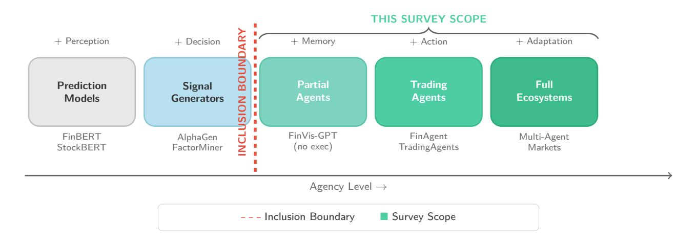

Figure 1: The Agency Spectrum of Trading Systems. From left to right: *Prediction Models* (e.g., FinBERT, StockBERT) perceive market information but lack decision-making capabilities; *Signal Generators* (e.g., AlphaGen, FactorMiner) add decision layers but remain non-executing; *Partial Agents* (e.g., FinVis-GPT without execution) incorporate memory but lack action modules; *Trading Agents* (e.g., FinAgent, TradingAgents) close the perception–memory–reasoning–action loop; *Full Ecosystems* (e.g., multi-agent markets) add adaptation and coordination. For this survey's primary empirical subset, studies must satisfy both minimum criteria shown by the inclusion boundary: *Action Output* and *Closed-Loop Evaluation*. Works left of that boundary may inform background discussion, but they do not enter primary, protocol-reporting, or reproducibility statistics.

ducible evidence, rather than backtest scores alone.

Despite the rapid emergence of LLM-based trading systems, the literature lacks a shared review lens for separating agent boundaries, protocol reporting, and architectural roles. Recent surveys and benchmarks often emphasize task coverage and model-level performance—for example, benchmark suites such as the FinBen suite [Xie et al.](#page-56-1) [\(2024\)](#page-56-1), PIXIU [Xie et al.](#page-56-2) [\(2023\)](#page-56-2), and InvestorBench [Li et al.](#page-52-0) [\(2025\)](#page-52-0), alongside finance-specific model/tool works such as FinGPT [Wang et al.](#page-56-3) [\(2023a\)](#page-56-3). Broader overviews of LLM agents in finance and trading [Ding et al.](#page-50-0) [\(2024\)](#page-50-0); [Dong et al.](#page-50-1) [\(2025\)](#page-50-1) are also useful. While valuable, these works typically do not provide a systematic account of how agents perceive market data, store and retrieve information, reason about trading decisions, execute actions under market frictions, or adapt their behavior over time.

*Note: Comparison criteria reflect our auditability-focused perspective. Other surveys prioritize di*ff*erent goals (e.g., model benchmarking, general agent architectures) where our criteria may not apply. FinBen and InvestorBench are benchmarks rather than surveys; evaluating them on "architecture coverage" may be inappropriate to their design goals.*

#### *1.1. Related Surveys and Positioning*

Several recent surveys examine aspects of AI in trading and finance, but they usually pursue different review objectives than the architecture-centric, protocol-aware perspective used here. We position our work against three categories of related surveys.

General LLM-Agent Surveys. A widely cited general survey by [Wang et al.](#page-56-4) [\(2024\)](#page-56-4) reviews LLM-based autonomous agents

across domains, organizing around agent construction, application, and evaluation. While foundational for general agent design, this survey does not focus on finance-specific concerns such as transaction-cost modeling, market-friction constraints, or the temporal structure of trading data. Our work complements this by focusing narrowly on trading, where execution semantics and cost assumptions are first-class concerns.

Financial Machine Learning Surveys. [Giglio et al.](#page-51-0) [\(2022\)](#page-51-0) survey recent methodological contributions in asset pricing using factor models and machine learning, organizing the literature around expected returns, factors, risk exposures, risk premia, the stochastic discount factor, model comparison, and alpha testing. Their scope remains centered on asset-pricing estimation and inference rather than the *agentic* problem of mapping predictions into executable actions under market constraints.

Task-Oriented Financial Benchmarks. The FinBen suite [Xie](#page-56-1) [et al.](#page-56-1) [\(2024\)](#page-56-1), InvestorBench [Li et al.](#page-52-0) [\(2025\)](#page-52-0), and finance-specific works such as FinGPT [Wang et al.](#page-56-3) [\(2023a\)](#page-56-3) and PIXIU [Xie et al.](#page-56-2) [\(2023\)](#page-56-2) emphasize task coverage and model-level performance evaluation. These benchmarks are valuable for comparing models on specific financial NLP or forecasting tasks, but they typically do not require end-to-end agentic evaluation—that is, closed-loop action generation under market frictions with explicit execution semantics. Our survey focuses specifically on works that close this loop, mapping perception through execution.

This gap is particularly problematic given the interdisciplinary nature of agentic trading systems, which draws from artificial intelligence, quantitative finance, cognitive science, and eco-

Table 1: Selected related surveys/benchmarks and auditability-oriented review emphasis. Criteria: Primary=central organizing concern; Partial=discussed qualitatively or for a subset of works; Background=appears mainly as supporting context; Not primary=outside the work's main review objective. Arch: architecture-centric organization (perception/memory/reasoning/action); Exec/Cost: explicit execution semantics and transaction-cost modeling; Map: structured evidence mapping table (≥20 papers); R: reproducibility tier assessment (R0–R3).

| Work                                     | Type       | Scope                | Arch        | Exec/Cost   | Map         | R           |
|------------------------------------------|------------|----------------------|-------------|-------------|-------------|-------------|
| This survey                              | Survey     | Trading Agents       | Primary     | Primary     | Primary     | Primary     |
| LLM-Agent Survey Wang et al. (2024)   | Survey     | General AI Agents | Primary     | Partial     | Not primary | Not primary |
| Giglio-Kelly-Xiu Giglio et al. (2022) | Survey     | Asset Pricing ML  | Background  | Partial     | Not primary | Not primary |
| FinBen Xie et al. (2024)              | Benchmark  | Financial Tasks      | Not primary | Not primary | Not primary | Not primary |
| FinGPT Wang et al. (2023a)            | Model/Tool | Financial NLP        | Not primary | Not primary | Not primary | Not primary |
| InvestorBench Li et al. (2025)        | Benchmark  | Trading Tasks        | Not primary | Partial     | Not primary | Not primary |
| LLM-Trading Survey Ding et al. (2024) | Survey     | Trading Agents       | Partial     | Partial     | Not primary | Not primary |
| LLM-Finance Survey Dong et al. (2025) | Survey     | Finance Agents       | Partial     | Partial     | Not primary | Not primary |

nomics. Without a unifying framework, researchers and practitioners struggle to compare approaches, identify overlapping innovations, or systematically explore the design space of trading agents.

# *1.2. Taxonomy Gap: Why Existing Frameworks Leave Open Gaps*

While the surveys reviewed above provide valuable coverage, they share a common limitation: they treat trading agents as either *applications* of general LLM-agent techniques or as *prediction models* with execution as an afterthought. This leads to systematic misclassifications that obscure critical design choices and hinder comparative analysis.

Limitation 1: Execution as Implicit Component. Existing frameworks typically treat action/execution as a byproduct of reasoning rather than a first-class architectural component. For example, FinAgent [Zhang et al.](#page-57-0) [\(2024\)](#page-57-0) is categorized as "Multimodal Financial Agent" in [Dong et al.](#page-50-1) [\(2025\)](#page-50-1), emphasizing its perception module while underplaying its execution layer a critical component for evaluating real-world deployability. The Architecture-Capability-Adaptation (A-C-A) lens treats Action/Execution as a core architectural dimension, making order mapping, cost assumptions, and latency constraints explicit [\(Section 6\)](#page-15-0).

Limitation 2: Architecture-Capability Conflation. Prior surveys often conflate *mechanism* (how agents process information) with *function* (what agents accomplish). For instance, AlphaAgent [Tang et al.](#page-55-0) [\(2025\)](#page-55-0) is a multi-agent alpha-mining framework whose regularized exploration mechanisms—originality enforcement, hypothesis-factor alignment, and complexity control help counteract alpha decay. The A-C-A lens distinguishes these concerns: the same Reactive Architecture can support both Alpha Generation (high-frequency signals) and Execution

(order slicing), while Strategic Architecture enables Portfolio Management (long-horizon planning) *across di*ff*erent functional domains* [\(Section 7\)](#page-17-0).

Limitation 3: Adaptation as Implementation Detail. Current frameworks treat learning and adaptation as homogeneous implementation details rather than a cross-cutting design dimension. TradingAgents [Xiao et al.](#page-56-0) [\(2024\)](#page-56-0) is classified as "Multi-agent Framework" without distinction between its hierarchical role organization (Architecture), its distributed capability allocation (Capability), and its feedback-based adaptation (Adaptation). The A-C-A lens makes adaptation levels explicit, from in-context learning (behavioral) to self-evolution (structural), with distinct protocol requirements for each [\(Section 10\)](#page-26-0).

[Table 2](#page-3-0) illustrates how three representative works can be re-read under the A-C-A exploratory analytical lens, making architectural distinctions more explicit than in prior categorizations. [Section Appendix C](#page-42-0) provides additional reclassification notes for representative papers as illustrative material rather than an external validation study.

We present a survey of LLM-based trading agents through an audit-oriented expert-system perspective. Our contributions are ordered by evidential strength:

- 1. An auditable evidence ledger under explicit inclusion criteria, separating 77 included studies into a fixed primary empirical subset (*n* = 19) and a background tier (*n* = 58).
- 2. A protocol and reproducibility audit showing that the current primary subset is not yet protocol-comparable: 2/19 studies report extractable split protocols, 1/19 report explicit cost models, 1/19 report universe/survivorship handling, 11/19 report execution semantics, 15/19 are R0, and 0/19 reach R3.
- 3. An expert-system decision-pipeline framing that maps perception to knowledge acquisition, memory/RAG to

Table 2: Taxonomy comparison: how existing frameworks classify representative works versus the A-C-A exploratory analytical lens. The A-C-A lens offers *architectural granularity* that complements (rather than refutes) prior categorizations; this table is illustrative rather than externally validated.

| Work                                                                                                                    | Prior Framework                                      | A-C-A Reclassification                                                                                                                       |  |
|-------------------------------------------------------------------------------------------------------------------------|------------------------------------------------------|----------------------------------------------------------------------------------------------------------------------------------------------|--|
| FinAgent Zhang et al. (2024)                                                                                         | "Multi-modal Agent" (perception centric)    | Architecture: Multi-modal Perception + Execution; Capability: Cross-modal Alpha; Adaptation: In-context learning                             |  |
| AlphaAgent Tang et al. "Multi-agent" (organization-centric) (2025) Regularized exploration against alpha decay |                                                      | Architecture: Reflective/Strategic hybrid Reasoning; Capability: Code-based Alpha with validation feedback; Adaptation:                      |  |
| TradingAgents Xiao et al. (2024)                                                                                  | "Multi-agent Framework" (organization-centric) | Architecture: Hierarchical role-based Coordination; Capability: Distributed Alpha+Portfolio+Risk; Adaptation: Hierarchical feedback |  |

the knowledge base, reasoning to the inference engine, execution to the action interface, risk/compliance to rule constraints, and logs/human oversight to explanation and accountability artifacts.

- 4. A-C-A as a working analytical lens, used to locate where architecture, capability, and adaptation choices create reporting gaps across the decision pipeline. We do not present A-C-A as an externally validated taxonomy.
- 5. Reporting checklists and methodological implications that separate evidence findings, background concepts, and author proposals, and translate recurring protocol gaps into minimum reporting expectations for future studies.

The remainder of this paper is organized as follows. [Section 2](#page-3-1) describes the review protocol and evidence scope. Part I: Architecture [\(Sections 3](#page-5-0) to [6\)](#page-15-0) presents the core architectural components. Part II: Capability [\(Sections 7](#page-17-0) to [9\)](#page-22-0) analyzes the capabilities enabled by this architecture. Part III: Adaptation [\(Sections 10](#page-26-0) to [12\)](#page-32-0) explores how agents adapt and evolve. [Section 13](#page-37-0) discusses technical challenges and future directions, and [Section 14](#page-40-0) concludes the survey.

We begin by establishing the foundational understanding of what constitutes an agentic trader, drawing on cognitive science and artificial intelligence literature to define the essential architectural components.

Part I addresses the fundamental question: *What constitutes an agentic trader?* We argue that an agentic trader can be characterized by four core architectural components—perception, memory, reasoning, and action/execution—that together support autonomous decision-making in financial markets. While traditional trading systems focus primarily on prediction, agentic systems typically include an explicit cognitive loop that can interact with and learn from the market environment through decisions that are mapped to tradable actions under market constraints.

# 2. Review Protocol and Evidence Scope

This review is designed as an audit-oriented evidence map rather than an exhaustive systematic review. Our goal is to make the evidentiary boundary of agentic trading explicit, to separate primary trading evidence from background design context, and to calibrate synthesis claims to protocol completeness rather than to headline performance alone.

We scoped the formal search to records published from 2022- 01-01 through 2026-03-09 (last query date: 2026-03-09), using ACM Digital Library (including ICAIF), IEEE Xplore, arXiv, SSRN, and Google Scholar, complemented by backward and forward citation chaining. We start the focused window in 2022 because this is the period in which LLM-based systems begin to appear as end-to-end trading agents rather than as isolated NLP or forecasting components. After deduplication and screening, the current ledger contains 77included studies from 92candidate records.

To make the review boundary reproducible, we distinguish three fixed denominators throughout the manuscript. The *candidate registry* contains 92unique records after deduplication. The *included evidence-mapping ledger* contains 77records retained for either primary evidence or background/design context. The *primary empirical subset* contains 19records that satisfy Action Output, Closed-Loop Evaluation, and an eligible empirical evaluation type (backtest, simulation, live, or benchmark); all protocol-field percentages, reproducibility percentages, and claim-to-evidence summaries use this 19 record subset unless explicitly stated otherwise.

Our inclusion boundary is intentionally narrow. To enter the *primary empirical subset*, a study must satisfy both of the following conditions: *(i) Action Output*, meaning that the system emits tradable actions such as orders, position changes, or portfolio allocations; and *(ii) Closed-Loop Evaluation*, meaning that those actions are evaluated in backtesting, simulation, or live trading rather than only through predictive metrics. Studies that remain useful for architectural or contextual discussion but do not satisfy both conditions are retained as *Background (BG)* within the included ledger. Under this rule, the present snapshot yields 19primary empirical studies and 58background studies. All protocol, denominator-based, and reproducibility summaries in this survey are computed over the fixed primary subset unless stated otherwise.

The screening workflow proceeded in four steps. First, database and preprint searches were run with agent/trading/finance keyword families and then expanded through backward and forward citation chaining. Second, duplicate records were removed by title, arXiv identifier, DOI, and manual inspection. Third, title/abstract screening removed records outside financial trading, portfolio construction, execution, or risk-management settings. Fourth, full-text screening assigned each retained record to either primary empirical evidence or background

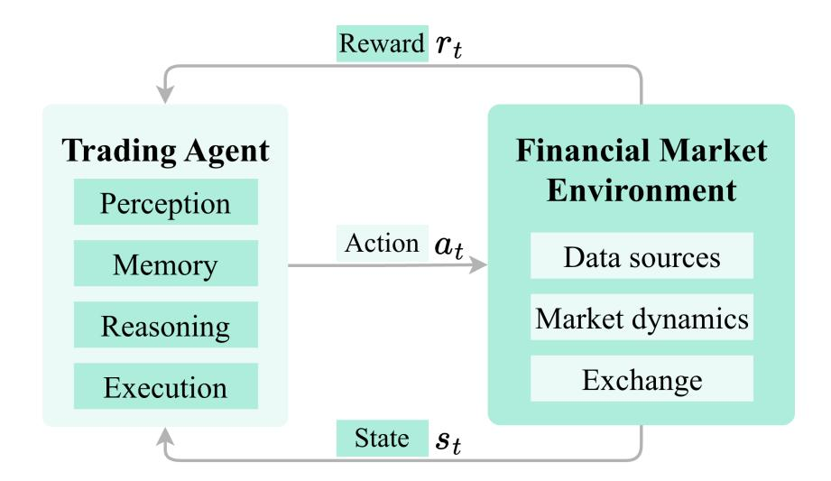

Figure 2: Reasoning flow diagram. The agent receives input from perception and memory, applies reasoning mechanisms to generate candidate actions, evaluates these actions through forward planning or reflection, selects the best action, and executes it through the action module. Feedback loops enable learning and adaptation over time. This figure is schematic and is *not* used for evidence-mapping statistics or protocol comparison.

Table 3: Study selection summary using the canonical candidate registry. The denominator is the 92-record deduplicated registry. Final exclusions are outside the survey domain; finance-relevant records that lack Action Output or Closed-Loop Evaluation remain in the included background tier. Detailed logs and per-record decisions are provided in Supplementary Material S1.

| Stage                                                   | Count |
|---------------------------------------------------------|-------|
| Registry candidate recordsa                             | 92    |
| Included in evidence mapping set                        | 77    |
| Excluded at screening/eligibility                       | 15    |
| Final exclusion reason                                  |       |
| Outside finance/trading/portfolio/risk-management scope | 15    |
| Included evidence-map partition                         |       |
| Primary empirical subset                                | 19    |
| Background/context tier                                 | 58    |

aThe canonical registry currently contains 92unique records after deduplication (77included in the evidence mapping set and 15excluded at screening/eligibility). The included evidence mapping set is partitioned into 19primary empirical studies and 58background/context records.

context. Studies were excluded from the candidate registry only when they fell outside the survey domain; papers that were finance-relevant but lacked Action Output or Closed-Loop Evaluation were kept as background context rather than counted as final exclusions.

For each included study, we code two classes of information. The first is architectural scope: perception, memory, reasoning, action/execution, and adaptation. The second is protocol-critical reporting: time-consistent split discipline, execution timing or semantics, transaction-cost modeling, universe/survivorship handling, and reproducibility artifacts. Missing or unclear reporting is coded conservatively as *NR*/*Unknown* rather than imputed. This coding is intended to support transparent evidence accounting and cautious cross-paper synthesis, especially in a literature where execution realism, leakage control, and artifact availability remain uneven.

We audited the screening stage on a stratified double-screening sample of 182 raw screening records in Supplementary Material S1. Because that sample predates the final 92-record canonical registry, it is retained only as a screening-boundary quality check. It is not used as evidence for extraction-level protocol fields, reproducibility tiers, or A-C-A classification robustness. To address the more consequential coding decisions, we added a targeted extraction-level audit over 15fixed-seed primary studies (seed=20260426). The audit covers action output, closed-loop evaluation, evidence role, evaluation type, split protocol, cost model, execution semantics, universe/survivorship handling, artifacts, and R0–R3 reproducibility. The per-study coding sheet and adjudication notes are provided in Supplementary Material S3.

Accordingly, the A-C-A lens should be read as an exploratory analytical lens for organizing the current evidence base, not as a settled or externally established classification scheme. Corpus-

Table 4: Reliability and coding-quality audits reported with the submission package.

| Audit layer                    | Sample            | Observed agreement           | Agreement note                                       | Scope                                                              |
|--------------------------------|-------------------|------------------------------|------------------------------------------------------|--------------------------------------------------------------------|
| S1 screening-boundary audit | 182 raw records   | Reported in S1               | Boundary only                                        | Inclusion/exclusion and screening-stage labels                     |
| S3 extraction-level audit   | 15primary studies | 100.0% after adjudication | field-dependent; see Supplementary Material S3 | Extraction fields used for protocol and reproducibility statistics |

level descriptive statistics for protocol reporting, reproducibility, and peer-review status are summarized in [Section Appendix B;](#page-42-1) boundary decisions and final exclusions are summarized in [Section Appendix D.](#page-45-0) Detailed query strings, screening logs, extraction tables, reliability-audit files, and coding notes are provided in Supplementary Materials S1–S3.

#### *2.1. Agentic Trading as an Expert-System Decision Pipeline*

For the purposes of ESWA, we interpret LLM-based trading agents as expert-system decision pipelines. This framing makes the evaluation problem explicit. Perception modules perform knowledge acquisition from prices, news, filings, social media, and market microstructure signals. Memory, retrievalaugmented generation, and tool-mediated context stores form a knowledge base whose provenance and update rules must be inspectable. Reasoning modules act as inference engines that convert state representations into hypotheses, rationales, and candidate decisions. Action and execution modules form the external action interface, where target weights, orders, fills, latency assumptions, and market frictions must be made explicit. Risk controls, compliance filters, and portfolio limits serve as rule constraints on the path from inference to action. Finally, logs, immutable artifacts, and human oversight provide the explanation and accountability layer expected of decisionsupport systems.

This expert-system framing motivates the protocol audit in the rest of the paper. A trading agent can appear architecturally sophisticated while still being empirically weak if the evaluation omits temporal splits, transaction costs, universe construction, execution semantics, or reproducible artifacts. The A-C-A lens is therefore used to locate evidence gaps across the pipeline: architecture describes where knowledge is acquired, stored, inferred, and acted upon; capability describes which trading function is being supported; and adaptation describes how the decision pipeline changes under feedback.

# 3. Perceptual Architecture

The preceding section introduced the cognitive architecture of agentic traders. This section addresses the question: "How do agents perceive financial markets?"

In this survey, we strictly define Perception as the mechanism by which an agent acquires a state observation *Ot* from the environment state *S t* at decision time *t*. This distinction is critical: general financial NLP or time-series forecasting models (e.g.,

standalone BERT or LSTM predictors) are considered Background (BG) unless they are explicitly integrated into an agent's decision loop. Under the primary-subset boundary specified in [Section 2,](#page-3-1) BG systems lack the closed-loop integration required for agentic classification but may provide valuable perceptual capabilities that end-to-end agents incorporate.

A perception module must do more than predict; it must provide actionable state representations—such as sentiment scores, market regime indicators, or visual summaries—that the agent's reasoning component can utilize to formulate valid actions.

We mobilize the evidence set to analyze perception across three distinct modalities, refined to separate visual signals from numerical data.

*Evidence status.*

- 1) Evidence base: Perception claims are supported only when a modality is embedded in an action-producing, closed-loop trading agent; standalone financial NLP, forecasting, or chart-analysis papers are retained as background.
- 2) Supported claim: The current evidence supports perception as an input contract for agent decisions, not as an independently validated source of trading profitability.
- 3) Reporting gap: Most studies do not expose timestamp availability, modality latency, or retrieval logs.
- 4) Implication: Perception modules should be reported as auditable state-construction pipelines before their downstream performance claims are compared.

*Taxonomy.*

- Text-based Perception [\(Section 3.1\)](#page-6-0): Processing unstructured linguistic data (news, reports).
- Time-Series & Structured Perception [\(Section 3.2\)](#page-6-1): Processing numerical sequences (price, volume) and structured fundamentals.
- Visual & Multimodal Perception [\(Section 3.3\)](#page-7-0): Processing chart images and fusing heterogeneous data streams.

[Figure 3](#page-6-2) illustrates the three perceptual modalities, showing the progression from single-modality processing (text-only or time-series-only) to integrated multimodal perception. This progression reflects both the increasing complexity of perceptual mechanisms and the expanding scope of information that agents can leverage.

# **Three Perceptual Modalities In Agentic Trading**

# **Text-based**

## Input:

News

• Reports

· Social media

# **Processing:**

Sentiment

• NLP

• Extraction

### **Time-series**

## Input:

• Prices

• Volume

Indicators

# **Processing:**

• Patterns

Trends

• Regimes

# Multimodal

# **Input:**

• Text + Charts

• News + Prices

· Cross-asset

# **Processing:**

• Fusion

Alignment

• Attention

Figure 3: Three perceptual modalities in agentic trading. Text-based perception processes linguistic information from news and reports. Time-series perception analyzes numerical patterns in price and volume data. Multimodal perception integrates heterogeneous data sources through cross-modal fusion mechanisms. This figure is schematic and is not used for evidence-mapping statistics or protocol comparison.

#### 3.1. Text-based Perception

Text-based perception refers to the acquisition of state observations  $O_t$  from linguistic information sources (news articles, earnings reports, analyst commentary, social media posts, regulatory filings) at decision time t. The module encodes textual inputs into representations—such as sentiment scores, event embeddings, or contextualized vectors—that the reasoning component can utilize to formulate actions.

Representative Approaches. Several lines of work have developed specialized architectures for financial text understanding. Du et al. (Du et al., 2024) provide a comprehensive survey of financial sentiment analysis techniques, reviewing prior evidence that sentiment signals are often associated with subsequent market movements. Iacovides et al. (Iacovides et al., 2024) introduce FinLlama, an LLM-based approach fine-tuned for financial sentiment analysis in algorithmic trading scenarios. Zhang et al. (Zhang et al., 2023a) propose Instruct-FinGPT, which uses instruction tuning to adapt general-purpose LLMs to financial sentiment tasks, while Zhang et al. (Zhang et al., 2023b) explore retrieval-augmented generation to enhance sentiment analysis with external knowledge.

Technical Mechanisms. Text-based perception typically follows a pipeline of tokenization, encoding, and extraction. Domain-specific language models such as FinBERT (Araci, 2019) provide contextualized representations of financial text, capturing terminology and semantic nuances that are often underrepresented in general-purpose models. Rodriguez Inserte et al. (Rodriguez Inserte et al., 2024) show that adapting large language models through task-specific fine-tuning can improve performance on financial sentiment tasks. Sentiment classification models then map these representations to polarity labels (e.g., positive, negative, and neutral) or to more fine-grained affective states. Xing et al. (Xing, 2025) further study heterogeneous LLM agents for financial sentiment analysis and report improved benchmark performance relative to selected baselines.

Critical Challenge: Temporal Alignment. A pervasive risk in text perception is look-ahead bias. News timestamps often record publication time rather than the exact time at which an item becomes available to a trading pipeline, creating a mismatch between historical records and executable decision contexts. Agents trained on historical news corpora without explicit ingestion-lag modeling or embargo enforcement are therefore likely to exhibit inflated backtest performance. A related issue is that some financial disclosures and structured reports are revised after initial release; using retrospectively cleaned or final versions in backtesting can introduce serious data leakage López de Prado (2018).

Table 5 summarizes representative text-based perception methods, highlighting the diversity of data sources and technical approaches. While effective for textual information, these methods cannot directly process numerical price data or visual chart patterns, motivating the need for complementary perceptual modalities.

# 3.2. Time-Series & Structured Perception

Time-series and structured perception refers to the acquisition of state observations  $O_t$  from numerical sequences (price, volume, Limit Order Books-LOB) and structured fundamental data (e.g., balance sheet tables) at decision time t. This modality encodes temporal patterns—such as trend indicators, volatility estimates, or regime classifications—into representations the reasoning component can utilize. It encompasses not only price and volume sequences (Open-High-Low-Close-Volume— OHLCV), but also deeper market structures such as LOB, options-implied state variables, and structured fundamental information. Because these inputs evolve over time, agents must deal with temporal dependence, seasonality, structural breaks, and non-stationary distributions when constructing actionable state representations.

Table 5: Text-based perception methods. Audit Status: BG=Background Model (not integrated into agent loop); R0–R3=Reproducibility Level (see [Section Appendix B\)](#page-42-1). Time Disc.=Time Discipline (Static=offline batch processing; RT=real-time streaming with specified latency).

| Reference                                           | Input Source                | Representation            | Time Disc. Audit |    |
|-----------------------------------------------------|-----------------------------|---------------------------|------------------|----|
| FinBERT Araci (2019)                                | News Headlines              | Sentiment Score (Scalar)  | Static           | BG |
| FinGPT Wang et al. (2023a)                          | News/Social                 | Summary/Embedding         | Static           | BG |
| BloombergGPT Wu et al. (2023)                       | Financial Corpus General LM |                           | Static           | BG |
| FinLlama Iacovides et al. (2024)                    | Reports                     | Instruction Tuned         | Static           | BG |
| Instruct-FinGPT Zhang et al. (2023a) Financial Text |                             | Instruction Tuned         | Static           | BG |
| RAG-FinGPT Zhang et al. (2023b)                     | Mixed Sources               | Retrieval-Augmented       | Static           | R0 |
| Heterogeneous Agents Xing (2025)                    | Multi-source                | Specialized Architectures | Static           | R0 |

Representative Approaches. Representative work in this area studies how sequence models encode information from market data streams into trading-relevant state representations. Recent systems use transformer-style or attention-based encoders to summarize price dynamics, while classical econometric approaches remain useful for regime identification and structuralchange analysis. In the current agentic trading literature, however, most implemented systems still rely on relatively accessible OHLCV-style inputs; explicit use of high-frequency LOB data and richly structured fundamentals remains comparatively limited.

Technical Mechanisms. Key challenges include nonstationarity, noise, and sensitivity to temporal misalignment. Successful approaches often employ attention mechanisms to focus on informative time points, regime-switching models to capture structural breaks [Hamilton](#page-51-2) [\(1989\)](#page-51-2); [Bai and Perron](#page-48-0) [\(2003\)](#page-48-0), and representation-learning objectives that improve robustness under changing market conditions. Standard positional encodings and related sequence-ordering schemes can also help models capture periodic structure and temporal context in sequential financial data [Vaswani et al.](#page-55-1) [\(2017\)](#page-55-1).

[Table 6](#page-8-0) compares representative time-series perception methods. While powerful for numerical data, these methods cannot directly incorporate the rich contextual information available in text, creating a need for multimodal perception.

# *3.3. Visual* & *Multimodal Perception*

Visual and multimodal perception refers to the acquisition of state observations *Ot* from heterogeneous sources (chart images, text, numerical series, audio) at decision time *t*, integrating these into unified representations through cross-modal alignment mechanisms. This reflects the reality where traders synthesize visual technical patterns with news flow and price action.

Representative Approaches. For visual perception, Wang et al. [\(Wang et al.,](#page-56-7) [2023b\)](#page-56-7) introduce FinVis-GPT for financial chart analysis, treating chart-like market representations as visual inputs that can be linked to language-based interpretation. For multimodal fusion, Zhang et al. [\(Zhang et al.,](#page-57-0) [2024\)](#page-57-0) introduce FinAgent, which combines textual news and numerical market information through a cross-modal pipeline designed for trading decisions. More broadly, multimodal systems differ in where fusion occurs: early-fusion approaches combine low-level inputs before representation learning, whereas late-fusion approaches aggregate higher-level features from separate encoders.

Critical Challenge: Cross-Modal Asynchrony. Fusing modalities with different update frequencies creates synchronization risks. News arrives sporadically, whereas market and LOB data may update at much higher frequency. Naive framing strategies such as pairing the latest available news item with the current price can therefore misrepresent the true decision context when the text signal is stale. In addition, visual interpretation and multimodal inference introduce nontrivial latency, which can make the perceived market state outdated by the time the agent acts in live settings. For this reason, protocol reporting should explicitly state perception-latency assumptions and alignment procedures.

Technical Mechanisms. Multimodal fusion poses significant challenges: different modalities have different dimensionalities, temporal resolutions, and noise characteristics. Early fusion concatenates raw features from all modalities before processing, while late fusion maintains separate processing pipelines and combines high-level representations. Cross-attention mechanisms provide a flexible alternative by enabling one modality to attend selectively to another during representation learning [Vaswani et al.](#page-55-1) [\(2017\)](#page-55-1); [Tsai et al.](#page-55-2) [\(2019\)](#page-55-2). Temporal alignment remains especially difficult in financial settings, because textual events arrive discretely while prices update continuously. Preventing look-ahead bias therefore requires strict timestamp discipline, explicit embargo handling, and clearly reported latency budgets [López de Prado](#page-54-1) [\(2018\)](#page-54-1).

[Figure 4](#page-8-1) illustrates the multimodal fusion pipeline, showing how text encoders process news and reports while time-series encoders analyze price movements, with a cross-modal fusion layer integrating these representations.

[Table 7](#page-8-2) summarizes representative visual and multimodal perception approaches. Taken together, these studies suggest that richer market state estimation often benefits from combining heterogeneous signals rather than relying on a single modality in isolation.

In summary, this section has presented three perceptual modalities through which trading agents acquire information from financial environments. Text-based perception extracts signals from language, time-series perception models temporal structure in numerical data, and multimodal perception integrates these complementary signals. The perceptual mechanisms described here produce state observations *Ot* that are stored and retrieved by memory architectures, which we discuss next.

Table 6: Time-series and structured perception methods. Time Disc.: RT=Real-time capable; Static=Offline dataset.

| Reference                                                                                                                 | Input Data                                      | Mechanism                                          | Time Disc. Audit   |                |
|---------------------------------------------------------------------------------------------------------------------------|-------------------------------------------------|----------------------------------------------------|--------------------|----------------|
| VISTA Khezresmaeilzadeh et al. (2025) Market Time Series EarnHFT Qin et al. (2024) Regime-Switching Hamilton (1989) | Crypto Market States Hierarchical RL Returns | Sequence Modeling Framework Hidden Markov Model | RT RT Static | R0 R0 BG |

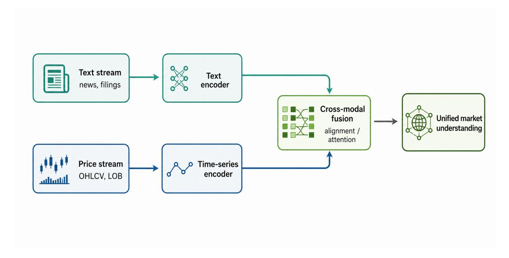

Figure 4: Multimodal fusion flow in agentic trading. The diagram illustrates how text encoders and time-series encoders process their respective inputs before a cross-modal fusion layer integrates the representations into a unified market understanding. This figure is schematic and is *not* used for evidence-mapping statistics or protocol comparison.

Table 7: Visual and multimodal perception methods. Latency: Estimated inference latency (critical for alignment). Note: Latency estimates are author-reported; see Supplementary Material S2 for detailed benchmarking protocols.

| Reference                                              | Modalities                                   | Fusion Strategy          | Latency Audit |    |
|--------------------------------------------------------|----------------------------------------------|--------------------------|---------------|----|
| FinVis-GPT Wang et al. (2023b)                         | Chart Images                                 | Vision-Language Analysis | Low           | BG |
| FinAgent Zhang et al. (2024)                           | News + Prices + Kline Charts Cross-Attention |                          | High          | R1 |
| Multimodal Transformer Tsai et al. (2019) Text + Audio |                                              | Cross-Modal Attention    | Med           | BG |

Table 8: Summary of perceptual architectures in trading agents. The Protocol Risk column highlights specific alignment challenges for each modality.

| Modality          | Primary Inputs              | Mechanism                                          | Protocol Risk                                | Examples             |
|-------------------|-----------------------------|----------------------------------------------------|----------------------------------------------|----------------------|
| Text-based        | News, Reports, Social Media | LLM Fine-tuning, Prompting, Senti ment Analysis | Publication Lag, Embargo Violations          | FinBERT, FinGPT      |
| Time-Series       | OHLCV, LOB, Fundamentals    | Temporal Attention, Hierarchical RL, GNNs       | Look-ahead Bias, Data Revisions              | EarnHFT, VISTA       |
| Visual/Multimodal | Charts, Text+Price+Audio    | Vision-Language Analysis, Cross Modal Attention | Synchronization Latency, Causal Misalignment | FinVis-GPT, FinAgent |

The next section addresses the question: "How do agents remember and store information?"

### 4. Memory Architecture

The preceding section introduced perceptual mechanisms for gathering market information. This section addresses the question: "How do agents remember and store information?"

Our use of *working*, *episodic*, and *semantic* memory draws on cognitive psychology, with episodic and semantic memory following Tulving's distinction [Tulving](#page-55-3) [\(1972\)](#page-55-3), multi-store structure drawing on Atkinson and Shiffrin [Atkinson and Shi](#page-48-1)ffrin [\(1968\)](#page-48-1), and working memory following Baddeley and Hitch [Baddeley and Hitch](#page-48-2) [\(1974\)](#page-48-2). While these terms originate from human memory research, they map naturally to trading agents:

- Episodic memory (experience-specific) → Historical trade records
- Semantic memory (knowledge-general) → Financial domain knowledge
- Working memory (active context) → Active trading context

This mapping has precedent in reinforcement learning literature on memory-augmented agents Zong et al. (2024).

Evidence status.

- Evidence base: Memory claims are treated as primary only when memory state participates in a closed-loop trading evaluation; general RAG or cognitive-memory analogies remain background.
- 2) Supported claim: Memory can organize market context and prior decisions, but the evidence does not yet identify a dominant memory architecture.
- **3) Reporting gap:** Papers rarely report update rules, retention windows, deletion policies, and replayable memory snapshots.
- **4) Implication:** Memory should be reported as a governed state store with explicit temporal boundaries, not only as a descriptive module.

Terminological Note. Our use of "working," "episodic," and "semantic" memory adapts cognitive psychology terminology for architectural description. We acknowledge these analogies are imperfect: AI "episodic memory" lacks the subjective experience and reconstructive processes of human episodic memory; "consolidation" in neural systems differs fundamentally from synaptic mechanisms in biological brains. We employ these terms for their intuitive organizational value while recognizing the underlying mechanisms differ substantially.

Memory is the critical bridge between perception and reasoning, enabling agents to accumulate experience over time rather than treating each trading decision in isolation. We organize the memory architecture around a taxonomy of three memory systems that differ in their temporal scale, capacity, and functional role.

Taxonomy.

- 1. **Working Memory** (Section 4.1): Short-term buffer for active trading context and risk tracking.
- 2. **Episodic Memory** (Section 4.2): Storage of specific trading episodes and market events.
- 3. **Semantic Memory** (Section 4.3): Long-term knowledge base for financial concepts and strategies.

#### 4.1. Working Memory

In agentic trading, working memory is often conflated with a generic "context window." For audit-oriented agent design, we distinguish between the **Deterministic State Store** (Layer A) and the **Generative Context** (Layer B).

Layer A: Deterministic State Store (Audit-Truth). This layer holds the ground-truth state of the trading system, including current positions, open orders, account balances, and risk limits. In an audit-oriented architecture, we argue that it should be **read-only** to the LLM and updated solely by the environment (e.g., EMS/OMS feedback). Treating this state as a "memory" subject to forgetting or hallucination is a critical vulnerability; in practice, it is better implemented as a structured store exposed through tools or state queries, as seen in tool-using trading agent designs Xiao et al. (2024).

**Layer B: Generative Context (Inference Scope)**. This layer corresponds to the LLM's active context window, containing the sliding history of observations, chain-of-thought reasonings, and recent reflections. Unlike Layer A, information here is transient and subject to eviction.

**Technical Mechanisms**. To manage Layer B's limited capacity, agents employ eviction policies such as **Summary-Compression** (condensing old steps into a narrative) or **hierarchical memory management** (using layered storage and retrieval priorities to retain higher-value fragments) Packer et al. (2023); Sun and Zeng (2025). A key design trade-off is the *context-to-noise ratio*: maintaining too much history can dilute attention and bury decision-relevant content in long contexts, a risk consistent with the broader "Lost in the Middle"finding Liu et al. (2024), while aggressive pruning may drop reasoning that is still relevant to a live position or pending order.

Table 9 summarizes the three memory systems, highlighting their differing capacity constraints and temporal scales. While working memory enables rapid decision-making, episodic and semantic memory support long-term learning and knowledge accumulation.

#### 4.2. Episodic Memory

Episodic memory stores specific trading experiences. To ensure auditability, valid episodes must be defined as a tuple  $(S_t, A_t, O_{t+k}, \tau)$ , where  $S_t$  is the state,  $A_t$  is the action,  $O_{t+k}$  is the outcome realized at step t + k, and  $\tau$  is the timestamp when this outcome becomes observable.

**Information Leakage via Memory**. We refer to a key vulnerability in trading agents as the "Oracle Fallacy,"where an agent retrieves a similar past episode that contains a *post-hoc* narrative (e.g., "this trade failed due to news X released tomorrow").

#### **Protocol Implication**

To prevent this, we suggest that reproducible trading-agent protocols enforce an **Outcome Embargo**: an episode recorded at t cannot expose its outcome field to retrieval until current time  $t_{now} \ge t + k$ .

Recent work has addressed the challenge of deterministic replay in financial agents, introducing assurance frameworks for regulatory audit Khatchadourian (2026).

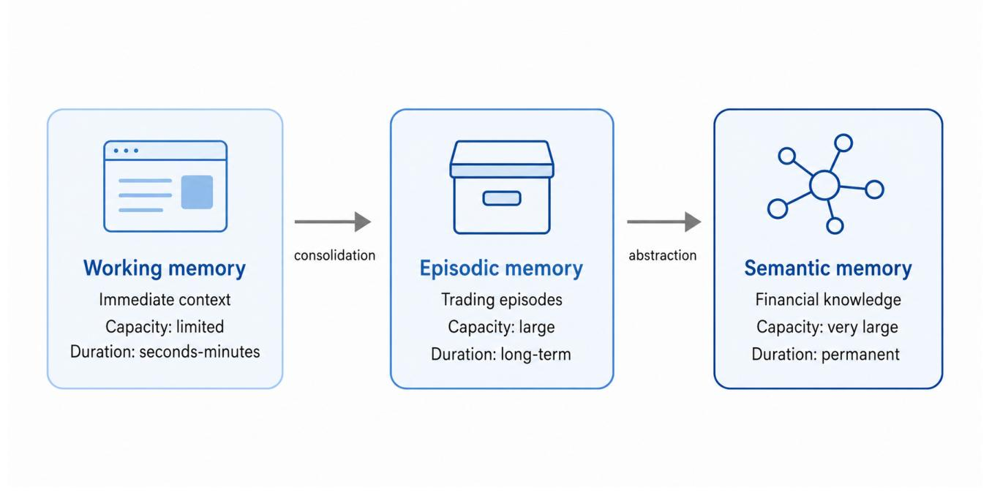

**Figure 5:** Three memory systems in agentic trading. Working memory maintains immediate context (capacity: limited, duration: seconds-minutes). Episodic memory stores trading episodes (capacity: large, duration: long-term). Semantic memory encodes financial knowledge (capacity: very large, duration: permanent). This figure is schematic and is *not* used for evidence-mapping statistics or protocol comparison.

Table 9: Memory system comparison. Tags follow the convention in Table 5 for the representative reference.

| Memory Type Capacity Volatility Key Characteristics |                   | Key Characteristics |                                                         |
|-----------------------------------------------------|-------------------|---------------------|---------------------------------------------------------|
| Working Memory                                      | Limited (Context) | Volatile            | Fast cache, eviction policies, sliding window           |
| Episodic Memory                                     | Large (Disk)      | Persistent          | Vector embeddings, similarity search, temporal indexing |
| Semantic Memory                                     | Infinite          | Persistent          | Knowledge graphs, neuro-symbolic, consolidation         |

Representative Approaches. FinAgent (Zhang et al., 2024) uses layered memory with dual-level reflection and diversified retrieval, though it appears to rely more on prompt-level control than on explicit database-level temporal constraints. FinMem (Yu et al., 2023) introduces a layered memory architecture with character design, demonstrating performance enhancement through structured memory management. Reflexion (Shinn et al., 2023) uses episodic storage to prune bad trajectories, but assumes relatively prompt feedback from the environment, a condition that becomes less natural in trading settings where reward realization may be delayed.

**Technical Mechanisms**. Vector databases Johnson et al. (2017); Malkov and Yashunin (2020) enable similarity search, but naive cosine similarity is often insufficient for financial time-series. "Time-Aware Retrieval"is therefore a useful design principle.

# **Protocol Implication**

We suggest a relevance score f(q,k) that includes a decay term  $e^{-\lambda(t_{now}-t_k)}$  to prioritize recent regimes.

Furthermore, **Drift Handling** is required: as market regimes shift (e.g., from low to high volatility), old episodes with

high feature similarity may still yield misleading expectations, a risk consistent with recent retrieval-augmented time-series forecasting evidence Xiao et al. (2025a).

#### 4.3. Semantic Memory

Semantic memory stores domain knowledge (e.g., "high interest rates hurt growth stocks"). For audit-oriented analysis, we classify this memory not by its format (Graph vs. Text), but by its **Auditability**:

**Type 1: Parametric Memory (Implicit)**. This knowledge is encoded in the model's weights via pre-training or fine-tuning (e.g., FinGPT (Wang et al., 2023a)). While efficient, it is relatively **opaque** (difficult to trace *why* the model knows a fact) and comparatively **static** (updates usually require additional training or alignment). For trading, this raises the risk of "outdated priors," where older market regularities may persist in model behavior after the regime that produced them has changed.

**Type 2: Non-Parametric Memory (Explicit)**. This involves retrieval from an external Knowledge Base (KB). We further distinguish between:

• **Curated KBs**: Verified documents (Rulebooks, SEC Filings) where source integrity is high Wang et al. (2025b).

• Uncurated KBs: Open-web data (Social Media, Forums) susceptible to "Noise Injection"or adversarial poisoning.

Technical Mechanisms. To ensure integrity, "Source Tracking"is a necessary design requirement: every retrieved semantic fact should carry a provenance log (Document ID + Version Timestamp). Knowledge Graphs encode explicit entity-relation structure (e.g., *EntityA supplier*\_*o f* −−−−−−−−→ *EntityB*) and can therefore support provenance-oriented reasoning and constraint checking more directly than unstructured text alone.

## *4.4. Design Trade-o*ff*s*

Strict auditability reveals critical design trade-offs that are often obscured in performance-only benchmarks.

Latency vs. Recall Depth. Deeper retrieval in high-fidelity RAG systems can introduce latency that is incompatible with high-frequency or rapid mid-frequency strategies. Agents therefore need to balance *retrieval depth* against *decision latency* and *execution speed*.

Context Length vs. Distraction. While newer LLMs support 1M+ token windows, simply stuffing all retrieved memories into context degrades reasoning due to the "Lost-inthe-Middle"phenomenon [Liu et al.](#page-53-0) [\(2024\)](#page-53-0). A strictly designed agent often performs better with *less* but *higher-relevance* context than with a raw dump of history.

Noise Injection Risk. Allowing uncurated semantic memory (e.g., scraping Reddit) increases the risk of "Noise Injection,"where irrelevant or manipulated public sentiment overrides the agent's core logical strategy. We therefore treat a "Hierarchy of Truth"as a design principle: internal Layer A state should override external noisy signals when the two conflict.

In summary, this section has presented three memory systems that enable trading agents to accumulate and leverage experience. Working memory provides immediate context, episodic memory stores specific experiences, and semantic memory encodes domain knowledge. The next section examines how agents reason over this stored information to make trading decisions.

The next section addresses the question: "How do agents make trading decisions?"

## 5. Reasoning Architecture

The preceding sections explored how agents perceive markets and store information. This section addresses the question: "How do agents make trading decisions?"

Building on the notation from [Section 3](#page-5-0) and [Section 4,](#page-8-3) we denote observations as *Ot* (state observations at time *t*) and retrievable memories as *Mepisodic* (episodic memory store).

Reasoning is treated here as the decision function that transforms perceptions and memories into candidate actions. We organize reasoning architectures by a Time-Scale Reasoning Paradigm because decision horizon, computational budget, and search depth are more directly auditable than broad cognitive analogies.

# Evidence Summary (Memory)

- We treat memory design as an *evaluation knob*: retrieval choices (time-aware vs. naive similarity, windowing, truncation) can change decisions even with the same base model, so ablations should report memory settings [Yu](#page-57-4) [et al.](#page-57-4) [\(2023\)](#page-57-4); [Zhang et al.](#page-57-0) [\(2024\)](#page-57-0); [Liu et al.](#page-53-0) [\(2024\)](#page-53-0).
- Episodic retrieval can improve robustness by grounding decisions in comparable past episodes, but retrieved context should remain timestamp-correct and embargoaware to avoid leakage from post-event narratives [Zhang](#page-57-0) [et al.](#page-57-0) [\(2024\)](#page-57-0); [Shinn et al.](#page-55-5) [\(2023\)](#page-55-5).
- Implicit and explicit semantic memory can both accelerate adaptation, but neither retrieved documents nor generated rationales are automatically faithful; traceability depends on verifiable sources, versioning, and logs [Wang et al.](#page-56-3) [\(2023a,](#page-56-3) [2025b\)](#page-56-9).
- Reporting gaps remain common across the audited literature: many papers describe memory at a high level but omit store contents, update cadence, and failure modes (staleness, retrieval drift), which limits comparability across studies (see [Table 10\)](#page-12-0).

#### *Evidence status.*

- 1) Evidence base: Reasoning claims are grounded in primary studies only when the reasoning trace leads to tradable action under a backtest, simulation, live, or benchmark setting.
- 2) Supported claim: LLM reasoning broadens the space of inspectable decision rationales, but current evidence supports it as a design pattern rather than a validated performance taxonomy.
- 3) Reporting gap: Prompt versions, tool calls, search budgets, and failed reasoning branches are rarely logged.
- 4) Implication: Reasoning modules should be evaluated with decision traces and ablations, not only with final returns.

# *Taxonomy.*

- 1. Reactive Reasoning [\(Section 5.1\)](#page-12-1): Millisecond-scale, intuitive decisions based on pattern recognition.
- 2. Reflective Reasoning [\(Section 5.2\)](#page-13-0): Second-scale, deliberate reasoning using multi-step chains of thought.
- 3. Strategic Reasoning [\(Section 5.3\)](#page-14-0): Hour/day-scale planning and optimization across extended time horizons.

We use "reactive" strictly for *non-LLM* latency-constrained control. LLM-based methods (including ReAct adaptations) operate at second-scale or slower, placing them in the reflective category. This distinction is critical for avoiding the misconception that LLMs can support high-frequency trading decisions.

Figure [7](#page-13-1) provides a schematic comparison of these three paradigms by time-scale.

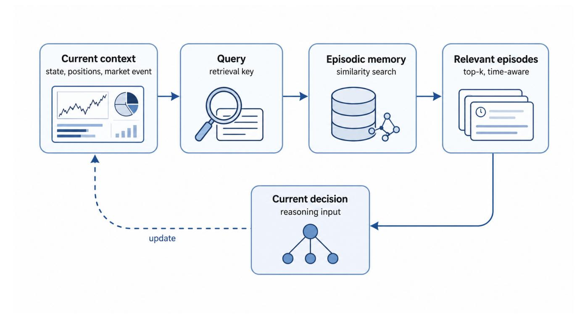

Figure 6: Memory retrieval mechanism. The agent formulates a query based on current context, searches the episodic memory database using similarity-based retrieval, and selects relevant episodes to inform the current decision. This figure is schematic and is *not* used for evidence-mapping statistics or protocol comparison.

Table 10: Comparison of memory retrieval mechanisms in trading agents. Tags follow the convention in [Table 5](#page-7-1) for the representative works in each row.

| Memory System            | Representative Ref           | Timestamp Rule | Embargo        | Drift Check | Audit Status |
|--------------------------|------------------------------|----------------|----------------|-------------|--------------|
| Working Memory           | FinMem Yu et al. (2023)      | N/A            | N/A            | N/A         | R0           |
| Episodic Memory          | FinAgent Zhang et al. (2024) | NR             | NR             | No          | R1           |
| Semantic Memory (Type 1) | FinGPT Wang et al. (2023a)   | Implicit       | No             | No          | BG           |
| Semantic Memory (Type 2) | FinSage Wang et al. (2025b)  | Versioned      | Yes (Doc Date) | Yes         | BG           |

Reasoning I/O Contract. For audit-oriented trading agents, we model the reasoning module as a function *f*(*Ot* , *Mepisodic*, *Pport f olio*) → (*Acand*, α, *Vcheck*), where:

- Inputs: timestamped observation *Ot* , retrievable memory *Mepisodic*, and read-only portfolio state *Pport f olio* (positions, risk limits).
- Outputs: a set of candidate actions *Acand*, a confidence score α ∈ [0, 1], and a validity check *Vcheck* (e.g., "holds &lt; max\_leverage").

This contract is intended to reduce the risk of "hallucinated actions" by enforcing risk constraints *during* or *immediately after* the reasoning step, distinct from the final execution layer.

#### *5.1. Reactive Reasoning*

Reactive reasoning, loosely analogous to System 1 in dualprocess theory (while acknowledging that this framework lacks consensus definitions for long-horizon planning), is characterized as a constrained simplified decision optimized

for latency budgets measured in milliseconds to microseconds. Importantly, this paradigm *does not* involve LLM-mediated deliberation—the latency of even lightweight LLMs (hundreds of milliseconds) exceeds the budgets of high-frequency trading. Instead, reactive trading systems employ rule-based controllers, lightweight neural networks (often <100K parameters), or precompiled decision tables that execute in constant time.

Representative Approaches. ReAct [\(Yao et al.,](#page-57-5) [2023b\)](#page-57-5) exemplifies reflective (not reactive) reasoning in general agent architectures—its "think" step involves explicit LLM inference that operates at second-scale latency. In trading contexts requiring millisecond response times, ReAct-style deliberation must be *decoupled from the critical path* and confined to offline analysis or non-latency-sensitive decision support. Rule-based systems encode expert knowledge as if-then rules (e.g., "if price crosses moving average, buy"), executing immediately when conditions are met. These systems sacrifice flexibility for speed, relying on pre-defined patterns rather than reasoning from first principles. The reactive paradigm is particularly effective

Figure 7: Three reasoning paradigms compared by time-scale. Reactive reasoning prioritizes speed over accuracy, executing in milliseconds. Reflective reasoning balances speed and accuracy through multi-step reasoning. Strategic reasoning prioritizes accuracy through extensive planning, executing over minutes to hours. This figure is schematic and is *not* used for evidence-mapping statistics or protocol comparison.

in relatively stable market regimes where previously learned patterns remain actionable. In agentic trading settings, this shallow-loop structure often appears as a reactive component inside larger systems, for example through tool-augmented signal retrieval plus constrained actions [\(Zhang et al.,](#page-57-0) [2024\)](#page-57-0), or through role-specialized teams that decompose perception while preserving a structured final decision pipeline [\(Xiao et al.,](#page-56-0) [2024\)](#page-56-0). Gradient-based policy optimization can further couple reactive decisions to reward-driven updates in interactive markets [\(Xiong](#page-57-6) [et al.,](#page-57-6) [2025\)](#page-57-6).

Technical Mechanisms. Reactive systems employ feature extractors that map raw market data to action logits, with the highest-logit action selected and executed. Neural networks with shallow architectures and limited reasoning depth are common, balancing prediction speed with accuracy. These architectures typically employ specialized layers such as temporal convolutional networks for processing time-series data [Bai et al.](#page-48-3) [\(2018\)](#page-48-3) or attention mechanisms for weighting relevant features [Vaswani](#page-55-1) [et al.](#page-55-1) [\(2017\)](#page-55-1). In some settings, a key advantage is *relative* interpretability: the mapping from a small feature set to actions can be inspected and constrained [Lundberg and Lee](#page-53-2) [\(2017\)](#page-53-2), though it does not guarantee faithful explanations of decision logic. However, these systems struggle with novel situations outside their training distribution, lacking the reasoning capacity to adapt to unprecedented market regimes. When market structure shifts abruptly, reactive agents may continue applying outdated patterns, potentially leading to significant losses.

The integration of tool use into financial agents requires explicit evaluation along at least two dimensions. AgentGuard studies safety-oriented evaluation for tool orchestration [Chen and Cong](#page-49-0) [\(2025\)](#page-49-0), while FinToolBench evaluates the capability of LLM agents to use financial tools in realistic tasks [Lu et al.](#page-53-3) [\(2026\)](#page-53-3). Complex reasoning over structured knowledge can be enhanced

through autonomous agent frameworks [Jiang et al.](#page-51-4) [\(2024\)](#page-51-4).

# *5.2. Reflective Reasoning*

Reflective reasoning, loosely analogous to System 2 in dualprocess theory (while acknowledging the limitations noted in [Section 5\)](#page-11-0), produces slow, deliberate decisions through multistep chains of thought. This paradigm enables agents to reason through complex scenarios, consider multiple hypotheses, and reflect on potential mistakes before acting. Unlike reactive systems that respond immediately to stimuli, reflective reasoning allocates computational resources to explore the decision space more thoroughly, making it suitable for medium-frequency trading where execution latency measured in seconds is acceptable.

Representative Approaches. Chain-of-Thought (CoT) prompting [\(Wei et al.,](#page-56-10) [2022\)](#page-56-10) guides LLMs to explicitly reason through trading decisions, producing intermediate steps like "the stock price dropped because of worse- than-expected earnings, but the long-term fundamentals remain strong, so this is a buying opportunity." FinCoT [\(Nitarach et al.,](#page-53-4) [2025\)](#page-53-4) adapts CoT to finance through domain-grounded prompting that encourages financial reasoning in trading tasks. FinCon [\(Yu et al.,](#page-57-1) [2024\)](#page-57-1) operationalizes reflective workflows through multi-agent or rolestructured coordination that updates investment beliefs over time. CryptoTrade [\(Li et al.,](#page-52-3) [2024c\)](#page-52-3) and TradingGroup [\(Tian et al.,](#page-55-6) [2025\)](#page-55-6) further instantiate reflection by revising trading decisions based on prior outcomes and synthesizing multi-source signals. Reflexion [\(Shinn et al.,](#page-55-5) [2023\)](#page-55-5) extends this with self-reflection, where agents critique their own reasoning and refine their conclusions before acting. For example, a Reflexion-based trader might generate an initial trading rationale, identify potential flaws in its logic (such as overlooking sector-wide risks), and revise its decision accordingly.

# Technical Mechanisms.

# Protocol Implication

We suggest a five-stage reflective reasoning protocol for audit-oriented trading agents: (1) analyze the current situation, (2) retrieve relevant memories, (3) consider multiple hypotheses, (4) evaluate the pros and cons of each action, (5) select the best action and justify the choice.

Temperature sampling controls the trade-off between creativity and consistency, with lower temperatures producing more deterministic reasoning. A challenge is maintaining coherence across long reasoning chains—LLMs may lose context or contradict themselves over dozens of reasoning steps. Techniques such as checkpointing (saving intermediate reasoning states) and consistency checks (verifying that conclusions follow from premises) help mitigate these issues [Wei et al.](#page-56-10) [\(2022\)](#page-56-10); [Wang](#page-56-11) [et al.](#page-56-11) [\(2022\)](#page-56-11); [Madaan et al.](#page-53-5) [\(2023\)](#page-53-5). The computational cost of reflective reasoning scales linearly with the number of reasoning steps, making it more expensive than reactive approaches but significantly more capable of handling novel situations that require adaptation.

Reflexion-style systems also assume relatively prompt feedback, which can be in tension with trading settings where outcomes materialize only after meaningful market delay [Shinn et al.](#page-55-5) [\(2023\)](#page-55-5). Modern risk-sensitive frameworks provide structured decision support for financial markets, though their exact internal decomposition varies by implementation [Liu and Dang](#page-52-4) [\(2025b\)](#page-52-4).

# *5.3. Strategic Reasoning*

Strategic reasoning extends beyond immediate decisions to plan across extended time horizons, considering sequences of actions and their long-term consequences. This paradigm addresses questions like "what portfolio allocation will maximize riskadjusted returns over the next quarter?" rather than "should I buy this stock right now?" Strategic reasoning operates at time scales of minutes to hours, making it suitable for portfolio optimization, risk management, and longer-term investment strategies where immediate execution is less critical than thorough planning.

Representative Approaches. Tree-of-Thought (ToT) [\(Yao](#page-57-7) [et al.,](#page-57-7) [2023a\)](#page-57-7) frames reasoning as search through a tree of possible thoughts, exploring multiple reasoning paths in parallel and selecting the most promising through explicit evaluation. Each node in the tree represents a partial reasoning state, and the algorithm systematically explores alternatives rather than committing to the first plausible solution. Monte Carlo Tree Search (MCTS) methods like Navigating Alpha Jungle [\(Shi et al.,](#page-55-7) [2025\)](#page-55-7) search through the space of possible trading strategies, using rollouts to estimate the long-term value of each candidate strategy. These methods balance exploration (trying new strategies) against exploitation (refining known good strategies) through upper confidence bounds applied to financial domains. Planning ideas from classical AI and reinforcement learning continue to inform strategic trading design, with state spaces representing market conditions and actions representing trading decisions. For portfolio-scale planning, RAPTOR [\(Almon](#page-46-1) [et al.,](#page-46-1) [2025\)](#page-46-1) integrates deliberative portfolio reasoning with

an orchestrated rebalancing pipeline to produce interpretable, risk-aware allocations.

Technical Mechanisms. Strategic reasoning requires models of the environment—predicting how market prices will evolve in response to trading actions. Model-based methods learn explicit transition models, capturing causal relationships between actions and market states. These models enable agents to simulate future scenarios and evaluate action sequences without executing them. Model-free methods learn value functions directly through experience, estimating the long-term return of each state-action pair without explicit environment models [Sutton and Barto](#page-55-8) [\(2018\)](#page-55-8). Hierarchical planning decomposes long horizons into shorter sub-problems: a strategic planner sets high-level targets (e.g., "reduce tech exposure by 20%"), and tactical planners execute specific trades to achieve these targets. Abstraction is critical—planning over individual stocks is intractable due to the combinatorial explosion of possible portfolios, but planning over sectors or factors reduces the state space to manageable dimensions. For example, a strategic planner might operate at the level of sector allocations (technology, healthcare, energy), while tactical planners handle individual stock selection within each sector. This hierarchical approach enables agents to reason about long-term objectives while remaining computationally feasible [Kocsis and Szepesvári](#page-52-5) [\(2006\)](#page-52-5); [Sutton et al.](#page-55-9) [\(1999\)](#page-55-9).

Critical Challenge: Search-Based Overfitting. Unlike game environments (e.g., Go, Chess) where simulation is perfect, financial planning relies on noisy historical data. Search algorithms (MCTS, ToT) that evaluate thousands of candidate strategies inherently face the *multiple testing* problem—finding a profitable trajectory purely by chance. To mitigate *Data Snooping*, reproducible research requires reporting the Search Budget (number of visited nodes) and enforcing strict Walk-Forward Validation, where the plan is frozen before being applied to out-of-sample data [Bailey et al.](#page-48-4) [\(2014\)](#page-48-4).

Hybrid Architecture: Cascaded Controller. To balance these trade-offs, advanced systems can employ what we call a Cascaded Controller architecture (illustrated in [Figure 7\)](#page-13-1): a master intent router classifies the market regime (e.g., "Flash Crash" vs. "Stable Trend") and routes execution to the appropriate paradigm, immediately triggering lower-level reactive stops in volatile conditions while planning strategic re-allocations during calm periods. *Note: both the term and the design pattern are our synthesis of principles observed in hierarchical trading systems [Yu et al.](#page-57-4) [\(2023\)](#page-57-4); [Xiao et al.](#page-56-0) [\(2024\)](#page-56-0); we present it as an architectural recommendation derived from the literature, not as an established term or a novel contribution of this survey.*

In summary, this section has presented three reasoning paradigms that enable trading agents to transform information into actions. Reactive reasoning provides fast responses to familiar situations, reflective reasoning enables complex deliberation, and strategic reasoning supports long-term planning. These paradigms are not mutually exclusive—sophisticated agents employ all three, switching between them based on the time constraints and complexity of the decision at hand. The next section examines how agents map decisions into concrete market actions

**Table 11:** Comparison of reasoning paradigms. **R-Level**: Reproducibility level (R0–R3, see Section Appendix B). **Audit Gap** highlights common reporting deficiencies.

| Paradigm   | Time-Scale                      | Mechanism                                                       | R-Level | Representative Works                                                                                     | Audit Gap (Common)               |
|------------|---------------------------------|-----------------------------------------------------------------|---------|----------------------------------------------------------------------------------------------------------|----------------------------------|
| Reactive   | Microsecond-millisecond budgets | Rule-based / Lightweight NN (often <100K params) / FSM | R0-R1   | ReAct Yao et al. (2023b) (reflective, not reactive), reactive components in FinAgent Zhang et al. (2024) | •                                |
| Reflective | Seconds                         | CoT / Self-Critique                                             | R0-R1   | FinCoT Nitarach et al. (2025), FinCon Yu et al. (2024)                                                   | Inference Cost not reported      |
| Strategic  | Minutes/Hours                   | MCTS / Planning                                                 | R0-R1   | Alpha Jungle Shi et al. (2025), Alpha 2 Xu (2024)                                             | Search Budget & Overfitting Risk |

#### **Evidence Summary (Reasoning)**

- Reasoning depth trades off with latency: reflective/strategic loops can improve planning quality, but must match the market timescale (event-driven vs. microstructure) Nitarach et al. (2025); Shi et al. (2025).
- Traces increase observability, not guaranteed faithfulness: chain-of-thought and self-critique can be useful artifacts, but for audit-oriented evaluation it is prudent to check them against grounded inputs and realized outcomes before treating them as trustworthy explanations Shinn et al. (2023).
- Search-based methods (e.g., MCTS in alpha spaces) can exacerbate multiple-testing risk; protocol details (splits, costs) determine whether gains generalize Shi et al. (2025).
- Comparisons across paradigms benefit from standardized reporting of prompts, tooling, and failure handling (timeouts, invalid actions), together with realistic multimonth evaluations beyond static tasks Zhang et al. (2024); Chen et al. (2025).
- Reasoning Evaluation Checklist—To improve replicability, we suggest that future works report:
  (1) Faithfulness: Can the reasoning trace be verified against ground-truth data snapshots? (2) Leakage: Does the reasoning chain implicitly use future information?
  (3) Budget: For strategic search, what is the max node count and rollout depth?

and execute them under cost, impact, and latency constraints.

#### 6. Action and Execution Architecture

The preceding sections examined perception, memory, and reasoning. This section addresses the question: "How do agents turn decisions into market actions?"

Evidence status.

1) Evidence base: Action/execution evidence is primary only when a system emits tradable actions and evaluates the resulting loop.

- 2) **Supported claim:** Execution semantics are the strongest boundary between a trading agent and a signal model.
- **3) Reporting gap:** Many papers omit order timing, fill assumptions, cost models, and rejection handling.
- **4) Implication:** The action interface should be treated as a typed I/O contract, and performance claims without execution semantics should remain conservative.

**Action I/O Contract**. For auditability, the action module is often modeled as a function  $f(D_t) \rightarrow (A_{order}, A_{algo})$ , where:

- Input: Decision output  $D_t$  (e.g., target portfolio weights  $w_t^*$  or signal  $s_t$ ).
- Output: A set of executable orders  $A_{order}$  (with strictly typed fields: side, size, limit price, TIF) and an execution algorithm selection  $A_{algo}$  (e.g., "submit immediately" or "TWAP over 5 min").
- Failure Modes: The interface typically handles *Rejection* (risk check failure), *Partial Fill* (liquidity shortage), and *Timeout* (latency violation), feeding these states back to memory.

This contract helps avoid "implicit execution" where agents are assumed to trade at the close price without order generation delays or constraints.

Taxonomy.

- 1. **Decision-to-Order Mapping**: Mapping high-level intent (signal, targets, risk limits) into order parameters (side, size, type, timing).
- 2. **Execution and Cost Modeling**: Selecting an execution policy (e.g., slicing, passive vs aggressive) and modeling transaction costs and market impact.
- 3. **Microstructure and Latency Awareness**: Incorporating order book dynamics, fill probabilities, and latency constraints that shape feasible actions.

Comparability note. Protocol-comparable action/execution claims typically report MR-3 (action semantics), MR-4 (execution & costs), and MR-6 (artifacts & logs); see Section 13.

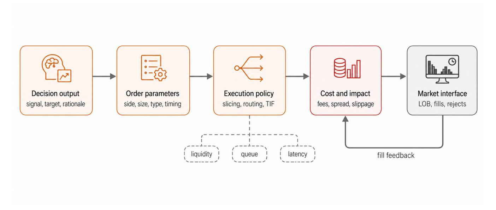

Figure 8: From decision to execution. Agent outputs map into order parameters and are executed with explicit cost and impact modeling under market microstructure constraints. This figure is schematic and is *not* used for evidence-mapping statistics or protocol comparison.

## *6.1. Decision-to-Order Mapping*

First Principle: Action Definition Risk. A critical failure mode in agent design is the ambiguity between *target weights* (portfolio intent) and *executable orders* (market instructions). If an agent only emits target weights without explicitly modeling order timing, fill constraints, and costs, evaluation can quietly collapse intent into execution, thereby underestimating the *execution gap* and liquidity constraints [Zhang et al.](#page-57-0) [\(2024\)](#page-57-0); [Chen et al.](#page-49-2) [\(2022\)](#page-49-2); [Cheridito and Weiss](#page-49-3) [\(2025\)](#page-49-3); [Liu and Dang](#page-52-6) [\(2025a\)](#page-52-6); [Papadakis et al.](#page-54-4) [\(2025\)](#page-54-4); [Olby et al.](#page-53-6) [\(2025\)](#page-53-6).

The literature shows that action modules translate high-level decisions (e.g., *increase exposure*) into order instructions. This mapping depends on explicit choices about order type (limit vs market) and queue position, as microstructure theory models execution probability as a function of order aggressiveness and state [Foucault](#page-50-3) [\(1999\)](#page-50-3); [Parlour](#page-54-5) [\(1998\)](#page-54-5). Constraints such as pretrade validation and kill switches are important boundaries that help keep theoretical alpha from turning into realized losses due to market impact [Kyle](#page-52-7) [\(1985\)](#page-52-7); [Glosten and Milgrom](#page-51-5) [\(1985\)](#page-51-5).

#### *6.2. Execution and Cost Modeling*

Execution policies determine how orders are placed over time and venues. Typical approaches include schedule-based execution (e.g., time-weighted average price (TWAP) and volumeweighted average price (VWAP)), cost-aware optimization that trades off urgency vs market impact [Almgren and Chriss](#page-46-2) [\(2001\)](#page-46-2); [Bertsimas and Lo](#page-48-5) [\(1998\)](#page-48-5); [Perold](#page-54-6) [\(1988\)](#page-54-6), and learning-based execution that adapts to market conditions. Recent studies explore deep learning and reinforcement learning for execution and impact-aware trading [Genet](#page-50-4) [\(2025\)](#page-50-4); [Byun](#page-49-4) [\(2023\)](#page-49-4); [Cheridito](#page-49-3) [and Weiss](#page-49-3) [\(2025\)](#page-49-3); [Hafsi and Vittori](#page-51-6) [\(2024\)](#page-51-6); [Chen et al.](#page-49-2) [\(2022\)](#page-49-2); [Olby et al.](#page-53-6) [\(2025\)](#page-53-6). FinPos [Liu and Dang](#page-52-6) [\(2025a\)](#page-52-6) introduces a position-aware trading agent system specifically designed for

real financial markets, emphasizing continuous portfolio adjustment. StockSim [Papadakis et al.](#page-54-4) [\(2025\)](#page-54-4) provides a dual-mode order-level simulator for evaluating multi-agent LLMs in financial markets, enabling realistic execution modeling.

#### *6.3. Microstructure and Latency Awareness*

Microstructure signals (order book imbalance, spread, queue position) are not merely inputs for optimization but represent hard feasibility constraints that filter the action space. Here, LOB (Limit Order Book) refers to the real-time queue of outstanding buy and sell limit orders, with LOB features including imbalance (bid vs. ask volume), spread, and depth.

- 1. Data Availability: The literature shows agents can suffer from "look-ahead bias" by acting on LOB features (e.g., *Imbalancet*) that are not technically available at decision time *t* due to processing latency. Feasible actions are generally conditioned on *Ot*−δ.
- 2. Latency Budget: In high-frequency regimes, the *latency budget* (time from perception to exchange ack) determines whether an arbitrage opportunity exists [Budish et al.](#page-49-5) [\(2015\)](#page-49-5). If *Tcompute* &gt; *Tdecay*, the action *at* is invalid regardless of its theoretical alpha.

Models of order book dynamics [Gould et al.](#page-51-7) [\(2013\)](#page-51-7); [Briola et al.](#page-49-6) [\(2024\)](#page-49-6) serve to validate these constraints before execution.

#### Evidence Summary (Action and Execution)

- Cost and impact modeling is essential for credible claims at order level: reported gains are sensitive to slippage/fees assumptions and simulator fidelity [Cheridito and Weiss](#page-49-3) [\(2025\)](#page-49-3); [Chen et al.](#page-49-2) [\(2022\)](#page-49-2).
- Microstructure-aware policies benefit from reporting latency, routing constraints, and data availability (LOB features) to make results comparable [Niu et al.](#page-53-7) [\(2024\)](#page-53-7); [Briola et al.](#page-49-6) [\(2024\)](#page-49-6).
- Post-trade explanations are useful only with auditable logs and verifiable data sources; otherwise they risk becoming plausible narratives that do not diagnose failure modes [Tan et al.](#page-55-10) [\(2025a\)](#page-55-10); [Khatchadourian](#page-52-2) [\(2026\)](#page-52-2).

# Protocol Implication

Beyond execution optimization, LLMs can support posttrade narratives by summarizing execution logs. To reduce "ex post rationalization" (where the LLM hallucinates a strategic reason for a random failure), we recommend grounding these narratives in immutable logs and replayable evidence [Tan et al.](#page-55-10) [\(2025a\)](#page-55-10); [Khatchadourian](#page-52-2) [\(2026\)](#page-52-2).

- Recommendation: Narrative generation can cite a cryptographically specific *Order*\_*ID* and *S napshot*\_*Hash* from the execution layer.
- Verification: Auditors can replay the *S napshot*\_*Hash* to check whether the market condition (e.g., "high spread") claimed by the narrative actually existed.

Without this *Log-to-Narrative Verification* link, LLM explanations are better treated as qualitative summaries rather than audit artifacts.

In summary, action and execution connect reasoning to real market interaction. They benefit from explicit modeling of constraints and costs that are often under-specified in agent papers. With the architectural foundations established, we now turn to the capabilities these architectures enable, beginning with alpha generation.

# 7. Alpha Discovery Capability

The preceding sections established the architectural foundations of agentic traders. This section addresses the question: "How do agents discover trading signals?"

Alpha discovery refers to generating and testing candidate trading signals. In this evidence map, we treat autonomous alpha search as supported only when the reported system connects discovery to out-of-sample or closed-loop evaluation, rather than when it only proposes factors.

*Evidence status.*

1) Evidence base: Primary alpha evidence comes from studies that connect factor or strategy generation to backtest or market-simulation outcomes.

- 2) Supported claim: LLM agents can expand the search interface for alpha ideas and formulaic factors.
- 3) Reporting gap: Search budgets, sealed test sets, factor similarity filters, and transaction-cost assumptions are often underreported.
- 4) Implication: Alpha-discovery claims should be read as search-pipeline evidence unless novelty, leakage control, and execution costs are reported together.

## **Classical Baseline: Factor Models and Information Coefficient**

Before LLM-based approaches, alpha generation relied on manually engineered factor models (e.g., the Fama-French three-factor model, momentum, value) where factor validity is measured by Information Coefficient (IC)—the correlation between factor scores and subsequent returns. Statistical rigor required controlling for multiple testing (White's Reality Check, Hansen's SPA) to distinguish true signals from data mining [Fama and French](#page-50-5) [\(1993\)](#page-50-5); [Grinold and Kahn](#page-51-8) [\(2000\)](#page-51-8). LLM-based agents automate factor discovery but face the same fundamental challenge: ensuring discovered patterns generalize out-of-sample rather than exploiting historical noise.

#### *Taxonomy.*

- 1. Code-based Alpha Discovery [\(Section 7.1\)](#page-18-0): Generating alpha factors through natural language to code translation.
- 2. Retrieval-based Alpha Discovery [\(Section 7.2\)](#page-19-0): Discovering alpha by retrieving and adapting existing factors.
- 3. Evolutionary Alpha Discovery [\(Section 7.3\)](#page-19-1): Searching the factor space through evolutionary optimization.

*Comparability note.* Protocol-comparable alpha discovery claims should report MR-2 (time split + sealed test), MR-4 (execution & costs), and MR-6 (factor semantics + artifacts & logs); see [Section 13](#page-37-0) for detailed protocol requirements and reporting checklists.

# Author Framework

Alpha-to-Trade Contract. We introduce the Alpha-to-Trade Contract as a conceptual framework for distinguishing statistical significance from tradeable signals. To bridge this gap, the conversion contract specifies:

- 1. Frequency Compatibility: Does the signal update frequency match the execution latency budget?
- 2. Turnover Constraints: Does the theoretical gain survive realistic transaction costs and market impact?
- 3. Liquidity Reality: Is the factor universe liquid enough for the assumed capital capacity?

Papers omitting this contract risk conflating theoretical IC with realized alpha return, a common pitfall in agentic trading literature [López de Prado](#page-54-1) [\(2018\)](#page-54-1).

Figure [9](#page-18-1) summarizes the three alpha discovery paradigms at a glance.

Table 12: Representative action/execution approaches and evaluation dimensions. Type distinguishes between End-to-End Agents (E2E) and component-level algorithms (Algo). Note that *Agent* literature often adopts simplified assumptions (Sim-based), whereas *Algo* literature focuses on execution quality but lacks agentic reasoning. Audit Gap highlights common missing reporting items.

| Category       | Type | Action Space   | Core Mechanism                   | Cost Assumption     | Audit Gap (Com mon) | Tags |
|----------------|------|----------------|----------------------------------|---------------------|------------------------------|------|
| Schedule-based | Algo | Order schedule | TWAP/VWAP-style scheduling       | Explicit fees       | Slippage Calib.              | R0   |
| RL Execution   | Algo | Market Orders  | Policy optimization in simulator | Impact-aware reward | Latency Budget               | R0   |
| Sim-based RL   | E2E  | Order-level    | Market simulator + RL            | Simulator-dependent | Decision Timing              | R0   |
| Microstructure | Algo | Limit Orders   | Fill/LOB modeling                | Implicit via LOB    | Realized Spread              | R0   |
| Hierarchical   | E2E  | Meta-Actions   | Hierarchical RL for order types  | Explicit/implicit   | Failure Modes                | R0   |

Figure 9: Three alpha discovery paradigms. Code-based discovery translates natural language hypotheses into executable code. Retrieval-based discovery finds and adapts existing factors from a library. Evolutionary discovery searches the factor space through mutation and selection. This figure is schematic and is *not* used for evidence-mapping statistics or protocol comparison.

#### *7.1. Code-based Alpha Discovery*

Code-based alpha generation leverages the code synthesis capabilities of LLMs to translate natural language hypotheses about market behavior into executable factor definitions. This paradigm enables domain experts who lack programming expertise to directly express and test their trading ideas.

Representative Approaches. CogAlpha [\(Liu et al.,](#page-53-8) [2025\)](#page-53-8) extends code-based generation with structured prompting templates that guide the LLM toward syntactically correct and semantically meaningful factor definitions. AlphaAgent [\(Tang](#page-55-0) [et al.,](#page-55-0) [2025\)](#page-55-0) further introduces regularization mechanisms (originality enforcement, hypothesis alignment, and complexity control) to counteract alpha decay. FactorMAD [\(Duan et al.,](#page-50-6) [2025\)](#page-50-6) leverages multi-agent debate frameworks where multiple LLM agents critique and refine factor proposals to enhance interpretability. Automate Strategy Finding [\(Kou et al.,](#page-52-8) [2025\)](#page-52-8) implements a three-stage pipeline with risk-aware multi-agent validation and ensemble strategy selection, reporting 53.17% cumulative returns on SSE50 under its backtest setup (*Split*: NR; *Execution*: NR; *Cost*: NR; *Universe*: SSE50; *Tier*: BG). When protocol-critical details are NR/Unknown, we treat such results as illustrative rather than protocol-comparable evidence.

Recent approaches combine LLM reasoning with reinforcement learning for structured trading decision-making [Xiao et al.](#page-56-12) [\(2025b\)](#page-56-12), and ensemble strategies employing deep reinforcement learning have demonstrated superior performance in stock trading tasks [Yang et al.](#page-57-9) [\(2025\)](#page-57-9).

Technical Mechanisms. The generation pipeline operates as an *adaptive search process* susceptible to overfitting: (1) parse the natural language hypothesis to identify key components, (2) map these to code templates and APIs, (3) generate executable code, (4) validate through sandboxed execution, and (5) backtest on historical data. Crucially, the "Validation Chain" provides feedback that guides the next generation step. This feedback loop creates a risk of adaptive overfitting: as the agent iterates to maximize the validation Sharpe ratio, it effectively "mines" the validation set [Bailey et al.](#page-48-4) [\(2014\)](#page-48-4); [López de Prado](#page-54-1) [\(2018\)](#page-54-1). Therefore, a rigorous protocol requires reporting the Search Budget (number of generated hypotheses) and ensuring that the final performance is reported on a sealed *Test Set* that is never exposed to the agent during the refinement loop. Without this separation, reported "validation" metrics are statistically inflated. Sandboxed execution mitigating security risks is also standard practice. Examples of synthesized factors include momentum and reversal signals, but their validity depends entirely on the

integrity of the data split.

#### *7.2. Retrieval-based Alpha Discovery*

Retrieval-based alpha generation reuses existing factor knowledge through retrieval and adaptation. Rather than generating factors from scratch, the agent finds related signals or financial context that can inform the current situation.

Representative Approaches. RAG-based financial retrieval systems [\(Cook et al.,](#page-49-7) [2025\)](#page-49-7) index domain knowledge as embeddings and retrieve contextually similar items using semantic search. PRISM [\(Ng et al.,](#page-53-9) [2025\)](#page-53-9) further refines retrieval through prompt-optimized in-context modeling for financial domains. Retrieval-augmented frameworks for financial timeseries forecasting [\(Xiao et al.,](#page-56-8) [2025a\)](#page-56-8) similarly demonstrate the effectiveness of combining LLM generation with historical pattern retrieval.

Technical Mechanisms. Retrieval relies on vector embeddings that encode factor semantics (formula structure) and market context. However, the validity of this paradigm hinges on Factor Library Governance, a data integrity challenge often overlooked.

- Survivorship Bias: If the library collects only "historically successful" factors, the retrieval process implicitly conditions on future outcomes, inflating backtest performance.
- Look-ahead Leakage in Embeddings: If the embedding model is trained on textual descriptions containing future knowledge (e.g., "a successful high-volatility factor"), the retrieval query *qt* effectively leaks information from *t* + *k*.

#### Protocol Implication

We recommend Point-in-Time (PIT) Governance for verifiable evidence: the retrieval corpus *Lt* available at time *t* must strictly contain only documents and performance metadata known at *t* [Cook et al.](#page-49-7) [\(2025\)](#page-49-7); [Ng et al.](#page-53-9) [\(2025\)](#page-53-9).

### *7.3. Evolutionary Alpha Discovery*

Evolutionary alpha generation searches the factor space through iterative mutation, crossover, and selection, treating factor discovery as an optimization problem. This paradigm can discover novel factor combinations that human experts might not conceive.

Representative Approaches. Navigating Alpha Jungle [\(Shi](#page-55-7) [et al.,](#page-55-7) [2025\)](#page-55-7) employs Monte Carlo Tree Search (MCTS) to efficiently explore the combinatorial space of possible factors. Each node in the search tree represents a partial factor definition (e.g., a specific transformation applied to a price series), and MCTS balances exploration (trying new factor components) with exploitation (refining promising factors). Alpha2 [\(Xu,](#page-57-8) [2024\)](#page-57-8) uses deep reinforcement learning, where an agent learns to construct factors by sequencing primitive operations, receiving rewards based on backtest performance. EFS (Evolutionary Factor Searching) [\(Luo et al.,](#page-53-10) [2025\)](#page-53-10) reformulates asset selection as a

top-m ranking task guided by LLM-generated factors, incorporating an evolutionary feedback loop for iterative refinement.

Technical Mechanisms. Evolutionary methods define a search space of primitive operations (price transformations, technical indicators) and combination rules. MCTS and Genetic Programming (GP) navigate this space by balancing exploration (new operations) and exploitation (refining promising factors). However, this paradigm faces a severe Multiple Testing Scalability risk. As the search space grows exponentially, the probability of finding a false positive approaches 1.0 unless rigorous statistical corrections are applied [White](#page-56-13) [\(2000\)](#page-56-13). Therefore, a valid protocol must report: (1) Primitive Ops Audit (the exact set of allowed functions), (2) Total Search Depth/Budget, and (3) statistical tests for data snooping (e.g., White's Reality Check or Hansen's SPA) [Hansen](#page-51-9) [\(2005\)](#page-51-9). Currently, few agent papers report these stats, rendering their results difficult to distinguish from noise. Regularization techniques (complexity penalties, ensemble methods) are useful heuristics but do not substitute for formal multiple hypothesis testing.

Open Question: Mathematical Bounds for Agent-Driven Search. While traditional multiple testing corrections (White's Reality Check, Hansen's SPA, and the Deflated Sharpe Ratio [Bailey et al.](#page-48-4) [\(2014\)](#page-48-4)) remain the statistical gold standard, a critical question emerges for LLM-based agents: can the agent's internal reflection/evolution loop provide novel mathematical bounds on overfitting risk? Current evidence suggests not yet. The reflection budget [\(Section 12.3\)](#page-36-0) limits search iterations but does not provide statistical guarantees on false discovery rate. The sealed test set protocol prevents adaptive overfitting but relies on experimental discipline rather than closed-form bounds. Factor originality constraints (e.g., AST-based similarity in AlphaAgent) reduce effective search space but do not quantify the residual multiple testing penalty. *This represents a significant research gap*: future work could explore whether LLM reasoning traces, factor genealogy logs, or Bayesian model averaging over discovered factors can yield principled, agent-native overfitting controls that complement or extend classical methods. Until such methods are developed, evolutionary alpha systems should report both (1) search budget protocol constraints and (2) classical multiple testing statistics (e.g., deflated Sharpe ratio [Bailey et al.](#page-48-4) [\(2014\)](#page-48-4)) to enable rigorous evaluation.

[Table 13](#page-20-0) summarizes the three alpha discovery paradigms. In practice, sophisticated agents combine all three: using codebased generation to encode expert hypotheses, retrieval to leverage existing knowledge, and evolutionary search to discover novel combinations.

In summary, this section has presented three paradigms for alpha generation. Code-based discovery translates hypotheses into factors, retrieval-based discovery adapts existing factors, and evolutionary discovery searches for novel factors. The next section examines how agents manage portfolios, allocating capital across multiple alpha signals.

The next section addresses the question: "How do agents manage multi-asset portfolios?"

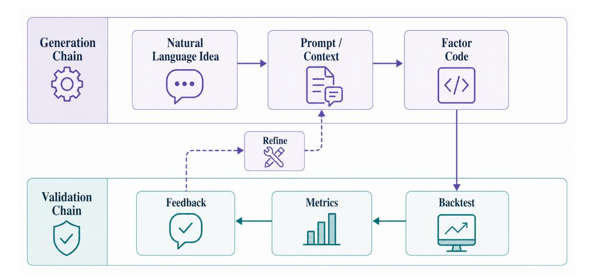

Figure 10: Chain-of-Alpha workflow. The generation chain (top) translates natural language into factor code. The validation chain (bottom) backtests the factor, computes performance metrics, and provides feedback for refinement. The two chains interact iteratively until a satisfactory factor is produced. This figure is schematic and is *not* used for evidence-mapping statistics or protocol comparison.

Table 13: Comparison of alpha discovery algorithms. Novelty is defined by structural distance (e.g., AST) from known factor families. Overfitting risk is proportional to the unadjusted search budget and IS-OOS performance gap. Protocol Tags (Split/Execution/Cost/Universe) indicate reporting rigor: R0 (no runnable artifacts), R1 (code available but not runnable), R2 (runnable with gaps), BG (background/conceptual), –– (not reported/applicable).

| Paradigm     | Discovery Mech              | Search Space          | Novelty   | Overfitting | Works                                                                      | Tags  |
|--------------|-----------------------------|-----------------------|-----------|-------------|----------------------------------------------------------------------------|-------|
| Code-based   | LLM → Code                  | Semantic factors      | High      | Medium      | CogAlpha Liu et al. (2025)                                              | R0    |
| Code-based   | Multi-Agent Debate          | Interpretable factors | High      | Low         | FactorMAD Duan et al. (2025)                                         | BG    |
| Retrieval    | Vector Search               | Factor Library        | Low       | Low         | RAG-Fintech Cook et al. (2025)                                       | R0    |
| Retrieval    | Prompt-Refined RAG          | Financial corpus      | Medium    | Low         | PRISM Ng et al. (2025)                                         | BG    |
| Evolutionary | MCTS / Deep RL              | Combinatorial ops     | Very High | High        | Alpha Jungle (R0), Alpha2 (R1) Shi et al. (2025); Xu (2024) | R0–R1 |
| Evolutionary | LLM-Guided Evolu tion | Sparse portfolios     | High      | Medium      | EFS Luo et al. (2025) BG                                                   |       |

#### 8. Portfolio Management Capability

The preceding section explored how agents generate alpha signals. This section addresses the question: "How do agents manage multi-asset portfolios?"

Portfolio management transforms individual signals into position or allocation decisions. We organize it by decision scope because the evidence is strongest where papers specify the action object– weights, orders, constraints, or rebalancing rules–and weakest where portfolio management is discussed only as a conceptual layer.

*Evidence status.*

1) Evidence base: Primary portfolio evidence requires closed-loop allocation or order evaluation.

- 2) Supported claim: LLM agents can mediate between narrative market views and portfolio constraints.
- 3) Reporting gap: Many studies do not report rebalancing calendars, universe construction, constraint sets, or transaction costs.
- 4) Implication: Portfolio claims should be tied to explicit allocation contracts and comparable rebalancing protocols.

# Evidence Summary (Alpha)

- Code-based, retrieval-based, and evolutionary discovery differ mainly in how they define and explore the search space; comparisons are only meaningful under sealed splits and explicit search budgets (MR-2).
- The dominant validity risk is adaptive overfitting/data snooping: iterative refinement against validation metrics can inflate performance without a single-use or walkforward test (MR-2).
- Claims of realized alpha require an explicit alpha-to-trade contract with turnover and friction modeling; otherwise, IC gains need not survive execution (MR-4).
- Reproducible evidence requires explicit factor semantics (formulas/architectures) and artifacts/logs for replay (MR-6).

### **Classical Baseline: Mean-Variance Optimization and Kelly Criterion**

Classical portfolio theory formulates allocation as mean-variance optimization (Markowitz 1952), maximizing risk-adjusted returns given covariance estimates, or as growth-optimal betting (Kelly 1956), maximizing log-utility of wealth. The Black-Litterman model incorporates investor views into equilibrium returns. These frameworks provide closed-form solutions under Gaussian assumptions but struggle with non-stationary higherorder moments and tail risks—precisely where LLM-based approaches may add value through adaptive reasoning and regime-aware dynamic allocation.

# *Taxonomy.*

- 1. Asset Allocation [\(Section 8.1\)](#page-21-0): Strategic allocation across asset classes and sectors.
- 2. Position Sizing [\(Section 8.2\)](#page-21-1): Determining the size of individual positions.
- 3. Rebalancing [\(Section 8.3\)](#page-22-1): Adjusting portfolios to maintain target weights.

*Comparability note.* Protocol-comparable portfolio claims typically report MR-1 (data/universe), MR-2 (time split), MR-3 (I/O contracts + constraints), and MR-4 (execution & costs); see [Section 13.](#page-37-0)

## *8.1. Asset Allocation*

Asset allocation sets portfolio weights across asset classes and broad themes (sectors, regions, styles), shaping the long-horizon risk/return envelope.

Representative Approaches. Classical baselines include meanvariance optimization [Markowitz](#page-53-11) [\(1952\)](#page-53-11) and Black-Litterman [Black and Litterman](#page-49-8) [\(1992\)](#page-49-8); both hinge on estimates (returns, covariances, or implied priors) that can drift quickly. Riskbased allocations (risk parity / HRP-style clustering) are often preferred when estimates are noisy. In agentic systems, LLMs commonly act as *view generators* [Lee et al.](#page-52-9) [\(2025\)](#page-52-9); [Kirtac and](#page-52-10) [Germano](#page-52-10) [\(2025\)](#page-52-10) utilizing news/macro data. Lee et al. [Lee et al.](#page-52-9) [\(2025\)](#page-52-9) demonstrate how LLM-generated views can be integrated into the Black-Litterman framework, while Kirtac et al. [Kirtac](#page-52-10) [and Germano](#page-52-10) [\(2025\)](#page-52-10) leverage LLM-based sentiment analysis to drive portfolio optimization decisions.

Recent advances in end-to-end neural approaches have shown promise for large-scale portfolio optimization. [Bongiorno et al.](#page-49-9) [\(2025\)](#page-49-9) propose end-to-end neural networks for variance minimization in large portfolios, while [Reis et al.](#page-54-7) [\(2025\)](#page-54-7) introduce deep learning frameworks combining 3D-CNNs and BiLSTMs for medium-term covariance forecasting. Graph attention-based heterogeneous multi-agent reinforcement learning [Zhang](#page-57-10) [\(2026\)](#page-57-10) offers adaptive portfolio optimization through multi-agent coordination. Pair-trading work that combines graph attention networks for pair selection with deep reinforcement learning for trade execution provides a non-LLM background example of relation-aware portfolio construction and execution design [Xia](#page-56-14) [et al.](#page-56-14) [\(2025\)](#page-56-14). HARLF [Coriat and Benhamou](#page-49-10) [\(2025\)](#page-49-10) integrates hierarchical reinforcement learning with lightweight LLM-driven sentiment analysis for financial portfolio optimization. These neural approaches complement traditional mean-variance optimization by capturing non-linear dependencies that classical methods may miss [Zouaoui and Naas](#page-58-1) [\(2025\)](#page-58-1); [Uysal et al.](#page-55-11) [\(2024\)](#page-55-11).

However, this introduces severe leakage risks. The literature on time-series evaluation shows that valid protocols should enforce Point-in-Time (PIT) Textual Alignment: macro inputs must use the unrevised values available at the exact release timestamp, and validation pipelines should avoid future information leaking through preprocessing or feature construction [Liu et al.](#page-52-11) [\(2022\)](#page-52-11); [Albelali and Ahmed](#page-46-3) [\(2025\)](#page-46-3). Similarly, *regime tagging* is best generated online from *t* − *k* lookback windows, as full-sample regime clustering can leak future volatility states [Hamilton](#page-51-2) [\(1989\)](#page-51-2); [Bai and Perron](#page-48-0) [\(2003\)](#page-48-0).

Technical Mechanisms. HRP-style allocation reduces sensitivity to covariance noise by allocating at the cluster level before distributing within clusters. Regime-aware allocation (statistical or LLM-driven) can switch risk budgets when volatility/liquidity conditions change, but it is best treated as a hypothesis to test rather than a guarantee. For agentic trading, the practical core is constraint-aware optimization (exposure, leverage, turnover) with explicit transaction-cost assumptions [López de](#page-54-8) [Prado](#page-54-8) [\(2016\)](#page-54-8); [Ledoit and Wolf](#page-52-12) [\(2004\)](#page-52-12); [Jagannathan and Ma](#page-51-10) [\(2003\)](#page-51-10).

# *8.2. Position Sizing*

Position sizing determines how much capital to allocate to each trading signal, balancing the desire to profit from strong signals against the risk of large losses. This tactical decision directly impacts portfolio volatility and drawdown.

Representative Approaches. The Kelly criterion [Kelly](#page-51-11) [\(1956\)](#page-51-11) links size to estimated edge and uncertainty, but is fragile to estimation error; most implementations therefore use fractional Kelly. Recent works by [Boyd et al.](#page-49-11) [\(2024\)](#page-49-11) and [Salo et al.](#page-54-9) [\(2024\)](#page-54-9) revisit portfolio optimization from complementary angles, highlighting the growing importance of constraint-aware sizing

in modern markets. Alternatives include risk-budget schemes (risk parity-style) and decision-informed neural methods [Hwang](#page-51-12) [et al.](#page-51-12) [\(2025\)](#page-51-12) that integrate learned forecasts and LLM inputs into portfolio decisions.

Agentic systems have expanded position sizing capabilities through multiple mechanisms. Dynamic optimization approaches using ODE-based formulations [Alkhudaydi](#page-46-4) [\(2025\)](#page-46-4) offer continuoustime solutions to the mean-variance problem, while cardinality and bounding constrained formulations [Li et al.](#page-52-13) [\(2024b\)](#page-52-13); [Caner](#page-49-12) [and Fan](#page-49-12) [\(2024\)](#page-49-12) address practical trading constraints often ignored in theoretical models. Agentic systems may add qualitative risk flags from text, but these inputs require strict time alignment and auditability.

Technical Mechanisms. In practice, sizing layers use conservative shrunk estimates and fractional Kelly-style scaling to control blow-ups.

## Protocol Implication

For comparability, we recommend reporting a Position Sizing Checklist: (1) Risk Metric: What is minimized? (Vol, CVaR, MaxDD), (2) Constraints: What are the boundaries? (Long-only, Leverage < 1.5, Sector < 20%), and (3) Scaling Logic: How is conviction mapped to size? (Fractional Kelly, Volatility Targeting).

When LLMs contribute qualitative risk signals, they can be treated as features with strict timestamping and ablation tests (text signal on/off) to verify incremental value [Kelly](#page-51-11) [\(1956\)](#page-51-11); [MacLean et al.](#page-53-12) [\(2011\)](#page-53-12); [Rockafellar and Uryasev](#page-54-10) [\(2000\)](#page-54-10).

# *8.3. Rebalancing*

Rebalancing adjusts portfolio weights to maintain target allocations as market prices move and new signals arrive. This operational decision balances the benefits of maintaining desired risk profiles against the costs of frequent trading.

Agentic AI systems have been successfully applied to dynamic crypto-asset allocation, demonstrating adaptability in high-volatility markets [Castelli et al.](#page-49-13) [\(2025\)](#page-49-13). Generative AI-enhanced approaches enable sophisticated sector-based portfolio construction using LLM selections combined with classical optimization [Voronina et al.](#page-55-12) [\(2025\)](#page-55-12). PolyModel theory combined with iTransformer architectures offers novel approaches for hedge fund portfolio construction [Zhao et al.](#page-58-2) [\(2024\)](#page-58-2). Explainable DRL techniques provide transparency in financial policy decisions [de-la Rica-Escudero et al.](#page-54-11) [\(2025\)](#page-54-11). Strategy-guided exploration mechanisms can expand agent boundaries for more robust portfolio workflows, but they are best read here as a generic robustness idea rather than direct evidence for rebalancing [Szot](#page-55-13) [et al.](#page-55-13) [\(2026\)](#page-55-13).

Representative Approaches. Common policies include threshold rebalancing (act only when weights drift beyond bands), time-based schedules, and cost-aware optimization that trades off tracking error vs. transaction/impact/tax costs.

Recent research has explored AI-enhanced rebalancing strategies. [Zhang et al.](#page-57-11) [\(2025\)](#page-57-11) propose heuristic-guided reward learning for portfolio optimization, demonstrating how learned heuristics can improve rebalancing decisions. Multi-objective gradient descent approaches [Oliva et al.](#page-53-13) [\(2025\)](#page-53-13) enable simultaneous optimization of multiple portfolio objectives during rebalancing.

The literature shows agentic workflows often add *event awareness* (e.g., risk-off before FOMC), but this introduces leakage risks. Comparisons are most credible when evaluations distinguish between Calendar Events (scheduled ahead of time, e.g., Earnings Calendar) and Shock Events (unexpected news). Rebalancing driven by shocks should rely on real-time proxies (e.g., VIX spike, spread widening) observable at *t*, rather than future-annotated event labels [Li et al.](#page-52-14) [\(2023\)](#page-52-14); [Unnikrish](#page-55-14)[nan](#page-55-14) [\(2024\)](#page-55-14). FinVision [Fatemi and Hu](#page-50-7) [\(2024\)](#page-50-7) is better read as a multimodal stock-prediction example than as direct evidence for this taxonomy.

News-driven rebalancing has emerged as a particularly promising application. [Unnikrishnan](#page-55-14) [\(2024\)](#page-55-14) combine financial news analysis with reinforcement learning for portfolio management, enabling dynamic rebalancing based on real-time sentiment shifts. Liquidity-aware portfolio selection and rebalancing strategies [Abensur](#page-46-5) [\(2024\)](#page-46-5); [Nguyen](#page-53-14) [\(2025\)](#page-53-14) incorporate machine learningbased liquidity classification to guide allocation and execution timing.

Technical Mechanisms. No-trade regions (bands) reduce churn by ignoring small drift until it matters for risk, while execution models (VWAP/TWAP/implementation shortfall (IS); [Sec](#page-16-0)[tion 6.2\)](#page-16-0) and explicit slippage assumptions determine whether a policy survives outside a backtest. For agentic trading, the key protocol caveat is separating *decision timing* (signal/optimizer) from *fill timing* (execution) to avoid overstating performance. If tax-aware logic is included, the literature suggests matching the account type and jurisdiction used in evaluation. [Constantinides](#page-49-14) [\(1986\)](#page-49-14); [Davis and Norman](#page-49-15) [\(1990\)](#page-49-15); [Almgren and Chriss](#page-46-2) [\(2001\)](#page-46-2); [Perold](#page-54-6) [\(1988\)](#page-54-6).

[Table 14](#page-23-0) summarizes portfolio management approaches and how LLMs enhance each level. The next section examines risk management, the complementary capability to portfolio management.

The next section addresses the question: "How do agents control financial risks?"

#### 9. Risk Management Capability

The preceding sections explored alpha generation and portfolio management. This section addresses the question: "How do agents control financial risks?"

Risk management is treated here as the set of constraints, monitors, and post-trade controls that shape allowable actions. We keep the discussion evidence-bounded because many risk mechanisms are described architecturally but not isolated empirically.

Table 14: Portfolio management method comparison. Protocol Tags (Split/Execution/Cost/Universe) indicate reporting rigor for empirical evaluations (coding rules in [Section 2\)](#page-3-1). BG denotes conceptual or background work without a verifiable trading backtest.

| Level            | Traditional Methods                                                                     | LLM Enhancement                                                                         | Key Challenges                                                                |  |
|------------------|-----------------------------------------------------------------------------------------|-----------------------------------------------------------------------------------------|-------------------------------------------------------------------------------|--|
| Asset Allocation | Mean-variance optimization, Black-Litterman, Risk parity, Hierarchical clustering | Regime detection from narra tives, View generation, Market sentiment analysis     | Covariance estima tion errors, Regime misclassification           |  |
| Position Sizing  | Kelly criterion, Risk parity equalization, Convex opti mization (VaR/CVaR)     | Qualitative risk assessment from news, Constraint handling with reasoning         | Estimation error sensitivity, Over aggressive sizing              |  |
| Rebalancing      | Threshold-based, Time based, Cost-aware optimiza tion                          | Strategic timing around events, Transaction cost estimation, Tax aware harvesting | Transaction costs, Market impact, Tax optimization com plexity |  |

### Evidence Summary (Portfolio Layer)

- Classical portfolio primitives (mean-variance, Black-Litterman, Kelly) remain useful as *interfaces* between forecasts and trades, but require robust estimation and conservative scaling in noisy markets [Markowitz](#page-53-11) [\(1952\)](#page-53-11); [Black and Litterman](#page-49-8) [\(1992\)](#page-49-8); [Kelly](#page-51-11) [\(1956\)](#page-51-11).
- Recent agentic frameworks emphasize modular pipelines (data → signal → portfolio/execution) and make the portfolio layer explicit, enabling ablations and audit trails [Benhenda](#page-48-6) [\(2025\)](#page-48-6); [Zhang et al.](#page-57-0) [\(2024\)](#page-57-0); [Xiao et al.](#page-56-0) [\(2024\)](#page-56-0).
- Evidence Grading: Studies failing to report specific I/O contracts or cost models (i.e., treating portfolio logic as an implicit black box) are graded as BG (Conceptual). Empirically valid comparisons are more comparable when they standardize rebalancing frequency and constraints [Benhenda](#page-48-6) [\(2025\)](#page-48-6); [Xiao et al.](#page-56-0) [\(2024\)](#page-56-0).
- Evaluations are more credible when they enforce timestamp correctness (text/news availability, event timing) and include out-of-sample or walk-forward tests to reduce leakage and regime overfitting [Zhang et al.](#page-57-0) [\(2024\)](#page-57-0); [Benhenda](#page-48-6) [\(2025\)](#page-48-6).

#### *Evidence status.*

- 1) Evidence base: The current primary subset contains little risk-focused closed-loop evidence, so much of this section synthesizes background mechanisms.
- 2) Supported claim: Risk modules are necessary for deployable trading agents, especially when actions can be generated autonomously.
- 3) Reporting gap: Thresholds, override rules, latency budgets, and audit logs are rarely reported.
- 4) Implication: Risk claims should be evaluated through prespecified safeguards and failure cases, not only through aggregate returns.

#### **Classical Baseline: VaR, CVaR, and Drawdown Control**

Traditional risk management quantifies tail risk through Value-at-Risk (VaR)—the quantile of loss distribution—and Conditional VaR (CVaR), the expected loss beyond VaR. Drawdown control limits peak-to-trough declines via dynamic programming or convex optimization. These metrics provide computationally tractable risk bounds but assume stationary distributions and known correlation structures. LLM agents offer natural language explanations of risk exposures and scenario generation, but the resulting explanations are most credible when grounded in verifiable metrics and immutable logs to ensure auditability comparable to classical frameworks [Khatchadourian](#page-52-2) [\(2026\)](#page-52-2).

# *Taxonomy.*

- 1. Pre-trade Risk Control [\(Section 9.1\)](#page-24-0): Preventing excessive risk before trades execute.
- 2. Real-time Risk Control [\(Section 9.2\)](#page-24-1): Monitoring and intervening during trading.
- 3. Post-trade Risk Analysis [\(Section 9.3\)](#page-25-0): Learning from outcomes and improving risk models.

*Comparability note.* Protocol-comparable risk claims typically report MR-3 (risk action semantics + priorities), MR-4 (execution/cost assumptions that risk controls depend on), and MR-6 (artifacts & logs); see [Section 13.](#page-37-0)

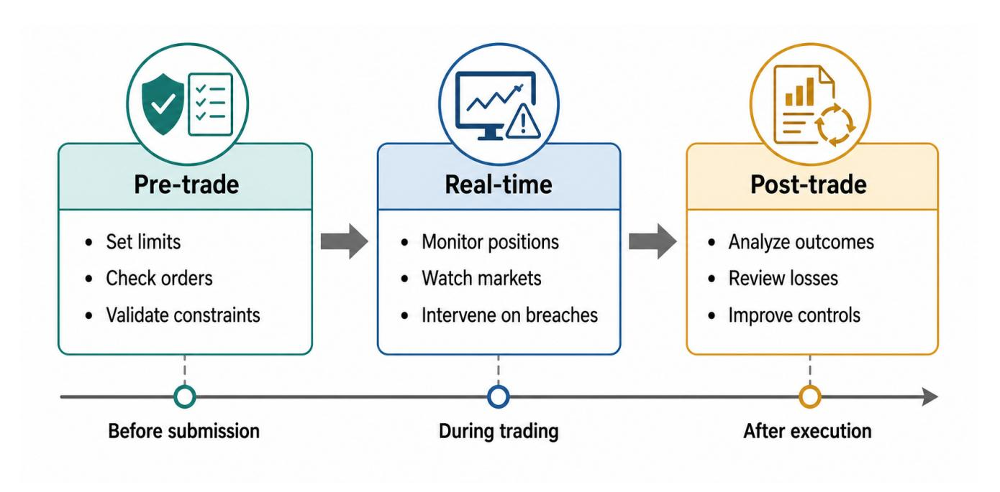

**Figure 11:** Risk control timeline across the trading lifecycle. Pre-trade risk control sets limits and checks before orders are submitted. Real-time risk control monitors positions and markets during trading, intervening when thresholds are breached. Post-trade risk analysis analyzes outcomes to improve future risk management. This figure is schematic and is *not* used for evidence-mapping statistics or protocol comparison.

#### 9.1. Pre-trade Risk Control

Pre-trade risk control prevents excessive risk by checking orders against risk limits before they are submitted to the market. This preventive stage is the first line of defense against catastrophic losses

Representative Approaches. Value-at-Risk (VaR) limits cap the maximum potential loss at a specified confidence level (e.g., 99% one-day VaR of \$1M). Conditional VaR (CVaR) extends this by estimating the expected loss in the tail beyond the VaR threshold Rockafellar and Uryasev (2000). Agentic systems increasingly employ structured, model-based risk representations to estimate market risk in a transparent and interpretable manner. Exposure constraints limit concentrations to single assets, sectors, or counterparties (e.g., no more than 10% of portfolio in any single stock). Compliance checks ensure trades respect regulatory requirements and internal policies. Some agentic prototypes explore using LLMs to translate human-readable policies into executable constraints Cosler et al. (2023). However, this introduces non-deterministic risks.

#### Protocol Implication

For protocol comparability, we recommend reporting: (1) **VaR Config** (Confidence Level, Holding Period, Window), (2) **Scenario Source** (Standard vs Custom), and (3) **LLM Verification**: policy-to-code translations are best validated against deterministic test sets rather than raw LLM chat outputs for compliance.

**Technical Mechanisms**. Portfolio risk models estimate the risk contribution of each potential trade, considering both

the standalone risk of the position and its correlation with existing holdings. Let  $\Sigma$  denote the covariance matrix of asset returns with entries  $\sigma_{ii}$ , and let w denote portfolio weights. The portfolio variance is  $V = w^{T} \Sigma w$ , and the marginal contribution to variance is  $\frac{\partial V}{\partial w_i} = 2(\Sigma w)_i$ . A commonly used risk contribution decomposition is  $RC_i = w_i(\Sigma w)_i$ , while the marginal contribution to volatility is  $\frac{\partial \sigma_p}{\partial w_i} = (\Sigma w)_i/\sigma_p$  with  $\sigma_p = \sqrt{w^T \Sigma w}$  Roncalli (2013). Scenario analysis simulates portfolio performance under stress scenarios (market crash: -30% equities, interest rate spike: +200bps, volatility surge:  $\sigma \times 3$ ) to identify hidden risks that might not manifest under normal conditions Basel Committee on Banking Supervision (2009). Rule engines encode regulatory and internal policies as executable rules (e.g., Reg T margin requirements, Reg NMS order protection rules), with LLMs parsing natural language policies to generate these rules automatically, bridging the gap between human-readable policies and machine-executable code.

Agent-based approaches model transaction costs and market slippage realistically for liquidity risk assessment Vytelingum et al. (2025). The STRIDE framework provides principled guidance for selecting between agentic AI, AI assistants, or direct LLM calls in risk-sensitive applications Asthana et al. (2025).

# 9.2. Real-time Risk Control

Real-time risk control monitors positions and market conditions during trading, intervening when risk thresholds are breached or anomalous conditions emerge. This reactive stage catches risks that pre-trade models miss due to changing market conditions or model error.

Representative Approaches. Position monitoring tracks portfolio metrics (greeks for options, duration for bonds, beta for equities) in real-time, alerting when they exceed thresholds. Drawdown stops halt trading when portfolio losses reach specified levels (e.g., stop trading if down 5% from peak). Volatility scaling reduces position sizes as market volatility increases, maintaining constant risk exposure. Risk control is a first-order design concern for cross-market robustness. Text streams can provide early warnings [Tetlock](#page-55-15) [\(2007\)](#page-55-15). Slowermoving macro uncertainty indices can complement them [Baker](#page-48-9) [et al.](#page-48-9) [\(2016\)](#page-48-9), but they are not real-time signals. LLMs are generally unsuitable for the sub-millisecond Critical Path. A robust architecture typically separates a Gating Layer (deterministic algorithms such as circuit breakers for submillisecond stops) from an asynchronous Explanation Layer (LLMs for cause attribution). Reporting can disclose Latency Budgets and False Positive Rates for all triggers.

Technical Mechanisms. Stream processing systems update risk metrics from tick data, trades, and order-book changes. Anomaly detection can flag price spikes, volume surges, and order-book imbalance as stress signals [Easley et al.](#page-50-8) [\(2012\)](#page-50-8); [Kirilenko et al.](#page-52-15) [\(2017\)](#page-52-15). Circuit breakers halt trading when drawdown or single-position loss limits are breached. Manual review before restart helps prevent stress-driven decisions [Lo](#page-53-15) [and Repin](#page-53-15) [\(2002\)](#page-53-15); [Kahneman and Tversky](#page-51-13) [\(1979\)](#page-51-13).

#### Protocol Implication

We suggest reporting any dynamic exposure rule in display form rather than embedding it in prose. A simple example is

$$w_i(t) = \min \left( w_i^{\text{max}}, \frac{\text{risk\_budget}}{\text{risk\_per\_unit}_i} \right)$$

which caps concentration as prices and volatility change.

# *9.3. Post-trade Risk Analysis*

Post-trade risk analysis learns from trading outcomes to improve future risk management. This retrospective stage identifies what risks were missed, how effective controls were, and where improvements are needed.

Representative Approaches. Performance attribution decomposes returns into component sources (alpha return, beta, timing, stock selection), identifying which risks contributed to gains or losses. LLM-assisted attribution can trace how market factors propagate through the portfolio structure. Stress testing simulates portfolio performance under historical crisis scenarios (2008 financial crisis and other major stress episodes) to assess resilience [Basel Committee on Banking Supervision](#page-48-7) [\(2009\)](#page-48-7). Regime analysis examines how portfolio performance varied across market regimes (bull, bear, high volatility), identifying conditions where risk management failed. LLM-enhanced systems can summarize risk outcomes, but preventing post-hoc rationalization is strongest when every narrative claim is grounded in immutable logs and replayable evidence [Tan et al.](#page-55-10) [\(2025a\)](#page-55-10); [Khatchadourian](#page-52-2) [\(2026\)](#page-52-2). Furthermore, Counterfactual Reasoning (e.g., "what if" scenarios) is best labeled as *Hypothetical*

*Inference* dependent on structural assumptions, not empirical fact.

Technical Mechanisms. Causal analysis identifies the root causes of risk events, distinguishing between market risk (systemic factors affecting all assets), idiosyncratic risk (assetspecific events), and model error (incorrect assumptions or predictions). Techniques include Granger causality tests, Shapley value decomposition for attribution, and structural break detection to identify when risk models failed. Counterfactual reasoning estimates what would have happened under different risk management decisions (as an illustrative example, "if we had reduced position size by 50%, drawdown would have been 3% instead of 8%"), enabling learning from near-misses and close calls. Report generation produces human-readable risk summaries for compliance and management review, with LLMs translating quantitative metrics ("VaR exceeded by 20% on March 15th") into narrative explanations ("Risk was elevated due to concentrated tech exposure during the AI sector correction; position limits were triggered but too late to prevent significant losses"), making risk analysis interpretable for non-technical stakeholders [Granger](#page-51-14) [\(1969\)](#page-51-14); [Shapley](#page-54-13) [\(1953\)](#page-54-13); [Bai and Perron](#page-48-0) [\(2003\)](#page-48-0); [Pearl](#page-54-14) [\(2009\)](#page-54-14).

[Table 15](#page-26-1) summarizes risk management approaches across the three stages. Effective risk management depends on all three stages working in concert: pre-trade controls prevent excessive risk, real-time controls catch emerging risks, and post-trade analysis enables continuous improvement.

## *9.4. Safety and Constraint Mechanisms*

Deployable trading agents require safety layers that sit outside the model's generative reasoning loop. These include pretrade exposure checks, hard position limits, concentration caps, drawdown triggers, and kill-switch logic that can halt order flow when market conditions or model behavior leave the approved operating envelope. In the current literature, such mechanisms are often mentioned briefly but rarely specified with enough detail to reproduce. For this reason, we treat safety architecture as part of the risk-management interface, not as an optional deployment afterthought.

In summary, this section has presented three stages of risk management that protect trading agents from catastrophic losses. Pre-trade controls prevent excessive risk, real-time controls respond to emerging risks, and post-trade analysis enables learning and improvement. Together with the alpha generation and portfolio management capabilities, risk management completes the core capability set of trading agents. The next part of the survey explores how agents adapt and evolve, extending beyond fixed capabilities to continuous learning and improvement.

This completes Part II on the capabilities enabled by agentic architectures. Having examined how agents generate alpha, manage portfolios, and control risk, we now turn to Part III, which explores how agents adapt and evolve in dynamic market environments.

Table 15: Risk management method comparison. Protocol Tags (Split/Execution/Cost/Universe) denote reporting rigor (coding rules in [Section 2\)](#page-3-1). BG (Background) indicates conceptual frameworks lacking empirical backtests.

| Stage                   | Mechanisms                                                                                              | LLM Enhancement                                                                                                          |
|-------------------------|---------------------------------------------------------------------------------------------------------|--------------------------------------------------------------------------------------------------------------------------|
| Pre-trade               | VaR/CVaR limits; exposure constraints; compliance checks                                                | Rule interpretation; policy translation; natural-language constraints                                                 |
| Real-time Post-trade | Position monitoring; drawdown stops; volatility scaling Attribution; stress testing; regime analysis | Anomaly detection; news monitoring; early-warning signals Narrative explanation; report generation; learning insights |

## Evidence Summary (Risk)

- Risk controls are comparable only when protocol details are explicit: split scheme, trading frequency, and cost/impact assumptions materially change drawdowns and tail risk.
- The literature recommends treating risk modules as *gating mechanisms* (position limits, kill switches, exposure budgets) rather than post-hoc reporting; logs and verifiable data sources are important for auditability.
- Portfolio-level risk is sensitive to estimation error and regime shifts; robust baselines (e.g., classical allocation primitives) remain useful reference points [Markowitz](#page-53-11) [\(1952\)](#page-53-11); [Black and Litterman](#page-49-8) [\(1992\)](#page-49-8).
- Evidence Grading: Studies missing I/O contracts or treating risk as a post-hoc metric are graded as BG (Basic/Conceptual). Credible improvement claims are stronger when backed by end-to-end gating logs. Evidence remains uneven; risk claims still require explicit caveats about data latency and false positives.

Within the primary studies, none explicitly addressed risk mechanisms as a primary contribution; the section therefore synthesizes background literature and conceptual frameworks. The most persistent gap is protocol grounding: risk triggers, latency budgets, and audit logs are still inconsistent across papers.

# 10. Learning Paradigms

The preceding parts of this survey established the architectural foundations of agentic traders and the capabilities these architectures enable. This section addresses the question: "How do agents learn from market feedback?"

Learning enables agents to adapt their behavior based on experience, improving performance over time and responding to changing market conditions. We organize learning paradigms around a taxonomy of three approaches that differ in how they incorporate feedback and update their behavior.

# *Evidence status.*

1) Evidence base: Learning claims are supported only where update rules are evaluated in an end-to-end trading loop; this section synthesizes 3 primary studies with endto-end trading evaluation, while general SFT, ICL, or RL mechanisms without trading closure are marked as [BG].

- 2) Supported claim: Feedback can improve agent behavior in specific reported settings.
- 3) Reporting gap: Studies often omit update frequency, training/evaluation separation, and post-update rollback rules.
- 4) Implication: Learning should be audited as a protocolgoverned update process rather than as a generic adaptation label.

#### *Taxonomy.*

- 1. In-context Learning (ICL) [\(Section 10.2\)](#page-26-2): Learning from examples without parameter updates.
- 2. Supervised Fine-tuning [\(Section 10.3\)](#page-27-0): Learning from labeled demonstrations.
- 3. Reinforcement Learning [\(Section 10.4\)](#page-27-1): Learning from trial and error with reward feedback.

#### *10.1. Reward and Feedback Design*

Reward specification is a first-order design choice rather than an implementation detail. Trading environments impose delayed, noisy, and partially confounded feedback: realized P&L arrives after execution, inventory risk accumulates across steps, and reward proxies can be hacked by exploiting simulator artifacts. We therefore distinguish immediate execution feedback (fill quality, slippage, rejected orders) from delayed portfolio feedback (P&L, drawdown, turnover, and risk-adjusted return). Papers claiming adaptive improvement should report which of these signals are optimized, over what horizon, and with what safeguards against reward hacking.

Figure [12](#page-27-2) is a schematic taxonomy card for these paradigms; it summarizes the learning-loop components, trade-offs, and illustrative uses of each approach rather than serving as an empirical ranking.

#### *10.2. In-context Learning*

In-context learning (ICL) enables agents to adapt from examples provided in the prompt without updating model parameters, following the GPT-3-style few-shot paradigm [Brown et al.](#page-49-17) [\(2020\)](#page-49-17) [BG]. This rapid adaptation mechanism is particularly valuable in dynamic markets where conditions change faster than models can be retrained.

Representative Approaches. FinAgent [Zhang et al.](#page-57-0) [\(2024\)](#page-57-0) uses ICL by retrieving relevant trading episodes from memory and inserting them as examples in the prompt, enabling the LLM

Figure 12: Schematic comparison card for three learning paradigms. The panels summarize what each loop updates, the main trade-offs emphasized in the design literature, and illustrative use cases. The figure is conceptual only and is not used for empirical comparison.

to adapt its reasoning to similar situations without parameter updates.

Technical Mechanisms. ICL systems are often organized around two stages: (i) example selection (e.g., similarity- and regime-aware retrieval) and (ii) prompt construction (ordering, formatting, and compressing historical episodes to fit the context window) [Brown et al.](#page-49-17) [\(2020\)](#page-49-17) [BG], [Zhang et al.](#page-57-0) [\(2024\)](#page-57-0). Retrieval-augmented generation (RAG) further extends ICL by pulling up-to-date financial documents (news, filings, analyst notes) from external stores. The key advantage is speed (no training), while the limitation is that adaptation is temporary and bounded by the context window.

## *10.3. Supervised Fine-tuning*

Supervised fine-tuning (SFT) updates model parameters on labeled demonstrations of desired behavior, teaching agents to imitate expert trading decisions. This approach transfers knowledge from expert traders or historical successful strategies into the agent.

Representative Approaches. The current section-level primarystudy count for SFT is N=0; the examples are therefore background building blocks, not end-to-end trading evidence. Fin-GPT [Wang et al.](#page-56-3) [\(2023a\)](#page-56-3) illustrates finance-domain instruction tuning for analysis, risk, and signal-generation tasks. Two supervised variants are most relevant here. Behavior cloning maps market states to expert actions, making trader demonstrations usable as policy targets [Ross et al.](#page-54-15) [\(2011\)](#page-54-15) [BG]. Multi-task adaptation trains on sentiment, portfolio, and risk tasks together, producing representations that may transfer across finance subtasks [Caruana](#page-49-18) [\(1997\)](#page-49-18) [BG].

Technical Mechanisms. SFT relies on instruction/demo datasets with prompt-response pairs (market context → expert decision or analysis). Training minimizes a supervised loss (e.g., crossentropy for discrete actions, regression for sizing/allocation), with standard regularization and careful held-out evaluation to check robustness to unseen regimes. Parameter-efficient methods (e.g., LoRA-style methods) reduce cost while preserving much of the base model; finance-oriented benchmarking work has explored these trade-offs [Wang et al.](#page-56-16) [\(2025a\)](#page-56-16). General parameterefficient variants are background mechanisms [Dettmers et al.](#page-50-9) [\(2023\)](#page-50-9); [Xu et al.](#page-57-12) [\(2024\)](#page-57-12) [BG]. SFT can produce persistent behavioral changes but is sensitive to label quality and distribution shift.

#### *10.4. Reinforcement Learning*

Reinforcement learning (RL) is used in trading agents when the objective is inherently sequential (portfolio rebalancing, execution, or iterative factor construction), the feedback is delayed, and the policy needs to trade off return, risk, and costs under constraints.

Representative Approaches. FinRL-DeepSeek [Benhenda](#page-48-6) [\(2025\)](#page-48-6) combines LLM-based priors with policy optimization, reporting risk-adjusted return improvements over baselines in simulated environments[1](#page-27-3) . MacroHFT [Zong et al.](#page-58-0) [\(2024\)](#page-58-0) introduces memory-augmented context-aware RL for highfrequency trading, while EarnHFT [Qin et al.](#page-54-2) [\(2024\)](#page-54-2) explores hierarchical RL for HFT. Deep RL for alpha discovery [Xu](#page-57-8) [\(2024\)](#page-57-8) frames factor construction as a program-generation task, optimizing an evaluation metric over the search space while balancing alpha performance and diversity.

1Specific performance metrics vary by configuration (e.g., CPPO-DeepSharpe vs. CPPO-DeepVol) and market regime; readers should consult the original paper for detailed protocol assumptions, cost models, and train/test split discipline.

# Evidence Summary (Section [10\)](#page-26-0)

- ICL enables rapid, non-persistent adaptation by conditioning on retrieved episodes and external context, without parameter updates [Zhang et al.](#page-57-0) [\(2024\)](#page-57-0).
- SFT remains background discussion in this section (N=0 primary studies); finance-oriented instruction tuning such as FinGPT is therefore treated as contextual motivation rather than primary trading evidence [Wang et al.](#page-56-3) [\(2023a\)](#page-56-3).
- RL can optimize sequential trading objectives, including programmatic alpha discovery, but results depend critically on split discipline, cost modeling, and simulator fidelity [Benhenda](#page-48-6) [\(2025\)](#page-48-6); [Xu](#page-57-8) [\(2024\)](#page-57-8).
- A recurring failure mode is simulator/backtest overfitting, where policies exploit artifacts and degrade sharply in live-like settings [Benhenda](#page-48-6) [\(2025\)](#page-48-6).

Recent advances adjacent to RL address three key challenges in agent learning: (1) modular memory architectures enable agents to accumulate and retain experience across tasks [Dorovatas](#page-50-10) [et al.](#page-50-10) [\(2026\)](#page-50-10) [BG]; (2) explicit state dynamics improve temporal coherence in long-horizon agent behavior [Subaharan](#page-55-16) [\(2026\)](#page-55-16) [BG]; (3) code-based alpha evolution enables strategy refinement through execution traces and natural language feedback [Liu et al.](#page-53-8) [\(2025\)](#page-53-8).

What should be reported (and why it matters). Because RL results are highly sensitive to experimental setup, trading papers should explicitly specify (i) chronological data splits (train/validation/test or walk-forward) and how hyperparameters are chosen to avoid leakage; (ii) the cost model (commissions, spread/slippage, and market impact assumptions); and (iii) simulator fidelity (fill/latency assumptions, action/state/reward definitions, constraints, and whether the simulator matches the instrument/microstructure being claimed). Key risks include simulator overfitting and reward hacking: policies can exploit artifacts of the backtester/cost model and fail catastrophically out-of-sample, especially under non-stationarity and regime shifts.

[Table 16](#page-29-0) is a conceptual comparison of design trade-offs, not a survey finding that all three paradigms are already validated or routinely combined in trading systems. The next section explores how multiple agents collaborate in markets.

The next section addresses the question: "How do multiple agents collaborate in markets?"

Across the 3 primary studies mapped in this section, ICL appears once, SFT has no primary end-to-end trading study, and RL appears twice. Reinforcement-learning-style adaptation therefore dominates the section's primary evidence, but its reported gains remain sensitive to split discipline, simulator fidelity, and reward-hacking risk.

# 11. Multi-Agent Coordination

*Note*: Multi-agent coordination spans both architectural (organization structure) and adaptation (coordination learning) dimensions. We place it in Part III due to its emphasis on emergent coordination dynamics, but acknowledge it could equally be classified as an architectural dimension.

The preceding sections examined the architecture and capabilities of agentic traders. This section addresses the question: "How do multiple agents collaborate in markets?"

Multi-agent systems enable specialization and decomposition, with different agents focusing on different aspects of the trading problem (analysis, execution, risk management). What remains unsettled is whether coordination itself delivers superior trading performance once computational budget, information access, and protocol design are held constant. We organize multi-agent coordination around a taxonomy of three patterns that differ in their structure and interaction mechanisms.

*Evidence status.*

- 1) Evidence base: Coordination claims are primary only when role interaction affects an evaluated trading loop; general multi-agent systems and market-structure literature are retained as [BG] unless they provide end-to-end trading evidence.
- 2) Supported claim: Multi-agent systems can decompose analysis, debate, trading, and risk-control functions.
- 3) Reporting gap: Role permissions, message protocols, shared state, consensus rules, and ablation results are underreported.
- 4) Implication: Coordination should be treated as a mechanism requiring role-level attribution, not as automatic evidence of performance improvement.

*Taxonomy.*

- 1. Role-based Collaboration [\(Section 11.1\)](#page-28-0): Specialized agents with distinct roles working together.
- 2. Hierarchical Organization [\(Section 11.2\)](#page-30-0): Layered decision-making with strategic and tactical agents.
- 3. Market Ecology [\(Section 11.3\)](#page-31-0): Agents interacting through market mechanisms with emergent behavior.

*Comparability note.* Protocol-comparable coordination claims should report MR-7 (roles/permissions, message protocol, consensus, shared state, and evaluation); see [Section 13.](#page-37-0)

Figure [13](#page-29-1) summarizes the coordination taxonomy used in this section as a set of stylized archetypes.

#### *11.1. Role-based Collaboration*

Role-based collaboration assigns specialized roles to different agents, each focusing on a specific aspect of the trading problem while coordinating to achieve collective goals. This division of labor enables deep specialization while maintaining coherent decision-making [Wooldridge](#page-56-17) [\(2009\)](#page-56-17) [BG].

Table 16: Learning paradigm performance comparison

| Paradigm | Speed  | Data Needed | Adaptability | Key Advantages            | Limitations                               |
|----------|--------|-------------|--------------|---------------------------|-------------------------------------------|
| ICL      | Fast   | Low         | Medium       | No training, immediate    | Context window, tempo                     |
| SFT      | Medium | High        | High         | Deep adaptation, transfer | rary Needs labels, overfitting risk |
| RL       | Slow   | Very high   | Very high    | Autonomous discovery      | High data, instability                    |

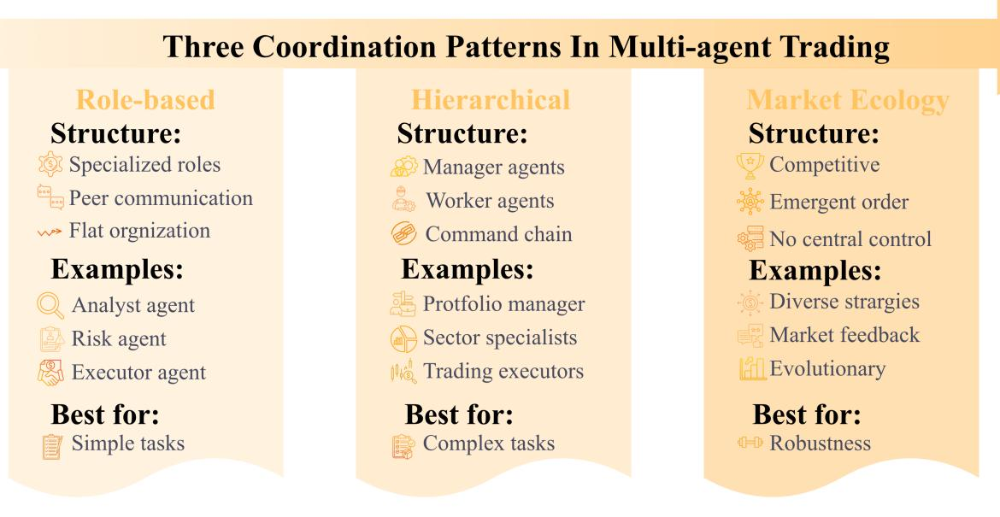

Figure 13: Three coordination patterns in multi-agent trading. Role-based collaboration assigns specialized roles (analyst, trader, risk manager) to different agents. Hierarchical organization layers agents from strategic (asset allocation) to tactical (position sizing) to execution (individual trades). Market ecology models agents interacting through markets with feedback and emergence. The structure/example/illustrative-use panels are stylized archetypes rather than evidence-ranked categories. This figure is schematic and is *not* used for evidence-mapping statistics or protocol comparison.

Representative Approaches. It is helpful to separate three evidence layers. *Primary trading systems* in the current sectionlevel subset show role specialization most directly: TradingAgents [Xiao et al.](#page-56-0) [\(2024\)](#page-56-0) assigns analyst/trader/risk/portfolio roles; FINCON [Yu et al.](#page-57-1) [\(2024\)](#page-57-1) structures debate and consensus; TradingGroup [Tian et al.](#page-55-6) [\(2025\)](#page-55-6) combines role specialization with reflection; and the REIT pipeline [Li](#page-52-16) [\(2026\)](#page-52-16) makes an analysis–prediction–decision–execution workflow explicit. These papers make decomposition visible, but complex role assignments can still obscure the source of gains. To support *attribution*, systems must log decision contributions (which agent proposed or vetoed an action) and perform role/communication ablations to verify that gains stem from coordination rather than increased computational budget. General LLM multi-agent optimization work such as HiveMind is relevant here as background for contribution-guided credit assignment and online prompt refinement, but should not be read as evidence that such coordination mechanisms are already validated across trading settings [Xia et al.](#page-56-18) [\(2026\)](#page-56-18).

*Benchmarks and simulated arenas* form a second layer. Trader-Bench, MarS, and related multi-agent market arenas [Lopez-Lira](#page-53-16) [\(2025\)](#page-53-16); [Li et al.](#page-52-17) [\(2024a\)](#page-52-17); [Yuan et al.](#page-57-13) [\(2026\)](#page-57-13) are useful for stressing specialization and interaction patterns, but they do not by themselves establish end-to-end trading coordination gains under comparable execution semantics.

*Background MAS*/*ABM literature* forms a third layer, including social or behavioral market models [Bohorquez and Cartlidge](#page-49-19) [\(2024\)](#page-49-19); [Aaron Wheeler](#page-46-6) [\(2023\)](#page-46-6), RL-plus-ABM interaction studies [Dicks et al.](#page-50-11) [\(2023\)](#page-50-11); [Oort et al.](#page-53-17) [\(2023\)](#page-53-17), workspace delegation [Nie et al.](#page-53-18) [\(2026\)](#page-53-18), and reciprocity-oriented foundations [Diau](#page-50-12) [\(2025\)](#page-50-12); [Gao et al.](#page-50-13) [\(2022\)](#page-50-13). These citations are useful for mechanism design, but they are not counted toward the sectionlevel primary study total of N=12.

Communication Protocols. Role-based collaboration requires rich communication protocols to enable effective coordination. Broadcasting allows an agent to share information with all team members simultaneously, useful for market-wide alerts or portfolio status updates. Peer-to-peer communication enables direct exchange between specific agents, such as the risk manager warning the trader about excessive exposure. Shared memory provides a common knowledge base where agents can read and write information, enabling asynchronous coordination without requiring all agents to be available simultaneously. These protocols need to be designed to balance information richness against communication overhead, as excessive messaging can slow decision-making in fast-moving markets [Wooldridge](#page-56-17) [\(2009\)](#page-56-17) [BG].

Consensus Mechanisms. When specialized agents disagree, consensus mechanisms aggregate diverse opinions into coherent decisions. Voting treats all agents equally, with the majority or plurality determining the final action. Expert weights assign different influence to agents based on their historical accuracy or domain expertise, allowing the analyst to dominate stock selection while the risk manager influences position sizing. Debate-based consensus enables agents to present arguments and counterarguments, with FINCON [Yu et al.](#page-57-1) [\(2024\)](#page-57-1) providing a conceptual language that structures these discussions. The choice of consensus mechanism involves trade-offs between speed (voting is fast) and quality (debate can uncover blind spots but takes longer). Dynamic mechanisms that adapt based on market conditions or agent confidence are particularly valuable in volatile markets [Hu et al.](#page-51-15) [\(2024\)](#page-51-15); [Wooldridge](#page-56-17) [\(2009\)](#page-56-17) [BG].

Task Allocation. Effective role-based collaboration requires intelligent task allocation that matches work to agent capabilities and current workload. Capability-based allocation assigns tasks based on specialized expertise, such as routing earnings analysis to the fundamental analyst while the technical analyst handles technical signals. Workload-based allocation considers current load, preventing bottlenecks when one agent is overwhelmed. Hybrid approaches combine both factors, ensuring that urgent but non-specialized tasks (such as emergency risk reduction) can be handled by any available agent. Task allocation may be centralized (a supervisor agent assigns work, as in TradingAgents) or decentralized (agents self-assign based on capability and availability). Dynamic reallocation enables the system to adapt when agents fail or become overloaded, improving robustness [Wooldridge](#page-56-17) [\(2009\)](#page-56-17) [BG].

Conflict Resolution. Disagreements between specialized agents are inevitable, particularly when agents have different perspectives (optimistic analyst vs pessimistic risk manager) or when their roles create tensions (trader seeking profit vs risk manager seeking safety). Negotiation allows agents to propose compromises, such as reducing position size to satisfy both profit targets and risk limits. Arbitration delegates dispute resolution to a higher authority (the supervisor in TradingAgents), ensuring that critical decisions are not deadlocked. Authority hierarchies establish which agent's view dominates in which domain (the risk manager has veto power over position sizing, while the analyst controls stock selection). Learning from past conflicts improves resolution over time, with agents developing heuristics for when to escalate disagreements and when to accept compromises [Wooldridge](#page-56-17) [\(2009\)](#page-56-17) [BG].

# *11.2. Hierarchical Organization*

Hierarchical organization structures agents into layers, with higher-level agents making strategic decisions and lower-level agents executing tactical actions. This structure enables coherence across time scales, from long-term asset allocation to short-term execution.

Representative Approaches. FinMem [Yu et al.](#page-57-4) [\(2023\)](#page-57-4) employs a three-layer memory hierarchy: working memory (secondsminutes), episodic memory (days-weeks), and semantic memory (long-term). H-MEM [Sun and Zeng](#page-55-4) [\(2025\)](#page-55-4) extends this with semantic hierarchy, reporting efficiency improvements through hierarchical memory organization. In multi-agent settings, strategic agents set high-level targets ("reduce tech exposure by 20%") and tactical agents determine specific trades to achieve these targets. Recent general-purpose frameworks like DyLAN [Liu et al.](#page-53-19) [\(2023\)](#page-53-19), MetaGPT [Hong et al.](#page-51-16) [\(2024\)](#page-51-16), and HiveMind [Xia et al.](#page-56-18) [\(2026\)](#page-56-18) demonstrate how dynamic architecture, role definitions, and prompts can evolve, a concept increasingly relevant for adaptive trading hierarchies.

Benchmarks and Protocols. Coordination claims are difficult to compare without common evaluation protocols and cost/execution semantics. Recent work introduces live and replay-based benchmarks for trading agents that stress sequential decisionmaking under real or event-driven market dynamics, including AI-Trader [Fan et al.](#page-50-14) [\(2025\)](#page-50-14), Agent Market Arena [Qian et al.](#page-54-16) [\(2025\)](#page-54-16), LiveTradeBench [Yu et al.](#page-57-14) [\(2025\)](#page-57-14), ContestTrade [Zhao](#page-57-15) [et al.](#page-57-15) [\(2025\)](#page-57-15), and PredictionMarketBench [Arora and Malpani](#page-48-10) [\(2026\)](#page-48-10). These benchmarks help separate architecture effects (coordination design, memory, workflow) from model-backbone effects, but remain sensitive to market selection, episode construction, and transaction cost assumptions.

#### Protocol Implication

For multi-agent systems, we recommend explicit reporting of: (i) *cross-play* evaluation (swap individual agents to test interoperability vs. team overfitting), (ii) explicit *communication constraints* (channel bandwidth and toolcall budgets), (iii) *crowding and impact* metrics (e.g., impact amplification under correlated policies), and (iv) *role ablations* to attribute gains to coordination rather than increased information access.

Goal Decomposition. Hierarchical organization requires breaking high-level objectives into actionable sub-goals that lowerlevel agents can execute. Top-down decomposition starts with strategic objectives ("achieve 15% annual return with 10% volatility") and recursively breaks them into smaller targets ("allocate 60% to equities, 30% to bonds, 10% to cash" then "select 50 technology stocks with equal weights"). Constraint-based decomposition helps ensure that sub-goals respect risk limits, liquidity constraints, and regulatory requirements. Dynamic decomposition adjusts targets based on market conditions, such as reducing return targets during bear markets or tightening risk limits when volatility spikes. The effectiveness of goal decomposition depends on how well strategic intent can be translated into tactical guidance without micromanaging lower-level agents; layers should specify clear I/O contracts (e.g., strategic targets vs. tactical orders) to prevent semantic drift [Wooldridge](#page-56-17) [\(2009\)](#page-56-17).

Feedback Mechanisms. Hierarchies rely on upward feedback to close the loop between strategy and execution. Bottom-up reporting enables tactical agents to inform strategic agents about outcomes, constraints, and opportunities. For example, execution agents report that liquidity is insufficient for the desired position size, prompting strategic agents to revise the allocation. Exception escalation triggers when lower-level agents encounter problems they cannot resolve, such as unexpected market events or violations of risk limits. Performance feedback provides information about which strategies are working, enabling strategic agents to reallocate resources to successful approaches. Effective feedback requires appropriate aggregation: raw data from execution must be summarized into metrics that inform strategic decisions without overwhelming strategic agents with details [Wooldridge](#page-56-17) [\(2009\)](#page-56-17).

Exception Handling. Lower-level agents inevitably encounter situations that exceed their authority or capability, requiring escalation to higher-level decision-makers. Predefined escalation triggers determine when to elevate issues, such as position limits exceeded, unusual market conditions, or conflicting signals. Time-sensitive exceptions (market crashes, circuit breakers) require immediate escalation with minimal delays. Resolution strategies range from fully automated (circuit breakers automatically reduce exposure) to human-in-the-loop (unusual patterns reported to human supervisors). Learning from exceptions improves future handling, with systems developing better triggers and resolution strategies over time. The design of exception handling involves trade-offs between false positives (escalating too often, creating noise) and false negatives (missing critical issues that require intervention) [Wooldridge](#page-56-17) [\(2009\)](#page-56-17).

Temporal Abstraction. Different layers of the hierarchy operate at different time scales, enabling separation between long-term planning and short-term reaction. Strategic agents operate at daily, weekly, or monthly frequencies, making decisions about asset allocation, factor tilts, and overall portfolio construction. Tactical agents operate at intraday or minutelevel frequencies, managing individual positions, entry and exit timing, and execution quality. This separation prevents shortterm noise from disrupting long-term strategy: a temporary price spike should not trigger a reallocation of the entire portfolio. However, temporal abstraction creates challenges for coordination: strategic agents need to set bounds (risk limits, position limits) that constrain tactical agents without being overly restrictive. Multi-scale learning enables agents to learn at different time horizons, with strategic agents learning from longterm patterns while tactical agents adapt to short-term dynamics [Sutton et al.](#page-55-9) [\(1999\)](#page-55-9) [BG].

# *11.3. Market Ecology*

Market ecology models agents as participants in a market environment, interacting through trading and prices rather than direct communication. In the current literature, this pattern is best read as an exploratory setting for studying collective behavior, not as mature evidence that ecological coordination improves live trading outcomes.

Representative Approaches. Agent-based simulations [Hashimot](#page-51-17)o [et al.](#page-51-17) [\(2025\)](#page-51-17) populate markets with heterogeneous agents to generate synthetic market data and to stress test strategies under controlled conditions. Related work studies how agent-environment

feedback can produce boom-bust dynamics and how repeated interaction may lead to undesirable emergent coordination, motivating regulatory and monitoring considerations. FinEvo [Zou](#page-58-3) [et al.](#page-58-3) [\(2026\)](#page-58-3) proposes an ecological market-game framing to study the evolution of interacting financial strategies, emphasizing that competitive performance can depend on population composition and adaptive feedback rather than isolated backtests. Validating ecological models requires rigorous calibration against real market microstructure to avoid *simulator overfitting*. Furthermore, protocols must audit for *timestamp leakage* and *consensus smoothing*, ensuring that emergent coordination is not an artifact of look-ahead bias or noise suppression.

Pioneering work in generative agents [Park et al.](#page-54-17) [\(2023\)](#page-54-17) established the viability of LLM-based simulacra. Subsequent financial-market simulations with LLM agents [Hashimoto et al.](#page-51-17) [\(2025\)](#page-51-17) explore how agent behaviors can affect market dynamics, enabling researchers to study emergent phenomena in controlled settings.

Market Mechanisms. Market ecology relies on established market structures to mediate agent interactions without requiring direct coordination. Continuous double auctions enable buyers and sellers to trade at any time, with prices emerging from the real-time balance of supply and demand. Call auctions aggregate orders over specific time intervals (open, close, volatility interruptions), determining prices through batch execution that reduces informational asymmetry. Dealer markets designate specific market makers who provide liquidity by continuously quoting bid and ask prices, with agents trading against these quotes rather than directly with each other. Each mechanism creates different incentives and dynamics: continuous double auctions favor fast reactions to information, call auctions reduce timing risk, and dealer markets provide guaranteed liquidity but at a cost (the bid-ask spread). The choice of market mechanism shapes the ecology by determining which strategies are viable and how information propagates through prices [Kyle](#page-52-7) [\(1985\)](#page-52-7); [Glosten and Milgrom](#page-51-5) [\(1985\)](#page-51-5) [BG].

Price Formation. In market ecology, no single agent sets prices; instead, prices emerge from the aggregate behavior of all agents. Order aggregation combines individual buy and sell orders into a collective order book, with the intersection of supply and demand determining the market-clearing price. Supply-demand balance shifts as agents react to news, portfolio changes, or risk management needs, causing prices to adjust. Informational efficiency measures how quickly prices incorporate new information, with efficient markets preventing agents from consistently profiting from public information. However, when agents are heterogeneous (different beliefs, time horizons, risk tolerances), prices may deviate from fundamental values for extended periods, creating opportunities for some agents at the expense of others. The dynamics of price formation depend on agent diversity: homogeneous agents tend to produce rapid convergence to consensus prices, while heterogeneous agents create more complex patterns with mispricings that persist until corrected by informed agents [Kyle](#page-52-7) [\(1985\)](#page-52-7); [Glosten and Milgrom](#page-51-5) [\(1985\)](#page-51-5) [BG].

Reflexivity and Feedback Loops. Market ecology creates reflexive relationships where agent actions affect prices, which in turn affect agent perceptions and actions. This two-way feedback can produce complex dynamics not present in systems with oneway causality. Positive feedback amplifies initial movements: price increases attract trend-following agents who buy, pushing prices higher and attracting more trend followers, potentially creating bubbles. Negative feedback stabilizes: price increases trigger profit-taking by mean-reversion agents who sell, pushing prices back toward fundamentals. The balance between positive and negative feedback determines market stability. Reflexivity becomes particularly powerful when agents learn and adapt: successful strategies attract imitators, changing market dynamics and potentially rendering the original strategy unprofitable. This co-evolution of agents and markets creates continuously changing patterns, making long-term prediction difficult even as short-term patterns may be exploitable [Shiller](#page-55-17) [\(1981\)](#page-55-17); [Kirilenko](#page-52-15) [et al.](#page-52-15) [\(2017\)](#page-52-15) [BG].

Emergent Phenomena. The interaction of heterogeneous agents through market mechanisms can generate exploratory scenarios that are not apparent from studying individual agents in isolation. Bubbles may occur when positive feedback dominates, with rising prices attracting speculative buying disconnected from fundamentals. Crashes may happen when bubbles burst or when negative feedback triggers panic selling, with prices plummeting as agents rush to exit simultaneously. Flash crashes represent extreme short-term crashes where prices rapidly plummet and recover within minutes, and are mechanistically plausible when high-frequency agents interact with market structure. Tacit collusion is another plausible risk when agents learn to coordinate behavior implicitly through repeated interaction without explicit communication, raising regulatory concerns about market manipulation. These emergent phenomena are difficult to predict because they depend on the collective behavior of many agents, so agent-based simulation is better viewed as a hypothesis-generation tool for understanding market dynamics and stress cases [Kirilenko et al.](#page-52-15) [\(2017\)](#page-52-15); [Shiller](#page-55-17) [\(1981\)](#page-55-17) [BG].

*Strategy Crowding and Alpha Decay.* As LLM-based agents proliferate, similar training data and reasoning patterns may lead to *strategy homogenization*. When multiple agents:

- Use similar foundation models (GPT-4, Claude)
- Fine-tune on similar financial corpora
- Employ comparable CoT or RAG patterns

they may generate correlated trading signals, creating mechanistically plausible risks such as:

- 1. Alpha decay: Common signals are arbitraged away faster
- 2. Self-reinforcing trends: Similar entry points amplify momentum
- 3. Correlated exits: Simultaneous stop-loss triggering increases volatility
- 4. Flash crash risk: Rapid unwinding of crowded positions

The evidence base currently lacks studies of multi-agent market impact at scale. We identify this as a critical gap requiring simulation-based research before deployment.

Regulatory Constraints. Regulators shape market ecology by constraining agent behavior to maintain market integrity and stability. Position limits prevent any single agent from dominating the market or taking excessive risks. Circuit breakers halt trading during extreme volatility, providing time for information to diffuse and potentially preventing panic selling. Market maker obligations require designated liquidity providers to quote prices continuously, ensuring that other agents can always trade. Reporting requirements may require that agents disclose large positions or trades, reducing information asymmetry. Manipulation rules prohibit agents from engaging in behavior that artificially affects prices (spoofing, layering, pumpand-dump schemes). The design of these regulations needs to balance competing goals: too little regulation enables manipulation and instability, while too much regulation reduces liquidity and efficiency. Agent-based simulation enables regulators to test proposed rules before implementation, identifying unintended consequences and optimizing regulatory parameters [European](#page-50-15) [Parliament and Council of the European Union](#page-50-15) [\(2014,](#page-50-15) [2016\)](#page-50-16); [Article 29 Working Party](#page-48-11) [\(2018\)](#page-48-11).

[Table 17](#page-33-0) summarizes coordination patterns. The final section of Part III explores self-evolution, examining how agents improve their own architectures and capabilities.

*Latency Constraints on Coordination.* The coordination mechanisms discussed above must operate within the latency budget established in [Section 6.](#page-15-0) Coordination cost is dominated by communication, consensus formation, and decision aggregation, so voting is typically cheaper than debate while expert-weighted aggregation sits in between. In latency-sensitive regimes, systems may need to prefer the simplest mechanism that preserves acceptable decision quality. This latency-aware coordination design remains an open research direction for financial multi-agent systems.

Within the 19primary studies, 9 addressed coordination mechanisms. Role-based systems contain the clearest auditable exemplar in the current subset, while hierarchical and ecological designs still need stronger calibration and cross-play evaluation.

The next section addresses the question: "How do agents improve themselves autonomously?"

## 12. Adaptation and Self-Evolution

The preceding sections examined how agents are built (architecture), what they can do (capabilities), and how they can coordinate. This section addresses the question: "How do agents adapt and improve over time?"

*Note*: Many mechanisms described in this section (e.g., memory consolidation, meta-learning, self-reflection) originate in general AI research; in trading, they remain experimental and should be interpreted through explicit *update governance* rather than as

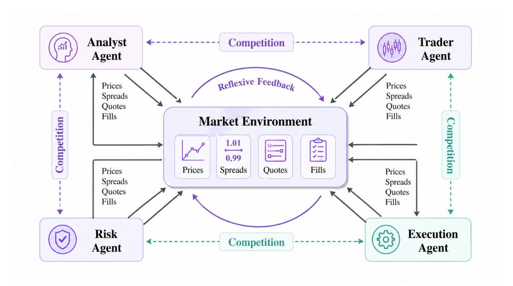

Figure 14: Market ecology interaction network. Agents interact both with one another and through the market environment, where prices, spreads, quotes, and fills feed back into subsequent behavior. The figure highlights reflexive feedback and competition channels that can support exploratory study of crowding, instability, and adaptation. This figure is schematic and is *not* used for evidence-mapping statistics or protocol comparison.

Table 17: Multi-agent coordination comparison. Tags: R=Reproducibility level (R0–R3), E=Execution semantics reported, -E–=Execution not reported (see [Section 2](#page-3-1) for full coding rules).

| Pattern        | Example                                                                                                             | Comm.                             | Decision Making                                     | Scalability                                        | Tags  |
|----------------|---------------------------------------------------------------------------------------------------------------------|-----------------------------------|-----------------------------------------------------|----------------------------------------------------|-------|
| Role-based     | TradingAgents Xiao et al. (2024), FIN CON Yu et al. (2024), TradingGroup Tian et al. (2025) | Direct, rich com munication    | Consensus, vot ing, debate                    | Moderate (co ordination overhead)         | R2,-E |
| Hierarchical   | Multi-agent invest ment pipeline Li (2026)                                                           | Vertical, layered feedback     | Top-down com mands, bottom up reporting | High (clear au thority)                   | R0,-E |
| Market Ecology | Agent simulations; FinEvo Zou et al. (2026)                                                       | Indirect, via prices/trades | Decentralized, in dependent                      | Very high (no direct coordina tion) | R0,-E |

industry-standard practice. Studies marked [BG] are background literature without end-to-end trading evaluation. Adaptation/ self-evolution claims are only comparable when the update loop is reproducible (MR-6; see [Section 13\)](#page-37-0): papers should report what can change (prompts, memory summaries, retrieval indices, weights), when updates trigger, and what historical window is used, with immutable logs plus frozen execution and cost semantics so that apparent "improvements" cannot be explained by protocol drift.

Adaptation can occur at multiple levels: updating behavior within a fixed architecture (e.g., experience-driven policy refinement) and changing the agent's internal components over longer horizons (self-evolution). In trading settings, such claims are particularly sensitive to leakage and evaluation protocol drift. *Evidence status.*

- 1) Evidence base: Self-evolution claims are supported only when an update loop is evaluated under fixed temporal and execution assumptions.
- 2) Supported claim: Some systems report reflection, memory revision, or strategy refinement, but evidence for durable self-improvement remains preliminary.
- 3) Reporting gap: Papers rarely freeze update triggers, data windows, and rollback criteria.
- 4) Implication: Adaptation should be reported with immutable logs and pre/post-update evaluation boundaries; online updates must be separated from out-of-sample testing and tied to frozen execution assumptions.

# Evidence Summary (Multi-agent)

- Most auditable in the current subset (R2): Role-based systems with defined permissions, message budgets, and ablation studies provide the clearest coordination traces in the current evidence base; this does not imply performance superiority.
- Low Evidence (R0): Conceptual hierarchies and ecological simulations often lack calibration or I/O contracts, representing design directions rather than empirical proof.
- Attribution Protocol: Evaluating coordination requires decision contribution logs and explicit ablation studies (removing roles/channels) to distinguish mechanism gains from compute scaling.
- Communication Audit: Message protocols must be specified (budget, aggregation) and audited for timestamp leakage and look-ahead bias.
- Benchmarks: Robust evaluation requires cross-play (generalization), crowding (market impact), and strategic behavior monitoring (detection of collusion or gaming).
- Coverage (section-level): The section-level primarystudy count is N=12; additional citations in the text include benchmarks and background MAS/ABM work that are not part of that primary-study total.

Self-evolution extends beyond learning within a fixed structure: the agent can compress and reorganize its memory, improve its own learning process, and critique and repair reasoning failures over time.

*Taxonomy.*

- 1. Memory Consolidation [\(Section 12.1\)](#page-34-0): Compressing and abstracting memories over time.
- 2. Meta-Learning [\(Section 12.2\)](#page-34-1): Learning to learn more efficiently.
- 3. Self-Reflection [\(Section 12.3\)](#page-36-0): Critiquing and improving own reasoning.

## *12.1. Memory Consolidation*

Memory consolidation transforms and compresses experiences over time, extracting general principles and discarding irrelevant details. This process prevents memory bloat and improves retrieval efficiency while preserving the most valuable knowledge.

Representative Approaches. Trading-facing evidence in this subsection is thin and should be separated from background mechanisms. Within the section-level primary subset, memoryconsolidation-like behavior is most visible in systems that keep episodic traces and derived summaries for later retrieval, such as FinMem and related retrieval-centered trading agents [Yu](#page-57-4) [et al.](#page-57-4) [\(2023\)](#page-57-4); [Zhang et al.](#page-57-0) [\(2024\)](#page-57-0). Experience replay samples important past experiences for rehearsal, strengthening their encoding in memory. Summarization compresses long episodes into concise representations, capturing key outcomes and lessons. Abstraction extracts general rules from specific cases ("stocks

often drop after earnings misses"). Forgetting mechanisms remove low-value memories entirely, focusing capacity on the most relevant information. Broader cited systems such as TradingGPT belong to the wider citation set rather than defining the section-level primary-study count [Li et al.](#page-52-14) [\(2023\)](#page-52-14).

Technical Mechanisms. Importance scoring weights memories based on multiple factors to determine which experiences should be retained. Recency bias gives higher weight to recent experiences, assuming they better reflect current market conditions. Outcome-based weighting prioritizes successful trades and costly mistakes, as these provide the strongest learning signal. Retrieval frequency tracks how often memories are accessed, with frequently-used memories deemed more valuable. These scoring mechanisms can be combined linearly or learned adaptively through neural networks [Lin](#page-52-18) [\(1992\)](#page-52-18); [Schaul](#page-54-18) [et al.](#page-54-18) [\(2016\)](#page-54-18); [McClelland et al.](#page-53-20) [\(1995\)](#page-53-20) [BG].

Compression algorithms reduce memory footprint while preserving useful signals [Hinton and Salakhutdinov](#page-51-18) [\(2006\)](#page-51-18) [BG]. Autoencoders learn compact latent representations. Quantization trades precision for storage. Summarization condenses long episodes into concise lessons about decisions and outcomes. Hierarchical compression keeps recent memories detailed and stores older memories at coarser resolution.

Conflict resolution handles contradictory memories that arise from changing market conditions. Temporal weighting resolves conflicts in favor of more recent memories, assuming they reflect current dynamics. Contextual conditioning extracts the contexts in which each memory applies (e.g., "this strategy works in bull markets but fails in bear markets"), enabling agents to apply the right memory to the right situation. Abstraction extracts higher-level rules that explain apparent contradictions, revealing the underlying principles that govern both cases [McClelland](#page-53-20) [et al.](#page-53-20) [\(1995\)](#page-53-20); [Kirkpatrick et al.](#page-52-19) [\(2017\)](#page-52-19) [BG].

Consolidation can be triggered by specific events or run periodically as a background process. Event-triggered consolidation responds to significant market changes (regime shifts, crashes, new regulations) by re-evaluating and reorganizing memories to adapt to the new environment. Periodic consolidation runs at fixed intervals (daily, weekly), gradually compressing and abstracting memories over time. Hybrid approaches combine both, using periodic consolidation with event-driven acceleration when major changes occur [Kirkpatrick et al.](#page-52-19) [\(2017\)](#page-52-19) [BG].

*Audit Trail Requirement*: Summarization can hallucinate details not present in the original log or lose the link to the trade decision. To remain auditable, consolidated memories must retain an immutable pointer (hash or timestamp) to the raw transaction logs. Adaptation protocols should periodically validate that summaries do not contain factual errors or future information compared to the ground-truth logs.

#### *12.2. Meta-Learning*

Meta-learning enables agents to learn how to learn, improving the efficiency and effectiveness of their learning process. In this

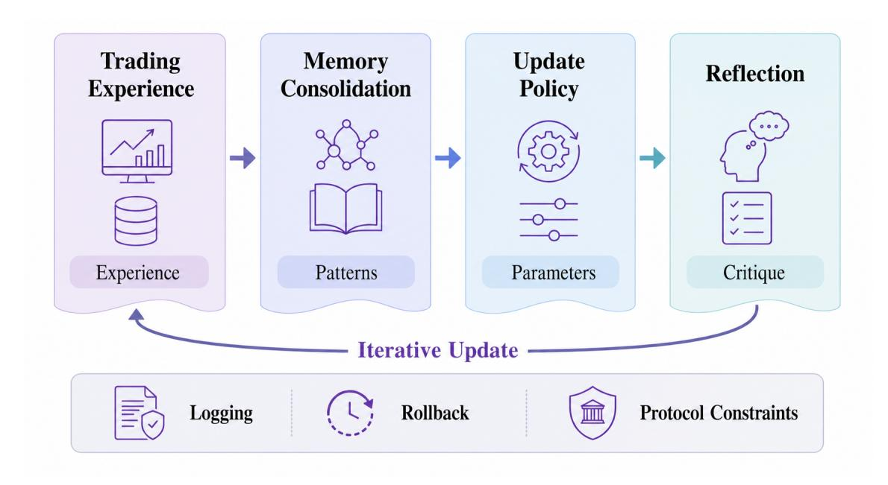

Figure 15: Conceptual governed update loop. Agents accumulate experience through trading, consolidate important patterns into memory, apply meta-learning-like update policies, and use reflection to critique reasoning under logging and rollback constraints. The figure is schematic, representing a protocol-constrained loop rather than an empirical proof of autonomous improvement, and is *not* used for evidence-mapping statistics or protocol comparison.

survey, however, trading-facing evidence remains extremely limited: the section-level count for meta-learning is N=0, because no included study explicitly implements a finance-specific metalearning algorithm (e.g., MAML). Early finance-oriented prototype systems instead explore multi-agent evolutionary loops to generate and select strategies or factors under backtest feedback [Yun et al.](#page-57-16) [\(2025\)](#page-57-16); [Luo et al.](#page-53-10) [\(2025\)](#page-53-10); [Zou et al.](#page-58-3) [\(2026\)](#page-58-3); these results are prototype-level and must be interpreted through the lens of evaluation protocol and cost/execution assumptions. The primary challenge is therefore not the algorithm (e.g., MAML), but the rigorous definition of "tasks" and sealed feedback channels to prevent look-ahead bias.

Task Splitting Requirement. In trading, a "task" cannot simply be a random sample of assets or days. To prevent leakage, tasks must be split by time (e.g., 2010–2015 as source, 2016 as target) or by distinct, non-overlapping asset classes. Random shuffling of episodes across time violates the causal structure of markets, creating false "adaptation" that is merely memorization of future regimes.

Representative Approaches. MAML (Model-Agnostic Meta-Learning) [Finn et al.](#page-50-17) [\(2017\)](#page-50-17) [BG] learns initialization parameters that enable rapid adaptation with few gradient steps. Learning to learn optimizes the learning rate schedule, exploration strategy, and architecture hyperparameters through experience, rather than relying on human experts to tune these. Financeoriented prototype systems use originality constraints and iterative critique to reduce brittle search behavior; AlphaAgent regularizes factor generation, and TradingGroup combines selfreflection with data synthesis [Tang et al.](#page-55-0) [\(2025\)](#page-55-0); [Tian et al.](#page-55-6) [\(2025\)](#page-55-6). More general multi-agent optimization systems such as

Yuksel et al. [Yuksel and Sawaf](#page-57-17) [\(2024\)](#page-57-17) [BG] illustrate the same iterative-refinement pattern, although they remain background evidence rather than finance-specific proof.

Technical Mechanisms. Task distributions define the set of related tasks that the agent should learn to handle. In trading, tasks can correspond to different market regimes (bull vs bear, high vs low volatility), asset classes (equities, futures, crypto), or time periods (pre- vs post-crisis). The metalearning objective optimizes performance across the distribution, learning initialization parameters that enable rapid adaptation to any task in the distribution with minimal task-specific data. Domain generalization extends this to unseen but related tasks, ensuring the agent can handle novel market conditions [Finn et al.](#page-50-17) [\(2017\)](#page-50-17); [Vinyals et al.](#page-55-18) [\(2016\)](#page-55-18); [Snell et al.](#page-55-19) [\(2017\)](#page-55-19); [Muandet et al.](#page-53-21) [\(2013\)](#page-53-21) [BG].

Few-shot learning divides data into support sets and query sets. Support sets provide a small number of examples from a new task (e.g., 5 recent trades in a new market regime), serving as context for adaptation. Query sets test performance on that task, evaluating how well the agent has adapted. Inner loop optimization adapts the model to the specific task using the support set, typically through one or a few gradient steps. Outer loop optimization updates the meta-parameters across all tasks, learning initialization that facilitates rapid inner loop adaptation.

MAML (Model-Agnostic Meta-Learning) [Finn et al.](#page-50-17) [\(2017\)](#page-50-17) [BG] formulates meta-learning as a bi-level optimization problem. The inner loop performs task-specific adaptation by taking gradient steps on each task's loss function. The outer loop optimizes the initialization parameters by maximizing performance across all tasks after inner loop adaptation. This produces initialization

parameters that are "easy to fine-tune," enabling rapid adaptation with minimal data. Memory-based optimization can augment the optimization process with external memory or replay, improving sample efficiency and stability in non-stationary settings.

Transfer learning applies meta-learned strategies to completely new tasks [Pan and Yang](#page-54-19) [\(2010\)](#page-54-19) [BG]. Inductive transfer reuses learned representations (neural network features, embeddings) as initialization for new tasks, reducing the data needed to learn. Behavioral transfer applies high-level strategies (risk management rules, exploration policies) learned in one domain to another. Domain adaptation fine-tunes meta-learned models on small amounts of task-specific data, bridging the gap between source and target domains. Few-shot adaptation enables agents to handle new assets or market conditions with only a handful of examples, a critical capability for rapidly changing markets.

#### *12.3. Self-Reflection*

Self-reflection enables agents to critique their own reasoning, identify mistakes, and correct errors before acting. This capability improves decision quality by catching errors that would otherwise propagate into actions.

Representative Approaches. Reflexion [Shinn et al.](#page-55-5) [\(2023\)](#page-55-5) [BG] adds an explicit critique–revise loop: after proposing a decision, the agent diagnoses weaknesses in its own reasoning and regenerates an improved plan. In trading settings, this is most useful as a guardrail against common failure modes (feature/label leakage, stale data, ignored costs, regime mismatch), rather than as a source of novel alpha. Self-consistency and retrospective error analysis complement Reflexion by exposing unstable rationales and recurring mistake patterns. In a finance-specific setting, CryptoTrade uses a reflective mechanism to refine zeroshot cryptocurrency trading decisions by analyzing outcomes of prior trades [Li et al.](#page-52-3) [\(2024c\)](#page-52-3). Within the section-level primary subset, the main trading-facing anchor is TradingGroup, which combines role specialization with self-reflection and data synthesis [Tian et al.](#page-55-6) [\(2025\)](#page-55-6); other reflection examples should be read as illustrative rather than as settled evidence for autonomous improvement.

# Technical Mechanisms.

#### Evidence Summary (Adaptation and Self-Evolution)

- Status: Most mechanisms (Meta-Learning, Reflection) are experimental designs transferred from general AI (marked [BG]), lacking rigorous end-to-end trading verification.
- Primary Evidence: The section-level primary-study count is N=4; the much larger citation list in the section includes additional background and prototype references that are not part of that total.
- Protocol Constraints: Claims of "self-improvement" are invalid without Sealed Testing and Frozen Semantics.

### Protocol Implication

We suggest a five-stage reflective protocol. Effective self-reflection is a *protocol*, not a free-form "thinking harder" step. (i) *Critique generation*: produce actionable checks tied to the trade proposal (data timestamps, assumptions, transaction costs, liquidity/slippage, and risk constraints). (ii) *Refinement*: run a small, bounded number of critique–revise iterations with early stopping; log the critique and the resulting change for auditability. (iii) *Consistency*/*uncertainty*: sample multiple reasoning paths; treat disagreement as a deferral/abstain signal to reduce overconfident errors, but validate thresholds empirically (consensus is not correctness). (iv) *Post-trade review*: categorize failures (prediction vs execution vs risk) and store compact lessons in memory keyed by instrument/regime so they can be retrieved at decision time. (v) *Pre-trade verification*: enforce hard constraints (risk limits, compliance rules, and operational feasibility) as deterministic checks.

*Risk of Search Bias*: Unbounded reflection acts as a search process. To prevent "testing into success" (retrying until a profitable trade is found just by chance), protocols must enforce a Reflection Budget (max iterations) and refrain from using Out-of-Sample feedback to terminate the loop. Reflective traces should not substitute for tests, monitoring, or out-of-sample evaluation [Wang et al.](#page-56-11) [\(2022\)](#page-56-11); [Madaan et al.](#page-53-5) [\(2023\)](#page-53-5); [Geifman](#page-50-18) [and El-Yaniv](#page-50-18) [\(2017\)](#page-50-18) [BG].

[Table 18](#page-37-1) summarizes self-evolution mechanisms at a conceptual level. Because all rows in the table are tagged BG, it should be read as a design-space summary rather than as evidence that trading agents already improve continuously through these loops. This completes our survey of the architecture, capabilities, and adaptation of agentic trading systems.

In summary, this part has explored how agents adapt and evolve in dynamic markets. Multi-agent coordination makes decomposition and specialization explicit, while self-evolution mechanisms remain mostly experimental and require frozen semantics, sealed testing, and immutable logs before any improvement claim can be compared across studies.

Across the 4 primary studies mapped in this section, evidence is split across memory consolidation (2), meta-learning-like

Table 18: Self-evolution method comparison. Tags: R=Reproducibility level (R0–R3); general mechanisms are treated as BG.

| Mechanism       | Description                    | Key Mechanism                                      | Comp Cost       | Data Eff              | Tags |
|-----------------|--------------------------------|----------------------------------------------------|-----------------|-----------------------|------|
| Consolidation   | Summarize, abstract, forget | Importance scoring, com pression          | Low (offline)   | High (reduces memory) | BG   |
| Meta-Learning   | Learn to learn                 | MAML Finn et al. (2017), memory-based opt       | High (bi-level) | High (few-shot)       | BG   |
| Self-Reflection | Critique and refine            | Reflexion Shinn et al. (2023), self-consistency | Medium          | Medium                | BG   |

adaptation (1), and self-reflection (1). The field remains experimental: sealed testing, frozen execution semantics, and immutable log pointers are the central requirements.

This completes Part III on adaptation mechanisms in agentic trading. Having surveyed the architecture, capabilities, and adaptation of trading agents, we now turn to the challenges facing the field and future directions for research.

#### 13. Challenges and Future Directions

The preceding sections have presented a structured evidencebased survey of agentic trading systems, from their architectural foundations to their capabilities and adaptation mechanisms. This section addresses the challenges facing the field and identifies promising directions for future research.

Beyond algorithmic limitations, the evidence mapping in [Sec](#page-3-1)[tion 2](#page-3-1) highlights a more basic bottleneck: many performance claims remain difficult to audit or compare because protocolcritical reporting is sparse. Within our primary empirical subset (*n* = 19), time-consistent splitting, transaction-cost modeling, universe/survivorship handling, and execution timing/semantics are all reported inconsistently. Reproducibility artifacts are also limited (R2+: 15.8%). Accordingly, several "technical challenges" below should be read not only as modeling challenges, but also as reporting and evaluation challenges.

#### Minimum Reporting Checklist (Protocol Implication)

To improve protocol comparability, we suggest the following reporting checklist for future agentic trading research:

- MR-1 (Data & universe): asset class, universe construction, survivorship treatment, and timestamps/availability for all modalities (especially text/news).
- MR-2 (Time-consistent splitting): train/validation/test dates, walk-forward/rolling details, and embargo/purge rules for leakage control; for adaptive search/selection (e.g., alpha discovery), report search budget and keep a sealed test set (validation , test).
- MR-3 (Action semantics): what the agent outputs (orders vs target weights), decision timestamp, order mapping, price formation (e.g., next-open/close/mid), and portfolio I/O contracts and constraints (leverage, turnover, position limits).
- MR-4 (Execution & costs): execution timing/price assumption, rebalancing frequency, fees/spread/slippage/impact model, and (when relevant) execution metrics (e.g., implementation shortfall, fill rate) plus sensitivity analysis under alternative frictions.
- MR-5 (Leakage audit): explicit leakage vectors checked (feature fitting, text hindsight, label leakage), with "NR/Unknown" treated conservatively.
- MR-6 (Artifacts & logs): code/data availability (or detailed pseudo-code), factor semantics (explicit formulas/ architectures), random seeds, and immutable logs (e.g., order IDs ↔ traces) sufficient to reproduce backtests or simulations (R0–R3); for adaptation/evolution claims, report mutable components, update triggers/windows, and rollback with frozen execution+cost semantics; for LLM-based systems, report inference cost per decision and total cost of ownership relative to strategy capacity.
- MR-7 (Multi-agent evaluation): roles & permissions, message protocol (types/budgets/sync), consensus mechanism, shared-state consistency, plus cross-play/ generalization, communication constraints, crowding/ impact metrics, and role/communication ablations for coordination claims.

To ensure fair comparison, we recognize that not all MR items apply equally to all research types. [Table 19](#page-38-0) presents the MR Applicability Matrix. For instance, End-to-End Trading systems must report universe construction (MR-1) and cost models (MR-4) to justify profitability claims, whereas a

Table 19: Minimum Reporting (MR) Applicability Matrix. We distinguish reporting obligations significantly by study type. M: Mandatory (failure to report downgrades evidence weight); R: Recommended (enhances reproducibility); O: Optional (context-dependent); –: Application dependent or N/A.

| MR Item                         | End-to-End (Full Trading) | Execution (Ord/Wt Algo) | Component (Perception/Risk) |
|---------------------------------|------------------------------|----------------------------|--------------------------------|
| MR-1 (Data & Universe)          | M                            | O                          | M                              |
| MR-2 (Time Split & Leakage)     | M                            | M                          | M                              |
| MR-3 (Action Semantics)         | M                            | M                          | –                              |
| MR-4 (Exec & Costs)             | M                            | M                          | –                              |
| MR-5 (Leakage Audit)            | M                            | R                          | R                              |
| MR-6 (Artifacts)                | R                            | R                          | R                              |
| MR-7 (Multi-Agent & Adaptation) | O                            | –                          | –                              |

Rationale for MR designations: The M/R/O classifications reflect domain-specific methodological norms for financial trading research. Mandatory (M) items are those essential for reproducibility and validity in the respective study type—for example, execution semantics (MR-3) and cost models (MR-4) are mandatory for any study claiming profitability (End-to-End and Execution categories) but not applicable to pure perception/analysis components. Recommended (R) items enhance reproducibility but are not strictly required for validity—e.g., leakage audits (MR-5) and artifacts (MR-6) are flagged as Recommended because their absence does not invalidate a study but limits external verification. Optional (O) items apply only in specific contexts—e.g., data universe specification (MR-1) is optional for execution algorithms that assume the universe as exogenous. These designations were operationalized through iterative refinement during pilot coding of 10 representative papers, with disagreements resolved through author consensus.

specialized Execution Algorithm taking parent orders as input may treat universe selection as exogenous (Optional). Similarly, Component studies (e.g., sentiment analysis modules) must strictly adhere to time-consistent splitting (MR-2) but may not need a transaction cost model if they do not execute trades. Researchers and reviewers can use this matrix to avoid "Not Reported" penalties where fields are structurally N/A.

#### *13.1. Technical Challenges*

Unless stated otherwise, the subsection narratives below combine challenge synthesis, methodological guidance, and protocol implications. In the primary studies, N counts only those studies that explicitly foreground the issue; N=0 therefore indicates sparse explicit reporting, not that the underlying risk is absent.

# *13.1.1. Hallucination in Finance*

LLM hallucination—generating plausible but false information poses *material* risks in financial contexts because trading decisions may be executed before the underlying claim is verified. Unlike domains where errors can be revisited later, market actions can realize losses before corrections arrive. Because the evidence base records only one primary study explicitly foregrounding this issue, the discussion here should be read as a mix of direct evidence and cross-section risk synthesis.

Propagation Mechanisms. In agentic workflows, hallucinated claims propagate through tool calls into downstream actions. A fabricated earnings report can trigger:

- 1. Erroneous position entry (immediate loss when corrected)
- 2. Stop-loss cascade (if other agents detect the "signal")
- 3. Confidence-based position scaling (larger losses due to false certainty)

Mitigation Limitations. Binding outputs to verifiable sources (FinMCP, HydraRAG) shifts but does not eliminate risk: source selection itself can be erroneous. Cross-validation requires multiple independent sources, which may not exist for timesensitive trading signals. Current fact-checking mechanisms operate at second-scale latency, incompatible with millisecond trading decisions. We cite these systems as illustrative tooling examples, not as empirically validated mitigations.

Regulatory Implications. Firms deploying LLM agents may face heightened liability if hallucinated outputs cause client losses. Documentation of source binding, validation checks, and human review may be needed for regulatory defense.

# *13.1.2. Look-ahead Bias*

Look-ahead bias is included here as methodological guidance tied directly to MR-2 and MR-5. Because the evidence base records N=0 primary studies explicitly foregrounding it in this section, the paragraph below should be read as a protocol requirement rather than a section-specific empirical count.

Look-ahead bias occurs when models inadvertently access future information during training or evaluation, producing unrealistic performance estimates that fail to generalize to real trading conditions. This is particularly insidious in timeseries settings where data leakage can occur through improper cross-validation that shuffles temporal data, technical indicators that require future data (such as moving averages that peek ahead), or textual sources that contain hindsight about market movements. Detection requires careful examination of model inputs and training procedures, including causal inference tests that check whether model performance degrades when strict temporal constraints are enforced. For example, a model that appears strong under naive random splits can degrade sharply under proper time-consistent evaluation, revealing substantial look-ahead contamination [López de Prado](#page-54-1) [\(2018\)](#page-54-1). Prevention requires strict temporal splitting (train on past, test on future), walk-forward validation that simulates real-time deployment, and causal modeling that helps ensure information only flows from past to future. Even the most sophisticated learning

and adaptation procedures fail when contaminated by future information or evaluation leakage.

## *13.1.3. Latency vs Accuracy Tradeo*ff

System 2 reasoning (reflective, multi-step) produces better decisions but is too slow for high-frequency trading where decisions must be made in microseconds, while System 1 reasoning (reactive, fast) lacks the depth for complex decisions involving multi-hop reasoning or extensive analysis. As an illustrative example, in latency-sensitive regimes the throughput advantage of faster decision policies can outweigh modest accuracy gains from slower deliberation, especially when opportunities are fleeting and execution queues are competitive. Hybrid approaches employ cascaded systems: fast System 1 handles routine decisions using [Section 3](#page-5-0) perceptual features, escalating difficult cases to slower System 2 reasoning that leverages [Section 5](#page-11-0) deliberative mechanisms. Model distillation compresses large reasoning models into smaller, faster models that retain much of the accuracy. Future work should develop more sophisticated tradeoff mechanisms that dynamically allocate computational budget based on decision importance, market volatility, and time pressure, potentially using reinforcement learning to learn optimal policies.

## *13.1.4. Explainability vs Performance*

Explainability vs performance is likewise a cross-section governance concern more than a densely evidenced subsection here: the evidence base records N=0 primary studies explicitly foregrounding it, so the discussion below is background and author guidance linked to deployment governance.

More complex models (deep neural networks, ensemble methods, large language models) often achieve better performance but are less interpretable, creating a fundamental tension between explainability and predictive power. This tension is not merely academic—depending on jurisdiction and system role, regulatory and legal frameworks (e.g., the EU's MiFID II) may impose governance, record-keeping, and explainability expectations for algorithmic trading and decision support [European Parliament](#page-50-15) [and Council of the European Union](#page-50-15) [\(2014\)](#page-50-15). Likewise, GDPR provisions and subsequent guidance can imply obligations to provide "meaningful information" about automated processing in certain contexts, though scope and applicability can vary [Eu](#page-50-16)[ropean Parliament and Council of the European Union](#page-50-16) [\(2016\)](#page-50-16); [Article 29 Working Party](#page-48-11) [\(2018\)](#page-48-11). When an agent's [Section 7](#page-17-0) alpha generation module triggers a large position, risk managers and regulators must understand why: was it a particular news event, a technical indicator pattern, or a reasoning chain? Neurosymbolic approaches combine neural networks with symbolic reasoning, achieving both performance and interpretability by using neural components for pattern recognition and symbolic components for transparent reasoning. Attention visualization shows which inputs the model focused on (e.g., specific news articles or price movements). Counterfactual explanations identify what would need to change to alter the model's decision (e.g., "the trade would not have occurred if the FOMC minutes had been less hawkish"). Regulatory and governance expectations

around explainability are likely to motivate advances in this area, particularly for [Section 9](#page-22-0) risk management and compliance applications.

Many academic systems demonstrate explanations on offline datasets or controlled prototypes; production deployments typically require additional engineering for auditability (decision logs, data lineage, and controlled model/prompt changes) to make explanations actionable for governance.

# *13.1.5. Computational Cost and Economic Feasibility*

The economic viability of LLM-based trading agents depends on the relationship between inference costs and generated returns. A simple annualized estimate is

Annual API Cost = 
$$D \times N \times C_{req}$$
,

where *D* is trading days per year, *N* is decisions per day, and *Creq* is the effective per-request cost implied by model pricing, prompt/completion token budgets, and any tool-specific charges. Because vendor pricing and model offerings change rapidly, we do not report a fixed cross-vendor dollar estimate here. Instead, empirical papers should disclose the model version, pricing snapshot date, token assumptions, tool usage, and the breakeven gross P&L required for net profitability after inference and execution costs.

#### *13.1.6. Evaluation Protocols and Deployment Safeguards*

This subsection translates the manuscript-wide minimum reporting framework (MR-1–MR-7) into concrete deployment safeguards. It is primarily an author protocol-implication layer grounded in the recurring reporting gaps identified earlier, rather than a new empirical taxonomy. Evidence-backed guidelines and common anti-patterns for agentic trading research and deployment include:

- Guard against temporal leakage: use strictly timeordered splits and walk-forward evaluation, and ensure feature engineering and scaling are fit only on past data [Albelali and Ahmed](#page-46-3) [\(2025\)](#page-46-3).
- Avoid unrealistic cost models: include fees, bid–ask spread, slippage, and market impact, and report sensitivity to cost assumptions [Perold](#page-54-6) [\(1988\)](#page-54-6); [Olby et al.](#page-53-6) [\(2025\)](#page-53-6).
- Check universe construction: document inclusion/exclusion rules and timestamp availability, and audit for survivorship/selection bias when building backtest datasets [Brown et al.](#page-49-20) [\(1992\)](#page-49-20).
- Mitigate backtest overfitting: separate model selection from final evaluation, use robust out-of-sample procedures, and be explicit about multiple-testing risk [Arian](#page-46-7) [et al.](#page-46-7) [\(2024\)](#page-46-7).
- Add deployment safeguards: maintain immutable action logs that link each action to inputs, evidence, and model versions. Use verifiable retrieval, citation checks, and cross-source consistency tests [Khatchadourian](#page-52-2) [\(2026\)](#page-52-2); [Tan et al.](#page-55-20) [\(2025b\)](#page-55-20).

# *13.2. Human-in-the-Loop Oversight*

Although this survey focuses on agentic systems, many realistic deployments retain human oversight at escalation points such as large notional changes, regime breaks, or tool failures. We therefore view human-in-the-loop design as a practical control boundary: stronger autonomy should imply stronger logging, clearer intervention rules, and explicit specification of when human approval is mandatory.

### *13.3. Negative Results and Failed Designs*

The literature is likely affected by survivorship bias at the survey level as well as at the backtest level. Few papers report failed prompts, abandoned reward schemes, degraded live performance, or architectures that increased turnover without improving net returns. We therefore interpret the absence of negative results as a reporting limitation rather than as evidence that the design space is uniformly promising.

#### *13.4. Future Directions*

#### *13.4.1. Neuro-Symbolic Integration*

Current LLM-based agents rely entirely on neural computation, which is powerful but opaque and unreliable for precise reasoning requiring exact calculations or logical guarantees. As discussed in [Section 5,](#page-11-0) pure neural approaches struggle with tasks like portfolio optimization under constraints or exact arithmetic. Neuro-symbolic integration combines neural networks (for pattern recognition and learning from data) with symbolic reasoning (for logic, constraint satisfaction, and exact computation). Hybrid architectures can employ neural networks to extract structured information from text (prices, dates, entities) and symbolic reasoning to perform financial calculations, enforce budget constraints, and help ensure logical consistency. Specific approaches include: (1) Neural theorem provers that use neural networks to guide proof search for financial constraints; (2) Differentiable logic that integrates logical constraints into neural network loss functions; (3) Program synthesis where LLMs generate code that is then formally verified; and (4) Neuro-symbolic ILP (Inductive Logic Programming) that learns logical rules from neural representations. The research objective is to combine neural flexibility with symbolic precision while keeping the resulting systems auditable enough for financial use.

# *13.4.2. Longer-Term Directions: Coordination, Governance, and Infrastructure*

Several longer-term directions remain relevant but more speculative than the protocol and auditability issues above. First, larger multi-agent market simulations could eventually function as controlled "wind tunnels" for studying crowding, flash episodes, and systemic-risk propagation, but the current evidence base is still dominated by small role-based teams rather than large agent societies. Second, regulatory and governance questions are likely to grow as agents become more autonomous: the immediate research need is not legal personhood for agents, but auditable records, intervention rules, and sandboxed evaluation that clarify who approved, monitored, or overrode each action. Third, low-latency infrastructure and model compression matter for deployment, yet hardware acceleration claims should remain secondary unless papers report end-to-end decision latency, execution timing, and cost/benefit analysis. These directions are therefore best treated as expert-system design constraints for future work, not as settled empirical findings of the present ledger.

Because several conclusions in this survey depend on a relatively thin but auditable empirical base, [Table 20](#page-41-0) makes the claim-toevidence mapping explicit in the main text rather than leaving it entirely to the supplement.

The current evidence base supports a narrower conclusion: agentic trading is a rapidly expanding design space, but comparability still depends more on reporting discipline than on headline performance claims. The final section concludes the survey.

Across the primary studies, protocol reporting remains the recurring limiter, while sealed testing, immutable logs, and latency-aware evaluation emerge as the common remedies.

#### 14. Conclusion

# *14.1. Summary*

This survey reframes LLM-based trading agents as expert-system decision pipelines and audits whether the current literature supports protocol-comparable claims. The central conclusion is evidence-level rather than taxonomy-level: architectural experimentation is growing quickly, but the primary empirical literature remains weakly comparable because temporal splits, cost assumptions, universe construction, execution semantics, and reproducible artifacts are often missing.

Accordingly, the paper's main contribution is the evidence ledger and the protocol/reproducibility audit. We use the A-C-A lens to organize where evidence gaps arise across perception, memory, reasoning, action/execution, capability, and adaptation modules. It remains a working analytical lens, not a validated classification standard.

Evidence-driven takeaway. In the current evidence ledger, we retain 77 included studies from 92 candidate records in the auditable snapshot screened through the 2026-03-09 ledger cutoff. Of these, 19 satisfy the primary empirical criteria and 58 remain in the background tier. Within the current primary subset, protocol-critical reporting remains limited: 2/19 (10.5%) report time-consistent split protocols, 1/19 (5.3%) report explicit cost models, 1/19 (5.3%) report universe/survivorship handling, and 11/19 (57.9%) report execution timing or semantics. Reproducibility artifacts are also limited, with 15/19 studies at R0, 3/19 at R2, and 0/19 at R3. These gaps motivate the conservative stance throughout this survey: where protocol-critical details are NR/Unknown, we avoid strong cross-paper performance comparisons and treat claims as preliminary unless supported by stronger evidence.

We emphasize that this synthesis is necessarily preliminary. Within the current primary subset, 78.9% of studies are at R0

Table 20: Claim-to-evidence map for the manuscript's strongest recurring conclusions. 'Primary' lists the papers supporting protocol-aware empirical claims.

| Claim                                                                                                                                     | Primary evidence                                                                                                                                                                                                                                     | Boundary / caveat                                                                                                                                                                                          |  |  |  |
|-------------------------------------------------------------------------------------------------------------------------------------------|------------------------------------------------------------------------------------------------------------------------------------------------------------------------------------------------------------------------------------------------------|------------------------------------------------------------------------------------------------------------------------------------------------------------------------------------------------------------|--|--|--|
| Protocol reporting is sparse                                                                                                     | FinAgent Zhang et al. (2024), TradingAgents Xiao et al. (2024), FinCon Yu et al. (2024), FinRL-DeepSeek Ben henda (2025), Agent Market Arena Qian et al. (2025), Fin Mem Yu et al. (2023)                                                   | Based on the primary empirical subset only; do not generalize percentages to all included/background work.                                                                                           |  |  |  |
| Action/execution seman tics are under-specified                                                                                        | FinAgent Zhang et al. (2024), TradingAgents Xiao et al. (2024), AI-Trader Fan et al. (2025), FinRL-DeepSeek Ben henda (2025)                                                                                                                   | Stronger evidence for missing reporting than for any single execution design winning empirically.                                                                                                       |  |  |  |
| Memory and adaptation remain heterogeneous Multi-agent systems improve decomposition, not guaranteed perfor mance | FinAgent Zhang et al. (2024), FinMem Yu et al. (2023), TradingGroup Tian et al. (2025), Alpha2 Xu (2024) TradingAgents Xiao et al. (2024), TradingGroup Tian et al. (2025), FinCon Yu et al. (2024), REIT multi-agent pipeline Li (2026) | Evidence is still thin; reported as emerging tendencies rather than settled best practice. Coordination benefits are plausible but attribution remains weak without role/communication ablations. |  |  |  |
| Cost and reproducibility gaps limit comparability                                                                                      | Primary subset tables in Section 2 plus R0–R3 audit summaries                                                                                                                                                                                     | This is the manuscript's strongest cross-paper conclusion because it depends on reporting structure, not headline Sharpe ratios.                                                                     |  |  |  |

reproducibility and none reach R3, so the architectural patterns we identify should be read as *emerging tendencies* within the current ledger rather than established best practices.

#### *14.2. Broader Impact*

Agentic trading may have meaningful implications for financial markets, industry practitioners, and academic researchers, but the current evidence base supports only cautious inferences. For markets, more autonomous decision pipelines could alter microstructure, liquidity provision, and information processing, while also raising questions about correlated agent behaviors, flash episodes, and new manipulation surfaces [\(Section 13\)](#page-37-0). For practitioners, modular agentic systems may lower some development barriers, but their deployment value still depends on execution realism, monitoring, and artifact quality. For researchers, agentic trading remains a useful testbed for studying AI in noisy real-world environments, especially around hallucination, lookahead bias, and the latency-accuracy tradeoff, yet the present sample does not justify broad claims about market-wide effects.

### *14.3. Limitations of the Lens and Evidence Base*

A-C-A should be read as a working analytical lens for this review. It helps separate agent boundary, architecture-capability alignment, and adaptation mechanism, but it has not been independently validated as a field-wide classification standard. Three limitations follow. First, emerging hybrid architectures may blur the distinction between architecture, capability, and adaptation. Second, the MR-1–MR-7 reporting dimensions in [Section 13](#page-37-0) reflect author judgment informed by quantitative finance and agent-system literature; broader community elicitation would strengthen their prioritization. Third, with only 15.8% of primary studies achieving R2+ reproducibility, many architectural patterns remain provisional and may merge, disappear, or require re-adjudication as stronger artifacts become available.

# *14.4. Call to Action*

We conclude with a targeted call to action for researchers, practitioners, and regulators. To researchers: more studies should report protocol-complete evaluation setups, clearly distinguish background discussion from primary evidence, and release enough artifacts to move beyond the current R0-heavy distribution. To practitioners: deployment claims should be accompanied by clearer documentation of execution assumptions, data timing, and monitoring procedures. To regulators: the current sample mainly indicates where reporting gaps persist; it may therefore be more useful to encourage auditable testing and controlled evaluation settings than to infer settled policy conclusions from an early-stage literature.

A parallel engineering trend outside the current trading-specific evidence base is the shift from one-off tool calls toward reusable workflow and skill layers in general LLM-agent systems. Recent work on agentic skills frames such capabilities as callable procedural modules with applicability conditions, execution policies, termination criteria, and reusable interfaces [Jiang et al.](#page-51-19) [\(2026\)](#page-51-19). For agentic trading, this suggests that future systems may package perception, retrieval, execution, risk checks, and reporting routines as governed skills or workflows. Because finance-specific closed-loop evidence for such designs remains limited, however, skill-based trading agents should be treated as an infrastructure direction rather than as validated trading evidence.

# *14.5. Artifact Availability Statement*

To support auditability of our review process, we submit supplementary materials alongside the manuscript: S1 includes the search log, study selection flow, and double-screening audit sample; S2 provides the evidence mapping master table (paper × coded fields) and coverage summaries; and S3 documents the coding schema and reproducibility tags with examples, including the targeted extraction-level reliability audit over 15fixed-seed primary studies. Boundary decisions and final exclusions are summarized in [Section Appendix D,](#page-45-0) and representative A-C-A reclassification notes are provided in [Section Appendix C.](#page-42-0) These materials are submitted as part of the review package for inspection during peer review. An anonymized repository containing the same supplementary materials and the LaTeX source will be released upon acceptance, subject to journal policy and anonymization requirements.

Agentic trading is an active and still unsettled research area. More comparable protocols, clearer evidence boundaries, and stronger artifact availability may be necessary before stronger conclusions about its long-run role in financial markets are warranted.

#### CRediT authorship contribution statement

Yihan Xia: Methodology, Investigation, Data curation, Formal analysis, Visualization, Writing – original draft, Writing – review & editing. Panpan You: Investigation, Data curation, Formal analysis, Visualization, Writing – original draft, Writing – review & editing. Taotao Wang: Conceptualization, Methodology, Supervision, Project administration, Resources, Validation, Writing – review & editing. Fang Liu: Conceptualization, Validation, Writing – review & editing. Han Qi: Conceptualization, Validation, Resources, Writing – review & editing. Xiaoxiao Wu: Conceptualization, Validation, Writing – review & editing. Shengli Zhang: Conceptualization, Validation, Writing – review & editing.

#### Declaration of competing interest

The authors declare that they have no known competing financial interests or personal relationships that could have appeared to influence the work reported in this paper.

# Acknowledgements

The authors thank colleagues and reviewers whose feedback helped improve the scope definition, evidence coding, and presentation of this survey.

### Data availability

The evidence ledger, coding summaries, and supplementary audit materials are submitted with the manuscript as Supplementary Materials S1–S3. S1 provides the canonical registry and search/screening logs, S2 provides the evidence-mapping and protocol tables, and S3 provides the coding schema, reproducibility annotations, and targeted extraction-level reliability audit. An anonymized repository containing the same materials and the LaTeX source will be released upon acceptance, subject to journal policy and anonymization requirements.

# Appendix A. Systematic Search Summary

This appendix summarizes the information sources and query patterns used to identify candidate records for this structured survey. The goal is transparency and reproducibility of the search boundary, rather than exhaustive coverage.

Coverage note. This survey discusses literature through the formal registry cutoff of 2026-03-09. Evidence annotations, screening counts, and protocol-coded denominators are synchronized to the auditable registry snapshot last queried on 2026-03-09.

#### Appendix B. Corpus Snapshot of the Evidence Ledger

This appendix consolidates corpus-level descriptive findings that follow from the review protocol but are not themselves part of the protocol definition. Unless stated otherwise, denominatorbased summaries here use the primary empirical subset (*n* = 19), while the full included ledger contains 77 studies partitioned into 19 primary empirical studies and 58 background studies.

The primary subset is concentrated in very recent work. Within the current ledger, 18/19 primary studies were published between 2024 and 2026. Registry metadata further indicate that 17/19 primary studies are currently coded as non-peer-reviewed, 2/19 as peer-reviewed, and 0/19 as Unknown. We therefore interpret this corpus as an early-stage literature whose claims often remain provisional pending stronger artifact release and independent replication.

Protocol-complete reporting remains sparse even within the fixed primary subset. Only 2/19 studies report an extractable split protocol, 1/19 specifies a transaction-cost model, 1/19 documents universe/survivorship handling, 11/19 reports execution timing or semantics, and 4/19 exposes artifacts beyond narrative description. Evaluation types are likewise unevenly distributed, with backtest, simulation, live, benchmark, and narrative-only or unclear evaluation reports appearing in different proportions across the corpus.

Reading note. In the figures below, Unknown denotes information that is not reported clearly enough in the source for reliable extraction under our conservative coding policy. These plots should therefore be read as corpus-level reporting distributions within the current ledger, not as proof that every unreported mechanism is absent in the underlying systems.

### Appendix C. Representative A-C-A Reclassification Notes

This appendix provides reclassification notes for 20 representative works to illustrate how the Architecture-Capability-Adaptation (A-C-A) exploratory analytical lens can reorganize parts of the literature. The notes are intended to clarify how the lens is applied and should not be read as an external validation exercise. For each work, we document: (i) classification under prior frameworks (where available), (ii) A-C-A reclassification with coding rationale, and (iii) the specific analytical insight surfaced by the lens.

Table A.21: Information sources and search summary (submitted as Supplementary Material S1).

| Source              | Notes                                                                              |
|---------------------|------------------------------------------------------------------------------------|
| ACM Digital Library | Keyword search over agentic trading, LLM agents, and financial decision-making. |
| IEEE Xplore         | Keyword search focused on trading systems, execution, and risk control.         |
| arXiv               | Preprints in cs.AI/cs.LG/q-fin with agent/trading keywords.                        |
| SSRN                | Working papers in quantitative finance and computational finance.                  |
| Google Scholar      | Broad catch-all for cross-venue discovery and citation chaining.                   |

Table A.22: Example query patterns used in the search.

| Target              | Query pattern (example)                                                                                 |  |  |  |
|---------------------|---------------------------------------------------------------------------------------------------------|--|--|--|
| Agentic trading     | (agent OR OR LLM agent) AND (trading OR agentic portfolio OR execution OR risk) |  |  |  |
| LLM finance agents  | (large language model OR LLM) AND (finance OR financial) AND (agent OR tool OR multi-agent)          |  |  |  |
| Evaluation/validity | (trading OR backtest) AND (look-ahead OR leakage OR transaction cost OR slippage OR survivorship)    |  |  |  |

#### *Appendix C.1. Reclassification Procedure*

Paper Selection. We selected 20 works representing diverse architectural approaches, capabilities, and adaptation mechanisms. Selection criteria: (a) coverage of all three A-C-A dimensions, (b) citation count or recency (indicating influence), (c) availability of technical details sufficient for classification.

Coding Procedure. For each paper, one author prepared an initial A-C-A classification and coding rationale, and the authors then reconciled edge cases through discussion. These notes are presented as an illustrative, author-curated coding dataset intended to clarify how the lens is applied, not as formal external validation.

Prior Framework Identification. For each work, we identified its classification in existing surveys where available: Wang et al. 2024 (LLM-Agent Survey), Ding et al. 2024 (LLM-Finance Survey), or task-centric benchmarks (FinBen, InvestorBench). Where a work was not explicitly labeled in one of those sources, the shorthand in the Prior column should be read as our closest reconstruction of how that work would map to the earlier scheme.

# *Appendix C.2. Reclassification Dataset*

[Table C.24](#page-44-0) presents the complete reclassification notes. The table is organized into illustrative architectural families rather than as an evidence-ranked progression or a validated hierarchy.

# *Appendix C.3. Illustrative Patterns from Reclassification*

Pattern 1: Architecture-Capability Non-Alignment. The same Reactive Architecture (FinAgent, AgentGuard) supports different capabilities (α vs R) depending on perceptual input and memory integration. This cross-cutting pattern is obscured by capability-centric categorizations.

Pattern 2: Adaptation Level Distinction. Works classified uniformly as "learning-based" in prior frameworks distribute across three adaptation levels: ICL (Chain-of-Alpha, RAG-Fintech), SFT (FinRS, MetaGPT), and SE (AlphaAgent, FinEvo). Each has distinct protocol requirements (Sec. [13\)](#page-37-0).

Pattern 3: Multi-Agent Architectural Hierarchy. Prior frameworks often use broad "multi-agent" labels. The A-C-A lens distinguishes role-based, hierarchical, and market-ecology coordination patterns, making the coordination mechanism visible rather than treating agent count as the primary distinction.

# *Appendix C.4. Coding Status*

In this revision, the coding notes are summarized qualitatively through author reconciliation examples rather than through placeholder agreement/kappa numerics. This is sufficient to show A-C-A's usefulness as an organizing lens for this manuscript, but not sufficient to establish it as a fully validated or uniquely correct taxonomy for the field.

*Appendix C.5. Limitations of the Reclassification Notes*

- 1. Selection Bias: 20 works selected from a broader review corpus spanning included studies, background references, and a small number of boundary cases used to stress-test the A-C-A lens; they were not randomly sampled.
- 2. Temporal Coverage: 85% (17/20) from 2024–2026, reflecting field recency. Earlier works may reveal different architectural patterns.
- 3. Prior Framework Availability: Not all works classified in existing surveys. Where unavailable, we inferred likely categorization based on paper content and survey scope.

Despite these limitations, the reclassification notes suggest that the A-C-A lens provides useful analytical granularity

Table B.23: Reproducibility levels within the primary empirical subset (*n* = 19).

| Level | Definition                                 | Criteria                                                                                                                                                                                                                    | Count | %    |
|-------|--------------------------------------------|-----------------------------------------------------------------------------------------------------------------------------------------------------------------------------------------------------------------------------|-------|------|
| R0    | No runnable artifacts                      | No publicly accessible code repository, or repository is broken/404, or it lacks essential files and cannot run                                                                                                       | 15    | 78.9 |
| R1    | Code available (not runnable)              | Public repository exists and is accessible, but key components are missing (dependencies, data access, eval scripts)                                                                                                  | 1     | 5.3  |
| R2    | Runnable with gaps                         | Complete code is available and data is ac cessible or clearly documented, and evalua tion scripts are provided, but pinned environ ment, complete documentation, or an end-to end pipeline may still be missing | 3     | 15.8 |
| R3    | Full reproduction package                  | Complete code with pinned environment, data snapshots or clear access instructions, complete documentation, and an end-to-end evaluation pipeline                                                                  | 0     | 0.0  |
|       | R2 or above (runnable with gaps or better) |                                                                                                                                                                                                                             | 3     | 15.8 |

Table C.24: Representative A-C-A reclassification notes for 20 works. These author-curated notes illustrate the exploratory analytical lens and are not an external validation study.

| Work                                              | Prior                              | A-C-A Reclassification                                                                               | P | M | R |     | Adapt Key Insight from A-C-A                                                                                |
|---------------------------------------------------|------------------------------------|------------------------------------------------------------------------------------------------------|---|---|---|-----|-------------------------------------------------------------------------------------------------------------|
| FinBERTAraci (2019) W: "NLP Model", D:            | "Sentiment"                        | Arch: Text Perception only; Cap: BG (no Action); Adapt: BG                                           | ✓ | – | – | BG  | Excluded as BG: demonstrates Action Output criterion excludes pure prediction                            |
| FinGPTWang et al. (2023a)                | W: "LLM Tool", D: "Gen eration" | Arch: Text Perception + Static Memory; Cap: BG (no closed-loop); Adapt: BG                           | ✓ | ✓ | – | BG  | Excluded as BG: Generation without execution integration                                                 |
| FinLlamaIacovides et al. (2024)                | D: "Sentiment"                     | Arch: Text Perception; Cap: BG; Adapt: BG                                                            | ✓ | – | – | BG  | Same architecture as FinBERT but instruction-tuned; capability depends on integration, not just model |
| AlphaAgentTang et al. (2025)                   | D: "Multi-agent"                   | Arch: Reflective/Strategic hybrid + Episodic Memory; Cap: α; Adapt: Self-reflection                  | ✓ | ✓ | ✓ | SE  | Multi-agent debate = validation mechanism for Alpha, not coordination capability                         |
| FinAgentZhang et al. (2024)                    | W: "Multi-modal", D: "Agent"    | Arch: Multi-modal P + Episodic M + Reflective R + Microstructure A; Cap: α (cross-modal); Adapt: ICL | ✓ | ✓ | ✓ | ICL | Core: cross-modal perception-to-action pipeline, not "multi-modality"                                    |
| Alpha2Xu (2024)                                   | B: "Alpha Mining"                  | Arch: Working Memory + Strategic Reasoning (MCTS); Cap: α (evolutionary); Adapt: RL                  | – | ✓ | ✓ | RL  | MCTS is Strategic Reasoning; evolutionary = search-based adaptation                                      |
| RAG-FintechCook et al. (2025)                  | D: "Retrieval"                     | Arch: Text P + Semantic M (KB) + Reflective R; Cap: α (retrieval-based); Adapt: ICL                  | ✓ | ✓ | ✓ | ICL | Retrieval = Memory architecture, not just augmentation technique                                         |
| RAPTORAlmon et al. (2025)                      | D: "Portfolio"                     | Arch: Working M + Strategic R + Execution A; Cap: P (hierarchical); Adapt: ICL                       | – | ✓ | ✓ | ICL | Portfolio = Strategic + Execution integration, not separate capability                                   |
| AgentGuard Jizhou Chen Chen and Cong (2025) | W: "Safety"                        | Arch: Reactive R + Action A with gating; Cap: R (real-time); Adapt: Rule-based                       | – | – | ✓ | –   | Risk as gating mechanism in Action architecture, not post-hoc                                            |
| FinRSLiu and Dang (2025b)                      | D: "Risk"                          | Arch: Text P + Episodic M + Reflective R; Cap: R (sentiment-driven); Adapt: SFT                      | ✓ | ✓ | ✓ | SFT | Risk capability derives from Perception-Memory-Reasoning chain                                           |
| TradingAgentsXiao et al. (2024)                | W: "Multi-agent"                   | Arch: Hierarchical role-based Coordination; Cap: α+P+R distributed; Adapt: Hierarchical feedback     | ✓ | ✓ | ✓ |     | ICL+SE Seven agents = capability hierarchy, not flat roles                                               |
| TradingGroupTian et al. (2025)                 | D: "Multi-agent"                   | Arch: Role-based + Shared Memory; Cap: α; Adapt: Self-reflection                                     | ✓ | ✓ | ✓ | SE  | Self-reflection coordinates roles, not external mechanism                                                |
| FINCONYu et al. (2024) D: "Consensus"             |                                    | Arch: Role-based + Communication Protocol; Cap: P; Adapt: Debate-based                               | ✓ | – | ✓ | ICL | Consensus = Decision Making mechanism, not independent capability                                        |
| FinMemYu et al. (2023) W: "Memory"                |                                    | Arch: Hierarchical Memory (3-tier) + Strategic R; Cap: P; Adapt: Memory consolidation                | – | ✓ | ✓ | SE  | Memory hierarchy enables temporal abstraction for Portfolio                                              |
| MetaGPTHong et al. (2024)                      | W: "Multi-agent"                   | Arch: Hierarchical (Manager + Engineers); Cap: α (code generation); Adapt: SFT                       | ✓ | ✓ | ✓ | SFT | Software engineering analogy applies to factor generation                                                |
| FinRL DeepSeekBenhenda (2025)               | B: "RL Trading"                    | Arch: Working M + Reactive/Strategic hybrid R + Execution A; Cap: α+P; Adapt: RL                     | – | ✓ | ✓ | RL  | RL spans multiple capabilities with shared architecture                                                  |
| ReflexionShinn et al. (2023)                   | W: "Reflection"                    | Arch: Working M + Reflective R; Cap: BG (general); Adapt: Self-reflection                            | – | ✓ | ✓ | SE  | Self-reflection as adaptation mechanism applicable to trading                                            |
| HashimotoHashimoto et al. (2025)               | B: "Simulation"                    | Arch: Market Ecology (no central coordination); Cap: α+P+R emergent; Adapt: Evolutionary             | ✓ | ✓ | ✓ |     | RL+SE Ecology = emergent capabilities from interaction, not design                                       |
| FinEvoZou et al. (2026) D: "Evolution"            |                                    | Arch: Market Ecology + Hierarchical; Cap: α; Adapt: Evolutionary + SE                                | ✓ | ✓ | ✓ | SE  | Combines ecology (interaction) with hierarchy (structure)                                                |

# Reproducibility Levels (primary subset, n=19)

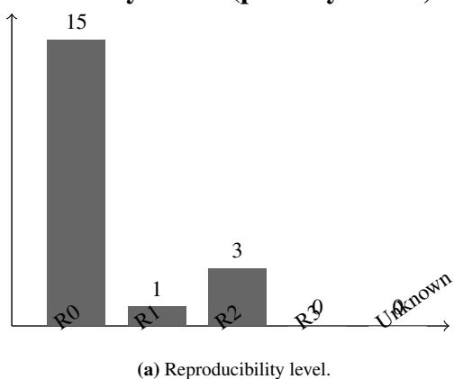

# Protocol Field Coverage (primary subset, n=19)

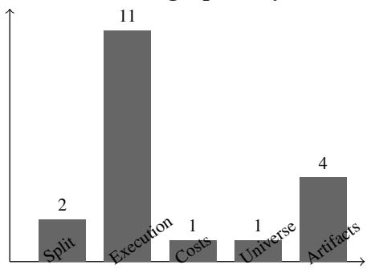

# **Evaluation Type (primary subset, n=19)**

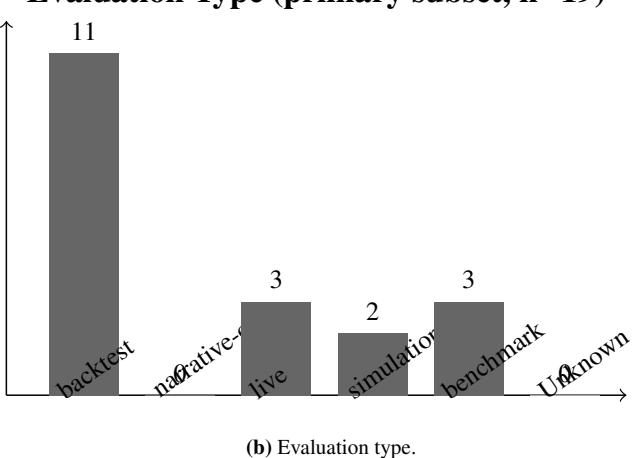

# **Split Protocol (primary subset, n=19)**

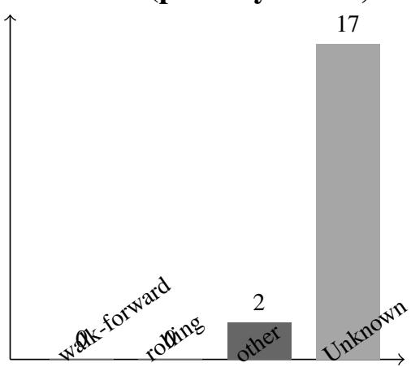

(d) Split-protocol reporting.

\* Universe/Cost reporting is calculated over n = 19. Low coverage reflects both reporting gaps and varying applicability (e.g., Execution tasks may not require Universe selection).

(c) Protocol-field coverage.

**Figure B.16:** Corpus-level reporting distributions within the primary empirical subset (n = 19).

for distinguishing design choices and surfacing architectural patterns that may be obscured by broader system- or task-level labels.

### Appendix D. Excluded Studies and Rationale

To ensure transparency and enable auditability of our evidence mapping process, this appendix distinguishes two decisions that are easy to conflate. First, *final exclusions* are candidate-registry records outside the finance/trading/portfolio/risk-management scope of this survey. Second, *background-tier boundary* 

*decisions* are finance-relevant records that remain in the included evidence ledger but do not enter the primary empirical subset because they lack Action Output or Closed-Loop Evaluation. Using PRISMA-ScR as a reporting aid for scoping-style transparency rather than as a claim of a full systematic-review workflow, we document both decision types to facilitate audit and assessment of potential selection bias.

*Appendix D.1. Exclusion Categories and Boundary Decisions* Candidate records were finally excluded only when they were outside the domain boundary of this survey. Finance-relevant records that were prediction models, benchmarks, tools, or conceptual background papers were retained as background/context where useful, but were excluded from the primary empirical denominator. The operational criteria are:

- E1 No Action Output: Pure prediction or analysis systems that do not generate tradable actions. These are backgroundtier records when finance-relevant, not final exclusions.
- E2 No Closed-Loop Evaluation: Systems that output signals or ideas but lack backtest, simulation, or live-trading evaluation. These are background-tier records when finance-relevant, not final exclusions.
- E3 Non-Financial Domain: Systems applied to non-financial markets or generic agent settings without financial trading, portfolio, execution, or risk-management instantiation. These form the final excluded set in the current canonical registry.
- E4 No LLM Component: Traditional quantitative trading systems without a language-model component. These may be cited only as background context when needed for finance methodology.
- E5 Duplicate: Multiple versions of the same work; the most complete version is retained.
- E6 Inaccessible: Full text not available after reasonable effort.

*Appendix D.2. Representative Final Exclusions and Background Boundary Cases*

[Table D.25](#page-48-12) separates final exclusions from background boundary cases. The aggregate exclusion count in the current canonical registry is 15, all of which are outside the finance/trading scope; the background cases remain in the 77-record included ledger but do not enter the 19-record primary empirical subset.

*Appendix D.3. Inclusion*/*Exclusion Decision Flow*

[Figure D.17](#page-47-0) illustrates the screening logic encoded in the canonical ledger and summarized in the main text. It should be read as an auditable reconstruction of the inclusion/exclusion workflow rather than as a separate inter-rater reliability audit.

*Appendix D.4. Impact of Exclusion Criteria on Evidence Set* The application of the domain boundary and minimum agent criteria substantially changed how records are interpreted. In the current auditable registry, 15 records were excluded during screening/eligibility after deduplication because they

were outside the survey domain. Separately, finance-relevant records that lacked Action Output or Closed-Loop Evaluation were retained as background/context rather than counted as final exclusions. The exclusion summary used in the main text therefore reports the macro-backed categories in [Table 3](#page-4-1) rather than legacy raw screening-log totals from earlier search iterations.

This filtering yields an included evidence-mapping set (*n* = 77); a primary empirical subset (*n* = 19) was then coded for protocolcomplete synthesis, while the remaining included records are retained as background/context where appropriate. Readers should therefore distinguish between included evidence, primary empirical evidence, background references, and final exclusions when interpreting percentages and narrative claims.

#### References

- Aaron Wheeler, J.D.V., 2023. Scalable agent-based modeling for complex financial market simulations. arXiv preprint arXiv:2312.14903v2 URL: [https://arxiv.org/pdf/23](https://arxiv.org/pdf/2312.14903v2) [12.14903v2](https://arxiv.org/pdf/2312.14903v2).
- Abensur, E., 2024. Machine learning for liquidity classification and its applications to portfolio selection. Brazilian Review of Finance / Revista Brasileira de Finanças 22, 1–14. URL: [https://periodicos.fgv.br/rbfin/article/downlo](https://periodicos.fgv.br/rbfin/article/download/90713/85865/206675) [ad/90713/85865/206675](https://periodicos.fgv.br/rbfin/article/download/90713/85865/206675), doi:[10.12660/rbfin.v22n2](http://dx.doi.org/10.12660/rbfin.v22n2.2024.90713) [.2024.90713](http://dx.doi.org/10.12660/rbfin.v22n2.2024.90713).
- Albelali, S., Ahmed, M., 2025. Hidden leaks in time series forecasting: How data leakage affects LSTM evaluation across configurations and validation strategies. arXiv preprint arXiv:2512.06932 URL: [https://arxiv.org/abs/2512](https://arxiv.org/abs/2512.06932) [.06932](https://arxiv.org/abs/2512.06932), doi:[10.48550/arXiv.2512.06932](http://dx.doi.org/10.48550/arXiv.2512.06932).
- Alkhudaydi, M.H., 2025. An ode-based dynamic mean-variance portfolio optimization. Computational Economics URL: [https://link.springer.com/article/10.1007/s106](https://link.springer.com/article/10.1007/s10614-025-11152-3) [14-025-11152-3](https://link.springer.com/article/10.1007/s10614-025-11152-3).
- Almgren, R., Chriss, N., 2001. Optimal execution of portfolio transactions. The Journal of Risk 3, 5–39. URL: [https:](https://doi.org/10.21314/jor.2001.041) [//doi.org/10.21314/jor.2001.041](https://doi.org/10.21314/jor.2001.041), doi:[10.21314/j](http://dx.doi.org/10.21314/jor.2001.041) [or.2001.041](http://dx.doi.org/10.21314/jor.2001.041).
- Almon, B., Caliboso, M., Kim, A., Dutta, R., Raman, R., Srungarapu, M., Sharma, V., Zhu, K., 2025. RAPTOR: Reasoned agentic portfolio trading with orchestrated rebalancing, in: NeurIPS 2025 Workshop (NORA). URL: [https:](https://openreview.net/forum?id=ziuTkKhgT0) [//openreview.net/forum?id=ziuTkKhgT0](https://openreview.net/forum?id=ziuTkKhgT0).
- Araci, D.T., 2019. Finbert: Financial sentiment analysis with pretrained language models. arXiv preprint arXiv:1908.10063 URL: <https://arxiv.org/abs/1908.10063>, doi:[10.4](http://dx.doi.org/10.48550/arXiv.1908.10063) [8550/arXiv.1908.10063](http://dx.doi.org/10.48550/arXiv.1908.10063).
- Arian, H., Norouzi Mobarekeh, D., Seco, L., 2024. Backtest overfitting in the machine learning era: A comparison of out-of-sample testing methods in a synthetic controlled

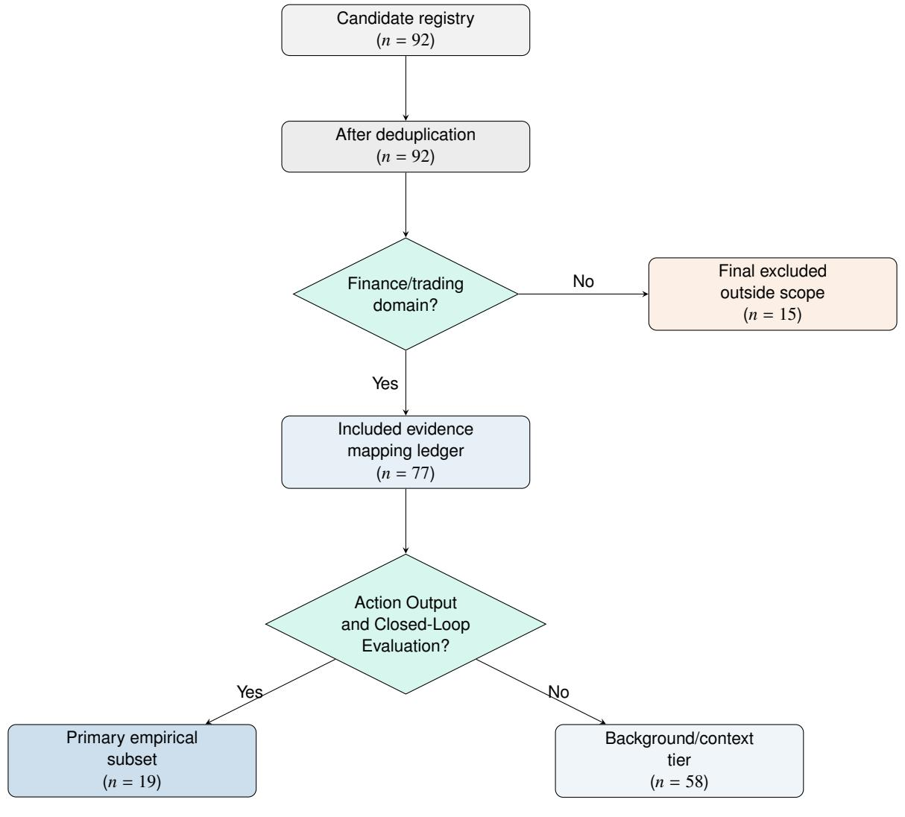

Figure D.17: Inclusion, exclusion, and evidence-tier decision flow. Final exclusions are outside the survey domain; finance-relevant records that lack Action Output or Closed-Loop Evaluation remain in the included background tier.

Table D.25: Representative final exclusions and background boundary cases.

| Study (Representative)                                   |    | CategoryDecision rationale                                                                                                                                     |
|----------------------------------------------------------|----|----------------------------------------------------------------------------------------------------------------------------------------------------------------|
| Final excluded records in the current canonical registry |    |                                                                                                                                                                |
| Socio-Agentic LLMs for Socio-Technical Systems        | E3 | Generic socio-technical agent paper outside finance/- trading/portfolio/risk management.                                                                    |
| Learning Game-Playing Agents with Generative          | E3 | General game-playing agent study without financial market instantiation.                                                                                    |
| Code Optimization NeSyCoCo                            | E3 | Neuro-symbolic compositional generalization study outside the trading domain.                                                                               |
| Agentic AI for Commer cial Insurance Underwrit ing | E3 | Insurance underwriting rather than trading, portfolio construction, execution, or market-risk management.                                                   |
| Included background boundary cases                       |    |                                                                                                                                                                |
| FinBERT (Araci 2019)                                     |    | E1/BG Finance-relevant sentiment model retained as back ground; no tradable action loop, so it is excluded from the primary empirical subset.            |
| FinGPT (Wang 2023a)                                      |    | E1/BG Finance language-model/tooling work retained as background; no explicit closed-loop trading execu tion integration.                                |
| InvestorBench                                            |    | E2/BG Finance benchmark retained as background; not counted as a primary empirical trading-agent system under Action Output plus Closed-Loop Evaluation. |

environment. Knowledge-Based Systems 305, 112477. URL: [https://www.sciencedirect.com/science/article/](https://www.sciencedirect.com/science/article/abs/pii/S0950705124011110) [abs/pii/S0950705124011110](https://www.sciencedirect.com/science/article/abs/pii/S0950705124011110), doi:[10.1016/j.knosys](http://dx.doi.org/10.1016/j.knosys.2024.112477) [.2024.112477](http://dx.doi.org/10.1016/j.knosys.2024.112477).

Arora, A., Malpani, R., 2026. Predictionmarketbench: A swebench-style framework for backtesting trading agents on prediction markets. arXiv preprint arXiv:2602.00133 URL: <https://arxiv.org/abs/2602.00133>, doi:[10.48550/a](http://dx.doi.org/10.48550/arXiv.2602.00133) [rXiv.2602.00133](http://dx.doi.org/10.48550/arXiv.2602.00133).

Article 29 Working Party, 2018. Guidelines on Automated individual decision-making and Profiling for the purposes of Regulation 2016/679. Technical Report. European Data Protection Board (endorsed). URL: [https://ec.europa.](https://ec.europa.eu/newsroom/article29/items/612053) [eu/newsroom/article29/items/612053](https://ec.europa.eu/newsroom/article29/items/612053). wP251 rev.01.

Asthana, S., Zhang, B., DeLuca, C., Mahindru, R., Patel, H., 2025. Stride: A systematic framework for selecting ai modalities – agentic ai, ai assistants, or llm calls. arXiv preprint arXiv:2512.02228 URL: [https://arxiv.org/ab](https://arxiv.org/abs/2512.02228) [s/2512.02228](https://arxiv.org/abs/2512.02228), doi:[10.48550/arXiv.2512.02228](http://dx.doi.org/10.48550/arXiv.2512.02228).

Atkinson, R.C., Shiffrin, R.M., 1968. Human memory: A proposed system and its control processes, in: Spence, K.W., Spence, J.T. (Eds.), The Psychology of Learning and Motivation. Academic Press. volume 2, pp. 89–195. URL: <https://psycnet.apa.org/record/1974-02719-003>, doi:[10.1016/S0079-7421\(08\)60422-3](http://dx.doi.org/10.1016/S0079-7421(08)60422-3).

Baddeley, A.D., Hitch, G., 1974. Working memory. Psychology of Learning and Motivation 8, 47–89. doi:[10.1016/S007](http://dx.doi.org/10.1016/S0079-7421(08)60452-1) [9-7421\(08\)60452-1](http://dx.doi.org/10.1016/S0079-7421(08)60452-1).

Bai, J., Perron, P., 2003. Computation and analysis of multiple structural change models. Journal of Applied Econometrics 18, 1–22. URL: <https://doi.org/10.1002/jae.659>, doi:[10.1002/jae.659](http://dx.doi.org/10.1002/jae.659).

Bai, S., Kolter, J.Z., Koltun, V., 2018. An empirical evaluation of generic convolutional and recurrent networks for sequence modeling. arXiv preprint arXiv:1803.01271 URL: [https:](https://arxiv.org/abs/1803.01271) [//arxiv.org/abs/1803.01271](https://arxiv.org/abs/1803.01271).

Bailey, D.H., Borwein, J.M., Lopez de Prado, M., Zhu, Q.J., 2014. Pseudo-mathematics and financial charlatanism: The effects of backtest overfitting. SSRN Electronic Journal URL: [https://papers.ssrn.com/sol3/papers.cfm?abstra](https://papers.ssrn.com/sol3/papers.cfm?abstract_id=2326253) [ct\\_id=2326253](https://papers.ssrn.com/sol3/papers.cfm?abstract_id=2326253), doi:[10.2139/ssrn.2326253](http://dx.doi.org/10.2139/ssrn.2326253).

Baker, S.R., Bloom, N., Davis, S.J., 2016. Measuring economic policy uncertainty. The Quarterly Journal of Economics 131, 1593–1636. URL: [https://doi.org/10.1093/qje/qjw0](https://doi.org/10.1093/qje/qjw024) [24](https://doi.org/10.1093/qje/qjw024), doi:[10.1093/qje/qjw024](http://dx.doi.org/10.1093/qje/qjw024).

Basel Committee on Banking Supervision, 2009. Principles for Sound Stress Testing Practices and Supervision. Technical Report. Bank for International Settlements. URL: [https:](https://www.bis.org/publ/bcbs155.htm) [//www.bis.org/publ/bcbs155.htm](https://www.bis.org/publ/bcbs155.htm).

Benhenda, M., 2025. Finrl-deepseek: Llm-infused risk-sensitive reinforcement learning for trading agents. arXiv preprint arXiv:2502.07393 URL: [https://arxiv.org/abs/2502](https://arxiv.org/abs/2502.07393) [.07393](https://arxiv.org/abs/2502.07393), doi:[10.48550/arXiv.2502.07393](http://dx.doi.org/10.48550/arXiv.2502.07393).

Bertsimas, D., Lo, A.W., 1998. Optimal control of execution costs. Journal of Financial Markets 1, 1–50. URL: [ht](https://doi.org/10.1016/S1386-4181(97)00012-8)

- [tps://doi.org/10.1016/S1386-4181\(97\)00012-8](https://doi.org/10.1016/S1386-4181(97)00012-8), doi:[10.1016/S1386-4181\(97\)00012-8](http://dx.doi.org/10.1016/S1386-4181(97)00012-8).
- Black, F., Litterman, R., 1992. Global portfolio optimization. Financial Analysts Journal 48, 28–43. URL: [https://rpc.](https://rpc.cfainstitute.org/en/research/financial-analysts-journal/1992/global-portfolio-optimization) [cfainstitute.org/en/research/financial-analyst](https://rpc.cfainstitute.org/en/research/financial-analysts-journal/1992/global-portfolio-optimization) [s-journal/1992/global-portfolio-optimization](https://rpc.cfainstitute.org/en/research/financial-analysts-journal/1992/global-portfolio-optimization), doi:[10.2469/faj.v48.n5.28](http://dx.doi.org/10.2469/faj.v48.n5.28).
- Bohorquez, G., Cartlidge, J., 2024. Simulation of social mediadriven bubble formation in financial markets using an agentbased model with hierarchical influence network. arXiv preprint arXiv:2409.00742v1 URL: [https://arxiv.or](https://arxiv.org/pdf/2409.00742v1) [g/pdf/2409.00742v1](https://arxiv.org/pdf/2409.00742v1).
- Bongiorno, C., Manolakis, E., Mantegna, R.N., 2025. End-toend large portfolio optimization for variance minimization with neural networks through covariance cleaning. URL: <https://arxiv.org/abs/2507.01918>, doi:[10.48550/a](http://dx.doi.org/10.48550/arXiv.2507.01918) [rXiv.2507.01918](http://dx.doi.org/10.48550/arXiv.2507.01918), [arXiv:2507.01918](http://arxiv.org/abs/2507.01918).
- Boyd, S., Johansson, R., Kahn, R.N., Schiele, P., Schmelzer, T., 2024. Markowitz portfolio construction at seventy. URL: [h t t p s : / / a r x i v . o r g / p d f / 2 4 0 1 . 0 5 0 80](https://arxiv.org/pdf/2401.05080), [arXiv:2401.05080](http://arxiv.org/abs/2401.05080).
- Briola, A., Bartolucci, S., Aste, T., 2024. Deep limit order book forecasting: A microstructural guide. arXiv preprint arXiv:2403.09267 URL: [https://arxiv.org/abs/2403](https://arxiv.org/abs/2403.09267) [.09267](https://arxiv.org/abs/2403.09267), doi:[10.48550/arXiv.2403.09267](http://dx.doi.org/10.48550/arXiv.2403.09267).
- Brown, S.J., Goetzmann, W.N., Ibbotson, R.G., Ross, S.A., 1992. Survivorship bias in performance studies. The Review of Financial Studies 5, 553–580. doi:[10.1093/rfs/5.4.553](http://dx.doi.org/10.1093/rfs/5.4.553).
- Brown, T.B., Mann, B., Ryder, N., Subbiah, M., Kaplan, J.D., Dhariwal, P., Neelakantan, A., Shyam, P., Sastry, G., Askell, A., Agarwal, S., Herbert-Voss, A., Krueger, G., Henighan, T., Child, R., Ramesh, A., Ziegler, D.M., Wu, J., Winter, C., Hesse, C., Chen, M., Sigler, E., Litwin, M., Gray, S., Chess, B., Clark, J., Berner, C., McCandlish, S., Radford, A., Sutskever, I., Amodei, D., 2020. Language models are fewshot learners, in: Advances in Neural Information Processing Systems. URL: <https://arxiv.org/abs/2005.14165>.
- Budish, E., Cramton, P., Shim, J., 2015. The high-frequency trading arms race: Frequent batch auctions as a market design response. The Quarterly Journal of Economics 130, 1547– 1621. URL: <https://doi.org/10.1093/qje/qjv027>, doi:[10.1093/qje/qjv027](http://dx.doi.org/10.1093/qje/qjv027).
- Byun, W., 2023. Practical application of deep reinforcement learning to optimal trade execution. FinTech 2, 414–429. URL: [https://www.mdpi.com/2674- 1032/2/3/23](https://www.mdpi.com/2674-1032/2/3/23), doi:[10.3390/fintech2030023](http://dx.doi.org/10.3390/fintech2030023).
- Caner, M., Fan, Q., 2024. Portfolio analysis in high dimensions with tracking error and weight constraints. URL: [https:](https://arxiv.org/abs/2402.17523) [//arxiv.org/abs/2402.17523](https://arxiv.org/abs/2402.17523), [arXiv:2402.17523](http://arxiv.org/abs/2402.17523).

- Caruana, R., 1997. Multitask learning. Machine Learning 28, 41–75. doi:[10.1023/A:1007379606734](http://dx.doi.org/10.1023/A:1007379606734).
- Castelli, A., Giudici, P., Piergallini, A., 2025. Building crypto portfolios with agentic ai. arXiv preprint arXiv:2507.20468v1 URL: <https://arxiv.org/pdf/2507.20468v1>.
- Chen, D., Zhu, Y., Liu, M., Li, J., 2022. Cost-efficient reinforcement learning for optimal trade execution on dynamic market environment, in: Proceedings of the ACM International Conference on AI in Finance (ICAIF). URL: [https:](https://dl.acm.org/doi/10.1145/3533271.3561761) [//dl.acm.org/doi/10.1145/3533271.3561761](https://dl.acm.org/doi/10.1145/3533271.3561761), doi:[10.1145/3533271.3561761](http://dx.doi.org/10.1145/3533271.3561761).
- Chen, J., Cong, S.L., 2025. Agentguard: Repurposing agentic orchestrator for safety evaluation of tool orchestration. arXiv preprint arXiv:2502.09809v1 URL: [https://arxiv.org/](https://arxiv.org/pdf/2502.09809v1) [pdf/2502.09809v1](https://arxiv.org/pdf/2502.09809v1).
- Chen, Y., Yao, Z., Liu, Y., Xin, A., Ye, J., Yu, J., Hou, L., Li, J., 2025. Stockbench: Can LLM agents trade stocks profitably in real-world markets? arXiv preprint arXiv:2510.02209 URL: <https://arxiv.org/abs/2510.02209>, doi:[10.48550/a](http://dx.doi.org/10.48550/arXiv.2510.02209) [rXiv.2510.02209](http://dx.doi.org/10.48550/arXiv.2510.02209).
- Cheridito, P., Weiss, M., 2025. Reinforcement learning for trade execution with market and limit orders. arXiv preprint arXiv:2507.06345 URL: [https://arxiv.org/abs/2507](https://arxiv.org/abs/2507.06345) [.06345](https://arxiv.org/abs/2507.06345), doi:[10.48550/arXiv.2507.06345](http://dx.doi.org/10.48550/arXiv.2507.06345).
- Constantinides, G.M., 1986. Capital market equilibrium with transaction costs. Journal of Political Economy 94, 842– 862. URL: <https://doi.org/10.1086/261412>, doi:[10.1086/261412](http://dx.doi.org/10.1086/261412).
- Cook, T., Osuagwu, R., Tsatiashvili, L., Vrynsia, V., Ghosal, K., Masoud, M., Mattivi, R., 2025. Retrieval augmented generation (rag) for fintech: Agentic design and evaluation. arXiv preprint arXiv:2510.25518 URL: [https://arxiv.or](https://arxiv.org/abs/2510.25518) [g/abs/2510.25518](https://arxiv.org/abs/2510.25518), doi:[10.48550/arXiv.2510.25518](http://dx.doi.org/10.48550/arXiv.2510.25518).
- Coriat, B., Benhamou, E., 2025. Harlf: Hierarchical reinforcement learning and lightweight llm-driven sentiment integration for financial portfolio optimization. URL: [https:](https://arxiv.org/abs/2507.18560) [//arxiv.org/abs/2507.18560](https://arxiv.org/abs/2507.18560), [arXiv:2507.18560](http://arxiv.org/abs/2507.18560).
- Cosler, M., Hahn, C., Mendoza, D., Schmitt, F., Trippel, C., 2023. nl2spec: Interactively translating unstructured natural language to temporal logics with large language models, in: Computer Aided Verification (CAV 2023), pp. 383– 396. URL: <https://arxiv.org/abs/2303.04864>, doi:[10.1007/978-3-031-37703-7\\_18](http://dx.doi.org/10.1007/978-3-031-37703-7_18).
- Davis, M.H.A., Norman, A.R., 1990. Portfolio selection with transaction costs. Mathematics of Operations Research 15, 676–713. URL: [https://doi.org/10.1287/moor.15.4.](https://doi.org/10.1287/moor.15.4.676) [676](https://doi.org/10.1287/moor.15.4.676), doi:[10.1287/moor.15.4.676](http://dx.doi.org/10.1287/moor.15.4.676).
- Deng, K., 2025. Autoquant: An auditable expert-system framework for execution-constrained auto-tuning in cryptocurrency perpetual futures. arXiv preprint arXiv:2512.22476 URL:

- <https://arxiv.org/abs/2512.22476>, doi:[10.48550/a](http://dx.doi.org/10.48550/arXiv.2512.22476) [rXiv.2512.22476](http://dx.doi.org/10.48550/arXiv.2512.22476).
- Dettmers, T., Pagnoni, A., Holtzman, A., Zettlemoyer, L., 2023. Qlora: Efficient finetuning of quantized llms URL: [https:](https://arxiv.org/abs/2305.14314) [//arxiv.org/abs/2305.14314](https://arxiv.org/abs/2305.14314), [arXiv:2305.14314](http://arxiv.org/abs/2305.14314).
- Diau, E., 2025. Finance as extended biology: Reciprocity as the cognitive substrate of financial behavior. arXiv preprint arXiv:2506.00099v2 URL: [https://arxiv.org/pdf/25](https://arxiv.org/pdf/2506.00099v2) [06.00099v2](https://arxiv.org/pdf/2506.00099v2).
- Dicks, M., Paskaramoorthy, A., Gebbie, T., 2023. Many learning agents interacting with an agent-based market model. arXiv preprint arXiv:2303.07393v4 URL: [https://arxiv.org/](https://arxiv.org/pdf/2303.07393v4) [pdf/2303.07393v4](https://arxiv.org/pdf/2303.07393v4).
- Ding, H., Li, Y., Wang, J., Chen, H., 2024. Large language model agent in financial trading: A survey. arXiv preprint arXiv:2408.06361 URL: [https://arxiv.org/abs/2408](https://arxiv.org/abs/2408.06361) [.06361](https://arxiv.org/abs/2408.06361), doi:[10.48550/arXiv.2408.06361](http://dx.doi.org/10.48550/arXiv.2408.06361).
- Dong, Y., Wu, F., Zhang, K., Dai, Y., Zhang, S., Ye, W., Chen, S., Cheng, Z.Q., 2025. Large language model agents in finance: A survey bridging research, practice, and realworld deployment, in: Findings of the Association for Computational Linguistics: EMNLP 2025, Association for Computational Linguistics, Suzhou, China. pp. 17889–17907. URL: [https://aclanthology.org/2025.findings-e](https://aclanthology.org/2025.findings-emnlp.972/) [mnlp.972/](https://aclanthology.org/2025.findings-emnlp.972/), doi:[10.18653/v1/2025.findings-emnlp.9](http://dx.doi.org/10.18653/v1/2025.findings-emnlp.972) [72](http://dx.doi.org/10.18653/v1/2025.findings-emnlp.972).
- Dorovatas, V., Schwerin, M., Bagdanov, A.D., Caccia, L., Carta, A., Charlin, L., Hammer, B., Hayes, T.L., Hess, T., Kanan, C., Kudithipudi, D., Liu, X., Lomonaco, V., Mendez-Mendez, J., Patil, D., Prabhu, A., Ricci, E., Tuytelaars, T., van de Ven, G.M., Wang, L., van de Weijer, J., Choi, J., Mundt, M., Aljundi, R., 2026. Modular memory is the key to continual learning agents. arXiv preprint arXiv:2603.01761 URL: <https://arxiv.org/abs/2603.01761>, doi:[10.4](http://dx.doi.org/10.48550/arXiv.2603.01761) [8550/arXiv.2603.01761](http://dx.doi.org/10.48550/arXiv.2603.01761).
- Du, K., Xing, F., Mao, R., Cambria, E., 2024. Financial sentiment analysis: Techniques and applications. ACM Computing Surveys 56, 1–42. doi:[10.1145/3649451](http://dx.doi.org/10.1145/3649451).
- Duan, Y., Zhang, C., Li, J., 2025. Factormad: A multiagent debate framework based on large language models for interpretable stock alpha factor mining, in: Proceedings of the 6th ACM International Conference on AI in Finance. URL: [https://dl.acm.org/doi/10.1145/3768292.37703](https://dl.acm.org/doi/10.1145/3768292.3770377) [77](https://dl.acm.org/doi/10.1145/3768292.3770377).
- Easley, D., López de Prado, M., O'Hara, M., 2012. Flow toxicity and liquidity in a high-frequency world. The Review of Financial Studies 25, 1457–1493. URL: [https://doi.](https://doi.org/10.1093/rfs/hhs053) [org/10.1093/rfs/hhs053](https://doi.org/10.1093/rfs/hhs053), doi:[10.1093/rfs/hhs053](http://dx.doi.org/10.1093/rfs/hhs053).
- European Parliament, Council of the European Union, 2014. Directive 2014/65/EU of the European Parliament and of

- the Council of 15 May 2014 on markets in financial instruments and amending Directive 2002/92/EC and Directive 2011/61/EU (consolidated text). Technical Report. Official Journal of the European Union. URL: [https://eur-lex](https://eur-lex.europa.eu/legal-content/EN/TXT/?uri=CELEX%3A02014L0065-20240328) [.europa.eu/legal-content/EN/TXT/?uri=CELEX%3A0](https://eur-lex.europa.eu/legal-content/EN/TXT/?uri=CELEX%3A02014L0065-20240328) [2014L0065-20240328](https://eur-lex.europa.eu/legal-content/EN/TXT/?uri=CELEX%3A02014L0065-20240328). consolidated version available on EUR-Lex.
- European Parliament, Council of the European Union, 2016. Regulation (EU) 2016/679 of the European Parliament and of the Council of 27 April 2016 on the protection of natural persons with regard to the processing of personal data and on the free movement of such data (General Data Protection Regulation). Technical Report. Official Journal of the European Union. URL: [https://eur-lex.europa.eu](https://eur-lex.europa.eu/legal-content/EN/TXT/?uri=CELEX%3A32016R0679) [/legal-content/EN/TXT/?uri=CELEX%3A32016R0679](https://eur-lex.europa.eu/legal-content/EN/TXT/?uri=CELEX%3A32016R0679).
- Fama, E.F., French, K.R., 1993. Common risk factors in the returns on stocks and bonds. Journal of Financial Economics 33, 3–56. URL: [https://doi.org/10.1016/0304-405](https://doi.org/10.1016/0304-405X(93)90023-5) [X\(93\)90023-5](https://doi.org/10.1016/0304-405X(93)90023-5), doi:[10.1016/0304-405X\(93\)90023-5](http://dx.doi.org/10.1016/0304-405X(93)90023-5).
- Fan, T., Yang, Y., Jiang, Y., Zhang, Y., Chen, Y., Huang, C., 2025. Ai-trader: Benchmarking autonomous agents in realtime financial markets. arXiv preprint arXiv:2512.10971 URL: <https://arxiv.org/abs/2512.10971>, doi:[10.48550/a](http://dx.doi.org/10.48550/arXiv.2512.10971) [rXiv.2512.10971](http://dx.doi.org/10.48550/arXiv.2512.10971).
- Fatemi, S., Hu, Y., 2024. Finvision: A multi-agent framework for stock market prediction, in: Proceedings of the 5th ACM International Conference on AI in Finance (ICAIF '24), pp. 582–590. URL: [https://dl.acm.org/doi/10.1145/3](https://dl.acm.org/doi/10.1145/3677052.3698688) [677052.3698688](https://dl.acm.org/doi/10.1145/3677052.3698688), doi:[10.1145/3677052.3698688](http://dx.doi.org/10.1145/3677052.3698688).
- Finn, C., Abbeel, P., Levine, S., 2017. Model-agnostic metalearning for fast adaptation of deep networks, in: International Conference on Machine Learning (ICML), pp. 1126–1135. URL: <https://arxiv.org/abs/1703.03400>.
- Foucault, T., 1999. Order flow composition and trading costs in a dynamic limit order market. Journal of Financial Markets 2, 99–134. URL: [https://doi.org/10.1016/S1386-418](https://doi.org/10.1016/S1386-4181(98)00012-3) [1\(98\)00012-3](https://doi.org/10.1016/S1386-4181(98)00012-3), doi:[10.1016/S1386-4181\(98\)00012-3](http://dx.doi.org/10.1016/S1386-4181(98)00012-3).
- Gao, K., Vytelingum, P., Weston, S., Luk, W., Guo, C., 2022. Understanding intra-day price formation process by agentbased financial market simulation: calibrating the extended chiarella model. arXiv preprint arXiv:2208.14207v1 URL: <https://arxiv.org/pdf/2208.14207v1>.
- Geifman, Y., El-Yaniv, R., 2017. Selective classification for deep neural networks. URL: [https://arxiv.org/abs/17](https://arxiv.org/abs/1705.08500) [05.08500](https://arxiv.org/abs/1705.08500), [arXiv:1705.08500](http://arxiv.org/abs/1705.08500).
- Genet, R., 2025. Deep learning for vwap execution in crypto markets: Beyond the volume curve. arXiv preprint arXiv:2502.13722 URL: [https://arxiv.org/abs/2502](https://arxiv.org/abs/2502.13722) [.13722](https://arxiv.org/abs/2502.13722), doi:[10.48550/arXiv.2502.13722](http://dx.doi.org/10.48550/arXiv.2502.13722).

- Giglio, S., Kelly, B., Xiu, D., 2022. Factor models, machine learning, and asset pricing. Annual Review of Financial Economics 14, 337–368. URL: [https://www.annual](https://www.annualreviews.org/doi/full/10.1146/annurev-financial-101521-104735) [reviews.org/doi/full/10.1146/annurev-financial](https://www.annualreviews.org/doi/full/10.1146/annurev-financial-101521-104735) [-101521-104735](https://www.annualreviews.org/doi/full/10.1146/annurev-financial-101521-104735), doi:[10.1146/annurev-financial-1](http://dx.doi.org/10.1146/annurev-financial-101521-104735) [01521-104735](http://dx.doi.org/10.1146/annurev-financial-101521-104735).
- Glosten, L.R., Milgrom, P.R., 1985. Bid, ask and transaction prices in a specialist market with heterogeneously informed traders. Journal of Financial Economics 14, 71–100. URL: [https://doi.org/10.1016/0304-405X\(85\)90044-3](https://doi.org/10.1016/0304-405X(85)90044-3), doi:[10.1016/0304-405X\(85\)90044-3](http://dx.doi.org/10.1016/0304-405X(85)90044-3).
- Gould, M.D., Porter, M.A., Williams, S., McDonald, M., Fenn, D.J., Howison, S.D., 2013. Limit order books. Quantitative Finance 13, 1709–1742. URL: [https://doi.org/10.108](https://doi.org/10.1080/14697688.2013.803148) [0/14697688.2013.803148](https://doi.org/10.1080/14697688.2013.803148), doi:[10.1080/14697688.201](http://dx.doi.org/10.1080/14697688.2013.803148) [3.803148](http://dx.doi.org/10.1080/14697688.2013.803148).
- Granger, C.W.J., 1969. Investigating causal relations by econometric models and cross-spectral methods. Econometrica 37, 424–438. URL: [https://www.jstor.org/stable/191](https://www.jstor.org/stable/1912791) [2791](https://www.jstor.org/stable/1912791), doi:[10.2307/1912791](http://dx.doi.org/10.2307/1912791).
- Grinold, R.C., Kahn, R.N., 2000. Active Portfolio Management: A Quantitative Approach for Producing Superior Returns and Controlling Risk. McGraw-Hill. URL: [https://www.mhed](https://www.mheducation.com/highered/product/active-portfolio-management-grinold-kahn/M9780070248820.html) [ucation.com/highered/product/active-portfolio](https://www.mheducation.com/highered/product/active-portfolio-management-grinold-kahn/M9780070248820.html) [-management-grinold-kahn/M9780070248820.html](https://www.mheducation.com/highered/product/active-portfolio-management-grinold-kahn/M9780070248820.html).
- Hafsi, Y., Vittori, E., 2024. Optimal execution with reinforcement learning. arXiv preprint arXiv:2411.06389 URL: <https://arxiv.org/pdf/2411.06389>, doi:[10.48550/a](http://dx.doi.org/10.48550/arXiv.2411.06389) [rXiv.2411.06389](http://dx.doi.org/10.48550/arXiv.2411.06389).
- Hamilton, J.D., 1989. A new approach to the economic analysis of nonstationary time series and the business cycle. Econometrica 57, 357–384. URL: [https://www.jstor.or](https://www.jstor.org/stable/1912559) [g/stable/1912559](https://www.jstor.org/stable/1912559), doi:[10.2307/1912559](http://dx.doi.org/10.2307/1912559).
- Hansen, P.R., 2005. A test for superior predictive ability. Journal of Business & Economic Statistics 23, 365–380. doi:[10.1198/073500105000000063](http://dx.doi.org/10.1198/073500105000000063).
- Hashimoto, R., Takayanagi, T., Suzuki, M., Izumi, K., 2025. Agent-based simulation of a financial market with large language models. Proceedings of the International Conference on Principles and Practice of Multi-Agent Systems (PRIMA) URL: <https://arxiv.org/abs/2510.12189>, doi:[10.4](http://dx.doi.org/10.48550/arXiv.2510.12189) [8550/arXiv.2510.12189](http://dx.doi.org/10.48550/arXiv.2510.12189).
- Hinton, G.E., Salakhutdinov, R.R., 2006. Reducing the dimensionality of data with neural networks. Science 313, 504–507. URL: [https://doi.org/10.1126/science.](https://doi.org/10.1126/science.1127647) [1127647](https://doi.org/10.1126/science.1127647), doi:[10.1126/science.1127647](http://dx.doi.org/10.1126/science.1127647).
- Hong, S., Zhuge, M., Chen, J., Zheng, X., Cheng, Y., Zhang, C., Wang, J., Wang, Z., Yau, S.K.S., Lin, Z., Zhou, L., Ran, C., Xiao, L., Wu, C., Schmidhuber, J., 2024. Metagpt: Meta programming for a multi-agent collaborative framework,

- in: International Conference on Learning Representations (ICLR). URL: <https://arxiv.org/abs/2308.00352>, doi:[10.48550/arXiv.2308.00352](http://dx.doi.org/10.48550/arXiv.2308.00352).
- Hu, X., Xiong, Y., Zhang, Z., Li, C., 2024. Consensus of a new multi-agent system via multi-task, multi-control mechanism and multi-consensus strategy. Neurocomputing doi:[10.1016/j.neucom.2024.127586](http://dx.doi.org/10.1016/j.neucom.2024.127586).
- Hwang, Y., Kong, Y., Zohren, S., Lee, Y., 2025. Decisioninformed neural networks with large language model integration for portfolio optimization. URL: [https://arxiv.org/](https://arxiv.org/pdf/2502.00828) [pdf/2502.00828](https://arxiv.org/pdf/2502.00828), [arXiv:2502.00828](http://arxiv.org/abs/2502.00828).
- Iacovides, G., Konstantinidis, T., Xu, M., Mandic, D., 2024. Finllama: Llm-based financial sentiment analysis for algorithmic trading, in: Proceedings of the 5th ACM International Conference on AI in Finance, ACM. pp. 134–141. doi:[10.1145/3677052.3698696](http://dx.doi.org/10.1145/3677052.3698696).
- Jagannathan, R., Ma, T., 2003. Risk reduction in large portfolios: Why imposing the wrong constraints helps. The Journal of Finance 58, 1651–1684. URL: [https://doi.org/10.111](https://doi.org/10.1111/1540-6261.00580) [1/1540-6261.00580](https://doi.org/10.1111/1540-6261.00580), doi:[10.1111/1540-6261.00580](http://dx.doi.org/10.1111/1540-6261.00580).
- Jiang, J., Zhou, K., Zhao, W.X., Song, Y., Zhu, C., Zhu, H., Wen, J.R., 2024. Kg-agent: An efficient autonomous agent framework for complex reasoning over knowledge graph. arXiv preprint arXiv:2402.11163v1 URL: [https:](https://arxiv.org/pdf/2402.11163v1) [//arxiv.org/pdf/2402.11163v1](https://arxiv.org/pdf/2402.11163v1).
- Jiang, Y., Li, D., Deng, H., Ma, B., Wang, X., Wang, Q., Yu, G., 2026. SoK: Agentic skills—beyond tool use in LLM agents. arXiv preprint arXiv:2602.20867 URL: [https:](https://arxiv.org/abs/2602.20867) [//arxiv.org/abs/2602.20867](https://arxiv.org/abs/2602.20867).
- Johnson, J., Douze, M., Jégou, H., 2017. Billion-scale similarity search with GPUs. arXiv preprint arXiv:1702.08734 URL: <https://arxiv.org/abs/1702.08734>.
- Kahneman, D., Tversky, A., 1979. Prospect theory: An analysis of decision under risk. Econometrica 47, 263–291. URL: <https://www.jstor.org/stable/1914185>, doi:[10.2307/1914185](http://dx.doi.org/10.2307/1914185).
- Kang, Z., Gong, J., Hu, W., Yin, S., Jiang, K., Fang, Z., He, Y., Meng, C., Fu, R., Chen, D., Zheng, L., Jiang, E.H., Feng, Y., Leng, Y., Zhu, J., Chen, X., Yang, X., Xuan, R., 2026. Quanteval: A benchmark for financial quantitative tasks in large language models. arXiv preprint arXiv:2601.08689 URL: <https://arxiv.org/abs/2601.08689>, doi:[10.4](http://dx.doi.org/10.48550/arXiv.2601.08689) [8550/arXiv.2601.08689](http://dx.doi.org/10.48550/arXiv.2601.08689).
- Kelly, J.L., 1956. A new interpretation of information rate. Bell System Technical Journal 35, 917–926. URL: [https:](https://onlinelibrary.wiley.com/doi/10.1002/j.1538-7305.1956.tb03809.x) [//onlinelibrary.wiley.com/doi/10.1002/j.1538-7](https://onlinelibrary.wiley.com/doi/10.1002/j.1538-7305.1956.tb03809.x) [305.1956.tb03809.x](https://onlinelibrary.wiley.com/doi/10.1002/j.1538-7305.1956.tb03809.x), doi:[10.1002/j.1538-7305.1956](http://dx.doi.org/10.1002/j.1538-7305.1956.tb03809.x) [.tb03809.x](http://dx.doi.org/10.1002/j.1538-7305.1956.tb03809.x).

- Khatchadourian, R., 2026. Replayable financial agents: A determinism-faithfulness assurance harness for tool-using llm agents. arXiv preprint arXiv:2601.15322v2 URL: [https:](https://arxiv.org/pdf/2601.15322v2) [//arxiv.org/pdf/2601.15322v2](https://arxiv.org/pdf/2601.15322v2).
- Khezresmaeilzadeh, T., Razmara, P., Azizi, S., Sadeghi, M.E., Potraghloo, E.B., 2025. Vista: Vision-language inference for training-free stock time-series analysis. arXiv preprint arXiv:2505.18570 doi:[10.48550/arXiv.2505.18570](http://dx.doi.org/10.48550/arXiv.2505.18570).
- Kirilenko, A.A., Kyle, A.S., Samadi, M., Tuzun, T., 2017. The flash crash: High-frequency trading in an electronic market. The Journal of Finance 72, 967–998. URL: [https://doi.](https://doi.org/10.1111/jofi.12498) [org/10.1111/jofi.12498](https://doi.org/10.1111/jofi.12498), doi:[10.1111/jofi.12498](http://dx.doi.org/10.1111/jofi.12498).
- Kirkpatrick, J., Pascanu, R., Rabinowitz, N., Veness, J., Hadsell, R., 2017. Overcoming catastrophic forgetting using elastic weight consolidation. Proceedings of the National Academy of Sciences (PNAS) 114, 3521–3526. URL: [https://](https://www.pnas.org/doi/10.1073/pnas.1611835114) [www.pnas.org/doi/10.1073/pnas.1611835114](https://www.pnas.org/doi/10.1073/pnas.1611835114), doi:[10.1073/pnas.1611835114](http://dx.doi.org/10.1073/pnas.1611835114).
- Kirtac, K., Germano, G., 2025. Leveraging llm-based sentiment analysis for portfolio optimization with proximal policy optimization, in: Proceedings of the 1st Workshop for Research on Agent Language Models (REALM 2025). URL: <https://aclanthology.org/2025.realm-1.12/>.
- Kocsis, L., Szepesvári, C., 2006. Bandit based monte-carlo planning, in: Machine Learning: ECML 2006, pp. 282– 293. URL: [https://doi.org/10.1007/11871842\\_29](https://doi.org/10.1007/11871842_29), doi:[10.1007/11871842\\_29](http://dx.doi.org/10.1007/11871842_29).
- Kou, Z., Yu, H., Luo, J., Peng, J., Li, X., Liu, C., Dai, J., Chen, L., Han, S., Guo, Y., 2025. Automate strategy finding with llm in quant investment, in: Findings of the Association for Computational Linguistics: EMNLP 2025, Suzhou, China. URL: [https://aclanthology.org/2025.findings-e](https://aclanthology.org/2025.findings-emnlp.1005.pdf) [mnlp.1005.pdf](https://aclanthology.org/2025.findings-emnlp.1005.pdf).
- Kyle, A.S., 1985. Continuous auctions and insider trading. Econometrica 53, 1315–1335. URL: [https://www.jstor.](https://www.jstor.org/stable/1913210) [org/stable/1913210](https://www.jstor.org/stable/1913210), doi:[10.2307/1913210](http://dx.doi.org/10.2307/1913210).
- Ledoit, O., Wolf, M., 2004. Honey, i shrunk the sample covariance matrix. The Journal of Portfolio Management 30, 110–119. URL: [https://doi.org/10.3905/jpm.20](https://doi.org/10.3905/jpm.2004.110) [04.110](https://doi.org/10.3905/jpm.2004.110), doi:[10.3905/jpm.2004.110](http://dx.doi.org/10.3905/jpm.2004.110).
- Lee, Y., Kim, Y., Kim, J., Kim, S., Lee, Y., 2025. Llm-enhanced black-litterman portfolio optimization. URL: [https://arxi](https://arxiv.org/abs/2504.14345) [v.org/abs/2504.14345](https://arxiv.org/abs/2504.14345), doi:[10.48550/arXiv.2504.14](http://dx.doi.org/10.48550/arXiv.2504.14345) [345](http://dx.doi.org/10.48550/arXiv.2504.14345), [arXiv:2504.14345](http://arxiv.org/abs/2504.14345).
- Li, H., Cao, Y., Yu, Y., Javaji, S.R., Deng, Z., He, Y., Jiang, Y., Zhu, Z., Subbalakshmi, K.P., Xiong, G., Huang, J., Qian, L., Peng, X., Xie, Q., Suchow, J.W., 2025. Investorbench: A benchmark for financial decision-making tasks with llmbased agent, in: Proceedings of the 63rd Annual Meeting of the Association for Computational Linguistics (Volume 1:

- Long Papers), pp. 2509–2525. URL: [https://aclantholo](https://aclanthology.org/2025.acl-long.126/) [gy.org/2025.acl-long.126/](https://aclanthology.org/2025.acl-long.126/), doi:[10.18653/v1/2025](http://dx.doi.org/10.18653/v1/2025.acl-long.126) [.acl-long.126](http://dx.doi.org/10.18653/v1/2025.acl-long.126).
- Li, J., Liu, Y., Liu, W., Fang, S., Wang, L., Xu, C., Bian, J., 2024a. Mars: a financial market simulation engine powered by generative foundation model. arXiv preprint arXiv:2409.07486 URL: [https://arxiv.org/abs/2409](https://arxiv.org/abs/2409.07486) [.07486](https://arxiv.org/abs/2409.07486), doi:[10.48550/arXiv.2409.07486](http://dx.doi.org/10.48550/arXiv.2409.07486).
- Li, Y., Du, N., Song, X., Yang, X., Cui, T., Xue, N., Farjudian, A., Ren, J., Cheah, W.P., 2024b. Cardinality and bounding constrained portfolio optimization using safe reinforcement learning, in: Proceedings of the International Joint Conference on Neural Networks (IJCNN). URL: [https://doi.org/10](https://doi.org/10.1109/IJCNN60899.2024.10651491) [.1109/IJCNN60899.2024.10651491](https://doi.org/10.1109/IJCNN60899.2024.10651491), doi:[10.1109/IJCN](http://dx.doi.org/10.1109/IJCNN60899.2024.10651491) [N60899.2024.10651491](http://dx.doi.org/10.1109/IJCNN60899.2024.10651491).
- Li, Y., Luo, B., Wang, Q., Chen, N., Liu, X., He, B., 2024c. CryptoTrade: A reflective LLM-based agent to guide zeroshot cryptocurrency trading, in: Al-Onaizan, Y., Bansal, M., Chen, Y.N. (Eds.), Proceedings of the 2024 Conference on Empirical Methods in Natural Language Processing, Association for Computational Linguistics, Miami, Florida, USA. pp. 1094–1106. URL: [https://aclanthology.org](https://aclanthology.org/2024.emnlp-main.63/) [/2024.emnlp-main.63/](https://aclanthology.org/2024.emnlp-main.63/), doi:[10.18653/v1/2024.emnlp](http://dx.doi.org/10.18653/v1/2024.emnlp-main.63) [-main.63](http://dx.doi.org/10.18653/v1/2024.emnlp-main.63).
- Li, Y., Yu, Y., Li, H., Chen, Z., Khashanah, K., 2023. Tradinggpt: Multi-agent system with layered memory and distinct characters for enhanced financial trading performance. URL: <https://arxiv.org/pdf/2309.03736>, doi:[10.4](http://dx.doi.org/10.48550/arXiv.2309.03736) [8550/arXiv.2309.03736](http://dx.doi.org/10.48550/arXiv.2309.03736), [arXiv:2309.03736](http://arxiv.org/abs/2309.03736).
- Li, Z., 2026. Design and empirical study of a large language model-based multi-agent investment system for chinese public reits. arXiv preprint arXiv:2602.00082 URL: [https://arxi](https://arxiv.org/abs/2602.00082) [v.org/abs/2602.00082](https://arxiv.org/abs/2602.00082), doi:[10.48550/arXiv.2602.00](http://dx.doi.org/10.48550/arXiv.2602.00082) [082](http://dx.doi.org/10.48550/arXiv.2602.00082).
- Lin, L.J., 1992. Self-improving reactive agents based on reinforcement learning, planning and teaching. Machine Learning 8, 293–321. URL: [https://doi.org/10.1023/](https://doi.org/10.1023/A:1022628806385) [A:1022628806385](https://doi.org/10.1023/A:1022628806385), doi:[10.1023/A:1022628806385](http://dx.doi.org/10.1023/A:1022628806385).
- Liu, B., Dang, R., 2025a. Finpos: A position-aware trading agent system for real financial markets. URL: [https:](https://arxiv.org/abs/2510.27251) [//arxiv.org/abs/2510.27251](https://arxiv.org/abs/2510.27251), [arXiv:2510.27251](http://arxiv.org/abs/2510.27251).
- Liu, B., Dang, R., 2025b. Finrs: A risk-sensitive trading framework for real financial markets. arXiv preprint arXiv:2511.12599v1 URL: [https://arxiv.org/pdf/25](https://arxiv.org/pdf/2511.12599v1) [11.12599v1](https://arxiv.org/pdf/2511.12599v1).
- Liu, F., Chen, L., Zheng, Y., Feng, Y., 2022. A prediction method with data leakage suppression for time series. Electronics 11, 3701. URL: [https://www.mdpi.com/2079-9292/11/2](https://www.mdpi.com/2079-9292/11/22/3701) [2/3701](https://www.mdpi.com/2079-9292/11/22/3701), doi:[10.3390/electronics11223701](http://dx.doi.org/10.3390/electronics11223701).

- Liu, F., Yi, H., Luo, S., Wang, Y., Yang, Y., Li, X., Hu, Z., Feng, J., Liu, Q., 2025. Cognitive alpha mining via llm-driven code-based evolution. arXiv preprint arXiv:2511.18850 URL: <https://arxiv.org/html/2511.18850v1>.
- Liu, N.F., Lin, K., Hewitt, J., Paranjape, A., Bevilacqua, M., Petroni, F., Liang, P., 2024. Lost in the middle: How language models use long contexts. Transactions of the Association for Computational Linguistics URL: [https://arxiv.org/ab](https://arxiv.org/abs/2307.03172) [s/2307.03172](https://arxiv.org/abs/2307.03172), doi:[10.1162/tacl\\_a\\_00638](http://dx.doi.org/10.1162/tacl_a_00638).
- Liu, Z., Zhang, Y., Li, P., Liu, Y., Yang, D., 2023. A dynamic llmpowered agent network for task-oriented agent collaboration. arXiv preprint arXiv:2310.02170 URL: [https://arxiv.or](https://arxiv.org/abs/2310.02170) [g/abs/2310.02170](https://arxiv.org/abs/2310.02170).
- Lo, A.W., Repin, D.V., 2002. The psychophysiology of real-time financial risk processing. Journal of Cognitive Neuroscience 14, 323–339. URL: [https://doi.org/10.1162/089892](https://doi.org/10.1162/089892902317361921) [902317361921](https://doi.org/10.1162/089892902317361921), doi:[10.1162/089892902317361921](http://dx.doi.org/10.1162/089892902317361921).
- Lopez-Lira, A., 2025. Can large language models trade? testing financial theories with llm agents in market simulations. arXiv preprint arXiv:2504.10789 URL: [https://arxiv.org/ab](https://arxiv.org/abs/2504.10789) [s/2504.10789](https://arxiv.org/abs/2504.10789), doi:[10.48550/arXiv.2504.10789](http://dx.doi.org/10.48550/arXiv.2504.10789).
- Lu, J., Wang, K., Wang, Y., Tang, Q., Zeng, H., Chen, X., Pi, J., Deng, S., Chen, L., Fu, Y., Yang, K., Sun, X., 2026. Fintoolbench: Evaluating llm agents for real-world financial tool use. arXiv preprint arXiv:2603.08262v1 URL: <https://arxiv.org/pdf/2603.08262v1>.
- Lundberg, S.M., Lee, S.I., 2017. A unified approach to interpreting model predictions, in: Advances in Neural Information Processing Systems (NeurIPS). URL: [https:](https://arxiv.org/abs/1705.07874) [//arxiv.org/abs/1705.07874](https://arxiv.org/abs/1705.07874).
- Luo, H., Zhang, Y., Liu, C., 2025. Efs: Evolutionary factor searching for sparse portfolio optimization using large language models. arXiv preprint arXiv:2507.17211 URL: <https://arxiv.org/abs/2507.17211>, doi:[10.48550/a](http://dx.doi.org/10.48550/arXiv.2507.17211) [rXiv.2507.17211](http://dx.doi.org/10.48550/arXiv.2507.17211).
- MacLean, L.C., Thorp, E.O., Ziemba, W.T., 2011. The Kelly Capital Growth Investment Criterion: Theory and Practice. World Scientific. URL: <https://doi.org/10.1142/7598>, doi:[10.1142/7598](http://dx.doi.org/10.1142/7598).
- Madaan, A., Tandon, N., Gupta, P., Hallinan, S., Gao, L., Wiegreffe, S., Alon, U., Dziri, N., Prabhumoye, S., Yang, Y., 2023. Self-refine: Iterative refinement with selffeedback. URL: <https://arxiv.org/abs/2303.17651>, [arXiv:2303.17651](http://arxiv.org/abs/2303.17651).
- Malkov, Y.A., Yashunin, D.A., 2020. Efficient and robust approximate nearest neighbor search using hierarchical navigable small world graphs. IEEE Transactions on Pattern Analysis and Machine Intelligence 42, 824–836. URL: <https://doi.org/10.1109/TPAMI.2018.2889473>, doi:[10.1109/TPAMI.2018.2889473](http://dx.doi.org/10.1109/TPAMI.2018.2889473).

- Markowitz, H., 1952. Portfolio selection. Journal of Finance 7, 77–91. URL: [https://www.jstor.org/stable/29759](https://www.jstor.org/stable/2975974) [74](https://www.jstor.org/stable/2975974), doi:[10.2307/2975974](http://dx.doi.org/10.2307/2975974).
- McClelland, J.L., McNaughton, B.L., O'Reilly, R.C., 1995. Why there are complementary learning systems in the hippocampus and neocortex: Insights from the successes and failures of connectionist models of learning and memory. Psychological Review 102, 419–457. URL: [https://doi.org/10.103](https://doi.org/10.1037/0033-295X.102.3.419) [7/0033-295X.102.3.419](https://doi.org/10.1037/0033-295X.102.3.419), doi:[10.1037/0033-295X.10](http://dx.doi.org/10.1037/0033-295X.102.3.419) [2.3.419](http://dx.doi.org/10.1037/0033-295X.102.3.419).
- Muandet, K., Balduzzi, D., Schölkopf, B., 2013. Domain generalization via invariant feature representation, in: Proceedings of the 30th International Conference on Machine Learning (ICML), pp. 10–18. URL: [https://proceedings.mlr.pr](https://proceedings.mlr.press/v28/muandet13.html) [ess/v28/muandet13.html](https://proceedings.mlr.press/v28/muandet13.html).
- Ng, C.C., Lim, J.Y., Low, W.Z., 2025. Prism: Prompt-refined in-context system modelling for financial retrieval. arXiv preprint arXiv:2511.14130 URL: [https://arxiv.org/ab](https://arxiv.org/abs/2511.14130) [s/2511.14130](https://arxiv.org/abs/2511.14130), doi:[10.48550/arXiv.2511.14130](http://dx.doi.org/10.48550/arXiv.2511.14130).
- Nguyen, T., 2025. Sharpe-driven stock selection and liquidityconstrained portfolio optimization. URL: [https://arxiv.](https://arxiv.org/pdf/2511.13251) [org/pdf/2511.13251](https://arxiv.org/pdf/2511.13251), [arXiv:2511.13251](http://arxiv.org/abs/2511.13251).
- Nie, X., Guo, Z., Chen, Y., Zhou, Y., Zhang, W., 2026. Awcp: A workspace delegation protocol for deepengagement collaboration across remote agents. arXiv preprint arXiv:2602.20493v1 URL: [https://arxiv.or](https://arxiv.org/pdf/2602.20493v1) [g/pdf/2602.20493v1](https://arxiv.org/pdf/2602.20493v1).
- Nitarach, N., Sirichotedumrong, W., Pitchayarthorn, P., Taveekitworachai, P., Manakul, P., Pipatanakul, K., 2025. Fincot: Grounding chain-of-thought in expert financial reasoning, in: Proceedings of the 10th Workshop on Financial Technology and Natural Language Processing (FinNLP) at EMNLP. URL: <https://arxiv.org/abs/2506.16123>, doi:[10.48550/arXiv.2506.16123](http://dx.doi.org/10.48550/arXiv.2506.16123). accepted at FinNLP 2025 (EMNLP).
- Niu, H., Li, S., Li, J., 2024. Macmic: Executing iceberg orders via hierarchical reinforcement learning, in: Proceedings of IJCAI 2024, pp. 6008–6016. URL: [https://www.ijcai.](https://www.ijcai.org/proceedings/2024/) [org/proceedings/2024/](https://www.ijcai.org/proceedings/2024/), doi:[10.24963/ijcai.2024](http://dx.doi.org/10.24963/ijcai.2024).
- Olby, O., Bacalum, A., Baggott, R., Stillman, N., 2025. Right place, right time: Market simulation-based rl for execution optimisation, in: Proceedings of ICAIF 2025. URL: [https:](https://arxiv.org/abs/2510.22206) [//arxiv.org/abs/2510.22206](https://arxiv.org/abs/2510.22206), doi:[10.48550/arXiv.2](http://dx.doi.org/10.48550/arXiv.2510.22206) [510.22206](http://dx.doi.org/10.48550/arXiv.2510.22206).
- Oliva, C., Ventura, P.R., Lago-Fernández, L.F., 2025. Multiobjective portfolio optimization via gradient descent. URL: [h t t p s : / / a r x i v . o r g / h t m l / 2 5 0 7 . 1 6 7 1 7 v 1](https://arxiv.org/html/2507.16717v1), [arXiv:2507.16717](http://arxiv.org/abs/2507.16717).
- Oort, C.M.V., Ratliff-Crain, E., Tivnan, B.F., Wshah, S., 2023. Adaptive agents and data quality in agent-based financial

- markets. arXiv preprint arXiv:2311.15974v1 URL: [https:](https://arxiv.org/pdf/2311.15974v1) [//arxiv.org/pdf/2311.15974v1](https://arxiv.org/pdf/2311.15974v1).
- Packer, C., Wooders, S., Lin, K., Fang, V., Patil, S.G., Stoica, I., Gonzalez, J.E., 2023. Memgpt: Towards llms as operating systems. arXiv preprint arXiv:2310.08560 URL: [https:](https://arxiv.org/abs/2310.08560) [//arxiv.org/abs/2310.08560](https://arxiv.org/abs/2310.08560), doi:[10.48550/arXiv.2](http://dx.doi.org/10.48550/arXiv.2310.08560) [310.08560](http://dx.doi.org/10.48550/arXiv.2310.08560).
- Pan, S.J., Yang, Q., 2010. A survey on transfer learning. IEEE Transactions on Knowledge and Data Engineering 22, 1345– 1359. URL: [https://ieeexplore.ieee.org/document](https://ieeexplore.ieee.org/document/5288526) [/5288526](https://ieeexplore.ieee.org/document/5288526), doi:[10.1109/TKDE.2009.191](http://dx.doi.org/10.1109/TKDE.2009.191).
- Papadakis, C., Filandrianos, G., Dimitriou, A., Lymperaiou, M., Thomas, K., Stamou, G., 2025. Stocksim: A dual-mode orderlevel simulator for evaluating multi-agent llms in financial markets. URL: <https://arxiv.org/abs/2507.09255>, doi:[10.48550/arXiv.2507.09255](http://dx.doi.org/10.48550/arXiv.2507.09255), [arXiv:2507.09255](http://arxiv.org/abs/2507.09255).
- Park, J.S., O'Brien, J.C., Cai, C.J., Ringel Morris, M., Liang, P., Bernstein, M.S., 2023. Generative agents: Interactive simulacra of human behavior, in: Proceedings of the ACM SIGCHI Conference on Human Factors in Computing Systems (CHI). URL: <https://arxiv.org/abs/2304.03442>, doi:[10.1145/3544548.3581516](http://dx.doi.org/10.1145/3544548.3581516).
- Parlour, C.A., 1998. Price dynamics in limit order markets. Review of Financial Studies 11, 789–816. URL: [https:](https://doi.org/10.1093/rfs/11.4.789) [//doi.org/10.1093/rfs/11.4.789](https://doi.org/10.1093/rfs/11.4.789), doi:[10.1093/rfs/](http://dx.doi.org/10.1093/rfs/11.4.789) [11.4.789](http://dx.doi.org/10.1093/rfs/11.4.789).
- Pearl, J., 2009. Causality: Models, Reasoning, and Inference. 2 ed., Cambridge University Press. URL: [https://www.camb](https://www.cambridge.org/core/books/causality/E62B1C761BC88EF7A8FE13A25FDFBBCD) [ridge.org/core/books/causality/E62B1C761BC88EF](https://www.cambridge.org/core/books/causality/E62B1C761BC88EF7A8FE13A25FDFBBCD) [7A8FE13A25FDFBBCD](https://www.cambridge.org/core/books/causality/E62B1C761BC88EF7A8FE13A25FDFBBCD).
- Perold, A.F., 1988. The implementation shortfall: Paper versus reality. The Journal of Portfolio Management 14, 4–9. URL: <https://doi.org/10.3905/jpm.1988.409150>, doi:[10.3905/jpm.1988.409150](http://dx.doi.org/10.3905/jpm.1988.409150).
- López de Prado, M., 2016. Building diversified portfolios that outperform out of sample. The Journal of Portfolio Management 42, 59–69. URL: [https://doi.org/10.390](https://doi.org/10.3905/jpm.2016.42.4.059) [5/jpm.2016.42.4.059](https://doi.org/10.3905/jpm.2016.42.4.059), doi:[10.3905/jpm.2016.42.4.](http://dx.doi.org/10.3905/jpm.2016.42.4.059) [059](http://dx.doi.org/10.3905/jpm.2016.42.4.059).
- López de Prado, M., 2018. The 10 reasons most machine learning funds fail. The Journal of Portfolio Management 44, 120–133. URL: [https://doi.org/10.3905/jpm.20](https://doi.org/10.3905/jpm.2018.44.6.120) [18.44.6.120](https://doi.org/10.3905/jpm.2018.44.6.120), doi:[10.3905/jpm.2018.44.6.120](http://dx.doi.org/10.3905/jpm.2018.44.6.120). also circulated as an SSRN working paper.
- Qian, L., Peng, X., Wang, Y., Zhang, V.J., He, H., Smith, H., Han, Y., He, Y., Li, H., Cao, Y., Yu, Y., Lopez-Lira, A., Lu, P., Nie, J.Y., Xiong, G., Huang, J., Ananiadou, S., 2025. When agents trade: Live multi-market trading benchmark for llm agents. arXiv preprint arXiv:2510.11695 URL: <https://arxiv.org/abs/2510.11695>, doi:[10.4](http://dx.doi.org/10.48550/arXiv.2510.11695) [8550/arXiv.2510.11695](http://dx.doi.org/10.48550/arXiv.2510.11695).

- Qin, M., Sun, S., Zhang, W., Xia, H., Wang, X., An, B., 2024. Earnhft: Efficient hierarchical reinforcement learning for high frequency trading, in: Proceedings of the AAAI Conference on Artificial Intelligence. URL: [https://arxiv.org/abs/](https://arxiv.org/abs/2309.12891) [2309.12891](https://arxiv.org/abs/2309.12891), doi:[10.1609/aaai.v38i13.29384](http://dx.doi.org/10.1609/aaai.v38i13.29384).
- Reis, P., Serra, A.P., Gama, J., 2025. A deep learning framework for medium-term covariance forecasting. arXiv preprint arXiv:2503.01581 URL: [https://arxiv.org/abs/25](https://arxiv.org/abs/2503.01581) [03.01581](https://arxiv.org/abs/2503.01581), doi:[10.48550/arXiv.2503.01581](http://dx.doi.org/10.48550/arXiv.2503.01581).
- de la Rica Escudero, A., Garrido-Merchán, E.C., Coronado-Vaca, M., 2024. Explainable post hoc portfolio management financial policy of a deep reinforcement learning agent. arXiv preprint arXiv:2407.14486 URL: [https://arxiv.org/ab](https://arxiv.org/abs/2407.14486) [s/2407.14486](https://arxiv.org/abs/2407.14486), doi:[10.48550/arXiv.2407.14486](http://dx.doi.org/10.48550/arXiv.2407.14486).
- de-la Rica-Escudero, A., Garrido-Merchán, E.C., Coronado-Vaca, M., 2025. Explainable post hoc portfolio management financial policy of a deep reinforcement learning agent. PLOS ONE 20, e0315528. URL: [https://journals.plos.org/](https://journals.plos.org/plosone/article?id=10.1371/journal.pone.0315528) [plosone/article?id=10.1371/journal.pone.031552](https://journals.plos.org/plosone/article?id=10.1371/journal.pone.0315528) [8](https://journals.plos.org/plosone/article?id=10.1371/journal.pone.0315528), doi:[10.1371/journal.pone.0315528](http://dx.doi.org/10.1371/journal.pone.0315528).
- Rockafellar, R.T., Uryasev, S., 2000. Optimization of conditional value-at-risk. Journal of Risk 2, 21–41. doi:[10.21314/JOR](http://dx.doi.org/10.21314/JOR.2000.037) [.2000.037](http://dx.doi.org/10.21314/JOR.2000.037).
- Rodriguez Inserte, P., Nakhl'e, M., Qader, R., Caillaut, G., Liu, J., 2024. Large language model adaptation for financial sentiment analysis. arXiv preprint arXiv:2401.14777 doi:[10](http://dx.doi.org/10.48550/arXiv.2401.14777) [.48550/arXiv.2401.14777](http://dx.doi.org/10.48550/arXiv.2401.14777).
- Roncalli, T., 2013. Introduction to Risk Parity and Budgeting. CRC Press. URL: [https://www.thierry-roncalli.co](https://www.thierry-roncalli.com/RiskParityBook.html) [m/RiskParityBook.html](https://www.thierry-roncalli.com/RiskParityBook.html).
- Ross, S., Gordon, G.J., Bagnell, J.A., 2011. A reduction of imitation learning and structured prediction to no-regret online learning, in: Proceedings of the International Conference on Artificial Intelligence and Statistics. URL: [http://procee](http://proceedings.mlr.press/v15/ross11a.html) [dings.mlr.press/v15/ross11a.html](http://proceedings.mlr.press/v15/ross11a.html).
- Salo, A., Doumpos, M., Liesiö, J., Zopounidis, C., 2024. Fifty years of portfolio optimization: A survey and outlook. European Journal of Operational Research 318, 1–18. URL: [https://www.sciencedirect.com/science/article/](https://www.sciencedirect.com/science/article/pii/S0377221723009827) [pii/S0377221723009827](https://www.sciencedirect.com/science/article/pii/S0377221723009827), doi:[10.1016/j.ejor.2023.](http://dx.doi.org/10.1016/j.ejor.2023.12.031) [12.031](http://dx.doi.org/10.1016/j.ejor.2023.12.031).
- Schaul, T., Quan, J., Antonoglou, I., Silver, D., 2016. Prioritized experience replay, in: International Conference on Learning Representations (ICLR). URL: [https://arxiv.org/abs/](https://arxiv.org/abs/1511.05952) [1511.05952](https://arxiv.org/abs/1511.05952).
- Shapley, L.S., 1953. A value for n-person games. Contributions to the Theory of Games 2, 307–317. URL: [https://www.](https://www.rand.org/pubs/papers/P295.html) [rand.org/pubs/papers/P295.html](https://www.rand.org/pubs/papers/P295.html).

- Shi, Y., Duan, Y., Li, J., 2025. Navigating the alpha jungle: An llm-powered mcts framework for formulaic factor mining. arXiv preprint arXiv:2505.11122 URL: [https://arxiv.or](https://arxiv.org/abs/2505.11122) [g/abs/2505.11122](https://arxiv.org/abs/2505.11122), doi:[10.48550/arXiv.2505.11122](http://dx.doi.org/10.48550/arXiv.2505.11122).
- Shiller, R.J., 1981. Do stock prices move too much to be justified by subsequent changes in dividends? American Economic Review 71, 421–436. URL: [https://www.aeaweb.org/a](https://www.aeaweb.org/aer/top20/71.3.421-436.pdf) [er/top20/71.3.421-436.pdf](https://www.aeaweb.org/aer/top20/71.3.421-436.pdf).
- Shinn, N., Cassano, F., Berman, E., Gopinath, A., Narasimhan, K., Yao, S., 2023. Reflexion: Language agents with verbal reinforcement learning, in: Advances in Neural Information Processing Systems (NeurIPS). URL: [https://papers.n](https://papers.nips.cc/paper_files/paper/2023/hash/1b44b878bb782e6954cd888628510e90-Abstract-Conference.html) [ips.cc/paper\\_files/paper/2023/hash/1b44b878bb7](https://papers.nips.cc/paper_files/paper/2023/hash/1b44b878bb782e6954cd888628510e90-Abstract-Conference.html) [82e6954cd888628510e90-Abstract-Conference.ht](https://papers.nips.cc/paper_files/paper/2023/hash/1b44b878bb782e6954cd888628510e90-Abstract-Conference.html) [ml](https://papers.nips.cc/paper_files/paper/2023/hash/1b44b878bb782e6954cd888628510e90-Abstract-Conference.html).
- Snell, J., Swersky, K., Zemel, R., 2017. Prototypical networks for few-shot learning, in: Advances in Neural Information Processing Systems (NeurIPS). URL: [https://arxiv.or](https://arxiv.org/abs/1703.05175) [g/abs/1703.05175](https://arxiv.org/abs/1703.05175).
- Subaharan, S., 2026. Controlling long-horizon behavior in language model agents with explicit state dynamics. arXiv preprint arXiv:2601.16087v1 URL: [https://arxiv.org/](https://arxiv.org/pdf/2601.16087v1) [pdf/2601.16087v1](https://arxiv.org/pdf/2601.16087v1).
- Sun, H., Zeng, S., 2025. H-mem: Hierarchical memory for highefficiency long-term reasoning in llm agents. arXiv preprint arXiv:2507.22925 URL: [https://arxiv.org/abs/2507](https://arxiv.org/abs/2507.22925) [.22925](https://arxiv.org/abs/2507.22925), doi:[10.48550/arXiv.2507.22925](http://dx.doi.org/10.48550/arXiv.2507.22925).
- Sutton, R.S., Barto, A.G., 2018. Reinforcement Learning: An Introduction. 2 ed., MIT Press. URL: [http://incomplete](http://incompleteideas.net/book/the-book-2nd.html) [ideas.net/book/the-book-2nd.html](http://incompleteideas.net/book/the-book-2nd.html).
- Sutton, R.S., Precup, D., Singh, S., 1999. Between MDPs and semi-MDPs: A framework for temporal abstraction in reinforcement learning. Artificial Intelligence 112, 181–211. URL: [https://doi.org/10.1016/S0004-3702\(99\)000](https://doi.org/10.1016/S0004-3702(99)00052-1) [52-1](https://doi.org/10.1016/S0004-3702(99)00052-1), doi:[10.1016/S0004-3702\(99\)00052-1](http://dx.doi.org/10.1016/S0004-3702(99)00052-1).
- Szot, A., Kirchhof, M., Attia, O., Toshev, A., 2026. Expanding llm agent boundaries with strategy-guided exploration. arXiv preprint arXiv:2603.02045 URL: [https://arxiv.org/ab](https://arxiv.org/abs/2603.02045) [s/2603.02045](https://arxiv.org/abs/2603.02045), doi:[10.48550/arXiv.2603.02045](http://dx.doi.org/10.48550/arXiv.2603.02045).
- Tan, L., Huang, K.W., Wu, K., 2025a. Fred: Financial retrieval-enhanced detection and editing of hallucinations in language models. arXiv preprint arXiv:2507.20930 URL: <https://arxiv.org/abs/2507.20930>. financial retrievalenhanced hallucination detection and editing.
- Tan, X., Wang, X., Liu, Q., Xu, X., Yuan, X., Zhu, L., Zhang, W., 2025b. Hydrarag: Structured cross-source enhanced large language model reasoning, in: Conference on Empirical Methods in Natural Language Processing (EMNLP). URL: <https://arxiv.org/abs/2505.17464>, doi:[10.48550](http://dx.doi.org/10.48550/arXiv.2505.17464) [/arXiv.2505.17464](http://dx.doi.org/10.48550/arXiv.2505.17464). accepted at EMNLP 2025 (Main Conference).

- Tang, Z., Chen, Z., Yang, J., Mai, J., Zheng, Y., Wang, K., Chen, J., Lin, L., 2025. Alphaagent: Llm-driven alpha mining with regularized exploration to counteract alpha decay, in: Proceedings of the 31st ACM SIGKDD Conference on Knowledge Discovery and Data Mining (KDD '25). URL: [https://dl.acm.org/doi/abs/10.1145/3711896.373](https://dl.acm.org/doi/abs/10.1145/3711896.3736838) [6838](https://dl.acm.org/doi/abs/10.1145/3711896.3736838).
- Tetlock, P.C., 2007. Giving content to investor sentiment: The role of media in the stock market. The Journal of Finance 62, 1139–1168. URL: [https://doi.org/10.1111/j.1540](https://doi.org/10.1111/j.1540-6261.2007.01232.x) [-6261.2007.01232.x](https://doi.org/10.1111/j.1540-6261.2007.01232.x), doi:[10.1111/j.1540-6261.2007](http://dx.doi.org/10.1111/j.1540-6261.2007.01232.x) [.01232.x](http://dx.doi.org/10.1111/j.1540-6261.2007.01232.x).
- Tian, F., Salim, F.D., Xue, H., 2025. Tradinggroup: A multiagent trading system with self-reflection and data-synthesis, in: Proceedings of the 6th ACM International Conference on AI in Finance (ICAIF '25). URL: [https://arxiv.org/ab](https://arxiv.org/abs/2508.17565) [s/2508.17565](https://arxiv.org/abs/2508.17565).
- Tsai, Y.H.H., Bai, S., Yamada, M., Morency, L.P., Salakhutdinov, R., 2019. Multimodal Transformer for unaligned multimodal language sequences, in: Proceedings of the 57th Annual Meeting of the Association for Computational Linguistics (ACL), pp. 6558–6569. URL: [https://aclanthology.o](https://aclanthology.org/P19-1656/) [rg/P19-1656/](https://aclanthology.org/P19-1656/), doi:[10.18653/v1/P19-1656](http://dx.doi.org/10.18653/v1/P19-1656).
- Tulving, E., 1972. Episodic and semantic memory, in: Tulving, E., Donaldson, W. (Eds.), Organization of Memory. Academic Press. URL: [https://psycnet.apa.org/record/197](https://psycnet.apa.org/record/1973-08477-007) [3-08477-007](https://psycnet.apa.org/record/1973-08477-007).
- Unnikrishnan, A., 2024. Financial news-driven llm reinforcement learning for portfolio management. URL: [https:](https://arxiv.org/pdf/2411.11059) [//arxiv.org/pdf/2411.11059](https://arxiv.org/pdf/2411.11059), [arXiv:2411.11059](http://arxiv.org/abs/2411.11059).
- Uysal, A.S., Li, X., Mulvey, J.M., 2024. End-to-end risk budgeting portfolio optimization with neural networks. Annals of Operations Research 339, 397–426. URL: [https:](https://doi.org/10.1007/s10479-023-05539-4) [//doi.org/10.1007/s10479-023-05539-4](https://doi.org/10.1007/s10479-023-05539-4), doi:[10](http://dx.doi.org/10.1007/s10479-023-05539-4) [.1007/s10479-023-05539-4](http://dx.doi.org/10.1007/s10479-023-05539-4). originally circulated as arXiv:2107.04636.
- Vaswani, A., Shazeer, N., Parmar, N., Uszkoreit, J., Jones, L., Gomez, A.N., Kaiser, Ł., Polosukhin, I., 2017. Attention is all you need, in: Advances in Neural Information Processing Systems (NeurIPS). URL: [https://arxiv.org/abs/17](https://arxiv.org/abs/1706.03762) [06.03762](https://arxiv.org/abs/1706.03762).
- Vinyals, O., Blundell, C., Lillicrap, T., Kavukcuoglu, K., Wierstra, D., 2016. Matching networks for one shot learning, in: Advances in Neural Information Processing Systems (NeurIPS). URL: <https://arxiv.org/abs/1606.04080>.
- Voronina, A., Romanko, O., Cao, R., Kwon, R.H., Mendoza-Arriaga, R., 2025. Generative ai-enhanced sectorbased investment portfolio construction. arXiv preprint arXiv:2512.24526v1 URL: [https://arxiv.org/pdf/25](https://arxiv.org/pdf/2512.24526v1) [12.24526v1](https://arxiv.org/pdf/2512.24526v1).

- Vytelingum, P., Baggott, R., Stillman, N., Zhang, J., Zhu, D., Chen, T., Lyon, J., 2025. Agent-based liquidity risk modelling for financial markets. arXiv preprint arXiv:2505.15296 URL: <https://arxiv.org/abs/2505.15296>, doi:[10.48550/a](http://dx.doi.org/10.48550/arXiv.2505.15296) [rXiv.2505.15296](http://dx.doi.org/10.48550/arXiv.2505.15296).
- Wang, D., Patel, J., Zha, D., Yang, S.Y., Liu, X.Y., 2025a. Finlora: Benchmarking lora methods for fine-tuning llms on financial datasets. arXiv preprint arXiv:2505.19819 URL: <https://arxiv.org/pdf/2505.19819>, doi:[10.48550/a](http://dx.doi.org/10.48550/arXiv.2505.19819) [rXiv.2505.19819](http://dx.doi.org/10.48550/arXiv.2505.19819).
- Wang, L., Ma, C., Feng, X., Zhang, Z., Yang, H., Zhang, J., Chen, Z., Tang, J., Chen, X., Lin, Y., Zhao, W.X., Wei, Z., Ji, H., 2024. A survey on large language model based autonomous agents. Frontiers of Computer Science 18, 186345. URL: <https://arxiv.org/abs/2308.11432>.
- Wang, N., Yang, H., Wang, C.D., 2023a. Fingpt: Instruction tuning benchmark for open-source large language models in financial datasets, in: NeurIPS 2023 Workshop on Instruction Tuning and Instruction Following. URL: [https://arxiv.](https://arxiv.org/abs/2310.04793) [org/abs/2310.04793](https://arxiv.org/abs/2310.04793), doi:[10.48550/arXiv.2310.0479](http://dx.doi.org/10.48550/arXiv.2310.04793) [3](http://dx.doi.org/10.48550/arXiv.2310.04793).
- Wang, X., Chi, J., Tai, Z., Kwok, T.S.T., Li, M., Li, Z., He, H., Hua, Y., Lu, P., Wang, S., Wu, Y., Huang, J., Tian, J., Mo, F., Cui, Y., Zhou, L., 2025b. Finsage: A multi-aspect rag system for financial filings question answering. arXiv preprint arXiv:2504.14493 URL: [https://arxiv.org/abs/2504](https://arxiv.org/abs/2504.14493) [.14493](https://arxiv.org/abs/2504.14493), doi:[10.48550/arXiv.2504.14493](http://dx.doi.org/10.48550/arXiv.2504.14493). accepted at CIKM 2025.
- Wang, X., Wei, J., Schuurmans, D., Le, Q., Chi, E., 2022. Selfconsistency improves chain of thought reasoning in language models. URL: <https://arxiv.org/abs/2203.11171>, [arXiv:2203.11171](http://arxiv.org/abs/2203.11171).
- Wang, Z., Li, Y., Wu, J., Soon, J., Zhang, X., 2023b. Finvisgpt: A multimodal large language model for financial chart analysis. arXiv preprint arXiv:2308.01430 doi:[10.48550/a](http://dx.doi.org/10.48550/arXiv.2308.01430) [rXiv.2308.01430](http://dx.doi.org/10.48550/arXiv.2308.01430).
- Wei, J., Wang, X., Schuurmans, D., Bosma, M., Ichter, B., Xia, F., Chi, E., Le, Q., Zhou, D., 2022. Chain-ofthought prompting elicits reasoning in large language models, in: Advances in Neural Information Processing Systems (NeurIPS), pp. 24824–24837. URL: [https://arxiv.org/](https://arxiv.org/abs/2201.11903) [abs/2201.11903](https://arxiv.org/abs/2201.11903), doi:[10.48550/arXiv.2201.11903](http://dx.doi.org/10.48550/arXiv.2201.11903).
- White, H., 2000. A reality check for data snooping. Econometrica 68, 1097–1126. URL: [https://doi.org/10.1111/](https://doi.org/10.1111/1468-0262.00152) [1468-0262.00152](https://doi.org/10.1111/1468-0262.00152), doi:[10.1111/1468-0262.00152](http://dx.doi.org/10.1111/1468-0262.00152).
- Wooldridge, M., 2009. An Introduction to MultiAgent Systems. 2 ed., John Wiley & Sons. URL: [https://www.wiley.co](https://www.wiley.com/en-us/An+Introduction+to+MultiAgent+Systems%2C+2nd+Edition-p-9780470519462) [m/en-us/An+Introduction+to+MultiAgent+Systems%](https://www.wiley.com/en-us/An+Introduction+to+MultiAgent+Systems%2C+2nd+Edition-p-9780470519462) [2C+2nd+Edition-p-9780470519462](https://www.wiley.com/en-us/An+Introduction+to+MultiAgent+Systems%2C+2nd+Edition-p-9780470519462).

- Wu, S., Irsoy, O., Lu, S., Dabravolski, V., Dredze, M., Gehrmann, S., Kambadur, P., Rosenberg, D., Mann, G., 2023. Bloomberggpt: A large language model for finance. arXiv preprint arXiv:2303.17564 URL: [https://arxiv.org/ab](https://arxiv.org/abs/2303.17564) [s/2303.17564](https://arxiv.org/abs/2303.17564), doi:[10.48550/arXiv.2303.17564](http://dx.doi.org/10.48550/arXiv.2303.17564).
- Xia, Y., Wang, T., Liew, S.C., Zhang, S., 2025. A hierarchical deep learning framework for pair trading with attention and graph networks. Expert Systems with Applications 291, 128496. URL: [https://www.sciencedirect.](https://www.sciencedirect.com/science/article/pii/S0957417425011183) [com/science/article/pii/S0957417425011183](https://www.sciencedirect.com/science/article/pii/S0957417425011183), doi:[10.1016/j.eswa.2025.128496](http://dx.doi.org/10.1016/j.eswa.2025.128496).
- Xia, Y., Wang, T., Zhang, S., Weng, Z., Cao, B., Liew, S.C., 2026. HiveMind: Contribution-guided online prompt optimization of LLM multi-agent systems, in: Proceedings of the AAAI Conference on Artificial Intelligence, pp. 29767–29774. URL: [https://ojs.aaai.org/index.php/AAAI/articl](https://ojs.aaai.org/index.php/AAAI/article/view/40222) [e/view/40222](https://ojs.aaai.org/index.php/AAAI/article/view/40222), doi:[10.1609/AAAI.V40I35.40222](http://dx.doi.org/10.1609/AAAI.V40I35.40222), [arXiv:2512.06432](http://arxiv.org/abs/2512.06432).
- Xiao, M., Jiang, Z., Qian, L., Chen, Z., He, Y., Xu, Y., Jiang, Y., Li, D., Weng, R.L., Peng, M., Huang, J., Ananiadou, S., Xie, Q., 2025a. Retrieval-augmented large language models for financial time-series forecasting. arXiv preprint arXiv:2502.05878 URL: [https://arxiv.org/abs/2502](https://arxiv.org/abs/2502.05878) [.05878](https://arxiv.org/abs/2502.05878), doi:[10.48550/arXiv.2502.05878](http://dx.doi.org/10.48550/arXiv.2502.05878).
- Xiao, Y., Sun, E., Chen, T., Wu, F., Luo, D., Wang, W., 2025b. Trading-r1: Financial trading with llm reasoning via reinforcement learning. arXiv preprint arXiv:2509.11420 URL: <https://arxiv.org/abs/2509.11420>, doi:[10.4](http://dx.doi.org/10.48550/arXiv.2509.11420) [8550/arXiv.2509.11420](http://dx.doi.org/10.48550/arXiv.2509.11420).
- Xiao, Y., Sun, E., Luo, D., Wang, W., 2024. Tradingagents: Multi-agents llm financial trading framework. arXiv preprint arXiv:2412.20138 URL: [https://arxiv.org/abs/2412](https://arxiv.org/abs/2412.20138) [.20138](https://arxiv.org/abs/2412.20138), doi:[10.48550/arXiv.2412.20138](http://dx.doi.org/10.48550/arXiv.2412.20138).
- Xie, Q., Han, W., Chen, Z., Xiang, R., Zhang, X., He, Y., Xiao, M., Li, D., Dai, Y., Feng, D., Xu, Y., Kang, H., Kuang, Z., Yuan, C., Yang, K., Luo, Z., Zhang, T., Liu, Z., Xiong, G., Deng, Z., Jiang, Y., Yao, Z., Li, H., Yu, Y., Hu, G., Huang, J., Liu, X.Y., Lopez-Lira, A., Wang, B., Lai, Y., Wang, H., Peng, M., Ananiadou, S., Huang, J., 2024. Finben: A holistic financial benchmark for large language models, in: Advances in Neural Information Processing Systems (NeurIPS), pp. 95716–95743. URL: [https://arxiv.org/abs/2402.126](https://arxiv.org/abs/2402.12659) [59](https://arxiv.org/abs/2402.12659).
- Xie, Q., Han, W., Zhang, X., Lai, Y., Peng, M., Lopez-Lira, A., Huang, J., 2023. Pixiu: A large language model, instruction data and evaluation benchmark for finance. arXiv preprint arXiv:2306.05443 URL: [https://arxiv.org/abs/2306](https://arxiv.org/abs/2306.05443) [.05443](https://arxiv.org/abs/2306.05443), doi:[10.48550/arXiv.2306.05443](http://dx.doi.org/10.48550/arXiv.2306.05443).
- Xing, F., 2025. Designing heterogeneous llm agents for financial sentiment analysis. ACM Transactions on Management Information Systems 16, 1–24. doi:[10.1145/3688399](http://dx.doi.org/10.1145/3688399).

- Xiong, G., Deng, Z., Wang, K., Cao, Y., Li, H., Yu, Y., Peng, X., Lin, M., Smith, K.E., Liu, X.Y., Huang, J., Ananiadou, S., Xie, Q., 2025. FLAG-TRADER: Fusion LLM-agent with gradientbased reinforcement learning for financial trading, in: Che, W., Nabende, J., Shutova, E., Pilehvar, M.T. (Eds.), Findings of the Association for Computational Linguistics: ACL 2025, Association for Computational Linguistics, Vienna, Austria. pp. 13921–13934. URL: [https://aclanthology.org/2](https://aclanthology.org/2025.findings-acl.716/) [025.findings-acl.716/](https://aclanthology.org/2025.findings-acl.716/), doi:[10.18653/v1/2025.fin](http://dx.doi.org/10.18653/v1/2025.findings-acl.716) [dings-acl.716](http://dx.doi.org/10.18653/v1/2025.findings-acl.716).
- Xu, F., 2024. Alpha²: Discovering logical formulaic alphas using deep reinforcement learning. arXiv preprint arXiv:2406.16505 URL: [https://arxiv.org/abs/24](https://arxiv.org/abs/2406.16505) [06.16505](https://arxiv.org/abs/2406.16505).
- Xu, Y., Xie, L., Gu, X., Chen, X., Chang, H., Zhang, H., Chen, Z., Zhang, X., Tian, Q., 2024. Qa-lora: Quantizationaware low-rank adaptation of large language models, in: Proceedings of the International Conference on Learning Representations (ICLR). URL: [https://openreview.net](https://openreview.net/forum?id=WvFoJccpo8) [/forum?id=WvFoJccpo8](https://openreview.net/forum?id=WvFoJccpo8), doi:[10.48550/arXiv.2309.14](http://dx.doi.org/10.48550/arXiv.2309.14717) [717](http://dx.doi.org/10.48550/arXiv.2309.14717).
- Yang, H., Liu, X.Y., Zhong, S., Walid, A., 2025. Deep reinforcement learning for automated stock trading: An ensemble strategy. arXiv preprint arXiv:2511.12120 URL: <https://arxiv.org/abs/2511.12120>, doi:[10.48550/a](http://dx.doi.org/10.48550/arXiv.2511.12120) [rXiv.2511.12120](http://dx.doi.org/10.48550/arXiv.2511.12120).
- Yao, S., Yu, D., Zhao, J., Shafran, I., Griffiths, T.L., Cao, Y., Narasimhan, K., 2023a. Tree of thoughts: Deliberate problem solving with large language models, in: Advances in Neural Information Processing Systems (NeurIPS). URL: <https://arxiv.org/abs/2305.10601>, doi:[10.48550/a](http://dx.doi.org/10.48550/arXiv.2305.10601) [rXiv.2305.10601](http://dx.doi.org/10.48550/arXiv.2305.10601).
- Yao, S., Zhao, J., Yu, D., Du, N., Shafran, I., Narasimhan, K., Cao, Y., 2023b. React: Synergizing reasoning and acting in language models, in: International Conference on Learning Representations (ICLR). URL: [https://arxiv.org/abs/](https://arxiv.org/abs/2210.03629) [2210.03629](https://arxiv.org/abs/2210.03629), doi:[10.48550/arXiv.2210.03629](http://dx.doi.org/10.48550/arXiv.2210.03629).
- Yu, H., Li, F., You, J., 2025. Livetradebench: Seeking realworld alpha with large language models. arXiv preprint arXiv:2511.03628 URL: [https://arxiv.org/abs/25](https://arxiv.org/abs/2511.03628) [11.03628](https://arxiv.org/abs/2511.03628), doi:[10.48550/arXiv.2511.03628](http://dx.doi.org/10.48550/arXiv.2511.03628).
- Yu, Y., Li, H., Chen, Z., Jiang, Y., Li, Y., Zhang, D., Liu, R., Suchow, J.W., Khashanah, K., 2023. Finmem: A performance-enhanced llm trading agent with layered memory and character design. arXiv preprint arXiv:2311.13743 URL: <https://arxiv.org/abs/2311.13743>, doi:[10.48550/a](http://dx.doi.org/10.48550/arXiv.2311.13743) [rXiv.2311.13743](http://dx.doi.org/10.48550/arXiv.2311.13743).
- Yu, Y., Yao, Z., Li, H., Deng, Z., Cao, Y., Chen, Z., Suchow, J.W., Liu, R., Cui, Z., Xu, Z., Zhang, D., Subbalakshmi, K., Xiong, G., He, Y., Huang, J., Li, D., Xie, Q., 2024. Fincon: A synthesized llm multi-agent system with conceptual

- verbal reinforcement for enhanced financial decision making, in: Advances in Neural Information Processing Systems (NeurIPS). URL: <https://arxiv.org/abs/2407.06567>, doi:[10.48550/arXiv.2407.06567](http://dx.doi.org/10.48550/arXiv.2407.06567).
- Yuan, X., Xu, H., Xu, S., Zou, C., Xiong, J., 2026. Traderbench: How robust are ai agents in adversarial capital markets? arXiv preprint arXiv:2603.00285v1 URL: [https://arxiv.org/](https://arxiv.org/abs/2603.00285) [abs/2603.00285](https://arxiv.org/abs/2603.00285).
- Yuksel, K.A., Sawaf, H., 2024. A multi-ai agent system for autonomous optimization of agentic ai solutions via iterative refinement and llm-driven feedback loops. arXiv preprint arXiv:2412.17149v1 URL: [https://arxiv.org/pdf/24](https://arxiv.org/pdf/2412.17149v1) [12.17149v1](https://arxiv.org/pdf/2412.17149v1).
- Yun, J., Lee, H.J., Jeon, I., 2025. Quantevolve: Automating quantitative strategy discovery through multi-agent evolutionary framework. arXiv preprint arXiv:2510.18569 URL: <https://arxiv.org/abs/2510.18569>, doi:[10.48550/a](http://dx.doi.org/10.48550/arXiv.2510.18569) [rXiv.2510.18569](http://dx.doi.org/10.48550/arXiv.2510.18569).
- Zhang, B., 2026. Graph attention-based heterogeneous multiagent deep reinforcement learning for adaptive portfolio optimization. Scientific Reports 16, 2674. URL: [https:](https://www.nature.com/articles/s41598-025-32408-w) [//www.nature.com/articles/s41598-025-32408-w](https://www.nature.com/articles/s41598-025-32408-w), doi:[10.1038/s41598-025-32408-w](http://dx.doi.org/10.1038/s41598-025-32408-w).
- Zhang, B., Yang, H., Liu, X.Y., 2023a. Instruct-fingpt: Financial sentiment analysis by instruction tuning of general-purpose large language models. arXiv preprint arXiv:2306.12659 URL: <https://arxiv.org/abs/2306.12659>, doi:[10.4](http://dx.doi.org/10.48550/arXiv.2306.12659) [8550/arXiv.2306.12659](http://dx.doi.org/10.48550/arXiv.2306.12659).
- Zhang, B., Yang, H., Zhou, T., Babar, M.A., Liu, X.Y., 2023b. Enhancing financial sentiment analysis via retrieval augmented large language models, in: Proceedings of the 4th ACM International Conference on AI in Finance, pp. 349–356. doi:[10.1145/3604237.3626866](http://dx.doi.org/10.1145/3604237.3626866).
- Zhang, W., Jia, R., Wang, Y., Cheng, D., Zhao, M., Chen, C., 2025. Enhancing portfolio optimization via heuristicguided inverse reinforcement learning with multi-objective reward and graph-based policy learning, in: Proceedings of the International Joint Conference on Artificial Intelligence (IJCAI). URL: [https://www.ijcai.org/proceedings/](https://www.ijcai.org/proceedings/2025/1054.pdf) [2025/1054.pdf](https://www.ijcai.org/proceedings/2025/1054.pdf).
- Zhang, W., Zhao, L., Xia, H., Sun, S., Sun, J., Qin, M., Li, X., Zhao, Y., Zhao, Y., Cai, X., Zheng, L., Wang, X., An, B., 2024. A multimodal foundation agent for financial trading: Toolaugmented, diversified, and generalist, in: Proceedings of the 30th ACM SIGKDD Conference on Knowledge Discovery and Data Mining (KDD '24). URL: [https://arxiv.org/](https://arxiv.org/abs/2402.18485) [abs/2402.18485](https://arxiv.org/abs/2402.18485), doi:[10.1145/3637528.3671801](http://dx.doi.org/10.1145/3637528.3671801). aCM KDD 2024. Full paper PDF available at the NTU author page.
- Zhao, L., Sun, R., Jiang, Z., Yang, B., Bai, Y., Chen, M., Wang, X., Li, J., Bai, Z., 2025. Contesttrade: A multi-agent trading system based on internal contest mechanism. arXiv preprint

- arXiv:2508.00554 URL: [https://arxiv.org/abs/2508](https://arxiv.org/abs/2508.00554) [.00554](https://arxiv.org/abs/2508.00554), doi:[10.48550/arXiv.2508.00554](http://dx.doi.org/10.48550/arXiv.2508.00554).
- Zhao, S., Dong, Z., Cao, Z., Douady, R., 2024. Hedge fund portfolio construction using polymodel theory and itransformer. arXiv preprint arXiv:2408.03320 URL: [https:](https://arxiv.org/abs/2408.03320) [//arxiv.org/abs/2408.03320](https://arxiv.org/abs/2408.03320), doi:[10.48550/arXiv.2](http://dx.doi.org/10.48550/arXiv.2408.03320) [408.03320](http://dx.doi.org/10.48550/arXiv.2408.03320).
- Zong, C., Wang, C., Qin, M., Feng, L., Wang, X., An, B., 2024. Macrohft: Memory augmented context-aware reinforcement learning on high frequency trading. arXiv preprint arXiv:2406.14537 URL: [https://arxiv.org/](https://arxiv.org/abs/2406.14537) [abs/2406.14537](https://arxiv.org/abs/2406.14537), doi:[10.48550/arXiv.2406.14537](http://dx.doi.org/10.48550/arXiv.2406.14537). accepted to KDD 2024.
- Zou, M., Chen, J., Luo, A., Dai, J., Zhang, C., Sun, D., Xu, Z., 2026. Finevo: From isolated backtests to ecological market games for multi-agent financial strategy evolution. arXiv preprint arXiv:2602.00948 URL: [https://arxiv.org/ab](https://arxiv.org/abs/2602.00948) [s/2602.00948](https://arxiv.org/abs/2602.00948), doi:[10.48550/arXiv.2602.00948](http://dx.doi.org/10.48550/arXiv.2602.00948).
- Zouaoui, H., Naas, M.N., 2025. Portfolio optimization based on mpt-lstm neural networks: A case study of cryptocurrency markets. Finance, Accounting and Business Analysis (FABA) 7, 82–98. URL: [https://faba.bg/index.php/faba/art](https://faba.bg/index.php/faba/article/view/265/137) [icle/view/265/137](https://faba.bg/index.php/faba/article/view/265/137), doi:[10.37075/FABA.2025.1.07](http://dx.doi.org/10.37075/FABA.2025.1.07).