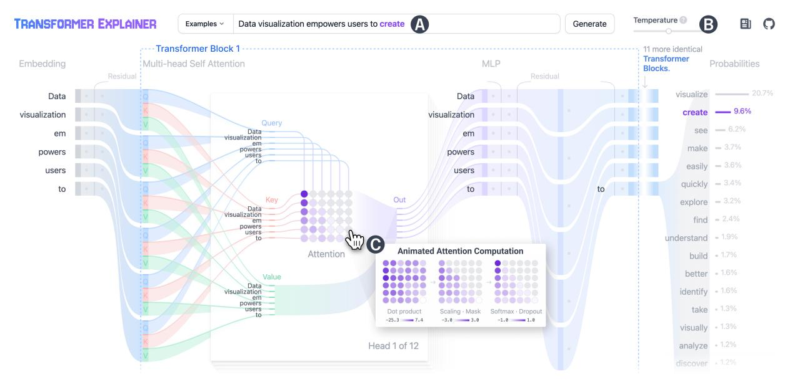
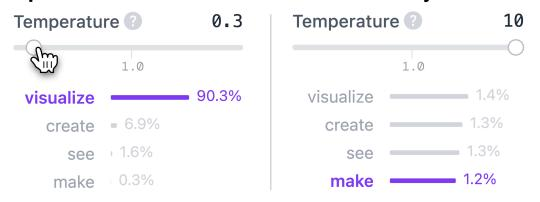

# **TRANSFORMER EXPLAINER: Interactive Learning of Text-Generative Models**

Aeree Cho\*1, Grace C. Kim\*1, Alexander Karpekov\*1 , Alec Helbling1 , Zijie J. Wang1 , Seongmin Lee1 , Benjamin Hoover1,2, Duen Horng (Polo) Chau1

Figure 1: TRANSFORMER EXPLAINER helps users (A) visually examine how a text-generative Transformer model (GPT-2) transforms input text to predict next tokens, (B) interactively experiment in real time with key model parameters like *temperature* to understand prediction determinism, and (C) transition seamlessly between abstraction levels to visualize the interplay between low-level mathematical operations and high-level model structures.

## **ABSTRACT**

Transformers have revolutionized machine learning, yet their inner workings remain opaque to many. We present TRANSFORMER EX-PLAINER, an interactive visualization tool designed for non-experts to learn about Transformers through the GPT-2 model. Our tool helps users understand complex Transformer concepts by integrating a model overview and enabling smooth transitions across abstraction levels of mathematical operations and model structures. It runs a live GPT-2 instance locally in the user's browser, empowering users to experiment with their own input and observe in real-time how the internal components and parameters of the Transformer work together to predict the next tokens. Our tool requires no installation or special hardware, broadening the public's education access to modern generative AI techniques. Our open-sourced tool is available at <https://poloclub.github.io/transformer-explainer/>. A video demo is available at <https://youtu.be/ECR4oAwocjs>.

# **1 INTRODUCTION**

The Transformer [\[10\]](#page-1-0) has gained popularity as a neural network architecture across numerous tasks, from text to vision. Despite its increasing widespread use, particularly in AI chatbots (e.g., [Chat-](https://openai.com/chatgpt)[GPT,](https://openai.com/chatgpt) [Gemini\)](https://gemini.google.com/app), its inner workings often remain opaque, hindering

understanding and engagement [\[12\]](#page-1-1). Demystifying this architecture is crucial for non-experts interested in learning about it. Existing resources, such as blog posts [\[2\]](#page-1-2), video tutorials [\[1,](#page-1-3) [9\]](#page-1-4), and 3D visualizations [\[4\]](#page-1-5) often emphasize mathematical intricacies and model implementations, which can overwhelm beginners. Meanwhile, visualization tools designed for AI practitioners focus on interpretability at the neuron and layer levels, which can be challenging for nonexperts to grasp [\[3\]](#page-1-6). To address this research gap, we contribute:

- 1. TRANSFORMER EXPLAINER, an open-source, web-based interactive visualization tool designed for non-experts to learn about both the Transformer's high-level model structure and lowlevel mathematical operations [\(Fig. 1\)](#page-0-0). Our tool explains the Transformer through its application in text generation, one of its most recognized uses. It adopts the Sankey diagram visual design, inspired by recent studies viewing the Transformer as a dynamic system [\[5\]](#page-1-7), to emphasize how input data "flows" through the model's components [\[6\]](#page-1-8). The Sankey diagram effectively illustrates how information moves through the model, showcasing how inputs undergo processing and transformations via Transformer operations. TRANSFORMER EXPLAINER helps users gain a comprehensive understanding of the complex concepts within Transformers by tightly integrating a model overview that summarizes a Transformer's structure and enabling users to smoothly transition between multiple abstraction levels to visualize the interplay between low-level mathematical operations and highlevel model structures [\(Fig. 1C](#page-0-0)) [\[11\]](#page-1-9).
- 2. Open-source, web-based implementation with real-time inference. Unlike many existing tools that require custom software installations or lack inference capabilities [\[3\]](#page-1-6), TRANS-FORMER EXPLAINER integrates a live GPT-2 model that runs locally in the user's browser using modern front-end frameworks.

\* Equal contribution.

1 Georgia Tech. {[aeree](mailto:aeree@gatech.edu)|[gracekim3](mailto:gracekim3@gatech.edu)|[alex.karpekov](mailto:alex.karpekov@gatech.edu)|[alechelbling](mailto:alechelbling@gatech.edu)| [jayw](mailto:jayw@gatech.edu)|[seongmin](mailto:seongmin@gatech.edu)|[bhoov](mailto:bhoov@gatech.edu)|[polo](mailto:polo@gatech.edu)}@gatech.edu

2 IBM Research.

Figure 2: The temperature slider lets users interactively experiment with the temperature parameter's impact on the next token's probability distribution. **Left**: lower temperatures sharpen the distribution, making outputs more predictable. **Right**: higher temperatures smooth the distribution, resulting in less predictable outputs.

Users can interactively experiment with their own input text [\(Fig. 1A](#page-0-0)), and observe in real time how the internal components and parameters of the Transformer work together to predict the next tokens [\(Fig. 1B](#page-0-0)). Our approach broadens educational access to modern generative AI techniques without requiring advanced computational resources, installations, or programming skills. We have chosen GPT-2 for its widespread familiarity, fast inference speed, and architectural similarities to more advanced models like GPT-3 and GPT-4, making it ideal for educational purposes. Our tool is open-source, available at [https:](https://poloclub.github.io/transformer-explainer/) [//poloclub.github.io/transformer-explainer/](https://poloclub.github.io/transformer-explainer/).

### **2 SYSTEM DESIGN AND IMPLEMENTATION**

TRANSFORMER EXPLAINER visualizes how a trained Transformerbased GPT-2 model processes text input and predicts the next token. The frontend uses [Svelte](https://kit.svelte.dev/) and [D3](https://d3js.org/) for interactive visualizations, while the backend uses [ONNX](https://onnxruntime.ai/) runtime and HuggingFace's [Transformers](https://huggingface.co/docs/transformers/en/index) library to run the GPT-2 model in the browser. A major challenge in designing TRANSFORMER EXPLAINER is managing the complexity of the underlying architecture, which can be overwhelming if all details are presented simultaneously. To address this, we draw on two key design principles:

Reducing Complexity via Multi-Level Abstractions. We structured the tool to present information at varying levels of abstraction. This approach allows users to start with a high-level overview and drill down into details as needed, preventing information overload [\[8,](#page-1-10) [11\]](#page-1-9). At the highest level, our tool illustrates the complete pipeline: from taking user-provided text as input [\(Fig. 1A](#page-0-0)), embedding it, processing it through multiple Transformer blocks, to using this transformed data to rank the most likely next token predictions. Intermediate operations, such as calculations for the attention matrix [\(Fig. 1C](#page-0-0)), are collapsed by default to visualize the significance of the computational result, with the option to expand to inspect its derivation through animation sequences. We employed a consistent visual language, such as stacking Attention Heads and collapsing repeated Transformer Blocks, to help users recognize repeating patterns in the architecture, while maintaining the end-to-end flow of data.

Enhancing Understanding and Engagement via Interactivity. The *temperature* parameter is crucial in controlling a Transformer's output probability distribution, affecting whether the next-token prediction will be more deterministic (at *low* temperature) or random (*high* temperature). Existing educational resources on Transformers often overlook this aspect [\[2\]](#page-1-2). Our tool enables users to adjust the temperature in real time [\(Fig. 1B](#page-0-0)) and visualize its critical role in controlling the prediction determinism [\(Fig. 2\)](#page-1-11). Additionally, users can select from provided examples or enter their own input text [\(Fig. 1A](#page-0-0)). Supporting custom input text engages users, by allowing them to analyze the model's behavior under various conditions and interactively test their own hypotheses on diverse text inputs.

Usage scenario. Professor Rousseau is modernizing the curriculum of a Natural Language Processing course to highlight recent

advances in generative AI. She has observed that some students view Transformer-based models as "magic," and some wish to learn how they work but are unsure where to start. To address this, she directs students to TRANSFORMER EXPLAINER, which provides an interactive overview of the Transformer [\(Fig. 1\)](#page-0-0), encouraging active experimentation and learning. With over 300 students in her class, the ability of TRANSFORMER EXPLAINER to run entirely in students' browsers without software installation or special hardware is a significant advantage, eliminating concerns about managing software or hardware setup. The tool introduces students to complex mathematical operations, such as attention computation, through animations and interactive reversible abstractions [\(Fig. 1C](#page-0-0)). This approach helps students gain both a high-level understanding of the operations and lower-level details that produce the results. Professor Rousseau is also aware that the technical capabilities and limitations of Transformers are sometimes obscured by anthropomorphism (e.g., the *temperature* parameter being viewed as a "creativity" control). By encouraging students to experiment with the temperature slider [\(Fig. 1B](#page-0-0)), she demonstrates that temperature actually modifies the probability distribution of the next token [\(Fig. 2\)](#page-1-11), controlling the randomness of the predictions and balancing between deterministic and more creative outputs. Additionally, as the system visualizes the token processing flow, students see there is no "magic" involved — regardless of the input texts [\(Fig. 1A](#page-0-0)), the model follows a welldefined sequence of operations using the Transformer architecture, simply sampling one token at a time, before repeating the process.

### **3 ONGOING WORK**

We are enhancing the tool's interactive explanations (e.g., layer normalization) to improve the learning experience. We are also boosting the inference speed with [WebGPU](https://www.w3.org/TR/webgpu//) and reducing model size through compression techniques (e.g., quantization, palettization) [\[7\]](#page-1-12). Finally, we plan to conduct user studies to assess TRANSFORMER EXPLAINER's efficacy and usability, to observe how newcomers to AI, students, educators, and practitioners use the tool, and gather feedback on additional functionalities they wish to see supported.

# **REFERENCES**

- [1] 3Blue1Brown. But what is a GPT? Visual intro to transformers. [https:](https://youtu.be/wjZofJX0v4M) [//youtu.be/wjZofJX0v4M](https://youtu.be/wjZofJX0v4M), 2024.
- [2] J. Alammar. The Illustrated Transformer. [https://jalammar.](https://jalammar.github.io/illustrated-transformer/) [github.io/illustrated-transformer/](https://jalammar.github.io/illustrated-transformer/), 2018.
- [3] A. M. P. Bras¸oveanu and R. Andonie. Visualizing Transformers for NLP: A Brief Survey. In *24th International Conference Information Visualisation (IV)*, pp. 270–279, 2020.
- [4] B. Bycroft. LLM Visualization. <https://bbycroft.net/llm>.
- [5] S. Dutta, T. Gautam, S. Chakrabarti, and T. Chakraborty. Redesigning the transformer architecture with insights from multi-particle dynamical systems. In *NeurIPS*, 2021.
- [6] N. Elhage et al. A Mathematical Framework for Transformer Circuits. *Transformer Circuits Thread*, 2021.
- [7] F. Hohman, C. Wang, J. Lee, J. Gortler, D. Moritz, J. P. Bigham, Z. Ren, ¨ C. Foret, Q. Shan, and X. Zhang. Talaria: Interactively optimizing machine learning models for efficient inference. In *CHI*, 2024.
- [8] M. Kahng, P. Y. Andrews, A. Kalro, and D. H. Chau. Activis: Visual exploration of industry-scale deep neural network models. *IEEE TVCG*, 24(1):88–97, 2017.
- [9] A. Karpathy. Let's build GPT: from scratch, in code, spelled out. <https://youtu.be/kCc8FmEb1nY>, 2024.
- [10] A. Vaswani, N. Shazeer, N. Parmar, J. Uszkoreit, L. Jones, A. N. Gomez, L. Kaiser, and I. Polosukhin. Attention is all you need. NIPS'17, p. 6000–6010. Curran Associates Inc., 2017.
- [11] Z. J. Wang, R. Turko, O. Shaikh, H. Park, N. Das, F. Hohman, M. Kahng, and D. H. Chau. CNN Explainer: Learning Convolutional Neural Networks with Interactive Visualization. *TVCG*, 2020.
- [12] C. Yeh, Y. Chen, A. Wu, C. Chen, F. Viegas, and M. Wattenberg. ´ Attentionviz: A global view of transformer attention. *TVCG*, 2023.