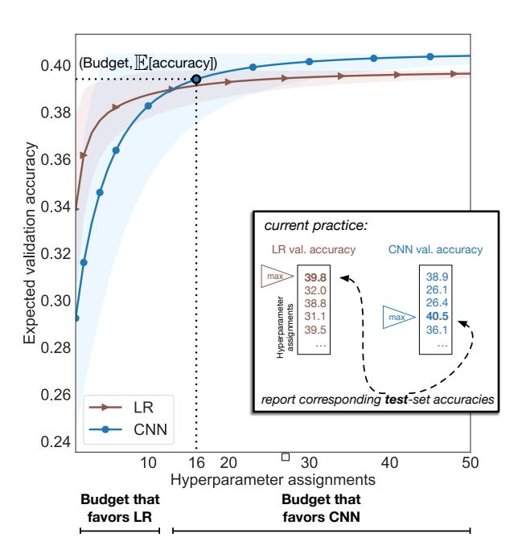
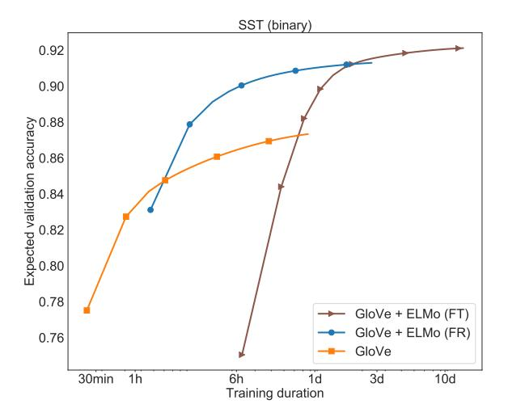
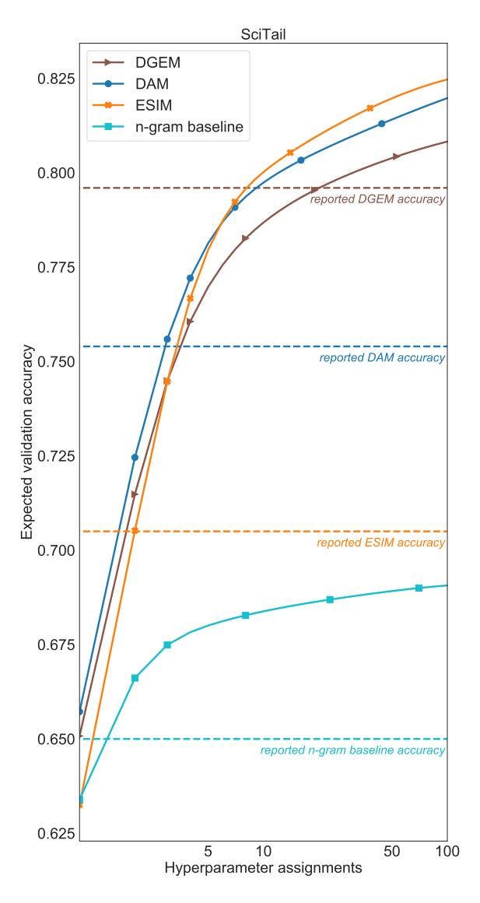
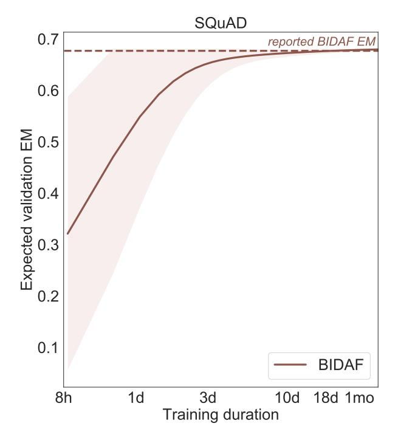

# **Show Your Work: Improved Reporting of Experimental Results**

Jesse Dodge♣ Suchin Gururangan♦ Dallas Card♥ Roy Schwartz♠ Noah A. Smith♠ Language Technologies Institute, Carnegie Mellon University, Pittsburgh, PA, USA ♠ Allen Institute for Artificial Intelligence, Seattle, WA, USA ♥ Machine Learning Department, Carnegie Mellon University, Pittsburgh, PA, USA ♠ Paul G. Allen School of Computer Science & Engineering, University of Washington, Seattle, WA, USA

{jessed,dcard}@cs.cmu.edu {suching,roys,noah}@allenai.org

#### **Abstract**

Research in natural language processing proceeds, in part, by demonstrating that new models achieve superior performance (e.g., accuracy) on held-out test data, compared to previous results. In this paper, we demonstrate that test-set performance scores alone are insufficient for drawing accurate conclusions about which model performs best. We argue for reporting additional details, especially performance on validation data obtained during model development. We present a novel technique for doing so: expected validation performance of the best-found model as a function of computation budget (i.e., the number of hyperparameter search trials or the overall training time). Using our approach, we find multiple recent model comparisons where authors would have reached a different conclusion if they had used more (or less) computation. Our approach also allows us to estimate the amount of computation required to obtain a given accuracy; applying it to several recently published results yields massive variation across papers, from hours to weeks. We conclude with a set of best practices for reporting experimental results which allow for robust future comparison, and provide code to allow researchers to use our technique.1

#### 1 Introduction

In NLP and machine learning, improved performance on held-out test data is typically used as an indication of the superiority of one method over others. But, as the field grows, there is an increasing gap between the large computational budgets used for some high-profile experiments and the budgets used in most other work (Schwartz et al., 2019). This hinders meaningful comparison between experiments, as improvements in performance can, in some cases, be ob-

Figure 1: Current practice when compraing NLP models is to train multiple instantiations of each, choose the best model of each type based on validation performance, and compare their performance on test data (inner box). Under this setup, (assuming test-set results are similar to validation), one would conclude from the results above (hyperparameter search for two models on the 5-way SST classification task) that the CNN outperforms Logistic Regression (LR). In our proposed evaluation framework, we instead encourage practitioners to consider the expected validation accuracy (y-axis; shading shows  $\pm 1$  standard deviation), as a function of budget (x-axis). Each point on a curve is the expected value of the best validation accuracy obtained (y) after evaluating x random hyperparameter values. Note that (1) the better performing model depends on the computational budget; LR has higher expected performance for budgets up to 10 hyperparameter assignments, while the CNN is better for larger budgets. (2) Given a model and desired accuracy (e.g., 0.395 for CNN), we can estimate the expected budget required to reach it (16; dotted lines).

https://github.com/allenai/allentune

tained purely through more intensive hyperparameter tuning (Melis et al., 2018; Lipton and Steinhardt, 2018).2

Moreover, recent investigations into "state-ofthe-art" claims have found competing methods to only be comparable, without clear superiority, even against baselines (Reimers and Gurevych, 2017; Lucic et al., 2018; Li and Talwalkar, 2019); this has exposed the need for reporting more than a single point estimate of performance.

Echoing calls for more rigorous scientific practice in machine learning (Lipton and Steinhardt, 2018; Sculley et al., 2018), we draw attention to the weaknesses in current reporting practices and propose solutions which would allow for fairer comparisons and improved reproducibility.

Our primary technical contribution is the introduction of a tool for reporting validation results in an easily interpretable way: *expected validation performance* of the best model under a given computational budget.3 That is, given a budget sufficient for training and evaluating n models, we calculate the expected performance of the best of these models on validation data. Note that this differs from the *best observed* value after n evaluations. Because the expectation can be estimated from the distribution of N validation performance values, with N ≥ n, and these are obtained during model development,4 our method does not require additional computation beyond hyperparameter search or optimization. We encourage researchers to report expected validation performance as a curve, across values of n ∈ {1, . . . , N}.

As we show in §4.3, our approach makes clear that the expected-best performing model is a function of the computational budget. In §4.4 we show how our approach can be used to estimate the budget that went into obtaining previous results; in one example, we see a too-small budget for baselines, while in another we estimate a budget of about 18 GPU days was used (but not reported). Previous work on reporting validation performance used the bootstrap to approximate the mean and variance of the best performing model (Lucic et al., 2018); in §3.2 we show that our approach computes these values with strictly less error than the bootstrap.

We conclude by presenting a set of recommendations for researchers that will improve scientific reporting over current practice. We emphasize this work is about *reporting*, not about running additional experiments (which undoubtedly can improve evidence in comparisons among models). Our reporting recommendations aim at reproducibility and improved understanding of sensitivity to hyperparameters and random initializations. Some of our recommendations may seem obvious; however, our empirical analysis shows that out of fifty EMNLP 2018 papers chosen at random, none report all items we suggest.

## 2 Background

Reproducibility Reproducibility in machine learning is often defined as the ability to produce the *exact* same results as reported by the developers of the model. In this work, we follow Gundersen and Kjensmo (2018) and use an extended notion of this concept: when comparing two methods, two research groups with different implementations should follow an experimental procedure which leads to the same conclusion about which performs better. As illustrated in Fig. 1, this conclusion often depends on the amount of computation applied. Thus, to make a *reproducible* claim about which model performs best, we must also take into account the budget used (e.g., the number of hyperparameter trials).

Notation We use the term *model family* to refer to an approach subject to comparison and to hyperparameter selection.5 Each model family M requires its own hyperparameter selection, in terms of a set of k hypermarameters, each of which defines a range of possible values. A *hyperparameter value* (denoted h) is a k-tuple of specific values for each hyperparameter. We call the set of all possible hyperparameter values HM. 6 Given HM and a computational budget sufficient for training B models, the set of hyperparameter values is {h1, . . . , hB}, hi ∈ HM. We let mi ∈ M denote the model trained with hyperparameter value hi .

2Recent work has also called attention to the environmental cost of intensive model exploration (Strubell et al., 2019).

3We use the term *performance* as a general evaluation measure, e.g., accuracy, F1, etc.

4We leave forecasting performance with larger budgets n > N to future work.

5Examples include different architectures, but also ablations of the same architecture.

6The hyperparameter value space can also include the random seed used to initialize the model, and some specifications such as the size of the hidden layers in a neural network, in addition to commonly tuned values such as learning rate.

Hyperparameter value selection There are many ways of selecting hyperparameter values,  $h_i$ . Grid search and uniform sampling are popular systematic methods; the latter has been shown to be superior for most search spaces (Bergstra and Bengio, 2012). Adaptive search strategies such as Bayesian optimization select  $h_i$  after evaluating  $h_1, \ldots, h_{i-1}$ . While these strategies may find better results quickly, they are generally less reproducible and harder to parallelize (Li et al., 2017). Manual search, where practitioners use knowledge derived from previous experience to adjust hyperparameters after each experiment, is a type of adaptive search that is the least reproducible, as different practitioners make different decisions. Regardless of the strategy adopted, we advocate for detailed reporting of the method used for hyperparmeter value selection (§5). We next introduce a technique to visualize results of samples which are drawn i.i.d. (e.g., random initializations or uniformly sampled hyperparameter values).

# 3 Expected Validation Performance Given Budget

After selecting the best hyperparameter values  $h_{i^*}$  from among  $\{h_1, \ldots, h_B\}$  with actual budget B, NLP researchers typically evaluate the associated model  $m_{i^*}$  on the test set and report its performance as an estimate of the family  $\mathcal{M}$ 's ability to generalize to new data. We propose to make better use of the intermediately-trained models  $m_1, \ldots, m_B$ .

For any set of n hyperparmeter values, denote the validation performance of the best model as

$$v_n^* = \max_{h \in \{h_1, \dots, h_n\}} \mathcal{A}(\mathcal{M}, h, \mathcal{D}_T, \mathcal{D}_V), \quad (1)$$

where  $\mathcal{A}$  denotes an algorithm that returns the performance on validation data  $\mathcal{D}_V$  after training a model from family  $\mathcal{M}$  with hyperparameter values h on training data  $\mathcal{D}_T$ . We view evaluations of  $\mathcal{A}$  as the elementary unit of experimental cost.

Though not often done in practice, procedure (1) could be repeated many times with different hyperparameter values, yielding a *distribution* of values for random variable  $V_n^*$ . This would allow us to estimate the *expected* performance,  $\mathbb{E}[V_n^* \mid n]$  (given n hyperparameter configurations). The

key insight used below is that, if we use random search for hyperparameter selection, then the effort that goes into a single round of random search (Eq. 1) suffices to construct a useful estimate of expected validation performance, without requiring any further experimentation.

Under random search, the n hyperparameter values  $h_1, \ldots, h_n$  are drawn uniformly at random from  $\mathcal{H}_{\mathcal{M}}$ , so the values of  $\mathcal{A}(\mathcal{M}, h_i, \mathcal{D}_T, \mathcal{D}_V)$  are i.i.d. As a result, the maximum among these is itself a random variable. We introduce a diagnostic that captures information about the computation used to generate a result: the expectation of maximum performance, *conditioned* on n, the amount of computation used in the maximization over hyperparameters and random initializations:

$$\mathbb{E}\left[\max_{h\in\{h_1,\dots,h_n\}}\mathcal{A}(\mathcal{M},h,\mathcal{D}_T,\mathcal{D}_V)\mid n\right]. (2)$$

Reporting this expectation as we vary  $n \in \{1, 2, ..., B\}$  gives more information than the maximum  $v_B^*$  (Eq. 1 with n = B); future researchers who use this model will know more about the computation budget required to achieve a given performance. We turn to calculating this expectation, then we compare it to the bootstrap (§3.2), and discuss estimating variance (§3.3).

### 3.1 Expected Maximum

We describe how to estimate the expected maximum validation performance (Eq. 2) given a budget of n hyperparameter values.

Assume we draw  $\{h_1,\ldots,h_n\}$  uniformly at random from hyperparameter space  $\mathcal{H}_{\mathcal{M}}$ . Each evaluation of  $\mathcal{A}(\mathcal{M},h,\mathcal{D}_T,\mathcal{D}_V)$  is therefore an i.i.d. draw of a random variable, denoted  $V_i$ , with observed value  $v_i$  for  $h_i \sim \mathcal{H}_{\mathcal{M}}$ . Let the maximum among n i.i.d. draws from an unknown distribution be

$$V_n^* = \max_{i \in \{1, \dots, n\}} V_i \tag{3}$$

We seek the expected value of  $V_n^*$  given n:

$$\mathbb{E}[V_n^* \mid n] = \sum_{v} v \cdot P(V_n^* = v \mid n) \qquad (4)$$

where  $P(V_n^* \mid n)$  is the probability mass function (PMF) for the max-random variable. For dis-

 $^{7}\mathcal{A}$  captures standard parameter estimation, as well as procedures that depend on validation data, like early stopping.

&lt;sup>8Note that researchers do not always report validation, but rather *test* performance, a point we will return to in §5.

&lt;sup>9Conversion to alternate formulations of budget, such as GPU hours or cloud-machine rental cost in dollars, is straightforward in most cases.

 $^{10}$ For a finite validation set  $\mathcal{D}_V$ , most performance measures (e.g., accuracy) only take on a finite number of possible values, hence the use of a sum instead of an integral in Eq. 4.

crete random variables.

$$P(V_n^* = v \mid n) = P(V_n^* \le v \mid n) - P(V_n^* < v \mid n)$$
(5)

Using the definition of "max", and the fact that the  $V_i$  are drawn i.i.d.,

$$P(V_n^* \le v \mid n) = P\left(\max_{i \in \{1, ..., n\}} V_i \le v \mid n\right)$$
  
=  $P(V_1 \le v, V_2 \le v, ..., V_n \le v \mid n)$   
=  $\prod_{i=1}^n P(V_i \le v) = P(V \le v)^n$ , (6)

and similarly for  $P(V_n^* < v \mid n)$ .

 $P(V \le v)$  and P(V < v) are cumulative distribution functions, which we can estimate using the empirical distribution, i.e.

$$\hat{P}(V \le v) = \frac{1}{n} \sum_{i=1}^{n} \mathbb{1}_{[V_i \le v]}$$
 (7)

and similarly for strict inequality.

Thus, our estimate of the expected maximum validation performance is

$$\hat{\mathbb{E}}[V_n^* \mid n] = \sum_{v} v \cdot (\hat{P}(V_i \le v)^n - \hat{P}(V_i < v)^n).$$
(8)

**Discussion** As we increase the amount of computation for evaluating hyperparameter values (n), the maximum among the samples will approach the observed maximum  $v_B^*$ . Hence the curve of  $\mathbb{E}[V_n^* \mid n]$  as a function of n will appear to asymptote. Our focus here is not on estimating that value, and we do not make any claims about extrapolation of  $V^*$  beyond B, the number of hyperparameter values to which A is actually applied.

Two points follow immediately from our derivation. First, at  $n=1, \mathbb{E}[V_1^* \mid n=1]$  is the mean of  $v_1, \ldots, v_n$ . Second, for all n,  $\mathbb{E}[V_n^* \mid n] \leq v_n^* =$  $\max_i v_i$ , which means the curve is a lower bound on the selected model's validation performance.

#### Comparison with Bootstrap

Lucic et al. (2018) and Henderson et al. (2018) have advocated for using the bootstrap to estimate the mean and variance of the best validation performance. The bootstrap (Efron and Tibshirani, 1994) is a general method which can be used to estimate statistics that do not have a closed form. The bootstrap process is as follows: draw N i.i.d. samples (in our case, N model evaluations). From these N points, sample n points (with replacement), and compute the statistic of interest (e.g., the max). Do this K times (where K is large), and

average the computed statistic. By the law of large numbers, as  $K \to \infty$  this average converges to  $P(V_n^* = v \mid n) = P(V_n^* \le v \mid n) - P(V_n^* \le v \mid n)$ , the sample expected value (Efron and Tibshirani,

> The bootstrap has two sources of error: the error from the finite sample of N points, and the error introduced by resampling these points K times. Our approach has strictly less error than using the bootstrap: our calculation of the expected maximum performance in §3.1 provides a closed-form solution, and thus contains none of the resampling error (the finite sample error is the same).

#### **3.3** Variance of $V_n^*$

Expected performance becomes more useful with an estimate of variation. When using the bootstrap, standard practice is to report the standard deviation of the estimates from the K resamples. As  $K \to \infty$ , this standard deviation approximates the sample standard error (Efron and Tibshirani, 1994). We instead calculate this from the distribution in Eq. 5 using the standard plug-in-estimator.

In most cases, we advocate for reporting a measure of variability such as the standard deviation or variance; however, in some cases it might cause confusion. For example, when the variance is large, plotting the expected value plus the variance can go outside of reasonable bounds, such as accuracy greater than any observed (even greater than In such situations, we recommend shading only values within the observed range, such as in Fig. 4. Additionally, in situations where the variance is high and variance bands overlap between model families (e.g., Fig. 1), the mean is still the most informative statistic.

#### Case Studies

Here we show two clear use cases of our method. First, we can directly estimate, for a given budget, which approach has better performance. Second, we can estimate, given our experimental setup, the budget for which the reported validation performance  $(V^*)$  matches a desired performance level. We present three examples that demonstrate these use cases. First, we reproduce previous findings that compared different models for text classification. Second, we explore the time vs. performance tradeoff of models that use contextual word embeddings (Peters et al., 2018). Third, from two previously published papers, we examine the budget required for our expected performance to match their reported performance. We find these budget estimates vary drastically. Consistently, we see that the best model is a function of the budget. We publicly release the search space and training configurations used for each case study. 11

Note that we do not report test performance in our experiments, as our purpose is not to establish a benchmark level for a model, but to demonstrate the utility of expected validation performance for model comparison and reproducibility.

#### 4.1 Experimental Details

For each experiment, we document the hyperparameter search space, hardware, average runtime, number of samples, and links to model implementations. We use public implementations for all models in our experiments, primarily in AllenNLP (Gardner et al., 2018). We use Tune (Liaw et al., 2018) to run parallel evaluations of uniformly sampled hyperparameter values.

#### 4.2 Validating Previous Findings

We start by applying our technique on a text classification task in order to confirm a well-established observation (Yogatama and Smith, 2015): logistic regression has reasonable performance with minimal hyperparameter tuning, but a well-tuned convolutional neural network (CNN) can perform better.

We experiment with the fine-grained Stanford Sentiment Treebank text classification dataset (Socher et al., 2013). For the CNN classifier, we embed the text with 50-dim GloVe vectors (Pennington et al., 2014), feed the vectors to a ConvNet encoder, and feed the output representation into a softmax classification layer. We use the scikit-learn implementation of logistic regression with bag-of-word counts and a linear classification layer. The hyperparameter spaces  $\mathcal{H}_{CNN}$  and  $\mathcal{H}_{LR}$ are detailed in Appendix B. For logistic regression we used bounds suggested by Yogatama and Smith (2015), which include term weighting, ngrams, stopwords, and learning rate. For the CNN we follow the hyperparameter sensitivity analysis in Zhang and Wallace (2015).

We run 50 trials of random hyperparameter search for each classifier. Our results (Fig. 1) confirm previous findings (Zhang and Wallace, 2015): under a budget of fewer than 10 hyperparameter

Figure 2: Expected maximum performance of a BCN classifier on SST. We compare three embedding approaches (GloVe embeddings, GloVe + frozen ELMo, and GloVe + fine-tuned ELMo). The x-axis is time, on a log scale. We omit the variance for visual clarity. For each of the three model families, we sampled 50 hyperparameter values, and plot the expected maximum performance with the x-axis values scaled by the average training duration. The plot shows that for each approach (GloVe, ELMo frozen, and ELMo fine-tuned), there exists a budget for which it is preferable.

search trials, logistic regression achieves a higher expected validation accuracy than the CNN. As the budget increases, the CNN gradually improves to a higher overall expected validation accuracy. For all budgets, logistic regression has lower variance, so may be a more suitable approach for fast prototyping.

#### 4.3 Contextual Representations

We next explore how computational budget affects the performance of contextual embedding models (Peters et al., 2018). Recently, Peters et al. (2019) compared two methods for using contextual representations for downstream tasks: *feature extraction*, where features are fixed after pretraining and passed into a task-specific model, or *fine-tuning*, where they are updated during task training. Peters et al. (2019) found that feature extraction is preferable to fine-tuning ELMo embeddings. Here we set to explore whether this conclusion depends on the experimental budget.

Closely following their experimental setup, in Fig. 2 we show the expected performance of the biattentive classification network (BCN; McCann et al., 2017) with three embedding approaches (GloVe only, GloVe + ELMo frozen, and GloVe

 $^{\rm II} {\tt https://github.com/allenai/} \\ {\tt show-your-work}$ 

+ ELMo fine-tuned), on the binary Stanford Sentiment Treebank task. 12

We use *time* for the budget by scaling the curves by the average observed training duration for each model. We observe that as the time budget increases, the expected best-performing model changes. In particular, we find that our experimental setup leads to the same conclusion as Peters et al. (2019) given a budget between approximately 6 hours and 1 day. For larger budgets (e.g., 10 days) fine-tuning outperforms feature extraction. Moreover, for smaller budgets (< 2 hours), using GloVe embeddings is preferable to ELMo (frozen or fine-tuned).

#### 4.4 Inferring Budgets in Previous Reports

Our method provides another appealing property: estimating the budget required for the expected performance to reach a particular level, which we can compare against previously reported results. We present two case studies, and show that the amount of computation required to match the reported results varies drastically.

We note that in the two examples that follow, the original papers only reported partial experimental information; we made sure to tune the hyperparameters they did list in addition to standard choices (such as the learning rate). In neither case do they report the method used to tune the hyperparameters, and we suspect they tuned them manually. Our experiments here are meant give an idea of the budget that would be required to reproduce their results or to apply their models to other datasets under random hyperparameter value selection.

**SciTail** When introducing the SciTail textual entailment dataset, Khot et al. (2018) compared four models: an *n-gram* baseline, which measures word-overlap as an indicator of entailment, *ESIM* (Chen et al., 2017), a sequence-based entailment model, *DAM* (Parikh et al., 2016), a bagof-words entailment model, and their proposed model, *DGEM* (Khot et al., 2018), a graph-based structured entailment model. Their conclusion was that DGEM outperforms the other models.

Figure 3: Comparing reported accuracies (dashed lines) on SciTail to expected validation performance under varying levels of compute (solid lines). The estimated budget required for expected performance to match the reported result differs substantially across models, and the relative ordering varies with budget. We omit variance for visual clarity.

We use the same implementations of each of these models each with a hyperparameter search space detailed in Appendix D.13 We use a budget based on trials instead of runtime so as to emphasize how these models behave when given a comparable number of hyperparameter configurations.

&lt;sup>12Peters et al. (2019) use a BCN with frozen embeddings and a BiLSTM BCN for fine-tuning. We conducted experiments with both a BCN and a BiLSTM with frozen and fine-tuned embeddings, and found our conclusions to be consistent. We report the full hyperparameter search space, which matched Peters et al. (2019) as closely as their reporting allowed, in Appendix C.

&lt;sup>13The search space bounds we use are large neighborhoods around the hyperparameter assignments specified in the public implementations of these models. Note that these curves depend on the specific hyperparameter search space adopted; as the original paper does not report hyperparameter search or model selection details, we have chosen what we believe to be reasonable bounds, and acknowledge that different choices could result in better or worse expected performance.

Figure 4: Comparing reported development exactmatch score of BIDAF (dashed line) on SQuAD to expected performance of the best model with varying computational budgets (solid line). The shaded area represents the expected performance  $\pm 1$  standard deviation, within the observed range of values. It takes about 18 days (55 hyperparameter trials) for the expected performance to match the reported results.

Our results (Fig. 3) show that the different models require different budgets to reach their reported performance in expectation, ranging from 2 (n-gram) to 20 (DGEM). Moreover, providing a large budget for each approach improves performance substantially over reported numbers. Finally, under different computation budgets, the top performing model changes (though the neural models are similar).

**SQuAD** Next, we turn our attention to SQuAD (Rajpurkar et al., 2016) and report performance of the commonly-used BiDAF model (Seo et al., 2017). The set of hyperparameters we tune covers those mentioned in addition to standard choices (details in Appendix D). We see in Fig. 4 that we require a budget of 18 GPU days in order for the expected maximum validation performance to match the value reported in the original paper. This suggests that some combination of prior intuition and extensive hyperparameter tuning were used by the original authors, though neither were reported.

#### √ For all reported experimental results

- ☐ Description of computing infrastructure
- ☐ Average runtime for each approach
- ☐ Details of train/validation/test splits
- ☐ Corresponding validation performance for each reported test result
- ☐ A link to implemented code

#### √ For experiments with hyperparameter search

- ☐ Bounds for each hyperparameter
- ☐ Hyperparameter configurations for bestperforming models
- ☐ Number of hyperparameter search trials
- ☐ The method of choosing hyperparameter values (e.g., uniform sampling, manual tuning, etc.) and the criterion used to select among them (e.g., accuracy)
- Expected validation performance, as introduced in §3.1, or another measure of the mean and variance as a function of the number of hyperparameter trials.

Text Box 1: Experimental results checklist.

#### 5 Recommendations

Experimental results checklist The findings discussed in this paper and other similar efforts highlight methodological problems in experimental NLP. In this section we provide a checklist to encourage researchers to report more comprehensive experimentation results. Our list, shown in Text Box 1, builds on the reproducibility checklist that was introduced for the machine learning community during NeurIPS 2018 (which is required to be filled out for each NeurIPS 2019 submission; Pineau, 2019).

Our focus is on improved reporting of experimental results, thus we include relevant points from their list in addition to our own. Similar to other calls for improved reporting in machine learning (Mitchell et al., 2019; Gebru et al., 2018), we recommend pairing experimental results with the information from this checklist in a structured format (see examples provided in Appendix A).

EMNLP 2018 checklist coverage. To estimate how commonly this information is reported in the NLP community, we sample fifty random EMNLP 2018 papers that include experimental results and evaluate how well they conform to our proposed reporting guidelines. We find that none of the papers reported all of the items in our checklist. However, every paper reported at least one item in the checklist, and each item is reported by at

least one paper. Of the papers we analyzed, 74% reported at least some of the best hyperparameter assignments. By contrast, 10% or fewer papers reported hyperparameter search bounds, the number of hyperparameter evaluation trials, or measures of central tendency and variation. We include the full results of this analysis in Table 1 in the Appendix.

Comparisons with different budgets. We have argued that claims about relative model performance should be qualified by computational expense. With varying amounts of computation, not all claims about superiority are valid. If two models have similar budgets, we can claim one outperforms the other (with that budget). Similarly, if a model with a small budget outperforms a model with a large budget, increasing the small budget will not change this conclusion. However, if a model with a large budget outperforms a model with a small budget, the difference might be due to the model or the budget (or both). As a concrete example, Melis et al. (2018) report the performance of an LSTM on language modeling the Penn Treebank after 1,500 rounds of Bayesian optimization; if we compare to a new M with a smaller budget, we can only draw a conclusion if the new model outperforms the LSTM.14

In a larger sense, there may be no simple way to make a comparison "fair." For example, the two models in Fig. 1 have hyperparameter spaces that are different, so fixing the same number of hyperparameter trials for both models does not imply a fair comparison. In practice, it is often not possible to measure how much past human experience has contributed to reducing the hyperparameter bounds for popular models, and there might not be a way to account for the fact that better understood (or more common) models can have better spaces to optimize over. Further, the cost of one application of A might be quite different depending on the model family. Converting to runtime is one possible solution, but implementation effort could still affect comparisons at a fixed x-value. Because of these considerations, our focus is on reporting whatever experimental results exist.

## 6 Discussion: Reproducibility

In NLP, the use of standardized test sets and public leaderboards (which limit test evaluations) has helped to mitigate the so-called "replication crisis" happening in fields such as psychology and medicine (Ioannidis, 2005; Gelman and Loken, 2014). Unfortunately, leaderboards can create additional reproducibility issues (Rogers, 2019). First, leaderboards obscure the budget that was used to tune hyperparameters, and thus the amount of work required to apply a model to a new dataset. Second, comparing to a model on a leaderboard is difficult if they *only* report test scores. For example, on the GLUE benchmark (Wang et al., 2018), the differences in *test set* performance between the top performing models can be on the order of a tenth of a percent, while the difference between test and validation performance might be one percent or larger. Verifying that a new implementation matches established performance requires submitting to the leaderboard, wasting test evaluations. Thus, we recommend leaderboards report validation performance for models evaluated on test sets.

As an example, consider Devlin et al. (2019), which introduced BERT and reported state-of-theart results on the GLUE benchmark. The authors provide some details about the experimental setup, but do not report a specific budget. Subsequent work which extended BERT (Phang et al., 2018) included distributions of validation results, and we highlight this as a positive example of how to report experimental results. To achieve comparable test performance to Devlin et al. (2019), the authors report the best of twenty or one hundred random initializations. Their validation performance reporting not only illuminates the budget required to fine-tune BERT on such tasks, but also gives other practitioners results against which they can compare without submitting to the leaderboard.

## 7 Related Work

Lipton and Steinhardt (2018) address a number of problems with the practice of machine learning, including incorrectly attributing empirical gains to modeling choices when they came from other sources such as hyperparameter tuning. Sculley et al. (2018) list examples of similar evaluation issues, and suggest encouraging stronger standards for empirical evaluation. They recommend detailing experimental results found throughout the research process in a time-stamped document, as is done in other experimental science fields. Our work formalizes these issues and provides an ac-

14This is similar to controlling for the amount of training data, which is an established norm in NLP research.

tionable set of recommendations to address them.

Reproducibility issues relating to standard data splits (Schwartz et al., 2011; Gorman and Bedrick, 2019; Recht et al., 2019a,b) have surfaced in a number of areas. Shuffling standard training, validation, and test set splits led to a drop in performance, and in a number of cases the inability to reproduce rankings of models. Dror et al. (2017) studied reproducibility in the context of consistency among multiple comparisons.

Limited community standards exist for documenting datasets and models. To address this, Gebru et al. (2018) recommend pairing new datasets with a "datasheet" which includes information such as how the data was collected, how it was cleaned, and the motivation behind building the dataset. Similarly, Mitchell et al. (2019) advocate for including a "model card" with trained models which document training data, model assumptions, and intended use, among other things. Our recommendations in §5 are meant to document relevant information for experimental results.

## 8 Conclusion

We have shown how current practice in experimental NLP fails to support a simple standard of reproducibility. We introduce a new technique for estimating the expected validation performance of a method, as a function of computation budget, and present a set of recommendations for reporting experimental findings.

## Acknowledgments

This work was completed while the first author was an intern at the Allen Institute for Artificial Intelligence. The authors thank Kevin Jamieson, Samuel Ainsworth, and the anonymous reviewers for helpful feedback.

# References

- James Bergstra and Yoshua Bengio. 2012. Random search for hyper-parameter optimization. *JMLR*, 13:281–305.
- Qian Chen, Xiao-Dan Zhu, Zhen-Hua Ling, Si Wei, Hui Jiang, and Diana Inkpen. 2017. Enhanced LSTM for natural language inference. In *Proc. of ACL*.
- Jacob Devlin, Ming-Wei Chang, Kenton Lee, and Kristina Toutanova. 2019. BERT: Pre-training of deep bidirectional transformers for language understanding. In *Proc. of NAACL*.

- Rotem Dror, Gili Baumer, Marina Bogomolov, and Roi Reichart. 2017. Replicability analysis for natural language processing: Testing significance with multiple datasets. *TACL*, 5:471–486.
- Bradley Efron and Robert Tibshirani. 1994. *An Introduction to the Bootstrap*. CRC Press.
- Matt Gardner, Joel Grus, Mark Neumann, Oyvind Tafjord, Pradeep Dasigi, Nelson F. Liu, Matthew E. Peters, Michael Schmitz, and Luke S. Zettlemoyer. 2018. AllenNLP: A deep semantic natural language processing platform. In *Proc. of NLP-OSS*.
- Timnit Gebru, Jamie H. Morgenstern, Briana Vecchione, Jennifer Wortman Vaughan, Hanna M. Wallach, Hal Daume, and Kate Crawford. 2018. ´ Datasheets for datasets. arXiv:1803.09010.
- Andrew Gelman and Eric Loken. 2014. The statistical crisis in science. *American Scientist*, 102:460.
- Kyle Gorman and Steven Bedrick. 2019. We need to talk about standard splits. In *Proc. of ACL*.
- Odd Erik Gundersen and Sigbjrn Kjensmo. 2018. State of the art: Reproducibility in artificial intelligence. In *Proc. of AAAI*.
- Peter Henderson, Riashat Islam, Philip Bachman, Joelle Pineau, Doina Precup, and David Meger. 2018. Deep reinforcement learning that matters. In *Proc. of AAAI*.
- John P. A. Ioannidis. 2005. Why most published research findings are false. *PLoS Med*, 2(8).
- Tushar Khot, Ashutosh Sabharwal, and Peter Clark. 2018. SciTaiL: A textual entailment dataset from science question answering. In *Proc. of AAAI*.
- Liam Li and Ameet Talwalkar. 2019. Random search and reproducibility for neural architecture search. In *Proc. of UAI*.
- Lisha Li, Kevin Jamieson, Giulia DeSalvo, Afshin Rostamizadeh, and Ameet Talwalkar. 2017. Hyperband: Bandit-based configuration evaluation for hyperparameter optimization. In *Proc. of ICLR*.
- Richard Liaw, Eric Liang, Robert Nishihara, Philipp Moritz, Joseph E Gonzalez, and Ion Stoica. 2018. Tune: A research platform for distributed model selection and training. In *Proc. of the ICML Workshop on AutoML*.
- Zachary C. Lipton and Jacob Steinhardt. 2018. Troubling trends in machine learning scholarship. arXiv:1807.03341.
- Mario Lucic, Karol Kurach, Marcin Michalski, Olivier Bousquet, and Sylvain Gelly. 2018. Are GANs created equal? A large-scale study. In *Proc. of NeurIPS*.

- Bryan McCann, James Bradbury, Caiming Xiong, and Richard Socher. 2017. Learned in translation: Contextualized word vectors. In *Proc. of NeurIPS*.
- Gabor Melis, Chris Dyer, and Phil Blunsom. 2018. ´ On the state of the art of evaluation in neural language models. In *Proc. of EMNLP*.
- Margaret Mitchell, Simone Wu, Andrew Zaldivar, Parker Barnes, Lucy Vasserman, Ben Hutchinson, Elena Spitzer, Inioluwa Deborah Raji, and Timnit Gebru. 2019. Model cards for model reporting. In *Proc. of FAT\**.
- Ankur P. Parikh, Oscar Tackstr ¨ om, Dipanjan Das, and ¨ Jakob Uszkoreit. 2016. A decomposable attention model for natural language inference. In *Proc. of EMNLP*.
- Jeffrey Pennington, Richard Socher, and Christopher Manning. 2014. GloVe: Global vectors for word representation. In *Proc. of EMNLP*.
- Matthew Peters, Sebastian Ruder, and Noah A. Smith. 2019. To tune or not to tune? Adapting pretrained representations to diverse tasks. In *Proc. of the RepL4NLP Workshop at ACL*.
- Matthew E. Peters, Mark Neumann, Mohit Iyyer, Matt Gardner, Christopher Clark, Kenton Lee, and Luke S. Zettlemoyer. 2018. Deep contextualized word representations. In *Proc. of NAACL*.
- Jason Phang, Thibault Fevry, and Samuel R. Bow- ´ man. 2018. Sentence encoders on STILTs: Supplementary training on intermediate labeled-data tasks. arXiv:1811.01088.
- Joelle Pineau. 2019. Machine learning reproducibility checklist. https://www.cs.mcgill.ca/ ˜jpineau/ReproducibilityChecklist. pdf. Accessed: 2019-5-14.
- Pranav Rajpurkar, Jian Zhang, Konstantin Lopyrev, and Percy Liang. 2016. SQuAD: 100,000+ questions for machine comprehension of text. In *Proc. of EMNLP*.
- Benjamin Recht, Rebecca Roelofs, Ludwig Schmidt, and Vaishaal Shankar. 2019a. Do CIFAR-10 classifiers generalize to CIFAR-10? arXiv:1806.00451.
- Benjamin Recht, Rebecca Roelofs, Ludwig Schmidt, and Vaishaal Shankar. 2019b. Do ImageNet classifiers generalize to ImageNet? In *Proc. of ICML*.
- Nils Reimers and Iryna Gurevych. 2017. Reporting score distributions makes a difference: Performance study of LSTM-networks for sequence tagging. In *Proc. of EMNLP*.
- Anna Rogers. 2019. How the transformers broke NLP leaderboards. https://hackingsemantics. xyz/2019/leaderboards/. Accessed: 2019- 8-29.

- Roy Schwartz, Omri Abend, Roi Reichart, and Ari Rappoport. 2011. Neutralizing linguistically problematic annotations in unsupervised dependency parsing evaluation. In *Proc. of ACL*.
- Roy Schwartz, Jesse Dodge, Noah A. Smith, and Oren Etzioni. 2019. Green AI. arXiv:1907.10597.
- D. Sculley, Jasper Snoek, Ali Rahimi, and Alex Wiltschko. 2018. Winner's curse? On pace, progress, and empirical rigor. In *Proc. of ICLR (Workshop Track)*.
- Min Joon Seo, Aniruddha Kembhavi, Ali Farhadi, and Hannaneh Hajishirzi. 2017. Bidirectional attention flow for machine comprehension. In *Proc. of ICLR*.
- Richard Socher, Alex Perelygin, Jean Wu, Jason Chuang, Christopher D. Manning, Andrew Y. Ng, and Christopher Potts. 2013. Recursive deep models for semantic compositionality over a sentiment treebank. In *Proc. of EMNLP*.
- Emma Strubell, Ananya Ganesh, and Andrew McCallum. 2019. Energy and policy considerations for deep learning in NLP. In *Proc. of ACL*.
- Alex Wang, Amanpreet Singh, Julian Michael, Felix Hill, Omer Levy, and Samuel R. Bowman. 2018. GLUE: A multi-task benchmark and analysis platform for natural language understanding. In *Proc. of ICLR*.
- Dani Yogatama and Noah A. Smith. 2015. Bayesian optimization of text representations. In *Proc. of EMNLP*.
- Ye Zhang and Byron Wallace. 2015. A sensitivity analysis of (and practitioners' guide to) convolutional neural networks for sentence classification. arXiv:1510.03820.