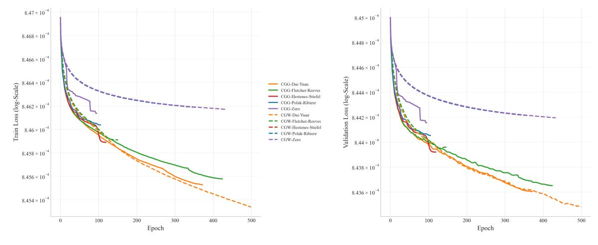
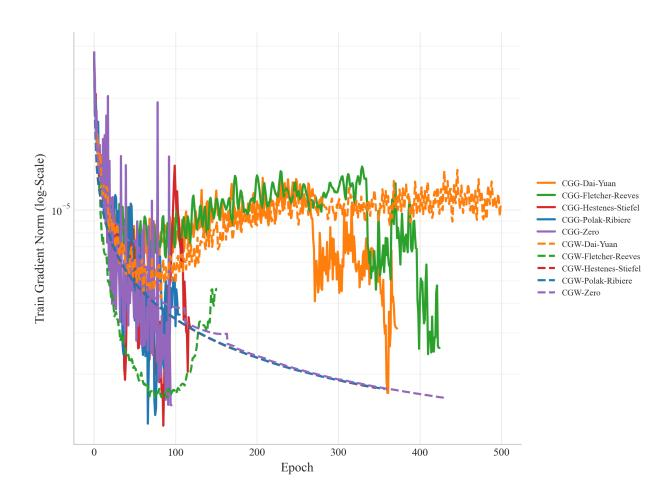
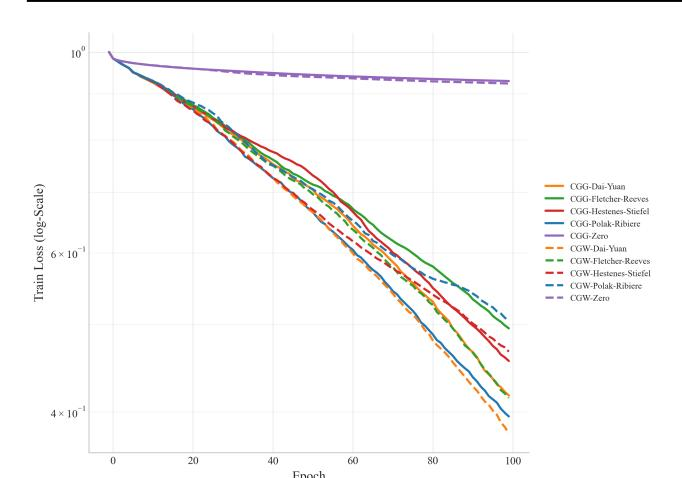
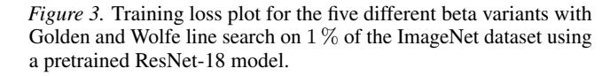
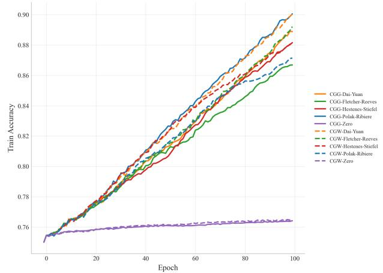

# Efficient Variants of the Conjugate Gradient Algorithm for Neural Networks

### Anonymous Authors1

### Abstract

The use of second-order optimization methods has been limited by their larger computational expense. The attempts to develop dedicated variants have focused on reducing this expense, neglecting the fact that they may lead to premature termination of the algorithm, which is a more serious problem than the expense itself. We have focused on identifying possible causes of premature termination: a fast but simplified line search and conjugate search directions that may be nondescending. Several published alternatives are equivalent for strictly quadratic functions but exhibit different behavior in regions that deviate from quadratic or even in locally non-convex regions. Computing experiments on a reduced GPT2 model and a ResNet18 model have shown the superiority (1) of the safe Golden Section line search (robust even in non-convex regions) over the presumably more efficient Wolfe method and (2) of the search direction based on the Dai-Yuan method, which generalizes the global convergence conditions to standard, instead of strong, Wolfe conditions.

## 1. Introduction

The *Conjugate Gradient* (CG) algorithm is a second-order algorithm for the minimization of convex functions. Numerical mathematicians widely use it because of its convergence guarantees. As with other second-order algorithms, the convexity of the function minimized is exploited with the help of a quadratic approximation. This is not possible with widespread first-order algorithms such as *Stochastic Gradient Descent* (SGD) or *Adam*.

However, first-order algorithms such as Adam have an excellent track record of application and are thus widely accepted in the AI community. This is why they are efficiently imple-

Preliminary work. Under review by the International Conference on Machine Learning (ICML). Do not distribute.

mented in popular AI programming frameworks.

Frequently mentioned reasons for preference of the firstorder algorithms (such as Adam) over the second-order ones (such as CG) are:

- The computational expense per epoch of CG is larger than that of Adam.
- Adam takes optimization steps on batches (small subsets of the training set) so that there are many steps per epoch, which is expected to accelerate optimization progress.

While Adam performs only a single gradient computation, followed by an optimization step, CG performs a line search along the search direction, making several forward passes to evaluate the loss function multiple times. Typically, about 10 such evaluations are necessary. A forward pass is necessary for this, and it accounts for about one-third of the total forward/backward pass cost, the latter being necessary for gradient computation. So, CG needs about the quadruple (i.e., 1 + 10/3) of a single gradient computation per epoch. This may be substantial, but it is only a constant factor that can be traded for better convergence.

The true gradient ∇wf(w) of the loss function f(w) with regard to the parameter vector w, for the training set of size N, can only be exactly computed over a whole epoch. The gradient over a batch ∇bf(x) (for batch size B) is a random approximation. The use of batch gradient is frequently justified by the fact that E [∇bf(x)] is a good approximation of the true gradient of the training set ∇pf (w), with a standard deviation of its elements proportional to pN/B. However, taken literally, this argument is oversimplified. If the only justification were a good approximation of the epoch gradient, the same effect of following successive approximations of the gradient can be reached equally by a large step in the direction of the true epoch-wise gradient. This is why additional justification is based on introducing a useful stochastic search component and, of course, the excellent practical record of batch processing.

Both groups of arguments prevented CG from widespread use. Nevertheless, some modifications have been attempted. The first group of arguments has nourished the assumption that the main problem of CG is its computational complexity.

1Anonymous Institution, Anonymous City, Anonymous Region, Anonymous Country. Correspondence to: Anonymous Author <anon.email@domain.com>.

Thus, most of the amendments followed the path of resource saving.

104

106

108 109 An example of this is the work of [\(Abreu et al.,](#page-7-0) [2025\)](#page-7-0). They focused on simplifying the Gauss-Newton method to achieve performance close to that of the full method. The approach used preconditioning while retaining the batchbased gradient computation (i.e., computing the gradient on a batch rather than the entire training set). This is a fast but rough method that does not meet the requirement of *exact* line search, as it evaluates the loss over the entire training set. Exact line search is required for satisfying theoretical foundations of the Conjugate Gradient method.

Unfortunately, such simplifications seem to undermine the principal advantage of CG: its safe and fast convergence. The convergence of CG (as well as another group of secondorder optimization methods, the *Quasi-Newton methods*) is *superlinear*, i.e., the number of significant digits of the difference between the true and the computed minimum increases faster than linearly with the algorithm's iterations. This is true for all *convex loss functions* [\(Ritter,](#page-7-1) [1972\)](#page-7-1). For a strictly quadratic loss function of N arguments and arbitrary machine precision, the exact optimum is even found in N steps [\(Press et al.,](#page-7-2) [1992\)](#page-7-2).

The most serious flaw resulting from acceleration attempts is premature termination before reaching the minimum machine precision. In the next section, the reasons for such a premature stop are analyzed.

### 2. Reasons for premature termination of CG

CG consists of two basic steps:

- 1. Determine the local loss gradient and the new conjugate search direction.
- 2. Perform a line search in the search direction to find the optimal step size.

The conjugate search direction is different from the steepest descent direction. It prevents spoiling the progress made in the previous iteration, assuming a quadratic function can approximate the loss.

One stopping criterion is that the gradient norm is close to zero. Then, the local minimum is assumed to have been reached. This type of termination is rare and generally not premature.

Another criterion is that the line search did not achieve a significant loss reduction, although the threshold is usually set close to the machine precision. This can have two reasons:

1. Line search fails to reach the minimum.

2. Alternatively, the search direction is such that no descent is possible (or it is too small to be measured).

Some line search procedures focus excessively on resource economy and rely on diverse assumptions, such as the strict convexity of the loss function. Then, the search can skip an existing minimum.

With a significant gradient norm, descent is guaranteed for smooth loss functions. However, the conjugate search direction is not identical to the steepest gradient. For locally nonconvex loss functions, the algorithm's search direction may occasionally become non-descending.

This is why it is advisable to focus on line search with safe termination properties and a safe search direction. This is the topic of the next two sections.

## 3. Safe line search

Most CG terminations occur during the line search. Every line search requires several evaluations of the loss function value (i.e., forward passes) and, in some variants, also the determination of the gradient. This is why the majority of the computing time is consumed in the line search.

This has shifted the line search to the forefront of efforts to reduce CG's resource needs. A typical preferred solution is to test the step size against *Wolfe conditions* [\(Wolfe,](#page-8-0) [1969\)](#page-8-0) rather than requiring it to be the local minimum in the search direction.

There are two conditions:

- 1. The *Armijo rule* requires a certain downward progress as a predefined fraction of what could be expected by extrapolating the local gradient.
- 2. The *curvature condition* ensures that the downward slope of the loss function becomes less steep (as expected for a convex loss function).

Formally, for the search direction si and step size αi

$$f(w_i + \alpha_i s_i) \le f(w_i) + c_1 \alpha_i s_i^T \nabla f(w_i)$$
 (1)

and

$$-s_i^T \nabla f(w_i + \alpha_i s_i) \le -c_2 s_i^T \nabla f(w_i)$$
 (2)

The meta-parameters 0 < c1 < 1 and 0 < c2 < 1 are set to the default values (c1 = 10−4 , c2 = 0.1). Various schedules generate candidate step sizes for testing with Wolfe conditions. Under standard assumptions (smoothness, bounded below), intervals satisfying Wolfe conditions are guaranteed to exist. However, it is not certain that some of the generated candidates will satisfy both conditions, leading to possibly premature termination.

By contrast, there are simple procedures that determine the minimum with a predefined tolerance (here: 0.01) and do not terminate prematurely. One of them is the Golden line search (Press et al., 1992). Its principle is very simple: it starts with a set of three points (i.e., step sizes) (a, b, c) such that f(a) > f(b) and f(c) > f(b), i.e., the loss at the middle point b being below that of the outer points a and c. Then a point u is set in the larger of the gaps |b-a|and |c-b|, so that a quadruple (a, b, u, c) or (a, u, b, c), respectively, arises. Depending on which of the inner points b and u has the lowest loss, a new triple is generated: for the initial quadruple (a, b, u, c), it is (a, b, u) or (b, u, c), respectively. This triple becomes the new (a, b, c), with a shrinking difference |c-a|. This is continued iteratively until |c-a| is below a predefined tolerance. Then, point b is the resulting optimum step size.

To make the properties of the Golden line search more precise, two simple theorems can be formulated.

**Theorem 3.1.** At the parameter point  $w_i$ , there is always a set of parameters that improves the loss value if  $s^T \nabla f(w_i) < 0$ .

*Proof.* Defining  $h(\alpha) = f(w_i + \alpha s_i)$  as the scalar function of step size  $\alpha$  in the search direction  $s_i$ , the Taylor expansion of the loss function is

$$h(\alpha) = f(w_i + \alpha s_i) = f(w_i) + \alpha \frac{\partial h}{\partial \alpha} + \alpha r(\alpha)$$

$$= f(w_i) + \alpha s_i^T \nabla f(w_i) + \alpha r(\alpha)$$

$$= f(w_i) + \alpha \left( s_i^T \nabla f(w_i) + r(\alpha) \right)$$

$$\lim_{\alpha \to 0} r(\alpha) = 0$$
(3)

For  $\alpha \to 0$ , the term  $s_i^T \nabla f(w_i) + r(\alpha)$  approaches  $s_i^T \nabla f(w_i)$ , which is negative according to the preconditions. Then, a lower value of  $f(w_i + \alpha s_i)$  exists for some  $\alpha$ .

Note that this theorem is also valid for non-convex smooth loss functions.

**Theorem 3.2.** For loss functions  $h(w, s, \alpha) = f(w_i + \alpha s_i)$  such that  $\lim_{\alpha \to \infty} h(w, s, \alpha) = \infty$  for all parameter vectors w and search directions s, there always exists a triple (0, b, c) such that 0 < b < c, h(w, s, b) < h(w, s, c) and h(w, s, b) < h(w, s, 0) improve the loss value if  $s^T \nabla_w h(w, s, 0) < 0$ .

*Proof.* The existence of b such that h(w,s,b) < h(w,s,0) follows from Theorem 3.1. The existence of c > b such that h(w,s,c) > h(w,s,b) follows from the assumption  $\lim_{\alpha \to \infty} h(w,p,\alpha) = \infty$  which guarantees that for some parameter vectors remote from zero, the loss function is arbitrarily growing.

This theorem is also valid for non-convex smooth loss functions. For a convex loss function, the precondition  $\lim_{\alpha\to\infty}h(w,s,\alpha)=\infty$  is automatically satisfied. It shows the existence of an initial triple (a,b,c) for the Golden line search. Consequently, the Golden line search is guaranteed to find a *local* minimum in the search direction, within the predefined tolerance  $|a-c|<\epsilon$ . For convex functions, this minimum is also global.

In summary, the Golden line search procedure is safe in the sense that a loss function improvement within the initial triple (a,b,c) is always found if such an improvement exists. For convex loss functions, this improvement corresponds to the minimum in the search direction with the predefined tolerance.

Of course, if an improvement (within machine precision) in the search direction does not exist, it cannot be found. This is the entry point for the discussion of the *safe* search direction.

#### 4. Safe search direction

CG has its origins in solving large linear equations Ax = b (A symmetric) with the help of minimizing  $\frac{1}{2}x^TAx - x^Tb$ . The minimum occurs where the gradient Ax - b is zero, i.e., the solution of the linear equation. This is a quadratic minimization problem. The series of iterative solutions  $x_i$  has been determined so that the progress of the previous steps is not "spoiled" by the current step. The change directions with this property are the *conjugate directions*.

Later, an analogical procedure was applied to the convex minimization of functions. In fact, it is quadratic minimization using a quadratic approximation of a convex function. In this case, the matrix A is unknown.

The principle of quadratic minimization is simple: the search direction  $s_i$  in the i-th iteration is updated with the help of the new negative gradient  $g_{i+1} = -\nabla f(w_{i+1})$  by the recursive formula

$$s_{i+1} = g_{i+1} + \beta s_i \tag{4}$$

If the line search has consequently been applied to find the line minimum in the preceding iterations (and the function is exactly quadratic, although its matrix A is unknown),

$$\beta_{\text{FR}} = \frac{g_{i+1}^T g_{i+1}}{g_i^T g_i} \tag{5}$$

ensures the conjugate property of consecutive search directions. Additionally, in this ideal situation of applying exact line search, the following relationships are valid for i > j:

$$g_i^T g_j = 0$$
  

$$g_i^T s_j = 0$$
(6)

The definition in Equation [\(5\)](#page-2-1) is the *Fletcher-Reeves* [\(Fletcher & Reeves,](#page-7-3) [1964\)](#page-7-3) variant of beta βFR. It is a perfectly suitable basic variant for strictly quadratic functions. However, convex minimization is not limited to quadratic functions. Moreover, it is often not guaranteed that the function is convex everywhere. A locally concave function can still be optimized by gradient descent methods as long as it possesses a single local minimum. (This is to be distinguished from functions with multiple minima, which are automatically nonconvex. For this class of functions, no minimization algorithms with guaranteed convergence are available.)

Such properties of the minimized function cannot be recognized in advance and are presumably widespread in AI applications, in particular, LLMs. This has been recognized early, and modifications to Equation [\(5\)](#page-2-1) have been proposed.

The best-known variant is the *Polak-Ribiere `* beta βPR [\(Polak](#page-7-4) [& Ribiere](#page-7-4) ` , [1969\)](#page-7-4)

$$\beta_{PR} = \frac{g_{i+1}^{T} (g_{i+1} - g_{i})}{g_{i}^{T} g_{i}}$$

$$= \beta_{FR} - \frac{g_{i+1}^{T} g_{i}}{g_{i}^{T} g_{i}}$$
(7)

For quadratic functions, it is identical to βFR since the numerator of the second term is zero. With deviations from the quadratic form, there seems to be empirical evidence that this definition of beta is more robust against such deviations than that of Fletcher-Reeves.

This robustness is essential for termination behavior. If searching in a negative gradient direction and the gradient norm is sufficiently different from zero, it is practically impossible for an improvement of the loss function not to be found by line search (although this improvement may be small). In search directions different from the negative gradient, this is generally not the case. Every improvement to the beta definition that reduces the likelihood of this undesirable case is welcome. Suggestions can be sought in related research. As mentioned above, the origin of CG lies in developing a numerically stable and efficient method to solve the linear equation system Ax = b by minimizing 1 2 x T Ax − x T b. The negative gradient b − Ax is simultaneously equal to the *residue* r of the equation. In the pioneering work [\(Hestenes & Stiefel,](#page-7-5) [1952\)](#page-7-5), an alternative beta (βHS) to Equation [\(7\)](#page-3-0) is proposed:

$$\beta_{\text{HS}} = \frac{r_{i+1}^T A s_i}{-s_i^T A s_i} = \frac{g_{i+1}^T A s_i}{-s_i^T A s_i} \tag{8}$$

Using the equality (in terms of gi instead of the original ri)

$$g_{i+1} = g_i - \alpha_i A s_i \tag{9}$$

or

204

206

213 214

216

218 219

$$\frac{g_{i+1} - g_i}{-\alpha_i} = As_i \tag{10}$$

with αi being the step size to the line minimum in the direction of si , Equation [\(8\)](#page-3-1) can be transformed to

$$\beta_{\text{HS}} = \frac{g_{i+1}^T \frac{g_{i+1} - g_i}{-alpha_i}}{-s_i^T \frac{g_{i+1} - g_i}{-alpha_i}} = \frac{g_{i+1}^T (g_{i+1} - g_i)}{-s_i^T (g_{i+1} - g_i)}$$
(11)

This is the formula of *Hestenes-Stiefel* [\(Hestenes & Stiefel,](#page-7-5) [1952\)](#page-7-5) in the form used for convex minimization.

The denominator can be expanded and simplified with the help of Equations [\(4\)](#page-2-2) and [\(6\)](#page-2-3) to

$$-s_i^T(g_{i+1} - g_i) = -s_i^T g_{i+1} + s_i^T g_i = s_i^T g_i$$
  
=  $(g_i + \beta s_{i-1})^T g_i = g_i^T g_i$  (12)

showing the equivalence to the Polak-Ribiere formula in the ` strictly quadratic loss function setting.

There is also a further variant: the relatively new beta variant βDY of *Dai-Yuan* [\(Dai & Yuan,](#page-7-6) [1999\)](#page-7-6):

$$\beta_{\text{DY}} = \frac{g_{i+1}^T g_{i+1}}{-s_i^T (g_{i+1} - g_i)}$$
 (13)

Its theoretical support is provided by extending the convergence conditions to the standard Wolfe conditions, rather than the strong Wolfe conditions required by previous computation methods for beta.

An ultimate help is a *reset*: if no loss improvement has been reached, an attempt should be made to search in the negative gradient direction (which is equivalent to β = 0) to eliminate the possibility that the condition s T ∇f(wi) < 0 has been violated due to computing imprecisions.

Theorem 4.1. *With such a beta reset, the next iteration is guaranteed to further converge if the squared gradient norm is greater than zero:*

$$\|\nabla f(w_i)\|^2 = (\nabla f(w_i))^T \nabla f(w_i) > 0$$
 (14)

*Proof.* With β = 0, the search direction si+1 = gi+1 + βsi (see Equation [\(4\)](#page-2-2)) is equal to the negative gradient gi+1.

Then

$$s_{i+1}^T \nabla f(w_{i+1}) = -g_{i+1}^T g_{i+1} = -\|g_{i+1}\|^2 < 0$$
 (15)

The existence of an improved solution that can be found by the Golden line search follows Theorem [3.1.](#page-2-0)

Like Theorems [3.1](#page-2-0) and [3.2,](#page-2-4) this theorem is valid for nonconvex smooth loss functions.

In addition to different robustness against premature termination, different definitions may lead to different convergence behaviors of CG. This again shows the importance of robustness against deviations from convexity.

### 5. Computing experiments

220

224

226

228 229 230

233 234

236

254

256

264

274

To demonstrate the importance of a robust and safe method for computing both the search direction and the step size, a series of experiments has been conducted.

CG is established to be efficient only in convex or nearly convex settings [\(Press et al.,](#page-7-2) [1992\)](#page-7-2). In [\(Hrycej et al.,](#page-7-7) [2025\)](#page-7-7), the authors proposed a two-phase method consisting of initial Adam optimization until the loss function reaches its approximately convex region, and then switched to CG optimization. In other words, CG is used for precise finetuning of the previous rough Adam loss minimum. Adam achieves substantial loss reduction from a random initial state, whereas CG fine-tuning fully leverages the model's potential.

The proximity of Adam's preliminary minimum to the true minimum leaves little room for improvement. This implies that there are only minor differences between the loss values achieved for individual CG variants. However, the differences between the *convergence rates* are substantial. The tendency to premature termination is also different, which is the main focus of this paper.

The tasks used have been

- a reduced Transformer-based model applied to the *Wiki-Text103* dataset and
- a pre-trained ResNet-18 model applied to a subset of the *ImageNet* dataset.

### 5.1. Reduced Transformer model on WikiText

The application tested has been a Transformer-based language model. The model is a reduced version of the *GPT-2* architecture [\(Radford et al.,](#page-7-8) [2019\)](#page-7-8) with a single decoder. The tokenizer and embedding layer are frozen from the published *GPT-2* base[1](#page-4-0) and are not part of the trained model. This leads to a substantial reduction in trainable parameters. The transformation of the output embedding back into the token probability vector requires multiplication with the transpose of the embedding matrix. This matrix is large and causes a substantial part of the computing expense. For a reduced Transformer model with relatively few parameters, about 98 % of the forward-pass computation time can be saved by omitting the transformation during training. But this requires a loss function defined at the embedding level: the loss is the mean squared error between the output embedding and the target embedding, rather than the categorical cross-entropy of the token probability distribution. As a subsidiary, but not directly optimized characteristic, the token accuracy has been computed. The training set has been as a subset of *WikiText103* [\(Merity et al.,](#page-7-9) [2016\)](#page-7-9).

In Figure [1,](#page-5-0) the development of all variants is presented. The variant for determining the beta corresponds to varying colors. The Golden line search is represented by a solid line and the Wolfe line search by a dashed line

It can be seen that good results can be reached by different methods, as long as no premature termination takes place. All four beta methods converge substantially better than the steepest descent (denoted *Zero*). With Golden line search, only two of the four methods (Polak-Ribiere and Hestenes- ` Stiefel) terminated too early. The remaining two terminated with good loss values at a very small gradient norm (see Figure [2\)](#page-5-1), which is the regular stopping rule. With Wolfe line search, three variants (Polak-Ribiere, Fletcher-Reeves, and ` Hestenes-Stiefel) have terminated prematurely, and only Dai-Yuan at the maximum epoch limit of 500.

Without premature termination, the Wolfe line search with Dai-Yuan beta has reached the best loss of all variants. This shows that the problem with Wolfe line search is not necessarily its convergence itself, but the tendency to premature stops. In another experiment with a small subset of the training set (512 sequences), the relation was 1-to-3, respectively (see Table [2\)](#page-6-0). This indicates that Golden line search is more robust against fluctuations in convexity. Epochs to termination and attained training set loss are listed in Table [1.](#page-5-2)

The training set of size 46 200 is based on the Chinchilla rule [\(Hoffmann et al.,](#page-7-10) [2022\)](#page-7-10) and seems to be sufficient for substantial generalization. The loss in the validation set shows a similar picture to that of the loss of the training set Figure [1](#page-5-0) (right).

An interesting supplementary point of view is given by the development of the gradient norm Figure [2.](#page-5-1) The assumption that the initial point resulting from the Adam optimization is within the convex region around the minimum would be supported by a decreasing gradient norm. This seems to be satisfied for about 100 epochs for all variants. Beyond 100 epochs, this is followed by an intermediate segment of moderate gradient norm growth, indicating a non-convex loss function region. With Golden line search, this growth swaps, once more, to a recovered decrease towards a gradient norm of zero.

### 5.2. ResNet model on Image Net

The second architecture tested has been *ResNet-18* [\(He et al.,](#page-7-11) [2016\)](#page-7-11) for image classification on *ImageNet* [\(Russakovsky](#page-7-12) [et al.,](#page-7-12) [2015\)](#page-7-12). The size of this dataset made a reduction necessary: only a randomly selected subset of 1 % of the training examples have been used. CG training is a continuation of the pretrained version of the model.[2](#page-4-1) For deterministic loss behavior, no data augmentation has been applied, the batch-norm layers are frozen, and any dropout rates are set

1 [kaggle.com/models/keras/gpt2/keras/gpt2](https://www.kaggle.com/models/keras/gpt2/keras/gpt2_base_en/3) base en/3

[kaggle.com/models/keras/resnetv1/keras/resnet](https://www.kaggle.com/models/keras/resnetv1/keras/resnet_18_imagenet) 18 imagenet

294

296

313 314

316

324

326

328 329

*Figure 1.* Convergence of training (left) and validation (right) losses of two CG variants (Wolfe and Golden) with various beta methods. Training started from 10 epochs of conventional Adam pretraining. The dataset subset size is 46 200 sequences according to the Chinchilla rule.

*Figure 2.* Convergence of CG gradient norm (beta variants with Golden and Wolfe line search) after an Adam pretraining of 10 epochs and training subset size of 46 200 sequences.

to zero.

The reduced training set made the model underdetermined, so substantial generalization was not expected. This is why only training loss and classification accuracy are depicted in Figures [3](#page-6-1) and [4.](#page-6-1) The summary of final loss values is given in Table [3.](#page-6-2)

Interestingly, the CG optimization of this task has been more straightforward than that of the language model of Section [5.1.](#page-4-2) There have been no premature stops with any variant. The best result has been reached, as in the language model application, by the Dai-Yuan variant of the beta search direction, but here with Wolfe line search. This shows that the deficiency of Wolfe line search is not its convergence, but rather its risk of premature stop. Without

*Table 1.* Final results for a maximum of 500 epochs of the two CG variants, Golden and Wolfe, using each of the four available methods (DY, FR, HS, PR) and without, to compute beta on a training subset with 46 200 sequences from the Wikitext-103 dataset.

| CG-Variant | Beta | Epoch | Loss (×10−4 ) | Note           |
|------------|------|-------|------------------|----------------|
| Golden     | DY   | 373   | 8.4553           | grad. norm → 0 |
|            | FR   | 425   | 8.4558           | grad. norm → 0 |
|            | HS   | 120   | 8.4589           | premature stop |
|            | PR   | 106   | 8.4604           | premature stop |
|            | Zero | 96    | 8.4614           | premature stop |
| Wolfe      | DY   | 500   | 8.4534           | all 500 epochs |
|            | FR   | 152   | 8.4591           | premature stop |
|            | HS   | 347   | 8.4619           | premature stop |
|            | PR   | 358   | 8.4619           | premature stop |
|            | Zero | 434   | 8.4617           | premature stop |

a premature stop, the Wolfe line search achieves good results. The otherwise rather weak Polak-Ribiere beta variant performed well with Golden line search but poorly with Wolfe line search. By contrast, the Dai-Yuan variant has been successful with both line searches.

### 6. Conclusion

Some recent adaptations of the second-order optimization methods, in particular of the Conjugate Gradient algorithm, focus on more economical computations. However, such adaptations make them more prone to premature termination, thereby eroding their most important advantage: fast, accurate convergence to the minimum within a convex region of the loss function.

In light of this observation, we have focused on the complementary aspect: searching for algorithmic alternatives that are particularly robust against premature stops. We have identified two causes of premature termination.

*Table 2.* Final results from the same setup as shown in Table [1,](#page-5-2) however, with a further reduced subset of only 512 sequences from the Wikitext-103 dataset.

| CG-Variant | Beta | Epoch | Loss (×10−4 ) | Note           |
|------------|------|-------|------------------|----------------|
| Golden     | DY   | 500   | 8.0377           | all 500 Epochs |
|            | FR   | 500   | 8.0446           | all 500 Epochs |
|            | HS   | 500   | 8.0192           | all 500 Epochs |
|            | PR   | 191   | 8.0486           | premature stop |
|            | Zero | 196   | 8.0551           | premature stop |
| Wolfe      | DY   | 500   | 8.0202           | all 500 Epochs |
|            | FR   | 198   | 8.0462           | premature stop |
|            | HS   | 56    | 8.0567           | premature stop |
|            | PR   | 227   | 8.0482           | premature stop |
|            | Zero | 140   | 8.0568           | premature stop |

- 1. Using a fast but simplified line search, sacrificing their safety to achieve an improvement.
- 2. The method for determining the conjugate search direction may lead to non-descending search directions, although the negative gradient itself is descending.

In the second category, several published alternatives are equivalent for strictly quadratic functions but exhibit different behavior in regions that deviate from quadratic or even in locally non-convex regions.

It is the interaction between the two problem categories that frequently leads to disturbed convergence or even premature termination. A large deviation in the search direction leads to a poor descent opportunity in line search, potentially exceeding machine precision.

In contrast to the widespread belief, *local* nonconvexity is not a fatal criterion against the use of second-order methods such as CG: they only lose some of the guarantees of *fast* convergence, not of the convergence itself. This has

*Figure 4.* Top-1 accuracy plot for the five different beta variants with Golden and Wolfe line search on 1 % of the ImageNet dataset using a ResNet-18 model.

*Table 3.* Final results for a maximum of 100 epochs of the two CG variants, Golden and Wolfe, using each of the five available beta methods (DY, FR, HS, PR, Zero) on 1 % of the ImageNet dataset with a pretrained ResNet-18 model.

| CG-Variant | Beta | Epoch | Loss   | Note           |
|------------|------|-------|--------|----------------|
| Golden     | DY   | 100   | 0.4174 | all 100 Epochs |
|            | FR   | 100   | 0.4952 | all 100 Epochs |
|            | HS   | 100   | 0.4557 | all 100 Epochs |
|            | PR   | 100   | 0.3957 | all 100 Epochs |
|            | Zero | 100   | 0.9297 | all 100 Epochs |
| Wolfe      | DY   | 100   | 0.3788 | all 100 Epochs |
|            | FR   | 100   | 0.4147 | all 100 Epochs |
|            | HS   | 100   | 0.4666 | all 100 Epochs |
|            | PR   | 100   | 0.5047 | all 100 Epochs |
|            | Zero | 100   | 0.9239 | all 100 Epochs |

been formulated in a set of simple theorems. They address convergence to a *local* minimum even for non-convex loss functions. For unimodal, non-convex loss functions, the local minimum is also the global minimum. This is, of course, still a limitation, given that most neural network loss functions are multimodal. Nevertheless, methods for rigorous global optimization of multimodal functions of realistic size provide at most guarantees of convergence in probability and over unlimited time (e.g., simulated annealing) but no guarantees of a usable convergence speed.

This has been verified through computational experiments on two different tasks: a *GPT-2*-based language model trained on two subsets from *WikiText103*, and ResNet-18 on a subset of the ImageNet dataset.

The merits of individual CG variants over all three applications are summarized in Table [4.](#page-7-13) The number of ranks 1 to 5 in achieved loss is denoted by *R1* to *R5*.

Although no method is the best throughout all tasks, the

424 425

431

438 439

*Table 4.* Count Winners!

| CG-Variant   | R1 | R2 |    |    |    | Premature stop |
|--------------|----|----|----|----|----|----------------|
| CG-G         | 9  | 6  |    |    |    | 5              |
| CG-W         | 6  | 9  |    |    |    | 8              |
| Beta-Variant | R1 | R2 | R3 | R4 | R5 | Premature stop |
| DY           | 4  | 2  | 0  | 0  | 0  | 0              |
| FR           | 0  | 5  | 0  | 0  | 0  | 1              |
| HS           | 1  | 0  | 3  | 2  | 0  | 3              |
| PR           | 1  | 0  | 2  | 3  | 0  | 4              |
| Zero         | 0  | 0  | 0  | 0  | 6  | 4              |

following observation can be made:

- The Dai-Yuan beta method with both line search methods has achieved the lowest loss most consistently, ranking first in four of six. The worst rank has been two.
- The more popular Polak-Ribiere variant turned out to ` be relatively poor for both line search methods, and it also suffered from early stopping.
- Wolfe line search is inferior to Golden line search for most beta variants, even when run for more epochs. However, without premature termination, it can potentially show good convergence.
- The zero beta variant corresponding to steepest gradient descent is inferior to all CG variants with Golden line search. This is less distinct with Wolfe line search.

To summarize, the best variant of the search direction has been the one based on the Dai-Yuan formula, whose theoretical foundation is also the most convincing: it generalizes the convergence under strong Wolfe conditions to standard ones. Surprisingly, the most popular Polak-Ribiere variant ` has been only moderately successful, both in robustness against premature termination and in the final loss minimum.

## References

- Abreu, N., Vyas, N., Kakade, S., and Morwani, D. The Potential of Second-Order Optimization for LLMs: A Study with Full Gauss-Newton, October 2025.
- Dai, Y. H. and Yuan, Y. A Nonlinear Conjugate Gradient Method with a Strong Global Convergence Property. *SIAM Journal on Optimization*, 10(1):177–182, January 1999. ISSN 1052-6234, 1095-7189. doi: 10.1137/S1052623497318992.
- Fletcher, R. and Reeves, C. M. Function minimization by conjugate gradients. *The Computer Journal*, 7(2):149– 154, February 1964. ISSN 0010-4620, 1460-2067. doi: 10.1093/comjnl/7.2.149.

- He, K., Zhang, X., Ren, S., and Sun, J. Deep Residual Learning for Image Recognition. In Ruzena Bajcsy, Fei-Fei Li, and Tinne Tuytelaars (eds.), *2016 IEEE Conference on Computer Vision and Pattern Recognition (CVPR)*, pp. 770–778, June 2016. doi: 10.1109/CVPR.2016.90.
- Hestenes, M. and Stiefel, E. Methods of conjugate gradients for solving linear systems. *Journal of Research of the National Bureau of Standards*, 49(6):409, December 1952. ISSN 0091-0635. doi: 10.6028/jres.049.044.
- Hoffmann, J., Borgeaud, S., Mensch, A., Buchatskaya, E., Cai, T., Rutherford, E., Casas, D. d. L., Hendricks, L. A., Welbl, J., Clark, A., Hennigan, T., Noland, E., Millican, K., van den Driessche, G., Damoc, B., Guy, A., Osindero, S., Simonyan, K., Elsen, E., Rae, J. W., Vinyals, O., and Sifre, L. Training Compute-Optimal Large Language Models, March 2022.
- Hrycej, T., Bermeitinger, B., Pavone, M., Wiegand, G.- H., and Handschuh, S. A Convexity-Dependent Two-Phase Training Algorithm for Deep Neural Networks. In *Proceedings of the 17th International Joint Conference on Knowledge Discovery, Knowledge Engineering and Knowledge Management*, pp. 78–86, Marbella, Spain, October 2025. SCITEPRESS. doi: 10.5220/ 0013696100004000.
- Merity, S., Xiong, C., Bradbury, J., and Socher, R. Pointer Sentinel Mixture Models, September 2016.
- Polak, E. and Ribiere, G. Note sur la convergence de ` methodes de directions conjugu ´ ees. ´ *Revue franc¸aise d'informatique et de recherche operationnelle. S ´ erie ´ rouge*, 3(16):35–43, 1969. ISSN 0373-8000. doi: 10.1051/m2an/196903R100351.
- Press, W. H., Teukolsky, S. A., Vetterling, W. T., and Flannery, B. P. *Numerical Recipes in C (2nd Ed.): The Art of Scientific Computing*. Cambridge University Press, USA, 1992. ISBN 978-0-521-43108-8.
- Radford, A., Wu, J., Child, R., Luan, D., Amodei, D., and Sutskever, I. Language Models are Unsupervised Multitask Learners, 2019.
- Ritter, K. Superlinearly convergent methods for unconstrained minimization problems. In *Proceedings of the ACM Annual Conference - Volume 2*, ACM '72, pp. 1137– 1145, New York, NY, USA, August 1972. Association for Computing Machinery. ISBN 978-1-4503-7492-7. doi: 10.1145/800194.805909.
- Russakovsky, O., Deng, J., Su, H., Krause, J., Satheesh, S., Ma, S., Huang, Z., Karpathy, A., Khosla, A., Bernstein, M., Berg, A. C., and Fei-Fei, L. ImageNet Large Scale Visual Recognition Challenge. *International Journal*

*of Computer Vision*, 115(3):211–252, December 2015. ISSN 1573-1405. doi: 10.1007/s11263-015-0816-y.

Wolfe, P. Convergence Conditions for Ascent Methods. *SIAM Review*, 11(2):226–235, April 1969. doi: 10.1137/ 1011036.