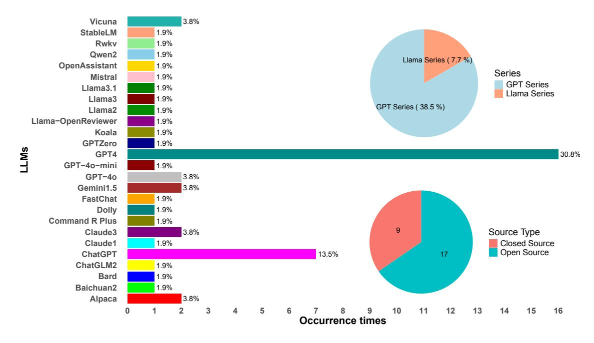

Large language models for automated scholarly paper review: A survey

Zhenzhen Zhuanga , Jiandong Chena , Hongfeng Xub , Yuwen Jiangc , Jialiang Lina,∗

aSchool of Computer Science and Engineering, Guangzhou Institute of Science and Technology, Guangzhou, China bSchool of Economics and Management, Guizhou Normal University, Guiyang, China cSchool of Artificial Intelligence, Guangzhou Institute of Science and Technology, Guangzhou, China

## Abstract

Large language models (LLMs) have significantly impacted human society, influencing various domains. Among them, academia is not simply a domain affected by LLMs, but it is also the pivotal force in the development of LLMs. In academic publications, this phenomenon is represented during the incorporation of LLMs into the peer review mechanism for reviewing manuscripts. We proposed the concept of automated scholarly paper review (ASPR) in our previous paper. As the incorporation grows, it now enters the coexistence phase of ASPR and peer review, which is described in that paper. LLMs hold transformative potential for the full-scale implementation of ASPR, but they also pose new issues and challenges that need to be addressed. In this survey paper, we aim to provide a holistic view of ASPR in the era of LLMs. We begin with a survey to find out which LLMs are used to conduct ASPR. Then, we review what ASPR-related technological bottlenecks have been solved with the incorporation of LLM technology. After that, we move on to explore new methods, new datasets, new source code, and new online systems that come with LLMs for ASPR. Furthermore, we summarize the performance and issues of LLMs in ASPR, and investigate the attitudes and reactions of publishers and academia to ASPR. Lastly, we discuss the challenges associated with the development of LLMs for ASPR. We hope this survey can serve as an inspirational reference for the researchers and promote the progress of ASPR for its actual implementation.

Keywords: Automated scholarly paper review, Large language models, Peer review, Academic publishing, Artificial intelligence

# 1. Introduction

In November 2022, ChatGPT1 , a chatbot developed by OpenAI, was stunningly launched. This chatbot can answer almost all kinds of questions with high quality, such as integrating and summarizing literature, completing student compositions, composing musical scores, writing scripts for poems and lyrics, writing and debugging code, emulating various terminals, and even Linux systems. ChatGPT reached 100 million users in just about two months after its release,2 Bill Gates believes that the importance of ChatGPT is comparable to the invention of the Internet and "will change our world." 3 . As a sign, large language models (LLMs), the core technology behind ChatGPT, gradually came into the public view, and began to change the living habits and working styles of human society

∗Corresponding author

Email addresses: zhuangzz@gzist.edu.cn (Zhenzhen Zhuang), jiandongchen@gzist.edu.cn (Jiandong Chen), hfxu1977@gznu.edu.cn (Hongfeng Xu), jiangyuwen@gzist.edu.cn (Yuwen Jiang), me@linjialiang.net (Jialiang Lin)

1https://openai.com/blog/chatgpt/

2https:// www.theguardian.com/technology/2023/feb/02/chatgpt-100-million-users-open-ai-fastest-growing-app

3https://www.reuters.com/technology/microsoft-co-founder-bill-gates-chatgpt-will-change-our-world-2023-02-10/

in just about two years. The research of natural language processing (NLP) and artificial intelligence (AI) thus ushered in important progress.

LLMs [\(Zhao et al., 2023\)](#page-26-0) are language models with a large number of parameters that have been trained through deep learning techniques. These models are capable of capturing and modeling the complexity and diversity of natural language. Therefore, they are able to process and generate natural language in a high-quality manner. LLMs are "large" because they have hundreds of millions or even hundreds of billions of parameters that are trained on large amounts of textual data, allowing the model to learn the complex patterns and structures of language. As the size of the models increases, so does their ability to understand and generate language.

With the development of technology, the ability of LLMs has evolved from the single module of processing text only to dealing with multiple modules of accepting different types of input. The latest version of OpenAI GPT-4o is a multimodal LLM that supports any combination of text, audio, and image inputs and generates any combination of text, audio, and image outputs. GPT-4o is particularly good at visual and audio understanding, allowing for real-time inference across audio, vision, and text. With this multimodal capability, the capabilities of LLMs have been greatly enhanced and their applications have been developed to a greater extent.

Research shows that, in the current peer review process, LLMs have already been used for generating the content of reivew report [\(Liang et al., 2024\)](#page-22-0). In the era of LLMs, we have no choice but to face the emergence of LLMs influencing peer review. Our previous paper proposes the concept and pipeline of automated scholarly paper review (ASPR) and envisions its future [\(Lin et al., 2023a\)](#page-22-1). At that time, ChatGPT was just released, and we clearly stated that the future directions of ASPR should "embrace the changes brought by ChatGPT and other large language models (LLMs)". As can be seen, since ChatGPT was released, numerous researchers have used LLMs to conduct ASPR or perform similar work. Also, there also exists some work that is not originally proposed for ASPR but can be used for ASPR. This phenomenon is exactly the coexistence phase of ASPR and peer review we presented. ASPR serves as a human assistant to write a better review report in peer review. At this phase, ASPR generation effects, related technologies, new resources, corresponding policies, ethics, etc. are further developed than before. These contents are closely concerned by the academic community, and are relevant to every researcher. It deserves to be collected, organized, and reviewed, therefore, we conduct this survey.

In this survey paper, we conduct a review of ASPR at the coexistence phase in the era of LLMs. The structure of our review is as follows:

- In Section [2,](#page-2-0) we start by reviewing which LLMs researchers use to conduct ASPR.
- In Section [3,](#page-5-0) we analyze how LLMs address the technological bottlenecks for ASPR.
- In Section [4,](#page-6-0) we review what new methods are employed in LLMs for ASPR.
- In Section [5](#page-8-0) and [6,](#page-10-0) we summarize what new LLMs resources are available for ASPR.
- In Section [7](#page-11-0) and [8,](#page-12-0) we elaborate on where the performance and issues of LLMs for ASPR lie in.
- In Section [9](#page-14-0) and [10,](#page-15-0) we access how publishers and academia think about and react to LLMs for ASPR.
- In Section [11,](#page-17-0) we conclude this survey by pointing out what the challenges are for LLMs in ASPR and where the future direction is.

#### 2. Which LLMs are used

In the current development landscape, LLMs have shown diversified development trends, which are mainly divided into two camps: closed-source and open-source. Closed-source LLMs are represented by OpenAI's GPT4 [\(Ope](#page-23-0)[nAI, 2023\)](#page-23-0), Google's Gemini series [\(Team et al., 2024\)](#page-24-0), and Anthropic's Claude series [\(Claude, 2023\)](#page-19-0). They are usually developed by powerful technology companies. With abundant computing resources and a large amount of high-quality data, these companies make the closed-source models excel in performance, stability, and generalizability. However, they lack transparency. Their training process and data are not open to the public, which restricts academic exploration and optimization [\(Zhao et al., 2023\)](#page-26-0). Among the open source LLMs, OpenAI's early ChatGPT [\(OpenAI, 2022\)](#page-23-1), Meta's LLaMA series [\(Touvron et al., 2023a\)](#page-25-0), Mistral AI's Mistral [\(Jiang et al.,](#page-21-0) [2023\)](#page-21-0), and Alibaba Group's Qwen2 [\(Yang et al., 2024\)](#page-25-1) have attracted much attention. They are mainly based on the Transformer architecture, which has the advantages of strong customizability and can be adjusted on demand. These models have a high level of community participation and can accelerate iterative optimization. Lower development and deployment costs reduce the threshold of using innovation and promoting the application of technology. However, these open-source models also have common shortcomings: insufficient understanding of specific domain knowledge, unstable performance on complex fuzzy tasks, and high requirements of hardware resources and technology for training and deployment [\(Zhao et al., 2023\)](#page-26-0).

In this subsection, a comprehensive review of papers concerning the application of LLMs in ASPR has been conducted. Table [1](#page-4-0) presents a detailed summary of the relevant information regarding the utilization of these models for ASPR, encompassing aspects such as model names, open-source status, official websites, and used papers in which they are discussed. Meanwhile, a visual drawing of Figure [1](#page-2-1) was performed based on the information provided in Table [1.](#page-4-0)

Figure 1: Percentage of occurrences of different LLMs

In Figure [1,](#page-2-1) the bars occupy the main part of the figure, showing the frequency of occurrence of multiple LLMs

in the ASPR literature. These models cover both open- and closed-source LLMs listed in Table [1,](#page-4-0) and the height of each bar represents the number of occurrences of the corresponding model. GPT4 occurs the most frequently at 30.8 percent (16 occurrences), ChatGPT at 13.5 percent (7 occurrences), while others such as Alpaca, Baichuan2, and others ranged from 1.9 percent to 3.8 percent, reflecting significant differences in the frequency of use of the models. The pie chart located on the top right side reveals the proportions of the models in the Llama series (including Llama2, Llama3, Llama3.1, and Llama-OpenReviewer) and the GPT series (including ChatGPT, GPT4, GPT-4o, and GPT-4o-mini). The GPT series is significantly 36.5 percent with a significant share, while the Llama series only accounted for 7.6 percent, indicating that the GPT series is widely used in the ASPR domain, which may be attributed to its excellent performance, ease of use, and community support.

Another pie chart at the bottom of the right-hand side shows the ratio of open-source to closed-source models, with the number of open-source models being 17 and closed-source models being 9. The high percentage of open source models reflects the enthusiasm of developers and researchers to participate in ASPR improvements and innovations. Open-source models are favored for their transparency and verifiability. Their internal mechanisms are publicly available, which facilitates a comprehensive understanding and independent verification of the research results, ensures transparency and reproducibility, and fits the stringent requirements of peer review. In addition, the absence of license fees makes open-source models ideal for resource-limited situations. Finally, the charts demonstrate the diversity of LLMs in the ASPR field, with many options beyond the most popular models, providing users with the opportunity to pick the most suitable tool for their specific needs.

In the future, as the research in this area continues to deepen and become more standardized, the table is expected to be supplemented with more detailed information, thus presenting a more comprehensive picture of the actual status of LLMs in ASPR applications.

Table 1: Summary of LLMs usage for ASPR

| Name                                               | OS       | Official website                                                               | Used papers                                                                                                                                                                                                                                                                                                                          |
|----------------------------------------------------|----------|--------------------------------------------------------------------------------|--------------------------------------------------------------------------------------------------------------------------------------------------------------------------------------------------------------------------------------------------------------------------------------------------------------------------------------|
| Alpaca (Taori et al., 2023)                        | <b>√</b> | https://github.com/tatsulab/stanford-alpaca                                    | Liu & Shah (2024),Chu et al. (2024)                                                                                                                                                                                                                                                                                                  |
| (Yang et al., 2023)  Baichuan2 (Yang et al., 2023) | <b>✓</b> | /stanford-alpaca https://github.com/baichuan-inc /Baichuan2                    | Chu et al. (2024)                                                                                                                                                                                                                                                                                                                    |
| Bard (Manyika & Hsiao, 2023)                       | ×        | http://bard.google.com                                                         | Liu & Shah (2024)                                                                                                                                                                                                                                                                                                                    |
| ChatGLM2                                           | <u> </u> | https://github.com/THUDM                                                       | Chu et al. (2024)                                                                                                                                                                                                                                                                                                                    |
| (Zeng et al., 2022)                                |          | /ChatGLM2-6B                                                                   |                                                                                                                                                                                                                                                                                                                                      |
| ChatGPT (OpenAI, 2022)                          | •        | https://openai.com/index/chatgpt                                               | Alshami et al. (2023),Zhou et al. (2024b), Chu et al. (2024),Biswas (2024),Chawla (2024), Mehta et al. (2024),Saad et al. (2024)                                                                                                                                                                                               |
| Claude1 (Claude, 2023)                          | ×        | https://www.anthropic.com/index/introducing-claude                             | Chu et al. (2024)                                                                                                                                                                                                                                                                                                                    |
| Claude3 Opus (Anthropic, 2024)                  | ×        | https://x.com/AnthropicAI                                                      | Du et al. (2024), Tyser et al. (2024), Idahl & Ahmadi (2024), Taechoyotin et al. (2024)                                                                                                                                                                                                                                           |
| Command R + (Gomez, 2024)                          | 1        | https://huggingface.co/CohereForAI/c4ai-command-r-plus                         | Tyser et al. (2024)                                                                                                                                                                                                                                                                                                                  |
| Dolly (Conover et al., 2023)                    | 1        | https://github.com/databrickslabs/dolly                                        | Liu & Shah (2024)                                                                                                                                                                                                                                                                                                                    |
| FastChat (Zheng et al., 2023)                   | 1        | https://github.com/lm-sys/FastChat                                             | Chu et al. (2024)                                                                                                                                                                                                                                                                                                                    |
| Gemini1.5 (Team et al., 2024)                   | ×        | https://deepmind.google/technologies/gemini                                    | Du et al. (2024), Tyser et al. (2024)                                                                                                                                                                                                                                                                                                |
| GPT4 OpenAI (2023)                              | ×        | https://openai.com/index/gpt-4                                                 | Ong et al. (2023), Du et al. (2024), Tyser et al. (2024), Chamoun et al. (2024), Liu & Shah (2024), Shcherbiak et al. (2024),D'Arcy et al. (2024), Yu et al. (2024),Robertson (2023), Thelwall (2024),Scherbakov et al. (2024), Chu et al. (2024),Bougie & Watanabe (2024), Díaz et al. (2024),Guo et al. (2024),Zhou et al. (2024b) |
| GPT-40 (OpenAI, 2023)                           | ×        | https://openai.com/index /hello-gpt-4o                                      | Bougie & Watanabe (2024), Idahl & Ahmadi (2024)                                                                                                                                                                                                                                                                                      |
| GPT-4o-mini (OpenAI, 2023)                      | X        | https://openai.com/index /gpt-4o-mini-advancing-cost-efficient-intelligence | Bougie & Watanabe (2024)                                                                                                                                                                                                                                                                                                             |
| GPTZero (Tian & Cui, 2023)                      | 1        | ${\rm https://gptzero.me}$                                                     | Shcherbiak et al. (2024)                                                                                                                                                                                                                                                                                                             |
| Koala (Geng et al., 2023)                       | 1        | https://github.com/young-geng/EasyLM                                           | Liu & Shah (2024)                                                                                                                                                                                                                                                                                                                    |
| Llama2- 70B (Touvron et al., 2023b)             | 1        | $https://www.llama.com/docs\\/model-cards-and-prompt-formats/other-models$     | Tyser et al. (2024)                                                                                                                                                                                                                                                                                                                  |
| Llama3-8B and -70B (Touvron et al., 2023a)         | 1        | https://www.llama.com/docs/model-cards-and-prompt-formats/llama-guard-3        | Du et al. (2024)                                                                                                                                                                                                                                                                                                                     |
| Llama3.1-8B and -70B (Dubey et al., 2024)          | 1        | https://www.llama.com/docs/model-cards-and-prompt-formats/llama3_1             | Bougie & Watanabe (2024), Idahl & Ahmadi (2024)                                                                                                                                                                                                                                                                                      |
| Llama-OpenReviewer-8B (Idahl & Ahmadi, 2024)    | 1        | https://huggingface.co/maxidl /Llama-OpenReviewer-8B                        | Idahl & Ahmadi (2024)                                                                                                                                                                                                                                                                                                                |
| Mistral-7b Instruct (Jiang et al., 2023)        | 1        | https://mistral.ai/news/announcing-mistral-7b                                  | Bougie & Watanabe (2024)                                                                                                                                                                                                                                                                                                             |
| Open Assistant (Köpf et al., 2023)              | 1        | https://github.com/LAION-AI /Open-Assistant                                 | Liu & Shah (2024)                                                                                                                                                                                                                                                                                                                    |
| Qwen2-72B (Yang et al., 2024)                   | 1        | https://github.com/QwenLM/Qwen2                                                | Du et al. (2024)                                                                                                                                                                                                                                                                                                                     |
| Rwkv (Peng et al., 2023)                        | 1        | https://github.com/BlinkDL/RWKV-LM                                             | Chu et al. (2024)                                                                                                                                                                                                                                                                                                                    |
| StableLM (AI, 2023)                             | 1        | https://github.com/stability-AI/stableLM                                       | Liu & Shah (2024)                                                                                                                                                                                                                                                                                                                    |
| (A1, 2029)                                         | •        |                                                                                |                                                                                                                                                                                                                                                                                                                                      |
| Vicuna (Chiang et al., 2023)                       | 1        | https://vicuna.lmsys.org                                                       | Liu & Shah (2024),Chu et al. (2024)                                                                                                                                                                                                                                                                                                  |

#### 3. New technologies in the era of LLMs for ASPR

In our ASPR paper [\(Lin et al., 2023a\)](#page-22-1), we have reviewed the technologies and challenges of conducting ASPR before the area of LLMs and pointed out the direction to embrace LLMs. The latest development of LLMs has many advanced technologies that solved the previous challenges.

#### 3.1. Long text modeling

Scholarly papers, especially full-length research articles, usually have a certain length. These lengths vary from different disciplines and requirements of journals. Generally from 4 pages (conference papers, around 3k words) to unlimited. However, even 6k is out of the processing ability of the conventional method and the staring ear of pre-trained language models. As a result, special methods are adopted to deal with this situation, like extractedthen-generate method [\(Yuan et al., 2022\)](#page-26-4) and modular guided method [\(Lin et al., 2023b\)](#page-22-5). While, these methods still have the deficiency of processing and dealing with the whole manuscript in a global aspect.

This situation changed in the era of LLMs in June 2023. The gpt-3.5-turbo-16k model shows his ability to process the input of 16k at the beginning. Just after a short while, the accepted input length has increased to 32k, then 64k. This ability is now enough for most of the scholarly papers. With this ability, LLMs solve this issue of input of processing the whole scholarly paper in a time. This capability essentially lays the technical foundation for the development and further processing of the various steps of ASPR.

# 3.2. Multi-module input

A scholarly paper consists of multiple elements, and text is only its main presenting form. In most of the papers we collected and reviewed of ASPR, they are only focusing on text. However, figures are important parts of papers. An excellent figure can provide straightforward and illustrative information on the amount of text. With the advance of LLMs, they have been evoluted from single-module into multi-module [\(Yin et al., 2023\)](#page-25-7), from processing text only to having the ability to process image, audio, and even video.

With the augmentation of this multimodal capability, LLMs truly have the same capabilities as human reviewers to review the whole content of the paper including text, tables, figures, and its related additional resources such as demonstration audio, demonstration video outer websites, and corresponding source code. This capability allows LLMs to have full access to every detail of a manuscript's content as input to perform more accurate evaluations.

#### 3.3. Multi-round conversation

In the traditional peer review process, reviewing a paper is a process of a multi-round pipeline. Authors, reviewers, and editors undergo a multi-round discussion to ensure and improve the quality of the manuscript in order to publish. In our previous paper, we define ASPR as a one round process since at that time, multi-round, or in other words, long text multi-round conversation in natural language process research is not mature enough.

In this area of LLMs, this situation has changed and evolved. Long text multi-round conversation is a main advance of LLMs. The ability of multi-round conversation contributed by sending the previous inputs (prompts) into the next conversation. This is also made possible by its advanced long text processing capabilities. With the ability, LLM is able to engage in multiple rounds of conversation to simulate the full review process, including author responses and interactions between reviewers [\(Tan et al., 2024\)](#page-24-6). Therefore, evaluating the author responses, checking their revision, and providing further feedback is possible.

#### 3.4. Instance knowledge acquisition

In the peer review process, there is a situation that a reviewer encounters descriptions and clarifications out of his knowledge scope. This may happen if these descriptions and clarifications are based on the latest updated news or research advanced. Or it does not fall into the research interest of the reviewers. When this happens, the reviewer would search, check, and confirm what they are not sure. In the early stage of LLMs, the knowdgebase is frozen at the training time. For example, the knowledge of GPT-4o is updated to October 2023.[4](#page-0-0) It is so called knowledge cutoff date. LLM providers tend to continue to update the models. However, news appears every new day and the research is developing. Even if the LLMs can be updated every week, they cannot get up with the last situation. Moreover, training an LLM requires a large amount of resources and cost. It is not unrealistic to update the model in a short period.

To overcome this handel, LLM providers integrated functions with search engines, such as Kimi[5](#page-0-0) and ChatGPT[6](#page-0-0) . As the model's knowledge is outdated or insufficient, it can perform real-time searching on the Internet to produce a more accurate answer. This feature allows LLMs to keep up with the latest scientific research and to evaluate the ideas and originality of papers more comprehensively.

#### 4. New methods for generating review reports by LLMs

Review reports are the core output of both peer review and ASPR, in the era of LLMs, researchers mainly use three types of methods to generate review reports.

#### 4.1. Prompt engineering

Prompt engineering refers to the process of designing and optimizing textual prompts that are input to LLMs. These prompts are intended to guide LLMs to produce output that meets expectations and is of high quality [\(Marvin](#page-23-7) [et al., 2024;](#page-23-7) [Sahoo et al., 2024\)](#page-23-8). Researchers optimize prompts based on specific requirements, guiding LLMs to generate more accurate, comprehensive, and format-compliant review reports.

[Thelwall](#page-24-4) [\(2024\)](#page-24-4) uses the customized function of OpenAI to design a self-defined ChatGPT-4 based on the UK Research Excellence Framework (REF) 2021[7](#page-0-0) . He applies it to scoring for his own 51 papers and compares with his own quality judgments. [Du et al.](#page-20-0) [\(2024\)](#page-20-0) use ICLR review guidelines, randomly chosen accepted and rejected papers review written by human, and an ICLR 2024 review format template as a long prompt for LLMs generation. [Liu & Shah](#page-22-2) [\(2024\)](#page-22-2) design prompts for LLMs to identify errors in papers, verify checklist questions, and choose the "better" paper in the designed compared pairs. [Zhou et al.](#page-26-5) [\(2024a\)](#page-26-5) summarized the review criteria of top journals in the field of cell biology: originality, accuracy, conceptual advance, timeliness, and significance. Then, they prompt

4https://platform.openai.com/docs/models/

5https://kimi.moonshot.cn/

6https://chatgpt.com/search

7https://2021.ref.ac.uk/publications-and-reports/index.html

the LLM to evaluate a given Pubmed ID paper with the above aspects in a three-star scoring system, and finally provide an overall evaluation. [Zhou et al.](#page-26-2) [\(2024b\)](#page-26-2) evaluate the ability of LLMs in predicting score and generation review comments. They also construct a review-revision multiple-choice questions (RR-MCQ) dataset to check the LLMs' performance in answering multiple-choice questions about paper.

# 4.2. Supervised fine-tuning

Supervised fine-tuning refers to further training based on a pre-trained model by providing labeled data to make the model perform better on a specific task or domain [\(Han et al., 2024;](#page-21-5) [Wang et al., 2024\)](#page-25-8). Researchers offer collected and constructed new datasets and use these datasets for fine-tuned LLMs for generating review reports.

[Tan et al.](#page-24-6) [\(2024\)](#page-24-6) introduce ReviewMT, a dataset including thorough annotations for each turn during the peer review process. They propose a method to convert the peer review process into a multi-turn dialogue involving different LLMs acting as roles of authors, reviewers, and decision-makers. By fine-tuning LLMs in these roles, they propose metrics for assessing the text quality, score, and decision, which provides a new perspective for evaluating the performance of LLMs in peer review. [Gao et al.](#page-21-6) [\(2024\)](#page-21-6) develop a two-stage review generation system named REVIEWER2. REVIEWER2 utilizes two fine-tuned language models: the first analyzes papers and generates prompts for aspects of a review that should be interested in; the second generates specific reviews based on these prompts. In addition, they propose two new evaluation metrics for assessing the specificity and coverage of the generated reviews. [Faizullah et al.](#page-20-4) [\(2024\)](#page-20-4) construct a dataset LimGen containing 4,068 research papers and their corresponding limitations. They use this dataset to fine-tune LLMs with Non-truncated, Dense Passage Retrieval, and Chain Modeling method. The proposed method is effective in generating limitations of a given paper by considering the whole paper context.

#### 4.3. Multi-instances frameworks

Prompt engineering and supervised fine-tuning are relatively direct methods for review report generation, and all the above methods use one single LLM instance. Some researchers are not satisfied with the performance of single LLM instance generation. They combine multiple LLM instances and design special strategies to let them work together for generation.

[Tyser et al.](#page-25-3) [\(2024\)](#page-25-3) develops AI-Driven Review Systems by proposing two main methods. One is to combine the fix questions and adaptive LLM-generated questions to prompt LLMs for reviewing. This approach is more customized and enables raising more relevant questions to be asked for particular papers. Another is to let LLMs act as program chair, senior area chair, area chair, reviewers, and authors. Through simulating the real conference paper submission to increase the quality of review report. [Chamoun et al.](#page-19-7) [\(2024\)](#page-19-7) propose a system called SWIF2T that aims to provide specific, actionable, and coherent comments by leveraging multiple LLMs to identify weaknesses or suggest changes in scientific papers. The system consists of four components: a planner, an investigator, a reviewer, and a controller. SWIF2T is innovative in that it breaks down the process of generating scientific feedback into a series of steps, and introduces a plan rescheduling methodology to optimize the generation of coherence, structure, and specificity of the plan, thus improving the effectiveness of the scientific feedback generation process. [Yu et al.](#page-25-4) [\(2024\)](#page-25-4) present SEA, a framework consisting of Standardization, Evaluation, and Analysis modules. Standardization module leverages the

ability of GPT-4 to consolidate multiple review comments into a uniformly formatted review content. Evaluation module fine-tunes the standardized data to generate high-quality structure review. Analysis module introduces a new assessment metric, the mismatch score, to evaluate the consistency between the content of the paper and the review comments. The integration of the three modules creates a systematic review process that can effectively deliver useful and specific comments. [D'Arcy et al.](#page-20-1) [\(2024\)](#page-20-1) create MARG, shorted for multi-agent review generation, a method that utilizes multiple LLM instances, called agents, for internal discussions to generate review on scientific papers. Agents are of three types: leader agents (coordinating tasks and communications), worker agents (receiving parts of a paper), and expert agents (specializing in assisting in the generation of specific types of comments). The method, through its multi-agent architecture, context management strategies, and refinement stages, can generate more specific, useful, and accurate reviews of scientific papers. [Taechoyotin et al.](#page-24-2) [\(2024\)](#page-24-2) develops MAMORX, a multi-agent multi-modal scientific review generation system. MAMORX uses a multi-agent architecture, where each agent focuses on a different aspect of the paper, such as novelty assessment, figure critic assessment, clarity assessment, etc. The system can handle not only textual information, but also multi-modal inputs such as figures, tables, and citations. It also enables to obtain the latest research advances and domain knowledge by accessing Semantic Scholar, in order to improve the quality and accuracy of review comments.

#### 5. New datasets

Datasets play an integral role in the ASPR process. As mentioned above, they play a key role in the supervised fine-tuning process and are used to assess the performance of tasks. The quality of the datasets largely determines the accuracy of the review results and the quality of the review reports. We have previously provided a comprehensive review of datasets for ASPR [\(Lin et al., 2023a\)](#page-22-1). With the advent of LLMs, many researchers have constructed their own datasets for various ASPR tasks. At the same time, there have also been a number of newly constructed datasets designed to provide a baseline for tasks based on traditional methods. Table [2](#page-9-0) is a review of the new outright datasets that have emerged since the previous review.

As shown in the table above, we classify these datasets into five different categories based on the specific tasks: screening, main review, comment generating, quality assessment of reviews, and author response. For screening, main review, and comment generating, most of the datasets contain information about the text of the manuscript, metadata, decision-making results, review comments, and reports. Some datasets contain information about multiple rounds of dialogues in the process of reviewing, and these datasets can fully utilize the advantages of the LLMs in multi-round conversation. For the quality assessment of reviews task, some datasets come with labels manually labeled by experts to assess the quality of review comments in different aspects. However, all these data are limited to text and do not include other types of data (e.g., figures in the manuscript), and the existing ASPR datasets fail to provide development conditions and operational support for multi-module LLMs.

Table 2: New ASPR related datasets

| Phase              | Name                                          | Application                                                                                                        | Scale                            | Contents                                                                                                                                |
|--------------------|-----------------------------------------------|--------------------------------------------------------------------------------------------------------------------|----------------------------------|-----------------------------------------------------------------------------------------------------------------------------------------|
| Screening          | RelevAI-Reviewer (Couto et al., 2024)      | Relevance assessing                                                                                                | 25,164 instances                 | Prompts, candidate papers, relevance levels, titles, abstracts, artificial related work section                                   |
| Main review     | ArgSciChat (Ruggeri et al., 2023)          | Literature understanding                                                                                           | 41 dialogues on 20 papers     | Dialogues, rationales, intent classes, abstract, introduction sections                                                            |
|                    | ContraSciView (Kumar et al., 2023)            | Contradiction identifying                                                                                          | 8.5k papers                      | Papers, review pairs, review pair comments                                                                                              |
|                    | LimGen (Faizullah et al., 2024)            | Limitation generation                                                                                              | 4068 papers                      | Papers, limitation sections                                                                                                             |
|                    | ReviewMT (Tan et al., 2024)                   | Multi-turn dialogue simulating                                                                                     | 26,841 papers, 92,017 reviews | Full text; reviews of each turn                                                                                                         |
| Comment            | PEERSUM (Li et al., 2023)                  | Meta-review generating                                                                                             | 14,993 samples                   | Abstract, metadata, official reviews, public reviews, official responses, public responses, author responses, author comments  |
|                    | Reviewer2 Dataset (Gao et al., 2024)       | Feedback generating                                                                                                | 27k papers, 99k reviews       | Papers, metadatas, reviews, prompts                                                                                                     |
|                    | PolitePEER (Bharti et al., 2023)           | Politeness in review comment                                                                                       | 2500 sentences                   | Review sentences, levels of politeness                                                                                                  |
| of reviews         | SubstanReview (Guo et al., 2023)              | Substantiation of review                                                                                           | 550 reviews                      | Claims, evidence, SubstanScore                                                                                                          |
|                    | Latona et al. 2024 (Latona et al., 2024)   | Impact on submission score and acceptance                                                                          | 23k+ submissions, $86k+$ reviews | Titles, abstracts, introductions, keywords, author institutions, textual evaluations, confidence scores, overall score ratings |
|                    | ReviewCritique (Du et al., 2024)              | Quality of LLM-generated reviews; Effectiveness of issues identifying                                           | 100 papers                       | Candidate papers, human-written reviews, LLM-generated reviews, labels and explanations                                        |
|                    | RR-MCQ (Zhou et al., 2024b)                | Ability of score prediction and review generation                                                                  | 196 questions                    | Questions, options, labels                                                                                                              |
|                    | SchNovel (Lin et al., 2024)                | Capability of assessing novelty                                                                                    | 15k paper pairs                  | Field, paper pairs, publication years, paper IDs, labels, titles, abstracts, metadata                                             |
|                    | SYNERGY (Li et al., 2024a)                 | Effectiveness in abstract screening                                                                                | 26 reviews                       | Reviews, abstracts, decisions                                                                                                           |
| Author response | JITSUPEER (Purkayastha et al., 2023)       | Rebuttal generation                                                                                                | 2332 sentences                   | Review sentences, attitude roots, attitude themes, canonical rebuttals, rebuttal actions                                          |
|                    | ARIES (D'Arcy et al., 2024)                   | Paper revising                                                                                                     | 4,096 comments                   | Papers, peer review feedback, author responses, paper revisions                                                                         |
| Multi- purpose  | MOPRD (Lin et al., 2023b)                     | Meta-review generation; Editorial decision prediction; Author rebuttal generation; Scientometric analysis | 6,578 papers                     | Paper metadata, multiple version manuscripts, review comments, meta-reviews, rebuttal letters, editorial decisions             |
|                    | NLPeer (Dycke et al., 2023)                   | Review score prediction; Pragmatic labeling; Guided skimming                                                 | 5k+ papers, 11k+ reports      | Peer reviews, paper drafts, revisions, metadatas                                                                                        |
|                    | Severin et al. 2023 (Severin et al., 2023) | Relationship between peer review characteristics and impact factor                                                 | 10,000 reports                   | Review reports, review metadata, impact factor, length, categories, location and gender of reviewers                              |

#### 6. Code and online tools using LLMs

Source code is critical for researchers and application developers because it allows them to reproduce the methods and results in AI papers [\(Lin et al., 2022\)](#page-22-10). This is especially important for ASPR. First, unlike theoretical research, ASPR research relies on experiments, which cannot be reproduced without the support of source code. Second, when building a complete ASPR process, existing source code can significantly reduce the amount of replication. Although some studies have not yet opened source code, they provide online systems that allow us to experience the latest ASPR technology. For example, [Tyser et al.](#page-25-3) [\(2024\)](#page-25-3) have developed three online review systems designed to provide feedback on academic papers, perform trend analysis, and improve the quality of reviews. Table [3](#page-10-1) summarizes studies with publicly available source code in ASPR-related approaches based on LLMs.

Table 3: Code and online tools related to ASPR using LLMs

| Phase                               | Name                                                  | Application                            | Official website                                                  |
|-------------------------------------|-------------------------------------------------------|----------------------------------------|-------------------------------------------------------------------|
|                                     | RAG-Novelty (Lin et al., 2024)                     | Novelty assessing                      | https://github.com/ethannlin/SchNovel                             |
| Main review                      | RelevAI-Reviewer (Couto et al., 2024)              | Relevance assessing                    | https://github.com/paulohenriquecrs/RelevAI-Reviewer              |
|                                     | SciLitLLM (Li et al., 2024b)                       |                                        | Literature understanding https://github.com/dptech-corp/Uni-SMART |
|                                     | SLG (Faizullah et al., 2024)                       | Limitation examining                   | https://github.com/arbmf/LimGen                                   |
|                                     | Tan et al. (Tan et al., 2024)                      | Process enhancing                      | https://github.com/chengtan9907/ReviewMT                          |
|                                     | RAMMER (Li et al., 2023)                           | Meta-review generating                 | https://github.com/oaimili/PeerSum                                |
| Comment generating               | ARIES (Couto et al., 2024)                         | Automatically revising                 | https://github.com/allenai/aries                                  |
|                                     | MAMORX (Taechoyotin et al., 2024)Review generating |                                        | https://github.com/sciosci/mamorx-review-system                   |
|                                     | MARG (D'Arcy et al., 2024)                         | Feedback generating                    | https://github.com/allenai/marg-reviewer                          |
|                                     | Reviewer2 (Gao et al., 2024)                       | Feedback generating                    | https://github.com/ZhaolinGao/Reviewer2                           |
|                                     | SEA (Yu et al., 2024)                              | Review generating                      | https://github.com/ecnu-sea/sea                                   |
| Author response                  | ARIES (Couto et al., 2024)                         | Automatically revising                 | https://github.com/allenai/aries                                  |
| Quality assessment of reviews | Li et al. (Li et al., 2024a)                       | Effectiveness in abstract screening | https://github.com/mikeli380/LLMAbstractScreening                 |

As shown in the table above, researchers have developed a variety of approaches to address subtasks at different stages of the ASPR process, including main review, comment generating, quality assessment of reviews, and author response. These approaches take advantage of LLMs strengths in processing long text and multi-round conversation, and they show better performance in most cases compared to traditional NLP baseline models. Of note, at the end of 2024, the first open-source ASPR system for multi-module LLM, MAMORX [\(Taechoyotin et al., 2024\)](#page-24-2), was introduced. Simulating key aspects of human review by integrating textual, graphical, and citation concerns and combining them with external knowledge sources gives MAMORX a high chance of winning against human reviewers and baseline models.

## 7. LLMs performance to conduce ASPR

LLMs have shown their power in text generation. Researchers have evaluated LLMs' performance in ASPR, and they found that LLMs have done well in the following aspects.

#### 7.1. Improving review efficiency

LLMs can speed up the peer review process by aiding in screening, offering rapid response to manuscript suitability, and identifying potential issues or ethics concerns. This expedites the whole publication schedule [\(Biswas](#page-19-11) [et al., 2023\)](#page-19-11). In this coexistence phase of ASPR, it also largely reduces the workload of human reviewers. The experiment of [Robertson](#page-23-5) [\(2023\)](#page-23-5) shows that LLMs generated review comment share the same helpfulness rating of human reviewers, which is 3 out of 5. This experiment confirms that LLMs are useful and helpful in conducting ASPR in the view of authors. The development of LLMs can contribute to making the reviewing process more efficient and robust, saving researchers' precious time, and increasing robustness and satisfaction [\(Kuznetsov et al.,](#page-21-9) [2024\)](#page-21-9).

#### 7.2. Generating high-quality structured comment

Summarization is the first part of a review report [\(Lin et al., 2023a\)](#page-22-1). LLMs have the ability to generate high quality summary text. It is worth mentioning that its generated summaries are not directly copied from the reviewing manuscript, which demonstrates its strong power [\(Du et al., 2024\)](#page-20-0). This ability is also examined by [Thelwall](#page-24-4) [\(2024\)](#page-24-4). By this setting, LLMs can produce a "quality evaluation rationales" in compliance with REF criteria.

#### 7.3. Validating given checklists

LLMs can verify manuscripts with given checklists, to ensure the submitted manuscripts fulfill the requirements of special conferences and journals. The experiment shows that LLMs achieve 86.6% accuracy of the checklist checking test, reaching the human level. Moreover, 50% of the LLMs errors are caused by the unavailable ability of the LLMs at the experiment time, for example, checking figure information to the single model LLMs at that time.

## 7.4. Checking technical errors

LLMs are able to check the correctness of the paper and identify errors and loopholes, including mathematical and conceptual errors, which helps to improve the quality of the paper. The experiment of [Liu & Shah](#page-22-2) [\(2024\)](#page-22-2) shows that LLMs identified deliberately inserted errors in 7 of the 13 short papers. This is comparable to the performance of human experts.

#### 8. Main existing issues

In the peer review process, reviewers are expected to provide objective and constructive comments. Even though LLMs take forward the advancement of ASPR in a large step, in the current stage, it still have several issues to take the role of human reviewers. In this section, we review and present the demerits that using LLMs for ASPR, and analyze its internal mechanism.

#### 8.1. Lack of professional knowledge and profound understanding

Reviewing a paper is a complex process, it requires thorough knowledge and profound experience in the field of a given paper. Justification in research is a process of "truth-conducive". Verification of results and interpretation of data are two essential parts. LLMs still cannot reach the human level in these two parts [\(Takagi, 2023\)](#page-24-8). LLMs have technical limitations in understanding highly specialized terminology or the latest research advances. LLMs lack actual understanding of domain-specific expertise and capacity to contextualize feedback in the nuanced framework of a particular field of study [\(Biswas, 2024\)](#page-19-3). LLMs are more likely to offer short sentences and general words, suggesting that its evaluation is only at the stage of imitatively evaluating the characteristics of the text, and that it is not yet capable of substantively evaluating the core elements of the paper, such as originality and soundness [\(Zhou](#page-26-5) [et al., 2024a\)](#page-26-5). Moreover, LLMs tend to suggest out-of-scope comments since their reviews are not so paper-specific and are superficial to avoid technical errors [\(Du et al., 2024\)](#page-20-0).

The current mechanisms of LLMs output are predicting missing words based on billions or even trillions of parameters deep neural networks. These networks are trained by unsupervised machine learning methods of enormous amounts of text from many different sources. Most of them are open-domain web resources, and the academic contents only account for a tiny portion [\(Brown et al., 2020\)](#page-19-12). This leads directly to the inability of LLMs to evaluate highly sophisticated cutting-edge topics and niche subjects in depth and detail. At the same time, humans are endowed with intuition, perception, empathy, deduction, self-awareness, and social awareness. These abilities enable human reviewers to gain an insight into conflicting theories and findings, inherent and problematic assumptions, and lasting but not outdated contributions. Unfortunately, LLMs lack these abilities [\(Weber, 2024\)](#page-25-9). These factors result in the failure of LLMs to perform profound understanding.

# 8.2. Bias review

It is the pursuit of peer review to give an objective and fair evaluation of the reviewed text merely on the manuscript quality. However, due to the internal generation mechanisms, the output of LLMs is subject to many factors such user prompts, model training data [\(Tan et al., 2024\)](#page-24-6). This leads to the instability of its generation results.

LLMs have a tendency to rate most papers higher scores [\(Zhou et al., 2024a;](#page-26-5) [Du et al., 2024\)](#page-20-0). The research from [Thelwall](#page-24-4) [\(2024\)](#page-24-4) found that LLMs never give the lowest score for the reviewing papers, and most of the time allocated the middle scores. Additionally, OpenAI acknowledged that its LLM may generate biased content [\(OpenAI, 2023\)](#page-23-0). These biases, relating to class, race, geography, etc., which are born with LLMs might be reproduced or even amplified [\(Hosseini & Horbach, 2023\)](#page-21-10).

These biases are all inherited from the training data of LLMs [\(Leung et al., 2023\)](#page-22-12). Whether admitted or not, most of the data LLMs used for training come from people with biases that may not be aware of them. These biases include preferring positive results, being more tolerant or intolerant of authors with specific demographic profiles, or from certain institutions and countries [\(Hosseini & Horbach, 2023\)](#page-21-10). Moreover, minority groups or options may have little or no included in training data in the LLMs. As with low-quality manuscripts and their corresponding review comments, leads to bias when LLMs deal with these rarely seen or unseen content.

## 8.3. Inaccuracies and erroneous comments

Identifying potential problems accurately in the manuscripts and giving insightful comments properly to the authors is expected of all the reviewers, and at least, reviewers are supposed not to make incorrect comments. Many researchers have evaluated LLMs for ASPR and pointed out that LLMs may generate inaccuracy or even error comments. LLMs may "hallucinate" [\(Huang et al., 2024\)](#page-21-11) inexplicably as their fabricate information with supporting references to generate convicting comments even when inaccurate [\(Spitale et al., 2023;](#page-24-9) [Tyser et al., 2024\)](#page-25-3), and they may judge low-quality manuscript a plausible veneer of rigor and decency [\(Nath et al., 2024\)](#page-23-11). LLMs frequently accept the author's claims without checking them thoroughly, and view indentify the manuscript strengths as a text summarization task of the manuscript itself [\(Du et al., 2024\)](#page-20-0). When LLMs are subjected to reviewing the same identical papers for multi times, they show instability and inconsistency. This is demonstrated by the fact that different scores, and different expressions are generated in different rounds for the same paper [\(Thelwall, 2024\)](#page-24-4). Also, research shows that LLMs fail to evaluate the writing level [\(Du et al., 2024\)](#page-20-0), and are incompetent in scoring manuscript accuracy [\(Zhou et al., 2024b\)](#page-26-2).

#### 8.4. Privacy and data security risks

In the conventional peer review process, the manuscript is strictly confidentiality. Editors and reviewers have the responsibility to protect the author's unpublished manuscripts from being disclosed. While there are occasional extremes [\(Laine, 2017\)](#page-22-13), this has basically become the academic consensus. When using the LLMs for ASPR, most of the early concerns involved confidentiality [\(Conroy, 2023\)](#page-20-8). LLMs may unintentionally incorporate the content of manuscripts into their training data. Because LLMs may store input text, using the LLM to review unpublished manuscripts may raise concerns about the confidential issues [\(Hosseini & Horbach, 2023\)](#page-21-10).

This is due to the deployment and interaction methods of LLMs. Training and deploying a LLM require large resources, the common method to use LLMs is to use it by a LLM provider through the Internet. Manuscript must be uploaded to the LLMs provider servers to conduct ASPR. In this process, all the uploaded content and the user prompts may be used to improve the LLMs themselves.[8](#page-0-0)

#### 8.5. Weak customization capability

Based on the tastes of the editorial board and the long-established style of publishing papers, different journals have their own review criteria. ASPR is intended to review a paper "for a specific publication venue", and meet their "aims and scopes, review standards, and publication requirement" [\(Lin et al., 2023a\)](#page-22-1). Notably, in the current stage,

8https://openai.com/consumer-privacy/

LLMs are unable to reflect the aims and scopes of journals or capture the complexity of their editorial visions [\(Saad](#page-23-3) [et al., 2024\)](#page-23-3).

# 9. Policy of reviewing by using AIGC tools from publishers

The development of LLMs made the coexistence stage of ASPR be possible. Many reviewers have used LLM to generate review reports for themselves [\(Liang et al., 2024\)](#page-22-0). Main steam publishers have realized this situation and published corresponding policies. Their policies are collected and summarized in Table [4.](#page-14-1)

Table 4: Policy on AIGC tools for reviewing

| Category                     | Publisher                           | Usage of AI                                                                                                                                            |
|------------------------------|-------------------------------------|--------------------------------------------------------------------------------------------------------------------------------------------------------|
|                              | AAAS 2024                           | ——                                                                                                                                                     |
|                              | AIP 2024                            | ——                                                                                                                                                     |
|                              | Cambridge University Press 2024a —— |                                                                                                                                                        |
| No                           | Elsevier 2024                       | ——                                                                                                                                                     |
| usage                        | Emerald 2024                        | ——                                                                                                                                                     |
|                              | IEEE 2024                           | ——                                                                                                                                                     |
|                              | MDPI 2024                           | ——                                                                                                                                                     |
|                              | MIT Press 2024b                     | ——                                                                                                                                                     |
|                              | Springer Nature 2024                | ——                                                                                                                                                     |
|                              | Taylor & Francis 2024               | ——                                                                                                                                                     |
| Partly                       | ACL 2023                            | Paraphrasing the review, checking proofs, explaining concepts that the reviewer doesn't know                                                        |
| usage                        | ACM 2023; 2024                      | Enhancing the quality and readability of review reports (not necessary to disclose)                                                                 |
|                              | Sage 2024                           | Looking for reviewers                                                                                                                                  |
|                              | JAMA Network 2023                   | Using AI tools that does not violate the confidentiality policy (the name and usage of the tool must be declared)                                   |
| Privately hosted AI tools | Frontiers 2020; 2024                | AI tool: AIRA Assessment of language quality, the integrity of the figures, detection of plagiarism, identifying potential conflicts of interest |
|                              | Wiley 2024                          | AI tool: Research Exchange Improving the match of reviewers screening research integrity                                                         |

As can be seen in Table [4,](#page-14-1) most of the publishers prohibit reviewers use AI tools to generate or assist in writing the content of review reports. The main reasons are:

- The usage of AI tools requires uploading the content of manuscript to these AI tools' servers. This behavior carries the risk of leaking the manuscript, which breaks the confidential reviewing process.
- Peer review is based on the experience and knowledge of the reviewer, and the reviewers are responsible for all the content of the submitted review report. Adopting opinions from AI in whole or in part would break this subjective responsibility and introduce bias.

Some publishers allow editors and reviewers to introduce AI tools to assist in the review process, subject to confidentiality rules. Sage allows editors to use AI tools to find reviewers, but also requires them to verify and take responsibility for the results. ACM allows reviewers to use generative AI or other third-party tools to improve the quality and readability of the review report and does not require disclosure in the report. ACL allows reviewers to use AI tools to help understand concepts and polish review comments. JAMA Network allows reviewers to use AI tools as a review resource and requires the name of the tool used and how it is used. The uses for which these publishers have introduced AI tools vary, but what they have in common is that they don't allow editors and reviewers to upload manuscripts to platforms that retain information and don't comply with confidentiality rules, such as GPT-4o and so on.

There are also a very small number of publishers that have demonstrated an embrace of AI in a practical way. They have developed privately hosted AI tools to make the review process more efficient, although they are not allowed to do so either. The Artificial Intelligence Review Assistant (AIRA) of Frontiers, the industry's first sophisticated AI available to those in the peer review process, can currently make up to 20 recommendations in just seconds, including the assessment of language quality, the integrity of the figures, the detection of plagiarism, as well as identifying potential conflicts of interest. The Research Exchange publishing platform of Wiley is a unique opportunity to share information on the impact of research and development on the world. The Research Exchange publishing platform of Wiley can assist in research integrity screening in addition to helping match reviewers, such as AI-generated content detection, researcher validation, forged or manipulated references, suspicious or problematic phrases, and other malicious behavior. In addition to their own AI platforms, both publishers do not allow reviewers to use other GAI tools for review and decision-making.

## 10. Suggestions from academia

In contrast to the cautious attitude of the publishing community, the academic community has been relatively tolerant of the use of LLMs for ASPR. Besides sharing the same concerns about data security, the academic community in general had an open mind and offered some suggestions for usage and development.

### 10.1. Data security

Academia considers data security the same importance as the industries. [Hosseini & Horbach](#page-21-10) [\(2023\)](#page-21-10) claims that materials with sensitive information or protected data should not be sent as input to LLMs before necessary actions to deal with data security are taken. One possible and actionable solution to handle the data security issues is to deploy privately hosted LLMs [\(Conroy, 2023\)](#page-20-8). By using the privately hosted LLMs, all the data including these confidence ones are produced with the users' own service. They will not submit the published LLMs service provider and protect the data.

This solution has some issues. It requires technical experts in LLMs and powerful hardware resources to support the deployment. Additionally, the performance of the open-source LLMs, in most of the time, is not as good as the close-source ones.

## 10.2. Undergoing training

Training in a standardized system is generally considered a necessary measure when confronted with new matters. [Mehta et al.](#page-23-2) [\(2024\)](#page-23-2) suggest that before integrating LLMs into the peer review process, researchers ought to first receive ethics training and be aware of the possible limitations and biases of the novel technology. [Hosseini &](#page-21-10) [Horbach](#page-21-10) [\(2023\)](#page-21-10) share the similar opinions. They claim that as the critical part of researcher training, the content of peer review training must include the potential advantages and disadvantages of using LLMs for review. This kind of training helps researchers use LLMs in a responsible way and makes them conscious of possible weaknesses and biases of LLMs. They also recommend that, in such a fast technology development day, the training should update frequently to catch up with the LLMs' evolution.

#### 10.3. Declaration of usage and transparency

Unlike publisher's attitude of forbidding the use of LLMs in the actual peer review process, academia shows a relatively tolerant attitude and accepts the use of LLMs for reviewing in certain conditions. [Drori & Te'eni](#page-20-13) [\(2024\)](#page-20-13) consider that when reviewers use LLMs in their reviewing, self-declaration or watermark produced by the machine should be explicitly made known. This measure is intended to increase transparency in the use of LLMs. [Hosseini & Horbach](#page-21-10) [\(2023\)](#page-21-10) suggested that besides revealing the use of LLMs, reviewers should also be responsible for the originality, accuracy, and tone of the presentation in their review reports. At the same time, editors are also supposed to disclose the use of LLMs in the whole process when they deal with the manuscripts. [Mehta](#page-23-2) [et al.](#page-23-2) [\(2024\)](#page-23-2) recommend that reviewers and editors should share the experience and outcome of using LLMs in order to contribute to collective learning. [Kuznetsov et al.](#page-21-9) [\(2024\)](#page-21-9) claim that to improve the transparency in LLMs assisted review, explicitly clarifying which types of tools are used in a given review activity and publishing thorough information of the models used and model cards is an actionable policy.

#### 10.4. Suggested usage

Researchers have gained a lot of different experiences and techniques when working with LLMs.

LLMs are developing at a quick pace, a same LLM providers might provide a different version of LLMs at the same time. These different versions are various in their performance and cost of use. Using the last and updated version is beneficial to the integration of LLMs and ASPR [\(Saad et al., 2024\)](#page-23-3). At the same time, there are many tasks in ASPR. Some simple tasks only require simple models. To explore an effective way to switch faster and cost fewer models for processing the simpler task, is a valuable research direction [\(D'Arcy et al., 2024\)](#page-20-1).

To get more accurate performance, prompt and get the outputs from LLMs for many rounds and make the averaging scores evaluated to be more effective than a single round [\(Thelwall, 2024\)](#page-24-4). To reduce errors, it is better to divide manuscripts into smaller and manageable parts before sending to LLMs [\(Mehta et al., 2024\)](#page-23-2). Researchers are also encouraged to continue on keeping experimenting with LLMs and sharing their experiences and results to overcome the uncertainties with regard to the competencies, limitations, and internal workings of the LLM ([Hosseini](#page-21-10) [& Horbach, 2023\)](#page-21-10). Last but not least, researchers are better not relying on LLMs as the only review means [\(Mehta](#page-23-2) [et al., 2024\)](#page-23-2), to prevent the case of a technical breakdown [\(Drori & Te'eni, 2024\)](#page-20-13).

## 10.5. Aligned with the values and goals of academic research

Although different human reviewers might have different opinions and comments on the same manuscript, academics share common values and objectives to promote the development of the human world and create a better life in the future. [Robertson](#page-23-5) [\(2023\)](#page-23-5) suggested that additional research is required to ensure that the LLMs used in the peer review process are consistent with our values and goals for scholarly research. [Takagi](#page-24-8) [\(2023\)](#page-24-8) recommend that when using LLM for reviewing manuscripts, it should be ensured that their value judgments are aligned with the assessments of human researchers to make sure that review comments are consistent with human perspectives and values, but not the standpoint and aspects form the LLMs. [Drori & Te'eni](#page-20-13) [\(2024\)](#page-20-13) consider that LLMs should be monitored and reported on for compliance with the journal's guidelines for conduct, including following review forms and rules of editorial and professional organizations.

#### 11. Conclusion and future directions

In this survey paper, we review and synthesize existing literature to provide an overview of technologies, methods, resources, policies, responses, and suggestions related to ASPR within the scope of LLMs. Initially, when LLMs first came into existence, they were met with skepticism and resistance from prestigious institutions and universities, as their utility and ethical implications were questioned. Over time, however, these models demonstrated their potential to revolutionize various tasks, ultimately gaining acceptance and becoming integral to modern AI systems.[9](#page-0-0) A similar trajectory is now being observed with ASPR. The idea of automating this traditionally human-led process initially is facing resistance as it enters the coexistence phase with peer review. Despite this, advancements in LLMs have begun to show that ASPR can be achieved in full sense, and we are confident that in the future, ASPR will be recognized by the publishers with an open mind and become a standard tool in academic publication. Ultimately, the objective is not about replacing one with the other, but to enhance the overall process and foster greater efficiency and quality in scholarly evaluation.

Based on the review presented, we highlight several open challenges as follows to warrant further exploration over this topic.

Correcting hallucinations. The problem of hallucinations [\(Huang et al., 2024\)](#page-21-11) has existed since the inception of LLMs and is rooted in their complex generation mechanisms. For paper reviewing, the accuracy and clarity of the text are required to eliminate the illusion and ensure that the content is authentic and reliable. Currently, although some researchers have devised various generation methods to reduce hallucinations, they still occur in some complex situations [\(Huang et al., 2024\)](#page-21-11). This suggests that LLMs need to be further improved in generating text to meet the demand for high-quality text in the academic field and to increase their applicability in rigorous scenarios.

Generating with Multimodal. At present, although LLMs have entered the multimodal era, not many studies have been conducted on ASPR using multimodal inputs. This is mainly due to the lack of sufficiently rich, high-quality, and accurately labeled multimodal datasets. Without appropriate data, it is difficult for models to fully learn the complex associations and interaction laws between multimodal information, thus limiting the in-depth

9https://tl.hku.hk/2023/10/policy-on-use-of-generative-artificial-intelligence-for-teaching-and-learning/

development of related research. Therefore, constructing multimodal datasets and conducting ASPR research based on them is undoubtedly a very promising and worthwhile direction to be explored in depth.

Deploying low resource private-hosted models. Confidential issues are the main concern for publishers and researchers using LLMs for ASPR. Deploying privately hosted models solves this problem but requires significant computational resources. How to easily deploy private-hosted models and reduce resource consumption is the key for such a solution. This requires technical optimization, cost control, and other aspects to ensure the efficient operation of the model, while reducing resource investment and achieving sustainable development to provide strong support for ASPR.

Addressing the issue of generative attacks. Generative attacks is an important security challenge facing LLMs, and the impact on ASPR is mainly reflected in reducing the quality of reviewing manuscripts and bringing system security risks. Attackers may manipulate LLMs to generate false review comments through adversarial attacks, which affects the fairness and accuracy of reviewing. They may also take advantage of the loopholes of LLMs to obtain sensitive information in the reviewing process, such as the content of the paper and the authors' identities, bringing the risk of data leakage. How to prevent generative attacks and delimit trust boundaries are important issues to be solved when LLMs is applied to ASPR.

# Acknowledgments

This work is funded by the Research Initiation Fund Project of Guangzhou Institute of Science and Technology (2023KYQ184), and Guizhou Province Science and Technology Plan Project (Qian Ke He[2023] No.450). Special and heartfelt gratitude goes to the corresponding author's wife Fenmei Zhou, for her understanding and love. Her unwavering support and continuous encouragement enable this research to be possible.

#### Declaration of competing interest

The authors declare that they have no known competing financial interests or personal relationships that could have appeared to influence the work reported in this paper.

# References

AAAS (2024). Peer Review at Science Journals. URL: [https://www.science.org/content/page/](https://www.science.org/content/page/peer-review-science-publications) [peer-review-science-publications](https://www.science.org/content/page/peer-review-science-publications).

ACL (2023). FAQ: Can I use AI writing assistants to write my review? URL: [https://2023.aclweb.org/blog/](https://2023.aclweb.org/blog/review-acl23/#faq-can-i-use-ai-writing-assistants-to-write-my-review) [review-acl23/#faq-can-i-use-ai-writing-assistants-to-write-my-review](https://2023.aclweb.org/blog/review-acl23/#faq-can-i-use-ai-writing-assistants-to-write-my-review).

ACM (2023). ACM Peer Review Policy. URL: <https://www.acm.org/publications/policies/peer-review>.

ACM (2024). ACM Peer Review Policy Frequently Asked Questions, .

AI, S. (2023). Stability ai launches the first of its stablelm suite of language models. Blog post, Apr , .

- AIP (2024). Ethics for Editors and Reviewers. URL: [https://publishing.aip.org/resources/researchers/](https://publishing.aip.org/resources/researchers/policies-and-ethics/editors-and-reviewers/) [policies-and-ethics/editors-and-reviewers/](https://publishing.aip.org/resources/researchers/policies-and-ethics/editors-and-reviewers/).
- Alshami, A., Elsayed, M., Ali, E., Eltoukhy, A. E., & Zayed, T. (2023). Harnessing the power of ChatGPT for automating systematic review process: Methodology, case study, limitations, and future directions. Systems, 11 , 351.
- Anthropic, A. (2024). The claude 3 model family: Opus, sonnet, haiku. Claude-3 Model Card, 1 .
- Bharti, P. K., Navlakha, M., Agarwal, M., & Ekbal, A. (2023). PolitePEER: does peer review hurt? A dataset to gauge politeness intensity in the peer reviews. Language Resources and Evaluation, . doi:[10.1007/](http://dx.doi.org/10.1007/s10579-023-09662-3) [s10579-023-09662-3](http://dx.doi.org/10.1007/s10579-023-09662-3).
- Biswas, S., Dobaria, D., & Cohen, H. L. (2023). ChatGPT and the future of journal reviews: A feasibility study. The Yale Journal of Biology and Medicine, 96 , 415–420. doi:[10.59249/SKDH9286](http://dx.doi.org/10.59249/SKDH9286).
- Biswas, S. S. (2024). AI-assisted academia: Navigating the nuances of peer review with ChatGPT 4. The Journal of Pediatric Pharmacology and Therapeutics, 29 , 441–445. doi:[10.5863/1551-6776-29.4.441](http://dx.doi.org/10.5863/1551-6776-29.4.441).
- Bougie, N., & Watanabe, N. (2024). Generative Adversarial Reviews: When LLMs Become the Critic. arXiv preprint arXiv:2412.10415 , .
- Brown, T., Mann, B., Ryder, N., Subbiah, M., Kaplan, J. D., Dhariwal, P., Neelakantan, A., Shyam, P., Sastry, G., Askell, A., Agarwal, S., Herbert-Voss, A., Krueger, G., Henighan, T., Child, R., Ramesh, A., Ziegler, D., Wu, J., Winter, C., Hesse, C., Chen, M., Sigler, E., Litwin, M., Gray, S., Chess, B., Clark, J., Berner, C., McCandlish, S., Radford, A., Sutskever, I., & Amodei, D. (2020). Language Models are Few-Shot Learners. In NeurIPS.
- Chamoun, E., Schlichtkrull, M., & Vlachos, A. (2024). Automated focused feedback generation for scientific writing assistance.
- Chawla, D. S. (2024). Is ChatGPT corrupting peer review? Telltale words hint at AI use. Nature, 628 , 483–484. doi:[10.1038/d41586-024-01051-2](http://dx.doi.org/10.1038/d41586-024-01051-2).
- Chiang, W.-L., Li, Z., Lin, Z., Sheng, Y., Wu, Z., Zhang, H., Zheng, L., Zhuang, S., Zhuang, Y., Gonzalez, J. E., Stoica, I., & Xing, E. P. (2023). Vicuna: An open-source chatbot impressing GPT-4 with 90% ChatGPT quality. URL: <https://vicuna.lmsys.org>.
- Chu, Z., Ai, Q., Tu, Y., Li, H., & Liu, Y. (2024). Automatic Large Language Model Evaluation via Peer Review. In Proceedings of the 33rd ACM International Conference on Information and Knowledge Management.
- Claude, I. (2023). Introducing Claude. URL: <https://www.anthropic.com/news/introducing-claude> claude1.
- Conover, M., Hayes, M., Mathur, A., Meng, X., Xie, J., Wan, J., Ghodsi, A., Wendell, P., & Zaharia, M. (2023). Hello Dolly: Democratizing the magic of ChatGPT with open models. Databricks blog. March, 24 .

- Conroy, G. (2023). How ChatGPT and other AI tools could disrupt scientific publishing. Nature, 622 , 234–236. doi:[10.1038/d41586-023-03144-w](http://dx.doi.org/10.1038/d41586-023-03144-w).
- Couto, P. H., Ho, Q. P., Kumari, N., Rachmat, B. K., Khuong, T. G. H., Ullah, I., & Sun-Hosoya, L. (2024). RelevAI-Reviewer: A Benchmark on AI Reviewers for Survey Paper Relevance. In CAp 2024 - Conférence sur l'Apprentissage Automatique.
- D'Arcy, M., Hope, T., Birnbaum, L., & Downey, D. (2024). MARG: Multi-agent review generation for scientific papers. arXiv preprint arXiv:2401.04259 , .
- Drori, I., & Te'eni, D. (2024). Human-in-the-Loop AI Reviewing: Feasibility, Opportunities, and Risks. Journal of the Association for Information Systems, 25 , 98–109. doi:[10.17705/1jais.00867](http://dx.doi.org/10.17705/1jais.00867).
- Du, J., Wang, Y., Zhao, W., Deng, Z., Liu, S., Lou, R., Zou, H. P., Venkit, P. N., Zhang, N., Srinath, M., Zhang, H. R., Gupta, V., Li, Y., Li, T., Wang, F., Liu, Q., Liu, T., Gao, P., Xia, C., Xing, C., Cheng, J., Wang, Z., Su, Y., Shah, R. S., Guo, R., Gu, J., Li, H., Wei, K., Wang, Z., Cheng, L., Ranathunga, S., Fang, M., Fu, J., Liu, F., Huang, R., Blanco, E., Cao, Y., Zhang, R., Yu, P. S., & Yin, W. (2024). LLMs assist NLP Researchers: Critique Paper (Meta-)Reviewing.
- Dubey, A., Jauhri, A., Pandey, A., Kadian, A., Al-Dahle, A., Letman, A., Mathur, A., Schelten, A., Yang, A., & Fan, A. (2024). The Llama 3 herd of models. arXiv preprint arXiv:2407.21783 , .
- Dycke, N., Kuznetsov, I., & Gurevych, I. (2023). NLPeer: A Unified Resource for the Computational Study of Peer Review. doi:[10.18653/v1/2023.acl-long.277](http://dx.doi.org/10.18653/v1/2023.acl-long.277).
- Díaz, O., Garmendia, X., & Pereira, J. (2024). Streamlining the review process: AI-generated annotations in research manuscripts. arXiv preprint arXiv:2412.00281 , .
- D'Arcy, M., Ross, A., Bransom, E., Kuehl, B., Bragg, J., Hope, T., & Downey, D. (2024). ARIES: A Corpus of Scientific Paper Edits Made in Response to Peer Reviews.
- Elsevier (2024). The use of generative AI and AI-assisted technologies in the journal peer review process. URL: [https://www.elsevier.com/about/policies-and-standards/generative-ai-policies-for-journals#](https://www.elsevier.com/about/policies-and-standards/generative-ai-policies-for-journals#2-for-reviewers) [2-for-reviewers](https://www.elsevier.com/about/policies-and-standards/generative-ai-policies-for-journals#2-for-reviewers).
- Emerald (2024). How to...Review a journal, case study or book proposal, .
- Faizullah, A. R. B. M., Urlana, A., & Mishra, R. (2024). LimGen: Probing the LLMs for Generating Suggestive Limitations of Research Papers. doi:[10.1007/978-3-031-70344-7\\\_7](http://dx.doi.org/10.1007/978-3-031-70344-7_7).
- Flanagin, A., Kendall-Taylor, J., & Bibbins-Domingo, K. (2023). Guidance for Authors, Peer Reviewers, and Editors on Use of AI, Language Models, and Chatbots. JAMA, 330 , 702–703. doi:[10.1001/jama.2023.12500](http://dx.doi.org/10.1001/jama.2023.12500).
- Francis, T. . (2024). Guidelines for peer reviewers. URL: [https://editorresources.taylorandfrancis.com/](https://editorresources.taylorandfrancis.com/reviewer-guidelines/) [reviewer-guidelines/](https://editorresources.taylorandfrancis.com/reviewer-guidelines/).

- Frontiers (2020). Artificial Intelligence to help meet global demand for high-quality, objective peer-review in publishing. URL: [https://www.frontiersin.org/news/2020/07/01/](https://www.frontiersin.org/news/2020/07/01/artificial-intelligence-peer-review-assistant-aira/) [artificial-intelligence-peer-review-assistant-aira/](https://www.frontiersin.org/news/2020/07/01/artificial-intelligence-peer-review-assistant-aira/).
- Frontiers (2024). Editorial policies and publication ethics. URL: [https://www.frontiersin.org/guidelines/](https://www.frontiersin.org/guidelines/policies-and-publication-ethics) [policies-and-publication-ethics](https://www.frontiersin.org/guidelines/policies-and-publication-ethics).
- Gao, Z., Brantley, K., & Joachims, T. (2024). Reviewer2: Optimizing review generation through prompt generation. arXiv preprint arXiv:2402.10886 , .
- Geng, X., Gudibande, A., Liu, H., Wallace, E., Abbeel, P., Levine, S., & Song, D. (2023). Koala: A dialogue model for academic research. Blog post, April, 1 , 6.
- Gomez, A. (2024). Introducing command r+: A scalable llm built for business. Online Blog, .
- Guo, E., Gupta, M., Deng, J., Park, Y.-J., Paget, M., & Naugler, C. (2024). Automated paper screening for clinical reviews using large language models: Data analysis study. Journal of Medical Internet Research, 26 , e48996.
- Guo, Y., Shang, G., Rennard, V., Vazirgiannis, M., & Clavel, C. (2023). Automatic analysis of substantiation in scientific peer reviews. doi:[10.18653/v1/2023.findings-emnlp.684](http://dx.doi.org/10.18653/v1/2023.findings-emnlp.684).
- Han, Z., Gao, C., Liu, J., Zhang, J., & Zhang, S. Q. (2024). Parameter-efficient fine-tuning for large models: A comprehensive survey. arXiv preprint arXiv:2403.14608 , .
- Hosseini, M., & Horbach, S. P. J. M. (2023). Fighting reviewer fatigue or amplifying bias? Considerations and recommendations for use of ChatGPT and other large language models in scholarly peer review. Research Integrity and Peer Review, 8 , 4. doi:[10.1186/s41073-023-00133-5](http://dx.doi.org/10.1186/s41073-023-00133-5).
- Huang, L., Yu, W., Ma, W., Zhong, W., Feng, Z., Wang, H., Chen, Q., Peng, W., Feng, X., Qin, B., & Liu, T. (2024). A Survey on Hallucination in Large Language Models: Principles, Taxonomy, Challenges, and Open Questions. ACM Transactions on Information Systems, . doi:[10.1145/3703155](http://dx.doi.org/10.1145/3703155).
- Idahl, M., & Ahmadi, Z. (2024). OpenReviewer: A Specialized Large Language Model for Generating Critical Scientific Paper Reviews. arXiv preprint arXiv:2412.11948 , .
- IEEE (2024). Become an IEEE reviewer. URL: [https://journals.ieeeauthorcenter.ieee.org/](https://journals.ieeeauthorcenter.ieee.org/submit-your-article-for-peer-review/become-an-ieee-reviewer/) [submit-your-article-for-peer-review/become-an-ieee-reviewer/](https://journals.ieeeauthorcenter.ieee.org/submit-your-article-for-peer-review/become-an-ieee-reviewer/).
- Jiang, A. Q., Sablayrolles, A., Mensch, A., Bamford, C., Chaplot, D. S., Casas, D. d. l., Bressand, F., Lengyel, G., Lample, G., & Saulnier, L. (2023). Mistral 7B. arXiv preprint arXiv:2310.06825 , .
- Kumar, S., Ghosal, T., & Ekbal, A. (2023). When reviewers lock horns: Finding disagreements in scientific peer reviews. doi:[10.18653/v1/2023.emnlp-main.1038](http://dx.doi.org/10.18653/v1/2023.emnlp-main.1038).
- Kuznetsov, I., Afzal, O. M., Dercksen, K., Dycke, N., Goldberg, A., Hope, T., Hovy, D., Kummerfeld, J. K., Lauscher, A., & Leyton-Brown, K. (2024). What can natural language processing do for peer review? arXiv preprint arXiv:2405.06563 , .

- Köpf, A., Kilcher, Y., von Rütte, D., Anagnostidis, S., Tam, Z. R., Stevens, K., Barhoum, A., Nguyen, D., Stanley, O., Nagyfi, R., Es, S., Suri, S., Glushkov, D., Dantuluri, A., Maguire, A., Schuhmann, C., Nguyen, H., & Mattick, A. (2023). OpenAssistant Conversations - Democratizing Large Language Model Alignment. In NeurIPS.
- Laine, C. (2017). Scientific misconduct hurts. Annals of Internal Medicine, 166 , 148–149. doi:[10.7326/M16-2550](http://dx.doi.org/10.7326/M16-2550).
- Latona, G. R., Ribeiro, M. H., Davidson, T. R., Veselovsky, V., & West, R. (2024). The AI Review Lottery: Widespread AI-Assisted Peer Reviews Boost Paper Scores and Acceptance Rates. arXiv preprint arXiv:2405.02150 , .
- Leung, T. I., de Azevedo Cardoso, T., Mavragani, A., & Eysenbach, G. (2023). Best practices for using AI tools as an author, peer reviewer, or editor. Journal of Medical Internet Research, 25 , e51584. doi:[10.2196/51584](http://dx.doi.org/10.2196/51584).
- Li, M., Hovy, E., & Lau, J. (2023). Summarizing multiple documents with conversational structure for meta-review generation. doi:[10.18653/v1/2023.findings-emnlp.472](http://dx.doi.org/10.18653/v1/2023.findings-emnlp.472).
- Li, M., Sun, J., & Tan, X. (2024a). Evaluating the effectiveness of large language models in abstract screening: a comparative analysis. Systematic Reviews, 13 , 219. doi:[10.1186/s13643-024-02609-x](http://dx.doi.org/10.1186/s13643-024-02609-x).
- Li, S., Huang, J., Zhuang, J., Shi, Y., Cai, X., Xu, M., Wang, X., Zhang, L., Ke, G., & Cai, H. (2024b). SciLitLLM: How to Adapt LLMs for Scientific Literature Understanding. arXiv preprint arXiv:2408.15545 , .
- Liang, W., Izzo, Z., Zhang, Y., Lepp, H., Cao, H., Zhao, X., Chen, L., Ye, H., Liu, S., Huang, Z., McFarland, D., & Zou, J. Y. (2024). Monitoring AI-modified content at scale: A case study on the impact of ChatGPT on AI conference peer reviews. In ICML.
- Lin, E., Peng, Z., & Fang, Y. (2024). Evaluating and Enhancing Large Language Models for Novelty Assessment in Scholarly Publications. arXiv preprint arXiv:2409.16605 , .
- Lin, J., Song, J., Zhou, Z., Chen, Y., & Shi, X. (2023a). Automated scholarly paper review: Concepts, technologies, and challenges. Information Fusion, 98 , 101830. doi:[10.1016/j.inffus.2023.101830](http://dx.doi.org/10.1016/j.inffus.2023.101830).
- Lin, J., Song, J., Zhou, Z., Chen, Y., & Shi, X. (2023b). MOPRD: A multidisciplinary open peer review dataset. Neural Computing and Applications, 35 , 24191–24206. doi:[10.1007/s00521-023-08891-5](http://dx.doi.org/10.1007/s00521-023-08891-5).
- Lin, J., Wang, Y., Yu, Y., Zhou, Y., Chen, Y., & Shi, X. (2022). Automatic analysis of available source code of top artificial intelligence conference papers. International Journal of Software Engineering and Knowledge Engineering, 32 , 947–970. doi:[10.1142/s0218194022500358](http://dx.doi.org/10.1142/s0218194022500358).
- Liu, R., & Shah, N. B. (2024). ReviewerGPT? An exploratory study on using large language models for paper reviewing. In AAAI SDU Workshop.
- Manyika, J., & Hsiao, S. (2023). An overview of Bard: an early experiment with generative AI. AI. Google Static Documents, 2 .

- Marvin, G., Hellen, N., Jjingo, D., & Nakatumba-Nabende, J. (2024). Prompt engineering in large language models. doi:[10.1007/978-981-99-7962-2\\\_30](http://dx.doi.org/10.1007/978-981-99-7962-2_30).
- MDPI (2024). Guidelines for Reviewers. URL: <https://www.mdpi.com/reviewers>.
- Mehta, V., Mathur, A., Anjali, A. K., & Fiorillo, L. (2024). The application of ChatGPT in the peer-reviewing process. Oral Oncology Reports, 9 , 100227. doi:[10.1016/j.oor.2024.100227](http://dx.doi.org/10.1016/j.oor.2024.100227).
- Nath, K. A., Conway, M., & Fonseca, R. (2024). AI in peer review: Publishing's panacea or a pandora's box of problems? Mayo Clinic Proceedings, 99 , 10–12. doi:[10.1016/j.mayocp.2023.11.013](http://dx.doi.org/10.1016/j.mayocp.2023.11.013).
- Nature, S. (2024). Editorial policies - Artificial Intelligence. URL: [https://www.springernature.com/gp/](https://www.springernature.com/gp/policies/editorial-policies) [policies/editorial-policies](https://www.springernature.com/gp/policies/editorial-policies).
- Ong, C., Blackbourn, H., & Migliori, G. (2023). GPT-4, artificial intelligence and implications for publishing. The International Journal of Tuberculosis and Lung Disease, 27 , 425–426. doi:[10.5588/ijtld.23.0143](http://dx.doi.org/10.5588/ijtld.23.0143).
- OpenAI (2022). Introducing ChatGPT. URL: <https://openai.com/blog/chatgpt>.
- OpenAI (2023). GPT-4 technical report. arXiv preprint arXiv:2303.08774 , .
- Peng, B., Alcaide, E., Anthony, Q., Albalak, A., Arcadinho, S., Biderman, S., Cao, H., Cheng, X., Chung, M., & Grella, M. (2023). Rwkv: Reinventing rnns for the transformer era. arXiv preprint arXiv:2305.13048 , .
- Press, C. U. (2024a). Core editorial policies for journals. URL: [https://www.cambridge.org/core/services/](https://www.cambridge.org/core/services/publishing-ethics/core-editorial-policies-journals) [publishing-ethics/core-editorial-policies-journals](https://www.cambridge.org/core/services/publishing-ethics/core-editorial-policies-journals).
- Press, M. (2024b). Policy on the use of AI tools by MIT Press authors. URL: [https://mitpress.mit.edu/](https://mitpress.mit.edu/for-authors/) [for-authors/](https://mitpress.mit.edu/for-authors/).
- Purkayastha, S., Lauscher, A., & Gurevych, I. (2023). Exploring Jiu-Jitsu argumentation for writing peer review rebuttals. doi:[10.18653/v1/2023.emnlp-main.894](http://dx.doi.org/10.18653/v1/2023.emnlp-main.894).
- Robertson, Z. (2023). GPT4 is slightly helpful for peer-review assistance: A pilot study. arXiv preprint arXiv:2307.05492 , .
- Ruggeri, F., Mesgar, M., & Gurevych, I. (2023). A dataset of argumentative dialogues on scientific papers. doi:[10.](http://dx.doi.org/10.18653/v1/2023.acl-long.425) [18653/v1/2023.acl-long.425](http://dx.doi.org/10.18653/v1/2023.acl-long.425).
- Saad, A., Jenko, N., Ariyaratne, S., Birch, N., Iyengar, K. P., Davies, A. M., Vaishya, R., & Botchu, R. (2024). Exploring the potential of ChatGPT in the peer review process: An observational study. Diabetes & Metabolic Syndrome: Clinical Research & Reviews, 18 , 102946. doi:[10.1016/j.dsx.2024.102946](http://dx.doi.org/10.1016/j.dsx.2024.102946).
- Sage (2024). Using AI in peer review and publishing. URL: [https://us.sagepub.com/en-us/nam/](https://us.sagepub.com/en-us/nam/using-ai-in-peer-review-and-publishing) [using-ai-in-peer-review-and-publishing](https://us.sagepub.com/en-us/nam/using-ai-in-peer-review-and-publishing).
- Sahoo, P., Singh, A. K., Saha, S., Jain, V., Mondal, S., & Chadha, A. (2024). A systematic survey of prompt engineering in large language models: Techniques and applications. arXiv preprint arXiv:2402.07927 , .

- Scherbakov, D., Hubig, N., Jansari, V., Bakumenko, A., & Lenert, L. A. (2024). The emergence of Large Language Models (LLM) as a tool in literature reviews: an LLM automated systematic review. arXiv preprint arXiv:2409.04600 , .
- Severin, A., Strinzel, M., Egger, M., Barros, T., Sokolov, A., Mouatt, J. V., & Müller, S. (2023). Relationship between journal impact factor and the thoroughness and helpfulness of peer reviews. PLOS Biology, 21 , e3002238. doi:[10.1371/journal.pbio.3002238](http://dx.doi.org/10.1371/journal.pbio.3002238).
- Shcherbiak, A., Habibnia, H., Böhm, R., & Fiedler, S. (2024). Evaluating science: A comparison of human and AI reviewers. Judgment and Decision Making, 19 , e21. doi:[10.1017/jdm.2024.24](http://dx.doi.org/10.1017/jdm.2024.24).
- Spitale, G., Biller-Andorno, N., & Germani, F. (2023). AI model GPT-3 (dis)informs us better than humans. Science Advances, 9 , eadh1850. doi:[10.1126/sciadv.adh1850](http://dx.doi.org/10.1126/sciadv.adh1850).
- Taechoyotin, P., Wang, G., Zeng, T., Sides, B., & Acuna, D. (2024). MAMORX: Multi-agent multi-modal scientific review generation with external knowledge. In Neurips 2024 Workshop Foundation Models for Science: Progress, Opportunities, and Challenges.
- Takagi, S. (2023). Speculative exploration on the concept of artificial agents conducting autonomous research. arXiv preprint arXiv:2312.03497 , .
- Tan, C., Lyu, D., Li, S., Gao, Z., Wei, J., Ma, S., Liu, Z., & Li, S. Z. (2024). Peer review as a multi-turn and long-context dialogue with role-based interactions. arXiv preprint arXiv:2406.05688 , .
- Taori, R., Gulrajani, I., Zhang, T., Dubois, Y., Li, X., Guestrin, C., Liang, P., & Hashimoto, T. B. (2023). Alpaca: A strong, replicable instruction-following model. Stanford Center for Research on Foundation Models, 3 , 7.
- Team, G., Georgiev, P., Lei, V. I., Burnell, R., Bai, L., Gulati, A., Tanzer, G., Vincent, D., Pan, Z., Wang, S., Mariooryad, S., Ding, Y., Geng, X., Alcober, F., Frostig, R., Omernick, M., Walker, L., Paduraru, C., Sorokin, C., Tacchetti, A., Gaffney, C., Daruki, S., Sercinoglu, O., Gleicher, Z., Love, J., Voigtlaender, P., Jain, R., Surita, G., Mohamed, K., Blevins, R., Ahn, J., Zhu, T., Kawintiranon, K., Firat, O., Gu, Y., Zhang, Y., Rahtz, M., Faruqui, M., Clay, N., Gilmer, J., Co-Reyes, J., Penchev, I., Zhu, R., Morioka, N., Hui, K., Haridasan, K., Campos, V., Mahdieh, M., Guo, M., Hassan, S., Kilgour, K., Vezer, A., Cheng, H.-T., de Liedekerke, R., Goyal, S., Barham, P., Strouse, D., Noury, S., Adler, J., Sundararajan, M., Vikram, S., Lepikhin, D., Paganini, M., Garcia, X., Yang, F., Valter, D., Trebacz, M., Vodrahalli, K., Asawaroengchai, C., Ring, R., Kalb, N., Baldini Soares, L., Brahma, S., Steiner, D., Yu, T., Mentzer, F., He, A., Gonzalez, L., Xu, B., Lopez Kaufman, R., El Shafey, L., Oh, J., Hennigan, T., van den Driessche, G., Odoom, S., Lucic, M., Roelofs, B., Lall, S., Marathe, A., Chan, B., Ontanon, S., He, L., Teplyashin, D., Lai, J., Crone, P., Damoc, B., Ho, L., Riedel, S., Lenc, K. et al. (2024). Gemini 1.5: Unlocking multimodal understanding across millions of tokens of context. URL: <https://arxiv.org/abs/2403.05530>. doi:[10.48550/arXiv.2403.05530](http://dx.doi.org/10.48550/arXiv.2403.05530).
- Thelwall, M. (2024). Can ChatGPT evaluate research quality? Journal of Data and Information Science, 9 , 1–21. doi:[10.2478/jdis-2024-0013](http://dx.doi.org/10.2478/jdis-2024-0013).

- Tian, E., & Cui, A. (2023). GPTZero: Towards detection of AI-generated text using zero-shot and supervised methods. GPTZero, .
- Touvron, H., Lavril, T., Izacard, G., Martinet, X., Lachaux, M.-A., Lacroix, T., Rozière, B., Goyal, N., Hambro, E., & Azhar, F. (2023a). Llama: Open and efficient foundation language models. arXiv preprint arXiv:2302.13971 , .
- Touvron, H., Martin, L., Stone, K., Albert, P., Almahairi, A., Babaei, Y., Bashlykov, N., Batra, S., Bhargava, P., & Bhosale, S. (2023b). Llama 2: Open foundation and fine-tuned chat models. arXiv preprint arXiv:2307.09288 , .
- Tyser, K., Segev, B., Longhitano, G., Zhang, X.-Y., Meeks, Z., Lee, J., Garg, U., Belsten, N., Shporer, A., & Udell, M. (2024). AI-driven review systems: Evaluating LLMs in scalable and bias-aware academic reviews. arXiv preprint arXiv:2408.10365 , .
- Wang, L., Chen, S., Jiang, L., Pan, S., Cai, R., Yang, S., & Yang, F. (2024). Parameter-Efficient Fine-Tuning in Large Models: A Survey of Methodologies. arXiv preprint arXiv:2410.19878 , .
- Weber, R. (2024). The Other Reviewer: RoboReviewer. Journal of the Association for Information Systems, 25 , 85–97. doi:[10.17705/1jais.00866](http://dx.doi.org/10.17705/1jais.00866).
- Wiley (2024). The role of Artificial Intelligence in Research Exchange. URL: [https://www.wiley.com/en-us/network/publishing/research-publishing/peer-review/](https://www.wiley.com/en-us/network/publishing/research-publishing/peer-review/the-role-of-artificial-intelligence-in-research-exchange) [the-role-of-artificial-intelligence-in-research-exchange](https://www.wiley.com/en-us/network/publishing/research-publishing/peer-review/the-role-of-artificial-intelligence-in-research-exchange).
- Yang, A., Xiao, B., Wang, B., Zhang, B., Bian, C., Yin, C., Lv, C., Pan, D., Wang, D., Yan, D., Yang, F., Deng, F., Wang, F., Liu, F., Ai, G., Dong, G., Zhao, H., Xu, H., Sun, H., Zhang, H., Liu, H., Ji, J., Xie, J., Dai, J., Fang, K., Su, L., Song, L., Liu, L., Ru, L., Ma, L., Wang, M., Liu, M., Lin, M., Nie, N., Guo, P., Sun, R., Zhang, T., Li, T., Li, T., Cheng, W., Chen, W., Zeng, X., Wang, X., Chen, X., Men, X., Yu, X., Pan, X., Shen, Y., Wang, Y., Li, Y., Jiang, Y., Gao, Y., Zhang, Y., Zhou, Z., & Wu, Z. (2023). Baichuan 2: Open large-scale language models. arXiv preprint arXiv:2309.10305 , .
- Yang, A., Yang, B., Hui, B., Zheng, B., Yu, B., Zhou, C., Li, C., Li, C., Liu, D., Huang, F., Dong, G., Wei, H., Lin, H., Tang, J., Wang, J., Yang, J., Tu, J., Zhang, J., Ma, J., Yang, J., Xu, J., Zhou, J., Bai, J., He, J., Lin, J., Dang, K., Lu, K., Chen, K., Yang, K., Li, M., Xue, M., Ni, N., Zhang, P., Wang, P., Peng, R., Men, R., Gao, R., Lin, R., Wang, S., Bai, S., Tan, S., Zhu, T., Li, T., Liu, T., Ge, W., Deng, X., Zhou, X., Ren, X., Zhang, X., Wei, X., Ren, X., Liu, X., Fan, Y., Yao, Y., Zhang, Y., Wan, Y., Chu, Y., Liu, Y., Cui, Z., Zhang, Z., Guo, Z., & Fan, Z. (2024). Qwen2 technical report. arXiv preprint arXiv:2407.10671 , .
- Yin, S., Fu, C., Zhao, S., Li, K., Sun, X., Xu, T., & Chen, E. (2023). A survey on multimodal large language models. arXiv preprint arXiv:2306.13549 , .
- Yu, J., Ding, Z., Tan, J., Luo, K., Weng, Z., Gong, C., Zeng, L., Cui, R., Han, C., Sun, Q., Wu, Z., Lan, Y., & Li, X. (2024). Automated peer reviewing in paper SEA: Standardization, evaluation, and analysis.

- Yuan, W., Liu, P., & Neubig, G. (2022). Can we automate scientific reviewing? Journal of Artificial Intelligence Research, 75 , 171–212. doi:[10.1613/jair.1.12862](http://dx.doi.org/10.1613/jair.1.12862).
- Zeng, A., Liu, X., Du, Z., Wang, Z., Lai, H., Ding, M., Yang, Z., Xu, Y., Zheng, W., & Xia, X. (2022). Glm-130b: An open bilingual pre-trained model. arXiv preprint arXiv:2210.02414 , . doi:[10.48550/arXiv.2210.02414](http://dx.doi.org/10.48550/arXiv.2210.02414).
- Zhao, W. X., Zhou, K., Li, J., Tang, T., Wang, X., Hou, Y., Min, Y., Zhang, B., Zhang, J., & Dong, Z. (2023). A survey of large language models. arXiv preprint arXiv:2303.18223 , .
- Zheng, L., Sheng, Y., Chiang, W., Zhang, H., Gonzalez, J., & Stoica, I. (2023). Fastchat. URl: https://github. com/lm-sys/FastChat, .
- Zhou, H., Huang, X., Pu, H., & Qi, Z. (2024a). May generative AI be a reviewer on an academic paper? In EEKE-AII.
- Zhou, R., Chen, L., & Yu, K. (2024b). Is LLM a reliable reviewer? A comprehensive evaluation of LLM on automatic paper reviewing tasks. In LREC-COLING.