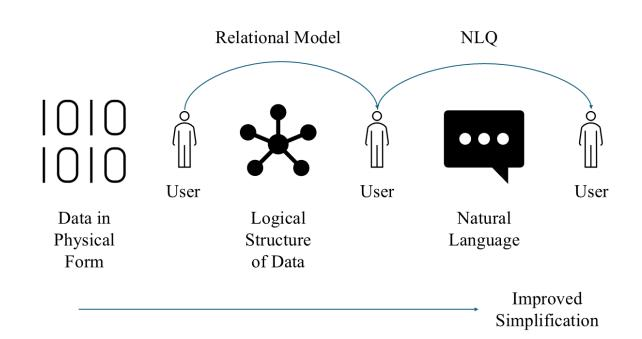
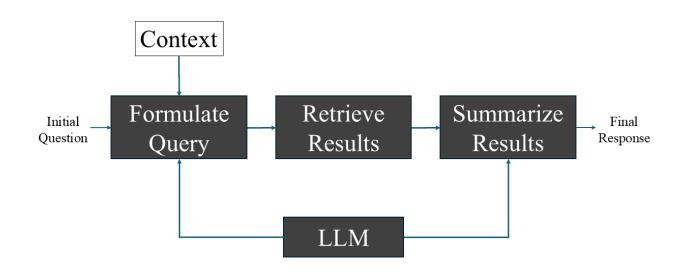
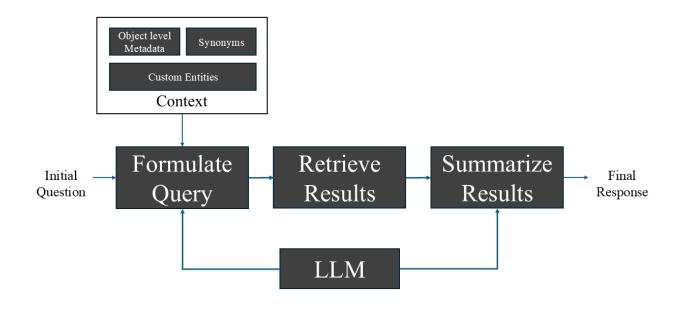
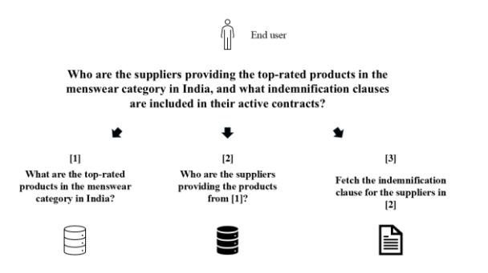
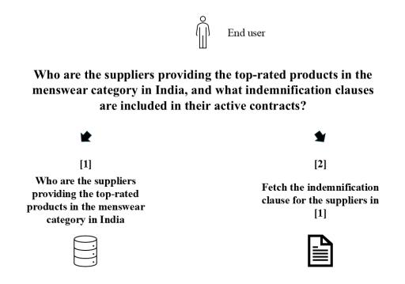
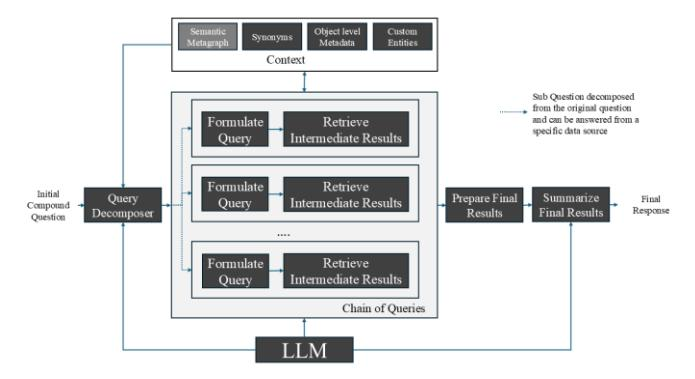
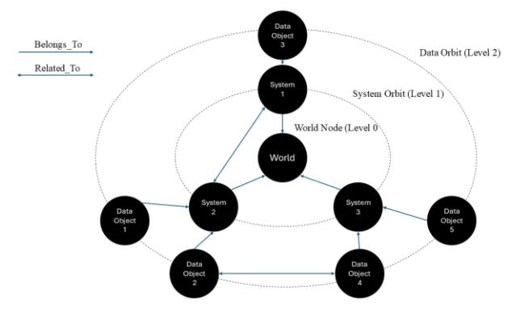
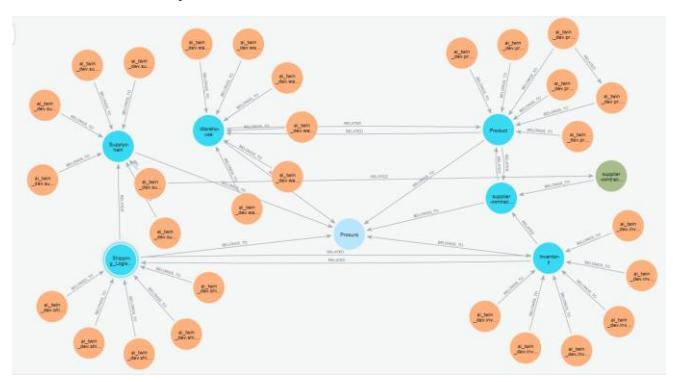
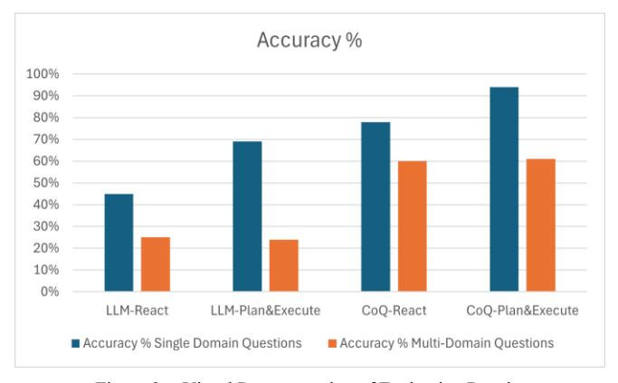

# **Chain of Queries (CoQ) - A Metagraph augmented Decomposition-Based Query Generation approach to conversing with all data using LLMs**

First A. Author, Second B. Author, Jr., and Third C. Author, *Member, IEEE*

*Abstract***— The traditional Business Intelligence (BI) stack historically centered on dashboards, KPIs, and pre-defined reports—is undergoing a fundamental transformation with the rise of Generative BI, driven by advances in large language models (LLMs) and generative AI. These technologies enable users to interact with data through natural language and receive insights in the form of visuals, summaries, or narratives. Despite this progress, two major challenges remain. First, current solutions are effective when working with narrowly scoped data sources, but natural language queries are rarely limited to a single source. Existing systems do not enable users to query all data, encompassing both structured data distributed across multiple platforms and multi-modal data such as text, images, and numerical tables. Second, processing compound natural language queries remains difficult. Although intent detection and query decomposition techniques have been explored to address this, they are still inadequate for handling complex questions across heterogeneous and multi-modal data environments. This paper introduces Chain of Queries (CoQ), a Metagraph-augmented, Decomposition-Based Query Generation framework that enables seamless conversational access to diverse data sources. CoQ incrementally decomposes complex user questions into a sequence of interrelated subqueries that collectively resolve the original information need. Experimental evaluations show that CoQ significantly improves both accuracy and robustness on compound queries spanning multiple data modalities and domains.**

## I. BACKGROUND

In 1970, E. F. Codd introduced the *relational model* of data—a groundbreaking framework that revolutionized how data is structured and queried. This model marked a paradigm shift in database systems, fundamentally transforming the way users interact with information. By representing databases as sets of mathematical relations, Codd made data querying more accessible—even for those without programming expertise.

A cornerstone of Codd's work was the principle of *data independence*: the idea that users and applications should remain unconcerned with the physical storage of data. This separation between logical structure and physical implementation was a major advancement in system design and laid the foundation for SQL, an English-like declarative language that enables users to express queries in a readable, intuitive format.

While SQL is often described as English-like, it still requires mastery of formal grammar and syntax, as well as awareness of the underlying schema. Codd's model abstracted away physical implementation—but not the logical schema. In other words, while Codd's work enabled data independence, true *schema independence* remains elusive. Over time, we witnessed the emergence of nuanced data structures beyond relational systems—such as search engines, NoSQL, and graph databases—each introducing its own declarative query language. We also saw the rise of multi-modal data in the form of text, images, and video. Recent advancements in AI, driven by LLMs and Generative AI, have expanded the scope of Business Intelligence (BI) far beyond structured data in data lakes.

Amid these innovations, one question persists: *Can we query in natural language—true English—rather than an English-like language?*

Attempts to answer this question and achieve schema independence have shaped the evolution of Natural Language Querying (NLQ). When designed effectively, NLQ systems can significantly reshape how BI solutions are built & consumed. This technology-driven simplification of data retrieval is illustrated in Figure 1.

Figure 1. Simplification of Data Retrieval

Today, we stand at the brink of another paradigm shift in how we interact with data. Breakthroughs in AI—particularly the rise of large language models—have dramatically enhanced NLQ capabilities. Multiple design strategies now aim to leverage LLMs to translate natural language into declarative queries for underlying data platforms. While these innovations have made remarkable progress, the challenge of conversing with any data source and connecting them seamlessly remains unresolved. In this paper, we introduce a novel technique—*Chain of Queries (CoQ)*—that advances the state of the art in NLQ. Before exploring CoQ in detail, we first review the key challenges in building effective NLQ solutions and examine the design approaches explored so far.

#### II. RELATED WORK

This section is organized into three parts. In the first part, we examine the foundational structure of an NLQ AI agent. We qualify an NLQ AI agent as one that is grounded on an LLM. In the second part, we shall outline the key challenges that make it a complex problem to solve. In the last part, we explore the various AI based design techniques that have been proposed to address these challenges.

#### *A. Core Structure of an NLQ Agent*

Figure 2 captures the structure of an NLQ AI agent. There are three steps to it. The first step is the generation of the query itself based on the user question and the context. The second step is the execution of the Query and performing the retrieval of the actual data. The third step involves summarizing the retrieved data for end user consumption. In real-world implementation, there will be additional steps to handle exceptions, retries etc., which we shall not get into in this paper.

Figure 2. Structure of an NLQ AI Agent

Of the three steps, the first step is the core of the NLQ AI agent.

# *B. Key challenges in implementing an NLQ AI Agent*

NLQ AI Agents face several nuanced challenges, which can be broadly categorized into six key areas:

- *Enterprise-Specific Data Models*: The foundational hurdle, when it comes to structured data, lies in the uniqueness of enterprise data models—particularly those underpinning data lakes that still powers BI applications. These models encompass both the logical structure (object relationships) and attribute data types, which are rarely standardized across organizations. Since LLMs are not pre-trained on these proprietary schemas, identical natural language queries may yield entirely different outputs depending on the enterprise.
- *Custom Entity References*: Enterprises often define domain-specific entities that diverge from general usage. For instance, in a manufacturing context, the term *plant* may carry a specialized meaning not reflected in common parlance. These custom entities are embedded within the data model and must be accurately recognized by the agent, despite LLMs being trained primarily on general knowledge.

- *Implied Entities in User Queries*: Beyond explicit references, users frequently imply entities in their questions. A regional retail manager might ask, "How is CYZ doing?"—implicitly referring to a supplier named CYZ. The agent must infer such contextual cues to correctly identify the relevant column and table for filtering, mimicking the natural conversational style of the user.
- *Intelligent Object Identification*: Generating accurate Query requires pinpointing the correct set of objects—tables, views, files, etc.—from the underlying data layer. This becomes especially complex in highly normalized schemas, where relationships and cross-references are maintained as separate objects and may not be directly evident from the query.
- *Multi-Modal Querying*: Enterprises often operate across multiple data platforms, with information distributed among diverse systems. A seemingly simple end user question in natural language can require retrieving and linking data from these disparate sources in real time. To achieve this, the querying agent must seamlessly orchestrate crossplatform data access and integration.
- *Semantic Gap Between Data Models and User Language*: Even well-modeled databases can suffer from semantic misalignment with user terminology. For example, the data layer might define an entity as Order, while users refer to it as a purchase. Bridging this semantic gap is essential for accurate query translation, requiring the agent to map user language to the underlying schema effectively.

#### *C. Design Techniques to address NLQ Challenges*

To tackle the challenges outlined earlier, several design strategies have been explored. Beyond generating syntactically correct queries, NLQ AI Agents enrich the runtime context with additional enterprise-specific information to help LLMs align with organizational semantics and maintain query relevance. These techniques include:

- *Capturing Object-Level Metadata*: This encompasses generating descriptions at the object level. Objects include table, view, and columns for structured data and files or any resource that is unstructured. For structured data, sample values and formatting guidelines are included along with. These metadata artifacts are curated in advance and stored within enterprise data catalog solutions. At runtime, they are retrieved and injected into the prompt context, enabling the agent to interpret and adapt to the enterprise's unique data models.
- *Synonym Mapping*: Attribute-level synonyms help bridge the semantic gap between user phrasing and the formal terminology used in the data catalog. These synonyms are also pre-generated—either algorithmically or with input from subject matter experts—and cataloged alongside object metadata. This mapping ensures that user questions using

colloquial or alternate terms can still be accurately resolved.

• *Indexing Custom Entity value lists*: This is a keyword-based index of values for enterprisespecific entities (e.g., supplier names) that users may reference implicitly. The NLQ AI agent consults this index to detect and resolve such entities—even when they are not explicitly mentioned in the query, as in the earlier example with "CYZ."

Figure 3 illustrates how these design elements come together within the NLQ AI Agent architecture to support operation in enterprise environments. The first two stages query formulation and data retrieval—are tailored to the underlying data platform. For example, when the platform is an RDBMS, the agent generates SQL during the first stage and executes it during the second. When the platform is a search-based system, the first stage produces a search query instead, with subsequent steps adapting accordingly.

Figure 3. Structure of an enterprise grade NLQ AI Agent

# III. CHAIN OF QUERIES (COQ) – CORE DESIGN

Despite incorporating all the design considerations outlined earlier, NLQ AI Agents can still face challenges particularly when generating accurate queries for compound questions. The difficulty stems from two common pitfalls:

- Monolithic translation, where the NLQ AI agent attempts to convert a complex question into a single comprehensive query in one step.
- Uninformed decomposition, where the agent breaks down the question arbitrarily without understanding the structure of the underlying data layer.

Figure 4. Informed Decomposition of a Compund Question (Schenario 1)

Figure 4 illustrates how a compound user question must be decomposed into coherent sub‑questions that reflect the structure of the underlying data landscape. In this example, product review information is separated from supplier master data and contract details. While product reviews and supplier data reside as structured entities across different databases, contract details exist in unstructured form, requiring a different retrieval pathway.

However, if supplier and product information are modeled as a connected data structure within a single database—as depicted in Figure 5—the same compound question must be decomposed and resolved in a fundamentally different manner. This variation highlights a key challenge: NLQ AI Agents struggle to adapt their decomposition strategies to differences in enterprise‑specific data topologies, as large language models are not trained on an organization's unique data landscape nuances (also demonstrated in the Experimental Details, Section IV).

Figure 5. Informed Decomposition of a Compund Question (Scenario 2)

To overcome the limitations and help the NLQ AI Agent achieve true schema independence, we introduce the Chain of Queries (CoQ) approach. In this approach we evolve the design of the NLQ AI agent in two parts.

- 1. The Query Formulation and the Retrieval steps are encapsulated inside a divide and conquer framework that is orchestrated by a Query Decomposer Step. This new step (Query Decomposer) helps the agent decompose the compound question into a set of simpler questions and invokes the relevant query formulator and retriever (SQL, search etc.) steps before preparing the final response.
- 2. To help the Query Decomposer step split the question the right way, we augment it with a Semantic Metagraph. The Semantic Metagraph has the entire meta structure of the enterprise data landscape.

Figure 6 presents the evolved architecture of the NLQ AI Agent—referred to throughout this work as the CoQ NLQ AI Agent. In the sections that follow, we examine the Semantic Metagraph in depth, outline the techniques required to programmatically construct and enrich it, and detail the end‑to‑end algorithm that powers the CoQ NLQ AI Agent.

Figure 6. Structure of an CoQ NLQ AI Agent

# *A. Semantic Metagraph*

The Semantic Metagraph is different from a conventional Knowledge Graph. While a Knowledge Graph holds knowledge, Semantic Metagraph captures the meta‑structure of the enterprise's knowledge landscape—spanning diverse data platforms and both structured and unstructured data objects. Its core purpose is to equip the Query Decomposer component within the CoQ NLQ AI Agent with a unified, intelligence‑driven map of enterprise knowledge. By doing so, it enables the agent to (a) identify the precise subset of relevant data objects from the broader data estate, (b) decompose compound user questions into coherent, context‑aligned sub‑questions, and (c) programmatically invoke the appropriate query formulators and retrievers required for each sub‑question.

A Semantic Metagraph is best implemented using a hybrid architecture that pairs a property‑graph database (such as Neo4j) with a vector database or semantic index (such as Pinecone or Azure AI Search). The graph layer supports relationship reasoning and traversal, while the vector layer enables semantic similarity search for natural‑language‑based object discovery.

To support these capabilities end‑to‑end, the enterprise data landscape is modeled as nodes and edges organized across multiple orbits (Levels 0, 1, and 2), as shown in Figure 7.

- *Level 2* represents the outermost orbit (*data* orbit) of the Semantic Metagraph and contains all data‑bearing objects across the enterprise landscape. Each Level 2 node includes the following properties:
  - o *ObjectType*: Indicates whether the data object is *structured* or *unstructured*.
  - o *ObjectName*: For *structured* objects, this corresponds to the table or view name. For *unstructured* objects, this stores the name of the semantic index that contains the embeddings for the underlying content.
  - o *ObjectURL*: The retrievable URL of the underlying entity (table, index, etc.), enabling the CoQ NLQ AI Agent's Retriever component to programmatically access the data source.

- o *ObjectDescription*: A semantic description of the object, used by the Query Decomposer component to identify which subset of Level 2 objects is relevant to a given user query.
- *Level 1* forms the intermediate *system* orbit, with each node representing a concrete physical system responsible for hosting one or more Level 2 data objects. Relationships always flow from Level 2 to Level 1, never the reverse. For structured data objects, the Level 1 system node specifies the database source coordinates; for unstructured objects, it identifies the service that hosts the index referenced in Level 2. Each Level 1 node includes:
  - o *SystemName*: The name of the system. For example, in the compound‑question scenario earlier discussed, these correspond to the three physical systems (Products, Suppliers, Supplier Contracts) providing the base datasets.
  - o *SystemPlatform*: The underlying platform (e.g., Oracle, Databricks), enabling the Query Decomposer component to select the correct driver and retrieval mechanism.
  - o *SystemDescription*: A semantic description of the system enables the Query Decomposer component to reinterpret the user's original question into well‑structured, system‑aligned sub‑queries and to construct an appropriate execution plan. This semantic description may also reside in an external vector index, accompanied by a pointer that links back to the corresponding node in the Semantic Metagraph.
- *Level 0* contains a single *World* node, which anchors the Semantic Metagraph and unifies all Level 1 and Level 2 nodes. This central node maps 1:1 to an enterprise business domain—such as Marketing, Procurement, or Supply Chain—and interacts directly with the agent runtime. The World node's role is to contextualize all downstream nodes within a coherent functional boundary.

There are two permissible relationship types within the Semantic Metagraph:

- *Belongs\_To*: A directional relationship linking a *Level n* node to its parent *Level (n‑1)* node.
- *Related*: A bidirectional relationship connecting two nodes at the same level; for example, two Level 2 data nodes or two Level 1 system nodes. Cross‑level relationships are not permitted.

Figure 7 captures the construct of the Semantic Metagraph as articulated above.

## *B. Populating the Semantic Metagraph*

Once the relevant data objects have been identified for a world, the Semantic Metagraph can be programmatically assembled and enriched through an automated harvesting process. This process leverages purpose‑built connectors together with adaptive sampling and profiling techniques to generate semantic descriptions for each object and infer the relationships among them. To further improve accuracy and ensure contextual relevance, an optional Human‑in‑the‑Loop review step may be introduced, allowing subject‑matter experts to validate and refine the system‑generated metagraph.

Figure 7. Structure of the Semantic Metagraph

## *C. Core Algorithm*

Large Language Models (LLMs) are highly effective at breaking down complex, multi‑part questions into simpler, more manageable questions. When paired with the Semantic Metagraph, the Query Decomposer component can translate a compound user question into a set of sub‑questions that are perfectly aligned with the underlying data landscape ensuring that each sub‑question maps to the appropriate data source. This decomposition step powers the Chain of Queries (CoQ) workflow, ultimately producing a precise and complete final response.

The Semantic Metagraph plays a critical role here: it keeps the LLM anchored in the correct enterprise context, ensuring that the decomposition yields meaningful, relevant sub‑queries that can actually be resolved through the data layer. Summary of the CoQ approach:

- 1. Identify the relevant sub‑graph within the Semantic Metagraph by locating Level‑2 data objects that semantically match the user's question.
- 2. Decompose the compound question into coherent, context‑aware sub‑questions, grouped by system, using the sub‑graph identified in Step 1.
- 3. Generate an execution plan that outlines how each sub‑question will be resolved.
- 4. Recursively execute the plan:
  - i. Formulate the appropriate query for the underlying system.
  - ii. Execute the query to retrieve the required data.

5. Assemble and synthesize the outputs from all sub‑queries to deliver the final response.

#### IV. EXPERIMENT DETAILS

In this section, we present the experimental setup used to evaluate the effectiveness of the CoQ approach. As part of the study, we designed and deployed two primary variants of NLQ AI Agents:

- 1. LLM Based NLQ AI Agent: In this variant, the Semantic Metagraph component illustrated in section III (Figure 5) is replaced by a suite of query generator tools. Each tool is purpose-built to target a specific data source, translating the contextual sub-question into an appropriate query for that source. Query decomposition relies entirely on the LLM's reasoning capabilities alone, and the descriptions provided for these tools.
- 2. Metagraph Augmented NLQ AI Agent: This variant represents a direct implementation of the CoQ NLQ AI Agent described in Section III (Figure 5). Here, query decomposition is driven by the LLM's reasoning capabilities in conjunction with the Semantic Metagraph—a pre-populated structure that encapsulates objectlevel metadata (in both textual and semantic forms), data source details, retrieval coordinates, and interrelationships across data sources.

We designed two sub-variants for each of the approaches described above.

- First sub-variant (React Mode): The query decomposition occurs dynamically. The original question is broken down into sub-questions, which are resolved recursively until the initial query is fully answered.
- Second sub-variant (Plan-and-Execute Mode): The query decomposition step generates a complete execution plan upfront. This plan is then carried out exactly as defined.

In summary, we have four variants as part of the experiment.

- 1. LLM Based NLQ AI Agent (LLM-React)
- 2. LLM Based NLQ AI Agent (LLM-Plan & Execute)
- 3. Metagraph Augmented NLQ AI Agent (CoQ-React)
- 4. Metagraph Augmented NLQ AI Agent (CoQ-Plan & Execute)

The four variants were evaluated based on the quality of responses generated for a curated set of user questions, with ground truth established by subject matter experts (SMEs).

## *A. Test Data*

To conduct experiments on the four variants, we curated a set of compound questions using data spread from six distinct domains: *Supply Chain, Shipping & Logistics, Inventory, Warehouse, Product Master, and Supplier Contracts*. Each of these domains map to a distinct System node in the Semantic Metagraph and is anchored by the World Node – Procurement.

- Five of these domains— Supply Chain, Shipping & Logistics, Inventory, Warehouse, Product Master contained structured data stored in relational databases. Each domain included approximately 4-6 data objects in the form of tables and vies.
- The sixth domain: Supplier Contract information was available as PDF documents.

Figure 8 presents a high‑level view of the Procurement Semantic Metagraph that was generated programmatically through the harvesting process. The light‑blue node represents the World node that anchors the domain. The six blue nodes correspond to the Level 1 system nodes, each associated with a distinct procurement‑related domain. The green node denotes the Level 2 unstructured‑content object (Supplier Contract). All orange nodes represent the structured Level 2 data objects—tables and views—that collectively form the data layer.

Figure 8. Semantic Metagraph for Procument World

A carefully curated set of 100 compound questions (referred to as Golden Set) was prepared by subject matter experts (SMEs). Each question spanned anywhere between one and up to four of the above-mentioned data sources. For every question, the corresponding ground truth response was established upfront to ensure accurate evaluation.

We conducted an evaluation of the Spider 2.0 dataset (Enterprise Extension) to determine its relevance for our experimental objectives. Upon thorough analysis, we elected to develop and curate a bespoke, complex, multi-domain dataset (as previously described). This decision was driven by the observation that the Spider dataset primarily emphasizes fine-grained aspects of text-to-SQL conversion, with most of its questions confined to a single domain. In contrast, our research aims to assess the agent's capability to decompose compound questions into logically coherent subquestions that can be translated into appropriate SQL statements. Achieving this objective necessitates the inclusion of compound questions that span heterogeneous data formats and intersecting domains, a requirement inadequately addressed by the Spider dataset.

#### *B. Evaluation Results*

The accuracy of an NLQ AI agent is measured as the percentage of golden SQL queries for which the agent generates a response that matches the ground truth. Table 1 summarizes the evaluation results from experiments conducted across four agent variants, using the set of questions defined in the golden set.

The golden set of questions was further categorized into two types: *single-domain* questions and *multi-domain* questions.

- Single-domain questions are focused queries targeting a single domain, requiring no decomposition.
- Multi-domain questions are compound queries spanning multiple domains, which must be decomposed to produce a correct response.

| Variant          | Accuracy %                 |                           |
|------------------|----------------------------|---------------------------|
|                  | Single Domain Questions | Multi-Domain Questions |
| LLM-React        | 45%                        | 25%                       |
| LLM-Plan&Execute | 69%                        | 24%                       |
| CoQ-React        | 78%                        | 60%                       |
| CoQ-Plan&Execute | 94%                        | 61%                       |

TABLE I. EVALUATION RESULTS

Figure 9 captures the visual representation of the above results:

Figure 9. Visual Representation of Evaluation Results

#### *C. Takeaway*

As illustrated by the table and accompanying visual, both CoQ variants demonstrated substantially higher performance compared to their LLM-based counterparts. While the absolute accuracy percentages for the CoQ variants remain slightly lower than for multi-domain questions, they are nevertheless far superior relative to the LLM-based approaches. These results underscore the effectiveness of the metagraph-augmented, decomposition-based query generation technique, which continues to be the most promising strategy for addressing compound questions involving multi-modal data distributed across disparate sources.

## *D. Technology Stack*

The experimental implementation was developed using robust technology stack on the cloud (Microsoft Azure).

- Data Layer: Five of the Six domains mentioned in the test data section were in structured form. These were split amongst two distinct platforms (Azure Databricks and Oracle). The specific details of the same are provided below:
  - o Azure Databricks 15.4 LTS served as the core data platform, leveraging Apache Spark 3.5.0 and Scala 2.12 for distributed data processing.
  - o Oracle 23ai (Free release). Version 23.4.0.24.05 served as the other database.
- Azure AI Search API (version 2023-11-01) functioned as the vector database for storing and retrieving semantic embeddings for the unstructured data (sixth domain – Supplier Contract).
- Neo4j 5.26.2 was deployed to capture structural relationships across objects and domains in a Metagraph. This graph database stored relationships and supported efficient graph traversal to uncover hidden join paths between semantically related objects and domains.
- AI Models: The following AI models were used:
  - o Large Language Model: OpenAI GPT-5.1 (API version 2025-01-01) was used for Query decomposition, SQL generation across all three approaches, ensuring consistent performance for fair comparison.
  - o Embedding Model: OpenAI Text Embedding Ada (text-embedding-ada-002, API version 2023-05-15) generated vector representations of unstructured data, and natural language queries for semantic similarity computations.

#### V. POSSIBLE ENHANCEMENTS

One of the critical aspects of implementing the CoQ design is determining the appropriate workspace size for the Query Decomposer component. This workspace acts as a scratchpad at runtime, managing independent query results and orchestrating the final response. In our experiments, we used the LLM's context window as the workspace. This approach works well when the decomposed queries return results of manageable size—a common scenario in most BI use cases where results are constrained by sorting or aggregation clauses. However, when dealing with large datasets, the workspace must be implemented natively outside the LLM context to ensure scalability and efficiency.

#### VI. CONCLUSION

Recent advances in AI—particularly Large Language Models (LLMs) and Generative AI—are transforming the enterprise data landscape and redefining Business Intelligence. We stand at the cusp of a paradigm shift where querying in natural language, such as English, is becoming a tangible reality. To achieve this, complete schema independence is essential. While declarative languages like SQL (for relational data) and Cypher (for graph databases) have delivered data independence, schema independence has remained elusive—truly the holy grail for human-like NLQ agents. Just as Chain of Thought (CoT) prompts reasoning [5] in LLMs, the Chain of Queries (CoQ) approach elicits focus and precision. Our experiments demonstrate that the CoQ design significantly improves accuracy in handling compound, multimodal questions, marking a clear step forward in achieving natural language querying at scale.

#### ACKNOWLEDGMENT

The authors acknowledge the use of AI-based tools (ChatGPT and Microsoft Copilot) for language refinement and grammatical corrections during the preparation of this manuscript. No content generation or substantive changes to the research findings were performed by these tools.

#### REFERENCES

- [1] E. F. Codd, "A relational model of data for large shared data banks," Communications of the ACM, vol. 13, no. 6, pp. 377–387, Jun. 1970
- [2] Ramaswami Mohandoss; Aruna Patkuri; Chaitanya Budkule; Lijo Joy; Sruti Praturi. 2025. Metagraph Augmented Generation (MAG) for optimized Text-to-SQL conversion using LLMs.
- [3] Song Cheng, Qiannan Cheng, Linbo Jin, Lei Yi, and Guannan Zhang. 2025. SQLord: A Robust Enterprise Text-to-SQL Solution via Reverse Data Generation and Workflow Decomposition. In Companion Proceedings of the ACM on Web Conference 2025 (WWW '25). Association for Computing Machinery, New York, NY, USA, 919–923[. https://doi.org/10.1145/3701716.3715541](https://doi.org/10.1145/3701716.3715541)
- [4] Haoyang Li; Jing Zhang; Cuiping Li; Hong Chen. 2023. RESDSQL: Decoupling Schema Linking and Skeleton Parsing for Text-to-SQL. arXiv:2302.05965v3
- [5] Jason Wei, Xuezhi Wang, Dale Schuurmans, Maarten Bosma, Brian Ichter, Fei Xia, Ed H. Chi, Quoc V. Le, and Denny Zhou. 2022. Chain-of-thought prompting elicits reasoning in large language models. In Proceedings of the 36th International Conference on Neural Information Processing Systems (NIPS '22). Curran Associates Inc., Red Hook, NY, USA, Article 1800, 24824–24837.
- [6] Bailin Wang; Richard Shin; Xiaodong Liu; Oleksandr Polozov; Matthew Richardson. 2019. RAT-SQL: Relation-Aware Schema Encoding and Linking for Text-to-SQL Parsers. arXiv:1911.04942v5
- [7] Eyal, B., Bachar, A., Haroche, O., Mahabi, M., and Elhadad, M., "Semantic Decomposition of Question and SQL for Text-to-SQL Parsing". arXiv:2310.13575, 2023.
- [8] Ali Mohammadjafari1; Anthony S. Maida2; Raju Gottumukkala2. 2024. From Natural Language to SQL: Review of LLM-based TexttoSQL Systems. arXiv:2410.01066v2.
- [9] Asim Biswal; Liana Patel; Siddarth Jha; Amog Kamsetty; Shu Liu; Joseph E. Gonzalez; Carlos Guestrin; Matei Zaharia. 2024. Text2SQL is Not Enough: Unifying AI and Databases with TAG. arXiv:2408.14717v1
- [10] Geling Liu; Yunzhi Tan, Ruichao Zhong; Yuanzhen Xie; Lingchen Zhao; Qian Wang; Bo Hu; Zang Li. 2024. Solid-SQL: Enhanced Schema-linking based In-context Learning for Robust Text-to-SQL. arXiv:2412.12522v1

[11] Zhenbiao Cao; Yuanlei Zheng; Zhihao Fan; Xiaojin Zhang; Wei Chen; Xiang Bai. 2024. RSL-SQL: Robust Schema Linking in Textto-SQL Generation. arXiv:2411.00073v2.