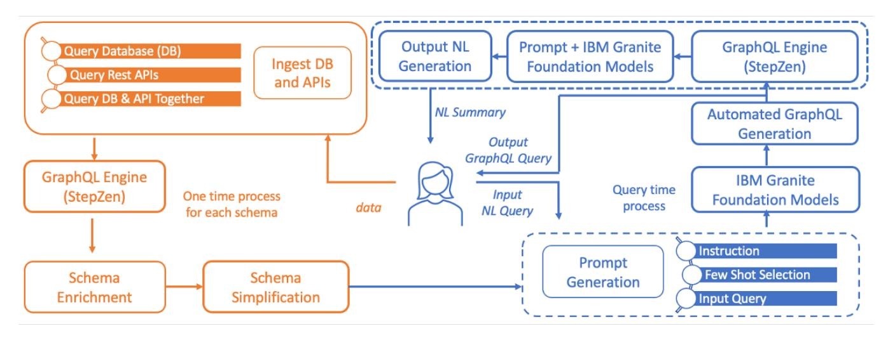
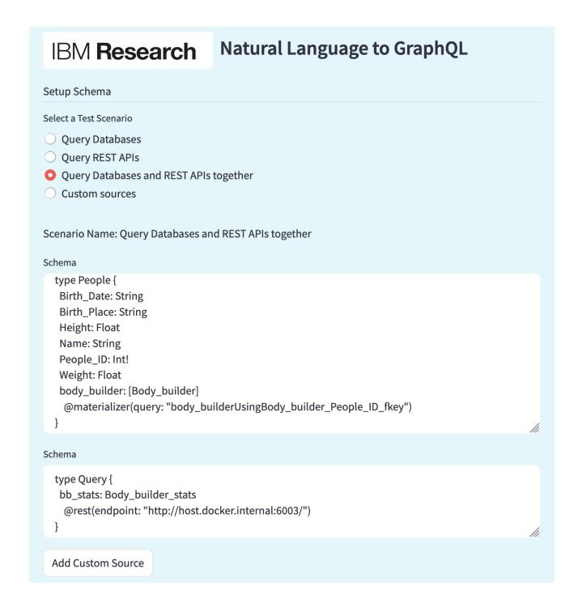
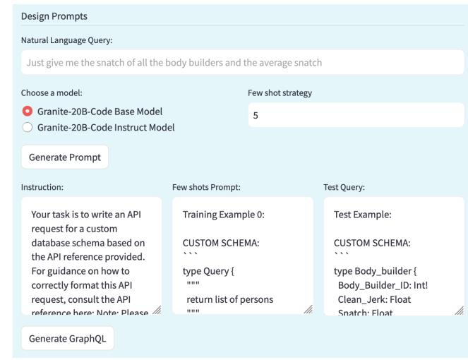
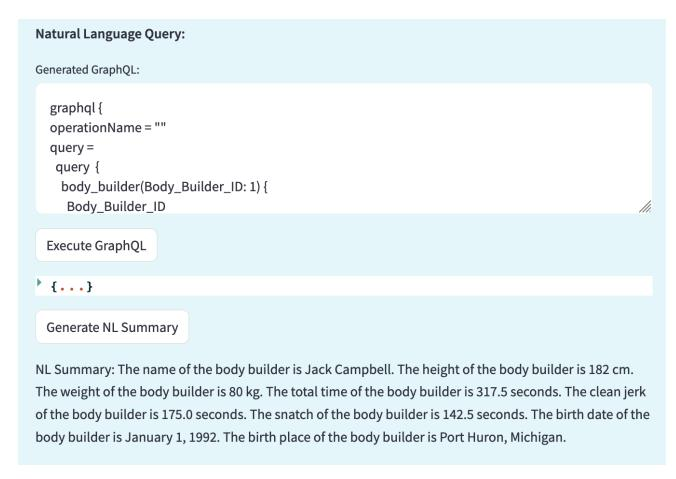

# LLM-powered GraphQL Generator for Data Retrieval

# Balaji Ganesan , Sambit Ghosh , Nitin Gupta , Manish Kesarwani Sameep Mehta , Renuka Sindhgatta

IBM Research

{bganesa1, ngupta47, manishkesarwani, sameepmehta}@in.ibm.com, {sambit.ghosh, renuka.sindhgatta.rajan}@ibm.com

#### Abstract

GraphQL offers an effcient, powerful, and fexible alternative to REST APIs. However, application developers writing GraphQL clients need both technical and domain-specifc expertise to reap its benefts, and avoid over-fetching or under-fetching data. Automated GraphQL generation has so far proven to be a hard problem because of complex GraphQL schema and lack of benchmark datasets. To address these issues, our work focuses on building an LLM-powered pipeline that can accept user requirements in natural language along with the complex GraphQL schema and automatically produce the GraphQL query needed to retrieve the necessary data. Automated GraphQL generation helps reduce entry barriers to application developers, broadening GraphQL adoption.

### 1 Introduction

GraphQL is a query language for web application programming interfaces (APIs) and a runtime engine for serving data. A GraphQL Server like [\[IBM, 2024\]](#page-3-0) hosts schema defning the data entities and relationships that the clients can query. Different aspects of GraphQL query language have been discussed in [\[Meta, 2012;](#page-3-1) [Hartig and Perez, 2018;](#page-3-2) [Wittern](#page-3-3) ´ *et al.*[, 2018;](#page-3-3) [Taelman](#page-3-4) *et al.*, 2019; [Hartig and Hidders, 2019;](#page-3-5) Cha *et al.*[, 2020;](#page-3-6) [Buna, 2021;](#page-3-7) [Quina-Mera](#page-3-8) ˜ *et al.*, 2023]. GraphQL Schema generation and server are discussed in [\[Cheng and Hartig, 2022;](#page-3-9) Li *et al.*[, 2023\]](#page-3-10).

SPARQL [\[Hogan and Hogan, 2020\]](#page-3-11), Gremlin [\[TinkerPop,](#page-3-12) [2020\]](#page-3-12), Cypher [Feng *et al.*[, 2023\]](#page-3-13) and PathQuery [\[Weaver](#page-3-14) *et al.*[, 2021\]](#page-3-14) have also been considered as alternatives for API data access. However, GraphQL, frst introduced by Facebook (now Meta) in 2012, has emerged popular among application developers. Some of the motivations for the adoption of GraphQL for data retrieval also happen to be major challenges in query generation using Large Language Models. GraphQL provides a SQL like access to data where applications can fexibly and yet precisely defne which data they require. GraphQL engines abstract away complex schema and allow users to focus on data they care about. Hence to automatically generate GraphQL from natural language, we need to address the following challenges.

GraphQL applications can access any part of the data, without having to stand up separate endpoints. Unlike REST APIs quickly become very complex and hard to manage, the ability of GraphQL to serve any data as long as it's defned in a schema is a major advantage. But working with large schema is hard for LLMs [\[Kothyari](#page-3-15) *et al.*, 2023]. Despite the signifcant increase in LLM context lengths, we may not want to dump very large schema in the prompt to generate GraphQL queries. We need to identify parts of the schema and the data sources which need to be queried.

GraphQL avoids the problems of over-fetching and underfetching of data in application development seen in REST API and other frameworks. Since applications might be built around pre-existing REST APIs which are harder to change without losing backward compatibility, applications might over-fetch or under-fetch data. This leads to less optimal bandwidth utilisation and latency. With GraphQL queries, applications can precisely specify the types and felds (analogous to tables and columns in SQL). But LLMs used for query generation often hallucinate on the column and tables names [Tai *et al.*[, 2023\]](#page-3-16). Fine tuning solutions are not suitable for generalized data access in large applications.

The biggest challenge for automated GraphQL query generation comes from schema complexity. GraphQL schema are deliberately complex because they can represent every real world or business object to be queried. A corollary to this is the complexity in handling massive REST APIs, for which retrieval and reasoning based solutions have been proposed [Patil *et al.*[, 2023\]](#page-3-17). Multi-hop querying across data sources and queries that require results from sub-queries or user feedback also present challenges. Reasoning based solutions like [\[Pourreza and Rafei, 2023\]](#page-3-18) are yet to be tried for GraphQL query generation.

In this work, we demonstrate our solution to automatically generate GraphQL queries using LLMs. We present an in-context learning solution using IBM's Granite Foundation Models [\[Mishra](#page-3-19) *et al.*, 2024], that elegantly addresses these problems and paves the wave for solving more complex problems in this task. By using a synthetically generated dataset comprising of natural language utterances, REST APIs and database end points, and the Stepzen GraphQL engine [\[IBM,](#page-3-0) [2024\]](#page-3-0), we demonstrate our solution to automatically generate GraphQL queries using LLMs.

Figure 1: End to end system for GraphQL Generation with optional NL Summarization

#### 2 Our Approach

Answering natural language questions or generating queries over GraphQL schema is signifcantly harder because of the complexity of the GraphQL schema. This problem of working with complex schema requires the models to reason or use human cues to learn the task. Querying multiple sources (databases and APIs), querying multiple tables, querying a portion of very large schema, multi-turn queries that build on the results of previous turns are some of the related problems.

Our *system architecture* as shown in Figure [1](#page-1-0) facilitates application developers to connect to different data sources like relational databases, REST APIs, and URLs of online data sources. It also supports collections of these different custom sources. *Ingest DB and APIs* module enables users to onboard and query their custom data source without migrating data from the user location to an external server, allowing the GraphQL server to query the user database and return the requested data. We fetch GraphQL Schema from StepZen for display, while the Schema Enrichment module enriches the GraphQL schema by annotating the felds with natural language descriptions. While the API doc format prompts used in [Tai *et al.*[, 2023\]](#page-3-16) only re-format the schema, we add comment like descriptions to the StepZen generated schema.

*Schema Simplifcation* module processes the default GraphQL schema generated by the GraphQL server, which includes schema elements and their resolver function, and uses string parsing techniques to remove unnecessary information. This simplifcation is essential for preparing the LLM Prompt, which is based on the user's Natural Language query and the input GraphQL schema *Prompt Generation* module structures the prompt into three parts: instruction, which outlines the objective and the format for the LLM to generate the GraphQL query; few shots, containing examples for incontext learning; and the input component, consisting of the simplifed GraphQL schema and the user's query. Demonstrating this schema simplifcation approach along with different prompting methods for few shot learning using IBM Granite models are our core contributions in this work.

| Prompt                             | Accuracy (%) |
|------------------------------------|--------------|
| Fixed one shot                     | 62.79        |
| Relevant one shot                  | 72.09        |
| Relevant 2 shots + Random 3 shots  | 81.00        |
| Relevant 5 shots                   | 81.40        |
| Relevant 20 shots                  | 84.00        |
| Relevant 5 shots + schema comments | 88.00        |

Table 1: Evaluation of few shot learning methods on IBM Granite-20B-Code Base Model. Relevant 5 shots prompts with schema comments outperform other variations.

We evaluate our approach on a synthetic dataset consisting of natural language and GraphQL queries along with GraphQL schema from StepZen. There are only few GraphQL datasets available publicly like [\[Weaviate, 2024\]](#page-3-20) and [\[Carrera, 2024\]](#page-3-21), but we did not evaluate on those since their schema format is specifc to the engine. Some text-tosql datasets like WikiSQL are easier to convert to GraphQL but they do not contain multi-schema queries.

Table [1](#page-1-1) shows the impact on the performance of GraphQL generation using the prompts generated by our system. Each row uses a distinct in-context learning strategy – *Fixed one shot* refers to the case where a fxed training sample is used, *Relevant N Shot*, where N ∈ {1, 5, 20}, refers to the scenario where contextually relevant N samples were selected, *Random 3 Shot* is where three random samples were chosen, and *Schema Comments* is the scenario where the GraphQL schema was enriched with description.Query generation models typically require one or few shot examples. Following [\[Kovriguina](#page-3-22) *et al.*, 2023] on a related problem, we attempted one shot prompts, but few shot prompts outperform them. We then evaluated on multiple combinations of few shot prompts as shown in Table [1.](#page-1-1) We observe that adding comments to server generated schema improves accuracy.

Figure 2: Setting up data access from multiple sources

#### 3 Demo

Our application demonstrates the advances we have made managing different data sources using the Stepzen framework, as well as enhancing Foundation Models to generated GraphQL queries. As shown in Figures [2,](#page-2-0) [3](#page-2-1) and [4,](#page-2-2) we demonstrate an end to end application to retrieve data from databases and REST APIs and combinations of multiple such sources.

One of the goals of this work is to enable data access from several data sources which can be databases or REST APIs. As can be seen in Figure [2,](#page-2-0) we present few example sources, but users can provide any remote url or database as a custom source. When we upload these sources, the schema is deployed on StepZen to create respective data access endpoints. When multiple sources are selected together, we merge their schema on the fy to produce a combined schema and deploy at a new endpoint that can be queried together. Once the schema has been deployed on the server, we can query that using GraphQL queries.

To enable natural language querying of these sources, we frst need to convert them to GraphQL. As we discussed in Section [2,](#page-1-2) our approach to automatically generating GraphQL from the natural language query and the schema is to use in context learning. Our prompts consist of instruction, few shot examples and text query. This prompt is then given to IBM's Granite Foundation Models, which produce the GraphQL queries. Figure [3](#page-2-1) shows the prompt given to LLM, with the natural language query, the combined schema from two sources, and fve few shot examples.

In Section [2,](#page-1-2) we described our experiments on generating GraphQL queries. Figure [4](#page-2-2) shows the generated GraphQL query for the user given natural language question. This query can now be executed on GraphQL engines like IBM

Figure 3: Design of few shot prompts for generating GraphQL

Figure 4: Data and summary retrieved for the natural language query

StepZen, Apollo [\[Apollo Graph Inc, 2024\]](#page-3-23) and Hasura [\[Ha](#page-3-24)[sura, 2024\]](#page-3-24). The output from the GraphQL engine is a json consisting of the data required to answer our natural language query. We give the natural language query along with the generated data to IBM Granite Foundation Models to produce a natural language summary of the data retrieved. In the above fgures, we have demonstrated our end to end system to go from multiple data sources, prompt generation and data access in formats users are comfortable with.

#### Conclusion

In this work, we demonstrated an advanced framework that utilizes Large Language Models (LLMs) to enable natural language querying of integrated data sources, showcasing a signifcant advancement in data accessibility and management. By leveraging IBM's Granite Foundation Models and StepZen, it simplifes complex data interactions, offering a streamlined approach to querying and summarizing data. We have demonstrated a practical application showcasing the potential of AI in enhancing user engagement with data systems.

# Ethical Statement

Given this work demonstrates our capabilities in accessing data from databases and REST API using GraphQL and Large Language Models (LLMs), we have taken care to use only synthetic data in this demonstration. Our models are trained on carefully curated data removing harmful, profane, personal and sensitive data. Our system is intended to be used in data systems with rigorous access management. To the best of our knowledge, our work does not pose any potential harm to the community at large.

### Acknowledgements

We thank Carlos Eberhardt, Dan Debrunner and Anant Jhingran for their inputs on StepZen and valuable feedback. We thank the anonymous reviewers for their feedback. We thank the editors for help ing to improve our presentation.

#### References

- [Apollo Graph Inc, 2024] Apollo Graph Inc. Apollo GraphQL. [https://www.apollographql.com/,](https://www.apollographql.com/) 2024. Accessed: 2024-02-19.
- [Buna, 2021] Samer Buna. *GraphQL in Action*. Simon and Schuster, 2021.
- [Carrera, 2024] Andre Carrera. SQL to GraphQL [dataset]. [https://github.com/andr-ec/sql-to-graphql,](https://github.com/andr-ec/sql-to-graphql) 2024. Accessed: 2024-02-19.
- [Cha *et al.*, 2020] Alan Cha, Erik Wittern, Guillaume Baudart, James C. Davis, Louis Mandel, and Jim A. Laredo. A principled approach to graphql query cost analysis. In *Proceedings of the 28th ACM Joint Meeting on European Software Engineering Conference and Symposium on the Foundations of Software Engineering*, 2020.
- [Cheng and Hartig, 2022] Sijin Cheng and Olaf Hartig. Lingbm: a performance benchmark for approaches to build graphql servers. In *International Conference on Web Information Systems Engineering*, 2022.
- [Feng *et al.*, 2023] Guandong Feng, Guoliang Zhu, Shengze Shi, Yue Sun, Zhongyi Fan, Sulin Gao, and Jun Hu. Robust nl-to-cypher translation for kbqa: Harnessing large language model with chain of prompts. In *China Conference on Knowledge Graph and Semantic Computing*, 2023.
- [Hartig and Hidders, 2019] Olaf Hartig and Jan Hidders. Defning schemas for property graphs by using the graphql schema defnition language. In *Proceedings of the 2nd Joint International Workshop on Graph Data Management Experiences & Systems (GRADES) and Network Data Analytics (NDA)*, 2019.
- [Hartig and Perez, 2018 ´ ] Olaf Hartig and Jorge Perez. Se- ´ mantics and complexity of graphql. In *Proceedings of the 2018 World Wide Web Conference*, 2018.
- [Hasura, 2024] Hasura. Hasura graphql engine. [https://](https://hasura.io/) [hasura.io/,](https://hasura.io/) 2024. Accessed: 2024-02-19.
- [Hogan and Hogan, 2020] Aidan Hogan and Aidan Hogan. Sparql query language. *The Web of Data*, 2020.

- [IBM, 2024] IBM. StepZen. [https://stepzen.com/,](https://stepzen.com/) 2024. Accessed: 2024-05-19.
- [Kothyari *et al.*, 2023] Mayank Kothyari, Dhruva Dhingra, Sunita Sarawagi, and Soumen Chakrabarti. Crush4sql: Collective retrieval using schema hallucination for text2sql. *arXiv preprint arXiv:2311.01173*, 2023.
- [Kovriguina *et al.*, 2023] Liubov Kovriguina, Roman Teucher, Daniil Radyush, and Dmitry Mouromtsev. Sparqlgen: One-shot prompt-based approach for sparql query generation. *SEMANTiCS Posters and Demos 2023 CEUR Workshop Proceedings*, 2023.
- [Li *et al.*, 2023] Huanyu Li, Olaf Hartig, Rickard Armiento, and Patrick Lambrix. Obg-gen: Ontology-based graphql server generation for data integration. In *Proceedings of the ISWC*, 2023.
- [Meta, 2012] Meta. Graphql: A data query language. [https://engineering.fb.com/2015/09/14/core-infra/](https://engineering.fb.com/2015/09/14/core-infra/graphql-a-data-query-language) [graphql-a-data-query-language,](https://engineering.fb.com/2015/09/14/core-infra/graphql-a-data-query-language) 2012. Accessed: 2024- 06-08.
- [Mishra *et al.*, 2024] Mayank Mishra, Matt Stallone, Gaoyuan Zhang, Yikang Shen, Aditya Prasad, et al. Granite code models: A family of open foundation models for code intelligence, 2024.
- [Patil *et al.*, 2023] Shishir G Patil, Tianjun Zhang, Xin Wang, and Joseph E Gonzalez. Gorilla: Large language model connected with massive apis. *arXiv preprint arXiv:2305.15334*, 2023.
- [Pourreza and Rafei, 2023] Mohammadreza Pourreza and Davood Rafei. Din-sql: Decomposed in-context learning of text-to-sql with self-correction. *arXiv preprint arXiv:2304.11015*, 2023.
- [Quina-Mera ˜ *et al.*, 2023] Antonio Quina-Mera, Pablo Fer- ˜ nandez, Jose Mar ´ ´ıa Garc´ıa, and Antonio Ruiz-Cortes. ´ Graphql: A systematic mapping study. *ACM Computing Surveys*, 2023.
- [Taelman *et al.*, 2019] Ruben Taelman, Miel Vander Sande, and Ruben Verborgh. Bridges between graphql and rdf. In *W3C Workshop on Web Standardization for Graph Data*, 2019.
- [Tai *et al.*, 2023] Chang-You Tai, Ziru Chen, Tianshu Zhang, Xiang Deng, and Huan Sun. Exploring chain-ofthought style prompting for text-to-sql. *arXiv preprint arXiv:2305.14215*, 2023.
- [TinkerPop, 2020] Apache TinkerPop. The gremlin graph traversal machine and language. https://tinkerpop.apache.org/gremlin.html, 2020.
- [Weaver *et al.*, 2021] Jesse Weaver, Eric Paniagua, Tushar Agarwal, Nicholas Guy, and Alexandre Mattos. Introducing pathquery, google's graph query language, 2021.
- [Weaviate, 2024] Weaviate. Weaviate GraphQL Gorilla [dataset]. [https://huggingface.co/datasets/weaviate/](https://huggingface.co/datasets/weaviate/WeaviateGraphQLGorilla) [WeaviateGraphQLGorilla,](https://huggingface.co/datasets/weaviate/WeaviateGraphQLGorilla) 2024. Accessed: 2024-02-19.
- [Wittern *et al.*, 2018] Erik Wittern, Alan Cha, and Jim A Laredo. Generating graphql-wrappers for rest (-like) apis. In *International Conference on Web Engineering*, 2018.