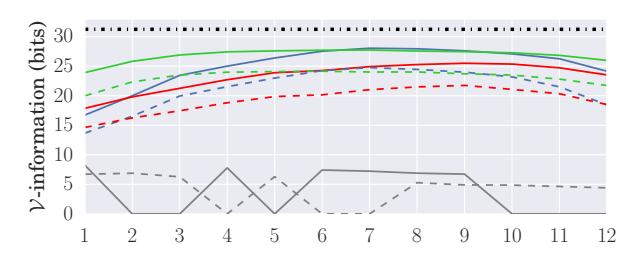
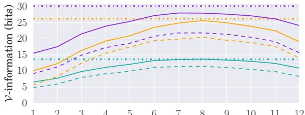
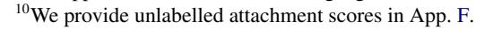
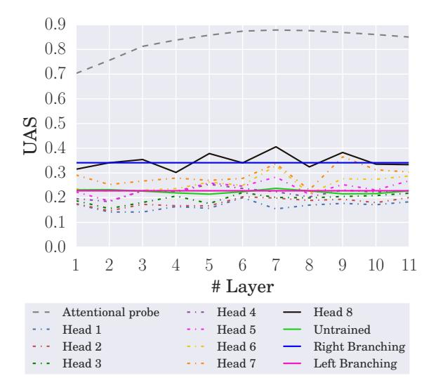
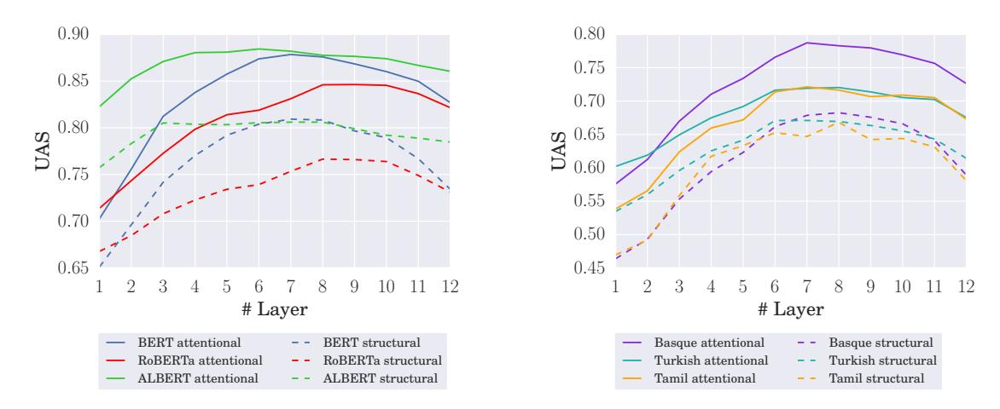
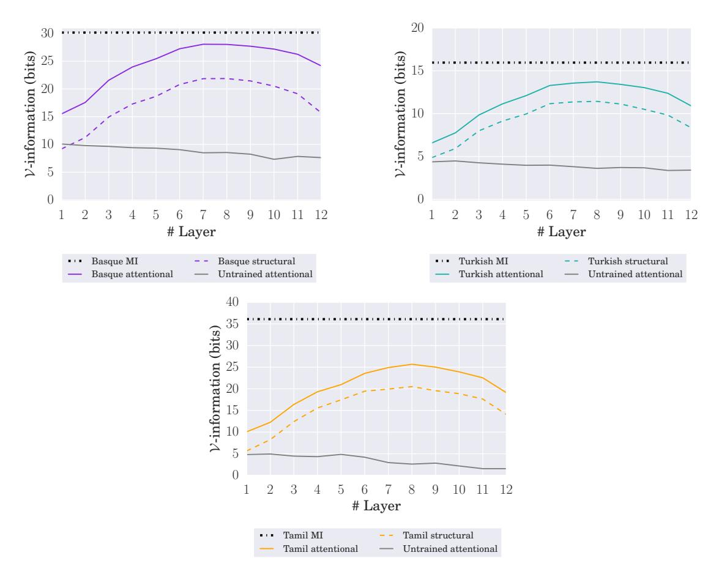
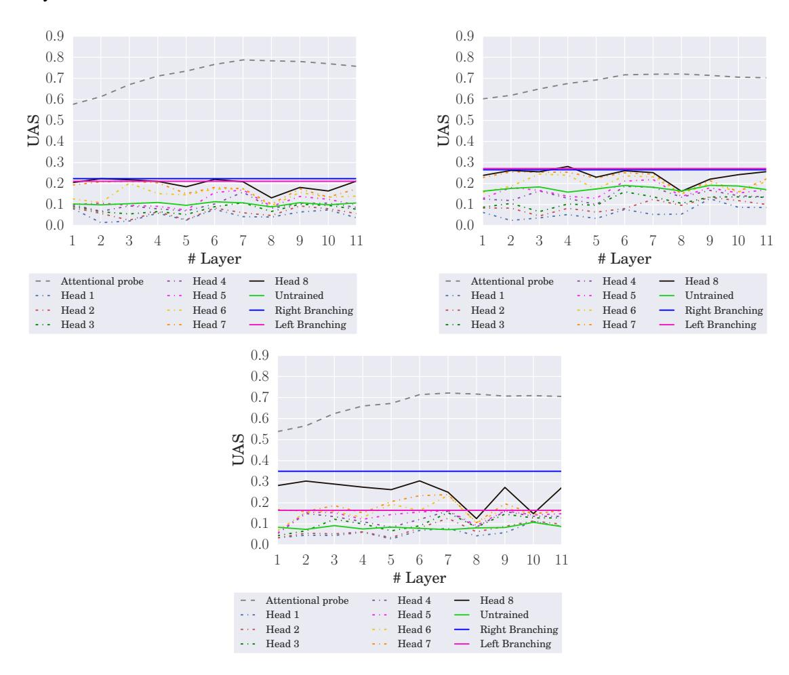

# The Architectural Bottleneck Principle

Tiago Pimentel∗, Josef Valvoda∗, Niklas Stoehr Ryan Cotterell University of Cambridge ETH Zürich [{tp472,](mailto:tp472@cam.ac.uk) [jv406}](mailto:jv406@cam.ac.uk)@cam.ac.uk [{niklas.stoehr,](mailto:niklas.stoehr@inf.ethz.ch) [ryan.cotterell}](mailto:ryan.cotterell@inf.ethz.ch)@inf.ethz.ch

# Abstract

In this paper, we seek to measure how much information a component in a neural network could extract from the representations fed into it. Our work stands in contrast to prior probing work, most of which investigates how much information a model's representations *contain*. This shift in perspective leads us to propose a new principle for probing, the architectural bottleneck principle: In order to estimate how much information a given component could extract, a probe should look exactly like the component. Relying on this principle, we estimate how much syntactic information is available to transformers through our attentional probe, a probe that exactly resembles a transformer's self-attention head. Experimentally, we find that, in three models (BERT, ALBERT, and RoBERTa), a sentence's syntax tree is mostly extractable by our probe, suggesting these models have access to syntactic information while composing their contextual representations. Whether this information is actually used by these models, however, remains an open question.

[https://github.com/rycolab/](https://github.com/rycolab/attentional-probe) [attentional-probe](https://github.com/rycolab/attentional-probe)

# 1 Introduction

The surprising performance of pretrained language models on diverse natural language processing tasks has sparked interest in their analysis. Probing is one of the most prevalent methods employed to engage in such an analysis. In a typical probing study [\(Alain and Bengio,](#page-5-0) [2016;](#page-5-0) [Belinkov et al.,](#page-5-1) [2017;](#page-5-1) [Adi et al.,](#page-5-2) [2017,](#page-5-2) *inter alia*), the weights of the model under consideration are first frozen. A probe is then trained on top of the model's contextual representations in an attempt to predict one of the input sentence's properties, e.g., its syntactic parse. Unfortunately, best practices on how to design such probes remain contested.

On one side of the debate, some argue for simplicity, suggesting that simple probes are to be

preferred so that we can distinguish probing from simply learning an NLP task [\(Hewitt and Liang,](#page-6-0) [2019\)](#page-6-0). On the other side of the debate, some argue we need complex probes in order to extract all relevant information from the representations [\(Saphra and Lopez,](#page-7-0) [2019;](#page-7-0) [Pimentel et al.,](#page-6-1) [2020b\)](#page-6-1). Bridging the gap, some have also called for a compromise, advocating that all probes on the complexity–accuracy Pareto curve should be considered [\(Pimentel et al.,](#page-6-2) [2020a\)](#page-6-2).

In this paper, we propose the architectural bottleneck principle (ABP) as a guideline for constructing useful probes. Under the ABP, a probe's architecture should mirror a component of the model being probed. Previous work has mostly focused on how much information is contained in a set of representations. However, if we care about whether the information is in fact used by the model, we should instead ask how much information the model in question could use.[1](#page-0-0) Under this perspective, the probed model's architecture acts as a natural bottleneck to how much information the model could use—and should thus also act as a constraint when probing.[2](#page-0-1)

As a concrete example, we posit that a transformer's attention head serves as a bottleneck to its use of syntactic information, as these are the only components in a transformer with access to multiple tokens at once. Following the ABP, we thus propose the attentional probe, which looks exactly like an attention head. This probe allows us to answer one specific question: How much syntactic information could a transformer use while computing its attention weights?

Our results reveal that most—albeit not all syntactic information is extractable with this simple attention head architecture: While we estimate English sentences to contain on average

∗Equal contribution.

1Explicitly, we use the bigram *could extract* to refer to the total amount of information a component is able to extract from the representations fed into it; this upper-bounds the information that component actually uses.

2 For related work investigating whether a model uses some information, see [Ravfogel et al.](#page-7-1) [\(2021\)](#page-7-1) and [Lasri et al.](#page-6-3) [\(2022\)](#page-6-3).

31.2 bits of information about their syntactic tree structure, the attentional probe can extract up to 28.0 bits. Furthermore, while these results hold for three popular transformer-based language models (BERT, ALBERT and RoBERTa), they do not for a similar but untrained model. This suggests that training a model shapes its representations to encode syntactic information. We find this trend holds across four typologically diverse languages (Basque, English, Tamil, and Turkish). In contrast, when we keep BERT's pretrained parameters frozen and analyze the weights of its pretrained attention heads, we observe that they do not seem to encode syntax under our operationalisation. Ergo, while we know these models could use syntactic information to compute attention weights, whether they actually do remains an open question.

# 2 A Taxonomy of Probing Principles

There are many competing approaches for how to design an effective probe [\(Belinkov and Glass,](#page-5-3) [2019\)](#page-5-3). We taxonomise them into principles here.

1. *The Linearity Principle [\(Alain and Bengio,](#page-5-0) [2016\)](#page-5-0). A neural network's purpose is to make information linearly separable for its final layer. Thus, probes should be linear models.*

Focusing on how much information a model could use in its final layer,[3](#page-1-0) [Alain and Bengio](#page-5-0) [\(2016\)](#page-5-0) propose what we term the linearity principle; many subsequent studies then adopted it in designing their probes [\(Shi et al.,](#page-7-2) [2016;](#page-7-2) [Ettinger et al.,](#page-5-4) [2016;](#page-5-4) [Bisazza and Tump,](#page-5-5) [2018;](#page-5-5) [Liu et al.,](#page-6-4) [2019a\)](#page-6-4). Other researchers, however, argued that a model's nonfinal layers do not necessarily encode information linearly [\(Conneau et al.,](#page-5-6) [2018;](#page-5-6) [Pimentel et al.,](#page-6-1) [2020b\)](#page-6-1). They then suggested that a probe should measure the *total* amount of information present in a model's representations—*independent* of whether it is actually used by the model. This led to a second principle, which we outline below.

2. *The Maximum Information Principle [\(Pi](#page-6-1)[mentel et al.,](#page-6-1) [2020b\)](#page-6-1). A probe's goal is to estimate how much information is encoded in a set of representations. Thus, probes should be as complex as necessary to extract all relevant information.*

Following this principle, some authors have found, unsurprisingly, that non-linear probes estimate larger amounts of information to be encoded in

a representation than linear ones [\(Qian et al.,](#page-7-3) [2016;](#page-7-3) [Belinkov et al.,](#page-5-1) [2017;](#page-5-1) [White et al.,](#page-7-4) [2021\)](#page-7-4). [Pimentel](#page-6-1) [et al.](#page-6-1) [\(2020b\)](#page-6-1), however, argued that all contextual representations, e.g., the ones produced by BERT, encode as much information about a target attribute as the original sentence. It follows that probing only makes sense with some constraint on probe complexity. Taking complexity into account suggests another natural principle for probe design.

3. *The Easy-extraction Principle [\(Hewitt and](#page-6-0) [Liang,](#page-6-0) [2019\)](#page-6-0). The goal of probing is to reveal how easy it is to extract the information encoded in the representations. Thus, probes should be as simple as possible without sacrificing performance.*

The idea of preferring simple probes goes by many names in the literature. Some authors discuss the complexity of probing architectures [\(Hewitt and](#page-6-0) [Liang,](#page-6-0) [2019;](#page-6-0) [Voita and Titov,](#page-7-5) [2020;](#page-7-5) [Pimentel et al.,](#page-6-2) [2020a;](#page-6-2) [Cao et al.,](#page-5-7) [2021\)](#page-5-7), while others discuss the amount of data required to train the probe [\(Pimentel](#page-6-5) [and Cotterell,](#page-6-5) [2021\)](#page-6-5). None of the work above, however, discusses how the model actually uses the information about the target attribute [\(Elazar et al.,](#page-5-8) [2021;](#page-5-8) [Lasri et al.,](#page-6-3) [2022\)](#page-6-3). If we are interested in whether information can be used by the model, we need a new principle. In this work, we argue that a model's architecture should factor into the probe's design, because the model's architecture constrains the amount of information the model can use. This leads us to propose the following principle.

4. *The Architectural Bottleneck Principle (ABP). A probe should measure how much information a component of a model could use. Thus, a probe's architecture should mirror that component.*

We believe the ABP naturally connects the first three principles. Importantly, the ABP generalises the linearity principle: If a model employs a linear projection coupled with a softmax in its final layer, and our probe mirrors that layer, as linear probes do, then the ABP will be equivalent to the linearity principle. Furthermore, the ABP also relates to the maximum information principle: If we probe a component that is expressive enough, it should be able to extract all relevant information from a set of representations. Finally, the ABP also implicitly controls for ease of extraction by restricting the capacity of probes.

# 3 Probing with Information Theory

In this paper, we take the position that the goal of probing is to determine how much information one

3We assume throughout this paper that a model's final layer is a linear projection coupled with a softmax nonlinearity.

can extract from the representations being probed. Following Pimentel et al. (2020b), we now operationalise this value formally using information theory, which offers us a clean framework to quantify information. Specifically, the measure we are interested in is a V-information (Xu et al., 2020).

#### 3.1 Mutual Information

Shannon (1948) famously quantified the amount of information that a random variable  $(\mathbf{R})$  contains about another  $(\mathbf{A})$  as their mutual information

$$I(\mathbf{R}; \mathbf{A}) \stackrel{\text{def}}{=} H(\mathbf{A}) - H(\mathbf{A} \mid \mathbf{R}) \tag{1}$$

where  $H(\mathbf{A})$  and  $H(\mathbf{A} \mid \mathbf{R})$  are, respectively, the entropy of  $\mathbf{A}$  and the conditional entropy of  $\mathbf{A}$  given  $\mathbf{R}$ . Given that  $\mathbf{R}$  is a continuous-valued representation with values  $\mathbf{r} \in \mathcal{R}$ , and  $\mathbf{A}$  is a discrete-valued attribute with values  $\mathbf{a} \in \mathcal{A}$ , these quantities are defined formally as

$$H(\mathbf{A}) \stackrel{\text{def}}{=} \sum_{\mathbf{a} \in \mathcal{A}} p(\mathbf{a}) \log \frac{1}{p(\mathbf{a})}$$
 (2)

$$H(\mathbf{A} \mid \mathbf{R}) \stackrel{\text{def}}{=} \int_{\mathcal{R}} \sum_{\mathbf{a} \in \mathcal{A}} p(\mathbf{r}, \mathbf{a}) \log \frac{1}{p(\mathbf{a} \mid \mathbf{r})} d\mathbf{r}$$
 (3)

The maximum information principle seeks to estimate Eq. (1). Notably, the relationship between  $\mathbf{R}$  and  $\mathbf{A}$ , represented by distribution  $p(\mathbf{a} \mid \mathbf{r})$ , may be arbitrarily complex, and this distributions' computational complexity has no direct effect on the conditional entropy's value  $H(\mathbf{A} \mid \mathbf{R})$ .

## 3.2 V-information

Under the architectural bottleneck principle, we are interested in how much information we can extract from  ${\bf R}$  about  ${\bf A}$ , when constrained to only using extraction functions in a set  ${\cal V}$ , the set of functions a model's component can represent. The  ${\cal V}$ -information (Xu et al., 2020), a generalisation of Shannon's (1948) mutual information, naturally operationalises this value as

$$I_{\mathcal{V}}(\mathbf{R} \to \mathbf{A}) \stackrel{\text{def}}{=} H_{\mathcal{V}}(\mathbf{A}) - H_{\mathcal{V}}(\mathbf{A} \mid \mathbf{R})$$
 (4)

where the conditional V-entropy is defined as

$$H_{\mathcal{V}}(\mathbf{A} \mid \mathbf{R}) \stackrel{\text{def}}{=} \inf_{q \in \mathcal{V}} \int_{\mathcal{R}} \sum_{\mathbf{a} \in \mathcal{A}} p(\mathbf{r}, \mathbf{a}) \log \frac{1}{q(\mathbf{a} \mid \mathbf{r})} d\mathbf{r}$$
(5)

The unconditional V-entropy is defined similarly.

In words, the  $\mathcal{V}$ -information computes the maximum information that can be extracted by a model with an architecture  $\mathcal{V}$ . Notably, if  $\mathcal{V}$  is sufficiently expressive, i.e., if  $p(\mathbf{a} \mid \mathbf{r}) \in \mathcal{V}$ , the  $\mathcal{V}$ -information will be equivalent to the traditional mutual information. Further,  $\mathcal{V}$ -information is bounded above by the mutual information, which leads to a new value termed here the  $\mathcal{V}$ -coefficient

$$C_{\mathcal{V}}(\mathbf{A} \mid \mathbf{R}) \stackrel{\text{def}}{=} \frac{I_{\mathcal{V}}(\mathbf{R} \to \mathbf{A})}{I(\mathbf{R}; \mathbf{A})}$$
 (6)

In short, the V-coefficient computes the percentage of information we can extract from a random variable when restricted to variational family V.

#### 4 An Attentional Probe

In our experiments, we will focus on a transformer's attention mechanism. Concretely, many researchers (e.g., Vig and Belinkov, 2019; Htut et al., 2019; Manning et al., 2020) have asserted that syntactic information is used by transformers when computing their attention weights (albeit not uncontroversially; for a review, see Rogers et al., 2021). Further, attention heads are the only components in a transformer which have access to multiple words at the same time. Thus, exploring the ABD in the context of attention heads is a natural starting point. Specifically, following the ABP, we will investigate how much information a transformer's attention head could extract from the representations fed into it.

Given an input sentence s, a transformer (Vaswani et al., 2017) will generate a set of representations  $\mathbf{r} \in \mathcal{R} \stackrel{\text{def}}{=} \mathbb{R}^{|\mathbf{s}| \times d_1}$  at layer  $\ell$ . An attention head then uses these representations to compute the attention weights

$$\alpha_{ij} = (\mathbf{K}\mathbf{r}_i)^{\mathsf{T}} \mathbf{Q}\mathbf{r}_j, \quad \mathbf{w}_{ij} = \frac{e^{\alpha_{ij}}}{\sum_{1 \le j' \le |\mathbf{s}|} e^{\alpha_{ij'}}} \quad (7)$$

where i and j index word positions in a sentence  $\mathbf{s}$ ,  $\mathbf{K}, \mathbf{Q} \in \mathbb{R}^{d_2 \times d_1}$  are the key and query matrices, and  $\alpha, \mathbf{w} \in \mathbb{R}^{|\mathbf{s}| \times |\mathbf{s}|}$  are, respectively, the self-attention logits and attention weights.

We now consider an attentional probe parameterised using the head in Eq. (7), but with randomly initialised K and Q matrices. Our goal is to train this probe, as we explain towards the end of this section. We use the attention weights, defined in Eq. (7), to compute the probability of

&lt;sup>4We operationalise our measure of interest as a *V*-information here, since *information* is usually the term used to describe probing questions. Our principle, however, can be easily extended to other measures. For instance, we can define *V*-UAS as the supremum unlabelled attachment score (UAS) achievable by an architecture.

Figure 1: V-information per layer of our probes evaluated on: (left) English using **BERT**, **RoBERTa**, **ALBERT** and **untrained** representations; (right) **Basque**, **Turkish**, and **Tamil** using BERT representations. Line patterns represent: --- Mutual information; — Attentional V-information; --- Structural V-information.

a specific directed spanning tree a, which encodes the syntactic dependencies

$$q_{\theta}(\mathbf{a} \mid \mathbf{r}) = \frac{\prod_{(i,j) \in \mathbf{a}} w_{ij}}{\sum_{\mathbf{a}' \in \mathcal{A}_{|\mathbf{s}|}} \prod_{(i,j) \in \mathbf{a}'} w_{ij}}$$
(8)

where tree a is represented as a set of pairs (i,j) which index an edge in it,  $\mathcal{A}_{|\mathbf{s}|}$  represents the set of all directed spanning trees with a specific number of nodes  $|\mathbf{s}|$ , and  $\boldsymbol{\theta} = [\mathbf{K}; \mathbf{Q}] \in \mathbb{R}^{d_2 \times (2d_1)}$  represents the probe's parameters. We can easily compute the numerator in this equation for a specific tree. The normalising factor in the denominator is more complex, as it requires looping through a prohibitively large sum. Luckily, we can efficiently compute it with Koo et al.'s (2007) variation of the matrix—tree theorem (MTT) for root-constrained directed spanning trees (Tutte, 1984; Zmigrod et al., 2020).

**The Variational Family.** The attentional probe architecture is defined by Eqs. (7) and (8). We now define the equivalent variational family

$$\mathcal{V} = \left\{ q_{\theta}(\mathbf{a} \mid \mathbf{r}) \mid \mathbf{K}, \mathbf{Q} \in \mathbb{R}^{d_2 \times d_1} \right\}$$
 (9)

This variational family includes the set of all distributions computable by an attention head architecture. In practice, however, we cannot compute the infimum over the set  $\mathcal{V}$  as required in Eq. (5). As an approximation, we train our attentional probe to minimise a cross-entropy loss, which gives us an estimate of the  $\mathcal{V}$ -entropy. We expand on this point in App. A.1.6

# 5 Experiments

**Data.** We use the universal dependencies' (UD) treebanks (Zeman et al., 2020). Specifically, we analyse results in four typologically diverse languages: Basque, English, Tamil, and Turkish. Furthermore, we focus our analysis on unlabelled dependency trees. We note that UD uses a particular syntax formalism, which could impact our results (Kuznetsov and Gurevych, 2020).

**Models.** Empirically, we study multilingual BERT in all four languages under consideration (Devlin et al., 2019) as well as RoBERTa and ALBERT (Liu et al., 2019b; Lan et al., 2020), which are only available in English. In line with the ABD, we keep our probe's hidden size the same as in the probed architectures. Finally, we also probe an *untrained* transformer model with the same architecture as BERT as a baseline.

**Training.** We train our probes with AdamW (Loshchilov and Hutter, 2019) using its default hyper-parameters in PyTorch (Paszke et al., 2019).7

**Baselines and Skylines.** We contrast our attentional probe's V-information against two other values. First, as a baseline, we investigate a special case of our model where K = Q, inspired by recent work on structural probing (Hewitt and Liang, 2019; Maudslay et al., 2020; White et al., 2021). Notably, this equality leads to symmetric attention weight matrices; by modelling the root explicitly, however, we still get a distribution over directed trees. This baseline evaluates whether previous work, by over-constraining their probes, has underestimated the amount of information available to a transformer's attention mechanism. We report this value as **structural** V-information. Second, as a skyline, we compare our attentional probe to an estimate of the true **mutual information**  $I(\mathbf{R}; \mathbf{A})$ ,

&lt;sup>5Importantly, Koo et al.'s (2007) method requires a set of weights between each word and a sentence's root. To handle this, we feed an extra root representation  $\mathbf{r}_0$ , initialised as a vector with all zeros, to our attentional probe, making our attention weights actually have shape  $\mathbf{w} \in \mathbb{R}^{|\mathbf{s}|+1 \times |\mathbf{s}|+1}$ . Explicitly, adding a root to an undirected dependency tree is equivalent to making it directed. We then use Zmigrod et al.'s (2021) implementation of the matrix–tree theorem.

&lt;sup>6We note that Hewitt et al. (2021) first noted the equivalence between estimating a  $\mathcal{V}$ -information and probing.

&lt;sup>7The estimation of  $H_{\mathcal{V}}(A)$  is described in App. D.

&lt;sup>8We describe both approaches in more detail in App. C.

| Model         | Layer | $I_{\mathcal{V}}$ | I    | $\mathrm{C}_{\mathcal{V}}$ |
|---------------|-------|-------------------|------|----------------------------|
| BERT          | 7     | 28.0              | 31.2 | 90%                        |
| RoBERTa       | 9     | 25.5              | 31.2 | 82%                        |
| <b>ALBERT</b> | 7     | 27.7              | 31.2 | 89%                        |

Table 1: Maximum V-informations ( $I_V$ ) and Vcoefficients ( $C_V$ ) estimated in English in each probed
model, together with the layer in which they occur. We
also display the estimated mutual information (I).

for which we follow Pimentel et al. (2020b) in using a deep neural network (DNN) to estimate.9

## 6 Results

We present our main results in Fig. 1. First, our probes estimate that most syntactic information is extractable in the middle layers, as previously reported by Tenney et al. (2019). Second, Fig. 1 shows that a large amount of syntactic information is encoded in the representations fed to the attention heads. Further, while we estimate close to 31 bits of information to be encoded in English, Tamil, and Basque sentences, we only estimate around 15 bits to be encoded in Turkish sentences; we suspect this is due to Turkish having the shortest sentences in the corpus (see App. I for these lengths).

Third, we find that, out of the total syntactic information present in the sentences, nearly all is available to the transformer-based models under consideration. In English, for instance, we find the  $\mathcal{V}$ -coefficient of the most informative layer to be 90%, 82%, and 89% in BERT, RoBERTa and ALBERT, respectively; see Tab. 1. This means they have access to roughly 85% of all syntactic information in a sentence. These trends are consistent across the four languages we have considered. Notably, this is not the case for the untrained BERT representations, which suggests this structure is a byproduct of the language models' pretraining procedures.

Additionally, we find that our structural baseline considerably underestimates the models' potential ability to reconstruct a syntax tree; the best English structural baseline recovers only 23 bits of information (versus 28 bits by the attentional probe). One can see this effect in Fig. 1, where all of the structural baseline results fall beneath their corresponding attentional probe counterparts. 10

 $^9$ We note that, as demonstrated by Pimentel et al. (2020b), the mutual information  $I(\mathbf{R}; \mathbf{A})$  is constant across contextual representations and equivalent to  $I(\mathbf{S}; \mathbf{A})$ . We thus use our single best approximation of it in each language as our estimate.

Figure 2: UAS of the attentional weights computed by BERT (with its pretrained weights frozen) in English. We also display the UAS achieved by the attentional probe, the best head per layer of an untrained BERT, and a right and left-branching baseline.

In a final experiment, we plug BERT's attention weights, as computed with its pretrained attention heads, directly into Eq. (8) and analyse its resulting unlabelled attachment scores. These results are presented in Fig. 2 for English (as well as in App. H for the other analysed languages). In short, they reveal that, while attention heads *could* use a large amount of syntactic information, none of the actual heads compute weights that strongly resemble syntax trees; see Htut et al. 2019 for similar results. As BERT has 8 attention heads, however, it might be the case that the syntactic information is used in a distributed manner, with each head relying on a subset of this information (see Tab. 3 in Clark et al. 2019 for results partly supporting this hypothesis).

#### 7 Conclusions

In this paper, we have approached probing from a new perspective. Rather than asking how much information is encoded by the model, we ask how much information its components could extract. We then quantify this amount using  $\mathcal{V}$ -information. Evaluating the attention mechanism of popular transformer language models, we find that the majority of the information about the syntax tree of a sentence is in fact extractable by the model. This, however, is not true for randomly initialised transformer models. Our results, thus, lead us to conclude that a transformer's training leads its attention heads to have the potential to decode syntax trees.

# Acknowledgements

We thank the reviewers and action editor for their helpful comments. We also thank Kevin Du, Clara Meister, Lucas Torroba Hennigen, and Afra Amini for their feedback on this manuscript.

# Limitations

In this paper, we propose a new principled way to choose a probe's architecture, operationalising the question "how much information *could* a model extract from a set of representations?" in terms of a V-information. We note, however, that this probe design principle is only applicable to answer the specific question above. Explicitly, we do *not* answer what we believe to be the more interesting question: "how much information *does* a model actually extract from a set of representations?" In practice, while our proposed probing method does not answer this second question, it does offer an upperbound for it; the amount of information a model could extract from a set of representations is strictly larger than the amount actually extracted. Quantifying how tight (or loose) this upperbound is remains future work.

# Ethical Concerns

We foresee no ethical concerns with this work.

# References

- Yossi Adi, Einat Kermany, Yonatan Belinkov, Ofer Lavi, and Yoav Goldberg. 2017. [Fine-grained anal](https://openreview.net/forum?id=BJh6Ztuxl)[ysis of sentence embeddings using auxiliary predic](https://openreview.net/forum?id=BJh6Ztuxl)[tion tasks.](https://openreview.net/forum?id=BJh6Ztuxl) In *International Conference on Learning Representations*.
- Itziar Aduriz, Maria Jesus Aranzabe, Jose Maria Arriola, Aitziber Atutxa, Arantza Diaz de Ilarraza, Aitzpea Garmendia, and Maite Oronoz. 2003. [Con](http://ixa.si.ehu.es/sites/default/files/dokumentuak/3240/TLT2003_pdf.pdf)[struction of a Basque dependency treebank.](http://ixa.si.ehu.es/sites/default/files/dokumentuak/3240/TLT2003_pdf.pdf) In *Treebanks and Linguistic Theories*.
- Guillaume Alain and Yoshua Bengio. 2016. [Under](https://arxiv.org/abs/1610.01644)[standing intermediate layers using linear classifier](https://arxiv.org/abs/1610.01644) [probes.](https://arxiv.org/abs/1610.01644) *arXiv preprint arXiv:1610.01644*.
- Yonatan Belinkov, Nadir Durrani, Fahim Dalvi, Hassan Sajjad, and James Glass. 2017. [What do neu](https://doi.org/10.18653/v1/P17-1080)[ral machine translation models learn about morphol](https://doi.org/10.18653/v1/P17-1080)[ogy?](https://doi.org/10.18653/v1/P17-1080) In *Proceedings of the 55th Annual Meeting of the Association for Computational Linguistics (Volume 1: Long Papers)*, pages 861–872, Vancouver, Canada. Association for Computational Linguistics.
- Yonatan Belinkov and James Glass. 2019. [Analysis](https://doi.org/10.1162/tacl_a_00254) [Methods in Neural Language Processing: A Survey.](https://doi.org/10.1162/tacl_a_00254)

- *Transactions of the Association for Computational Linguistics*, 7:49–72.
- Arianna Bisazza and Clara Tump. 2018. [The lazy en](https://doi.org/10.18653/v1/D18-1313)[coder: A fine-grained analysis of the role of mor](https://doi.org/10.18653/v1/D18-1313)[phology in neural machine translation.](https://doi.org/10.18653/v1/D18-1313) In *Proceedings of the 2018 Conference on Empirical Methods in Natural Language Processing*, pages 2871–2876, Brussels, Belgium. Association for Computational Linguistics.
- Steven Cao, Victor Sanh, and Alexander Rush. 2021. [Low-complexity probing via finding subnetworks.](https://doi.org/10.18653/v1/2021.naacl-main.74) In *Proceedings of the 2021 Conference of the North American Chapter of the Association for Computational Linguistics: Human Language Technologies*, pages 960–966, Online. Association for Computational Linguistics.
- Kevin Clark, Urvashi Khandelwal, Omer Levy, and Christopher D. Manning. 2019. [What does BERT](https://doi.org/10.18653/v1/W19-4828) [look at? An analysis of BERT's attention.](https://doi.org/10.18653/v1/W19-4828) In *Proceedings of the 2019 ACL Workshop BlackboxNLP: Analyzing and Interpreting Neural Networks for NLP*, pages 276–286, Florence, Italy. Association for Computational Linguistics.
- Alexis Conneau, German Kruszewski, Guillaume Lample, Loïc Barrault, and Marco Baroni. 2018. [What](https://doi.org/10.18653/v1/P18-1198) [you can cram into a single \\$&!#\\* vector: Probing](https://doi.org/10.18653/v1/P18-1198) [sentence embeddings for linguistic properties.](https://doi.org/10.18653/v1/P18-1198) In *Proceedings of the 56th Annual Meeting of the Association for Computational Linguistics (Volume 1: Long Papers)*, pages 2126–2136, Melbourne, Australia. Association for Computational Linguistics.
- Jacob Devlin, Ming-Wei Chang, Kenton Lee, and Kristina Toutanova. 2019. [BERT: Pre-training of](https://doi.org/10.18653/v1/N19-1423) [deep bidirectional transformers for language under](https://doi.org/10.18653/v1/N19-1423)[standing.](https://doi.org/10.18653/v1/N19-1423) In *Proceedings of the 2019 Conference of the North American Chapter of the Association for Computational Linguistics: Human Language Technologies, Volume 1 (Long and Short Papers)*, pages 4171–4186, Minneapolis, Minnesota. Association for Computational Linguistics.
- Timothy Dozat and Christopher D. Manning. 2017. [Deep biaffine attention for neural dependency pars](https://openreview.net/forum?id=Hk95PK9le)[ing.](https://openreview.net/forum?id=Hk95PK9le) In *International Conference on Learning Representations*.
- Yanai Elazar, Shauli Ravfogel, Alon Jacovi, and Yoav Goldberg. 2021. [Amnesic probing: Behavioral ex](https://doi.org/10.1162/tacl_a_00359)[planation with amnesic counterfactuals.](https://doi.org/10.1162/tacl_a_00359) *Transactions of the Association for Computational Linguistics*, 9:160–175.
- Allyson Ettinger, Ahmed Elgohary, and Philip Resnik. 2016. [Probing for semantic evidence of composition](https://doi.org/10.18653/v1/W16-2524) [by means of simple classification tasks.](https://doi.org/10.18653/v1/W16-2524) In *Proceedings of the 1st Workshop on Evaluating Vector-Space Representations for NLP*, pages 134–139, Berlin, Germany. Association for Computational Linguistics.

- John Hewitt, Kawin Ethayarajh, Percy Liang, and Christopher Manning. 2021. [Conditional probing:](https://aclanthology.org/2021.emnlp-main.122) [measuring usable information beyond a baseline.](https://aclanthology.org/2021.emnlp-main.122) In *Proceedings of the 2021 Conference on Empirical Methods in Natural Language Processing*, pages 1626–1639, Online and Punta Cana, Dominican Republic. Association for Computational Linguistics.
- John Hewitt and Percy Liang. 2019. [Designing and](https://doi.org/10.18653/v1/D19-1275) [interpreting probes with control tasks.](https://doi.org/10.18653/v1/D19-1275) In *Proceedings of the 2019 Conference on Empirical Methods in Natural Language Processing and the 9th International Joint Conference on Natural Language Processing (EMNLP-IJCNLP)*, pages 2733–2743, Hong Kong, China. Association for Computational Linguistics.
- John Hewitt and Christopher D. Manning. 2019. [A](https://doi.org/10.18653/v1/N19-1419) [structural probe for finding syntax in word repre](https://doi.org/10.18653/v1/N19-1419)[sentations.](https://doi.org/10.18653/v1/N19-1419) In *Proceedings of the 2019 Conference of the North American Chapter of the Association for Computational Linguistics: Human Language Technologies, Volume 1 (Long and Short Papers)*, pages 4129–4138, Minneapolis, Minnesota. Association for Computational Linguistics.
- Phu Mon Htut, Jason Phang, Shikha Bordia, and Samuel R. Bowman. 2019. [Do attention heads](http://arxiv.org/abs/1911.12246) [in BERT track syntactic dependencies?](http://arxiv.org/abs/1911.12246) *CoRR*, abs/1911.12246.
- Terry Koo, Amir Globerson, Xavier Carreras, and Michael Collins. 2007. [Structured prediction mod](https://aclanthology.org/D07-1015)[els via the matrix-tree theorem.](https://aclanthology.org/D07-1015) In *Proceedings of the 2007 Joint Conference on Empirical Methods in Natural Language Processing and Computational Natural Language Learning (EMNLP-CoNLL)*, pages 141–150, Prague, Czech Republic. Association for Computational Linguistics.
- Ilia Kuznetsov and Iryna Gurevych. 2020. [A matter of](https://doi.org/10.18653/v1/2020.emnlp-main.13) [framing: The impact of linguistic formalism on prob](https://doi.org/10.18653/v1/2020.emnlp-main.13)[ing results.](https://doi.org/10.18653/v1/2020.emnlp-main.13) In *Proceedings of the 2020 Conference on Empirical Methods in Natural Language Processing (EMNLP)*, pages 171–182, Online. Association for Computational Linguistics.
- Zhenzhong Lan, Mingda Chen, Sebastian Goodman, Kevin Gimpel, Piyush Sharma, and Radu Soricut. 2020. [ALBERT: A lite BERT for self-supervised](https://openreview.net/forum?id=H1eA7AEtvS) [learning of language representations.](https://openreview.net/forum?id=H1eA7AEtvS) In *The 8th International Conference on Learning Representations*.
- Karim Lasri, Tiago Pimentel, Alessandro Lenci, Thierry Poibeau, and Ryan Cotterell. 2022. [Probing](https://doi.org/10.18653/v1/2022.acl-long.603) [for the usage of grammatical number.](https://doi.org/10.18653/v1/2022.acl-long.603) In *Proceedings of the 60th Annual Meeting of the Association for Computational Linguistics (Volume 1: Long Papers)*, pages 8818–8831, Dublin, Ireland. Association for Computational Linguistics.
- Nelson F. Liu, Matt Gardner, Yonatan Belinkov, Matthew E. Peters, and Noah A. Smith. 2019a. [Lin](https://doi.org/10.18653/v1/N19-1112)[guistic knowledge and transferability of contextual](https://doi.org/10.18653/v1/N19-1112)

- [representations.](https://doi.org/10.18653/v1/N19-1112) In *Proceedings of the 2019 Conference of the North American Chapter of the Association for Computational Linguistics: Human Language Technologies, Volume 1 (Long and Short Papers)*, pages 1073–1094, Minneapolis, Minnesota. Association for Computational Linguistics.
- Yinhan Liu, Myle Ott, Naman Goyal, Jingfei Du, Mandar Joshi, Danqi Chen, Omer Levy, Mike Lewis, Luke Zettlemoyer, and Veselin Stoyanov. 2019b. [RoBERTa: A robustly optimized BERT pretraining](http://arxiv.org/abs/1907.11692) [approach.](http://arxiv.org/abs/1907.11692) *CoRR*, abs/1907.11692.
- Ilya Loshchilov and Frank Hutter. 2019. [Decoupled](https://openreview.net/forum?id=Bkg6RiCqY7) [weight decay regularization.](https://openreview.net/forum?id=Bkg6RiCqY7) In *International Conference on Learning Representations*.
- Christopher D. Manning, Kevin Clark, John Hewitt, Urvashi Khandelwal, and Omer Levy. 2020. [Emer](https://doi.org/10.1073/pnas.1907367117)[gent linguistic structure in artificial neural networks](https://doi.org/10.1073/pnas.1907367117) [trained by self-supervision.](https://doi.org/10.1073/pnas.1907367117) *Proceedings of the National Academy of Sciences*, 117(48):30046–30054.
- Rowan Hall Maudslay, Josef Valvoda, Tiago Pimentel, Adina Williams, and Ryan Cotterell. 2020. [A tale of](https://doi.org/10.18653/v1/2020.acl-main.659) [a probe and a parser.](https://doi.org/10.18653/v1/2020.acl-main.659) In *Proceedings of the 58th Annual Meeting of the Association for Computational Linguistics*, pages 7389–7395, Online. Association for Computational Linguistics.
- Adam Paszke, Sam Gross, Francisco Massa, Adam Lerer, James Bradbury, Gregory Chanan, Trevor Killeen, Zeming Lin, Natalia Gimelshein, Luca Antiga, Alban Desmaison, Andreas Kopf, Edward Yang, Zachary DeVito, Martin Raison, Alykhan Tejani, Sasank Chilamkurthy, Benoit Steiner, Lu Fang, Junjie Bai, and Soumith Chintala. 2019. [Py-](http://papers.neurips.cc/paper/9015-pytorch-an-imperative-style-high-performance-deep-learning-library.pdf)[Torch: An imperative style, high-performance deep](http://papers.neurips.cc/paper/9015-pytorch-an-imperative-style-high-performance-deep-learning-library.pdf) [learning library.](http://papers.neurips.cc/paper/9015-pytorch-an-imperative-style-high-performance-deep-learning-library.pdf) In H. Wallach, H. Larochelle, A. Beygelzimer, F. d'Alché-Buc, E. Fox, and R. Garnett, editors, *Advances in Neural Information Processing Systems 32*, pages 8024–8035. Curran Associates, Inc.
- Tiago Pimentel and Ryan Cotterell. 2021. [A Bayesian](https://aclanthology.org/2021.emnlp-main.229) [framework for information-theoretic probing.](https://aclanthology.org/2021.emnlp-main.229) In *Proceedings of the 2021 Conference on Empirical Methods in Natural Language Processing*, pages 2869–2887, Online and Punta Cana, Dominican Republic. Association for Computational Linguistics.
- Tiago Pimentel, Naomi Saphra, Adina Williams, and Ryan Cotterell. 2020a. [Pareto probing: Trading off](https://doi.org/10.18653/v1/2020.emnlp-main.254) [accuracy for complexity.](https://doi.org/10.18653/v1/2020.emnlp-main.254) In *Proceedings of the 2020 Conference on Empirical Methods in Natural Language Processing (EMNLP)*, pages 3138–3153, Online. Association for Computational Linguistics.
- Tiago Pimentel, Josef Valvoda, Rowan Hall Maudslay, Ran Zmigrod, Adina Williams, and Ryan Cotterell. 2020b. [Information-theoretic probing for linguistic](https://doi.org/10.18653/v1/2020.acl-main.420) [structure.](https://doi.org/10.18653/v1/2020.acl-main.420) In *Proceedings of the 58th Annual Meeting of the Association for Computational Linguistics*, pages 4609–4622, Online. Association for Computational Linguistics.

- Peng Qian, Xipeng Qiu, and Xuanjing Huang. 2016. [Investigating language universal and specific prop](https://doi.org/10.18653/v1/P16-1140)[erties in word embeddings.](https://doi.org/10.18653/v1/P16-1140) In *Proceedings of the 54th Annual Meeting of the Association for Computational Linguistics (Volume 1: Long Papers)*, pages 1478–1488, Berlin, Germany. Association for Computational Linguistics.
- Loganathan Ramasamy and Zdenek Žabokrtský. 2012. ˇ [Prague dependency style treebank for Tamil.](http://www.lrec-conf.org/proceedings/lrec2012/summaries/456.html) In *Proceedings of Eighth International Conference on Language Resources and Evaluation (LREC 2012)*, pages 1888–1894, ˙Istanbul, Turkey.
- Shauli Ravfogel, Grusha Prasad, Tal Linzen, and Yoav Goldberg. 2021. [Counterfactual interventions re](https://doi.org/10.18653/v1/2021.conll-1.15)[veal the causal effect of relative clause representa](https://doi.org/10.18653/v1/2021.conll-1.15)[tions on agreement prediction.](https://doi.org/10.18653/v1/2021.conll-1.15) In *Proceedings of the 25th Conference on Computational Natural Language Learning*, pages 194–209, Online. Association for Computational Linguistics.
- Anna Rogers, Olga Kovaleva, and Anna Rumshisky. 2021. [A primer in BERTology: What we know](https://doi.org/10.1162/tacl_a_00349) [about how BERT works.](https://doi.org/10.1162/tacl_a_00349) *Transactions of the Association for Computational Linguistics*, 8:842–866.
- Naomi Saphra and Adam Lopez. 2019. [Understand](https://doi.org/10.18653/v1/N19-1329)[ing learning dynamics of language models with](https://doi.org/10.18653/v1/N19-1329) [SVCCA.](https://doi.org/10.18653/v1/N19-1329) In *Proceedings of the 2019 Conference of the North American Chapter of the Association for Computational Linguistics: Human Language Technologies, Volume 1 (Long and Short Papers)*, pages 3257–3267, Minneapolis, Minnesota. Association for Computational Linguistics.
- Claude E. Shannon. 1948. [A mathematical theory of](https://doi.org/10.1002/j.1538-7305.1948.tb01338.x) [communication.](https://doi.org/10.1002/j.1538-7305.1948.tb01338.x) *The Bell System Technical Journal*, 27(3):379–423.
- Xing Shi, Inkit Padhi, and Kevin Knight. 2016. [Does](https://doi.org/10.18653/v1/D16-1159) [string-based neural MT learn source syntax?](https://doi.org/10.18653/v1/D16-1159) In *Proceedings of the 2016 Conference on Empirical Methods in Natural Language Processing*, pages 1526– 1534, Austin, Texas. Association for Computational Linguistics.
- Natalia Silveira, Timothy Dozat, Marie-Catherine de Marneffe, Samuel Bowman, Miriam Connor, John Bauer, and Christopher D. Manning. 2014. [A](https://aclanthology.org/L14-1067/) [gold standard dependency corpus for English.](https://aclanthology.org/L14-1067/) In *Proceedings of the Ninth International Conference on Language Resources and Evaluation (LREC-2014)*.
- Umut Sulubacak, Memduh Gokirmak, Francis Tyers, Çagrı Çöltekin, Joakim Nivre, and Gül¸sen Eryi ˘ git. ˘ 2016. [Universal Dependencies for Turkish.](https://aclanthology.org/C16-1325) In *Proceedings of COLING 2016, the 26th International Conference on Computational Linguistics: Technical Papers*, pages 3444–3454, Osaka, Japan. The COLING 2016 Organizing Committee.
- Ian Tenney, Dipanjan Das, and Ellie Pavlick. 2019. [BERT rediscovers the classical NLP pipeline.](https://doi.org/10.18653/v1/P19-1452) In

- *Proceedings of the 57th Annual Meeting of the Association for Computational Linguistics*, pages 4593– 4601, Florence, Italy. Association for Computational Linguistics.
- W. T. Tutte. 1984. *[Graph Theory](https://onlinelibrary.wiley.com/doi/abs/10.1002/net.3230160110)*. Addison-Wesley Publishing Company.
- Ashish Vaswani, Noam Shazeer, Niki Parmar, Jakob Uszkoreit, Llion Jones, Aidan N. Gomez, Łukasz Kaiser, and Illia Polosukhin. 2017. [Attention is all](https://proceedings.neurips.cc/paper/2017/file/3f5ee243547dee91fbd053c1c4a845aa-Paper.pdf) [you need.](https://proceedings.neurips.cc/paper/2017/file/3f5ee243547dee91fbd053c1c4a845aa-Paper.pdf) In *Advances in Neural Information Processing Systems*, volume 30. Curran Associates, Inc.
- Jesse Vig and Yonatan Belinkov. 2019. [Analyzing](https://doi.org/10.18653/v1/W19-4808) [the structure of attention in a transformer language](https://doi.org/10.18653/v1/W19-4808) [model.](https://doi.org/10.18653/v1/W19-4808) In *Proceedings of the 2019 ACL Workshop BlackboxNLP: Analyzing and Interpreting Neural Networks for NLP*, pages 63–76, Florence, Italy. Association for Computational Linguistics.
- Elena Voita and Ivan Titov. 2020. [Information](https://doi.org/10.18653/v1/2020.emnlp-main.14)[theoretic probing with minimum description length.](https://doi.org/10.18653/v1/2020.emnlp-main.14) In *Proceedings of the 2020 Conference on Empirical Methods in Natural Language Processing (EMNLP)*, pages 183–196, Online. Association for Computational Linguistics.
- Jennifer C. White, Tiago Pimentel, Naomi Saphra, and Ryan Cotterell. 2021. [A non-linear structural probe.](https://doi.org/10.18653/v1/2021.naacl-main.12) In *Proceedings of the 2021 Conference of the North American Chapter of the Association for Computational Linguistics: Human Language Technologies*, pages 132–138, Online. Association for Computational Linguistics.
- Thomas Wolf, Lysandre Debut, Victor Sanh, Julien Chaumond, Clement Delangue, Anthony Moi, Pierric Cistac, Tim Rault, Remi Louf, Morgan Funtowicz, Joe Davison, Sam Shleifer, Patrick von Platen, Clara Ma, Yacine Jernite, Julien Plu, Canwen Xu, Teven Le Scao, Sylvain Gugger, Mariama Drame, Quentin Lhoest, and Alexander Rush. 2020. [Trans](https://doi.org/10.18653/v1/2020.emnlp-demos.6)[formers: State-of-the-art natural language process](https://doi.org/10.18653/v1/2020.emnlp-demos.6)[ing.](https://doi.org/10.18653/v1/2020.emnlp-demos.6) In *Proceedings of the 2020 Conference on Empirical Methods in Natural Language Processing: System Demonstrations*, pages 38–45, Online. Association for Computational Linguistics.
- Yilun Xu, Shengjia Zhao, Jiaming Song, Russell Stewart, and Stefano Ermon. 2020. [A theory of usable in](https://openreview.net/forum?id=r1eBeyHFDH)[formation under computational constraints.](https://openreview.net/forum?id=r1eBeyHFDH) In *International Conference on Learning Representations*.
- Daniel Zeman, Joakim Nivre, Mitchell Abrams, Elia Ackermann, Noëmi Aepli, Željko Agic, Lars Ahren- ´ berg, Chika Kennedy Ajede, Gabriele Aleksan- ˙ draviciˇ ut¯ e, Lene Antonsen, Katya Aplonova, An- ˙ gelina Aquino, Maria Jesus Aranzabe, Gashaw Arutie, Masayuki Asahara, Luma Ateyah, Furkan Atmaca, Mohammed Attia, Aitziber Atutxa, Liesbeth Augustinus, Elena Badmaeva, Miguel Ballesteros, Esha Banerjee, Sebastian Bank, Verginica Barbu Mititelu, Victoria Basmov, Colin Batchelor, John Bauer, Kepa Bengoetxea, Yevgeni Berzak,

Irshad Ahmad Bhat, Riyaz Ahmad Bhat, Erica Biagetti, Eckhard Bick, Agnė Bielinskienė, Rogier Blokland, Victoria Bobicev, Loïc Boizou, Emanuel Borges Völker, Carl Börstell, Cristina Bosco, Gosse Bouma, Sam Bowman, Adriane Boyd, Kristina Brokaitė, Aljoscha Burchardt, Marie Candito, Bernard Caron, Gauthier Caron, Tatiana Cavalcanti, Gülşen Cebiroğlu Eryiğit, Flavio Massimiliano Cecchini, Giuseppe G. A. Celano, Slavomír Čéplö, Savas Cetin, Fabricio Chalub, Ethan Chi, Jinho Choi, Yongseok Cho, Jayeol Chun, Alessandra T. Cignarella, Silvie Cinková, Aurélie Collomb, Cağrı Çöltekin, Miriam Connor, Marine Courtin, Elizabeth Davidson, Marie-Catherine de Marneffe, Valeria de Paiva, Elvis de Souza, Arantza Diaz de Ilarraza, Carly Dickerson, Bamba Dione, Peter Dirix, Kaja Dobrovoljc, Timothy Dozat, Kira Droganova, Puneet Dwivedi, Hanne Eckhoff, Marhaba Eli, Ali Elkahky, Binyam Ephrem, Olga Erina, Tomaž Erjavec, Aline Etienne, Wograine Evelyn, Richárd Farkas, Hector Fernandez Alcalde, Jennifer Foster, Cláudia Freitas, Kazunori Fujita, Katarína Gajdošová, Daniel Galbraith, Marcos Garcia, Moa Gärdenfors, Sebastian Garza, Kim Gerdes, Filip Ginter, Iakes Goenaga, Koldo Gojenola, Memduh Gökırmak, Yoav Goldberg, Xavier Gómez Guinovart, Berta González Saavedra, Bernadeta Griciūtė, Matias Grioni, Loïc Grobol, Normunds Grūzītis, Bruno Guillaume, Céline Guillot-Barbance, Tunga Güngör, Nizar Habash, Jan Hajič, Jan Hajič jr., Mika Hämäläinen, Linh Hà Mỹ, Na-Rae Han, Kim Harris, Dag Haug, Johannes Heinecke, Oliver Hellwig, Felix Hennig, Barbora Hladká, Jaroslava Hlaváčová, Florinel Hociung, Petter Hohle, Jena Hwang, Takumi Ikeda, Radu Ion, Elena Irimia, Olájídé Ishola, Tomáš Jelínek, Anders Johannsen, Hildur Jónsdóttir, Fredrik Jørgensen, Markus Juutinen, Hüner Kaşıkara, Andre Kaasen, Nadezhda Kabaeva, Sylvain Kahane, Hiroshi Kanayama, Jenna Kanerva, Boris Katz, Tolga Kayadelen, Jessica Kenney, Václava Kettnerová, Jesse Kirchner, Elena Klementieva, Arne Köhn, Abdullatif Köksal, Kamil Kopacewicz, Timo Korkiakangas, Natalia Kotsyba, Jolanta Kovalevskaitė, Simon Krek, Sookyoung Kwak, Veronika Laippala, Lorenzo Lambertino, Lucia Lam, Tatiana Lando, Septina Dian Larasati, Alexei Lavrentiev, John Lee, Phương Lê Hồng, Alessandro Lenci, Saran Lertpradit, Herman Leung, Maria Levina, Cheuk Ying Li, Josie Li, Keying Li, KyungTae Lim, Yuan Li, Nikola Ljubešić, Olga Loginova, Olga Lyashevskaya, Teresa Lynn, Vivien Macketanz, Aibek Makazhanov, Michael Mandl, Christopher Manning, Ruli Manurung, Cătălina Mărănduc, David Mareček, Katrin Marheinecke, Héctor Martínez Alonso, André Martins, Jan Mašek, Hiroshi Matsuda, Yuji Matsumoto, Ryan McDonald, Sarah McGuinness, Gustavo Mendonça, Niko Miekka, Margarita Misirpashayeva, Anna Missilä, Cătălin Mititelu, Maria Mitrofan, Yusuke Miyao, Simonetta Montemagni, Amir More, Laura Moreno Romero, Keiko Sophie Mori, Tomohiko Morioka, Shinsuke Mori, Shigeki Moro, Bjartur Mortensen, Bohdan Moskalevskyi,

Kadri Muischnek, Robert Munro, Yugo Murawaki, Kaili Müürisep, Pinkey Nainwani, Juan Ignacio Navarro Horñiacek, Anna Nedoluzhko, Gunta Nešpore-Bērzkalne, Lương Nguyên Thị, Huyên Nguyễn Thi Minh, Yoshihiro Nikaido, Vitaly Nikolaev, Rattima Nitisaroj, Hanna Nurmi, Stina Ojala, Atul Kr. Ojha, Adédayo Olúòkun, Mai Omura, Emeka Onwuegbuzia, Petya Osenova, Robert Östling, Lilja Øvrelid, Şaziye Betül Özateş, Arzucan Özgür, Balkız Öztürk Başaran, Niko Partanen, Elena Pascual, Marco Passarotti, Agnieszka Patejuk, Guilherme Paulino-Passos, Angelika Peljak-Łapińska, Siyao Peng, Cenel-Augusto Perez, Guy Perrier, Daria Petrova, Slav Petrov, Jason Phelan, Jussi Piitulainen, Tommi A Pirinen, Emily Pitler, Barbara Plank, Thierry Poibeau, Larisa Ponomareva, Martin Popel, Lauma Pretkalnina, Sophie Prévost, Prokopis Prokopidis, Adam Przepiórkowski, Tiina Puolakainen, Sampo Pyysalo, Peng Qi, Andriela Rääbis, Alexandre Rademaker, Loganathan Ramasamy, Taraka Rama, Carlos Ramisch, Vinit Ravishankar, Livy Real, Petru Rebeja, Siva Reddy, Georg Rehm, Ivan Riabov, Michael Rießler, Erika Rimkutė, Larissa Rinaldi, Laura Rituma, Luisa Rocha, Mykhailo Romanenko, Rudolf Rosa, Valentin Rosca, Davide Rovati, Olga Rudina, Jack Rueter, Shoval Sadde, Benoît Sagot, Shadi Saleh, Alessio Salomoni, Tanja Samardžić, Stephanie Samson, Manuela Sanguinetti, Dage Särg, Baiba Saulīte, Yanin Sawanakunanon, Salvatore Scarlata, Nathan Schneider, Sebastian Schuster, Djamé Seddah, Wolfgang Seeker, Mojgan Seraji, Mo Shen, Atsuko Shimada, Hiroyuki Shirasu, Muh Shohibussirri, Dmitry Sichinava, Aline Silveira, Natalia Silveira, Maria Simi, Radu Simionescu, Katalin Simkó, Mária Šimková, Kiril Simov, Maria Skachedubova, Aaron Smith, Isabela Soares-Bastos, Carolyn Spadine, Antonio Stella, Milan Straka, Jana Strnadová, Alane Suhr, Umut Sulubacak, Shingo Suzuki, Zsolt Szántó, Dima Taji, Yuta Takahashi, Fabio Tamburini, Takaaki Tanaka, Samson Tella, Isabelle Tellier, Guillaume Thomas, Liisi Torga, Marsida Toska, Trond Trosterud, Anna Trukhina, Reut Tsarfaty, Utku Türk, Francis Tyers, Sumire Uematsu, Roman Untilov, Zdeňka Urešová, Larraitz Uria, Hans Uszkoreit, Andrius Utka, Sowmya Vajjala, Daniel van Niekerk, Gertjan van Noord, Viktor Varga, Eric Villemonte de la Clergerie, Veronika Vincze, Aya Wakasa, Lars Wallin, Abigail Walsh, Jing Xian Wang, Jonathan North Washington, Maximilan Wendt, Paul Widmer, Seyi Williams, Mats Wirén, Christian Wittern, Tsegay Woldemariam, Tak-sum Wong, Alina Wróblewska, Mary Yako, Kavo Yamashita, Naoki Yamazaki, Chunxiao Yan, Koichi Yasuoka, Marat M. Yavrumyan, Zhuoran Yu, Zdeněk Žabokrtský, Amir Zeldes, Hanzhi Zhu, and Anna Zhuravleva. 2020. Universal dependencies 2.6. LINDAT/CLARIAH-CZ digital library at the Institute of Formal and Applied Linguistics (ÚFAL), Faculty of Mathematics and Physics, Charles University.

Ran Zmigrod, Tim Vieira, and Ryan Cotterell. 2020.

[Please mind the root: Decoding arborescences for](https://doi.org/10.18653/v1/2020.emnlp-main.390) [dependency parsing.](https://doi.org/10.18653/v1/2020.emnlp-main.390) In *Proceedings of the 2020 Conference on Empirical Methods in Natural Language Processing (EMNLP)*, pages 4809–4819, Online. Association for Computational Linguistics.

Ran Zmigrod, Tim Vieira, and Ryan Cotterell. 2021. [Efficient computation of expectations under span](https://doi.org/10.1162/tacl_a_00391)[ning tree distributions.](https://doi.org/10.1162/tacl_a_00391) *Transactions of the Association for Computational Linguistics*, 9:675–690.

#### A More on the V-information

# A.1 Probing as approximating V-information

In this section, we make a similar argument to Hewitt et al.'s (2021), who first pointed out the equivalence between the goals of probing and estimating a  $\mathcal{V}$ -information. When probing for some information, we typically train a probabilistic classifier  $q_{\theta}(\mathbf{a}|\mathbf{r})$  (with parameters  $\theta$ ) to approximate a target probability distribution  $p(\mathbf{a}|\mathbf{r})$ . We do this by using an empirical cross-entropy loss function

$$\mathcal{L}(\mathcal{D}_{\text{train}}; \boldsymbol{\theta}) \stackrel{\text{def}}{=} \sum_{(\mathbf{r}, \mathbf{a}) \in \mathcal{D}_{\text{train}}} \log \frac{1}{q_{\boldsymbol{\theta}}(\mathbf{a} | \mathbf{r})}$$
 (10)

where  $\mathcal{D}_{train}$  is a training set composed of  $(\mathbf{r}, \mathbf{a})$  pairs, which are assumed to be sampled from the true distribution  $p(\mathbf{r}, \mathbf{a})$ . Further, we usually have access to a development set  $\mathcal{D}_{dev}$ , on which we estimate this same loss  $\mathcal{L}(\mathcal{D}_{dev}; \boldsymbol{\theta})$  and which we use to avoid overfitting. Together, these steps aim at making  $q_{\boldsymbol{\theta}}(\mathbf{a} \mid \mathbf{r})$  approximate the distribution which minimises the true cross-entropy

$$\mathbf{H}_{\boldsymbol{\theta}}(\mathbf{A} \mid \mathbf{R}) \stackrel{\text{def}}{=} \int_{\mathcal{R}} \sum_{\mathbf{a} \in \mathcal{A}} p(\mathbf{r}, \mathbf{a}) \log \frac{1}{q_{\boldsymbol{\theta}}(\mathbf{a} \mid \mathbf{r})} d\mathbf{r}$$
(11)

Minimising this cross-entropy is equivalent to finding the  $q(\mathbf{a} \mid \mathbf{r}) \in \mathcal{V}$  which minimises the conditional  $\mathcal{V}$ -entropy in Eq. (5). Furthermore, since  $H_{\mathcal{V}}(\mathbf{A})$  is constant with respect to the representations  $\mathbf{R}$ , this is also equivalent (up to an additive constant) to estimating the  $\mathcal{V}$ -information in Eq. (4)—where  $\mathcal{V}$  is defined by our choice of architecture for the probing classifier.

## A.2 On V, Expressivity and Learnability

Ideally, a trained probe  $q_{\theta}(\mathbf{r} \mid \mathbf{a})$  would converge to the infimum  $q \in \mathcal{V}$  from Eq. (5). In practice, however, limitations on the dataset size and optimisation algorithms may lead to poor approximations. Moreover, even with a trained probe, we still cannot compute Eq. (11), but must instead empirically approximate it with a test set and the loss function in Eq. (10). We can thus decompose our actually measured value into four terms

$$\mathcal{L}(\mathcal{D}_{\text{test}}; \boldsymbol{\theta}) = H(\mathbf{A} \mid \mathbf{R}) + \epsilon_1 + \epsilon_2 + \epsilon_3$$
 (12)

where

$$\epsilon_1 \stackrel{\text{def}}{=} \underbrace{H_{\mathcal{V}}(\mathbf{A} \mid \mathbf{R}) - H(\mathbf{A} \mid \mathbf{R})}_{\text{Expressivity Constraint}} \tag{13}$$

$$\epsilon_2 \stackrel{\text{def}}{=} \underbrace{\mathbf{H}_{\boldsymbol{\theta}}(\mathbf{A} \mid \mathbf{R}) - \mathbf{H}_{\mathcal{V}}(\mathbf{A} \mid \mathbf{R})}_{\text{Training Constraint}}$$
(14)

$$\epsilon_3 \stackrel{\text{def}}{=} \underbrace{\mathcal{L}(\mathcal{D}_{\text{test}}; \boldsymbol{\theta}) - H_{\boldsymbol{\theta}}(\mathbf{A} \mid \mathbf{R})}_{\text{Measurement Error}}$$
 (15)

Given a large enough testset,  $\epsilon_3$  should be roughly zero, as the empirical loss in Eq. (10) is an unbiased estimator of the cross-entropy in Eq. (11). This leaves  $\epsilon_1$  and  $\epsilon_2$ . While  $\epsilon_1$  is intentionally imposed by the choice of  $\mathcal{V}$ , which defines the expressivity constraints on the structure of the learned information extractors,  $\epsilon_2$  is a byproduct of multiple factors:  $\mathcal{V}$  itself, the optimisation algorithm and both the train and devset sizes.

Analysing the  $\mathcal{V}$ -information of a very expressive variational family may thus be vacuous, as we may expect  $\epsilon_1$  to be relatively small compared to  $\epsilon_2$ ; this would likely be the case for a  $\mathcal{V}$  resembling the entire BERT architecture. For smaller variational families, however, such as the ones we explore here, we can expect our learning procedures to be well behaved and for  $\epsilon_2$  to be relatively small.

# **B** Inverse Ablation Perspective

One could view our work as a reversed ablation study. In a typical ablation experiment a component of a model is removed to observe its effect on the functioning of the entire model. The idea is that the observed difference in performance of the model will indicate the relative importance of the component. However, with ablation it is impossible to tell what role the component plays in solving the target task. In comparison, we freeze the entire model up to a particular component we are interested in. Instead of asking how important the component is to the overall goal of the model, we ask how good it is at a task we believe is important towards achieving such goal.

#### C Baseline and Skyline

#### C.1 Structural Baseline

Hewitt and Manning (2019) propose the structural probe to investigate the encoding of syntactic structure in contextual representations. Intuitively, they

&lt;sup>11In these scenarios, an information-theoretic measure that accounts for training set sizes might be more meaningful, such as the Bayesian information (Pimentel and Cotterell, 2021).

probe to which extent they can reconstruct a sentence's syntactic tree purely from the distance between contextual representations  $\mathbf{r}$ . Instead of learning separate query  $\mathbf{Q}$  and key  $\mathbf{K}$  matrices as we do, however, they limit themselves to a single projection matrix  $\mathbf{B} \in \mathbb{R}^{d_2 \times d_1}$ . Their probe can thus be written as

$$\alpha_{ij} = (\mathbf{Br}_i)^{\mathsf{T}} \mathbf{Br}_i \tag{16}$$

Since we want to train the structural probe with the same cross-entropy parsing loss as our attentional probe, we softmax its distances

$$\mathbf{w}_{ij} = \frac{e^{\alpha_{ij}}}{\sum\limits_{1 \le j' \le |\mathbf{s}|} e^{\alpha_{ij'}}} \tag{17}$$

making it similar to White et al.'s (2021) non-linear structural probe. This is necessary because the MTT we use to compute the denominator in Eq. (8) assumes non-negative inputs. We then train it with the same loss function as our proposed attentional probe, also making it similar to Maudslay et al.'s (2020) structural parser. In practice, thus, our structural baseline's implementation can be seen as a non-linear structural parser.

#### C.2 DNN Parser

To approximate the true mutual information  $I(\mathbf{R}; \mathbf{A})$ , we follow Pimentel et al. (2020b) in using more powerful feed forward neural network probes. Specifically, we rely on a variant of Dozat and Manning's (2017) parser. We first use two multi-layer perceptrons (MLP), one for the dependent and one for the head token in a dependency arc

$$\mathbf{r}_i' = \text{MLP}(\mathbf{r}_i), \quad \mathbf{r}_i' = \text{MLP}(\mathbf{r}_j)$$
 (18)

These MLP's are composed of a number of linear transformations, interweaved with ReLU non-linearities and dropout layers. We then feed both these transformed representations into a biaffine transformation to get the dependency logits

$$\alpha_{ij} = \mathbf{r}_i^{\prime \mathsf{T}} \mathbf{W} \mathbf{r}_j^{\prime} \tag{19}$$

Finally, we again make these values non-negative by softmaxing them

$$\mathbf{w}_{ij} = \frac{e^{\alpha_{ij}}}{\sum_{1 \le j' \le |\mathbf{s}|} e^{\alpha_{ij'}}} \tag{20}$$

We train this model with the same cross-entropy loss function as our proposed attentional probe.

To choose the hyper-parameters of this model's MLP we use random search, training 50 independent models. We random search for the number of layers in  $\{0,1,2\}$ , dropout in [0.0,0.5], and the hidden size in [32;512]. Furthermore, we note that, as demonstrated by Pimentel et al. (2020b), the mutual information  $I(\mathbf{R}; \mathbf{A})$  is constant across contextual representations and equivalent to  $I(\mathbf{S}; \mathbf{A})$ , where  $\mathbf{S}$  is a random variable representing the original input sentence. We thus use our single best approximation of it in each language as our estimate.

# **D** Unconditional Entropy Parser

We still need to estimate the unconditional entropies  $H_{\mathcal{V}}(\mathbf{A})$ . As these unconditional entropies are not conditioned on anything, however, we cannot estimate them using the previous parsers directly. Specifically, the representations  $\mathbf{r}_i$  and  $\mathbf{r}_j$  in Eqs. (7), (16) and (18) cannot be used. We sidestep this issue by dropping our contextual representations from these equations and using position embeddings in their place. Importantly, these position embeddings do not depend on the input sentences. In short, we compute these equations as

$$\alpha_{ij} = (\mathbf{K}\mathbf{p}_i)^{\mathsf{T}} \mathbf{Q}\mathbf{p}_j$$
 (attentional) (21)

$$\alpha_{ij} = (\mathbf{B}\mathbf{p}_i)^{\mathsf{T}} \mathbf{B}\mathbf{p}_i$$
 (structural) (22)

$$\mathbf{r}_i' = \text{MLP}(\mathbf{p}_i), \ \mathbf{r}_j' = \text{MLP}(\mathbf{p}_j) \ (DNN)$$
 (23)

where  $\mathbf{p}_i \in \mathbb{R}^{d_1}$  is a randomly initialised position embedding and is trained with the rest of the probe.

# **E** Extra Information about Training

We use the base version of all our analysed pretrained models (taken from the transformers library Wolf et al., 2020). We train the model with a batch size of 2048, evaluate the model every 100 batches, and stop training when the model does not improve over 10 consecutive evaluations. Both the attentional and structural probes are trained with a dropout of 0.2 (applied both on the raw input representations and on the key and query representations before being multiplied together) and with a hidden size (i.e.  $d_2$ ) of 64—this is the size of the query, and key representations in both BERT, RoBERTa and ALBERT. As our data, we used the treebanks: English EWT (Silveira et al., 2014); Basque BDT (Aduriz et al., 2003); Turkish IMST (Sulubacak et al., 2016); Tamil TTB (Ramasamy and Žabokrtský, 2012).

## F UAS Results

Figure 3: UAS of the probes evaluated on English using BERT, RoBERTa and ALBERT representations (left); Basque, Turkish and Tamil using BERT representations (right).

# G V-information by Language

Figure 4: The estimated attentional V-information, structural V-information, and mutual information on Basque (top-left); Turkish (top-right); and Tamil (bottom).

# **H** Attention Head Weights Results

We additionally compute the parsing accuracy of the attention heads with their actual weights as taken from BERT (with its parameters as pretrained). 12 In Fig. 5 (as well as Fig. 2 in the main text), we label the heads in order of their performance (1 is always the least accurate per layer, 8 the most). These results show that an attention head's potential to extract syntax trees is far above what each individual head actually extracts.

Figure 5: UAS of all attention heads' weights computed by BERT (with its pretrained parameters frozen) in Basque (top-left); Turkish (top-right); and Tamil (bottom).

# I Average Sentence Lengths

| Language | Average Sentence Length |  |  |
|----------|-------------------------|--|--|
| Basque   | 13                      |  |  |
| English  | 15                      |  |  |
| Tamil    | 17                      |  |  |
| Turkish  | 10                      |  |  |

Table 2: The average sentence length per language under consideration.

&lt;sup>12We assign the weight between each word and the root node as zero, since it is not part of the attention weights.