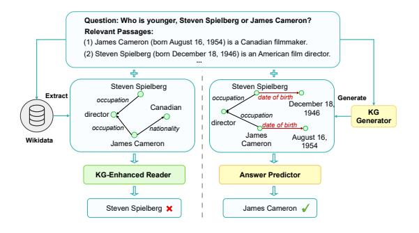
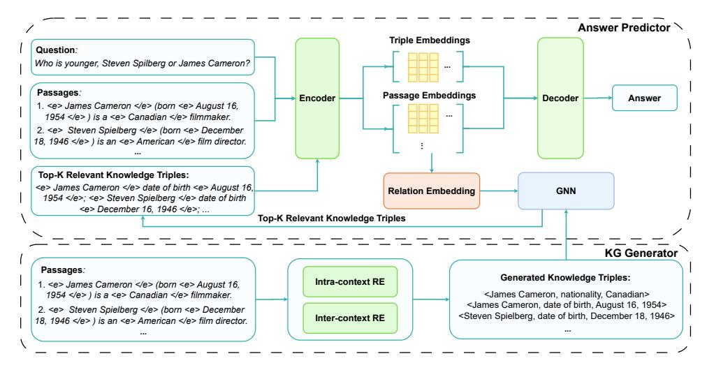
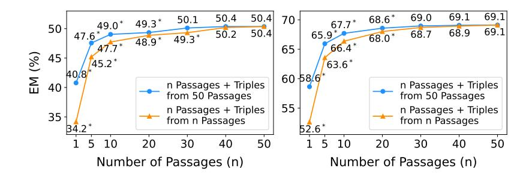
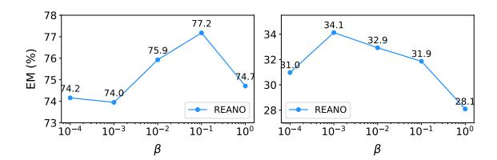
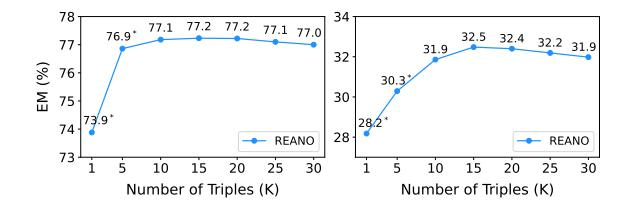

# **REANO: Optimising Retrieval-Augmented Reader Models** through Knowledge Graph Generation

# Jinyuan Fang

University of Glasgow

j.fang.2@research.gla.ac.uk

# Zaiqiao Meng\*

University of Glasgow

zaiqiao.meng@glasgow.ac.uk

## **Craig Macdonald**

University of Glasgow

craig.macdonald@glasgow.ac.uk

#### **Abstract**

Open domain question answering (ODQA) aims to answer questions with knowledge from an external corpus. Fusion-in-Decoder (FiD) is an effective retrieval-augmented reader model to address this task. Given that FiD independently encodes passages, which overlooks the semantic relationships between passages, some studies use knowledge graphs (KGs) to establish dependencies among passages. However, they only leverage knowledge triples from existing KGs, which suffer from incompleteness and may lack certain information critical for answering given questions. To this end, in order to capture the dependencies between passages while tacking the issue of incompleteness in existing KGs, we propose to enhance the retrievalaugmented reader model with a knowledge graph generation module (REANO). Specifically, REANO consists of a KG generator and an answer predictor. The KG generator aims to generate KGs from the passages; the answer predictor then generates answers based on the passages and the generated KGs. Experimental results on five ODQA datasets indicate that compared with baselines, REANO1 can improve the exact match score by up to 2.7%on the EntityQuestion dataset, with an average improvement of 1.8% across all the datasets.

## 1 Introduction

The open domain question answering (ODQA) task (Voorhees and Tice, 2000) aims to answer questions with knowledge from an external corpus, such as Wikipedia. Retrieval-augmented models are an effective way of addressing the ODQA task (Zhang et al., 2023). These models employ a retriever-reader architecture that consists of both a retriever and a reader (Chen et al., 2017). The retriever model retrieves a set of passages that are relevant to the questions and then the reader model

Figure 1: Comparison between existing KG-enhanced readers (left) and our REANO (right).

extracts or generates answers conditioned on the questions and the passages. The two-stage structure of ODQA systems allows for the independent optimisation of the retriever and the reader (Karpukhin et al., 2020). In this paper, we focus on enhancing the performance of the reader model, given that the effectiveness of ODQA systems primarily depends on the reader's ability to interpret and process the information within the retrieved passages.

There has been remarkable progress in using generative readers to address the ODQA task (Sachan et al., 2021; Izacard et al., 2023). For example, Izacard and Grave (2021b) proposed a generative reader called Fusion-in-Decoder (FiD), which uses an encoder-decoder based T5 (Raffel et al., 2020) model to generate answers. By separately encoding each passage with the encoder and combining the token embeddings of these passages as inputs of the decoder, FiD could effectively utilise the knowledge from each passage to generate answers.

However, since FiD independently encodes each passage, it overlooks the semantic relationships between passages, which are critical for answering questions that require multi-hop reasoning (Ramesh et al., 2023). To this end, several studies (Yu et al., 2022; Ju et al., 2022; Hu et al., 2022; Oguz et al., 2022) proposed to leverage knowledge graphs (KGs) to establish relational dependencies among passages. Specifically, KGs store relational

\*Corresponding Author.

&lt;sup>1REANO code: https://github.com/jyfang6/REANO.

information between real-world entities in the form of triples \(\langle head \) entity, \(relation\), tail entity\\. These knowledge triples are used to construct passage graphs (Yu et al., 2022) or entity-passage graphs (Ramesh et al., 2023) to enhance the multihop reasoning ability of the reader models. Despite the success of these models, they all directly use the triples from existing KGs such as Wikidata (Vrandečić and Krötzsch, 2014). However, these KGs often suffer from incompleteness (Cao et al., 2022) and may lack certain information critical for answering questions that are present within the passages. For example, as illustrated Figure 1, for a question "Who is younger, Steven Spielberg or James Cameron?", existing KGs may lack the birthday information of these two individuals, which is crucial to correctly answer the question. This incompleteness can hinder the reader's ability to fully comprehend the passages and answer questions.

Therefore, in order to capture the dependencies between passages and tackling the issue of incompleteness in existing KGs, we propose to enhance the REtrieval-Augmented generative readers with a kNOwledge graph generation module (REANO). Specifically, REANO consists of a KG generator and an answer predictor. The KG generator generates a KG, which consists of a set of knowledge triples, based on the retrieved passages. Since the KG is inferred from the passages, it can effectively capture and preserve the critical information contained within these passages. After generating the KG, REANO employs the answer predictor to perform inference over the unstructured passages and the structured KG to generate answers. Our answer generator is based on the FiD model. The key difference is that it leverages a graph neural network (GNN) (He et al., 2021) to identify and select the top-K triples most relevant to the questions. These triples are concatenated in the order of relevance as an additional passage for answer generation. By combining relevant triples into a passage, we can gather information from multiple passages that are critical to answering the questions, alleviating the reasoning burden of the answer predictor. We conduct experiments on five ODQA datasets and the results indicate that compared with state-of-the-art baselines, our REANO improves the exact match (EM) score by up to 2.7% on the EntityQuestion dataset, with an average improvement of 1.8% across all the datasets.

Our contribution can be summarised as follows: (1) We propose REANO, which integrates a KG

generation module to enhance the performance of the generative readers; (2) We use a GNN to identify and select the top-K knowledge triples that are most relevant to the questions from the generated KGs and combine these triples as an additional passage for enhanced answer generation; (3) Experimental results on five ODQA datasets show that REANO can improve the EM score by up to 2.7% compared with state-of-the-art baselines.

### 2 Preliminaries

Task Formulation. Retrieval-augmented models address the ODQA task by employing a retriever-reader pipeline. In this paper, we focus on enhancing the performance of the reader model. Formally, we denote a question and its answer as q and a, respectively. Each question is associated with a set of n passages, denoted as  $\mathcal{D}_q = \{d_1, d_2, \ldots, d_n\}$ , which are obtained by a retriever such as DPR (Karpukhin et al., 2020). Given a dataset  $\mathcal{O} = \{(q, a, \mathcal{D}_q)\}$ , the goal is to train a reader model  $p_\theta$  with parameter  $\theta$  to generate answer a based on the question q and passages  $\mathcal{D}_q$ .

**Fusion-in-Decoder.** The Fusion-in-Decoder (FiD) model (Izacard and Grave, 2021b) is a simple yet effective generative reader model for the ODQA task. It leverages an encoder-decoder based T5 model (Raffel et al., 2020) to generate answers:

$$p_{\theta}(a|q, \mathcal{D}_q) = \text{Dec}([\mathbf{H}_1; \dots; \mathbf{H}_n]),$$
 (1)

$$\mathbf{H}_i = \text{Enc}(q, d_i), \forall i \in [1, \dots, n], \quad (2)$$

where  $\operatorname{Enc}(\cdot)$  and  $\operatorname{Dec}(\cdot)$  represent the encoder and decoder of T5, respectively, and  $[\cdot\,;\cdot]$  is the concatenation operation. For each passage  $d_i\in\mathcal{D}_q$ , FiD encodes the combined sequence of the question and the passage, i.e.,  $\operatorname{Enc}(q,d_i)$ . The embeddings for all the passages are then concatenated as inputs to the decoder for answer generation.

### 3 REANO

The overall framework of our REANO is shown in Figure 2. This section begins with the probabilistic formulation of REANO in § 3.1, followed by its parameterisation details in § 3.2. Finally, the training strategies are introduced in § 3.3.

## 3.1 Probabilistic Formulation of REANO

We begin by formalising our REANO in a probabilistic way. Given a question q and its relevant passages  $\mathcal{D}_q$ , the goal is to maximize the distribution  $p_{\theta}(a|q, \mathcal{D}_q)$ . In addition to direct inference on

Figure 2: Overall framework of REANO, which includes a *KG Generator* that generates knowledge triples based on the passages and an *Answer Predictor* that generates answers based on the passages and the knowledge triples.

the passages, we propose to generate a knowledge graph  $\mathcal{G}_q$ , which consists of entities and relations among these entities, based on these passages and then perform joint inference over both the unstructured passages and the structured knowledge graph to generate answers. Since  $\mathcal{G}_q$  is unknown, we treat it as a latent variable and rewrite  $p_{\theta}(a|q,\mathcal{D}_q)$  as:

$$p_{\theta}(a|q, \mathcal{D}_q) = \sum_{\mathcal{G}_q} p_{\theta}(a|q, \mathcal{D}_q, \mathcal{G}_q) p_{\phi}(\mathcal{G}_q|\mathcal{D}_q),$$
 (3)

where the answer generation target  $p_{\theta}(a|q,\mathcal{D}_q)$  is jointly modeled by a KG generator  $p_{\phi}(\mathcal{G}_q|\mathcal{D}_q)$  and an answer predictor  $p_{\theta}(a|q,\mathcal{D}_q,\mathcal{G}_q)$ . The KG generator infers a KG conditioned on the retrieved passages  $\mathcal{D}_q$ , while the answer predictor generates answers conditioned on the question q, the passages  $\mathcal{D}_q$  and the generated knowledge graph  $\mathcal{G}_q$ . Next, we introduce the detailed parameterisation of the KG generator and the answer predictor.

#### 3.2 Parameterisation

## 3.2.1 KG Generator

For each question q, the KG generator  $p_{\phi}(\mathcal{G}_q|\mathcal{D}_q)$  aims to deduce a set of knowledge triples in the form of  $\langle head\ entity, relation, tail\ entity \rangle$  based on the passages  $\mathcal{D}_q$ . Following the established practice of KG generation (Ji et al., 2022), we decompose this task into two components: entity recognition (ER) and relation extraction (RE). The ER focuses on identifying the entities within the passages, while the RE aims to infer the relations among these entities. For the ER, we leverage SpaCy (Honnibal and Montani, 2017) to identify named entities and use TAGME (Ferragina and Scaiella, 2010), an entity linking system, to identify

Wikipedia entities. We denote the entities identified within  $\mathcal{D}_q$  as  $\mathcal{E}_q$ . An entity  $e \in \mathcal{E}_q$  may have multiple occurrences within  $\mathcal{D}_q$  and we refer to each instance of this entity in the passages as a mention.

Subsequently, we infer the relations among entities. Given that current state-of-the-art RE models rely on a transformer backbone (Lu et al., 2022a,b), it is impractical to infer the relations among all the entities simultaneously. This is due to the constrained maximum input length of these models, as processing all the passages at once would exceed this limit. Therefore, we further decompose the RE component into two sub-modules: *intra-context* RE and *inter-context* RE.

**Intra-Context RE.** Intra-context RE focuses on extracting the relations among entities within a single passage, while inter-context RE aims to extract the relations among entities across passages.

The intra-context RE model is defined as:

$$p_{\phi}(\mathcal{T}_q^I | \mathcal{D}_q, \mathcal{E}_q) = \prod_{d_i \in \mathcal{D}_q} p_{\phi}(\mathcal{T}_{q, d_i}^I | d_i, \mathcal{E}_{q, d_i}), \quad (4)$$

where  $\mathcal{T}_{q,d_i}^I$  denotes intra-context relation triples among entities  $\mathcal{E}_{q,d_i}$  within a passage  $d_i$ . We instantiate the intra-context RE model  $p_\phi$  with DocuNet (Zhang et al., 2021a), an effective RE model capable of predicting relations between every entity pair within a passage in a single forward propagation. More details about the framework and the parameterisation of DocuNet are provided in Appendix A.

**Inter-Context RE.** For inter-context RE, we leverage the Wikidata API2 to retrieve relations among

&lt;sup>2https://www.wikidata.org/w/api.php

entities across passages from the Wikidata (Vrandečić and Krötzsch, 2014). Following previous work (Yu et al., 2022), we include all the relations between entities even if they are not grounded in the passages to construct inter-passage connections.

Therefore, the generated KG for the question q is obtained by combining the intra-context relation triples  $\mathcal{T}_q^I$  and the inter-context relation triples  $\mathcal{T}_q^C$ , i.e.,  $\mathcal{G}_q = \{\mathcal{T}_q^I, \mathcal{T}_q^C\}$ .

#### 3.2.2 Answer Predictor

For a question, the answer predictor  $p_{\theta}(a|q, \mathcal{D}_q, \mathcal{G}_q)$ generates answers based on the passages and the generated KGs. Our answer predictor is based on the FiD model. However, the key difference between our answer predictor and FiD is that our answer predictor uses a graph neural network (GNN) to select a set of triples relevant to the question q from  $\mathcal{G}_q$ , given that most of the triples in  $\mathcal{G}_q$  may be irrelevant to the question. These selected triples are combined into an additional passage for answer generation. Formally, we denote the set of triples relevant to the question q as  $\mathcal{T}_q^R \subset \mathcal{G}_q$ , and define the probability of each triple being relevant to the question as  $p_{\theta}(\mathcal{T}_q^R|q,\mathcal{D}_q,\mathcal{G}_q)$ . Empirically, we found that simply selecting top-K triples with the highest probability could consistently yield excellent performance. Therefore,  $\mathcal{T}_q^R$  is specified as the set of top-K triples with the highest values in  $p_{\theta}(\mathcal{T}_q^R|q,\mathcal{D}_q,\mathcal{G}_q).$ 

Given the relevant triples  $\mathcal{T}_q^R$ , the answer distribution is then defined as:

$$p_{\theta}(a|q, \mathcal{D}_q, \mathcal{G}_q) = p_{\theta}(a|q, \mathcal{D}_q, \mathcal{T}_q^R), \quad (5)$$

where we use the selected relevant triples  $\mathcal{T}_q^R$  instead of all the triples  $\mathcal{G}_q$  to generate answers. In what follows, we will introduce  $p_{\theta}(\mathcal{T}_q^R|q,\mathcal{D}_q,\mathcal{G}_q)$  and  $p_{\theta}(a|q,\mathcal{D}_q,\mathcal{T}_q^R)$  in details.

**Graph Neural Network.** We begin by introducing how to identify relevant triples using GNN (He et al., 2021), i.e.,  $p_{\theta}(\mathcal{T}_q^R|q,\mathcal{D}_q,\mathcal{G}_q)$ . To this end, we first initialise the entity and relation embeddings. The embedding of an entity is initialised with the contextualised embeddings of its mentions. Specifically, for each passage  $d_i \in \mathcal{D}_q$ , we insert special symbols "<e>" and "</e>" at the start and end of all entity mentions to indicate the presence of an entity. We then use the encoder of T5 to obtain the token embeddings of the passages:  $\mathbf{H}_i = \operatorname{Enc}(q, d_i), \forall i = 1, \dots, n$ . Following

previous works (Verga et al., 2018; Zhang et al., 2021a), we use the embeddings of the "<e>" tokens to represent mention embeddings, which are subsequently mean-pooled to obtain entity embeddings:  $t_e = \frac{1}{N_e} \sum_{j=1}^{N_e} m_{e,j}, \ \forall e \in \mathcal{E}_q$ , where  $N_e$  denotes the number of mentions of entity e within  $\mathcal{D}_q$  and  $m_{e,j}$  is the j-th mention embedding of e.

Next, we introduce how to obtain relation embeddings. For a knowledge triple  $\langle e, r_{ev}, v \rangle$  in  $\mathcal{G}_q$ , e.g.,  $\langle Steven\ Spielberg,\ occupation,\ director \rangle$ , we employ the encoder of T5 to obtain token embeddings for the relation label, i.e., occupation. These embeddings are mean-pooled to get the initial relation embeddings, denoted as  $\hat{r}_{ev}$ . Since the relations between entities are predicted by the KG generator, which might contain potential inaccuracies, we introduce a relation embedding module. This module aims to refine relation embeddings by integrating entity embeddings, thereby enhancing the reliability and accuracy of the relation embedding for  $r_{ev}$ , which is given by:

$$\mathbf{r}_{ev} = \hat{\mathbf{r}}_{ev} + \text{REM}([\mathbf{t}_e; \mathbf{t}_v]), \tag{6}$$

where  $REM(\cdot)$  is the relation embedding module, instantiated as a two-layer feed-forward neural network in our model.

Subsequently, we use an L-layer GNN network to update the entity embeddings. Inspired by previous relation-aware GNNs for the knowledge base question answering task (Vashishth et al., 2020; He et al., 2021), we define the process of updating entity embeddings at the l-th layer of our GNN as:

$$\boldsymbol{t}_{e}^{(l)} = \text{FFN}([\boldsymbol{t}_{e}^{(l-1)}; \boldsymbol{s}_{e}^{(l)}]), \tag{7}$$

$$\mathbf{s}_{e}^{(l)} = \sum_{(v,r_{ev})\in\mathcal{N}(e)} \alpha_{v}^{r_{ev}} \cdot \text{FFN}([\mathbf{t}_{v}^{(l-1)}; \mathbf{r}_{ev}]), \quad (8)$$

$$\alpha_v^{r_{ev}} = \frac{\boldsymbol{w}^{\top}(\boldsymbol{q} \odot \boldsymbol{r}_{ev})}{\sum_{(v',r_{ev'}) \in \mathcal{N}(e)} \boldsymbol{w}^{\top}(\boldsymbol{q} \odot \boldsymbol{r}_{ev'})}, \tag{9}$$

where  $t_e^{(l)}$  denotes the entity embedding of e at the l-th layer with  $t_e^{(0)} = t_e$ , FFN(·) denotes a feed-forward neural network layer,  $\mathcal{N}(e)$  is a set of neighboring triples of e for its outgoing edges, q is the embedding of the question q obtained by taking the average of its token embeddings,  $\odot$  is the element-wise multiplication and w is a learnable parameter. Specifically, for each entity e, the GNN fuses the aggregated message  $s_e^{(l)}$  from the entity's neighbouring triples to update the entity's embedding, i.e., Equation (7).

This message is a weighted aggregation of the information from each neighbouring triple, i.e., Equation (8), with the weights  $\alpha_v^{rev}$  being determined by the similarity between the question and the relation of the triple, i.e., Equation (9). This GNN allows entities to attend to triples that are more relevant to the question, thereby obtaining more accurate and question-specific entity embeddings.

**Top-K Relevant Triple Selection.** After updating the entity embeddings, we calculate the similarities between a triple  $\langle e, r_{ev}, v \rangle \in \mathcal{G}_q$  and the question q as follows:

$$p_{\theta}(\mathcal{T}_q|q, \mathcal{D}_q, \mathcal{G}_q) \propto \boldsymbol{q}^{\top} \boldsymbol{t}_e^{(L)} + \boldsymbol{q}^{\top} \boldsymbol{r}_{ev} + \boldsymbol{q}^{\top} \boldsymbol{t}_v^{(L)}.$$
 (10)

Based on this similarity measure, we identify and select top-K triples that exhibit the highest relevance to the question, i.e.,  $\mathcal{T}_q^R$ . We simply concatenate these top-K triples in the descending order of the similarities as a passage denoted as  $d_{\mathcal{T}_q^R}$ . The purpose of combining triples is to gather information from multiple passages that are helpful in answering questions, thereby alleviating the reasoning burden. This passage is then encoded with the T5 encoder. The resulting embeddings are concatenated with the passage embeddings as inputs to the T5 decoder to generate answers:

$$\mathbf{H}_{\mathcal{T}_{a}^{R}} = \operatorname{Enc}(q, d_{\mathcal{T}_{a}^{R}}), \tag{11}$$

$$p_{\theta}(a|q, \mathcal{D}_q, \mathcal{T}_q^R) = \text{Dec}([\mathbf{H}_1; \dots; \mathbf{H}_n; \mathbf{H}_{\mathcal{T}_q^R}]).$$
 (12)

## 3.3 Training Strategies

The goal of training REANO is to find the parameters for the KG generator and the answer predictor that can maximize the log-likelihood of the training data, i.e.,  $\log p_{\theta}(a|q,\mathcal{D}_q)$ . Since the end-to-end optimisation of both the KG generator and the answer predictor is non-differentiable, similar to the previous work (Zhang et al., 2022), we decouple the training of REANO by first training the KG generator and then the answer predictor based on the KGs obtained from the KG generator.

Distantly Supervised Training of KG Generator. In the KG generator, only the DocuNet model needs to be trained for intra-context RE. Given the absence of gold labels for this task, we employ a distantly supervised training approach (Mintz et al., 2009; Zhang et al., 2021b). This involves training the DocuNet model on the REBEL dataset (Cabot and Navigli, 2021) and directly using the trained model to predict intra-context relation triples for

each passage within  $\mathcal{D}_q$ . Particularly, the REBEL dataset is a large-scale RE dataset built by aligning Wikipedia abstracts and the knowledge triples in the Wikidata. Each item in this dataset consists of a Wikipedia text paired with some knowledge triples that can be inferred from the text. More details about the dataset and DocuNet training are provided in Appendices B.1 and B.2. In addition, we also investigate creating a RE training dataset for each ODQA dataset by extracting Wikidata triples within each passage. The generated data are used either to finetune the DocuNet model trained on the REBEL dataset or to train the DocuNet model from scratch. However, our findings indicate that neither of these two approaches can further improve the performance (see Appendix C.3).

Training of Answer Predictor. In the answer predictor, we need to train the GNN model for selecting the top-K relevant triples and the T5 model for generating answers. In the ODQA datasets, we observe that sometimes the answer to a question qcan match one of the entities identified within its retrieved passages  $\mathcal{D}_q$ . Based on this observation, we use such answer-entity alignment as supervision signals to train the GNN model. Specifically, we identify all the paths connecting each entity in the question to the answer entity in the generated KG  $\mathcal{G}_q$ . We consider all the entities that are part of these paths as relevant to the question, denoted as  $\mathcal{E}_q^{rel} \subset \mathcal{E}_q$ . If such paths do not exist, we use the answer entity as the relevant entity. We then add a linear classifier on top of the GNN model to predict which entities are relevant to the question:  $m{c}_q = ext{Softmax}(\mathbf{E}_q^{(L)} m{w}_c), ext{ where } \mathbf{E}_q^{(L)} ext{ denotes the}$ embedding matrix of all the entities (i.e.,  $\mathcal{E}_q$ ),  $\boldsymbol{w}_c$ is a learnable parameter and  $c_q$  denotes the probability of each entity being relevant to the question. Following Zhang et al. (2022), the GNN model is trained by minimising:  $\mathcal{L}_{gnn} = D_{\text{KL}}(\boldsymbol{c}_q || \boldsymbol{c}_q^*),$ where  $oldsymbol{c}_q^*$  denotes the ground-truth relevant entity distribution computed with  $\mathcal{E}_q^{rel}$ , and  $D_{KL}$  denotes the Kullback-Leibler divergence.

The T5 model is trained with the cross entropy loss between the predicted answer distribution and the true answer distribution, which is denoted as  $\mathcal{L}_{t5} = \text{CE}(p_{\theta}(a|q, \mathcal{D}_q, \mathcal{T}_q), p^*(a|q))$ . Hence, the loss for training the answer generator is:

$$\mathcal{L}_{answer} = \mathcal{L}_{t5} + \beta \mathcal{L}_{ann}, \tag{13}$$

where  $\beta$  is a trade-off hyperparameter between the T5 loss and the GNN loss.

## 4 Experiments

## 4.1 Experimental Setup

Datasets. We conduct experiments on five ODQA datasets: Natural Questions (NQ) (Kwiatkowski et al., 2019), **TriviaQA** (TQA) (Joshi et al., 2017), EntityQuestions (EQ) (Sciavolino et al., 2021), 2WikiMultiHopOA (2WOA) (Ho et al., 2020) and MuSiQue (Trivedi et al., 2022). For NQ and TQA, we use the data splits provided by Karpukhin et al. (2020). Each question in NQ and TQA is associated with a set of 100 passages, which are retrieved by the DPR (Karpukhin et al., 2020) model from the December 20, 2018 Wikipedia dump that contains 21M passages. The same data are also used in our baselines, except RAG-Seq. For EQ, following Sciavolino et al. (2021), we use the same 21M Wikipedia dump as the corpus and employ BM25 (Robertson and Zaragoza, 2009) to retrieve top-20 relevant passages for each question. The 2WOA and MuSiQue are multi-hop OA datasets that require reasoning over multiple passages to answer questions. Each question in 2WQA and MuSiQue is associated with 10 and 20 passages respectively provided by the authors. We directly use these passages in our experiments. More details about the datasets are provided in Appendix B.1.

Baselines. Since REANO is built under the FiD framework (Izacard and Grave, 2021b), we mainly compare it with the FiD model and its variants. In particular, we compare with models from each of the following categories: (1) extractive reader: DPR (Karpukhin et al., 2020); (2) generative reader: RAG-Seq. (Lewis et al., 2020b), FiDO (de Jong et al., 2023); (3) KG-enhanced reader: KG-FiD (Yu et al., 2022), OREOLM (Hu et al., 2022), GRAPE (Ju et al., 2022). Due to resource constraints, both our REANO and baselines use the base versions of the transformer models.

**Evaluation.** Following Izacard and Grave (2021b), we use greedy decoding to generate answers and employ the Exact Match (EM) as the evaluation metric, where a predicted answer is considered correct if it matches any answer in a list of gold answers after normalisation (Yu et al., 2022).

**Training and Hyperparameter Details.** For the KG generator, we use the default architecture and hyperparameters as in Zhang et al. (2021a) for intracontext RE. The statistics of the generated KGs for each dataset are provided in Table 4 of the Appendix. For the answer predictor, we use t5-base

| Models   | NQ                          | TQA                         | EQ                            | 2WQA                          | MuSiQue               |
|----------|-----------------------------|-----------------------------|-------------------------------|-------------------------------|-----------------------|
| DPR      | $41.5^{\dagger}$            | 57.9 †           | 55.3                          | 54.8                          | 16.9                  |
| RAG-Seq. | 44.5 †           | 56.8 †           |                               |                               |                       |
| FiD      | 48.2 †           | 65.0 †           | 68.1                          | 74.1                          | 29.9                  |
| KG-FiD   | $49.6^{\dagger}$            | $66.7^{\dagger}$            | -                             | -                             | -                     |
| OREOLM   | $49.3^{\dagger}$            | $67.1^{\dagger}$            | -                             | -                             | -                     |
| GRAPE    | $48.7^{\dagger}$            | $66.2^{\dagger}$            | 68.3                          | 73.4                          | 28.3                  |
| FiDO     | 49.5                        | 67.4                        | 67.8                          | 74.6                          | 30.4                  |
| REANO    | <b>50.4</b> (0.8 <b>↑</b> ) | <b>69.1</b> (1.7 <b>↑</b> ) | <b>71.0</b> * (2.7 <b>↑</b> ) | <b>77.1</b> * (2.5 <b>↑</b> ) | <b>31.8</b> * (1.4 ↑) |

Table 1: Overall performance (EM %) of REANO and baselines, where  $^{\dagger}$  denotes the results are from the original papers3, \* denotes p-value < 0.05 compared with FiD and  $\uparrow$  denotes performance improvements compared with the second best models on each dataset. The best performance per dataset is marked in boldface.

as the backbone model and set the number of GNN layers L as 3. Due to the resource constraints, we only use the top-50 passages for each question in both NQ and TQA datasets and use all the passages per question in the other datasets. Throughout the experiments, we set the number of triples selected by the GNN K as 10. We use AdamW (Loshchilov and Hutter, 2019) with a constant learning rate of 1e-4 as the optimizer and set the batch size as 64. More training details are provided in Appendix B.2.

### 4.2 Results and Analysis

We provide our main results in this section and additional experimental results in Appendix C.

(RQ1): How does our REANO perform against the baselines? The performance of REANO and baselines is reported in Table 1, which shows the EM scores (%) of different models across different datasets. The results yield the following findings: (1) First, our REANO consistently achieves the best performance on all the datasets. Compared with the second best models on each dataset, REANO achieves improvements of 1.7%, 2.7% and 2.5% on the TQA, EQ and 2WQA datasets, respectively. REANO also achieves an average improvement of 1.8% across all the datasets. These results demonstrate the effectiveness of REANO for ODQA.

(2) Moreover, when compared with existing KG-enhanced FiD-based readers, i.e., KG-FiD, ORE-OLM and GRAPE, on the NQ and TQA datasets, REANO still achieves the best performance. The suboptimal performance of prior KG-enhanced readers may be due to the fact that they only leverage knowledge triples from existing KGs, which

&lt;sup>3These results are obtained using at least 50 passages except RAG-Seq, which only uses 10 passages.

Figure 3: Performance of our REANO under different settings of knowledge triples on NQ (left) and TQA (right) datasets, where  $^*$  indicates p-value < 0.05 compared with n=50 in the corresponding setting.

| Models                    | EQ    | 2WQA  | MuSiQue |
|---------------------------|-------|-------|---------|
| REANO                     | 71.0  | 77.1  | 31.8    |
| w/o inter-context triples | 69.5* | 75.7* | 30.6*   |
| w/o intra-context triples | 70.2* | 76.0* | 30.1*   |
| w/o REM                   | 69.1* | 75.1* | 30.2*   |
| w/o GNN                   | 68.9* | 75.5* | 28.0*   |

Table 2: Ablation studies of REANO, where \* denotes p-value < 0.05 compared with REANO.

may lack some information critical to answer questions. Therefore, this result indicates the effectiveness of generating knowledge triples from passages used by our REANO model, complementing the knowledge triples from existing KGs.

(3) Furthermore, if we remove the knowledge triples in REANO, REANO is equivalent to FiD. When compared with FiD, REANO demonstrates significant (using a paired sample t-test) improvements of 2.9%, 3.0% and 1.9% on the EQ, 2WQA and MuSiQue datasets, respectively, and also exhibits superior performance on the other two datasets. This indicates the effectiveness of using knowledge triples as additional context to enhance the reader's understanding of passages.

(RQ2): Does different components of our model affect the performance? We conduct ablation studies to study the effects of different components in REANO, including different sets of knowledge triples, the REM module and the GNN module.

First, to investigate the effects of different triples, we introduce two variants of REANO: (1) *w/o inter-context triples*, where we remove the inter-context triples and only use the intra-context triples as inputs to the answer predictor; (2) *w/o intra-context triples*, where we only pass the inter-context triples to the answer predictor. The results for ablation studies are reported in Table 2, which shows the performance (EM %) of REANO and its variants on

the EQ, 2WQA and MuSiQue datasets. The results show that both *w/o inter-context triples* and *w/o intra-context triples* perform significantly worse than REANO on these datasets, which indicates that both the inter-context triples and the intra-context triples are necessary for improving the performance. This is because the intra-context triples can capture the relations among entities within the same passages and the inter-context triples can capture the relations among entities across different passages. The combination of these two sources of information can help the reader better understand the information within all the passages.

Moreover, to investigate the effects of the REM and the GNN modules, we additionally introduce two variants: w/o REM and w/o GNN, which are obtained by removing the REM module and the GNN module in the answer predictor, respectively. The results in Table 2 indicate that removing either of these two components would significantly degrade the performance on the EQ, 2WQA and MuSiQue datasets. This is because, with the REM module, the answer predictor can learn to refine relation embeddings based on the contextualised embeddings of entities, thereby enhancing the accuracy of relation embeddings. Moreover, the GNN can perform multi-hop reasoning over the KGs to better identify and select knowledge triples that are relevant to the questions, leading to improved performance.

(RQ3): Can knowledge triples help to reduce the number of passages while maintaining satisfactory performance? As shown in Figure 2, we aim to generate and select knowledge triples that contain critical information within the passages to answer questions. To investigate the effects of these knowledge triples, we study the performance of REANO on the NQ and TQA datasets under different number of passages. Moreover, we introduce two different settings of knowledge triples for

| Question $q$                                                                                                             | Passages $\mathcal{D}_q$                                                                                                                                                                                                                                                                                  | Top-Ranked Triples $\hat{\mathcal{T}}_q^R$                                                                                                                                                                                                                                                              | Generated Answer |
|--------------------------------------------------------------------------------------------------------------------------|-----------------------------------------------------------------------------------------------------------------------------------------------------------------------------------------------------------------------------------------------------------------------------------------------------------|---------------------------------------------------------------------------------------------------------------------------------------------------------------------------------------------------------------------------------------------------------------------------------------------------------|------------------|
| Where was the father of Stefan I. Nenitescu born?                                                                        | D7. Stefan I. Nenitescu (October 8, 1897–October 1979 ) was a Romanian poet and aesthetician. Born in Bucharest, his parents were the poet Ioan S. Nenitescu and his wife Elena D10. Ioan S. Nenitescu (April 11, 1854–February 23, 1901) was a Romanian poet and playwright. Born in Galati, his parents | (Stefan I. Nenitescu father Ioan S. Nenitescu)     (Ioan S. Nenitescu place of birth Galati)     (Stefan I. Nenitescu, employer, Bucharest University)     (Stefan I. Nenitescu, given name, Ştefan)     (Nenitescu, spouse, Elena)                                                                     | Galați           |
| Are both stations, Muzaf- fargarh Railway Station and Raisan Railway Sta- tion, located in the same country? | D8. Muzaffargarh railway station is situated at Muzaffargarh, Pakistan. This railway station was constructed in 1887. D9. Raisan railway station is located in Pakistan                                                                                                                                   | (Muzaffargarh Railway Station country Pakistan)     (Raisan Railway Station country Pakistan)     (Muzaffargarh, country, Pakistan)     (Muzaffargarh Railway Station, located in the administrative territorial entity, Muzaffargarh)     (Muzaffargarh Railway Station, instance of, railway station) | yes              |
| Who died first, Madame Pasca or James A. Dono- hoe?                                                                | D6. James A. Donohoe (August 9, 1877–February 26 1956) was a United States District Judge D7. Alice Marie Angèle Pasquier (November 16, 1833–May 25 1914), better known by her stage name Madame Pasca                                                                                                    | (James A. Donohoe date of death February 26 1956)     (James A. Donohoe, date of birth, August 9, 1877)     (Madame Pasca date of death May 25 1914)     (Madame Pasca, date of birth, November 16, 1833)     (Madame Pasca, occupation, stage actress)                                                 | Madame Pasca     |

Table 3: Case study of REANO on the 2WQA dataset, where "Top-Ranked Triples" denotes the top-5 knowledge triples selected by the GNN module from the knowledge triples generated by the KG generator.

comparison: (1) n passages + Triples from 50 passages (n50), where we use the token embeddings of the top-n passages and the token embeddings of triples selected from all the 50 passages as inputs to the decoder for answer generation; (2) npassages + Triples from n passages (nn), where we use the token embeddings of triples selected from these n passages as inputs to the decoder. The results in Figure 3 show that under the *n50* setting, REANO does not exhibit significant performance decline until the number of passages is reduced to 20, which indicates that knowledge triples can help to reduce the number of passages. Moreover, when comparing the performance of REANO under the n50 and nn settings, the results reveal that, in the nn setting, REANO suffers from a more substantial decline in performance when the number of passages is reduced from 50 to 1. This can be explained by the fact that the knowledge triples selected from all the 50 passages provide more useful information to answer the question, thereby leading to better performance. This result also suggests that, under the FiD framework, it is possible to use knowledge triples to represent some context passages, which is particularly useful for language models with limited context length.

(RQ4): How does the hyperparameter  $\beta$  affect the performance of REANO? In Equation (13), we introduce a trade-off hyperparameter  $\beta$  to balance the T5 loss and the GNN loss during training. To investigate its effects on the performance of REANO, we conduct experiments by varying the value of  $\beta$  from 1e-4 to 1.0 and examining the corresponding performance. The results are provided

Figure 4: Performance (EM %) of our REANO under different values of  $\beta$  on the 2WQA (left) and the MuSiQue (right) datasets.

in Figure 4, which shows the EM scores of RE-ANO under different values of  $\beta$  on the 2WQA and the MuSiQue datasets. The results show that as we increase the value of  $\beta$  from 1e-4 to 1.0, the performance of REANO initially improves and then declines on both datasets. However, the optimal value of  $\beta$  varies between datasets, with 0.1 being optimal for 2WQA and 1e-3 for MuSiQue. Therefore, the experimental results indicate the trade-off hyperparameter  $\beta$  can effectively balance the T5 loss and the GNN loss. Additionally, the optimal value for  $\beta$  is dataset-dependent, with different datasets requiring different values for optimal performance.

Case Study. Finally, we conduct a case study to investigate if REANO can generate and identify triples that are helpful in answering questions. The results are provided in Table 3, which shows three examples from 2WQA test set4. The examples show that our KG generator can generate meaningful knowledge triples from the passages. For example, it generates a *inter-context* triple "(Raisan Rail-

&lt;sup>4The complete passages and triples of these examples and a few other examples can be found in Appendix C.7.

way Station, country, Pakistan\" that indicates the county of the station, based on the sentence "Raisan railway station is located in Pakistan". Moreover, the results also reveal that our GNN module can identify triples that are useful to answer the questions. For example, for the question "Are both stations, Muzaffargarh Railway Station and Raisan Railway Station, located in the same country?", the top-2 triples "\langle Muzaffargarh Railway Station, country, Pakistan\" and "\langle Railway Station, country, Pakistan\" are highly relevant to the question. Therefore, the case study indicates that RE-ANO can not only generate meaningful knowledge triples from passages but also identify triples that are useful to answer questions.

#### 5 Related Work

Retrieval-Augmented Models for ODQA. Recent studies focus on leveraging retrieval-augmented models to address the ODQA (Zhang et al., 2023), where a retriever is used to obtain relevant information from Wikipedia (Chen et al., 2017; Lewis et al., 2020b; Karpukhin et al., 2020) and a reader is used to extract (Kedia et al., 2022) or generate (Izacard and Grave, 2021b) answers. There are three lines of work to enhance the performance of these models: (1) Improve the retriever: compared with sparse retrieval models, such as BM25 (Robertson et al., 1994), dense retrievers (Karpukhin et al., 2020), which are based on the contextualised embeddings, have shown superior retrieval performance. Existing works have focused on improving dense retrievers using hard negatives (Qu et al., 2021), knowledge distillation (Izacard and Grave, 2021a), reranking (Mao et al., 2021) or supervision from large language models (LMs) (Shi et al., 2023). (2) Improve the reader: compared with extractive reader (Karpukhin et al., 2020), generative readers are more effective in predicting answers (Izacard and Grave, 2021b; Lewis et al., 2020b; Cheng et al., 2021; Borgeaud et al., 2022; de Jong et al., 2023). (3) Some works have joint optimised the retriever and the reader to mutually enhance each other (Guu et al., 2020; Sachan et al., 2021; Izacard et al., 2023). Furthermore, some recent studies also proposed to use LLMs to generate, rather than retrieve, relevant contexts to answer questions (Yu et al., 2023; Abdallah and Jatowt, 2023; Frisoni et al., 2024). In contrast, our work uses a KG generator to model the relationships among different passages.

**KG-Enhanced Retrieval-Augmented Models for ODQA**. KGs have been previously used to enhance the retrieval-augmented models for ODQA (Min et al., 2019; Zhou et al., 2020; Oguz et al., 2022; Yu et al., 2022; Ju et al., 2022; Hu et al., 2022; Ramesh et al., 2023). In particular, UniK-QA (Oguz et al., 2022) converts triples into texts and combine them into text corpus. KG-FiD (Yu et al., 2022) uses KGs to construct passage graphs for passage reranking and Grape (Ju et al., 2022) fuses the KG and contextual representations into the hidden states of the reader. However, these models only use knowledge triples from existing KGs, which often suffer from incompleteness. In contrast, our REANO uses a KG generator to generate knowledge triples from passages and uses a GNN to identify and select the most relevant triples, which can effectively capture critical information within the passages.

## 6 Conclusion

This paper proposes REANO to address the ODQA task. REANO aims to capture dependencies among passages with a knowledge graph generation module. Specifically, it consists of a KG generator, which generates KGs based on the passages, and an answer predictor, which generates answers based on both the passages and the generated KGs. The answer predictor is based on the FiD model, with an additional GNN model to identify and select knowledge triples relevant to questions. Experimental results on five ODQA datasets indicate that REANO can improve the EM score by up to 2.7% compared with state-of-the-art baselines.

#### Limitations

This work focuses on improving the performance of retrieval-augmented readers with a knowledge graph generation module. We have verified the effectiveness of REANO using an encoder-decoder based T5 model. However, the performance of REANO with other generative readers, such as BART (Lewis et al., 2020a) and the decoder-only generative models (Brown et al., 2020; Touvron et al., 2023) remains unexplored, and we defer this exploration to future work. Moreover, we leverage a frozen retriever in our experiments to simplify the setting and do not investigate how the passage retriever's effectiveness would affect the performance of REANO. We also leave the exploration of how to jointly optimise the retriever and our REANO for better performance as our future work.

# References

- Abdelrahman Abdallah and Adam Jatowt. 2023. Generator-retriever-generator: A novel approach to open-domain question answering. *arXiv preprint arXiv:2307.11278*.
- Sebastian Borgeaud, Arthur Mensch, Jordan Hoffmann, Trevor Cai, Eliza Rutherford, Katie Millican, George van den Driessche, Jean-Baptiste Lespiau, Bogdan Damoc, Aidan Clark, Diego de Las Casas, Aurelia Guy, Jacob Menick, Roman Ring, Tom Hennigan, Saffron Huang, Loren Maggiore, Chris Jones, Albin Cassirer, Andy Brock, Michela Paganini, Geoffrey Irving, Oriol Vinyals, Simon Osindero, Karen Simonyan, Jack W. Rae, Erich Elsen, and Laurent Sifre. 2022. Improving language models by retrieving from trillions of tokens. In *International Conference on Machine Learning*, volume 162, pages 2206–2240.
- Tom B. Brown, Benjamin Mann, Nick Ryder, Melanie Subbiah, Jared Kaplan, Prafulla Dhariwal, Arvind Neelakantan, Pranav Shyam, Girish Sastry, Amanda Askell, Sandhini Agarwal, Ariel Herbert-Voss, Gretchen Krueger, Tom Henighan, Rewon Child, Aditya Ramesh, Daniel M. Ziegler, Jeffrey Wu, Clemens Winter, Christopher Hesse, Mark Chen, Eric Sigler, Mateusz Litwin, Scott Gray, Benjamin Chess, Jack Clark, Christopher Berner, Sam McCandlish, Alec Radford, Ilya Sutskever, and Dario Amodei. 2020. Language models are few-shot learners. In *Advances in Neural Information Processing Systems*.
- Pere-Lluís Huguet Cabot and Roberto Navigli. 2021. REBEL: relation extraction by end-to-end language generation. In *Findings of the Association for Computational Linguistics*, pages 2370–2381.
- Jiahang Cao, Jinyuan Fang, Zaiqiao Meng, and Shangsong Liang. 2022. Knowledge graph embedding: A survey from the perspective of representation spaces. *arXiv preprint arXiv:2211.03536*.
- Danqi Chen, Adam Fisch, Jason Weston, and Antoine Bordes. 2017. Reading wikipedia to answer opendomain questions. In *Proceedings of the 55th Annual Meeting of the Association for Computational Linguistics*, pages 1870–1879.
- Hao Cheng, Yelong Shen, Xiaodong Liu, Pengcheng He, Weizhu Chen, and Jianfeng Gao. 2021. Unitedqa: A hybrid approach for open domain question answering. In *Proceedings of the 59th Annual Meeting of the Association for Computational Linguistics and the 11th International Joint Conference on Natural Language Processing*, pages 3080–3090.
- Michiel de Jong, Yury Zemlyanskiy, Joshua Ainslie, Nicholas FitzGerald, Sumit Sanghai, Fei Sha, and William W. Cohen. 2023. FiDO: Fusion-in-decoder optimized for stronger performance and faster inference. In *Findings of the Association for Computational Linguistics*, pages 11534–11547.
- Jacob Devlin, Ming-Wei Chang, Kenton Lee, and Kristina Toutanova. 2019. BERT: Pre-training of

- deep bidirectional transformers for language understanding. In *Proceedings of the 2019 Conference of the North American Chapter of the Association for Computational Linguistics*, pages 4171–4186.
- Paolo Ferragina and Ugo Scaiella. 2010. TAGME: on-the-fly annotation of short text fragments (by wikipedia entities). In *Proceedings of the 19th ACM international conference on Information and knowledge management*, pages 1625–1628.
- Giacomo Frisoni, Alessio Cocchieri, Alex Presepi, Gianluca Moro, and Zaiqiao Meng. 2024. To generate or to retrieve? on the effectiveness of artificial contexts for medical open-domain question answering. *arXiv preprint arXiv:2403.01924*.
- Kelvin Guu, Kenton Lee, Zora Tung, Panupong Pasupat, and Mingwei Chang. 2020. Retrieval augmented language model pre-training. In *International conference on machine learning*, pages 3929–3938. PMLR.
- Gaole He, Yunshi Lan, Jing Jiang, Wayne Xin Zhao, and Ji-Rong Wen. 2021. Improving multi-hop knowledge base question answering by learning intermediate supervision signals. In *Proceedings of the 14th ACM international conference on web search and data mining*, pages 553–561.
- Xanh Ho, Anh-Khoa Duong Nguyen, Saku Sugawara, and Akiko Aizawa. 2020. Constructing A multihop QA dataset for comprehensive evaluation of reasoning steps. In *Proceedings of the 28th International Conference on Computational Linguistics*, pages 6609–6625.
- Matthew Honnibal and Ines Montani. 2017. spaCy 2: Natural language understanding with bloom embeddings, convolutional neural networks and incremental parsing. github.
- Ziniu Hu, Yichong Xu, Wenhao Yu, Shuohang Wang, Ziyi Yang, Chenguang Zhu, Kai-Wei Chang, and Yizhou Sun. 2022. Empowering language models with knowledge graph reasoning for open-domain question answering. In *Proceedings of the 2022 Conference on Empirical Methods in Natural Language Processing*, pages 9562–9581.
- Gautier Izacard and Edouard Grave. 2021a. Distilling knowledge from reader to retriever for question answering. In *International Conference on Learning Representations*.
- Gautier Izacard and Edouard Grave. 2021b. Leveraging passage retrieval with generative models for open domain question answering. In *Proceedings of the 16th Conference of the European Chapter of the Association for Computational Linguistics*, pages 874–880.
- Gautier Izacard, Patrick S. H. Lewis, Maria Lomeli, Lucas Hosseini, Fabio Petroni, Timo Schick, Jane Dwivedi-Yu, Armand Joulin, Sebastian Riedel, and Edouard Grave. 2023. Atlas: Few-shot learning with retrieval augmented language models. *Journal of Machine Learning Research*, 24:251:1–251:43.

- Shaoxiong Ji, Shirui Pan, Erik Cambria, Pekka Marttinen, and Philip S. Yu. 2022. A survey on knowledge graphs: Representation, acquisition, and applications. *IEEE Trans. Neural Networks Learn. Syst.*, 33(2):494–514.
- Mandar Joshi, Eunsol Choi, Daniel S. Weld, and Luke Zettlemoyer. 2017. TriviaQA: A large scale distantly supervised challenge dataset for reading comprehension. In *Proceedings of the 55th Annual Meeting of the Association for Computational Linguistics*, pages 1601–1611.
- Mingxuan Ju, Wenhao Yu, Tong Zhao, Chuxu Zhang, and Yanfang Ye. 2022. GRAPE: Knowledge graph enhanced passage reader for open-domain question answering. In *Findings of the Association for Computational Linguistics*, pages 169–181.
- Vladimir Karpukhin, Barlas Oguz, Sewon Min, Patrick S. H. Lewis, Ledell Wu, Sergey Edunov, Danqi Chen, and Wen-tau Yih. 2020. Dense passage retrieval for open-domain question answering. In *Proceedings of the 2020 Conference on Empirical Methods in Natural Language Processing*, pages 6769–6781.
- Akhil Kedia, Mohd Abbas Zaidi, and Haejun Lee. 2022. FiE: Building a global probability space by leveraging early fusion in encoder for open-domain question answering. In *Proceedings of the 2022 Conference on Empirical Methods in Natural Language Processing*, pages 4246–4260.
- Tom Kwiatkowski, Jennimaria Palomaki, Olivia Redfield, Michael Collins, Ankur Parikh, Chris Alberti, Danielle Epstein, Illia Polosukhin, Jacob Devlin, Kenton Lee, et al. 2019. Natural questions: a benchmark for question answering research. *Transactions of the Association for Computational Linguistics*, 7:453– 466.
- Mike Lewis, Yinhan Liu, Naman Goyal, Marjan Ghazvininejad, Abdelrahman Mohamed, Omer Levy, Veselin Stoyanov, and Luke Zettlemoyer. 2020a. BART: denoising sequence-to-sequence pre-training for natural language generation, translation, and comprehension. In *Proceedings of the 58th Annual Meeting of the Association for Computational Linguistics*, pages 7871–7880.
- Patrick Lewis, Ethan Perez, Aleksandra Piktus, Fabio Petroni, Vladimir Karpukhin, Naman Goyal, Heinrich Küttler, Mike Lewis, Wen-tau Yih, Tim Rocktäschel, et al. 2020b. Retrieval-augmented generation for knowledge-intensive NLP tasks. *Advances in Neural Information Processing Systems*, 33:9459– 9474.
- Qimai Li, Zhichao Han, and Xiao-Ming Wu. 2018. Deeper insights into graph convolutional networks for semi-supervised learning. In *Thirty-Second AAAI conference on Artificial Intelligence*.
- Jimmy Lin, Xueguang Ma, Sheng-Chieh Lin, Jheng-Hong Yang, Ronak Pradeep, and Rodrigo Nogueira. 2021. Pyserini: A Python toolkit for reproducible

- information retrieval research with sparse and dense representations. In *Proceedings of the 44th Annual International ACM SIGIR Conference on Research and Development in Information Retrieval*, pages 2356–2362.
- Yinhan Liu, Myle Ott, Naman Goyal, Jingfei Du, Mandar Joshi, Danqi Chen, Omer Levy, Mike Lewis, Luke Zettlemoyer, and Veselin Stoyanov. 2019. RoBERTa: A robustly optimized bert pretraining approach. *arXiv preprint arXiv:1907.11692*.
- Ilya Loshchilov and Frank Hutter. 2019. Decoupled weight decay regularization. In *International Conference on Learning Representations*.
- Keming Lu, I-Hung Hsu, Wenxuan Zhou, Mingyu Derek Ma, and Muhao Chen. 2022a. Summarization as indirect supervision for relation extraction. In *Findings of the Association for Computational Linguistics*, pages 6575–6594.
- Yaojie Lu, Qing Liu, Dai Dai, Xinyan Xiao, Hongyu Lin, Xianpei Han, Le Sun, and Hua Wu. 2022b. Unified structure generation for universal information extraction. In *Proceedings of the 60th Annual Meeting of the Association for Computational Linguistics*, pages 5755–5772.
- Yuning Mao, Pengcheng He, Xiaodong Liu, Yelong Shen, Jianfeng Gao, Jiawei Han, and Weizhu Chen. 2021. Reader-guided passage reranking for opendomain question answering. In *Findings of the Association for Computational Linguistics*, pages 344– 350.
- Sewon Min, Danqi Chen, Luke Zettlemoyer, and Hannaneh Hajishirzi. 2019. Knowledge guided text retrieval and reading for open domain question answering. *arXiv preprint arXiv:1911.03868*.
- Mike Mintz, Steven Bills, Rion Snow, and Dan Jurafsky. 2009. Distant supervision for relation extraction without labeled data. In *Proceedings of the Joint Conference of the 47th Annual Meeting of the ACL and the 4th International Joint Conference on Natural Language Processing of the AFNLP*, pages 1003– 1011.
- Barlas Oguz, Xilun Chen, Vladimir Karpukhin, Stan Peshterliev, Dmytro Okhonko, Michael Sejr Schlichtkrull, Sonal Gupta, Yashar Mehdad, and Scott Yih. 2022. UniK-QA: Unified representations of structured and unstructured knowledge for opendomain question answering. In *Findings of the Association for Computational Linguistics*, pages 1535– 1546.
- Yingqi Qu, Yuchen Ding, Jing Liu, Kai Liu, Ruiyang Ren, Wayne Xin Zhao, Daxiang Dong, Hua Wu, and Haifeng Wang. 2021. RocketQA: An optimized training approach to dense passage retrieval for opendomain question answering. In *Proceedings of the 2021 Conference of the North American Chapter of the Association for Computational Linguistics*, pages 5835–5847.

- Colin Raffel, Noam Shazeer, Adam Roberts, Katherine Lee, Sharan Narang, Michael Matena andYanqi Zhou, Wei Li, and Peter J. Liu. 2020. Exploring the limits of transfer learning with a unified text-to-text transformer. *Journal of Machine Learning Research*, 21:140:1–140:67.
- Gowtham Ramesh, Makesh Narsimhan Sreedhar, and Junjie Hu. 2023. Single sequence prediction over reasoning graphs for multi-hop QA. In *Proceedings of the 61st Annual Meeting of the Association for Computational Linguistics (Volume 1: Long Papers)*, pages 11466–11481.
- Stephen E. Robertson, Steve Walker, Susan Jones, Micheline Hancock-Beaulieu, and Mike Gatford. 1994. Okapi at TREC-3. In *Proceedings of The Third Text REtrieval Conference, TREC*, volume 500-225, pages 109–126.
- Stephen E. Robertson and Hugo Zaragoza. 2009. The probabilistic relevance framework: BM25 and beyond. *Foundations and Trends in Information Retrieval*, 3(4):333–389.
- Olaf Ronneberger, Philipp Fischer, and Thomas Brox. 2015. U-Net: Convolutional networks for biomedical image segmentation. In *Medical Image Computing and Computer-Assisted Intervention–MICCAI 2015: 18th International Conference, Munich, Germany, October 5-9, 2015, Proceedings, Part III 18*, pages 234–241. Springer.
- Devendra Singh Sachan, Mostofa Patwary, Mohammad Shoeybi, Neel Kant, Wei Ping, William L. Hamilton, and Bryan Catanzaro. 2021. End-to-end training of neural retrievers for open-domain question answering. In *Proceedings of the 59th Annual Meeting of the Association for Computational Linguistics and the 11th International Joint Conference on Natural Language Processing*, pages 6648–6662.
- Christopher Sciavolino, Zexuan Zhong, Jinhyuk Lee, and Danqi Chen. 2021. Simple entity-centric questions challenge dense retrievers. In *Proceedings of the 2021 Conference on Empirical Methods in Natural Language Processing*, pages 6138–6148.
- Weijia Shi, Sewon Min, Michihiro Yasunaga, Minjoon Seo, Rich James, Mike Lewis, Luke Zettlemoyer, and Wen-tau Yih. 2023. Replug: Retrievalaugmented black-box language models. *arXiv preprint arXiv:2301.12652*.
- Hugo Touvron, Thibaut Lavril, Gautier Izacard, Xavier Martinet, Marie-Anne Lachaux, Timothée Lacroix, Baptiste Rozière, Naman Goyal, Eric Hambro, Faisal Azhar, et al. 2023. Llama: Open and efficient foundation language models. *arXiv preprint arXiv:2302.13971*.
- Harsh Trivedi, Niranjan Balasubramanian, Tushar Khot, and Ashish Sabharwal. 2022. MuSiQue: Multihop questions via single-hop question composition. *Trans. Assoc. Comput. Linguistics*, 10:539–554.

- Shikhar Vashishth, Soumya Sanyal, Vikram Nitin, and Partha P. Talukdar. 2020. Composition-based multirelational graph convolutional networks. In *8th International Conference on Learning Representations*.
- Patrick Verga, Emma Strubell, and Andrew McCallum. 2018. Simultaneously self-attending to all mentions for full-abstract biological relation extraction. In *Proceedings of the 2018 Conference of the North American Chapter of the Association for Computational Linguistics: Human Language Technologies*, pages 872–884.
- Ellen M. Voorhees and Dawn M. Tice. 2000. The TREC-8 question answering track. In *Proceedings of the Second International Conference on Language Resources and Evaluation*.
- Denny Vrandeciˇ c and Markus Krötzsch. 2014. Wiki- ´ data: a free collaborative knowledgebase. *Communications of the ACM*, 57(10):78–85.
- Donghan Yu, Chenguang Zhu, Yuwei Fang, Wenhao Yu, Shuohang Wang, Yichong Xu, Xiang Ren, Yiming Yang, and Michael Zeng. 2022. KG-FiD: Infusing knowledge graph in fusion-in-decoder for opendomain question answering. In *Proceedings of the 60th Annual Meeting of the Association for Computational Linguistics*, pages 4961–4974.
- Wenhao Yu, Dan Iter, Shuohang Wang, Yichong Xu, Mingxuan Ju, Soumya Sanyal, Chenguang Zhu, Michael Zeng, and Meng Jiang. 2023. Generate rather than retrieve: Large language models are strong context generators. In *The Eleventh International Conference on Learning Representations*.
- Jing Zhang, Xiaokang Zhang, Jifan Yu, Jian Tang, Jie Tang, Cuiping Li, and Hong Chen. 2022. Subgraph retrieval enhanced model for multi-hop knowledge base question answering. In *Proceedings of the 60th Annual Meeting of the Association for Computational Linguistics (Volume 1: Long Papers)*, pages 5773– 5784.
- Ningyu Zhang, Xiang Chen, Xin Xie, Shumin Deng, Chuanqi Tan, Mosha Chen, Fei Huang, Luo Si, and Huajun Chen. 2021a. Document-level relation extraction as semantic segmentation. In *Proceedings of the Thirtieth International Joint Conference on Artificial Intelligence*, pages 3999–4006.
- Qin Zhang, Shangsi Chen, Dongkuan Xu, Qingqing Cao, Xiaojun Chen, Trevor Cohn, and Meng Fang. 2023. A survey for efficient open domain question answering. In *Proceedings of the 61st Annual Meeting of the Association for Computational Linguistics*, pages 14447–14465.
- Yue Zhang, Hongliang Fei, and Ping Li. 2021b. Readsre: Retrieval-augmented distantly supervised relation extraction. In *Proceedings of the 44th International ACM SIGIR Conference on Research and Development in Information Retrieval*, pages 2257– 2262.

Mantong Zhou, Zhouxing Shi, Minlie Huang, and Xiaoyan Zhu. 2020. Knowledge-aided opendomain question answering. arXiv preprint arXiv:2006.05244.

### A Introduction of DocuNet

DocuNet (Zhang et al., 2021a) aims to extract relations among multiple entity pairs in a passage. It encodes a passage with BERT (Devlin et al., 2019) to obtain entity embeddings, which are then passed to a U-Net (Ronneberger et al., 2015) model to predict the relations between every entity pair.

Specifically, DocuNet formulates relation extraction as a classification task, i.e., predicting relations between entities from a predefined relation set  $\mathcal{R}$ . Given a passage  $d = [x_1, \ldots, x_L]$ , it inserts special symbols "<e>" and "</e>" at the start and the end of mentions to mark the entity positions. The sequence is encoded with BERT to obtain token embeddings:  $\mathbf{H} = [\mathbf{h}_1, \ldots, \mathbf{h}_L] = \mathrm{BERT}(x_1, \ldots, x_L)$ . It uses log-sumexp pooling to obtain entity embeddings for each entity e:  $e = \log \sum_{j=1}^{N_e} \exp(\mathbf{m}_j)$ , where  $\mathbf{m}_j$  denotes the j-the mention embedding of entity e and  $N_e$  denotes the number of mentions of e in the passage.

Since DocuNet aims to extract relations between each entity pair, it proposes an entity-aware attention with affine transformation to obtain the feature vector for each entity pair as follows:

$$\mathbf{F}(e_1, e_2) = \mathbf{W}_1 \mathbf{H}^{\top} \boldsymbol{a}_{12}, \tag{14}$$

$$\boldsymbol{a}_{12} = \operatorname{Softmax}(\sum_{i=1}^{K} \mathbf{A}_{1}^{(i)} \cdot \mathbf{A}_{2}^{(i)}), \quad (15)$$

where  $a_{12}$  is the attention weights,  $A_1^{(i)}$  is the self-attention scores of entity  $e_1$  at the *i*-th head of the transformer model, and K is the total number of heads in the transformer.

After obtaining the entity-level feature matrix  $\mathbf{F} \in \mathbb{R}^{N \times N \times D}$ , where N denotes the number of entities and D is the feature dimension, DocuNet updates the feature matrix with a UNet model:

$$\mathbf{Y} = \text{UNet}(\mathbf{W}_2 \mathbf{F}). \tag{16}$$

Given the entity pair embedding  $e_1$  and  $e_2$ , and the entity-level feature matrix  $\mathbf{Y}$ , DocuNet obtains the probability of relation via a bilinear function:

$$z_1 = \tanh(\mathbf{W}_3 \mathbf{e}_1 + \mathbf{Y}_{12}),\tag{17}$$

$$z_2 = \tanh(\mathbf{W}_4 \mathbf{e}_2 + \mathbf{Y}_{12}),\tag{18}$$

$$p(r|e_1, e_2) = \sigma(\mathbf{z}_1 \mathbf{W}_r \mathbf{z}_2 + \mathbf{b}_r), \quad (19)$$

where  $\mathbf{Y}_{12}$  represents the entity-pair representation of  $(e_1, e_2)$  in matrix  $\mathbf{Y}, \mathbf{W}_r \in \mathbb{R}^{D \times D}, \mathbf{b}_r \in \mathbb{R}, \mathbf{W}_3 \in \mathbb{R}^{D \times D}, \mathbf{W}_4 \in \mathbb{R}^{D \times D}$  are learnable parameters, and  $\sigma(\cdot)$  is the sigmoid function.

## **B** Experimental Details

#### **B.1** Datasets

In this section, we first introduce the details of the REBEL dataset, which is used to train the DocuNet model for intra-context RE. Subsequently, we introduce the details of the QA datasets used in our experiments, the statistics of which are summarised in Table 4.

**REBEL Dataset** (Cabot and Navigli, 2021): REBEL dataset is a large-scale relation extraction dataset proposed to pretrain the REBEL model for extracting relation triples from texts (Cabot and Navigli, 2021). This dataset is built by aligning Wikipedia abstracts and the knowledge triples in Wikidata. Specifically, it first identifies entities within Wikipedia abstracts using wikimapper5 and then extracts relations present between those entities in Wikidata. Moreover, in order to filter out some relations irrelevant to the text, it further uses the entailment prediction of a RoBERTa model (Liu et al., 2019) to filter those relations not entailed by the Wikipedia text. As a result, each example in the REBEL dataset is a Wikipedia text along with the Wikidata knowledge triples that can be inferred from the text. The original training, development and test of the REBEL dataset contain approximately 2M, 152K and 515K examples, respectively.

We aim to train the DocuNet model with the REBEL dataset for intra-context relation extraction. To define the label set for the DocuNet model, we exclude relations that appear less than 100 times across all triples in the dataset and keep the remaining relations as the label set  $\mathcal{R}$ . This filtering process aims to make the DocuNet model focus on more frequent and informative relations. The number of relations in  $\mathcal{R}$  is 472. We then exclude triples whose relations do not exist in the relation set  $\mathcal{R}$  from the dataset. Moreover, we exclude examples with less than 3 entities or less than 3 triples. As a result, the processed REBEL dataset contains about 1M, 3K and 3K examples in the training, development and test set, respectively.

Natural Questions (NQ) (Kwiatkowski et al.,

5https://pypi.org/project/wikimapper/

| Dataset | #       | Question | S      | # Passages | Avg. # Entities Per Question |       | Avg. # Triples Per Question |        | Percentage of Answer Entity |        |       |       |       |
|---------|---------|----------|--------|------------|------------------------------|-------|-----------------------------|--------|-----------------------------|--------|-------|-------|-------|
|         | Train   | Dev      | Test   |            | Train                        | Dev   | Test                        | Train  | Dev                         | Test   | Train | Dev   | Test  |
| NQ      | 79,168  | 8,757    | 3,610  | 50         | 514.5                        | 523.5 | 513.2                       | 1023.1 | 1045.2                      | 999.2  | 72.0% | 71.0% | 73.0% |
| TQA     | 78,785  | 8,837    | 11,313 | 50         | 502.3                        | 511.8 | 513.2                       | 977.8  | 1015.5                      | 1017.8 | 80.6% | 79.3% | 79.9% |
| EQ      | 176,560 | 22,068   | 44,150 | 20         | 239.4                        | 239.4 | 240.6                       | 288.4  | 288.3                       | 290.2  | 66.8% | 66.7% | 66.7% |
| 2WQA    | 166,454 | 1,000    | 12,576 | 10         | 93.6                         | 93.2  | 102.8                       | 115.9  | 116.8                       | 134.5  | 60.2% | 63.7% | 78.3% |
| MuSiQue | 18,938  | 1,000    | 2,417  | 20         | 238.3                        | 239.7 | 247.4                       | 445.7  | 447.8                       | 457.4  | 91.3% | 91.3% | 89.9% |

Table 4: Statistics of our experimental datasets, where "Percentage of Answer Entity" denotes the percentage of questions whose entity sets (obtained from the passages) contain entities that can match the corresponding answers.

2019). NQ is a commonly used dataset in the ODQA task. It contains questions from the Google search engine and the answers are paragraphs or entities, which are annotated by human annotators, in the Wikipedia page of the top 5 search results. We use the same train/dev/test splits as in Karpukhin et al. (2020), which also provide the top-100 passages relevant to each question retrieved by the DPR model from a corpus. The corpus is obtained from the Dec. 20, 2018 Wikipedia dump, which is split into passages of approximately 100 words. This preprocessing step results in a retrieval corpus containing about 21 million passages.

**TriviaQA** (TQA) (Joshi et al., 2017). TQA includes question-answer pairs constructed by trivia enthusiasts. This dataset has relatively complex and compositional questions, which require reasoning over multiple sentences to obtain the answers. We also use the train/dev/test splits and the top-100 relevant passages provided by Karpukhin et al. (2020) in our experiment. These passages are also retrieved by the DPR model from the same Wikipedia corpus used in NQ.

EntityQuestions (EQ) (Sciavolino et al., 2021). EQ contains simple and entity-centric questions, which are constructed based on the facts from Wikidata. Each question in EQ focuses on a particular aspect of an entity. We employ the train/dev/test splits provided by the authors. Moreover, following the original work, we leverage the same Wikipedia corpus used in NQ and TQA as the retrieval corpus. For each question, we leverage the Pyserini BM25 (Lin et al., 2021) to retrieve top-20 relevant passages. The reason we use BM25 to retrieve relevant passages is that the results from the original paper demonstrate that BM25 can achieve better retrieval performance than dense retrieval methods such as DPR in this dataset.

**2WikiMultiHopQA** (2WQA) (Ho et al., 2020). 2wikimultihopQA is a multi-hop question answering dataset that requires reading multiple passages

| Parameter              | DocuNet                  | <b>Answer Generator</b> |  |  |
|------------------------|--------------------------|-------------------------|--|--|
| Initialisation         | bert-base-uncased + UNet | t5-base                 |  |  |
| Learning Rate          | 3e-5                     | 1e-4                    |  |  |
| Learning Rate Schedule | linear                   | constant                |  |  |
| Batch Size             | 32                       | 64                      |  |  |
| Maximum Input Length   | 256                      | 250                     |  |  |
| Training Steps         | 60,000                   | 10,000                  |  |  |
| Warmup Steps           | 10,000                   | -                       |  |  |
| Gradient Clipping Norm | 0.3                      | 1.0                     |  |  |
| Weight Decay           | 0.01                     | 0.01                    |  |  |
| Optimizer              | AdamW                    | AdamW                   |  |  |

Table 5: Hyperparameters of the DocuNet model and the answer generator in our REANO.

to answer a given question. It is constructed using evidence information containing a reasoning path for the multi-hop questions. Since the test set of 2WQA is not publicly available, following Ramesh et al. (2023), we treat the original dev set as the test set and we report performance on this set. Moreover, we randomly select 1000 examples from the original training set as the dev set and use the remaining examples for training. Given that each question in this dataset contains 10 contexts, which are retrieved from Wikipedia using bigram TF-IDF, for answering the given question, we directly use these contexts in our experiments. Note that this dataset is constructed in a distractor setting, where the passages contain some distractors that are not useful to answer the questions and the passages are randomly shuffled.

**MuSiQue** (Trivedi et al., 2022). MuSiQue is also a multi-hop question answering dataset that requires 2-4 hops reasoning. This dataset is constructed using a bottom-up technique, where it iteratively combines single-hop questions from multiple datasets into a k-hop benchmark. Since the test set of MuSiQue is also not publicly available, we adopt the same dataset splitting strategy as 2WQA in our experiment. Moreover, each question in this dataset contains 20 contexts, which include passages that are helpful to answer the given question and some distractor passages that are irrelevant to the question. We also directly employ these contexts in our experiments.

## B.2 Training and Hyperparameter Settings

We summarise the training details used in our RE-ANO in Table [5.](#page-13-1) In order to train the DocuNet model for intra-context relation extraction, we follow the default architecture and hyperparameter settings in the original paper [\(Zhang et al.,](#page-11-7) [2021a\)](#page-11-7). We train the DocuNet model from scratch on our preprocessed REBEL dataset. The trained DocuNet model is directly used to extract relations among entities in the passages of different QA datasets.

For the answer predictor, we use the following settings on all the ODQA datasets unless otherwise specified. In particular, we use T5-base as the backbone model and leverage a 3-layered GNN to select the top-K relevant knowledge triples from the generated KGs, where the K is set as 10. Moreover, we set the trade-off hyperparameter β as 0.1. We train the answer predictors on different ODQA datasets using the settings in Table [5.](#page-13-1) These hyperparameters are chosen based on previous works [\(Izacard](#page-9-2) [and Grave,](#page-9-2) [2021b;](#page-9-2) [Yu et al.,](#page-11-17) [2023\)](#page-11-17). However, given the different training sizes of the EQ, 2WQ and MuSiQue, we train the answer predictors on these datasets for 15, 000, 15, 000 and 3, 000 steps, respectively. Furthermore, when optimising the GNN loss, we ignore questions where the answers could not match any entities identified within their corresponding passages (the statistics are provided in Table [4\)](#page-13-0). These questions are only used for calculating the T5 loss.

During training, we evaluate our answer predictor on the development set every 500 steps and select the checkpoint with the best EM scores on the development set as the final model for evaluation. We report the performance on the test sets of different ODQA datasets.

## C Additional Experimental Results

In this section, we first introduce the performance of REANO using the T5-large model in § [C.1.](#page-14-2) We then introduce the performance of REANO with different orders of knowledge triples in § [C.2,](#page-14-3) as well as its performance with different variants of the DocuNet model in § [C.3.](#page-15-0) Subsequently, we introduce the effect of the number of triples K in § [C.4,](#page-15-1) and the effect of the number of GNN layers L in § [C.5,](#page-15-2) respectively. In addition, we also investigate the effect of jointly optimising the GNN model and the T5 model in § [C.6.](#page-16-1) Finally, we provide the results of the case study in § [C.7.](#page-16-0)

| Models | EQ      | 2WQA    | MuSiQue |
|--------|---------|---------|---------|
| FiD    | 68.3∗   | 76.9∗   | 30.6∗   |
|        | 71.4∗   | 78.8∗   | 34.8∗   |
| REANO  | (3.1 ↑) | (1.9 ↑) | (4.2 ↑) |

Table 6: Overall performance (EM %) of REANO and FiD using T5-large, where ∗ denotes p-value < 0.05.

| Models                | EQ   | 2WQA  | MuSiQue |
|-----------------------|------|-------|---------|
| REANO                 | 71.0 | 77.1∗ | 31.8    |
| REANO w. Random Order | 70.7 | 76.4∗ | 31.5    |

Table 7: Overall performance (EM %) of REANO with different orders of knowledge triples, where ∗ indicates p-value< 0.05.

## C.1 Performance of REANO with T5-Large

Due to the resource constraints, we mainly report the performance of REANO and baselines using the base versions of the corresponding transformer models. To investigate if the conclusions can be generalised to large models, we additionally compare the performance of REANO and FiD when using T5-large as the backbone model on datasets with a relatively small number of passages, i.e., EQ, 2WQA and MuSiQue. Experimental results are provided in Table [6,](#page-14-4) which shows the EM scores (%) of REANO and FiD on the EQ, 2WQA and MuSiQue datasets. The results show that our RE-ANO can still achieve the best performance on all the three datasets with an average improvement of 3.1%, which indicates the effectiveness of the proposed REANO.

## C.2 Effect of the Order of Knowledge Triples

In our REANO, we combine the sequence of knowledge triples in the descending order of their similarities to the questions as an additional passage. In order to investigate if the order of knowledge triples would affect the performance, we introduce a variant of REANO: "REANO w. Random Order", where the knowledge triples are combined in a random order. Experimental results in Table [7](#page-14-5) provide the EM scores (%) of REANO and its variant on the EQ, 2WQA and MuSiQue datasets. The results show that compared with REANO, the performance of "REANO w. Random Order" is slightly worse on the EQ and the MuSiQue datasets, and is significantly worse on the 2WQA dataset. Therefore, the results indicate the the order of knowledge triples would affect the performance and combining knowledge triples in the descending order of simi-

| Models                              | 2WQA  | MuSiQue |
|-------------------------------------|-------|---------|
| REANO                               | 77.1  | 31.8    |
| <b>REANO</b> with finetuned DocuNet | 75.8* | 32.2    |
| REANO with trained DocuNet          | 76.5* | 31.0*   |

Table 8: Performance (EM %) of our REANO under different variants of the DocuNet model, where \* indicates p-value < 0.05 compared with REANO.

larities is beneficial to improve the performance.

# C.3 Performance of REANO with Different DocuNet Models

In REANO, we train the DocuNet model using a distantly supervised training approach, where the model is trained on the REBEL dataset and then directly used to extract intra-context relation triples for different ODQA datasets. To investigate the effectiveness of such an approach, we introduce two variants of REANO: (1) REANO with finetuned DocuNet: in this variant, we aim to finetune the DocuNet model trained on the REBEL dataset on each ODQA dataset. To achieve this, for each passage within an ODQA dataset, we extract knowledge triples among entities within the passage from Wikidata. The data is processed in the same way as the REBEL dataset (see Appendix B.1 for details). We then use the processed data to finetune the DocuNet model. (2) REANO with trained DocuNet: in this variant, we train the DocuNet model on each ODQA dataset from scratch. Experimental results are provided in Table 8, which shows the performance of REANO under different variants of the DocuNet model on the 2WOA and MuSiQue datasets. The results indicate that finetuning or training the DocuNet model on ODQA datasets does not lead to performance improvement and may even result in a decrease in performance. We conjecture that this occurs because both the REBEL dataset and the passages in ODQA datasets are obtained from Wikipedia, meaning they share the same data distribution. Therefore, the DocuNet model trained on the REBEL dataset can effectively generalise to the ODQA datasets.

## **C.4** Effect of the Number of Triples

We conduct experiments to investigate the effect of the number of triples K on the performance of RE-ANO. Specifically, we vary the number of triples K from 1 to 30 and report the corresponding performance. Experimental results are provided in Figure 5, which shows the EM scores of our REANO

Figure 5: Performance (EM %) of our REANO using different number of triples on the 2WQA (left) and the MuSiQue (right) datasets, where  $\ast$  indicates p-value < 0.05 compared with K=15.

| Number of GNN Layers | 2WQA        | MuSiQue |
|----------------------|-------------|---------|
| 1                    | 73.4        | 30.5    |
| 2                    | 75.4        | 32.3    |
| 3                    | <b>77.1</b> | 31.8    |
| 4                    | 75.8        | 31.5    |

Table 9: Performance (EM %) of our REANO with different number of GNN layers.

under different number of triples on the 2WQA and MuSiQue datasets. The results illustrate that for both datasets, as we increase the value of Kfrom 1 to 15, REANO consistently demonstrates significant performance improvement and achieves the best performance when K=15. However, beyond this point, increasing the number of triples does not lead to further performance improvements but even slightly decrease the performance. This is because our REANO uses a GNN module to select and rank the generated knowledge triples. The top-15 triples can provide sufficient information to answer the questions and, including more knowledge triples would introduce noises, leading to decreased performance. Therefore, the results indicate the effectiveness of the GNN module in identifying and selecting knowledge triples helpful to answer the questions.

### C.5 Effect of the Number of GNN Layers

The GNN module in the REANO is responsible for identifying and selecting knowledge triples relevant to the given questions. We additionally conduct experiments to investigate the effect of the number of GNN layers L. Specifically, we vary the number of GNN layers from 1 to 4 and report the corresponding performance in Table 9, which shows the EM scores of REANO with different number of GNN layers. The results indicate that as we increase the value of L from 1 to 4, the performance of REANO initially increases and then

| Models                       | 2WQA | MuSiQue |
|------------------------------|------|---------|
| Joint Optimisation           | 77.1 | 31.8    |
| <b>Separate Optimisation</b> | 74.5 | 29.1    |

Table 10: Performance (EM %) of our REANO with different optimisation methods.

declines. Notably, the performance of REANO with 1-layer GNN is worse than the other settings on both datasets. This is because the GNN module uses neighbourhood aggregation to perform multihop reasoning over the generated KGs to identify triples relevant to the questions. GNN with more layers has more powerful capability in performing this task effectively. However, the effectiveness of the GNN module would be hindered if the number of layers is too large due to the over-smoothing problem (Li et al., 2018), i.e., the representations of nodes in deep GNNs converge to similar values and become indistinguishable.

## **C.6** Effect of the Joint Optimisation

In Equation (13), we combine the T5 loss and GNN loss to optimise the GNN model and the T5 model jointly. To investigate the effect of the joint optimisation, we introduce a variant of REANO, where we separately optimise these two losses. Specifically, we first optimise the model with the GNN loss  $\mathcal{L}_{gnn}$  and then optimise the model with the answer generation loss  $\mathcal{L}_{t5}$ . The experimental results are provided in Table 10, which shows the exact match scores of REANO under different optimisation strategies on the 2WQA and MuSiQue datasets. The results show that joint optimisation performs better than separate optimisation on the 2WOA and the MuSiQue datasets. The main reason is that the GNN and T5 share an encoder. If we separately optimise  $\mathcal{L}_{qnn}$  and  $\mathcal{L}_{t5}$ , the encoder might forget the previously learned knowledge, leading to suboptimal performance. In contrast, jointly optimising the GNN and T5 allows the shared encoder to learn and retain features for both tasks simultaneously.

#### C.7 Case Study

We provide the results of the case study on the 2WQA dataset in Table 11 and Table 12, which includes the question q, all the passages  $\mathcal{D}_q$ , all the top-ranked triples  $\hat{\mathcal{T}}_q^R$  selected by the GNN module, and the corresponding answers generated by our REANO.

| Question q                                                                      | Passages $\mathcal{D}_q$                                                                                                                                                                                                                                                                                                                                                                                                                                                                                                                                                                                                                                                                                                                                                                                                                                                                                                                                                                                                                                                                                                                                                                                                                                                                                                                                                                                                                                                                                                                                                                                                              | Top-Ranked Triples $\hat{\mathcal{T}}_q^R$                                                                                                                                                                                                                                                                                                                                                                                                                                                                        | Generated Answe |
|---------------------------------------------------------------------------------|---------------------------------------------------------------------------------------------------------------------------------------------------------------------------------------------------------------------------------------------------------------------------------------------------------------------------------------------------------------------------------------------------------------------------------------------------------------------------------------------------------------------------------------------------------------------------------------------------------------------------------------------------------------------------------------------------------------------------------------------------------------------------------------------------------------------------------------------------------------------------------------------------------------------------------------------------------------------------------------------------------------------------------------------------------------------------------------------------------------------------------------------------------------------------------------------------------------------------------------------------------------------------------------------------------------------------------------------------------------------------------------------------------------------------------------------------------------------------------------------------------------------------------------------------------------------------------------------------------------------------------------|-------------------------------------------------------------------------------------------------------------------------------------------------------------------------------------------------------------------------------------------------------------------------------------------------------------------------------------------------------------------------------------------------------------------------------------------------------------------------------------------------------------------|-----------------|
| Where was the father of Stefan I. Nenitescu born?                            | D1. He was the father of Takayama Ukon, and was a Kirishitan. D2. Anacyndaraxes was the father of Sardanapalus, king of Assyria. D3. Viscount was the first Director of Railways in Japan and is known as the" father of the Japanese railways" D4. Cleomenes II (died 309 BC) was Agiad King of Sparta from 369 to 309 BC. The son of Cleombrotus I, he succeeded his brother Agesipolis II. He was the father of Acrotatus I, the father of Areus I, and of Cleonymus, the father of Leonidas II. D5. Eystein Glumra(" Eystein the Noisy" or" Eystein the Clatterer"; Modern Norwegian" ystein Glumra") also known as Eystein Ivarsson, was reputedly a petty king on the west coast of Norway, during the 9th Century D6. Arthur Beauchamp (1827 – 28 April 1910) was a Member of Parliament from New Zealand. He is remembered as the father of Harold Beauchamp, who rose to fame as chairman of the Bank of New Zealand and was the father of writer Katherine Mansfield. D7. Stefan I. Nenitescu (October 8, 1897–October 1979) was a Romanian poet and aesthetician. Born in Bucharest, his parents were the poet Ioan S. Nenitescu and his wife Elena D8. John Templeton( 1766–1825) was an early Irish naturalist and botanist. He is often referred to as the" Father of Irish Botany". He was the father of naturalist, artist and entomologist Robert Templeton. D9. He was the father of Obata Masamori. D10. Ioan S. Nenitescu (April II, 1854–February 23, 1901) was a Romanian poet and playwright. Born in Galati, his parents                                                                                      | 1. (Stefan I. Nenitescu father Ioan S. Nenitescu) 2. (Ioan S. Nenitescu place of birth Galati) 3. (Stefan I. Nenitescu, employer, Bucharest University) 4. (Stefan I. Nenitescu, given name, Stefan) 5. (Nenitescu, spouse, Elena) 6. (Elena, spouse, Nenitescu) 7. (Stefan I. Nenitescu, educated at, Sapienza University of Rome) 8. (Nenitescu, languages spoken, written or signed, Romanian) 9. (Bucharest University, headquarters location, Bucharest) 10. (Ioan S. Nenitescu, child, Stefan I. Nenitescu) | Galaţi          |
| Are both stations, Muzaf- fargarh Railway Station and Raisan Railway Sta- | D1. Pai Khel railway station is a Railway Station located in Pakistan.  D2. Sawi railway station is a railway station located in Na Pho                                                                                                                                                                                                                                                                                                                                                                                                                                                                                                                                                                                                                                                                                                                                                                                                                                                                                                                                                                                                                                                                                                                                                                                                                                                                                                                                                                                                                                                                                               | (Muzaffargarh Railway Station country Pakistan)     (Raisan Railway Station country Pakistan)     (Muzaffargarh, country, Pakistan)     (Muzaffargarh Railway Station, located in the adminis-                                                                                                                                                                                                                                                                                                                    | yes             |
| tion, located in the same country?                                              | Subdistrict, Sawi District, Chumphon. It is a class 2 railway station located from Bangkok railway station.  D3. Baku Railway station is a railway station located in Baku, Azerbaijan.  D4. Thepha railway station is a railway station located in Thepha Subdistrict, Thepha District, Songkhla. It is a class 1 railway station located from Thon Buri railway station.  D5. Bagatora railway station is a closed railway station located in Pakistan.  D6. Ligovo railway station is a railway station located in St. Petersburg, Russia.  D7. Saphli railway station is a railway station located in Saphli Subdistrict, Pathio District, Chumphon. It is a class 3 railway station located from Thon Buri railway station.  D8. Raisan railway station is located in Pakistan.  D9. Muzaffargarh railway station is situated at Muzaffargarh, Pakistan. This railway station was constructed in 1887.  D10. Lamae railway station is a railway station located in Lamae Subdistrict, Lamae District, Chumphon. It is a class 2 railway station located from Bangkok railway station.                                                                                                                                                                                                                                                                                                                                                                                                                                                                                                                                            | trative territorial entity, Muzaffargarh\) 5. \( Muzaffargarh Railway Station, instance of, railway station\) 6. \( \text{Raisan Railway Station, instance of, railway station\) 7. \( \text{Pakistan, diplomatic relation, Azerbaijan\) 8. \( \text{Pai Khel railway station, country, Pakistan\) 9. \( \text{Bagatora railway station, country, Pakistan\) 10. \( \text{Azerbaijan, diplomatic relation, Pakistan\)                                                                                             | Madame Pasca    |
| Who died lirst, Madame Pasca or James A. Dono- noe?                       | <ul> <li>D1. James Woolley or James Wolley (ca. 1695 – 22 November 1786) was a watch and clockmaker from Codnor, Derbyshire.</li> <li>D2. Kurt Sellers( born March 20, 1982), better known as Kasey/KC James or James Curtis, an American retired professional wrestler who was best known for working in World Wrestling Entertainment.</li> <li>D3. Andrew Victor McLaglen( July 28, 1920 – August 30, 2014) was a British- born American film and television director, known for Westerns and adventure films, often starring John Wayne or James Stewart.</li> <li>D4. Joseph Lloyd Carr( 20 May 1912 – 26 February 1994), who called himself' Jim" or" James", was an English novelist, publisher, teacher and eccentric.</li> <li>D5. James Corker or James Cleveland( born 1753 or 1754, died March 24, 1791) was a man of English descent who took part in clan fighting in precolonial Sierra Leone.</li> <li>D6. Alice Marie Angèle Pasquier (November 16, 1833–May 25 1914), better known by her stage name Madame Pasca</li> <li>D7. James A. Donohoe (August 9, 1877–February 26 1956) was a United States District Judge</li> <li>D8. Jakob Abbadie( 25 September 1727), also known as Jacques or James Abbadie, was a French Protestant minister and writer. He became Dean of Killaloe, in Ireland.</li> <li>D9. Jacob of Edessa( or James of Edessa)( c. 640 – 5 June 708) was one of the most distinguished of Syriac writers.</li> <li>D10. James T. O'Donohoe( 1898 – 27 August 1928 in Los Angeles, California) born James Thomas Langton O'Donohoe was a screenwriter in the early days of Hollywood</li> </ul> | 1956) 2. (James A. Donohoe, date of birth, August 9, 1877) 3. (Madame Pasca date of death May 25 1914) 4. (Madame Pasca, date of birth, November 16, 1833) 5. (Madame Pasca, occupation, stage actress) 6. (Andrew V. McLaglen, father, Victor McLaglen) 7. (1928, has part, August 1928) 8. (August 1928, part of, 1928) 9. (Andrew V. McLaglen, date of death, August 30, 2014)                                                                                                                                 | Mauame Pasca    |

Table 11: Case study of REANO from 2WQA dataset (part 1).

| Question q                                                                      | Passages $\mathcal{D}_q$                                                                                                                                                                                                                                                                                                                                                                                                                                                                                                                                                                                                                                                                                                                                                                                                                                                                                                                                                                                                                                                                                                                                                                                                                                                                                                                                                                                                                                                                                                                                                  | Top-Ranked Triples $\hat{\mathcal{T}}_q^R$                                                                                                                                                                                                                                                                                                                                                                                                                                                                                                                       | Generated Answer   |
|---------------------------------------------------------------------------------|---------------------------------------------------------------------------------------------------------------------------------------------------------------------------------------------------------------------------------------------------------------------------------------------------------------------------------------------------------------------------------------------------------------------------------------------------------------------------------------------------------------------------------------------------------------------------------------------------------------------------------------------------------------------------------------------------------------------------------------------------------------------------------------------------------------------------------------------------------------------------------------------------------------------------------------------------------------------------------------------------------------------------------------------------------------------------------------------------------------------------------------------------------------------------------------------------------------------------------------------------------------------------------------------------------------------------------------------------------------------------------------------------------------------------------------------------------------------------------------------------------------------------------------------------------------------------|------------------------------------------------------------------------------------------------------------------------------------------------------------------------------------------------------------------------------------------------------------------------------------------------------------------------------------------------------------------------------------------------------------------------------------------------------------------------------------------------------------------------------------------------------------------|--------------------|
| Who is the spouse of the director of film The Unholy Wife?                      | D1. Sophia Magdalena of Denmark (3 July 1746 – 21 August 1813) was Queen of Sweden as the spouse of King Gustav III. D2. Marie Louise Coidavid (1778 – March 11, 1851), was the Queen of the Kingdom of Haiti 1811 – 20 as the spouse of Henri I of Haiti. D3. John Villiers Farrow, KGCHS (10 February 190427 January 1963) was an Australian-born American film director, producer and screenwriter D4. Gertrude of Saxony and Bavaria (1152/55–1197) was Duchess of Swabia as the spouse of Duke Frederick IV, and Queen of Denmark as the spouse of King Canute VI. D5. Maria Teresa, Grand Duchess of Luxembourg( born María Teresa Mestre y Batista; on 22 March 1956), is the spouse of Grand Duke Henri. D6. Mehdi Abrishamchi is an Iranian People's Mujahedin of Iran (MEK) politician who has been described as" the right hand man of Massoud Rajavi" D7. Adib Kheir was a leading Syrian nationalist of the 1920s. He was the owner of the Librairie Universelle in Damascus. His granddaughter is the spouse of Manaf Tlass. D8. The nholy Wife is a 1957 Technicolor film noir crime film produced and directed by John Farrow at RKO Radio Pictures, but released by Universal Pictures as RKO was in the process of ceasing its film activities D9. Princess Auguste of Bavaria (28 April 1877 – 25 June 1964) was a member of the Bavarian Royal House of Wittelsbach and the spouse of Archduke Joseph August of Austria. D10. Heather Denise Gibson is a Scottish economist currently serving as Director-Advisor to the Bank of Greece( since 2011). | 1. \land nholy Wife director John Farrow \rangle 2. (Unholy Wife, producer, John Villiers Farrow \rangle 3. (John Farrow spouse Maureen O Sullivan) 4. \langle John Villiers Farrow, spouse, Maureen O'Sullivan \rangle 5. (John Villiers Farrow, child, Mia Farrow) 6. \langle Mia Farrow, mother, Maureen O'Sullivan \rangle 7. (Mia Farrow, father, John Villiers Farrow) 8. \langle Maureen O'Sullivan, spouse, John Villiers Farrow) 9. \langle (Unholy Wife, cast member, Beulah Bondi) 10. \langle John Villiers Farrow, award received, Best Screenplay) | Maureen O'Sullivan |
| Who is the spouse of the director of film The Dressmaker From Paris?            |                                                                                                                                                                                                                                                                                                                                                                                                                                                                                                                                                                                                                                                                                                                                                                                                                                                                                                                                                                                                                                                                                                                                                                                                                                                                                                                                                                                                                                                                                                                                                                           | Heilbron〉 4. (Dressmaker From Paris, producer, Cecil DeMille〉 5. (Dressmaker From Paris, cast member, Leatrice Joy〉 6. (The Dressmaker, director, Jim O'Brien〉 7. (Dressmaker From Paris, screenwriter, Howard Hawks〉 8. (Jean Harlow, spouse, Paul Bern〉 9. (Dressmaker From Paris, screenwriter, Heilbron〉 10. (Dressmaker From Paris, distributed by, Paramount                                                                                                                                                                                               | Jean Harlow        |
| What nationality of the company that published Personalized Medicine (Journal)? | D1. Human Genomics and Proteomics was an open-access peer- reviewed academic journal that published papers in the fields of human genomics and proteomics  D2. Pink Pages was an Indian LGBT magazine that published online and print issues from 2009 to 2017.  D3. Personalized Medicine is a bimonthly peer-reviewed medical journal covering personalized medicine. It was established in 2004 and is published by Future Medicine.  D4. Metagaming Concepts, later known simply as Metagaming, was a company that published board games from 1974 to 1983.  D5. Pariah Press was the company, funded by Mike Nystul, that published the first commercial edition of The Whispering Vault role- playing game.  D6. "A New Leaf" is a short story by F. Scott Fitzgerald that published in July 1931 in" The Saturday Evening Post".  D7. Chappell Co. was an English company that published music and manufactured pianos.  D8. Future Medicine is a privately owned company based in London England nited Kingdom. It is part of Future Science Publishing Group  D9. Noggin was an American magazine that published art, fiction, cartoons, and social and political commentary  D10. A web enhancement is a bonus expansion to a role-playing game product, that can be read and/ or downloaded from the website of the company                                                                                                                                                                                                                                    |                                                                                                                                                                                                                                                                                                                                                                                                                                                                                                                                                                  | United Kingdom     |

Table 12: Case study of REANO from 2WQA dataset (part 2).