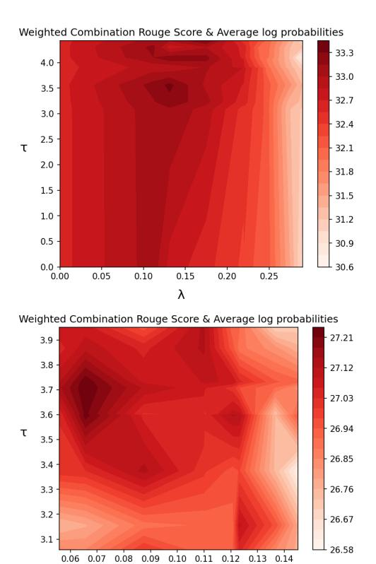

# Mutual Information Alleviates Hallucinations in Abstractive Summarization

## Liam van der Poel Ryan Cotterell Clara Meister

[lvander@ethz.ch](mailto:lvander@ethz.ch) {[ryan.cotterell,](mailto:ryan.cotterell.inf.ethz.ch) [clara.meister](mailto:clara.meister@inf.ethz.ch)}@inf.ethz.ch

## Abstract

Despite significant progress in the quality of language generated from abstractive summarization models, these models still exhibit the tendency to hallucinate, i.e., output content not supported by the source document. A number of works have tried to fix—or at least uncover the source of—the problem with limited success. In this paper, we identify a simple criterion under which models are significantly more likely to assign more probability to hallucinated content during generation: high model uncertainty. This finding offers a potential explanation for hallucinations: models default to favoring text with high marginal probability, i.e., high-frequency occurrences in the training set, when uncertain about a continuation. It also motivates possible routes for real-time intervention during decoding to prevent such hallucinations. We propose a decoding strategy that switches to optimizing for pointwise mutual information of the source and target token—rather than purely the probability of the target token—when the model exhibits uncertainty. Experiments on the XSUM dataset show that our method decreases the probability of hallucinated tokens while maintaining the ROUGE and BERTS scores of top-performing decoding strategies.

[https://github.com/VanderpoelLiam/](https://github.com/VanderpoelLiam/CPMI) [CPMI](https://github.com/VanderpoelLiam/CPMI)

## 1 Introduction

Abstractive summarization, the task of condensing long documents into short summaries, has a number of applications, such as providing overviews of news articles or highlighting main points in technical documents. Abstractive summarization is usually performed using probabilistic text generators [\(Goyal and Durrett,](#page-5-0) [2020;](#page-5-0) [Mao et al.,](#page-6-0) [2020;](#page-6-0) [Kryscinski et al.,](#page-6-1) [2020\)](#page-6-1), which have shown a strong ability to produce fluent, human-like text [\(Baevski](#page-5-1) [and Auli,](#page-5-1) [2019;](#page-5-1) [Radford et al.,](#page-7-0) [2019;](#page-7-0) [Brown et al.,](#page-5-2) [2020\)](#page-5-2). However, these models have been observed

to hallucinate facts, i.e., add information to the output that was not present in the original text. This behavior is problematic, as presenting users with unsubstantiated content can lead to undesirable effects, such as the spread of misinformation [\(Bender](#page-5-3) [et al.,](#page-5-3) [2021;](#page-5-3) [Abid et al.,](#page-5-4) [2021;](#page-5-4) [Liang et al.,](#page-6-2) [2021\)](#page-6-2). Some works have attributed this phenomenon to the specific training corpora for these models, in which ground-truth summaries often contain outside information that may not have been directly deducible from the original text [\(Maynez et al.,](#page-6-3) [2020;](#page-6-3) [Zhou et al.,](#page-7-1) [2021\)](#page-7-1). Others have pointed to model architectures or training strategies [\(Voita](#page-7-2) [et al.,](#page-7-2) [2021;](#page-7-2) [Wang and Sennrich,](#page-7-3) [2020;](#page-7-3) [Kang and](#page-6-4) [Hashimoto,](#page-6-4) [2020\)](#page-6-4). While these works have given us an improved understanding of the cause of hallucinations, there still does not exist an efficient and robust set of techniques for identifying and preventing them during the generation process.

This work aims to first provide a simple criterion indicating when a model is more likely to assign higher probability to content not necessarily derived from the source document. Specifically, we link the start of a hallucination during generation to high model uncertainty about the next token, which we quantify by conditional entropy. We hypothesize that hallucinations may be due to a tendency of models to default to placing probability mass on tokens that appeared frequently in the training corpus, a behavior by language models previously observed in several natural language processing (NLP) tasks [\(Kobayashi et al.,](#page-6-5) [2020;](#page-6-5) [Wei et al.,](#page-7-4) [2021\)](#page-7-4). As a consequence, generations with hallucinations would still be viable candidates, as standard decoding strategies for summarization optimize purely for the probability of the generation. We propose an alternative decoding strategy to combat this behavior: When a model exhibits high uncertainty, we change our decoding objective to pointwise mutual information between the source document and target token (PMI; [Li et al.,](#page-6-6) [2016;](#page-6-6) [Takayama and Arase,](#page-7-5) [2019\)](#page-7-5), encouraging the model to prioritize tokens relevant to the source document. While changing

completely to the PMI objective causes a drop of 3.13% in ROUGE-L scores, this conditional and temporary change leads to only a 0.977% drop in ROUGE-L while increasing factuality according to the FACTScore metric.

In experiments, we first observe a strong correlation between conditional entropy and the start of a hallucination on an annotated subset of the XSUM dataset (Maynez et al., 2020). We next score the targets in the annotated subset under both the standard log-probability objective and CPMI, and observe that the revised log-probability of hallucinated tokens under the CPMI objective is indeed lower. Finally, we find that our proposed decoding strategy maintains ROUGE and BERTS scores.

#### 2 Preliminaries

In this work, we consider probabilistic models for abstractive summarization. Explicitly, we consider models with distribution  $p(y \mid x)$ , where x is the source document that we wish to summarize and  $\mathbf{y} = \langle y_0, \dots, y_T \rangle$  is a string, represented as a sequence of tokens from the model's vocabulary  $\mathcal{V}$ . The set of valid sequences  $\mathcal{Y}$  is then defined as all sequences y such that  $y_0 \stackrel{\text{def}}{=} BOS$  and  $y_T \stackrel{\text{def}}{=} \text{EOS}$ , the beginning- and end-of-sequence tokens, respectively, and  $y_t \in \mathcal{V}$  for 0 < t < T. Note that standard models are locally normalized, i.e., they provide a probability distribution over  $\overline{\mathcal{V}} \stackrel{\text{def}}{=} \mathcal{V} \cup \{\text{EOS}\}$  at time step t given the source document and prior context  $p(\cdot \mid \mathbf{y}_{< t}, \mathbf{x})$ . The probability of an entire string y can then be computed as  $p(\mathbf{y} \mid \mathbf{x}) = \prod_{t=1}^{T} p(y_t \mid \mathbf{y}_{< t}, \mathbf{x})$ , where for shorthand we define  $\mathbf{y}_{< t} \stackrel{\text{def}}{=} \langle y_0, \dots, y_{t-1} \rangle$ .

Generation from p is performed token-by-token due to the autoregressive natures of most language generators. We typically seek to generate a string that maximizes some score function

$$\mathbf{y}^{\star} = \underset{\mathbf{y} \in \mathcal{Y}}{\operatorname{argmax}} \operatorname{score}(\mathbf{y} \mid \mathbf{x}) \tag{1}$$

In the case of probabilistic models, this function is often simply  $\operatorname{score}(\mathbf{y} \mid \mathbf{x}) = \log p(\mathbf{y} \mid \mathbf{x})$ , i.e., we want to generate a high probability string  $\mathbf{y}$ . Note that searching over the entire space  $\mathcal{Y}$  is usually infeasible (or at least impractical) due to the non-Markovian nature of most neural models. Thus we often use an approximate search algorithm such as beam search, as given in Alg 1, that optimizes for our score function somewhat greedily. This procedure meshes well with the use of  $\log p$  as

<span id="page-1-0"></span>**Algorithm 1** Standard beam search. ¹ ○ used to represent string concatenation.

```
Input: x: source document
           k: maximum beam size
           n_{\rm max}: maximum hypothesis length
           score(\cdot \mid \cdot): scoring function
  1: B_0 \leftarrow \{\langle 0, BOS \rangle\} \rightarrow beam set
     for t \in \{1, ..., n_{\max}\} do
  3:
            for \langle s, \mathbf{y} \rangle \in B_{t-1} do
  4:
  5:
                  for u \in \overline{\mathcal{V}} do
                        s \leftarrow \text{score}(\mathbf{y} \circ y \mid \mathbf{x})
  6:
  7:
                        B.add(\langle s, \mathbf{y} \circ y \rangle)
             B_t \leftarrow B.top(k)
  8:
  9: return B_{n_{\max}}.max()
```

the score function since it can be decomposed as the sum of individual token log-probabilities, i.e., we can instead consider a token-wise score function  $score(y \mid \mathbf{y}_{< t}, \mathbf{x}) = \log p(y \mid \mathbf{y}_{< t}, \mathbf{x})$  using the fact that  $score(\mathbf{y} \mid \mathbf{x}) = \sum_{t=1}^{T} score(y \mid \mathbf{y}_{< t}, \mathbf{x})$ . We only consider decoding strategies for score functions that can be decomposed in this manner.

Evaluation. Abstractive summarization systems are usually evaluated using automatic metrics, such as ROUGE (Lin, 2004). While ROUGE generally correlates poorly with human judgments (Maynez et al., 2020; Fabbri et al., 2021) and is only weakly correlated with factuality,<sup>2</sup> it is quick to compute, making it useful for quickly testing modeling choices. Recently, entailment metrics (FactCC; Kryscinski et al., 2020) and contextual embedding methods (BERTScore; Zhang et al., 2020) have surfaced as reasonable indicators of factuality.

## <span id="page-1-3"></span>3 Finding and Combating Hallucinations

It is not well understood *when* summarization models start to hallucinate, i.e., when they start to place high probability on continuations that are unfaithful (not entailed by the information presented in the source document). In this work, we hypothesize that such moments correlate with high model uncertainty. In other problem settings, it has been observed that NLP models default to placing an inappropriately large portion of probability mass on high-frequency (with respect to the training cor-

<span id="page-1-2"></span><span id="page-1-1"></span><sup>&</sup>lt;sup>1</sup>Pseudocode taken from Meister et al. (2020).

<sup>&</sup>lt;sup>2</sup>ROUGE-2 on XSUM has 0.17 Pearson and 0.14 Spearman correlation (Deutsch et al., 2021; Pagnoni et al., 2021)

pus) tokens; this is especially the case when making predictions for data points of a type that the model has not had much exposure to during training (Kobayashi et al., 2020; Wei et al., 2021). In this same setting, models often have high (epistemic) uncertainty about their predictions (Hüllermeier and Waegeman, 2021). We extrapolate on these findings and posit that summarization models may score highly more marginally likely—but perhaps unrelated—tokens in settings for which they are not well-calibrated.

Fortunately, both model certainty and marginal likelihood have quantifications that can be easily computed at any given point in the decoding process, making it possible to test for relationships between these quantities and the start of hallucinations. Specifically, we can use the standard equation for Shannon entropy with our conditional distribution to quantify model uncertainty at time step t:  $\mathrm{H}(p(\cdot\mid\mathbf{y}_{< t},\mathbf{x})) = -\sum_{y\in\overline{\mathcal{V}}} p(y\mid\mathbf{y}_{< t},\mathbf{x})\log p(y\mid\mathbf{y}_{< t},\mathbf{x})$ . Entropy is not a holistic measure of uncertainty,<sup>3</sup> but our use of is motivated by previous research that has likewise employed it to quantify the uncertainty of model predictions in classification (Gal and Ghahramani, 2016) and summarization (Xu et al., 2020) tasks. Further, we can directly compute marginal probabilities  $p(y \mid \mathbf{y}_{< t})$  using a language model—this value quantifies how likely a continuation y is irrespective of the source.4

#### 3.1 Pointwise Mutual Information Decoding

Under the premise that models are placing disproportionate probability mass on marginally likely, (i.e., frequent) tokens, the standard log-probability decoding objective is prone to favor generic continuations regardless of the input. In order to alleviate the problem of generic outputs from neural conversation models, Li et al. (2016) propose maximizing for mutual information during decoding, which effectively introduces a penalty term for such candidates. Formally, they propose using the following score function in the problem of Eq. (1):

$$score(\mathbf{y} | \mathbf{x}) = \log \frac{p(\mathbf{x}, \mathbf{y})}{p(\mathbf{x})p(\mathbf{y})}$$
(2)

which is the (pairwise) mutual information between the source  $\mathbf{x}$  and the target  $\mathbf{y}$ . Note that this would be equivalent to optimizing for  $\operatorname{score}(\mathbf{y} \mid \mathbf{x}) = \log p(\mathbf{y} \mid \mathbf{x}) - \log p(\mathbf{y}).^5$  While this score function likewise decomposes over tokens, for the same reasons as discussed earlier, solving for the exact minimizer is computationally intractable. Thus we must still resort to approximate search algorithms. In practice, one can iteratively optimize for *pointwise* mutual information (PMI):  $\log p(y \mid \mathbf{y}_{< t}, \mathbf{x}) - \log p(y \mid \mathbf{y}_{< t}).^6$ 

Our proposed decoding strategy, **conditional PMI decoding** (CPMI), uses the conditional entropy at a given time step to indicate when the pointwise decoding objective should be changed. This process can be formalized as follows. For a given (token-by-token) decoding strategy, we use the pointwise score function:

$$score(y \mid \mathbf{y}_{< t}, \mathbf{x}) = \log p(y \mid \mathbf{y}_{< t}, \mathbf{x})$$

$$- \lambda \cdot \mathbb{1} \left\{ H(p(\cdot \mid \mathbf{y}_{< t}, \mathbf{x})) \ge \tau \right\} \cdot \log p(y \mid \mathbf{y}_{< t})$$
(3)

In words, when  $H(p(\cdot|\mathbf{y}_{< t},\mathbf{x}))$  is above a certain threshold  $\tau$ , we subtract a term for the marginal log-probability of the token, i.e., we change from the standard token-wise log-probability objective to PMI.

#### <span id="page-2-4"></span>4 Related Work

Understanding hallucinations. Several prior works have tried to identify the cause of hallucinations in various natural language generation tasks, along with methods for alleviating them. For example, both Wang and Sennrich (2020) and Voita et al. (2021) suggest that exposure bias, i.e., the failure of a model to predict accurate continuations following its own generations rather than the ground-truth context as a result of the discrepancy between procedures at training and inference, leads to hallucinations, as it causes the model to over-rely on target contributions when decoding. They propose using minimum risk training (MRT), which can alleviate exposure bias, to make models more robust. However these results show only a tentative connection to exposure bias, and are based on models for neural machine translation (NMT) rather than summarization. Other works have shown that

<span id="page-2-0"></span><sup>&</sup>lt;sup>3</sup>While we may also use techniques like MC dropout (Gal and Ghahramani, 2016) to quantify model uncertainty, such metrics would only capture epistemic uncertainty. Entropy on the other hand, should provide a quantification of both aleatoric and epistemic uncertainty.

<span id="page-2-1"></span><sup>&</sup>lt;sup>4</sup>As  $p(y | \mathbf{y}_{< t}) = \sum_{\mathbf{x}} p(y | \mathbf{y}_{< t}, \mathbf{x})$ , the language model probability is equivalent to marginalizing over all source documents  $\mathbf{x}$ .

<span id="page-2-2"></span><sup>&</sup>lt;sup>5</sup>This follows as  $\log \frac{p(\mathbf{x}, \mathbf{y})}{p(\mathbf{x})p(\mathbf{y})} = \log \frac{p(\mathbf{y}|\mathbf{x})}{p(\mathbf{y})} = \log p(\mathbf{y} \mid \mathbf{x}) - \log p(\mathbf{y})$  after applying Bayes rule.

<span id="page-2-3"></span><sup>&</sup>lt;sup>6</sup>Other practical considerations are the introduction of the hyperparameter  $\lambda$  to control the strength of the influence of the language model p(y).

pre-training and training on more data generate summaries more faithful to the source [\(Voita et al.,](#page-7-2) [2021;](#page-7-2) [Maynez et al.,](#page-6-3) [2020\)](#page-6-3). In contrast to these works, our method does not require any changes to model training. Rather, it intervenes during generation without the need to retrain the base model.

Detecting hallucinations. Other efforts aim to identify hallucinations rather than their cause. Token- [\(Zhou et al.,](#page-7-1) [2021\)](#page-7-1) and sentence-level [\(Kryscinski et al.,](#page-6-1) [2020\)](#page-6-1) hallucination detection, as well as textual entailment systems [\(Goyal and](#page-5-0) [Durrett,](#page-5-0) [2020\)](#page-5-0) allow hallucinations to be identified after the generation process. Some techniques even aim to correct the unfaithful span by, e.g., replacing it with text from the source [\(Chen et al.,](#page-5-8) [2021\)](#page-5-8). However, these approaches are all post-hoc. Our approach intervenes during decoding, allowing real-time hallucination detection and prevention.

Decoding to avoid hallucinations. Perhaps most in-line with this work, some prior work has modified the decoding procedure to avoid unfaithful outputs. Keyword-based methods extract keyphrases from the source and require that they appear in the summary [\(Mao et al.,](#page-6-0) [2020\)](#page-6-0). The focus attention mechanism [\(Aralikatte et al.,](#page-5-9) [2021\)](#page-5-9) biases the decoder towards tokens that are similar to the source. While this is similar to our approach, we use mutual information to bias our decoding algorithm away from high probability—but not necessarily relevant—candidates. Another difference is that our method only runs when model uncertainty, as quantified by conditional entropy, is high, so we only bias generation when necessary. Lastly, our approach is purely abstractive and does not require resorting to extractive methods.

Mutual information decoding. Mutual information-based decoding techniques have proven to be helpful in a number of settings. For example, in zero-shot settings [\(Holtzman et al.,](#page-5-10) [2021\)](#page-5-10) or for promoting diversity or relevance in neural dialogue models [\(Li et al.,](#page-6-6) [2016;](#page-6-6) [Takayama](#page-7-5) [and Arase,](#page-7-5) [2019\)](#page-7-5). Our work is the first to use mutual information to increase the faithfulness of summaries in abstractive summarization.

## 5 Experiments

Data. We use the extreme summarization (XSUM) dataset [\(Narayan et al.,](#page-6-11) [2018\)](#page-6-11), which is composed of 226,711 British Broadcasting Corporation (BBC) articles and their single-sentence

summaries. We use the same train–valid–test splits as the authors. A subset of these articles (500) from the test set are annotated, i.e., reference spans are labeled as faithful or not to the source article [\(Maynez et al.,](#page-6-3) [2020\)](#page-6-3). We further process these labels to obtain token-level hallucination labels.

Models. We use the Fairseq framework [\(Ott et al.,](#page-6-12) [2019\)](#page-6-12) for all of our experiments. We evaluate several models: a transformer based summarization model (TRANS2S) trained on the XSUM dataset with the standard maximum log-likelihood objective as well as the BART summarization model (BARTS2S) fine-tuned on XSUM [\(Lewis et al.,](#page-6-13) [2020\)](#page-6-13).[7](#page-3-0) Lastly, for our language model p(y), we train a Transformer-based language model.[8](#page-3-1)

Decoding. We generate summaries using CPMI and beam search, as well as score existing summaries under the CPMI objective. We do a hyperparameter search to select the two hyperparameters λ/τ (see appendix [B](#page-8-0) for details). For evaluations, we would ideally use token-level faithfulness labels. However, we have only 500 such human annotated reference summaries [\(Maynez et al.,](#page-6-3) [2020\)](#page-6-3). To obtain labels for the generated text, and the 10,832 other reference summaries, we turn to automatic factuality detection [\(Zhou et al.,](#page-7-1) [2021\)](#page-7-1). This allows us to evaluate on metrics specific to the token label e.g., average probability of hallucinated tokens. We investigate solely using the PMI objective by allowing τ = 0 during our hyperparameter search.

Evaluation. Lacking a good operationalization of a hallucination, we cannot directly measure the fraction of hallucinated tokens in the generated summaries. In line with previous work, we rely on automatic metrics and human evaluations to estimate the incidence of hallucinations [\(Nie et al.,](#page-6-14) [2019;](#page-6-14) [Maynez et al.,](#page-6-3) [2020;](#page-6-3) [Zhou et al.,](#page-7-1) [2021\)](#page-7-1). CPMI is evaluated using standard summarization performance metrics (ROUGE and BERTScore), factuality metrics (FactCC and FACTScore), and an estimation of hallucination incidence based on scoring reference summaries with associated human evaluated hallucination labels. The FactCC metric computes a token-level binary factuality score over a collection of source/summary pairs and returns the mean [\(Pagnoni et al.,](#page-6-9) [2021\)](#page-6-9). It uses the binary

<span id="page-3-0"></span><sup>7</sup> [https://github.com/facebookresearch/fairseq/](https://github.com/facebookresearch/fairseq/tree/main/examples/bart) [tree/main/examples/bart](https://github.com/facebookresearch/fairseq/tree/main/examples/bart)

<span id="page-3-1"></span><sup>8</sup>We use both XSUM articles and summaries when training our LM as we found the summaries alone did not constitute enough data to train a well-performing LM.

<span id="page-4-0"></span>

|                                           | TRANS2                           | 2S                               | BARTS2S                          |                                  |  |
|-------------------------------------------|----------------------------------|----------------------------------|----------------------------------|----------------------------------|--|
| Metrics                                   | Beam Search                      | CPMI                             | Beam Search                      | CPMI                             |  |
| ROUGE-L<br>BERTS P<br>BERTS R<br>BERTS F1 | 0.252<br>0.901<br>0.886<br>0.893 | 0.249<br>0.897<br>0.885<br>0.891 | 0.372<br>0.926<br>0.917<br>0.922 | 0.372<br>0.926<br>0.917<br>0.922 |  |
| FACTScore<br>FactCC                       | 0.155<br><b>0.221</b>            | <b>0.167</b> 0.193               | 0.126<br><b>0.232</b>            | <b>0.128</b> 0.227               |  |

Table 1: Performance and factuality metrics for both models and decoding procedures

<span id="page-4-1"></span>

| Token Label      | TRAN           | S2S                             | BARTS2S        |                                |  |
|------------------|----------------|---------------------------------|----------------|--------------------------------|--|
| Token Laber      | $\Delta$ score | $\Delta$ rank                   | $\Delta$ score | $\Delta rank$                  |  |
| Non-Hallucinated | $-0.35\pm0.03$ | $987 \pm 91$                    | $-0.07\pm0.01$ | 275±114                        |  |
| Hallucinated     | $-0.50\pm0.01$ | $1228{\pm}42$                   | $-0.07\pm0.01$ | $395\pm45$                     |  |
| Initial          | $-0.55\pm0.04$ | $1272{\pm}\textcolor{red}{126}$ | $-0.13\pm0.03$ | $552{\pm}\textcolor{red}{134}$ |  |
| Subsequent       | $-0.50\pm0.01$ | $1221{\pm}44$                   | $-0.07\pm0.01$ | $376{\pm}47$                   |  |

Table 2: Change in average token score and ranking by ground-truth hallucination label for CPMI compared to beam search.

entailment classifier of the same name (Kryscinski et al., 2020). Thus we can produce a similar entailment metric using the factuality labeling generated by Zhou et al. (2021), which we denote FACTScore. The uncertainty values of our results denote standard error.

### 5.1 Preliminary Analysis

Using the 500 example subset of XSUM with factuality annotations (Maynez et al., 2020), we are able to determine whether a token is hallucinated, and further whether it is the first in a sequence of hallucinated tokens. Our preliminary investigations found that on average, the conditional entropy under our summarization model is higher for first hallucinated tokens relative to non-hallucinated tokens  $(4.197 \pm 0.065 \text{ vs } 3.689 \pm 0.021 \text{ for TRANS2S}$  and  $3.115 \pm 0.051 \text{ vs } 2.390 \pm 0.013 \text{ for BARTS2S}$ ). This suggests that hallucinations could be connected with model uncertainty, and that the start of hallucinations could be identified when conditional entropy is above a certain threshold, the model defaults to a likely but perhaps unfaithful token.

#### 5.2 Results

We now perform our generation and scoring analyses, as outlined above.

How are performance and factuality metrics impacted by CPMI? From Table 1 we see that for the BARTS2S model there is very little change to performance metrics. For the TRANS2S

model, performance metrics are slightly worse under CPMI, but the largest change is still within the margin of error. This suggests CPMI does not negatively impact the quality of generated sentences. While FACTScore increases under CPMI for both models, FactCC decreases. However, FACTScore employs a model trained specifically for XSUM while FactCC employs a model trained only on CNN/DM. Consequently, we take the results of FACTScore as a better indicator of the effect of our approach on hallucination incidence during generation. Examples of summaries generated with and without CPMI are given in fig. 1.

What happens to known unfaithful tokens when scored under CPMI? Table 2 shows how token-level score and ranking (where the highestprobability token is rank 1 and lowest probability token is rank  $|\mathcal{V}|$ ) change when CPMI is used instead of the standard log-probability scoring function for 500 ground-truth summaries with human evaluated factuality labels. Overall, we see that for hallucinated tokens, the scores decrease and ranking increases, which is the desired behavior. This is particularly true for tokens at the start of an unfaithful span (denoted as Initial), for which we see a more significant impact on both models. E.g., for BARTS2S, the score decreases more for initial vs. non-hallucinated ( $-0.13 \pm 0.03 \text{ vs } -0.07 \pm 0.01$ ) and likewise rankings increasing more (275  $\pm$  114 vs.  $552 \pm 134$ ). While there is also an impact on non-hallucinated tokens, it is much less significant. For an appropriate choice of threshold though, it is likely that PMI will not be in action at times when non-hallucinated tokens would have been chosen, meaning this change should not be a concern.

#### 6 Conclusion

In this work, we link the start of a hallucination in abstractive summarization during generation to model uncertainty, as quantified by high conditional entropy, about next-token predictions. We then propose a decoding procedure, CPMI, which switches the decoding objective to pointwise mutual information when model uncertainty is high to prevent hallucinations. Our method reduces the likelihood of generating unfaithful tokens while still outputting high-quality summaries. In the future it would be interesting to combine CPMI decoding with post-hoc correction methods and other decoding procedures, to investigate if we can complement existing techniques mentioned in §4.

# Limitations

A clear limitation of this work is that the results have been shown only for English on the XSUM dataset, as this is the only open dataset with the annotations required for our set of experiments. Further work should consider other model architectures, and other datasets such as CNN/DM [\(Her](#page-5-11)[mann et al.,](#page-5-11) [2015\)](#page-5-11). Further, we do not conduct human evaluations. Using human judges to obtain a qualitative assessment of the effect of CPMI could provide additional data about the efficacy of the decoding procedure. However, we note that human judgment of the faithfulness of summaries is far from perfect [\(Clark et al.,](#page-5-12) [2021\)](#page-5-12).

There are issues with the XSUM dataset that may be confounders for results: some articles/summaries are in Gaelic, and previous work has shown that reference summaries often contain spans not directly inferable from the source article [\(Maynez et al.,](#page-6-3) [2020\)](#page-6-3). Limitations of the models themselves are that we truncate the source to 4096 tokens, so we lose information due to this training constraint.

## Ethical Concerns

We do not foresee any ethical concerns with this work beyond those already documented in abstractive summarization systems and other text generators [\(Smiley et al.,](#page-7-8) [2017;](#page-7-8) [Zellers et al.,](#page-7-9) [2019;](#page-7-9) [Kreps et al.,](#page-6-15) [2022\)](#page-6-15).

# References

- <span id="page-5-4"></span>Abubakar Abid, Maheen Farooqi, and James Zou. 2021. [Large language models associate mus](https://www.nature.com/articles/s42256-021-00359-2)[lims with violence.](https://www.nature.com/articles/s42256-021-00359-2) *Nature Machine Intelligence*, 3(6):461–463.
- <span id="page-5-9"></span>Rahul Aralikatte, Shashi Narayan, Joshua Maynez, Sascha Rothe, and Ryan McDonald. 2021. [Focus at](https://doi.org/10.18653/v1/2021.acl-long.474)[tention: Promoting faithfulness and diversity in sum](https://doi.org/10.18653/v1/2021.acl-long.474)[marization.](https://doi.org/10.18653/v1/2021.acl-long.474) In *Proceedings of the 59th Annual Meeting of the Association for Computational Linguistics and the 11th International Joint Conference on Natural Language Processing (Volume 1: Long Papers)*, pages 6078–6095, Online. Association for Computational Linguistics.
- <span id="page-5-1"></span>Alexei Baevski and Michael Auli. 2019. [Adaptive in](https://openreview.net/forum?id=ByxZX20qFQ)[put representations for neural language modeling.](https://openreview.net/forum?id=ByxZX20qFQ) In *Proceedings of the 7th International Conference on Learning Representations*.
- <span id="page-5-3"></span>Emily M. Bender, Timnit Gebru, Angelina McMillan-Major, and Shmargaret Shmitchell. 2021. [On the](https://doi.org/10.1145/3442188.3445922)

- [dangers of stochastic parrots: Can language models](https://doi.org/10.1145/3442188.3445922) [be too big?](https://doi.org/10.1145/3442188.3445922) In *Proceedings of the 2021 ACM Conference on Fairness, Accountability, and Transparency*, page 610–623, New York, NY, USA. Association for Computing Machinery.
- <span id="page-5-2"></span>Tom Brown, Benjamin Mann, Nick Ryder, Melanie Subbiah, Jared D Kaplan, Prafulla Dhariwal, Arvind Neelakantan, Pranav Shyam, Girish Sastry, Amanda Askell, et al. 2020. [Language models are few-shot](https://proceedings.neurips.cc/paper/2020/file/1457c0d6bfcb4967418bfb8ac142f64a-Paper.pdf) [learners.](https://proceedings.neurips.cc/paper/2020/file/1457c0d6bfcb4967418bfb8ac142f64a-Paper.pdf) *Advances in Neural Information Processing Systems*, 33:1877–1901.
- <span id="page-5-8"></span>Sihao Chen, Fan Zhang, Kazoo Sone, and Dan Roth. 2021. [Improving faithfulness in abstractive summa](https://doi.org/10.18653/v1/2021.naacl-main.475)[rization with contrast candidate generation and se](https://doi.org/10.18653/v1/2021.naacl-main.475)[lection.](https://doi.org/10.18653/v1/2021.naacl-main.475) In *Proceedings of the 2021 Conference of the North American Chapter of the Association for Computational Linguistics: Human Language Technologies*, pages 5935–5941, Online. Association for Computational Linguistics.
- <span id="page-5-12"></span>Elizabeth Clark, Tal August, Sofia Serrano, Nikita Haduong, Suchin Gururangan, and Noah A. Smith. 2021. [All that's 'human' is not gold: Evaluating](https://doi.org/10.18653/v1/2021.acl-long.565) [human evaluation of generated text.](https://doi.org/10.18653/v1/2021.acl-long.565) In *Proceedings of the 59th Annual Meeting of the Association for Computational Linguistics and the 11th International Joint Conference on Natural Language Processing (Volume 1: Long Papers)*, pages 7282–7296, Online. Association for Computational Linguistics.
- <span id="page-5-6"></span>Daniel Deutsch, Rotem Dror, and Dan Roth. 2021. [A Statistical Analysis of Summarization Evaluation](https://doi.org/10.1162/tacl_a_00417) [Metrics Using Resampling Methods.](https://doi.org/10.1162/tacl_a_00417) *Transactions of the Association for Computational Linguistics*, 9:1132–1146.
- <span id="page-5-5"></span>Alexander R. Fabbri, Wojciech Krysci ´ nski, Bryan ´ McCann, Caiming Xiong, Richard Socher, and Dragomir Radev. 2021. [SummEval: Re-evaluating](https://doi.org/10.1162/tacl_a_00373) [summarization evaluation.](https://doi.org/10.1162/tacl_a_00373) *Transactions of the Association for Computational Linguistics*, 9:391–409.
- <span id="page-5-7"></span>Yarin Gal and Zoubin Ghahramani. 2016. [Dropout as a](https://proceedings.mlr.press/v48/gal16.html) [bayesian approximation: Representing model uncer](https://proceedings.mlr.press/v48/gal16.html)[tainty in deep learning.](https://proceedings.mlr.press/v48/gal16.html) In *Proceedings of The 33rd International Conference on Machine Learning*, volume 48, pages 1050–1059, New York, New York, USA.
- <span id="page-5-0"></span>Tanya Goyal and Greg Durrett. 2020. [Evaluating fac](https://doi.org/10.18653/v1/2020.findings-emnlp.322)[tuality in generation with dependency-level entail](https://doi.org/10.18653/v1/2020.findings-emnlp.322)[ment.](https://doi.org/10.18653/v1/2020.findings-emnlp.322) In *Findings of the Association for Computational Linguistics: EMNLP 2020*, pages 3592–3603, Online. Association for Computational Linguistics.
- <span id="page-5-11"></span>Karl Moritz Hermann, Tomas Kocisky, Edward Grefenstette, Lasse Espeholt, Will Kay, Mustafa Suleyman, and Phil Blunsom. 2015. [Teaching machines to read](https://dl.acm.org/doi/10.5555/2969239.2969428) [and comprehend.](https://dl.acm.org/doi/10.5555/2969239.2969428) *Advances in Neural Information Processing Systems*, 28:1693–1701.
- <span id="page-5-10"></span>Ari Holtzman, Peter West, Vered Shwartz, Yejin Choi, and Luke Zettlemoyer. 2021. [Surface form compe](https://doi.org/10.18653/v1/2021.emnlp-main.564)[tition: Why the highest probability answer isn't al](https://doi.org/10.18653/v1/2021.emnlp-main.564)[ways right.](https://doi.org/10.18653/v1/2021.emnlp-main.564) In *Proceedings of the 2021 Conference*

- *on Empirical Methods in Natural Language Processing*, pages 7038–7051, Online and Punta Cana, Dominican Republic. Association for Computational Linguistics.
- <span id="page-6-10"></span>Eyke Hüllermeier and Willem Waegeman. 2021. [Aleatoric and epistemic uncertainty in machine](https://link.springer.com/article/10.1007/s10994-021-05946-3) [learning: An introduction to concepts and methods.](https://link.springer.com/article/10.1007/s10994-021-05946-3) *Machine Learning*, 110:457–506.
- <span id="page-6-4"></span>Daniel Kang and Tatsunori B. Hashimoto. 2020. [Im](https://doi.org/10.18653/v1/2020.acl-main.66)[proved natural language generation via loss trunca](https://doi.org/10.18653/v1/2020.acl-main.66)[tion.](https://doi.org/10.18653/v1/2020.acl-main.66) In *Proceedings of the 58th Annual Meeting of the Association for Computational Linguistics*, pages 718–731, Online. Association for Computational Linguistics.
- <span id="page-6-5"></span>Goro Kobayashi, Tatsuki Kuribayashi, Sho Yokoi, and Kentaro Inui. 2020. [Attention is not only a weight:](https://doi.org/10.18653/v1/2020.emnlp-main.574) [Analyzing transformers with vector norms.](https://doi.org/10.18653/v1/2020.emnlp-main.574) In *Proceedings of the 2020 Conference on Empirical Methods in Natural Language Processing*, pages 7057– 7075, Online. Association for Computational Linguistics.
- <span id="page-6-16"></span>Philipp Koehn, Hieu Hoang, Alexandra Birch, Chris Callison-Burch, Marcello Federico, Nicola Bertoldi, Brooke Cowan, Wade Shen, Christine Moran, Richard Zens, Chris Dyer, Ondˇrej Bojar, Alexandra Constantin, and Evan Herbst. 2007. [Moses: Open](https://aclanthology.org/P07-2045) [source toolkit for statistical machine translation.](https://aclanthology.org/P07-2045) In *Proceedings of the 45th Annual Meeting of the Association for Computational Linguistics Companion Volume Proceedings of the Demo and Poster Sessions*, pages 177–180, Prague, Czech Republic. Association for Computational Linguistics.
- <span id="page-6-15"></span>Sarah Kreps, R Miles McCain, and Miles Brundage. 2022. [All the news that's fit to fabricate: AI](https://www.cambridge.org/core/journals/journal-of-experimental-political-science/article/abs/all-the-news-thats-fit-to-fabricate-aigenerated-text-as-a-tool-of-media-misinformation/40F27F0661B839FA47375F538C19FA59)[generated text as a tool of media misinformation.](https://www.cambridge.org/core/journals/journal-of-experimental-political-science/article/abs/all-the-news-thats-fit-to-fabricate-aigenerated-text-as-a-tool-of-media-misinformation/40F27F0661B839FA47375F538C19FA59) *Journal of Experimental Political Science*, 9(1):104– 117.
- <span id="page-6-1"></span>Wojciech Kryscinski, Bryan McCann, Caiming Xiong, and Richard Socher. 2020. [Evaluating the factual](https://doi.org/10.18653/v1/2020.emnlp-main.750) [consistency of abstractive text summarization.](https://doi.org/10.18653/v1/2020.emnlp-main.750) In *Proceedings of the 2020 Conference on Empirical Methods in Natural Language Processing*, pages 9332–9346, Online. Association for Computational Linguistics.
- <span id="page-6-13"></span>Mike Lewis, Yinhan Liu, Naman Goyal, Marjan Ghazvininejad, Abdelrahman Mohamed, Omer Levy, Veselin Stoyanov, and Luke Zettlemoyer. 2020. [BART: Denoising sequence-to-sequence pre](https://doi.org/10.18653/v1/2020.acl-main.703)[training for natural language generation, translation,](https://doi.org/10.18653/v1/2020.acl-main.703) [and comprehension.](https://doi.org/10.18653/v1/2020.acl-main.703) In *Proceedings of the 58th Annual Meeting of the Association for Computational Linguistics*, pages 7871–7880, Online. Association for Computational Linguistics.
- <span id="page-6-6"></span>Jiwei Li, Michel Galley, Chris Brockett, Jianfeng Gao, and Bill Dolan. 2016. [A diversity-promoting ob](https://doi.org/10.18653/v1/N16-1014)[jective function for neural conversation models.](https://doi.org/10.18653/v1/N16-1014) In *Proceedings of the 2016 Conference of the North*

- *American Chapter of the Association for Computational Linguistics: Human Language Technologies*, pages 110–119, San Diego, California. Association for Computational Linguistics.
- <span id="page-6-2"></span>Paul Pu Liang, Chiyu Wu, Louis-Philippe Morency, and Ruslan Salakhutdinov. 2021. [Towards under](https://proceedings.mlr.press/v139/liang21a.html)[standing and mitigating social biases in language](https://proceedings.mlr.press/v139/liang21a.html) [models.](https://proceedings.mlr.press/v139/liang21a.html) In *Proceedings of the 38th International Conference on Machine Learning*, volume 139, pages 6565–6576.
- <span id="page-6-7"></span>Chin-Yew Lin. 2004. [ROUGE: A package for auto](https://aclanthology.org/W04-1013)[matic evaluation of summaries.](https://aclanthology.org/W04-1013) In *Text Summarization Branches Out*, pages 74–81, Barcelona, Spain. Association for Computational Linguistics.
- <span id="page-6-0"></span>Yuning Mao, Xiang Ren, Heng Ji, and Jiawei Han. 2020. [Constrained abstractive summarization: Pre](http://arxiv.org/abs/2010.12723)[serving factual consistency with constrained genera](http://arxiv.org/abs/2010.12723)[tion.](http://arxiv.org/abs/2010.12723) *CoRR*, abs/2010.12723.
- <span id="page-6-3"></span>Joshua Maynez, Shashi Narayan, Bernd Bohnet, and Ryan McDonald. 2020. [On faithfulness and factu](https://doi.org/10.18653/v1/2020.acl-main.173)[ality in abstractive summarization.](https://doi.org/10.18653/v1/2020.acl-main.173) In *Proceedings of the 58th Annual Meeting of the Association for Computational Linguistics*, pages 1906–1919, Online. Association for Computational Linguistics.
- <span id="page-6-8"></span>Clara Meister, Tim Vieira, and Ryan Cotterell. 2020. [Best-first beam search.](https://doi.org/10.1162/tacl_a_00346) *Transactions of the Association for Computational Linguistics*, 8:795–809.
- <span id="page-6-11"></span>Shashi Narayan, Shay B. Cohen, and Mirella Lapata. 2018. [Don't give me the details, just the summary!](https://doi.org/10.18653/v1/D18-1206) [topic-aware convolutional neural networks for ex](https://doi.org/10.18653/v1/D18-1206)[treme summarization.](https://doi.org/10.18653/v1/D18-1206) In *Proceedings of the 2018 Conference on Empirical Methods in Natural Language Processing*, pages 1797–1807, Brussels, Belgium. Association for Computational Linguistics.
- <span id="page-6-14"></span>Feng Nie, Jin-Ge Yao, Jinpeng Wang, Rong Pan, and Chin-Yew Lin. 2019. [A simple recipe towards re](https://doi.org/10.18653/v1/P19-1256)[ducing hallucination in neural surface realisation.](https://doi.org/10.18653/v1/P19-1256) In *Proceedings of the 57th Annual Meeting of the Association for Computational Linguistics*, pages 2673–2679, Florence, Italy. Association for Computational Linguistics.
- <span id="page-6-12"></span>Myle Ott, Sergey Edunov, Alexei Baevski, Angela Fan, Sam Gross, Nathan Ng, David Grangier, and Michael Auli. 2019. [fairseq: A fast, extensible](https://doi.org/10.18653/v1/N19-4009) [toolkit for sequence modeling.](https://doi.org/10.18653/v1/N19-4009) In *Proceedings of the 2019 Conference of the North American Chapter of the Association for Computational Linguistics (Demonstrations)*, pages 48–53, Minneapolis, Minnesota. Association for Computational Linguistics.
- <span id="page-6-9"></span>Artidoro Pagnoni, Vidhisha Balachandran, and Yulia Tsvetkov. 2021. [Understanding factuality in abstrac](https://doi.org/10.18653/v1/2021.naacl-main.383)[tive summarization with FRANK: A benchmark for](https://doi.org/10.18653/v1/2021.naacl-main.383) [factuality metrics.](https://doi.org/10.18653/v1/2021.naacl-main.383) In *Proceedings of the 2021 Conference of the North American Chapter of the Association for Computational Linguistics: Human Language Technologies*, pages 4812–4829, Online. Association for Computational Linguistics.

- <span id="page-7-0"></span>Alec Radford, Jeffrey Wu, Rewon Child, David Luan, Dario Amodei, Ilya Sutskever, et al. 2019. [Lan](https://d4mucfpksywv.cloudfront.net/better-language-models/language_models_are_unsupervised_multitask_learners.pdf)[guage models are unsupervised multitask learners.](https://d4mucfpksywv.cloudfront.net/better-language-models/language_models_are_unsupervised_multitask_learners.pdf) *OpenAI blog*, 1(8):9.
- <span id="page-7-10"></span>Rico Sennrich, Barry Haddow, and Alexandra Birch. 2016. [Neural machine translation of rare words](https://doi.org/10.18653/v1/P16-1162) [with subword units.](https://doi.org/10.18653/v1/P16-1162) In *Proceedings of the 54th Annual Meeting of the Association for Computational Linguistics (Volume 1: Long Papers)*, pages 1715– 1725, Berlin, Germany. Association for Computational Linguistics.
- <span id="page-7-8"></span>Charese Smiley, Frank Schilder, Vassilis Plachouras, and Jochen L. Leidner. 2017. [Say the right thing](https://doi.org/10.18653/v1/W17-1613) [right: Ethics issues in natural language generation](https://doi.org/10.18653/v1/W17-1613) [systems.](https://doi.org/10.18653/v1/W17-1613) In *Proceedings of the First ACL Workshop on Ethics in Natural Language Processing*, pages 103–108, Valencia, Spain. Association for Computational Linguistics.
- <span id="page-7-5"></span>Junya Takayama and Yuki Arase. 2019. [Relevant and](https://doi.org/10.18653/v1/W19-4115) [informative response generation using pointwise mu](https://doi.org/10.18653/v1/W19-4115)[tual information.](https://doi.org/10.18653/v1/W19-4115) In *Proceedings of the First Workshop on NLP for Conversational AI*, pages 133–138, Florence, Italy. Association for Computational Linguistics.
- <span id="page-7-2"></span>Elena Voita, Rico Sennrich, and Ivan Titov. 2021. [An](https://doi.org/10.18653/v1/2021.acl-long.91)[alyzing the source and target contributions to pre](https://doi.org/10.18653/v1/2021.acl-long.91)[dictions in neural machine translation.](https://doi.org/10.18653/v1/2021.acl-long.91) In *Proceedings of the 59th Annual Meeting of the Association for Computational Linguistics and the 11th International Joint Conference on Natural Language Processing (Volume 1: Long Papers)*, pages 1126–1140, Online. Association for Computational Linguistics.
- <span id="page-7-3"></span>Chaojun Wang and Rico Sennrich. 2020. [On exposure](https://doi.org/10.18653/v1/2020.acl-main.326) [bias, hallucination and domain shift in neural ma](https://doi.org/10.18653/v1/2020.acl-main.326)[chine translation.](https://doi.org/10.18653/v1/2020.acl-main.326) In *Proceedings of the 58th Annual Meeting of the Association for Computational Linguistics*, pages 3544–3552, Online. Association for Computational Linguistics.
- <span id="page-7-4"></span>Jason Wei, Dan Garrette, Tal Linzen, and Ellie Pavlick. 2021. [Frequency effects on syntactic rule learn](https://doi.org/10.18653/v1/2021.emnlp-main.72)[ing in transformers.](https://doi.org/10.18653/v1/2021.emnlp-main.72) In *Proceedings of the 2021 Conference on Empirical Methods in Natural Language Processing*, pages 932–948, Online and Punta Cana, Dominican Republic. Association for Computational Linguistics.
- <span id="page-7-7"></span>Jiacheng Xu, Shrey Desai, and Greg Durrett. 2020. [Un](https://doi.org/10.18653/v1/2020.emnlp-main.508)[derstanding neural abstractive summarization mod](https://doi.org/10.18653/v1/2020.emnlp-main.508)[els via uncertainty.](https://doi.org/10.18653/v1/2020.emnlp-main.508) In *Proceedings of the 2020 Conference on Empirical Methods in Natural Language Processing*, pages 6275–6281, Online. Association for Computational Linguistics.
- <span id="page-7-9"></span>Rowan Zellers, Ari Holtzman, Hannah Rashkin, Yonatan Bisk, Ali Farhadi, Franziska Roesner, and Yejin Choi. 2019. [Defending against neural fake](https://proceedings.neurips.cc/paper/2019/file/3e9f0fc9b2f89e043bc6233994dfcf76-Paper.pdf) [news.](https://proceedings.neurips.cc/paper/2019/file/3e9f0fc9b2f89e043bc6233994dfcf76-Paper.pdf) In *Advances in Neural Information Processing Systems*, volume 32. Curran Associates, Inc.

- <span id="page-7-6"></span>Tianyi Zhang, Varsha Kishore, Felix Wu, Kilian Q. Weinberger, and Yoav Artzi. 2020. [BERTScore:](https://openreview.net/forum?id=SkeHuCVFDr) [Evaluating text generation with BERT.](https://openreview.net/forum?id=SkeHuCVFDr) In *Proceedings of the 8th International Conference on Learning Representations*.
- <span id="page-7-1"></span>Chunting Zhou, Graham Neubig, Jiatao Gu, Mona Diab, Francisco Guzmán, Luke Zettlemoyer, and Marjan Ghazvininejad. 2021. [Detecting halluci](https://doi.org/10.18653/v1/2021.findings-acl.120)[nated content in conditional neural sequence gener](https://doi.org/10.18653/v1/2021.findings-acl.120)[ation.](https://doi.org/10.18653/v1/2021.findings-acl.120) In *Findings of the Association for Computational Linguistics: ACL-IJCNLP 2021*, pages 1393– 1404, Online. Association for Computational Linguistics.

<span id="page-8-1"></span>**REFERENCE SUMMARY:** A drunk man who was driving his car at 119mph when he crashed into and killed an off-duty police community support officer (PCSO) has been jailed.

**DOCUMENT:** Alwyn Pritchard, 53, was riding his motorbike when he was struck by an Audi driven by Paul Wilson, who then fled the scene, Cardiff Crown Court heard.

[2 sentences with 41 words are abbreviated from here.]

Wilson, an experienced HGV driver, admitted drinking "a couple of pints of Peroni and two bottles of Corona" but claimed he had been driving at 70mph on the Heads of the Valleys road near Abergavenny.

[12 sentences with 232 words are abbreviated from here.] Gwent Police Chief Constable Jeff Farrar described him as "a committed, kind and conscientious community support officer".

**TRANS2S:** A driver has been jailed for four years for causing the death of a man by careless driving.

**TRANS2S WITH CPMI:** A driver who crashed into a car which killed a couple has been jailed for seven years.

BARTS2S: A man has been jailed for causing the death of a police community support officer by dangerous driving in Monmouthshire.

BARTS2S WITH CPMI: A drink-driver has been jailed for causing the death of a police community support officer in Monmouthshire

Figure 1: An abridged example from the XSUM dataset and the generated summaries under TRANS2S and BARTS2S, with and without CPMI decoding.

#### **A Additional Results**

Table 3 contains the results of evaluating beam search and CPMI on ground truth token labels that was processed to generate Table 2. Table 4 contains the full results of our preliminary analysis to correlate average conditional entropy of the summarization model by token labels. Alg 1 provides the standard beam search algorithm.

## <span id="page-8-0"></span>**B** Implementation Details

We train all models using the Fairseq framework (Ott et al., 2019). The code will be released upon acceptance.

**Preprocessing.** We tokenize the data with Moses (Koehn et al., 2007). For the TRANS2S we learn and apply BPE using FastBPE (Sennrich et al., 2016), whereas for BARTS2S we follow the provided BPE preprocessing steps. <sup>9</sup> We then binarize the resulting data using the fairseq-preprocess CLI tool from Fairseq.

General training and generation. We train on a single GPU with 4 CPU cores, each with 2048 MB memory. The average runtime for training depends on the model, but was between 24 and 48 hours. We stop training early if validation performance

does not improve for 5 consecutive runs. We use a maximum length of 4096 tokens, and truncate longer sources. We use beam search with a beam size of 5, the same beam size is used for CPMI.

**TRANS2S.** We use the fairseq transformer model with parameters selected according to the transformer-wmt-en-de model  $^{10}$  We picked the parameter update frequency to be the maximum value that did not cause out-of-memory errors: 64. We then did a grid-search over dropout in [0.1, 0.3] and learning rate in  $[7 \times 10^{-4}, 7 \times 10^{-5}]$ . The optimal values were dropout of 0.3 and learning rate of  $7 \times 10^{-5}$ , with a validation loss of 6.225.

**BARTS2S.** We used a pretrained BART summarization model (Lewis et al., 2020) finetuned on XSUM.

Language model. As the BPE step was different for TRANS2S and BARTS2S, we trained two language models denoted by the associated summarization model name. The architecture is the fairseq transformer-lm model. The early stopping criteria was 5 runs, and maximum length was 2048 tokens. As before we picked the update-frequency to be as large as possible without taking too long, this was 32. We searched over different training sets of targets only and both source and targets. We then did a grid-search over learning rate in  $[1 \times 10^{-4}, 2.5 \times 10^{-4}, 5 \times 10^{-4}]$ . The optimal parameters were to train on both source and targets with a learning rate of  $1 \times 10^{-4}$  for TRANS2S and  $5 \times 10^{-4}$  for BARTS2S. The optimal validation metrics were a loss and perplexity of 5.6404 and 49.88 respectively for TRANS2S and 4.5453 and 23.35 respectively for BARTS2S.

CPMI hyperparameter search. We select two hyperparameters  $\lambda/\tau$ , controlling the influence of the language model and the conditional entropy threshold which triggers PMI decoding. The goal is to perform a min max optimization, where we minimize the average log probability (scored under the PMI objective) of initial hallucinated tokens based on human evaluations of the target sentences and to maximize the ROUGE-L score of generated sentences. We use the 500 example subset of XSUM with factuality annotations, that is a subset of the XSUM test set (Maynez et al., 2020). To perform the optimization we generate a heat plot with  $\lambda/\tau$ 

<span id="page-8-2"></span><sup>9</sup>https://github.com/facebookresearch/fairseq/ tree/main/examples/bart

<span id="page-8-3"></span><sup>10</sup>https://github.com/facebookresearch/fairseq/
tree/main/examples/translation

<span id="page-9-0"></span>

|                  | TRANS2S          |                |                  | BARTS2S        |                  |                |                |                |
|------------------|------------------|----------------|------------------|----------------|------------------|----------------|----------------|----------------|
| Token label      | Beam Search      |                | CPMI             |                | Beam Search      |                | CPMI           |                |
| Token laber      | score            | rank           | score            | rank           | score            | rank           | score          | rank           |
| Non-Hallucinated | $-3.58 \pm 0.02$ | $8020 \pm 62$  | $-3.93 \pm 0.02$ | $9007 \pm 67$  | $-2.15 \pm 0.01$ | $13403 \pm 80$ | $-2.22\pm0.01$ | $13678 \pm 81$ |
| Hallucinated     | $-5.09 \pm 0.01$ | $10458 \pm 29$ | $-5.59 \pm 0.01$ | $11686 \pm 31$ | $-2.48 \pm 0.01$ | $14219 \pm 31$ | $-2.55\pm0.01$ | $14614 \pm 32$ |
| Initial          | $-5.62 \pm 0.03$ | $13115\pm87$   | $-6.17\pm0.03$   | $14387 \pm 91$ | $-3.48 \pm 0.02$ | $16029 \pm 94$ | $-3.61\pm0.02$ | $16581 \pm 96$ |
| Subsequent       | $-5.01 \pm 0.01$ | $10091 \pm 30$ | $-5.51\pm0.01$   | $11312\pm32$   | $-2.35 \pm 0.01$ | $13994 \pm 33$ | $-2.42\pm0.01$ | $14370 \pm 34$ |

Table 3: Average score and ranking values with standard error by hallucination label scored on ground truth tokens for both models under beam search and CPMI.

<span id="page-9-1"></span>

| Average Conditional Entropy |                     |                     |  |  |
|-----------------------------|---------------------|---------------------|--|--|
| Token label                 | TRANS2S             | BARTS2S             |  |  |
| Non-Hallucinated            | $2.3898 \pm 0.0131$ | $3.8111 \pm 0.0292$ |  |  |
| Hallucinated                | $2.5405 \pm 0.0200$ | $3.6893 \pm 0.0209$ |  |  |
| Initial                     | $3.1147 \pm 0.0514$ | $4.1972 \pm 0.0648$ |  |  |
| Subsequent                  | $2.4490 \pm 0.0214$ | $3.7405 \pm 0.0323$ |  |  |

Table 4: Average conditional entropy with standard error by hallucination label scored on ground truth tokens for both models under beam search.

on the x/y axis and the z axis is a weighted combination of ROUGE score - log probability to get around a 3:1 contribution respectively to the z value. We then determine the optimal parameters to be the ones that maximize this metric.

There were two evaluation runs, first with  $\lambda \in [2\times 10^{-1}, 2\times 10^{-2},..., 2\times 10^{-1}]$  and  $\tau$  selected from a uniform distribution about the average conditional entropy of the initial hallucinated tokens  $\pm$  the standard deviation (see Table 4 for these values). The second run, selected a smaller region the looked promising and then selected uniformly at random  $10~\lambda/\tau$  values for a total of  $100~\rm possible$  parameters pairs. The optimal values were  $\lambda = 1.3120\times 10^{-1}, \tau = 3.5618$  for TRANS2S and  $\lambda = 6.5602\times 10^{-1}, \tau = 3.5987$  for BARTS2S. The plots in fig. 2, show the plots from this second run used to select the optimal parameters.

**Automatic hallucination detection.** We mention in the paper that we use automatic factuality detection in order to obtain measures such as FACTScore. For this we use the provided code by Zhou et al. (2021). <sup>11</sup>

<span id="page-9-2"></span>

Figure 2: Hyperparameter search for  $\lambda/\tau$  for TRANS2S (top) and BARTS2S (bot)

<span id="page-9-3"></span><sup>11</sup>https://github.com/violet-zct/
fairseq-detect-hallucination