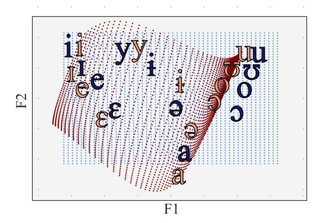
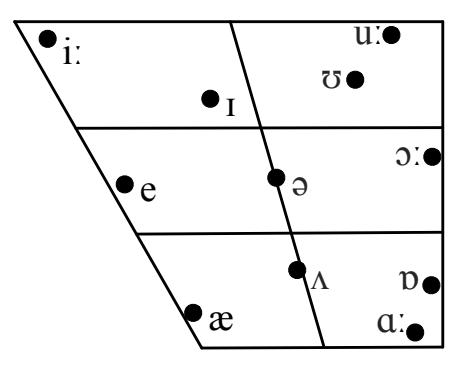
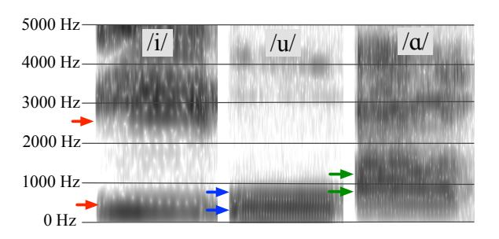
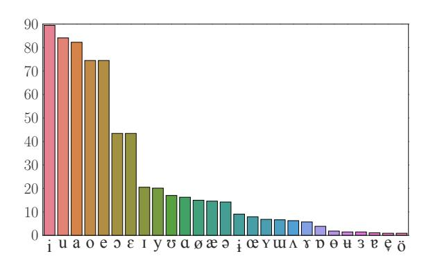
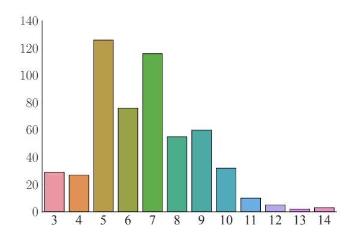

# Probabilistic Typology: Deep Generative Models of Vowel Inventories

## Ryan Cotterell and Jason Eisner

Department of Computer Science Johns Hopkins University

{ryan.cotterell,eisner}@jhu.edu

## Abstract

Linguistic typology studies the range of structures present in human language. The main goal of the field is to discover which sets of possible phenomena are universal, and which are merely frequent. For example, all languages have vowels, while most—but not all—languages have an [u] sound. In this paper we present the first probabilistic treatment of a basic question in phonological typology: What makes a natural vowel inventory? We introduce a series of deep stochastic point processes, and contrast them with previous computational, simulation-based approaches. We provide a comprehensive suite of experiments on over 200 distinct languages.

## 1 Introduction

Human languages exhibit a wide range of phenomena, within some limits. However, some structures seem to occur or co-occur more frequently than others. Linguistic typology attempts to describe the range of natural variation and seeks to organize and quantify linguistic universals, such as patterns of co-occurrence. Perhaps one of the simplest typological questions comes from phonology: which vowels tend to occur and co-occur within the phoneme inventories of different languages? Drawing inspiration from the linguistic literature, we propose models of the probability distribution from which the attested vowel inventories have been drawn.

It is a typological universal that every language contains both vowels and consonants [\(Velupillai,](#page-10-0) [2012\)](#page-10-0). But which vowels a language contains is guided by softer constraints, in that certain configurations are more widely attested than others. For instance, in a typical phoneme inventory, there tend to be far fewer vowels than consonants. Likewise, all languages contrast vowels based on height, although which contrast is made is language-dependent [\(Ladefoged and Maddieson,](#page-9-0) [1996\)](#page-9-0). Moreover, while over 600 unique vowel

Figure 1: The transformed vowel space that is constructed within one of our deep generative models (see §[7.1\)](#page-5-0). A deep network nonlinearly maps the blue grid ("formant space") to the red grid ("metric space"), with individual vowels mapped from blue to red position as shown. Vowel pairs such as [@]– [O] that are brought close together are anti-correlated in the point process. Other pairs such as [y]–[1] are driven apart. For purposes of the visualization, we have transformed the red coordinate system to place red vowels near their blue positions—while preserving distances up to a constant factor (a "Procrustes transformation").

phonemes have been attested cross-linguistically [\(Moran et al.,](#page-9-1) [2014\)](#page-9-1), certain regions of acoustic space are used much more often than others, e.g., the regions conventionally transcribed as [a], [i], and [u]. Human language also seems to prefer inventories where phonologically distinct vowels are spread out in acoustic space ("dispersion") so that they can be easily distinguished by a listener. We depict the acoustic space for English in Figure [2.](#page-1-0)

In this work, we regard the proper goal of linguistic typology as the construction of a universal prior distribution from which linguistic systems are drawn.For vowel system typology, we propose three formal probability models based on stochastic point processes. We estimate the parameters of the model on one set of languages and evaluate performance on a held-out set. We explore three questions: (i) How well do the properties of our proposed probability models line up experimentally with linguistic theory? (ii) How well can our models predict held-out vowel systems? (iii) Do our models benefit from a "deep" transformation from formant space to metric space?

Figure 2: The standard vowel table in IPA for the RP accent of English. The x-axis indicates the front-back spectrum and the y-axis indicates the high-low distinction.

## 2 Vowel Inventories and their Typology

Vowel inventories are a simple entry point into the study of linguistic typology. Every spoken language chooses a discrete set of vowels, and the number of vowel phonemes ranges from 3 to 46, with a mean of 8.7 [\(Gordon,](#page-9-2) [2016\)](#page-9-2). Nevertheless, the empirical distribution over vowel inventories is remarkably peaked. The majority of languages have 5–7 vowels, and there are only a handful of distinct 4-vowel systems attested despite many possibilities. Reigning linguistic theory [\(Becker-](#page-8-0)[Kristal,](#page-8-0) [2010\)](#page-8-0) has proposed that vowel inventories are shaped by the principles discussed below.

## 2.1 Acoustic Phonetics

One way to describe the sound of a vowel is through its acoustic energy at different frequencies. A spectrogram (Figure [3\)](#page-1-1) is a visualization of the energy at various frequencies over time. Consider the "peak" frequencies F0 < F1 < F2 < . . . that have a greater energy than their neighboring frequencies. F0 is called the fundamental frequency or pitch. The other qualities of the vowel are largely determined by F1, F2, . . ., which are known as formants [\(Ladefoged and Johnson,](#page-9-3) [2014\)](#page-9-3). In many languages, the first two formants F1 and F2 contain enough information to identify a vowel: Figure [3](#page-1-1) shows how these differ across three English vowels. We consider each vowel listed in the International Phonetic Alphabet (IPA) to be *cross-linguistically* characterized by some (F1, F2) pair.

### 2.2 Dispersion

The dispersion criterion [\(Liljencrants and Lind](#page-9-4)[blom,](#page-9-4) [1972;](#page-9-4) [Lindblom,](#page-9-5) [1986\)](#page-9-5) states that the phonemes of a language must be "spread out" so that they are easily discriminated by a listener. A

Figure 3: Example spectrogram of the three English vowels: [i], [u] and [A]. The x-axis is time and y-axis is frequency. The first two formants F1 and F2 are marked in with colored arrows for each vowel. We used the Praat toolkit to generate the spectrogram and find the formants [\(Boersma et al.,](#page-9-6) [2002\)](#page-9-6).

language seeks phonemes that are sufficiently "distant" from one another to avoid confusion. Distances between phonemes are defined in some latent "metric space." We use this term rather than "perceptual space" because the confusability of two vowels may reflect not just their perceptual similarity, but also their common distortions by imprecise articulation or background noise.[1](#page-1-2)

## 2.3 Focalization

The dispersion criterion alone does not seem to capture the whole story. Certain vowels are simply more popular cross-linguistically. A commonly accepted explanation is the *quantal theory of speech* [\(Stevens,](#page-10-1) [1972,](#page-10-1) [1989\)](#page-10-2). The quantal theory states that certain sounds are easier to articulate and to perceive than others. These vowels may be characterized as those where F1 and F2 have frequencies that are close to one another. On the production side, these vowels are easier to pronounce since they allow for greater articulatory imprecision.On the perception side, they are more salient since the two spectral peaks aggregate and act as one, larger peak to a certain degree.In general, languages will prefer these vowels.

### 2.4 Dispersion-Focalization Theory

The dispersion-focalization theory (DFT) combines both of the above notions. A good vowel system now consists of vowels that contrast with each other *and* are individually desirable [\(Schwartz et al.,](#page-9-7) [1997\)](#page-9-7). This paper provides the first probabilistic treatment of DFT, and new evaluation metrics for future probabilistic and non-probabilistic treatments of vowel inventory typology.

1We assume in this paper that the metric space is universal—although it would not be unreasonable to suppose that each language's vowel system has adapted to avoid confusion in the *specific* communicative environment of its speakers.

#### 3 Point Process Models

Given a base set  $\mathcal{V}$ , a point process is a distribution over its subsets.2 In this paper, we take  $\mathcal{V}$  to be the set of all IPA symbols corresponding to vowels. Thus a draw from a point process is a vowel inventory  $V \subseteq \mathcal{V}$ , and the point process itself is a distribution over such inventories. We will consider three basic point process models for vowel systems: the Bernoulli Point Process, the Markov Point Process and the Determinantal Point Process. In this section, we review the relevant theory of point processes, highlighting aspects related to §2.

#### 3.1 Bernoulli Point Processes

Taking  $\mathcal{V} = \{v_1, \dots, v_N\}$ , a Bernoulli point process (BPP) makes an *independent* decision about whether to include each vowel in the subset. The probability of a vowel system  $V \subseteq \mathcal{V}$  is thus

$$p(V) \propto \prod_{v_i \in V} \phi(v_i),$$
 (1)

where  $\phi$  is a unary potential function, i.e.,  $\phi(v_i) \geq$ 0. Qualitatively, this means that  $\phi(v_i)$  should be large if the  $i^{th}$  vowel is good in the sense of §2.3. Marginal inference in a BPP is computationally trivial. The probability that the inventory V contains  $v_i$  is  $\phi(v_i)/(1+\phi(v_i))$ , independent of the other vowels in V. Since a BPP predicts each vowel independently, it only models focalization. Thus, the model provides an appropriate baseline that will let us measure the importance of the dispersion principle—how far can we get with just focalization? A BPP may still tend to generate well-dispersed sets if it defines  $\phi$  to be large only on certain vowels in V and these are well-dispersed (e.g., [i], [u], [a]). More precisely, it can define  $\phi$ so that  $\phi(v_i)\phi(v_i)$  is small whenever  $v_i, v_i$  are similar.3 But it cannot actively encourage dispersion:

including  $v_i$  does not lower the probability of also including  $v_i$ .

#### 3.2 Markov Point Processes

A Markov Point Process (MPP) (Van Lieshout, 2000)—also known as a Boltzmann machine (Ackley et al., 1985; Hinton and Sejnowski, 1986)—generalizes the BPP by adding pairwise interactions between vowels. The probability of a vowel system  $V \subseteq \mathcal{V}$  is now

$$p(V) \propto \prod_{v_i \in V} \phi(v_i) \prod_{v_i, v_j \in V} \psi(v_i, v_j), \quad (2)$$

where each  $\phi(v_i) \geq 0$  is, again, a unary potential that scores the quality of the  $i^{\text{th}}$  vowel, and each  $\psi(v_i,v_j) \geq 0$  is a binary potential that scores the combination of the  $i^{\text{th}}$  and  $j^{\text{th}}$  vowels. Roughly speaking, the potential  $\psi(v_i,v_j)$  should be large if the  $i^{\text{th}}$  and  $j^{\text{th}}$  vowel often co-occur. Recall that under the principle of dispersion, the vowels that often co-occur are easily distinguishable. Thus, confusable vowel pairs should tend to have potential  $\psi(v_i,v_j)<1$ .

Unlike the BPP, the MPP can capture both focalization and dispersion. In this work, we will consider a fully connected MPP, i.e., there is a potential function for each pair of vowels in  $\mathcal{V}$ . MPPs closely resemble Ising models (Ising, 1925), but with the difference that Ising models are typically lattice-structured, rather than fully connected.

Inference in MPPs. Inference in fully connected MPPs, just as in general Markov Random Fields (MRFs), is intractable (Cooper, 1990) and we must rely on approximation. In this work, we estimate any needed properties of the MPP distribution by (approximately) drawing vowel inventories from it via Gibbs sampling (Geman and Geman, 1984; Robert and Casella, 2005). Gibbs sampling simulates a discrete-time Markov chain whose stationary distribution is the desired MPP distribution. At each time step, for some random  $v_i \in \mathcal{V}$ , it stochastically decides whether to replace the current inventory V with  $\bar{V}$ , where  $\bar{V}$  is a copy of V with  $v_i$  added (if  $v_i \notin V$ ) or removed (if  $v_i \in V$ ). The probability of replacement is  $\frac{p(\bar{V})}{p(V)+p(\bar{V})}$ .

#### 3.3 Determinantal Point Processes

A determinantal point process (DPP) (Macchi, 1975) provides an elegant alternative to an MPP, and one that is directly suited to modeling both focalization and dispersion. Inference requires only

 $^2$ A point process is a specific kind of stochastic process, which is the technical term for a distribution over *functions*. Under this view, drawing some subset of  $\mathcal{V}$  from the point process is regarded as drawing some *indicator function* on  $\mathcal{V}$ .

 $^3$ We point out that such a scheme would break down if we extended our work to cover fine-grained phonetic modeling of the vowel inventory. In that setting, we ask not just whether the inventory includes /i/ but exactly which pronunciation of /i/ it contains. In the limit,  $\phi$  becomes a function over a *continuous* vowel space  $\mathcal{V} = \mathbb{R}^2$ , turning the BPP into an inhomogeneous spatial Poisson process. A continuous  $\phi$  function implies that the model places similar probability on similar vowels. Then if most vowel inventories contain some version of /i/, then many of them will contain several closely related variants of /i/ (independently chosen). By contrast, the other methods in this paper do extend nicely to fine-grained phonetic modeling.

a few matrix computations and runs tractably in  $O(|\mathcal{V}|^3)$  time, even though the model may encode a rich set of multi-way interactions. We focus on the L-ensemble parameterization of the DPP, due to Borodin and Rains (2005).4 This type of DPP defines the probability of an inventory  $V \subseteq \mathcal{V}$  as

$$p(V) \propto \det L_V,$$
 (3)

where  $L \in \mathbb{R}^{N \times N}$  (for  $N = |\mathcal{V}|$ ) is a symmetric positive semidefinite matrix, and  $L_V$  refers to the submatrix of L with only those rows and columns corresponding to those elements in the subset V.

Although MAP inference remains NP-hard in DPPs (just as in MPPs), marginal inference becomes tractable. We may compute the normalizing constant in closed form as follows:

$$\sum_{V \in 2^{\mathcal{V}}} \det L_V = \det (L+I). \tag{4}$$

How does a DPP ensure focalization and dispersion? L is positive semidefinite iff it can be written as  $E^{\top}E$  for some matrix  $E \in \mathbb{R}^{N \times N}$ . It is possible to express p(V) in terms of the column vectors of E, which we call  $\mathbf{e}_1, \dots, \mathbf{e}_N$ :

- For inventories of size 2,  $p(\{v_i, v_j\}) \propto (\phi(v_i)\phi(v_j)\sin\theta)^2$ , where  $\phi(v_i), \phi(v_j)$  represent the quality of vowels  $v_i, v_j$  (as in the BPP) while  $\sin\theta \in [0,1]$  represents their dissimilarity. More precisely,  $\phi(v_i), \phi(v_j)$  are the lengths of vectors  $\mathbf{e}_i, \mathbf{e}_j$  while  $\theta$  is the angle between them. Thus, we should choose the columns of E so that focal vowels get long vectors and similar vowels get vectors of similar direction.
- Generalizing beyond inventories of size 2, p(V) is proportional to the square of the volume of the parallelepiped whose sides are given by  $\{\mathbf{e}_i: v_i \in V\}$ . This volume can be regarded as  $\prod_{v_i \in V} \phi(v_i)$  times a term that ranges from 1 for an orthogonal set of vowels to 0 for a linearly dependent set of vowels.
- The events  $v_i \in V$  and  $v_j \in V$  are anticorrelated (when not independent). That is, while both vowels may individually have high probabilities (focalization), having either one in the inventory lowers the probability of the other (dispersion).

#### 4 Dataset

At this point it is helpful to introduce the empirical dataset we will model. For each of 223 languages,5 Becker-Kristal (2010) provides the vowel inventory as a set of IPA symbols, listing the first 5 formants for each vowel (or fewer when not available in the original source). Some corpus statistics are shown in Figs. 4 and 5.6 For the present paper, we take V to be the set of all 53 IPA symbols that appear in the corpus. We treat these IPA labels as meaningful, in that we consider two vowels in different languages to be the *same* vowel in V if (for example) they are both annotated as [3]. We characterize that vowel by its average formant vector across all languages in the corpus that contain the vowel: e.g.,  $(F_1, F_2, ...) = (500, 700, ...)$  for [5]. In future work, we plan to relax this idealization (see footnote 3), allowing us to investigate natural questions such as whether [u] is pronounced higher (smaller  $F_1$ ) in languages that also contain [o] (to achieve better dispersion).

#### 5 Model Parameterization

The BPP, MPP, and DPP models (§3) require us to specify parameters for each vowel in  $\mathcal{V}$ . In §5.1, we will accomplish this by deriving the parameters for each vowel  $v_i$  from a possibly high-dimensional embedding of that vowel,  $e(v_i) \in \mathbb{R}^r$ .

In §5.2,  $e(v_i) \in \mathbb{R}^r$  will in turn be defined as some learned function of  $f(v_i) \in \mathbb{R}^k$ , where  $f: \mathcal{V} \mapsto \mathbb{R}^k$  is the function that maps a vowel to a k-vector of its measurable acoustic properties. This approach allows us to determine reasonable parameters even for rare vowels, based on their measurable properties. It will even enable us in

&lt;sup>4Most DPPs are *L*-ensembles (Kulesza and Taskar, 2012).

&lt;sup>5Becker-Kristal lists some languages multiple times with different measurements. When a language had multiple listings, we selected one randomly for our experiments.

&lt;sup>6Caveat: The corpus is a curation of information from various phonetics papers into a common electronic format. No standard procedure was followed across all languages: it was up to individual phoneticists to determine the size of each vowel inventory, the choice of IPA symbols to describe it, and the procedure for measuring the formants. Moreover, it is an idealization to provide a single vector of formants for each vowel type in the language. In real speech, different tokens of the same vowel are pronounced differently, because of coarticulation with the vowel context, allophony, interspeaker variation, and stochastic intraspeaker variation. Even within a token, the formants change during the duration of the vowel. Thus, one might do better to represent a vowel's pronunciation not by a formant vector, but by a conditional probability distribution over its formant trajectories given its context, or by a parameter vector that characterizes such a conditional distribution. This setting would require richer data than we present here.

future to generalize to vowels that were unseen in the training set, letting us scale to very large or infinite  $\mathcal{V}$  (footnote 3).

## **5.1** Deep Point Processes

We consider deep versions of all three processes.

**Deep Bernoulli Point Process.** We define

$$\phi(v_i) = ||\boldsymbol{e}(v_i)|| \ge 0 \tag{5}$$

**Deep Markov Point Process.** The MPP employs the same unary potential as the BPP, as well as the binary potential

$$\psi(v_i, v_j) = \exp{-\frac{1}{T \cdot ||e(v_i) - e(v_j)||^2}} < 1$$
 (6)

where the learned temperature T>0 controls the relative strength of the unary and binary potentials.

This formula is inspired by Coulomb's law for describing the repulsion of static electrically charged particles. Just as the repulsive force between two particles approaches  $\infty$  as they approach each other, the probability of finding two vowels in the same inventory approaches  $\exp -\infty = 0$  as they approach each other. The formula is also reminiscent of Shepard (1987)'s "universal law of generalization," which says here that the probability of responding to  $v_i$  as if it were  $v_j$  should fall off exponentially with their distance in some "psychological space" (here, embedding space).

**Deep Determinantal Point Process.** For the DPP, we simply define the vector  $\mathbf{e}_i$  to be  $e(v_i)$ , and proceed as before.

**Summary.** In the deep BPP, the probability of a set of vowels is proportional to the product of the lengths of their embedding vectors. The deep MPP modifies this by multiplying in *pairwise* repulsion terms in (0,1) that increase as the vectors' endpoints move apart in Euclidean space (or as  $T \to \infty$ ). The deep DPP instead modifies it by multiplying in a single *setwise* repulsion term in (0,1) that increases as the embedding vectors become more mutually orthogonal. In the limit, then, the MPP and DPP both approach the BPP.

#### 5.2 Embeddings

Throughout this work, we simply have f extract the first k=2 formants, since our dataset does not provide higher formants for all languages. For

example, we have  $f([\mathfrak{d}]) = (500, 700)$ . We now describe three possible methods for mapping  $f(v_i)$  to an embedding  $e(v_i)$ . Each of these maps has learnable parameters.

**Neural Embedding.** We first consider directly embedding each vowel  $v_i$  into a vector space  $\mathbb{R}^r$ . We achieve this through a feed-forward neural net

$$e(v_i) = W_1 \tanh(W_0 f(v_i) + \mathbf{b}_0) + \mathbf{b}_1,$$
 (7)

Equation (7) gives an architecture with 1 layer of nonlinearity; in general we consider stacking  $d \geq 0$  layers. Here  $W_0 \in \mathbb{R}^{r \times k}, W_1 \in \mathbb{R}^{r \times r}, \dots W_d \in \mathbb{R}^{r \times r}$  are weight matrices,  $\mathbf{b}_0, \dots \mathbf{b}_d \in \mathbb{R}^r$  are bias vectors, and tanh could be replaced by any pointwise nonlinearity. We treat both the depth d and the embedding size r as hyperparameters, and select the optimal values on a development set.

Interpretable Neural Embedding. We are interested in the special case of neural embeddings when r=k since then (for any d) the mapping  $f(v_i) \mapsto e(v_i)$  is a diffeomorphism:8 a smooth invertible function of  $\mathbb{R}^k$ . An example of such a diffeomorphism is shown in Figure 1.

There is a long history in cognitive psychology of mapping stimuli into some psychological space. The distances in this psychological space may be predictive of generalization (Shepard, 1987) or of perception. Due to the anatomy of the ear, the mapping of vowels from acoustic space to perceptual space is often presumed to be nonlinear (Rosner and Pickering, 1994; Nearey and Kiefte, 2003), and there are many perceptually-oriented phonetic scales, e.g., Bark and Mel, that carry out such nonlinear transformations while preserving the dimensionality k, as we do here. As discussed in §2.2, vowel system typology is similarly believed to be influenced by distances between the vowels in a latent metric space. We are interested in whether a constrained k-dimensional model of these distances can do well in our experiments.

**Prototype-Based Embedding.** Unfortunately, our interpretable neural embedding is unfortunately incompatible with the DPP. The DPP assigns probability 0 to any vowel inventory V whose e vectors are linearly dependent. If the vectors are in  $\mathbb{R}^k$ , then this means that p(V) = 0 whenever |V| > k. In our setting, this would limit vowel inventories to size 2.

 $^{7}$ In lieu of higher formants, we could have extended the vector  $f(v_i)$  to encode the binary distinctive features of the IPA vowel  $v_i$ : round, tense, long, nasal, creaky, etc.

&lt;sup>8Provided that our nonlinearity in (7) is a differentiable invertible function like tanh rather than relu.

Our solution to this problem is to still construct our interpretable metric space  $\mathbb{R}^k$ , but then map that nonlinearly to  $\mathbb{R}^r$  for some large r. This latter map is constrained. Specifically, we choose "prototype" points  $\mu_1, \dots, \mu_r \in \mathbb{R}^k$ . These prototype points are parameters of the model: their coordinates are learned and do not necessarily correspond to any actual vowel. We then construct  $e(v_i) \in \mathbb{R}^r$  as a "response vector" of similarities of our vowel  $v_i$  to these prototypes. Crucially, the responses depend on distances measured in the interpretable metric space  $\mathbb{R}^k$ . We use a Gaussian-density response function, where  $\mathbf{x}(v_i)$  denotes the representation of our vowel  $v_i$  in the interpretable space:

$$\mathbf{e}(v_i)_{\ell} = w_{\ell} \ p(\mathbf{x}(v_i); \boldsymbol{\mu}_{\ell}, \sigma^2 I)$$

$$= w_{\ell} \ (2\pi\sigma^2)^{-\left(\frac{k}{2}\right)} \exp\left(\frac{-||\mathbf{x} - \boldsymbol{\mu}_{\ell}||^2}{2\sigma^2}\right).$$
(8)

for  $\ell = 1, 2, ..., r$ . We additionally impose the

constraints that each  $w_\ell \geq 0$  and  $\sum_{\ell=1}^r w_\ell = 1$ . Notice that the sum  $\sum_{\ell=1}^r e(v_i)$  may be viewed as the density at  $\mathbf{x}(v_i)$  under a Gaussian mixture model. We use this fact to construct a prototypebased MPP as well: we redefine  $\phi(v_i)$  to equal this positive density, while still defining  $\psi$  via equation (6). The idea is that dispersion is measured in the interpretable space  $\mathbb{R}^k$ , and focalization is defined by certain "good" regions in that space that are centered at the r prototypes.

#### **Evaluation Metrics**

Fundamentally, we are interested in whether our model has abstracted the core principles of what makes a good vowel system. Our choice of a probabilistic model provides a natural test: how surprised is our model by held-out languages? In other words, how likely does our model think unobserved, but attested vowel systems are? While this is a natural evaluation paradigm in NLP, it has not—to the best of our knowledge—been applied to a quantitative investigation of linguistic typology.

As a second evaluation, we introduce a vowel system cloze task that could also be used to evaluate non-probabilistic models. This task is defined by analogy to the traditional semantic cloze task (Taylor, 1953), where the reader is asked to fill in a missing word in the sentence from the context. In our vowel system cloze task, we present a learner with a subset of the vowels in a held-out vowel system and ask them to predict the remaining vowels. Consider, as a concrete example, the

general American English vowel system (excluding long vowels)  $\{[i], [i], [u], [v], [e], [e], [a], [o], [a], [o], [e], [e], [e], [e], [e], [e], [e], [e$ [ə]}. One potential cloze task would be to predict  $\{[i], [u]\}\$  given  $\{[i], [v], [\epsilon], [\alpha], [\beta], [\alpha], [\beta]\}$  and the fact that two vowels are missing from the inventory. Within the cloze task, we report accuracy, i.e., did we guess the missing vowel right? We consider three versions of the cloze tasks. First, we predict one missing vowel in a setting where exactly one vowel was deleted. Second, we predict up to one missing vowel where a vowel may have been deleted. Third, we predict up to two missing vowels, where one or two vowels may be deleted.

## **Experiments**

We evaluate our models using 10-fold crossvalidation over the 223 languages. We report the mean performance over the 10 folds. The performance on each fold ("test") was obtained by training many models on 8 of the other 9 folds ("train"), selecting the model that obtained the best task-specific performance on the remaining fold ("development"), and assessing it on the test fold. Minimization of the parameters is performed with the L-BFGS algorithm (Liu and Nocedal, 1989). As a preprocessing step, the first two formants values  $F_1$  and  $F_2$  are centered around zero and scaled down by a factor of 1000 since the formant values themselves may be quite large.

Specifically, we use the development fold to select among the following combinations of hyperparameters. For neural embeddings, we tried  $r \in \{2, 10, 50, 100, 150, 200\}$ . For prototype embeddings, we took the number of components  $r \in \{20, 30, 40, 50\}$ . We tried network depths  $d \in$  $\{0,1,2,3\}$ . We sweep the coefficient for an  $L_2$ regularizer on the neural network parameters.

### 7.1 Results and Discussion

Figure 1 visualizes the diffeomorphism from formant space to metric space for one of our DPP models (depth d = 3 with r = 20 prototypes). Similar figures can be generated for all of the interpretable models.

We report results for cross-entropy and the cloze evaluation in Table 1.9 Under both metrics, we see that the DPP is slightly better than the MPP; both are better than the BPP. This ranking holds for

&lt;sup>9Computing cross-entropy exactly is intractable with the MPP, so we resort to an unbiased importance sampling scheme where we draw samples from the BPP and reweight according to the MPP (Liu et al., 2015).

|           | BPP    | uBPP   | uMPP   | uDPP   | iBPP   | iMPP   | iDPP | pBPP   | pMPP   | pDPP   |
|-----------|--------|--------|--------|--------|--------|--------|------|--------|--------|--------|
| x-ent     | 8.24   | 8.28   | 8.08   | 8.00   | 13.01  | 11.50  | X    | 12.83  | 10.95  | 10.29  |
| cloze-1   | 69.55% | 69.55% | 72.05% | 73.18% | 64.13% | 67.02% | X    | 65.13% | 68.18% | 68.18% |
| cloze-01  | 60.00% | 60.00% | 61.01% | 62.27% | 61.78% | 61.04% | X    | 61.02% | 63.04% | 63.63% |
| cloze-012 | 53.18% | 53.18% | 57.92% | 58.18% | 39.04% | 43.02% | X    | 40.56% | 45.01% | 45.46% |

Table 1: Cross-entropy in nats (lower is better) and cloze prediction accuracy (higher is better). "BPP" is a simple BPP with one parameter for each of the 53 vowels in  $\mathcal V$ . This model does artificially well by modeling an "accidental" feature of our data: it is able to learn not only which vowels are popular among languages, but also which IPA symbols are popular or conventional among the descriptive phoneticists who created our dataset (see footnote 6), something that would become irrelevant if we upgraded our task to predict actual formant vectors rather than IPA symbols (see footnote 3). Our point processes, by contrast, are appropriately allowed to consider a vowel only through its formant vector. The "u-" versions of the models use the uninterpretable neural embedding of the formant vector into  $\mathbb{R}^r$ : by taking r to be large, they are still able to learn special treatment for each vowel in  $\mathcal{V}$  (which is why uBPP performs identically to BPP, before being beaten by uMPP and uDPP). The "i-" versions limit themselves to an interpretable neural embedding into  $\mathbb{R}^r$ , giving a more realistic description that does not perform as well. The "p-"versions lift that  $\mathbb{R}^k$  embedding into  $\mathbb{R}^r$  by measuring similarities to r prototypes; they thereby improve on the corresponding i- versions. For each result shown, the depth d of our neural network was tuned on a development set (typically d=2). r was also tuned when applicable (typically r>100 dimensions for the r- models and r>100 dimensions for the r- models and r>100 dimensions for the r- models and r>100 dimensions for the r- models and r>100 dimensions for the r- models and r>100 dimensions for the r- models and r>100 dimensions for the r- models and r>100 dimensions for the r- models and r>100 dimensions for the r- models and r>100 dimensions for the r- models and r>100 dimensions for the r- models and r>100 dimensions for the r- models and r>100 dimensions for the r- models and r>10

each of the 3 embedding schemes. The embedding schemes themselves are compared in the caption.

Within each embedding scheme, the BPP performs several points worse on the cloze tasks, confirming that dispersion is needed to model vowel inventories well. Still, the BPP's respectable performance shows that much of the structure can be capture by focalization. As §3 noted, the BPP may generate well-dispersed sets, as the common vowels tend to be dispersed already (see Figure 4). In this capacity, however, the BPP is not explanatory as it cannot actually tell us why *these* vowels should be frequent.

We mention that depth in the neural network is helpful, with deeper embedding networks performing slightly better than depth d=0.

Finally, we identified each model's favorite complete vowel system of size n (Table 2). For the BPP, this is simply the n most probable vowels. Decoding the DPP and MPP is NP-hard, but we found the best system by brute force (for small n). The dispersion in these models predicts different systems than the BPP.

### 8 Discussion: Probabilistic Typology

**Typology as Density Estimation?** Our goal is to define a *universal* distribution over all possible vowel inventories. Is this appropriate? We regard this as a natural approach to typology, because it directly describes which kinds of linguistic systems are more or less common. Traditional implicational universals ("all languages with  $v_i$  have  $v_j$ ") are softened, in our approach, into conditional probabilities such as " $p(v_j \in V \mid v_i \in V) \approx 0.9$ ." Here the 0.9 is not merely an empirical ratio, but a smoothed

probability derived from the complete estimated distribution. It is meant to make predictions about unseen languages.

Whether human language learners exploit any properties of this distribution10 is a separate question that goes beyond typology. Jakobson (1941) did find that children acquired phoneme inventories in an order that reflected principles similar to dispersion ("maximum contrast") and focalization.

At any rate, we estimate the distribution given some set of attested systems that are assumed to have been drawn IID from it. One might object that this IID assumption ignores evolutionary relationships among the attested systems, causing our estimated distribution to favor systems that are coincidentally frequent among current human languages, rather than being natural in some timeless sense. We reply that our approach is then appropriate when the goal of typology is to estimate the distribution of *actual* human languages—a distribution that can be utilized in principle (and also in practice, as we show) to predict properties of *actual* languages from outside the training set.

A different possible goal of typology is a theory of *natural* human languages. This goal would require a more complex approach. One should not imagine that natural languages are drawn in a vacuum from some single, stationary distribution. Rather, each language is drawn *conditionally* on its parent language. Thus, one should estimate a stochastic model of the evolution of linguistic systems through time, and identify "naturalness" with

&lt;sup>10This could happen because learners have evolved to expect the languages (the Baldwin effect), or because the languages have evolved to be easily learned (universal grammar).

|   |               | BPP        |                            |               | MPP        |                            | DPP                |           |           |  |
|---|---------------|------------|----------------------------|---------------|------------|----------------------------|--------------------|-----------|-----------|--|
|   |               | changes fr | $\operatorname{rom} n - 1$ |               | changes fr | $\operatorname{rom} n - 1$ | changes from $n-1$ |           |           |  |
| n | MAP inventory | additions  | deletions                  | MAP inventory | additions  | deletions                  | MAP inventory      | additions | deletions |  |
| 1 | i             | i          |                            | Э             | Э          |                            | -G                 | ə         |           |  |
| 2 | i, u          | u          |                            | i, u          | i, u       | Э                          | i, u               | i, u      | ə         |  |
| 3 | i, u, a       | a          |                            | i, u, a       | a          |                            | i, u, a            | a         |           |  |
| 4 | i, u, a, o    | 0          |                            | i, u, a, e    | e          |                            | i, u, a, o         | 0         |           |  |
| 5 | i, u, a, o, e | e          |                            | i, u, a, e, ə | Э          |                            | i, u, a, o, ə      | 0         |           |  |

Table 2: Highest-probability inventory of each size according to our three models (prototype-based embeddings and d=3). The MAP configuration is computed by brute-force enumeration for small n.

the directions in which this system tends to evolve.

**Energy Minimization Approaches.** The traditional energy-based approach (Liljencrants and Lindblom, 1972) to vowel simulation minimizes the following objective (written in our notation):

$$\mathcal{E}(m) = \sum_{1 \le i < j \le m} \frac{1}{||\boldsymbol{e}(v_i) - \boldsymbol{e}(v_j)||^2}, \quad (9)$$

where the vectors  $e(v_i) \in \mathbb{R}^r$  are not spit out of a deep network, as in our case, but rather directly optimized. Liljencrants and Lindblom (1972) propose a coordinate descent algorithm to optimize  $\mathcal{E}(m)$ . While this is not in itself a probabilistic model, they generate diverse vowel systems through random restarts that find different local optima (a kind of *deterministic* evolutionary mechanism). We note that equation (9) assumes that the number of vowels m is given, and only encodes a notion of dispersion. Roark (2001) subsequently extended equation (9) to include the notion of focalization.

Vowel Inventory Size. A fatal flaw of the traditional energy minimization paradigm is that it has no clear way to compare vowel inventories of different sizes. The problem is quite crippling since, in general, inventories with fewer vowels will have lower energy. This does not match reality—the empirical distribution over inventory sizes (shown in Figure 5) shows that the mode is actually 5 and small inventories are uncommon: no 1-vowel inventory is attested and only one 2-vowel inventory is known. A probabilistic model over *all* vowel systems must implicitly model the size of the system. Indeed, our models pit all potential inventories against each other, bestowing the extra burden to match the empirical distribution over size.

**Frequency of Inventories.** Another problemis the inability to model frequency. While for inventories of a modest size (3-5 vowels) there are very few unique attested systems, there is a plethora of

attested larger vowel systems. The energy minimization paradigm has no principled manner to tell the scientist how likely a novel system may be. Appealing again to the empirical distribution over attested vowel systems, we consider the relative diversity of systems of each size. We graph this in Figure 5. Consider all vowel systems of size 7. There are  $\binom{|\mathcal{V}|}{7}$  potential inventories, yet the empirical distribution is remarkably peaked. Our probabilistic models have the advantage in this context as well, as they naturally quantify the likelihood of an individual inventory.

**Typology is a Small-Data Problem.** In contrast to many common problems in applied NLP, e.g., part-of-speech tagging, parsing and machine translation, the modeling of linguistic typology is fundamentally a "small-data" problem. Out of the 7105 languages on earth, we only have linguistic annotation for 2600 of them (Comrie et al., 2013). Moreover, we only have phonetic and phonological annotation for a much smaller set of languages between 300-500 (Maddieson, 2013). Given the paucity of data, overfitting on only those attested languages is a dangerous possibility—just because a certain inventory has never been attested, it is probably wrong to conclude that it is impossible or even improbable—on that basis alone. By analogy to language modeling, almost all sentences observed in practice are novel with respect to the training data, but we still must employ a principled manner to discriminate high-probability sentences (which are syntactically and semantically coherent) from low-probability ones. Probabilistic modeling provides a natural paradigm for this sort of investigation—machine learning has developed well-understood smoothing techniques, e.g., regularization with tuning on a held-out dev set, to avoid overfitting in a small-data scenario.

**Related Work in NLP.** Various point processes have been previously applied to potpourri of tasks

Figure 4: Percentage of the vowel inventories (y-axis) in the Becker-Kristal corpus (Becker-Kristal, 2010) that have a given vowel (shown in IPA along the x-axis).

in NLP. Determinantal point processes have found a home in the literature in tasks that require diversity. E.g., DPPs have achieved state-of-the-art results on multi-document document summarization (Kulesza and Taskar, 2011), news article selection (Affandi et al., 2012) recommender systems (Gartrell et al., 2017), joint clustering of verbal lexical semantic properties (Reichart and Korhonen, 2013), inter alia. Poisson point processes have also been applied to NLP problems: Yee et al. (2015) model the emerging topic on social media using a homogeneous point process and Lukasik et al. (2015) apply a log-Gaussian point process, a variant of the Poisson point process, to rumor detection in Twitter. We are unaware of previous attempts to probabilistically model vowel inventory typology.

**Future Work.** This work lends itself to several technical extensions. One could expand the function f to more completely characterize each vowel's acoustic properties, perceptual properties, or distinctive features (footnote 7). One could generalize our point process models to sample finite subsets from the *continuous* space of vowels (footnote 3). One could consider augmenting the MPP with a new factor that explicitly controls the size of the vowel inventory. Richer families of point processes might also be worth exploring. For example, perhaps the vowel inventory is generated by some temporal mechanism with latent intermediate steps, such as sequential selection of the vowels or evolutionary drift of the inventory. Another possibility is that vowel systems tend to reuse distinctive features or even follow factorial designs, so that an inventory with creaky front vowels also tends to have creaky back vowels.

Figure 5: Histogram of the sizes of different vowel inventories in the corpus. The *x*-axis is the size of the vowel inventory and the *y*-axis is the number of inventories with that size.

#### 9 Conclusions

We have presented a series of point process models for the modeling of vowel system inventory typology with the goal of a mathematical grounding for research in phonological typology. All models were additionally given a deep parameterization to learn representations similar to perceptual space in cognitive science. Also, we motivated our preference for *probabilistic* modeling in linguistic typology over previously proposed computational approaches and argued it is a more natural research paradigm. Additionally, we have introduced several novel evaluation metrics for research in vowelsystem typology, which we hope will spark further interest in the area. Their performance was empirically validated on the Becker-Kristal corpus, which includes data from over 200 languages.

#### Acknowledgments

The first author was funded by an NDSEG graduate fellowship, and the second author by NSF grant IIS-1423276. We would like to thank Tim Vieira and Huda Khayrallah for helpful initial feedback.

### References

David H. Ackley, Geoffrey E. Hinton, and Terrence J. Sejnowski. 1985. A learning algorithm for Boltzmann machines. *Cognitive Science* 9(1):147–169.

Raja Hafiz Affandi, Alex Kulesza, and Emily B. Fox. 2012. Markov determinantal point processes. In *Proceedings of the Twenty-Eighth Conference on Uncertainty in Artificial Intelligence*. pages 26–35.

Roy Becker-Kristal. 2010. Acoustic Typology of Vowel Inventories and Dispersion Theory: Insights from a Large Cross-Linguistic Corpus. Ph.D. thesis, UCLA.

- Paulus Petrus Gerardus Boersma et al. 2002. Praat, a system for doing phonetics by computer. *Glot International* 5.
- Alexei Borodin and Eric M. Rains. 2005. Eynard-Mehta theorem, Schur process, and their Pfaffian analogs. *Journal of Statistical Physics* 121(3- 4):291–317.
- Bernard Comrie, Matthew S. Dryer, David Gil, and Martin Haspelmath. 2013. [Introduction.](http://wals.info/chapter/s1) In Matthew S. Dryer and Martin Haspelmath, editors, *The World Atlas of Language Structures Online*, Max Planck Institute for Evolutionary Anthropology, Leipzig. [http://wals.info/chapter/s1.](http://wals.info/chapter/s1)
- Gregory F. Cooper. 1990. The computational complexity of probabilistic inference using Bayesian belief networks. *Artificial Intelligence* 42(2-3):393–405.
- Mike Gartrell, Ulrich Paquet, and Noam Koenigstein. 2017. Low-rank factorization of determinantal point processes pages 1912–1918.
- Stuart Geman and Donald Geman. 1984. Stochastic relaxation, Gibbs distributions, and the Bayesian restoration of images. *IEEE Transactions on Pattern Analysis and Machine Intelligence* (6):721–741.
- Matthew K. Gordon. 2016. *Phonological Typology*. Oxford.
- Geoffrey E. Hinton and Terry J. Sejnowski. 1986. Learning and relearning in Boltzmann machines. In David E. Rumelhart and James L. McClelland, editors, *Parallel Distributed Processing*, MIT Press, volume 2, chapter 7, pages 282–317.
- Ernst Ising. 1925. Beitrag zur theorie des ferromagnetismus. *Zeitschrift fur Physik A Hadrons and Nu- ¨ clei* 31(1):253–258.
- Roman Jakobson. 1941. *Kindersprache, Aphasie und allgemeine Lautgesetze*. Suhrkamp Frankfurt aM.
- Alex Kulesza and Ben Taskar. 2011. Learning determinantal point processes. In *Proceedings of the Twenty-Seventh Conference on Uncertainty in Artificial Intelligence*. pages 419–427.
- Alex Kulesza and Ben Taskar. 2012. Determinantal point processes for machine learning. *Foundations and Trends* R *in Machine Learning* 5(2–3):123–286.
- Peter Ladefoged and Keith Johnson. 2014. *A Course in Phonetics*. Centage.
- Peter Ladefoged and Ian Maddieson. 1996. *The Sounds of the World's Languages*. Oxford.
- Johan Liljencrants and Bjorn Lindblom. 1972. Numer- ¨ ical simulation of vowel quality systems: The role of perceptual contrast. *Language* pages 839–862.
- Bjorn Lindblom. 1986. Phonetic universals in vowel ¨ systems. *Experimental Phonology* pages 13–44.

- Dong C. Liu and Jorge Nocedal. 1989. On the limited memory BFGS method for large scale optimization. *Mathematical Programming* 45(1-3):503–528.
- Qiang Liu, Jian Peng, Alexander T. Ihler, and John W. Fisher III. 2015. Estimating the partition function by discriminance sampling. In *Proceedings of the Thirty-First Conference on Uncertainty in Artificial Intelligence*. pages 514–522.
- Michal Lukasik, Trevor Cohn, and Kalina Bontcheva. 2015. Point process modelling of rumour dynamics in social media. In *Proceedings of the 53rd Annual Meeting of the Association for Computational Linguistics and the 7th International Joint Conference on Natural Language Processing (Volume 2: Short Papers)*. Association for Computational Linguistics, Beijing, China, pages 518–523.
- Odile Macchi. 1975. The coincidence approach to stochastic point processes. *Advances in Applied Probability* pages 83–122.
- Ian Maddieson. 2013. [Vowel quality inventories.](http://wals.info/chapter/2) In Matthew S. Dryer and Martin Haspelmath, editors, *The World Atlas of Language Structures Online*, Max Planck Institute for Evolutionary Anthropology, Leipzig. [http://wals.info/chapter/2.](http://wals.info/chapter/2)
- Steven Moran, Daniel McCloy, and Richard Wright. 2014. PHOIBLE online. *Leipzig: Max Planck Institute for Evolutionary Anthropology* .
- Terrance M. Nearey and Michael Kiefte. 2003. Comparison of several proposed perceptual representations of vowel spectra. *Proceedings of the XVth International Congress of Phonetic Sciences* 1:1005– 1008.
- Roi Reichart and Anna Korhonen. 2013. Improved lexical acquisition through DPP-based verb clustering. In *Proceedings of the 51st Annual Meeting of the Association for Computational Linguistics (Volume 1: Long Papers)*. Association for Computational Linguistics, Sofia, Bulgaria, pages 862–872.
- Brian Roark. 2001. Explaining vowel inventory tendencies via simulation: Finding a role for quantal locations and formant normalization. In *North East Linguistic Society*. volume 31, pages 419–434.
- Christian P. Robert and George Casella. 2005. *Monte Carlo Statistical Methods*. Springer-Verlag New York, Inc., Secaucus, NJ, USA.
- Burton S. Rosner and John B. Pickering. 1994. *Vowel Perception and Production*. Oxford University Press.
- Jean-Luc Schwartz, Louis-Jean Boe, Nathalie Vall ¨ ee, ´ and Christian Abry. 1997. The dispersionfocalization theory of vowel systems. *Journal of Phonetics* 25(3):255–286.
- Roger N. Shepard. 1987. Toward a universal law of generalization for psychological science. *Science* 237(4820):1317–1323.

- Kenneth N. Stevens. 1972. The quantal nature of speech: Evidence from articulatory-acoustic data. In E. E. David and P. B. Denes, editors, *Human Communication: A Unified View*, McGraw-Hill, pages 51–56.
- Kenneth N Stevens. 1989. On the quantal nature of speech. *Journal of Phonetics* 17:3–45.
- Wilson L. Taylor. 1953. Cloze procedure: a new tool for measuring readability. *Journalism and Mass Communication Quarterly* 30(4):415.
- M. N. M. Van Lieshout. 2000. *Markov Point Processes and Their Applications*. Imperial College Press, London.
- Viveka Velupillai. 2012. *An Introduction to Linguistic Typology*. John Benjamins Publishing Company.
- Connie Yee, Nathan Keane, and Liang Zhou. 2015. Modeling and characterizing social media topics using the gamma distribution. In *EVENTS*. pages 117– 122.