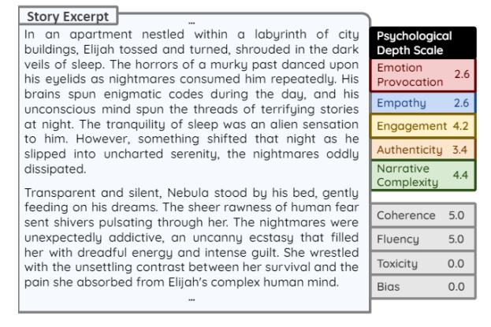
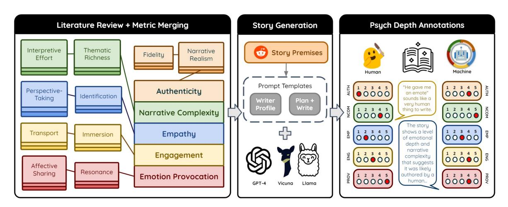
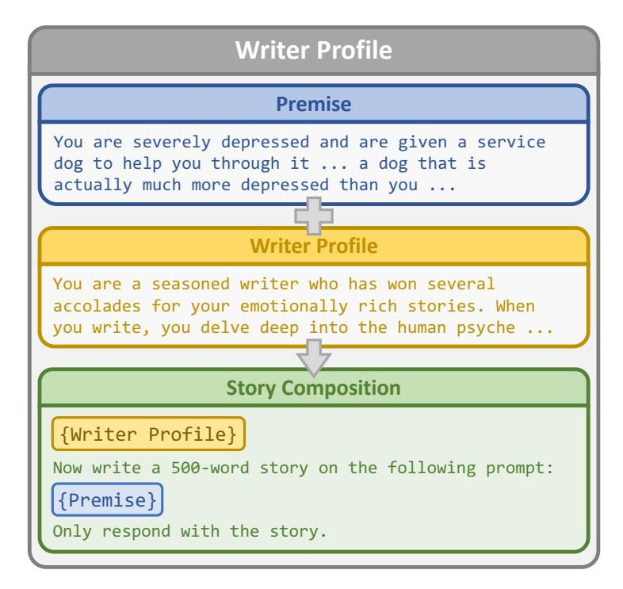
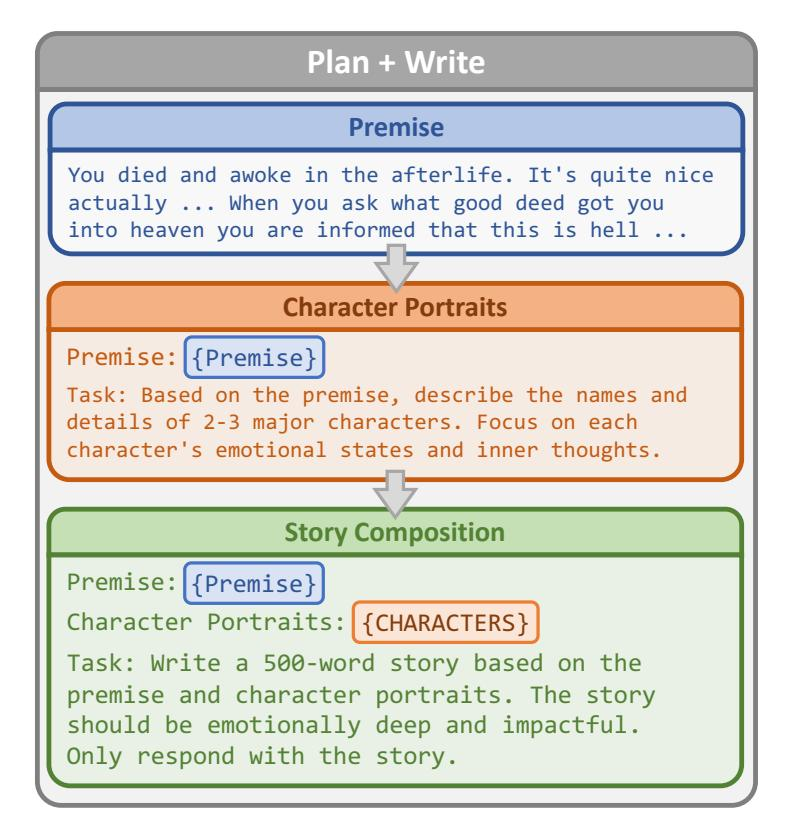
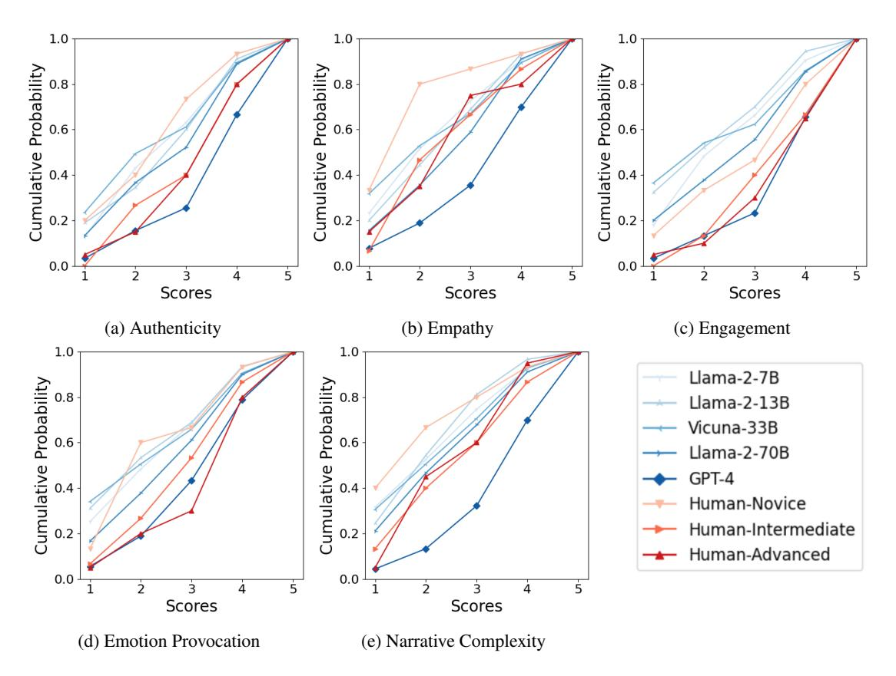
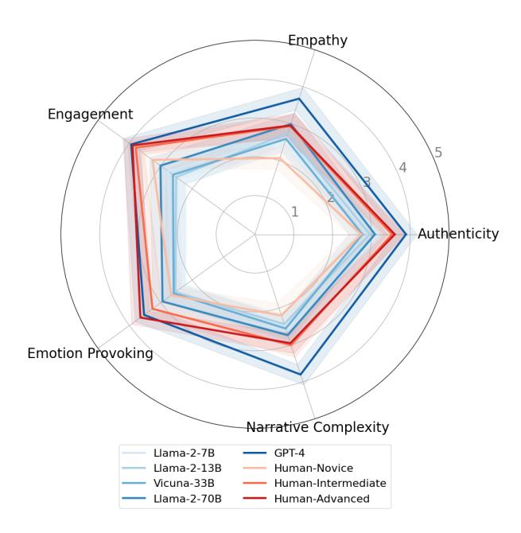
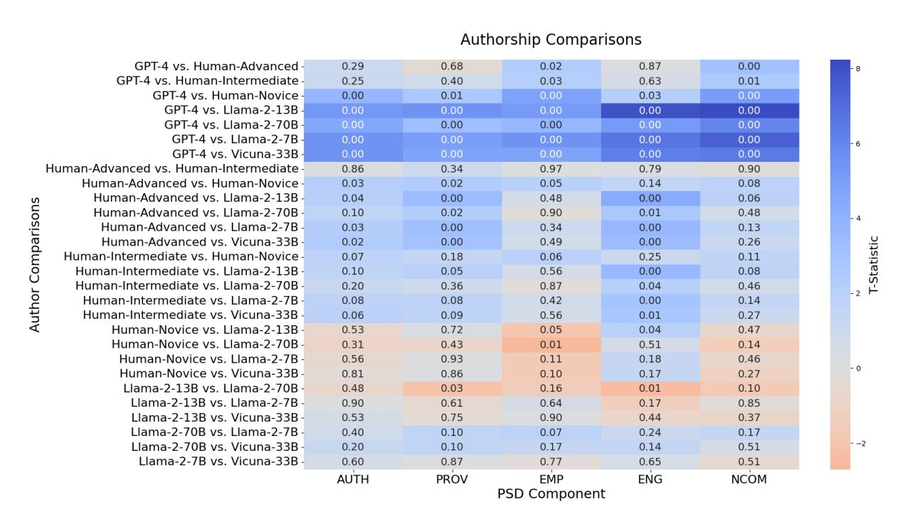

# Measuring Psychological Depth in Language Models

# Fabrice Harel-Canada Hanyu Zhou Sreya Muppalla Zeynep Yildiz Miryung Kim Amit Sahai‡ Nanyun Peng‡

University of California, Los Angeles fabricehc@cs.ucla.edu

## Abstract

Evaluations of creative stories generated by large language models (LLMs) often focus on objective properties of the text, such as its style, coherence, and diversity. While these metrics are indispensable, they do not speak to a story's subjective, psychological impact from a reader's perspective. We introduce the Psychological Depth Scale (PDS), a novel framework rooted in literary theory that measures an LLM's ability to produce authentic and narratively complex stories that provoke emotion, empathy, and engagement. We empirically validate our framework by showing that humans can consistently evaluate stories based on PDS (0.72 Krippendorff's alpha). We also explore techniques for automating the PDS to easily scale future analyses. GPT-4o, combined with a novel Mixture-of-Personas (MoP) prompting strategy, achieves an average Spearman correlation of 0.51 with human judgment while Llama-3-70B with constrained decoding scores as high as 0.68 for empathy. Finally, we compared the depth of stories authored by both humans and LLMs. Surprisingly, GPT-4 stories either surpassed or were statistically indistinguishable from highly-rated human-written stories sourced from Reddit. By shifting the focus from text to reader, the Psychological Depth Scale is a validated, automated, and systematic means of measuring the capacity of LLMs to connect with humans through the stories they tell.

## 1 Introduction

Stories play a crucial role in our understanding of ourselves and the world around us [\(Langer,](#page-11-0) [1942;](#page-11-0) [Kaniss,](#page-11-1) [1991\)](#page-11-1). As large language models (LLMs) are increasingly deployed in narrative design and

Our code and data is available at [https://github.com/](https://github.com/PlusLabNLP/psychdepth) [PlusLabNLP/psychdepth](https://github.com/PlusLabNLP/psychdepth).

<span id="page-0-0"></span>



Figure 1: In this GPT-4 story, the psychological depth scale highlights strengths and weaknesses contributing to the overall reader experience, providing additional quality signals over traditional metrics more likely to saturate. Scores are normalized 1-5 for comparison.

creation, their growing impact on how stories are told calls for a deeper understanding of their narrative power. Current evaluations of LLM-generated stories often focus on objective properties of the text such as discourse structure [\(Liu et al.,](#page-12-0) [2024\)](#page-12-0), fluency [\(Gómez-Rodríguez and Williams,](#page-11-2) [2023\)](#page-11-2), style [\(Wang et al.,](#page-13-0) [2024\)](#page-13-0), creativity [\(Chakrabarty](#page-10-0) [et al.,](#page-10-0) [2024\)](#page-10-0), diversity [\(Gehrmann et al.,](#page-10-1) [2021\)](#page-10-1), toxicity and bias [\(Wang et al.,](#page-13-1) [2023\)](#page-13-1). However, it is crucial to extend these evaluations to accommodate the subjective, psychological impact stories have on readers. While some studies have recently explored aspects like empathy [\(Ma et al.,](#page-12-1) [2020;](#page-12-1) [Sabour et al.,](#page-12-2) [2022\)](#page-12-2) and engagement [\(Ghazarian](#page-10-2) [et al.,](#page-10-2) [2020;](#page-10-2) [Xu et al.,](#page-13-2) [2022\)](#page-13-2), they do not fully capture the multifaceted and interconnected nature of the reading experience.

Recognizing this gap, our study introduces a novel approach to measuring the *psychological depth* of short stories. We present the Psychological Depth Scale (PDS), drawing inspiration from two literary theory frameworks: reader-response criticism [\(Holland,](#page-11-3) [1989\)](#page-11-3) and text world theory

<sup>‡</sup> Equal advisory role.

<span id="page-1-0"></span>

Figure 2: Overview of our approach to developing and validating the Psychological Depth Scale. We merge related metrics from an extensive survey of literary theory and reader-response analysis, then generate deep stories using LLMs, and finally compare annotations from both human evaluators and automated systems across five key dimensions: authenticity, narrative complexity, empathy, engagement, and emotion provocation.

[\(Gavins,](#page-10-3) [2007a\)](#page-10-3). Reader-response criticism emphasizes the reader's subjective experience, while text world theory examines how readers cognitively construct a nuanced and realistic mental model of a story. Using related search terms, we conducted an extensive literature review of 95 peer-reviewed articles and books, identified 143 different evaluation criteria, and merged many of the broader themes into five key metacomponents: empathy, engagement, emotion provocation, authenticity, and narrative complexity. By recognizing the dual roles of authors and readers in creating and interpreting narratives, we aim to offer a more streamlined and comprehensive framework for assessing the psychological depth of creative content (Figure [1\)](#page-0-0).

To empirically validate the PDS, we conducted a study involving non-expert humans, who are increasingly engaging with creative content generated by LLMs. We enlisted five undergraduate students from UCLA to analyze a dataset of 97 stories authored by humans and five contemporary LLMs. The raters provided psychological depth ratings and predictions on human or machine authorship, with detailed justifications. Our approach, illustrated in Figure [2,](#page-1-0) addresses three critical research questions to explore the intersection of LLMs and the psychological nuances of creative writing.

RQ1. *How consistently can well-informed humans judge psychological depth?* The Psychological Depth Scale achieved an average Krippendorff's alpha of 0.72, indicating a significant level of agreement among raters and affirming its validity as a reliable instrument for assessing fictional short stories.

RQ2. *To what extent can psychological depth*

*be measured automatically?* Leveraging our novel Mixture-of-Personas prompting strategy, GPT-4o achieved a Spearman correlation of 0.51 with human judgment while Llama-3- 70B with constrained decoding attains correlations as high as 0.68 for empathy and 0.62 for narrative complexity. These results highlight that while no single LLM excels at predicting all components of psychological depth, a strategic combination of different LLMs shows significant promise for automating PDS analyses.

RQ3. *How do stories written by amateur humans and LLMs manifest psychological depth?* Starting from the same Reddit premise, stories generated by GPT-4 surpassed popular humanauthored stories with statistical significance on narrative complexity and empathy while being statistically indistinguishable on all other components. This constitutes a notable progression in the capacity of some LLMs for deep and impactful storytelling.

Overall, our findings validate the Psychological Depth Scale as an effective, automated, and systematic means of measuring how well LLMs connect with humans through storytelling. Remarkably, our results reveal that GPT-4 already matches or exceeds the quality of respected stories from Reddit, with 73% of readers believing GPT-4's stories to be human-written.

## 2 The Psychological Depth Scale

The Psychological Depth Scale (PDS) aims to comprehensively assess the psychological depth of human and machine-authored narratives. PDS is underpinned by two reader-centered theoretical frameworks, reader-response criticism and text world theory, briefly summarized as follows. Reader-response literary theory centers the role and experience of the reader in narrative analysis. Instead of "what does this sentence mean?", it asks "what does this sentence do?", emphasizing readers' role in the production of literary meaning [\(Fish,](#page-10-4) [1970;](#page-10-4) [Mailloux,](#page-12-3) [1976;](#page-12-3) [Babaee and Mon](#page-9-0)[tashery,](#page-9-0) [2012\)](#page-9-0). On a more cognitive-structural level, text-world theory suggests that people understand narratives by constructing "text worlds" [\(Gavins,](#page-10-5) [2007b;](#page-10-5) [Canning,](#page-10-6) [2017\)](#page-10-6). Text-worlds are mental representations of a narrative dynamically evaluated and updated throughout the reading process [\(Gavins,](#page-10-5) [2007b\)](#page-10-5). The practical advantages of both frameworks are observed across education [\(Woodruff and Griffin,](#page-13-3) [2017;](#page-13-3) [Kunjanman and](#page-11-4) [Abdul Aziz,](#page-11-4) [2021\)](#page-11-4), translation studies [\(Tian and](#page-13-4) [Wang,](#page-13-4) [2019;](#page-13-4) [Chan,](#page-10-7) [2016\)](#page-10-7), and consumer research [\(Scott,](#page-12-4) [1994;](#page-12-4) [Kushneruk,](#page-11-5) [2017\)](#page-11-5).

The metrics for PDS are derived from an extensive literature review within cognitive psychology, media studies, and narrative analysis. We conducted a comprehensive search on several databases, including Google Scholar, PubMed, and JSTOR. Our search terms included "psychological depth in literary texts" and "cognitive narrative analysis". The initial search results were screened for discussion and application of evaluative criteria for narrative quality and reader responses. Overall, we surveyed 95 peer-reviewed articles and books in the final review and extracted 143 candidate components from the included works. We employed thematic analysis to group these candidates under five metrics: (1) emotion provocation, (2) empathy, (3) engagement, (4) authenticity, and (5) narrative complexity. Below we analyze these metrics and discuss their impact. We note that while factors contributing to each metric may be complex, measuring their narrative achievement is relatively simple. As PDS is a reader-centered assessment tool, each metric is such that readers will know when a story achieves it. Our surveys reflect this fact.

Emotion Provocation (PROV) measures the narrative's ability to elicit strong emotional responses, positive or negative. Recent fMRI research shows that *congruent* (i.e. positive valence - high intensity, negative valence - low intensity) textual emotive expressions are more cognitively effective than *conflicting* (i.e. positive valence low intensity, negative valence - high intensity)

ones [\(Citron et al.,](#page-10-8) [2014;](#page-10-8) [Megalakaki et al.,](#page-12-5) [2019\)](#page-12-5). The disparity between congruent and conflicting narrative emotions may be a factor in "compassion fatigue" [\(Maier,](#page-12-6) [2015;](#page-12-6) [Kinnick et al.,](#page-11-6) [1996\)](#page-11-6) and "psychic numbing" [\(Maier et al.,](#page-12-7) [2016;](#page-12-7) [Slovic,](#page-12-8) [2007\)](#page-12-8) exhibited by readers towards news about mass tragedies. Enhancing a story's emotional impact is therefore more complex than increasing the amount and intensity of emotion-laden content as this may elicit weaker emotional responses. Given its impact and complexity, we contend that emotional provocation is an achievement of psychologically deep stories and is thereby a crucial metric in narrative quality assessment.

Theories of emotions range across neuroscience [\(Clark-Polner et al.,](#page-10-9) [2016;](#page-10-9) [Mendes,](#page-12-9) [2016\)](#page-12-9), cognitive psychology [\(Ortony et al.,](#page-12-10) [2022;](#page-12-10) [Lazarus,](#page-11-7) [1991\)](#page-11-7), and philosophy [\(Sartre,](#page-12-11) [1971;](#page-12-11) [Nussbaum,](#page-12-12) [2004\)](#page-12-12). Contemporary approaches describe emotions as mental states marked by valence (positivity or negativity) and arousal (level of intensity) [\(Bar](#page-10-10)[rett et al.,](#page-10-10) [2016\)](#page-10-10). Narrative evocation of emotions foster attention and interest, and evoked emotions may persist or recur after reading [\(Mar et al.,](#page-12-13) [2011\)](#page-12-13).

Empathy (EMP) captures narrative evocation of empathetic responses in readers, such as immersive identification with characters and cognitively partaking in narrated experiences [\(Miall and Kuiken,](#page-12-14) [2001;](#page-12-14) [Oatley,](#page-12-15) [2002;](#page-12-15) [Zaki and Ochsner,](#page-13-5) [2012\)](#page-13-5). The neural and cognitive structure of empathy and its social and psychological impact is well-documented in the literature [\(Davis,](#page-10-11) [1994;](#page-10-11) [Hoffman,](#page-11-8) [1991;](#page-11-8) [Ud](#page-13-6)[din et al.,](#page-13-6) [2007\)](#page-13-6). Both behavioral studies and fMRI research demonstrate that empathetic identification facilitates a cognitive deployment shift in readers, privileging fictional perspective over one's own perspective [\(Kaufman and Libby,](#page-11-9) [2012;](#page-11-9) [Speer et al.,](#page-13-7) [2009\)](#page-13-7). Empathetic responses catalyze introspection and perspective-taking, facilitating prosocial behavior [\(Grant,](#page-11-10) [2008\)](#page-11-10), emotional intelligence [\(Mar](#page-12-16) [et al.,](#page-12-16) [2006\)](#page-12-16), and insight into the human experience [\(Davis et al.,](#page-10-12) [1980;](#page-10-12) [Gerdes et al.,](#page-10-13) [2010;](#page-10-13) [Singer et al.,](#page-12-17) [2006\)](#page-12-17). Empathetic narratives embody "suggestion structure[s]" that conjure up themes of shared human experiences through the use of tropes such as metaphor and metonymy [\(Oatley,](#page-12-15) [2002;](#page-12-15) [Johnson-](#page-11-11)[Laird and Oatley,](#page-11-11) [2022\)](#page-11-11). Narrative evocation of empathy is therefore a plausible indicator of the psychological depth of stories.

Engagement (ENG) assesses the ability of a story to captivate and maintain the reader's attentional focus [\(Busselle and Bilandzic,](#page-10-14) [2009\)](#page-10-14). Narrative engagement is a major component of *transportation* [\(Gerrig,](#page-10-15) [1993\)](#page-10-15), whose positive social and cognitive effects have been extensively demonstrated [\(Johnson,](#page-11-12) [2012;](#page-11-12) [Green and Brock,](#page-11-13) [2000\)](#page-11-13). As transportation consists of engagement and emotional response [\(Green et al.,](#page-11-14) [2008\)](#page-11-14), we have chosen to treat each component separately. In fictional settings, engagement facilitates persuasion and strong attitudes, heavily influencing how much fun is experienced [\(Goffman,](#page-10-16) [1961\)](#page-10-16). More engaged readers are more likely to lose track of time and fail to notice changes in their surroundings [\(Busselle](#page-10-17) [and Bilandzic,](#page-10-17) [2008\)](#page-10-17). In contrast, unengaged readers are more likely to be distracted or frustrated [\(Bal and Veltkamp,](#page-10-18) [2013\)](#page-10-18). These results reveal the reciprocal role of engagement as both a predictor and an outcome of other narrative achievements.

Authenticity (AUTH) captures narrative expressions of genuine human experiences and emotions. Psychologically deep stories convey authentic aspects of human existence the reader can resonate with, and "feel one's way in" (Einfühlung) [\(Forster,](#page-10-19) [2022\)](#page-10-19) even when depictions involve radical mental and material differences. In philosophy, authentic expressions are considered to manifest [\(Rousseau,](#page-12-18) [2016\)](#page-12-18) and construct [\(Kierkegaard,](#page-11-15) [1980\)](#page-11-15) one's true self, and capture the essence of human existence [\(Heidegger,](#page-11-16) [1962;](#page-11-16) [Berlin,](#page-10-20) [2000;](#page-10-20) [Taylor,](#page-13-8) [1991\)](#page-13-8). Empirical research suggests that positive authenticity judgments help fulfill a social "need to belong" [\(Newman and Smith,](#page-12-19) [2016\)](#page-12-19). Narrative realism enhances persuasive impact [\(Petraglia,](#page-12-20) [2009;](#page-12-20) [Zwarun](#page-14-0) [and Hall,](#page-14-0) [2012\)](#page-14-0) and promotes more interest in the story [\(Green,](#page-11-17) [2004;](#page-11-17) [Hall,](#page-11-18) [2003\)](#page-11-18). Creating psychologically deep stories therefore involves ensuring that stories feel reflective of real-life complexities.

Narrative Complexity (NCOM) refers to the presence of rich and intricate storylines and character development, especially those that engender puzzled intrigue from the reader [\(Somasun](#page-13-9)[daran et al.,](#page-13-9) [2018\)](#page-13-9). Narrative complexity is often achieved through creative techniques such as nonlinear narration, plot twists, and double perspectivation [Kiss and Willemsen](#page-11-19) [\(2017\)](#page-11-19). Complex narratives present immersive puzzles that motivate readers to undertake mental restructuring and retroactive revision [Kiss and Willemsen](#page-11-19) [\(2017\)](#page-11-19); [Cutting](#page-10-21) [\(2019\)](#page-10-21). Exerting cognitive effort facilitates reader attention and interest [\(Empson,](#page-10-22) [1947;](#page-10-22) [Steiner,](#page-13-10) [1978\)](#page-13-10), and can result in a more enjoyable reading experience [\(Zunshine,](#page-14-1) [2006\)](#page-14-1). However, recent studies show that LLM-generated stories often

lack this kind of narrative depth, though improvements can be made by incorporating key discourse elements like suspense and diversity [\(Tian et al.,](#page-13-11) [2024\)](#page-13-11). Additionally, planning and contextualizing narratives remain challenging for LLMs when compared to human authors [\(Spangher et al.,](#page-13-12) [2024\)](#page-13-12).

Narrative complexity is also not narrational complexity: simple stories can be obscurely narrated, while complex stories can be free of complex language [\(Cutting,](#page-10-21) [2019\)](#page-10-21). Furthermore, the extent to which narrative complexity is intersubjective depends on situational similarities and contextual cues [\(Tikka and Kaipainen,](#page-13-13) [2017\)](#page-13-13). Thus, narrative complexity is a dynamic and reciprocal measure that goes beyond stylistic and structural choices.

## 3 PSYCHDEPTH Dataset

We developed a dataset to analyze the psychological depth of creative short stories, consisting of premise-response pairs in English with authorship metadata. The full dataset includes 495 stories: 45 human-written and 450 LLM-generated, each averaging about 450 words. Due to the time and cost involved in manual annotation, we also created a smaller subset of 97 stories using a stratified sampling method to balance prompt premises, authorship, and generation strategies. We used this smaller dataset in our Human Study in Section [4.](#page-4-0)

# 3.1 Human Stories

We collected human-authored stories from Reddit's r/WritingPrompts, [1](#page-3-0) a popular online community with over 18 million users. This forum was chosen for its accessibility, thematic diversity, and the structured nature of its writing prompts. Aspiring writers respond to these prompts (called "premises") with their stories, which readers can upvote or downvote. While these stories may not represent the pinnacle of human writing, Reddit's voting system allows us to approximate where LLM performance stands relative to variances in human writing quality. We categorized the stories based on their ranking position: *Human-Advanced* for top-voted stories, *Human-Intermediate* for medium-voted stories, and *Human-Novice* for lowvoted stories, with average upvotes of 1434, 263, and 9, respectively. To ensure that quality was the primary factor influencing votes, we only selected stories that were posted within 24 hours of one another.

<span id="page-3-0"></span><sup>1</sup> <https://www.reddit.com/r/WritingPrompts>

# 3.2 LLM Stories

When generating stories with LLMs, we employed a multifaceted approach involving five models, two prompting strategies, and three sampled generations. We intentionally restricted the model architecture to examine the impact of model size on psychological depth. In particular, we chose the Llama-2 family [\(Touvron et al.,](#page-13-14) [2023\)](#page-13-14) with a variety of sizes (7B, 13B, and 70B). We added Vicuna-33B [\(Chiang et al.,](#page-10-23) [2023\)](#page-10-23), which is fine-tuned based on Llama, to fill the size gap between 13B and 70B. We also included GPT-4 [\(Achiam et al.,](#page-9-1) [2023\)](#page-9-1) as the highest-performing LLM at the time (November 2023). Appendix [A.1](#page-15-0) describes the quality control measures applied to LLM-generated stories.

## 3.2.1 Prompting Strategies

After extensive internal experimentation and prompt engineering, we developed two distinct prompting strategies to prime the LLMs for generating stories with exceptional psychological depth.

WRITERPROFILE (WP): Prior work has shown that in-context impersonation of domain experts can improve LLM performance [\(Salewski et al.,](#page-12-21) [2023\)](#page-12-21). Adopting this approach, we crafted a profile of a seasoned writer known for psychologically deep, engaging stories. This profile is prepended to the prompt to prime the LLM for exploring complex psychological states and evoking strong emotions.

PLAN+WRITE (P+W): Inspired by prior work [\(Yao et al.,](#page-13-15) [2019;](#page-13-15) [Goldfarb-Tarrant et al.,](#page-11-20) [2019;](#page-11-20) [Yang et al.,](#page-13-16) [2022\)](#page-13-16), the PLAN+WRITE approach splits the writing process into two phases: Character Portraits and Story Composition. The Character Portraits phase augments a story prompt with details about the main characters, such as their emotional states and inner thoughts. The Story Composition phase expands on the premise and character profiles to produce the final story. Although other story components like setting, plot, and outline can be included, we found that adding multiple phases harmed the coherency and consistency of short stories. Therefore, we focused solely on character portraits in the PLAN+WRITE approach.

Additional examples, visualizations, and comparisons for both prompting strategies can be found in Appendix [A.3.2,](#page-20-0) [A.3.3,](#page-22-0) and [A.3.4.](#page-27-0)

## <span id="page-4-0"></span>4 Human Study

Participant Recruiting. In November 2023, we recruited undergraduate students from UCLA's English and Psychology departments using targeted fliers and emails. We hypothesized that participants with some aptitude for literary and psychological analysis would provide more valuable insights than a random cross-section of the population. From 47 applications, we selected the 5 most promising candidates based on their interests and previous experience in narrative and psychological analysis. Our goal was to engage *informed* laypeople with relevant backgrounds, bridging the gap between typical Amazon Mechanical Turkers and expert professionals.

Evaluation Protocol. In December 2023, we held an initial meeting to introduce the PDS and outline the annotation task. We provided a tutorial annotation session, followed up with short questions designed to help participants calibrate their understanding of each component of the PDS. We show our annotation instructions in Appendix [A.5.](#page-28-0) After confirming task comprehension, participants were instructed to complete the annotations independently and remotely within seven days. To prevent annotator fatigue and promote careful annotation, stories were divided into batches of 20. The evaluation criteria required participants to (1) read the prompts and stories thoroughly; (2) rate the five components of psychological depth on a Likert scale from 1 to 5; (3) assess the likelihood of authorship on a Likert scale from 1 (LLM) to 5 (human); (4) provide explanations for ratings (optional).

Each story is evaluated by all 5 annotators. On average, annotations took approximately 7.8 hours to complete, and participants were compensated \$100 each for their contributions. The study produced a rich dataset with 2,425 ratings for psychological depth, 485 authorship likelihood ratings, and 1,128 free-form justifications.

# 5 Results

### 5.1 RQ1. Consistency of Human Judgments

This question establishes the degree to which PDS is operational as a coherent framework for evaluating short stories. We employ the widely used Krippendorf's alpha (K-α) [\(Krippendorff,](#page-11-21) [2011\)](#page-11-21) parameterized with an ordinal kernel metric to measure agreement among study participants' Likert ratings. Human ratings exhibit notable consistency across the five components of psychological depth:

<span id="page-5-0"></span>

| Component   |      |      |      |      | AUTH EMP ENG PROV NCOM AVG |      |
|-------------|------|------|------|------|----------------------------|------|
| Llama-3-8B  | 0.90 | 0.96 | 0.95 | 0.96 | 0.94                       | 0.94 |
| Llama-3-70B | 0.93 | 0.96 | 0.91 | 0.95 | 0.96                       | 0.94 |
| GPT-3.5     | 0.88 | 0.93 | 0.88 | 0.89 | 0.93                       | 0.90 |
| GPT-4o      | 0.92 | 0.92 | 0.90 | 0.95 | 0.92                       | 0.92 |
| Human       | 0.71 | 0.74 | 0.70 | 0.71 | 0.74                       | 0.72 |

Table 1: Rater agreement on each PSD component as measured by Krippendorff's alpha (K-α). Mixture-of-Personas (MoP) prompting helps inject useful diversity of opinion into the annotations.

Authenticity (0.71), Empathy (0.74), Engagement (0.70), Emotion Provocation (0.71), and Narrative Complexity (0.74) (See Human row of Table [1\)](#page-5-0). Evaluator consistency establishes the practical potential of operationalizing PDS in literary studies and creative writing pedagogy.

### RQ1. Main Takeaway

The Psychological Depth Scale garnered an average K-α = 0.72, which reflects a substantial degree of consensus and thereby establishes its effectiveness as a coherent framework for evaluating short stories.

# 5.2 RQ2. LLM-as-Judge for Measuring Psychological Depth

Acquiring human annotations is often costly and time-consuming. Recent work has demonstrated the potential of leveraging LLMs for automated evaluation of text summarization [\(Liu](#page-11-22) [et al.,](#page-11-22) [2023\)](#page-11-22) and creative generation [\(Rajani et al.,](#page-12-22) [2023\)](#page-12-22). Correspondingly, we designed an automated evaluation procedure to study the degree to which four contemporary LLMs of various sizes and inference costs – Llama-3-8B, Llama-3- 70B, GPT-3.5 (gpt-3.5-turbo-0125), and GPT-4o (gpt-4o-2024-05-13) [2](#page-5-1) – can assess psychological depth in a zero-shot fashion. For each story, we prompted LLMs with instructions similar to those provided to human participants but additionally required explanations that contextualized each numerical rating.

To streamline interactions with these models, we used langchain [\(Chase,](#page-10-24) [2022\)](#page-10-24) for querying OpenAI's GPT-series and the guidance framework [\(Lundberg et al.,](#page-12-23) [2022\)](#page-12-23) to support constrained decoding of the locally-hosted Llama-3 models. guidance provides enhanced LLM steerability that

we used to guarantee parsable responses, thereby freeing the model to focus entirely on the depth annotation task without splitting attention on output formatting. We theorized that this separation of concerns would enable competitive performance relative to the proprietary GPT series, which does not expose underlying token probabilities and is, therefore, less well-suited for constraint-guided generation.

Exploring further benefits of in-context impersonation [\(Salewski et al.,](#page-12-21) [2023\)](#page-12-21), we experimented with two different prompt settings: (1) a vanilla zero-shot baseline and (2) a novel Mixture-of-Personas (MoP) approach. For MoP, we queried GPT-4o to provide a set of relevant personas based on a description of the PDS components and task setting. We then repeated the zero-shot annotation with N = 5 different personas designed to prime the LLMs for taking diverse perspectives towards textual analysis (e.g. see Table [10](#page-33-0) in Appendix [A.7\)](#page-33-1). Similar to RQ1., we calculated Krippendorf's alpha upon this set of ratings to measure the agreement among persona judgments. Before calculating Spearman Rank correlations between human and LLM judgments of psychological depth, all ratings were aggregated by a simple average to yield equivalently sized sets of consensus labels.

Table [1](#page-5-0) shows the K-α values, which indicate that the personas do inject some diversity of opinion into the ratings, though comparatively less than human participants. Remarkably, leveraging an ensemble of relevant personas increased correlation with human judgment relative to the vanilla zero-shot baseline. In Table [2,](#page-6-0) we present the zeroshot correlations between LLM-as-Judge and human evaluations for each PDS component. The data indicate that the Mixture-of-Personas significantly improves the correlation with human judgments across all models on average. For instance, the Llama-3-8B and GPT-4o models showed an average correlation improvement of 25.16% and 26.43%, respectively.

Among individual PDS components, authenticity and empathy show the most significant improvements. For instance, authenticity correlations for Llama-3-8B improve from 0.0786 to 0.3175, a remarkable 304% increase for that LLM and an average improvement of 33.81% across all models. Empathy correlations for Llama-3-70B improve from 0.5790 to 0.6793, the highest observed correlation across all components and models. These results suggest that MoP particularly enhances the models'

<span id="page-5-1"></span><sup>2</sup>Llama-3 and GPT-4o were released after our human study ended, so we could only include them in the evaluation automation for RQ2.

<span id="page-6-0"></span>

| Judge           | AUTH   | EMP    | ENG    | PROV   | NCOM   | Average | +MoP ∆% |
|-----------------|--------|--------|--------|--------|--------|---------|---------|
| Llama-3-8B      | 0.0786 | 0.4248 | 0.1981 | 0.3316 | 0.4641 | 0.2994  | –       |
| Llama-3-8BM oP  | 0.3175 | 0.4669 | 0.2272 | 0.3959 | 0.4665 | 0.3748  | 25.16%  |
| Llama-3-70B     | 0.2205 | 0.5790 | 0.2477 | 0.5181 | 0.5881 | 0.4307  | –       |
| Llama-3-70BM oP | 0.2525 | 0.6793 | 0.2775 | 0.5695 | 0.6163 | 0.4790  | 11.23%  |
| GPT-3.5         | 0.3867 | 0.4637 | 0.1800 | 0.3551 | 0.3289 | 0.3429  | –       |
| GPT-3.5M oP     | 0.4729 | 0.6024 | 0.1470 | 0.4182 | 0.5269 | 0.4335  | 26.43%  |
| GPT-4o          | 0.4537 | 0.5121 | 0.2923 | 0.4429 | 0.3840 | 0.4170  | –       |
| GPT-4oM oP      | 0.4820 | 0.6417 | 0.4218 | 0.5661 | 0.4241 | 0.5071  | 21.62%  |
| +MoP ∆%         | 33.81% | 20.74% | 16.93% | 18.34% | 15.22% | 20.43%  | –       |

Table 2: Zero-shot correlations between LLM-as-Judge and Humans on each PSD component where MoP indicates Mixture-of-Personas prompting. All correlations are significant at p < 0.05 except those with strikethrough.

ability to judge certain components in ways that align more closely with human evaluations.

It is worth noting that no single model consistently outperforms the others across all components. While GPT-4o had the highest overall correlation of 0.51 and excelled in quantifying authenticity and engagement, Llama-3-70B showed the best performance for measuring empathy (0.68), narrative complexity (0.62), and emotional provocation (0.57). This variability underscores the importance of selecting and possibly combining multiple models depending on the specific evaluative criteria being prioritized.

Overall, the average percentage increase due to Mixture-of-Personas prompting across all models is approximately 20.43%. These results demonstrate that diverse LLM opinions can more accurately reflect the multifaceted nature of human judgment, proving the potential for more nuanced and human-like assessments by AI systems.

### RQ2. Main Takeaway

Prompting LLMs to adopt a mixture of personas improves alignment with human judgments by 20%, enabling Llama-3-70B to attain strong correlations of 0.68 for empathy and 0.62 for narrative complexity while GPT-4o had the highest average correlation of 0.51 across all components.

# 5.3 RQ3. Comparing Psychological Depth in Human and LLM Stories

To compare human- and LLM-written stories, we aggregated participant ratings by author and present the means and standard deviations in Table [3.](#page-7-0) We also computed statistical significances via pairwise t-tests between each combination of authors. Full results for that analysis are shown in Appendix [A.8.](#page-33-2)

Remarkably, GPT-4 scored the highest on four out of five components of psychological depth, though only with statistical significance on empathy and narrative complexity. On authenticity, engagement, and emotional provocation, GPT-4 stories were statistically indistinguishable from stories by both advanced and intermediate human writers on Reddit. The table also illustrates a notable variance in scores across different levels of human writing where stories generated by Llama-2-7B are most comparable to those written by Human-Novice while GPT-4 is most similar to Human-Advanced. The smaller standard deviations also highlight GPT-4 as one of the most consistent authors in the study. Visualizations of these results can be found in Appendix [A.6.](#page-31-0)

Beyond the five PDS components, participants were tasked with estimating authorship sources. Stories penned by humans averaged a rating of 4.18, compared to 3.91 for the most "human-like" of LLMs, GPT-4. Despite being perceived as slightly less human on average, GPT-4's psychological depth scores were generally higher on average. On the other hand, human-authored stories were correctly perceived as more human, but that was sufficient for them to garner better PSD scores.

## RQ3. Main Takeaway

Stories generated by GPT-4 received statistically higher ratings than highly upvoted Reddit stories in terms of narrative complexity and empathy, while showing no significant difference in all other components.

<span id="page-7-0"></span>

| Author             | AUTH        | EMP         | ENG         | PROV        | NCOM        | HUM         |
|--------------------|-------------|-------------|-------------|-------------|-------------|-------------|
| Llama-2-7B         | 2.92 ± 1.23 | 2.62 ± 1.28 | 2.77 ± 1.27 | 2.64 ± 1.28 | 2.48 ± 1.30 | 2.87 ± 1.57 |
| Llama-2-13B        | 2.96 ± 1.26 | 2.73 ± 1.23 | 2.51 ± 1.32 | 2.53 ± 1.33 | 2.43 ± 1.12 | 2.40 ± 1.58 |
| Vicuna-33B         | 2.76 ± 1.37 | 2.59 ± 1.41 | 2.61 ± 1.52 | 2.59 ± 1.42 | 2.55 ± 1.32 | 2.44 ± 1.57 |
| Llama-2-70B        | 3.09 ± 1.26 | 2.99 ± 1.23 | 3.01 ± 1.37 | 2.94 ± 1.26 | 2.73 ± 1.28 | 2.69 ± 1.56 |
| GPT-4              | 3.89 ± 1.11 | 3.68 ± 1.23 | 3.94 ± 1.07 | 3.53 ± 1.13 | 3.80 ± 1.10 | 3.91 ± 1.30 |
| Human-Novice       | 2.73 ± 1.22 | 2.07 ± 1.16 | 3.27 ± 1.39 | 2.67 ± 1.23 | 2.20 ± 1.32 | 3.93 ± 1.33 |
| Human-Intermediate | 3.53 ± 1.13 | 2.93 ± 1.22 | 3.80 ± 1.08 | 3.27 ± 1.16 | 3.00 ± 1.31 | 4.40 ± 0.99 |
| Human-Advanced     | 3.60 ± 1.10 | 2.95 ± 1.32 | 3.90 ± 1.12 | 3.65 ± 1.14 | 2.95 ± 1.10 | 4.20 ± 1.01 |

Table 3: Average human ratings (5-point Likert) and standard deviations for each component of psychological depth, as well as HUM: the estimation of human or LLM authorship (1 is LLM and 5 is Human).

## <span id="page-7-1"></span>6 Discussion

Human vs. LLM Authorship Identification. On average, participants identified human vs. LLM authorship with only 56% accuracy. For stories generated by GPT-4, accuracy dropped significantly to 27%. Conversely, GPT-4's accuracy in identifying authorship was 39%, underscoring the challenge even for LLMs to distinguish between human and machine-generated content.

Through a partially automated thematic analysis of 199 free-form justifications for authorship decisions, we categorized the reasons into 16 common features shown in Table [9.](#page-27-1) First, we collected all the justifications and queried GPT-4 to extract the recurring themes. We reviewed and modified the initial results with several themes from our own review. Second, we eased the annotation burden by creating a zero-shot multi-label classification pipeline where each justification was passed to a Mixtral-8x7B model [\(Jiang et al.,](#page-11-23) [2024\)](#page-11-23) and could be assigned 0-to-many relevant labels. We then reviewed each annotation and adjusted the labels where necessary. Finally, we aggregated the labels by story to frame our conclusions in terms of percentages of stories.

Notably, stories authored by GPT-4 were perceived as highly creative (89%) and nuanced (94%), surpassing the frequency observed in most humangenerated stories (53%). GPT-4 stories also exhibited the highest rate of grammatical issues among LLMs (17%), but annotators interpreted this as an indicator of human authorship. Moreover, GPT-4 stories often avoided common pitfalls associated with LLM outputs, such as simplistic character names and formulaic narratives ending with moral lessons. An extended analysis is presented in Appendix [A.4.](#page-27-2)

Impact of Model Size on Depth. Our model

choices enabled us to understand the relationship between an LLM's size and its ability to generate psychologically deep stories. Despite an initial hypothesis of a strong correlation, we observed a weaker relationship with a Pearson correlation coefficient of 0.31 between parameter count and depth ratings. Surprisingly, smaller models like Llama-2-7B performed relatively well compared to their larger counterparts, suggesting that sheer size does not directly equate to superior narrative depth. Future work will explore enhancing psychological depth in smaller open-source LLMs through finetuning and prompting strategies to compete with larger proprietary models like GPT-4.

## 7 Related Work

## 7.1 Evaluating Creative Writing

Numerous studies have established methodologies for evaluating creative works, ranging from unstructured feedback by human experts [\(Baer and](#page-9-2) [Kaufman,](#page-9-2) [2019\)](#page-9-2) and the use of specific evaluation rubrics [\(Vaezi and Rezaei,](#page-13-17) [2019\)](#page-13-17), to employing LLMs as autonomous critics [\(Ke et al.,](#page-11-24) [2024\)](#page-11-24). The Consensual Assessment Technique (CAT) [\(Ama](#page-9-3)[bile,](#page-9-3) [1982\)](#page-9-3), widely regarded as the gold standard for subjectively evaluating creative works [\(Baer](#page-9-4) [and McKool,](#page-9-4) [2014;](#page-9-4) [Carson,](#page-10-25) [2019;](#page-10-25) [Baer,](#page-9-5) [2017\)](#page-9-5), traditionally relies on expert judgments to ensure reliable evaluations. However, our PDS framework aims to capture more universal psychological reactions to written works, so we broaden CAT by including non-experts. Given that AI-generated content is consumed by a diverse audience, incorporating non-experts allows us to better characterize a wider range of psychological and emotional responses.

Methodologically, our research shares the closest resemblance with a recent investigation by

[Chakrabarty et al.](#page-10-0) [\(2024\)](#page-10-0). In that study, the authors proposed the Torrance Test of Creative Writing (TTCW) as a rubric to evaluate short stories for fluency, flexibility, originality, and elaboration. This assessment was applied to a corpus comprising 12 narratives authored by professional writers and 36 narratives produced by popular LLMs [\(Achiam et al.,](#page-9-1) [2023;](#page-9-1) [Anthropic,](#page-9-6) [2023\)](#page-9-6). Their findings showed that narratives authored by humans were 3-10× more creative than those generated by LLMs. Our research, however, arrives at a notably divergent conclusion regarding the creative capabilities and depth of LLMs, which we believe may be attributed to several methodological variances. Primarily, our analysis concentrates on stories of a considerably reduced length (450 vs. 1400 words), a decision influenced by the observed challenges LLMs face in producing lengthy texts seamlessly in a single iteration [\(Yang et al.,](#page-13-16) [2022\)](#page-13-16). Additionally, the approach of iteratively regenerating stories to meet a specific word count could potentially detract from their overall quality. Moreover, we posit that the enhanced depth observed in our study may be due to more complex premises and prompting strategies, providing a richer framework for creativity compared to the simpler, single-sentence premises utilized in the aforementioned study.

### 7.2 Creative Generation by LLMs

The advent of LLMs has marked a significant shift in the landscape of creative writing, offering new approaches for narrative generation and humancomputer collaboration [\(Zhao et al.,](#page-13-18) [2023;](#page-13-18) [Lee](#page-11-25) [et al.,](#page-11-25) [2022\)](#page-11-25). One pioneering study by [Yuan et al.](#page-13-19) [\(2022\)](#page-13-19) introduced Wordcraft, an innovative text editor designed for co-writing stories with GPT-3 [\(Brown et al.,](#page-10-26) [2020\)](#page-10-26). Their findings underscored the ability of LLMs to enhance narrative complexity and engagement by participating in open-ended dialogues about the story and offering creative suggestions to overcome writer's block.

Other studies have concentrated moreso on fully automating the creative writing process. For example, the Weaver project [\(Wang et al.,](#page-13-0) [2024\)](#page-13-0) launched a series of LLMs that were meticulously pre-trained and fine-tuned with a focus on creative writing. With a maximum size of 70B parameters, Weaver Ultra was shown to outperform larger generalist LLMs when evaluated for style, relevance, fluency, and creativity. In addition to innovations in training, content-planning [\(Yao et al.,](#page-13-15) [2019;](#page-13-15) [Goldfarb-Tarrant et al.,](#page-11-20) [2019\)](#page-11-20) and novel prompting

strategies [\(Yang et al.,](#page-13-16) [2022\)](#page-13-16) have been used to improve the factuality and coherence of creative generations, which we view as two necessary prerequisites for components of psychological depth like authenticity and narrative complexity.

# 8 Conclusion

This study introduces and validates the Psychological Depth Scale (PDS), a comprehensive framework designed to assess empathy, engagement, emotional provocation, authenticity, and narrative complexity in stories generated by both humans and large language models (LLMs). PDS provides a structured approach to evaluating the reader's experience with creative content, integrating concepts from reader-response criticism and text world theory. High inter-annotator agreement, indicated by an average Krippendorff's alpha of 0.72, confirms the PDS's reliability and robustness in human evaluations. Additionally, our Mixture-of-Personas prompting strategy demonstrates the potential for automating the assessment of psychological depth, with LLMs showing strong zero-shot correlations with human judgments, particularly in empathy and narrative complexity. GPT-4 achieved the highest average correlation of 0.51, highlighting the feasibility of scaling automated analyses. Comparative analysis revealed that LLMs, in particular GPT-4, can produce narratives with psychological depth that often rival and sometimes surpass those written by experienced human authors. This study underscores the significant potential of LLMs in generating psychologically rich narratives and suggests a future where human and machine collaboration can enhance creative writing. Future research should explore the scalability of these findings to determine how effectively language models can maintain psychological depth in lengthier and more complex narrative forms.

## 9 Limitations and Risks

Sourcing Stories from Reddit. Using humanwritten content from Reddit's r/WritingPrompts has potential limitations. First, we cannot guarantee that all selected stories are fully written by humans. Despite community rules explicitly prohibiting AI-generated content, our study shows that many publicly available LLMs can sufficiently mimic human creative writing to evade detection 44% of the time on average. Second, while Reddit's voting system and large user base provide

a reasonable signal of writing quality, it may not represent the highest caliber of human writing. To address this, we introduced writing quality levels to facilitate comparisons with some of the platform's best content. Future research could further this by identifying more reliable sources of high-quality stories.

### Selection of Psychological Depth Components.

While our five components of psychological depth are grounded in an extensive literature review, we do not claim that they comprehensively cover every psychological aspect of reading. Our primary goal was to keep annotation tractable while maximizing semantic coverage. Each component is designed to characterize an inherent storytelling value with insights into improving specific elements of narrative quality and reader response. For example, authors knowing their draft is engaging but doesn't elicit much emotional response would allow for more targeted edits and self-reflective questions. Appendix [A.3](#page-18-0) shows example stories with high-entropy ratings to illustrate the useful feedback provided by the PDS. Overall, PDS provides a structured approach to critique and appreciate literature, offering sufficiently clear criteria that can guide both the analysis and creation of narrative fiction.

Generalization Beyond Short Stories. Our study relies on a relatively small dataset of short fictional stories that does not fully capture the diversity and variability of storytelling styles and narrative structures. Likewise, our components of psychological depth were primarily designed for this one type of creative writing. Additional evaluation would be required to determine whether the PDS framework can generalize to other forms of writing like screenplays, scripts, and speeches.

Prompt Engineering. Engineering effective prompts is an active area of research [\(Zhou et al.,](#page-14-2) [2023b;](#page-14-2) [Pryzant et al.,](#page-12-24) [2023\)](#page-12-24) and the templates we carefully reviewed and iteratively improved are still likely to be sub-optimal. We have open-sourced the full pipelines used for both story generation and evaluation. We encourage future work to refine these prompts by incorporating potentially compatible techniques [\(Wei et al.,](#page-13-20) [2023;](#page-13-20) [Liu et al.,](#page-11-22) [2023;](#page-11-22) [Li et al.,](#page-11-26) [2023\)](#page-11-26) and current best practices [\(Bsharat](#page-10-27) [et al.,](#page-10-27) [2024\)](#page-10-27).

Potential Risks. While our study focuses on the positive impact of psychological depth in storytelling, the methodologies we've developed for enhancing and assessing such depth bear inherent risks if misapplied. Specifically, the techniques devised for augmenting and automatically measuring psychological engagement could be co-opted to disseminate misinformation more effectively. Emotionally charged or psychologically resonant messages are often more memorable and influential, thereby amplifying the potential for misinformation to spread [\(Chen and Shu,](#page-10-28) [2024;](#page-10-28) [Zhou et al.,](#page-14-3) [2023a\)](#page-14-3). Additionally, as LLM-generated content increasingly mirrors human creativity, distinguishing between the two becomes challenging, potentially undermining trust in digital communications. This erosion of trust is particularly concerning in domains that depend on genuine human interactions, such as journalism and political discourse.

## 10 Acknowledgements

This research is partly supported by a National Science Foundation CAREER award #2339766, a Meta/FAIR-sponsored research award, a Google Research Scholar grant, a Simons Investigator Award, NTT Research, NSF Grant #2333935, and the Symantec Chair of Computer Science. We are grateful to the reviewers and to people like Aaron Hatrick, Darrin Murray, and Sean Gildersleeve for their valuable feedback and insightful discussions, which helped shape the development of the ideas presented in this manuscript.

## References

<span id="page-9-1"></span>Josh Achiam, Steven Adler, Sandhini Agarwal, Lama Ahmad, Ilge Akkaya, Florencia Leoni Aleman, Diogo Almeida, Janko Altenschmidt, Sam Altman, Shyamal Anadkat, et al. 2023. [Gpt-4 technical report.](http://arxiv.org/abs/2303.08774)

<span id="page-9-3"></span>Teresa M Amabile. 1982. Social psychology of creativity: A consensual assessment technique. *Journal of personality and social psychology*, 43(5):997.

<span id="page-9-6"></span>Anthropic. 2023. [Introducing claude.](https://www.anthropic.com/news/introducing-claude)

<span id="page-9-0"></span>Ruzbeh Babaee and Iraj Montashery. 2012. [Stanley fish](https://api.semanticscholar.org/CorpusID:56062729) [with respect to the reader.](https://api.semanticscholar.org/CorpusID:56062729) *International Journal of English and Literature*, 3:18–24.

<span id="page-9-5"></span>John Baer. 2017. Why you are probably more creative (and less creative) than you think. In *The creative self*, pages 259–273. Elsevier.

<span id="page-9-2"></span>John Baer and James C Kaufman. 2019. Assessing creativity with the consensual assessment technique. *The Palgrave handbook of social creativity research*, pages 27–37.

<span id="page-9-4"></span>John Baer and Sharon S McKool. 2014. The gold standard for assessing creativity. *International Journal of Quality Assurance in Engineering and Technology Education (IJQAETE)*, 3(1):81–93.

- <span id="page-10-18"></span>P. Matthijs Bal and Martijn Veltkamp. 2013. [How does](https://doi.org/10.1371/journal.pone.0055341) [fiction reading influence empathy? an experimental](https://doi.org/10.1371/journal.pone.0055341) [investigation on the role of emotional transportation.](https://doi.org/10.1371/journal.pone.0055341) *PLOS ONE*, 8(1):1–12.
- <span id="page-10-10"></span>L.F. Barrett, M. Lewis, and J.M. Haviland-Jones. 2016. *[Handbook of Emotions, Fourth Edition](https://books.google.com/books?id=bDBqDAAAQBAJ)*. Psychology (The Guilford Press). Guilford Publications.
- <span id="page-10-20"></span>Isaiah Berlin. 2000. *Three Critics of the Enlightenment: Vico, Hamann, Herder*. Princeton University Press, Princeton.
- <span id="page-10-26"></span>Tom Brown, Benjamin Mann, Nick Ryder, Melanie Subbiah, Jared D Kaplan, Prafulla Dhariwal, Arvind Neelakantan, Pranav Shyam, Girish Sastry, Amanda Askell, et al. 2020. [Language models are few-shot](https://proceedings.neurips.cc/paper_files/paper/2020/file/1457c0d6bfcb4967418bfb8ac142f64a-Paper.pdf) [learners.](https://proceedings.neurips.cc/paper_files/paper/2020/file/1457c0d6bfcb4967418bfb8ac142f64a-Paper.pdf) In *Advances in Neural Information Processing Systems*, volume 33, pages 1877–1901. Curran Associates, Inc.
- <span id="page-10-27"></span>Sondos Mahmoud Bsharat, Aidar Myrzakhan, and Zhiqiang Shen. 2024. [Principled instructions are](http://arxiv.org/abs/2312.16171) [all you need for questioning llama-1/2, gpt-3.5/4.](http://arxiv.org/abs/2312.16171)
- <span id="page-10-17"></span>Rick Busselle and Helena Bilandzic. 2008. Fictionality and perceived realism in experiencing stories: A model of narrative comprehension and engagement. *Communication theory*, 18(2):255–280.
- <span id="page-10-14"></span>Rick Busselle and Helena Bilandzic. 2009. Measuring narrative engagement. *Media psychology*, 12(4):321– 347.
- <span id="page-10-6"></span>Patricia Canning. 2017. [Text world theory and real](https://doi.org/10.1177/0963947017704731) [world readers: From literature to life in a belfast](https://doi.org/10.1177/0963947017704731) [prison.](https://doi.org/10.1177/0963947017704731) *Language and Literature*, 26(2):172–187. PMID: 29278261.
- <span id="page-10-25"></span>Shelley H Carson. 2019. 14 creativity and mental illness. *Cambridge Handbook of Creativity*, pages 296–318.
- <span id="page-10-0"></span>Tuhin Chakrabarty, Philippe Laban, Divyansh Agarwal, Smaranda Muresan, and Chien-Sheng Wu. 2024. [Art or artifice? large language models and the false](https://doi.org/10.1145/3613904.3642731) [promise of creativity.](https://doi.org/10.1145/3613904.3642731) In *Proceedings of the CHI Conference on Human Factors in Computing Systems*, CHI '24, New York, NY, USA. Association for Computing Machinery.
- <span id="page-10-7"></span>Leo Tak-hung Chan. 2016. Reader response and reception theory.
- <span id="page-10-24"></span>Harrison Chase. 2022. [LangChain.](https://github.com/langchain-ai/langchain)
- <span id="page-10-28"></span>Canyu Chen and Kai Shu. 2024. [Can LLM-generated](https://openreview.net/forum?id=ccxD4mtkTU) [misinformation be detected?](https://openreview.net/forum?id=ccxD4mtkTU) In *The Twelfth International Conference on Learning Representations*.
- <span id="page-10-23"></span>Wei-Lin Chiang, Zhuohan Li, Zi Lin, Ying Sheng, Zhanghao Wu, Hao Zhang, Lianmin Zheng, Siyuan Zhuang, Yonghao Zhuang, Joseph E Gonzalez, et al. 2023. [Vicuna: An open-source chatbot impressing](https://lmsys.org/blog/2023-03-30-vicuna/) [gpt-4 with 90%\\* chatgpt quality.](https://lmsys.org/blog/2023-03-30-vicuna/)

- <span id="page-10-8"></span>Francesca Citron, Marcus Gray, Hugo Critchley, Brendan Weekes, and Evelyn Ferstl. 2014. [Emotional va](https://doi.org/10.1016/j.neuropsychologia.2014.01.002)[lence and arousal affect reading in an interactive way:](https://doi.org/10.1016/j.neuropsychologia.2014.01.002) [Neuroimaging evidence for an approach-withdrawal](https://doi.org/10.1016/j.neuropsychologia.2014.01.002) [framework.](https://doi.org/10.1016/j.neuropsychologia.2014.01.002) *Neuropsychologia*, 56:79–89.
- <span id="page-10-9"></span>Elizabeth Clark-Polner, Tor D Wager, Ajay B Satpute, and Lisa Feldman Barrett. 2016. Neural fingerprinting: Meta-analysis, variation and the search for brainbased essences in the science of emotion. *The handbook of emotion*, pages 146–65.
- <span id="page-10-21"></span>James Cutting. 2019. [Simplicity, complexity, and narra](https://doi.org/10.2307/j.ctvhktjh6.14)[tion in popular movies.](https://doi.org/10.2307/j.ctvhktjh6.14)
- <span id="page-10-12"></span>Mark H Davis et al. 1980. A multidimensional approach to individual differences in empathy.
- <span id="page-10-11"></span>M.H. Davis. 1994. *[Empathy: A Social Psychological](https://books.google.com/books?id=0A8RAQAAIAAJ) [Approach](https://books.google.com/books?id=0A8RAQAAIAAJ)*. Brown & Benchmark's social psychology series. Brown & Benchmark Publishers.
- <span id="page-10-22"></span>William Empson. 1947. *The Structure of Complex Words*. Chatto and Windus, London.
- <span id="page-10-4"></span>Stanley Fish. 1970. [Literature in the reader: Affective](http://www.jstor.org/stable/468593) [stylistics.](http://www.jstor.org/stable/468593) *New Literary History*, 2(1):123–162.
- <span id="page-10-19"></span>Michael N. Forster. 2022. Johann gottfried von herder. [https://plato.stanford.edu/entries/](https://plato.stanford.edu/entries/herder) [herder](https://plato.stanford.edu/entries/herder). Stanford Encyclopedia of Philosophy, Edward N. Zalta (ed.).
- <span id="page-10-3"></span>Joanna Gavins. 2007a. *Text world theory: An introduction*. Edinburgh University Press.
- <span id="page-10-5"></span>Joanna Gavins. 2007b. *[Text World Theory: An Introduc](http://www.jstor.org/stable/10.3366/j.ctt1r285f)[tion](http://www.jstor.org/stable/10.3366/j.ctt1r285f)*. Edinburgh University Press.
- <span id="page-10-1"></span>Sebastian Gehrmann, Tosin Adewumi, Karmanya Aggarwal, Pawan Sasanka Ammanamanchi, Aremu Anuoluwapo, Antoine Bosselut, Khyathi Raghavi Chandu, Miruna Clinciu, Dipanjan Das, Kaustubh D Dhole, et al. 2021. [The GEM benchmark: Natural](https://doi.org/10.18653/v1/2021.gem-1.10) [language generation, its evaluation and metrics.](https://doi.org/10.18653/v1/2021.gem-1.10) In *Proceedings of the 1st Workshop on Natural Language Generation, Evaluation, and Metrics (GEM 2021)*, pages 96–120, Online. Association for Computational Linguistics.
- <span id="page-10-13"></span>Karen E Gerdes, Elizabeth A Segal, and Cynthia A Lietz. 2010. Conceptualising and measuring empathy. *British Journal of Social Work*, 40(7):2326–2343.
- <span id="page-10-15"></span>Richard Gerrig. 1993. *Experiencing narrative worlds*. Routledge.
- <span id="page-10-2"></span>Sarik Ghazarian, Ralph Weischedel, Aram Galstyan, and Nanyun Peng. 2020. Predictive engagement: An efficient metric for automatic evaluation of opendomain dialogue systems.
- <span id="page-10-16"></span>Erving Goffman. 1961. Fun in games. In *Encounters: Two Studies in the Sociology of Interaction*, pages 15–81. Bobbs-Merrill, Indianapolis.

- <span id="page-11-20"></span>Seraphina Goldfarb-Tarrant, Haining Feng, and Nanyun Peng. 2019. [Plan, write, and revise: an interac](https://doi.org/10.18653/v1/N19-4016)[tive system for open-domain story generation.](https://doi.org/10.18653/v1/N19-4016) In *Proceedings of the 2019 Conference of the North American Chapter of the Association for Computational Linguistics (Demonstrations)*, pages 89–97, Minneapolis, Minnesota. Association for Computational Linguistics.
- <span id="page-11-2"></span>Carlos Gómez-Rodríguez and Paul Williams. 2023. [A](https://doi.org/10.18653/v1/2023.findings-emnlp.966) [confederacy of models: a comprehensive evaluation](https://doi.org/10.18653/v1/2023.findings-emnlp.966) [of LLMs on creative writing.](https://doi.org/10.18653/v1/2023.findings-emnlp.966) In *Findings of the Association for Computational Linguistics: EMNLP 2023*, pages 14504–14528, Singapore. Association for Computational Linguistics.
- <span id="page-11-10"></span>Adam M Grant. 2008. Does intrinsic motivation fuel the prosocial fire? motivational synergy in predicting persistence, performance, and productivity. *Journal of applied psychology*, 93(1):48.
- <span id="page-11-14"></span>MC Green, S Kass, J Carrey, R Feeney, B Herzig, and J Sabini. 2008. Transportation across media: Print versus film comparisons. *Media Psychology*, 11(4):512–539.
- <span id="page-11-13"></span>Melanie Green and Timothy Brock. 2000. [The role of](https://doi.org/10.1037/0022-3514.79.5.701) [transportation in the persuasiveness of public narra](https://doi.org/10.1037/0022-3514.79.5.701)[tive.](https://doi.org/10.1037/0022-3514.79.5.701) *Journal of personality and social psychology*, 79:701–21.
- <span id="page-11-17"></span>Melanie C. Green. 2004. [Transportation into narrative](https://doi.org/10.1207/s15326950dp3802_5) [worlds: The role of prior knowledge and perceived](https://doi.org/10.1207/s15326950dp3802_5) [realism.](https://doi.org/10.1207/s15326950dp3802_5) *Discourse Processes*, 38(2):247–266.
- <span id="page-11-18"></span>Alice Hall. 2003. [Reading realism: Audiences' evalua](https://doi.org/10.1111/j.1460-2466.2003.tb02914.x)[tions of the reality of media texts.](https://doi.org/10.1111/j.1460-2466.2003.tb02914.x) *Journal of Communication*, 53:624 – 641.
- <span id="page-11-16"></span>Martin Heidegger. 1962. *Being and Time*. Harper & Row, New York. Originally published in 1927. Translated by J. Macquarrie & E. Robinson.
- <span id="page-11-8"></span>Martin L. Hoffman. 1991. Empathy, social cognition, and moral action. In William M. Kurtines and Jacob L. Gewirtz, editors, *Handbook of Moral Behavior and Development*, pages 1–275. L. Erlbaum.
- <span id="page-11-3"></span>Norman N Holland. 1989. *The dynamics of literary response*. Columbia University Press.
- <span id="page-11-23"></span>Albert Q Jiang, Alexandre Sablayrolles, Antoine Roux, Arthur Mensch, Blanche Savary, Chris Bamford, Devendra Singh Chaplot, Diego de las Casas, Emma Bou Hanna, Florian Bressand, et al. 2024. [Mixtral of experts.](http://arxiv.org/abs/2401.04088)
- <span id="page-11-12"></span>Dan R. Johnson. 2012. [Transportation into a story in](https://doi.org/https://doi.org/10.1016/j.paid.2011.10.005)[creases empathy, prosocial behavior, and perceptual](https://doi.org/https://doi.org/10.1016/j.paid.2011.10.005) [bias toward fearful expressions.](https://doi.org/https://doi.org/10.1016/j.paid.2011.10.005) *Personality and Individual Differences*, 52(2):150–155.
- <span id="page-11-11"></span>Philip N. Johnson-Laird and Keith Oatley. 2022. [How poetry evokes emotions.](https://doi.org/https://doi.org/10.1016/j.actpsy.2022.103506) *Acta Psychologica*, 224:103506.

- <span id="page-11-1"></span>Phyllis Kaniss. 1991. *Making local news*. University of Chicago Press.
- <span id="page-11-9"></span>Geoff Kaufman and Lisa Libby. 2012. [Changing beliefs](https://doi.org/10.1037/a0027525) [and behavior through experience-taking.](https://doi.org/10.1037/a0027525) *Journal of personality and social psychology*, 103:1–19.
- <span id="page-11-24"></span>Pei Ke, Bosi Wen, Zhuoer Feng, Xiao Liu, Xuanyu Lei, Jiale Cheng, Shengyuan Wang, Aohan Zeng, Yuxiao Dong, Hongning Wang, et al. 2024. Critiquellm: Towards an informative critique generation model for evaluation of large language model generation. In *Proceedings of the 62nd Annual Meeting of the Association for Computational Linguistics*.
- <span id="page-11-15"></span>Søren Kierkegaard. 1980. *The Sickness Unto Death: The Christian Psychological Exposition for Upbuilding and Awakening*. Princeton University Press, Princeton. Originally published in 1849. Translated by H. V. Hong and E. H. Hong.
- <span id="page-11-6"></span>Katherine Kinnick, Dean Krugman, and Glen Cameron. 1996. [Compassion fatigue: Communication and](https://doi.org/10.1177/107769909607300314) [burnout toward social problems.](https://doi.org/10.1177/107769909607300314) *Journalism & Mass Communication Quarterly - JOURNALISM MASS COMMUN*, 73:687–707.
- <span id="page-11-19"></span>Miklós Kiss and Steven Willemsen. 2017. *Impossible Puzzle Films: A Cognitive Approach to Contemporary Complex Cinema*. Edinburgh University Press.
- <span id="page-11-21"></span>Klaus Krippendorff. 2011. [Computing krippendorff's](https://api.semanticscholar.org/CorpusID:59901023) [alpha-reliability.](https://api.semanticscholar.org/CorpusID:59901023)
- <span id="page-11-4"></span>Sugitha Kunjanman and Azlina Abdul Aziz. 2021. [Reader-response theory: A systematic literature re](https://doi.org/10.47405/mjssh.v6i4.747)[view.](https://doi.org/10.47405/mjssh.v6i4.747) *Malaysian Journal of Social Sciences and Humanities (MJSSH)*, 6:252–260.
- <span id="page-11-5"></span>Svetlana Kushneruk. 2017. [Metaphors in the text](https://doi.org/10.5593/SGEMSOCIAL2017/HB31/S10.018)[worlds of commercial advertising.](https://doi.org/10.5593/SGEMSOCIAL2017/HB31/S10.018)
- <span id="page-11-0"></span>Susanne K Langer. 1942. *Philosophy in a new key: A study in the symbolism of reason, rite, and art*. Harvard University Press.
- <span id="page-11-7"></span>Richard Lazarus. 1991. [Cognition and motivation in](https://doi.org/10.1037/0003-066X.46.4.352) [emotion.](https://doi.org/10.1037/0003-066X.46.4.352) *The American psychologist*, 46:352–67.
- <span id="page-11-25"></span>Mina Lee, Percy Liang, and Qian Yang. 2022. [Coauthor:](https://doi.org/10.1145/3491102.3502030) [Designing a human-ai collaborative writing dataset](https://doi.org/10.1145/3491102.3502030) [for exploring language model capabilities.](https://doi.org/10.1145/3491102.3502030) In *CHI Conference on Human Factors in Computing Systems*, CHI '22. ACM.
- <span id="page-11-26"></span>Cheng Li, Jindong Wang, Yixuan Zhang, Kaijie Zhu, Wenxin Hou, Jianxun Lian, Fang Luo, Qiang Yang, and Xing Xie. 2023. [Large language models under](http://arxiv.org/abs/2307.11760)[stand and can be enhanced by emotional stimuli.](http://arxiv.org/abs/2307.11760)
- <span id="page-11-22"></span>Yang Liu, Dan Iter, Yichong Xu, Shuohang Wang, Ruochen Xu, and Chenguang Zhu. 2023. [G-eval:](https://doi.org/10.18653/v1/2023.emnlp-main.153) [NLG evaluation using gpt-4 with better human align](https://doi.org/10.18653/v1/2023.emnlp-main.153)[ment.](https://doi.org/10.18653/v1/2023.emnlp-main.153) In *Proceedings of the 2023 Conference on Empirical Methods in Natural Language Processing*, pages 2511–2522, Singapore. Association for Computational Linguistics.

- <span id="page-12-0"></span>Yinhong Liu, Yixuan Su, Ehsan Shareghi, and Nigel Collier. 2024. [Unlocking structure measuring: In](https://doi.org/10.18653/v1/2024.naacl-short.9)[troducing PDD, an automatic metric for positional](https://doi.org/10.18653/v1/2024.naacl-short.9) [discourse coherence.](https://doi.org/10.18653/v1/2024.naacl-short.9) In *Proceedings of the 2024 Conference of the North American Chapter of the Association for Computational Linguistics: Human Language Technologies (Volume 2: Short Papers)*, pages 92–100, Mexico City, Mexico. Association for Computational Linguistics.
- <span id="page-12-23"></span>Scott Lundberg et al. 2022. Guidance. [https://](https://github.com/guidance-ai/guidance) [github.com/guidance-ai/guidance](https://github.com/guidance-ai/guidance).
- <span id="page-12-1"></span>Yukun Ma, Khanh Linh Nguyen, Frank Z. Xing, and Erik Cambria. 2020. [A survey on empathetic dia](https://doi.org/https://doi.org/10.1016/j.inffus.2020.06.011)[logue systems.](https://doi.org/https://doi.org/10.1016/j.inffus.2020.06.011) *Information Fusion*, 64:50–70.
- <span id="page-12-7"></span>Scott Maier, Paul Slovic, and Marcus Mayorga. 2016. [Reader reaction to news of mass suffering: Assessing](https://doi.org/10.1177/1464884916663597) [the influence of story form and emotional response.](https://doi.org/10.1177/1464884916663597) *Journalism*, 18.
- <span id="page-12-6"></span>Scott R. Maier. 2015. [Compassion fatigue and the](https://doi.org/10.1177/1077699015599660) [elusive quest for journalistic impact: A content](https://doi.org/10.1177/1077699015599660) [and reader-metrics analysis assessing audience re](https://doi.org/10.1177/1077699015599660)[sponse.](https://doi.org/10.1177/1077699015599660) *Journalism & Mass Communication Quarterly*, 92(3):700–722.
- <span id="page-12-3"></span>Steven Mailloux. 1976. [Stanley fish's "interpreting the](https://doi.org/10.1086/447880) [variorum": Advance or retreat?](https://doi.org/10.1086/447880) *Critical Inquiry*, 3(1):183–190.
- <span id="page-12-13"></span>Raymond Mar, Keith Oatley, Maja Djikic, and Justin Mullin. 2011. [Emotion and narrative fiction: Inter](https://doi.org/10.1080/02699931.2010.515151)[active influences before, during, and after reading.](https://doi.org/10.1080/02699931.2010.515151) *Cognition & emotion*, 25:818–33.
- <span id="page-12-16"></span>Raymond A Mar, Keith Oatley, Jacob Hirsh, Jennifer Dela Paz, and Jordan B Peterson. 2006. Bookworms versus nerds: Exposure to fiction versus non-fiction, divergent associations with social ability, and the simulation of fictional social worlds. *Journal of research in personality*, 40(5):694–712.
- <span id="page-12-5"></span>Olga Megalakaki, Ugo Ballenghein, and Thierry Baccino. 2019. [Effects of valence and emotional inten](https://doi.org/10.3389/fpsyg.2019.00179)[sity on the comprehension and memorization of texts.](https://doi.org/10.3389/fpsyg.2019.00179) *Frontiers in Psychology*, 10.
- <span id="page-12-9"></span>W. B. Mendes. 2016. [Handbook of emotions, fourth](https://books.google.com/books?id=bDBqDAAAQBAJ) [edition.](https://books.google.com/books?id=bDBqDAAAQBAJ)
- <span id="page-12-14"></span>David S Miall and Don Kuiken. 2001. Shifting perspectives: Readers' feelings and literary response. *New perspectives on narrative perspective*, pages 289–301.
- <span id="page-12-25"></span>Tempestt Neal, Kalaivani Sundararajan, Aneez Fatima, Yiming Yan, Yingfei Xiang, and Damon Woodard. 2017. Surveying stylometry techniques and applications. *ACM Computing Surveys (CSuR)*, 50(6):1–36.
- <span id="page-12-19"></span>George E. Newman and Rosanna K. Smith. 2016. [Kinds](https://api.semanticscholar.org/CorpusID:51829146) [of authenticity.](https://api.semanticscholar.org/CorpusID:51829146) *Philosophy Compass*, 11:609–618.

- <span id="page-12-12"></span>Martha Nussbaum. 2004. Emotions as judgments of value and importance. In Robert C. Solomon, editor, *Thinking About Feeling: Contemporary Philosophers on Emotions*. Oxford University Press.
- <span id="page-12-15"></span>Keith Oatley. 2002. Emotions and the story worlds of fiction. *Narrative Impact: Social and Cognitive Foundations*, pages 39–69.
- <span id="page-12-10"></span>Andrew Ortony, Gerald L Clore, and Allan Collins. 2022. *The cognitive structure of emotions*. Cambridge university press.
- <span id="page-12-20"></span>Joseph Petraglia. 2009. The importance of being authentic: Persuasion, narration, and dialogue in health communication and education. *Health communication*, 24(2):176–185.
- <span id="page-12-24"></span>Reid Pryzant, Dan Iter, Jerry Li, Yin Lee, Chenguang Zhu, and Michael Zeng. 2023. [Automatic prompt op](https://doi.org/10.18653/v1/2023.emnlp-main.494)[timization with "gradient descent" and beam search.](https://doi.org/10.18653/v1/2023.emnlp-main.494) In *Proceedings of the 2023 Conference on Empirical Methods in Natural Language Processing*, pages 7957–7968, Singapore. Association for Computational Linguistics.
- <span id="page-12-22"></span>Nazneen Rajani, Nathan Lambert, Sheon Han, Jean Wang, Osvald Nitski, Edward Beeching, Lewis Turnstall, Julien Launay, and Thomas Wolf. 2023. Can foundation models label data like humans? *Hugging Face Blog*. Https://huggingface.co/blog/llmleaderboard.
- <span id="page-12-18"></span>Jean-Jacques Rousseau. 2016. A discourse on the origin of inequality. In *Democracy: A Reader*, pages 127–129. Columbia University Press. Originally published in 1755.
- <span id="page-12-2"></span>Sahand Sabour, Chujie Zheng, and Minlie Huang. 2022. Cem: Commonsense-aware empathetic response generation. In *Proceedings of the AAAI Conference on Artificial Intelligence*, volume 36, pages 11229– 11237.
- <span id="page-12-21"></span>Leonard Salewski, Stephan Alaniz, Isabel Rio-Torto, Eric Schulz, and Zeynep Akata. 2023. [In-context im](https://proceedings.neurips.cc/paper_files/paper/2023/file/e3fe7b34ba4f378df39cb12a97193f41-Paper-Conference.pdf)[personation reveals large language models'strengths](https://proceedings.neurips.cc/paper_files/paper/2023/file/e3fe7b34ba4f378df39cb12a97193f41-Paper-Conference.pdf) [and biases.](https://proceedings.neurips.cc/paper_files/paper/2023/file/e3fe7b34ba4f378df39cb12a97193f41-Paper-Conference.pdf) In *Advances in Neural Information Processing Systems*, volume 36, pages 72044–72057. Curran Associates, Inc.
- <span id="page-12-11"></span>Jean-Paul Sartre. 1971. *Sketch for a Theory of the Emotions*. Routledge. Originally published in 1939.
- <span id="page-12-4"></span>Linda M. Scott. 1994. [The Bridge from Text to Mind:](https://doi.org/10.1086/209411) [Adapting Reader-Response Theory to Consumer Re](https://doi.org/10.1086/209411)[search.](https://doi.org/10.1086/209411) *Journal of Consumer Research*, 21(3):461– 480.
- <span id="page-12-17"></span>Tania Singer, Ben Seymour, John O'Doherty, Klaas Stephan, Raymond Dolan, and Chris Frith. 2006. [Empathic neural responses are modulated by the per](https://doi.org/10.1038/nature04271)[ceived fairness of others.](https://doi.org/10.1038/nature04271) *Nature*, 439:466–9.
- <span id="page-12-8"></span>Paul Slovic. 2007. [If i look at the mass i will never act:](https://doi.org/10.1007/978-90-481-8647-1_3) [Psychic numbingpsychic numbing and genocidegeno](https://doi.org/10.1007/978-90-481-8647-1_3)[cide.](https://doi.org/10.1007/978-90-481-8647-1_3) *Judgment and Decision Making*, 2:79–95.

- <span id="page-13-9"></span>Swapna Somasundaran, Michael Flor, Martin Chodorow, Hillary Molloy, Binod Gyawali, and Laura McCulla. 2018. [Towards evaluating nar](https://doi.org/10.1162/tacl_a_00007)[rative quality in student writing.](https://doi.org/10.1162/tacl_a_00007) *Transactions of the Association for Computational Linguistics*, 6:91–106.
- <span id="page-13-12"></span>Alexander Spangher, Nanyun Peng, Sebastian Gehrmann, and Mark Dredze. 2024. Do llms plan like human writers? comparing journalist coverage of press releases with llms. In *Conference on Empirical Methods in Natural Language Processing*.
- <span id="page-13-7"></span>Nicole Speer, Jeremy Reynolds, Khena Swallow, and Jeffrey Zacks. 2009. [Reading stories activates neu](https://doi.org/10.1111/j.1467-9280.2009.02397.x)[ral representations of visual and motor experiences.](https://doi.org/10.1111/j.1467-9280.2009.02397.x) *Psychological science*, 20:989–99.
- <span id="page-13-10"></span>George Steiner. 1978. [On difficulty.](https://doi.org/10.2307/430437) *Journal of Aesthetics and Art Criticism*, 36(3):263–276.
- <span id="page-13-8"></span>Charles Taylor. 1991. *The Ethics of Authenticity*. Harvard University Press, Cambridge.
- <span id="page-13-4"></span>Lu Tian and Hui Wang. 2019. [Towards a text-world ap](https://doi.org/10.4018/IJTIAL.2019070102)[proach to translation and its pedagogical implications.](https://doi.org/10.4018/IJTIAL.2019070102) *International Journal of Translation, Interpretation, and Applied Linguistics*, 1:14–26.
- <span id="page-13-11"></span>Yufei Tian, Tenghao Huang, Miri Liu, Derek Jiang, Alexander Spangher, Muhao Chen, Jonathan May, and Nanyun Peng. 2024. [Are large language models](http://arxiv.org/abs/2407.13248) [capable of generating human-level narratives?](http://arxiv.org/abs/2407.13248)
- <span id="page-13-13"></span>Pia Tikka and Mauri Kaipainen. 2017. Intersubjectivity, idiosyncrasy and narrative deixis a neurocinematic approach.
- <span id="page-13-14"></span>Hugo Touvron, Louis Martin, Kevin Stone, Peter Albert, Amjad Almahairi, Yasmine Babaei, Nikolay Bashlykov, Soumya Batra, Prajjwal Bhargava, Shruti Bhosale, et al. 2023. [Llama 2: Open foundation and](http://arxiv.org/abs/2307.09288) [fine-tuned chat models.](http://arxiv.org/abs/2307.09288)
- <span id="page-13-6"></span>Lucina Q. Uddin, Marco Iacoboni, Claudia Lange, and Julian Paul Keenan. 2007. [The self and social cogni](https://doi.org/https://doi.org/10.1016/j.tics.2007.01.001)[tion: the role of cortical midline structures and mirror](https://doi.org/https://doi.org/10.1016/j.tics.2007.01.001) [neurons.](https://doi.org/https://doi.org/10.1016/j.tics.2007.01.001) *Trends in Cognitive Sciences*, 11(4):153– 157.
- <span id="page-13-17"></span>Maryam Vaezi and Saeed Rezaei. 2019. [Development](https://doi.org/10.1080/14790726.2018.1520894) [of a rubric for evaluating creative writing: a multi](https://doi.org/10.1080/14790726.2018.1520894)[phase research.](https://doi.org/10.1080/14790726.2018.1520894) *New Writing*, 16(3):303–317.
- <span id="page-13-21"></span>Vivek Verma, Eve Fleisig, Nicholas Tomlin, and Dan Klein. 2024. [Ghostbuster: Detecting text ghostwrit](https://doi.org/10.18653/v1/2024.naacl-long.95)[ten by large language models.](https://doi.org/10.18653/v1/2024.naacl-long.95) In *Proceedings of the 2024 Conference of the North American Chapter of the Association for Computational Linguistics: Human Language Technologies (Volume 1: Long Papers)*, pages 1702–1717, Mexico City, Mexico. Association for Computational Linguistics.
- <span id="page-13-1"></span>Boxin Wang, Weixin Chen, Hengzhi Pei, Chulin Xie, Mintong Kang, Chenhui Zhang, Chejian Xu, Zidi

- Xiong, Ritik Dutta, Rylan Schaeffer, et al. 2023. Decodingtrust: A comprehensive assessment of trustworthiness in gpt models. *Thirty-seventh Conference on Neural Information Processing Systems Datasets and Benchmarks Track*.
- <span id="page-13-0"></span>Tiannan Wang, Jiamin Chen, Qingrui Jia, Shuai Wang, Ruoyu Fang, Huilin Wang, Zhaowei Gao, Chunzhao Xie, Chuou Xu, Jihong Dai, et al. 2024. [Weaver:](http://arxiv.org/abs/2401.17268) [Foundation models for creative writing.](http://arxiv.org/abs/2401.17268)
- <span id="page-13-20"></span>Jason Wei, Xuezhi Wang, Dale Schuurmans, Maarten Bosma, Brian Ichter, Fei Xia, Ed Chi, Quoc Le, and Denny Zhou. 2023. [Chain-of-thought prompting elic](http://arxiv.org/abs/2201.11903)[its reasoning in large language models.](http://arxiv.org/abs/2201.11903)
- <span id="page-13-3"></span>Amanda Woodruff and Robert Griffin. 2017. Reader response in secondary settings: Increasing comprehension through meaningful interactions with literary texts. *Texas Journal of Literacy Education*, 5.
- <span id="page-13-2"></span>Guangxuan Xu, Ruibo Liu, Fabrice Harel-Canada, Nischal Reddy Chandra, and Nanyun Peng. 2022. [En-](https://doi.org/10.18653/v1/2022.findings-emnlp.359)[Dex: Evaluation of dialogue engagingness at scale.](https://doi.org/10.18653/v1/2022.findings-emnlp.359) In *Findings of the Association for Computational Linguistics: EMNLP 2022*, pages 4884–4893, Abu Dhabi, United Arab Emirates. Association for Computational Linguistics.
- <span id="page-13-16"></span>Kevin Yang, Yuandong Tian, Nanyun Peng, and Dan Klein. 2022. [Re3: Generating longer stories with](https://doi.org/10.18653/v1/2022.emnlp-main.296) [recursive reprompting and revision.](https://doi.org/10.18653/v1/2022.emnlp-main.296) In *Proceedings of the 2022 Conference on Empirical Methods in Natural Language Processing*, pages 4393–4479, Abu Dhabi, United Arab Emirates. Association for Computational Linguistics.
- <span id="page-13-15"></span>Lili Yao, Nanyun Peng, Ralph Weischedel, Kevin Knight, Dongyan Zhao, and Rui Yan. 2019. Planand-write: Towards better automatic storytelling. In *Proceedings of the AAAI Conference on Artificial Intelligence*, volume 33, pages 7378–7385.
- <span id="page-13-19"></span>Ann Yuan, Andy Coenen, Emily Reif, and Daphne Ippolito. 2022. [Wordcraft: Story writing with large](https://doi.org/10.1145/3490099.3511105) [language models.](https://doi.org/10.1145/3490099.3511105) In *27th International Conference on Intelligent User Interfaces*, IUI '22, page 841–852, New York, NY, USA. Association for Computing Machinery.
- <span id="page-13-5"></span>Jamil Zaki and Kevin Ochsner. 2012. [Zaki j, ochsner k.](https://doi.org/10.1038/nn.3085) [the neuroscience of empathy: progress, pitfalls and](https://doi.org/10.1038/nn.3085) [promise. nat neurosci 15: 675-680.](https://doi.org/10.1038/nn.3085) *Nature neuroscience*, 15:675–80.
- <span id="page-13-18"></span>Zoie Zhao, Sophie Song, Bridget Duah, Jamie Macbeth, Scott Carter, Monica P Van, Nayeli Suseth Bravo, Matthew Klenk, Kate Sick, and Alexandre L. S. Filipowicz. 2023. [More human than human:](https://doi.org/10.1145/3591196.3596612) [Llm-generated narratives outperform human-llm in](https://doi.org/10.1145/3591196.3596612)[terleaved narratives.](https://doi.org/10.1145/3591196.3596612) In *Proceedings of the 15th Conference on Creativity and Cognition*, C&C '23, page 368–370, New York, NY, USA. Association for Computing Machinery.

- <span id="page-14-3"></span>Jiawei Zhou, Yixuan Zhang, Qianni Luo, Andrea G Parker, and Munmun De Choudhury. 2023a. Synthetic lies: Understanding ai-generated misinformation and evaluating algorithmic and human solutions. In *Proceedings of the 2023 CHI Conference on Human Factors in Computing Systems*, pages 1–20.
- <span id="page-14-2"></span>Yongchao Zhou, Andrei Ioan Muresanu, Ziwen Han, Keiran Paster, Silviu Pitis, Harris Chan, and Jimmy Ba. 2023b. [Large language models are human-level](http://arxiv.org/abs/2211.01910) [prompt engineers.](http://arxiv.org/abs/2211.01910)
- <span id="page-14-1"></span>Lisa Zunshine. 2006. Why we read fiction: Theory of mind and the novel. *Bibliovault OAI Repository, the University of Chicago Press*.
- <span id="page-14-0"></span>Lara Zwarun and Alice Hall. 2012. [Narrative persua](https://doi.org/10.1080/15213269.2012.700592)[sion, transportation, and the role of need for cogni](https://doi.org/10.1080/15213269.2012.700592)[tion in online viewing of fantastical films.](https://doi.org/10.1080/15213269.2012.700592) *Media Psychology*, 15.

## A Appendix

## <span id="page-15-0"></span>A.1 Dataset Quality Control Measures

Length Control. Unlike related work [\(Chakrabarty et al.,](#page-10-0) [2024\)](#page-10-0), we controlled story length via simple re-generation rather than iterative expansion. Specifically, we discarded any LLM story that was not within the range of 400-600 words and requested another story to be created in its entirety. We conjecture that this approach allowed us to attain better, more coherent stories than iteratively requesting expanding or contracting edits.

<span id="page-15-1"></span>We tracked how well each model constrained itself to the required length depending on the prompting technique and present the results in Table [4.](#page-15-1) Llama-2-7B was not an efficient story generator, taking an average of 139 attempts to satisfy the length requirement with WRITERPROFILE prompting. However, our PLAN+WRITE prompting technique significantly improved generation efficiency of the 7B and 13B models. Vicuna-33B, Llama-2-70B, and GPT-4 were all relatively adroit at generating stories that satisfied the length constraint.

| Author      | WP  | P+W |
|-------------|-----|-----|
| Llama-2-7B  | 139 | 3   |
| Llama-2-13B | 9   | 2   |
| Vicuna-33B  | 1   | 1   |
| Llama-2-70B | 2   | 2   |
| GPT-4       | 0   | 0   |

Table 4: Average number of regeneration attempts before the story satisfied our length constraint of 400-600 words. WP stands for WRITERPROFILE prompting and P+W stands for PLAN+WRITE prompting.

Post-Generation Cleanup. Despite being explicitly instructed to generate the story, some LLMs were prone to add preliminary affirmations of understanding (e.g. "Okay! Here's the story...") and other unrelated texts. Since such content is difficult to systematically detect and remove during generation, we manually removed extraneous text from LLM generations to ensure that only the narrative content was present. This cleanup process was crucial for maintaining the focus on the storytelling aspects of the writing without providing any obvious indicators of LLM authorship.

Plagiarism Detection. To further ensure the originality of LLM-generated content, stories were analyzed using a popular online plagiarism detector.[3](#page-15-2) The results indicate a low likelihood of plagiarism for LLM stories, with mean and max probabilities of 3% and 22%, respectively. This contrasted sharply with the publicly available human-written stories, which showed significantly higher mean and max plagiarism probabilities of 43% and 100%, respectively. Higher plagiarism scores for human stories are expected because they are publicly available and would likely be indexed by the detector for comparisons. This suggests that LLM-authored narratives are not mere regurgitations.

Ascertaining Human Authorship on Reddit. To better understand the likelihood of AI vs human authorship, we took a sample of 134 stories and passed them into Ghostbuster [\(Verma et al.,](#page-13-21) [2024\)](#page-13-21), a tool with a reported 99% F1 accuracy in detecting AI-generated content. The results shown in Table [5](#page-16-0) suggest that our human stories have a very low probability of AI authorship (10% average). While many of the LLMs are reliably detected, GPT-4 is noticeably challenging to detect (only 3.5% more likely to be AI than the human average). These results are consistent with our human study where our annotators perceived GPT-4 to be only slightly less human-like than the stories sourced from Reddit. Therefore, we still cannot definitively rule out the possibility of Redditors using GPT-4 to author their stories in part or full. The same is likely true for any recent writing contest, where monetary prizes may incentivize AI use. Perhaps the only way to guarantee sole human authorship is to directly observe study participants writing unassisted. However, this would complicate the experimental setup significantly, add more time, make it more difficult to attain high-quality writing, and estimate that quality as well.

<span id="page-15-2"></span><sup>3</sup> <https://smallseotools.com/plagiarism-checker>

<span id="page-16-0"></span>

| Author             | # of Stories | Average AI Probability | Std Deviation |
|--------------------|--------------|------------------------|---------------|
| Human-Advanced     | 15           | 0.1167                 | 0.0927        |
| Human-Intermediate | 15           | 0.0907                 | 0.0493        |
| Human-Novice       | 15           | 0.0967                 | 0.0613        |
| Human (Average)    | 45           | 0.1013                 | 0.0695        |
| Llama-2-7B         | 19           | 0.7637                 | 0.2299        |
| Llama-2-13B        | 18           | 0.8744                 | 0.1865        |
| Vicuna-33B         | 16           | 0.8000                 | 0.2273        |
| Llama-2-70B        | 18           | 0.8956                 | 0.0733        |
| GPT-4              | 18           | 0.1356                 | 0.1917        |
| LLM (Average)      | 89           | 0.6922                 | 0.3411        |

Table 5: Average probabilities of being AI generated as reported by Ghostbuster [\(Verma et al.,](#page-13-21) [2024\)](#page-13-21). Results show that on average, human stories are unlikely to be authored by LLMs. Consistent with our authorship classification analysis, GPT-4 stories were also considered likely to be human-written.

These findings suggest that traditional indicators of writing quality are becoming increasingly unreliable for distinguishing human authorship from AI-generated content. Advanced models like GPT-4 have demonstrated a high level of proficiency in generating fluent, coherent, and contextually appropriate text across a wide range of topics. Consequently, recent research in AI text detection has shifted towards identifying discriminative textual-linguistic features, such as those explored by approaches like Ghostbuster [\(Verma et al.,](#page-13-21) [2024\)](#page-13-21). We view such efforts as a form of stylometric analysis, akin to authorship attribution studies [\(Neal et al.,](#page-12-25) [2017\)](#page-12-25), which aim to assess the likelihood that a document was authored by a specific individual based on stylistic traits. When reduced to the binary classification of "human" versus "AI" authorship, this task simplifies the number of author options but complicates the feature analysis due to the considerable variability within both categories.

Future research could benefit from a deeper exploration of established stylometric techniques and the development of experimental setups tailored to AI-generated content. Given the wide variation in LLM capabilities, it may be more effective to analyze their stylistic feature distributions separately. For instance, we observe that syntactic patterns such as adverbial present-participle phrases modifying a main clause (e.g., "We aimed to teach students effectively, closing the achievement gap.") appear frequently in GPT-4's outputs. While the predictive power of individual features may be limited, combining multiple indicators could result in a robust classifier. Ultimately, a more nuanced understanding of these and other linguistic features will enhance AI detection methodologies and help ensure authorship credit where it is important to differentiate.

## A.2 Prompt Premises

We collected 15 prompts (i.e. premises) from Reddit's r/WritingPrompts forum to serve as the premises of generated stories. The premise provides basic background information about the characters and setting of the story, leaving space for authors to determine their own directions for characters and plot development. We specifically chose prompts that provide a decent amount of contextual information likely to elicit emotionally and narratively rich stories. Details of the characters, including their inner states, are not mentioned.

As an additional precaution against potential plagiarism, we ensured that the selected premises were posted after the reported training data cut-off dates for GPT-4 (September 2021) [\(Achiam et al.,](#page-9-1) [2023\)](#page-9-1) and Llama-2 (September 2022) [\(Touvron et al.,](#page-13-14) [2023\)](#page-13-14) to maximize the likelihood of generating genuinely new stories.

All 15 premises used for story prompting are listed in Table [6.](#page-17-0)

## <span id="page-17-0"></span>ID Premises

- 0 A centuries old vampire gets really into video games because playing a character who can walk around in the sun is the closest thing they have to experiencing the day again in centuries.
- 1 A psychic alien who feeds on dreams comes to Earth for the first time. Turns out humans are the only sentients in the galaxy that have nightmares.
- 2 Aliens take over the Earth. They then announce that they will be forcing the humans to work a 'tyrannical' 4 hours a day 4 days a week in exchange for basic rights like housing. Needless to say they are very confused when the humans celebrate their new alien overlords.
- 3 Humanity is visited by a cosmic horror the likes of which has only been seen in Lovecraftian horror. In desperation, Earth throws everything we have at it, and, miraculously, the human race has killed a God. Somewhere in a realm beyond our understanding, the other gods speak of the event.
- 4 Instead of the Monkey's Paw, you find the Clown's Nose, which instead of granting your wish in the worst way possible will grant it in the funniest way.
- 5 Rather than robots replacing human workers, both are mistreated by the rich as cheap labour. The eventual uprising wasn't just robots alone, but the poor and robots together, against their common enemy.
- 6 The world ended 20 years ago, you haven't found a living soul since then. Through some ingenuity, you call voicemails for the last 20 years to keep you company. "Hi, this is Cindy..." "Hi you reached Bob" "You know what to do at the beep" until one day "Hello...hello? Oh my God hello!"
- 7 You are a beekeeper. You have a special relationship with your bees. You are able to communicate with them and they're intelligent enough to see you removing honey as "rent". This year things are different. The new queens are politely requesting that you invest some money to improve the hives.
- 8 You are allowed to 'downvote' a government candidate instead of voting normally, reducing their votes by one. Turns out people have little love for politicians, and the majority end with negative votes. In these democracies, anonymity is the key to winning.
- 9 You are severely depressed and are given a service dog to help you through it. However, due to a mixup, you are given a dog that is actually much more depressed than you. The main thing that gets you up in the morning is knowing that you need to be the service human for your dog.
- 10 You died and awoke in the afterlife. It's quite nice actually. The people and atmosphere are a lot nicer than you are used to and there is no stress or pressure. When you ask what good deed got you into heaven you are informed that this is hell, followed by a visit from a very concerned demon.
- 11 You just discovered your 14 year old daughters Moon Princess locket that allows her to transform into one of the worlds greatest heroes. It also is a communications device and you are about to give the Moon Goddess a piece of your mind for letting 14 year old's defend the world against evil.
- 12 You wake up in the middle of the night, your arm hangs over the side of your bed. It's pitch black & your room is shrouded in deep shadow. Something unseen seizes your hand. You grasp it tightly, knowing that first impressions are important & a firm, confident handshake establishes dominance.
- 13 Your Significant Other has landed a book publishing deal! You're very proud of them, even if you don't actually enjoy their writing. One day, on a whim, you buy an actual copy in a book store. It's nothing like the pages they gave you to read. Nothing.
- 14 Your wife has an estranged sister that you have never met. She was murdered in a cold case soon after you were married. You brush off your wife's new strange behaviour after the murder as grief. Until you find an old family photo of your wife as a kid, you shiver as you realise... they're twins.

## <span id="page-18-0"></span>A.3 Story Examples

We present several examples of stories from the study to better contextualize their quality. Some stories were uniformly well rated while others garnered mixed reviews depending on the component. These higher-entropy examples are especially informative as they illustrate the individual contributions of each component to the overall reading experience.

Table [7](#page-18-1) shows the PDS rating statistics for the four example stories shown in this section. story\_id=52 is the high quality human-authored story from Reddit. story\_id=5 is the most highly rated story in the entire study, authored by GPT-4. story\_id=59 and story\_id=79 are two examples of high entropy stories authored by GPT-4 and Llama-2-7B, respectively.

<span id="page-18-1"></span>

| p_id | s_id | Author         | Prompt | AUTH | EMP  | ENG  | PROV | NCOM | Average |
|------|------|----------------|--------|------|------|------|------|------|---------|
| 9    | 52   | Human-Advanced | –      | 4.40 | 4.60 | 4.20 | 4.60 | 3.20 | 4.20    |
| 10   | 5    | GPT-4          | WP     | 4.20 | 4.60 | 4.80 | 4.00 | 4.40 | 4.48    |
| 1    | 59   | GPT-4          | P+W    | 3.40 | 2.60 | 4.20 | 2.60 | 4.40 | 3.44    |
| 9    | 79   | Llama-2-7B     | P+W    | 3.20 | 3.80 | 2.60 | 3.40 | 1.80 | 2.96    |

Table 7: PSD Ratings for example stories show in the appendix. p\_id = premise\_id and s\_id = story\_id.

## A.3.1 Human Story Example

Our first example is story\_id=52, a human-authored story shown in Listing [1.](#page-19-0) This story garnered over 1300 upvotes on Reddit and was thus categorized as Human-Advanced. Unsurprisingly, it received high scores on most PDS components except narrative complexity, reflecting the simpler setting for an otherwise impactful tale about a man and his dog battling depression.

<span id="page-19-0"></span>I didn 't even know dogs could get depressed . Sure , I've seen dogs pout and whine when their master was gone for the day , but full - blown depression ? Never . But there was not a doubt in my mind Frost was depressed .

The first morning after I got him , I expected to be woken up by a squirrely dog jumping on my bed giving me licks , but instead there was only the typical solitude I was accustomed to . After lying in bed for an hour or two , I'm not sure how long , I mustered the energy to rise . Frost was still asleep in the kitchen . Not even the sound of the food - bag was enough to rouse him . He simply lay there . Tired .

When he was up , he did not look much different than when he slept . He carried himself heavily , and I thought mayhaps he was sick , so after two days of his constitution not improving , I took him to the vet , who said all was fine , and it was simply who he was . I took it as a challenge .

Whenever I saw him around the house , I pet him , and talked to him in a voice with more emotion than I knew in recent years . It was like talking to my daughter , who had been gone for a year now . Black was her hair , too .

Our inaugural walk together was hard . He did not want to move . With a gentle tug , he eventually did follow me , but still in that slow , trudging fashion . We passed a little girl in the park , and she gave him a great big hug and lots of love . Even that didn 't phase him .

But , day by day , little by little , things improved . I found myself getting out of bed sooner than before , eager to meet with my new pal . Outside , on our walks , the days were bright , the smells of autumn , pumpkin and coolness , were strong , and together we learned to live once more .

Frost 's posture improved . No longer did he hunch down , head close to the ground , eyes more interested in the floor than ahead . Now he carried his head tall with pride . It suited him . He looked like a whole different dog , but I knew he was still my friend .

One morning ( five o' clock sharp ! The sun was still not up -- I should never have dreamed I'd wake up at such a time willingly ) we went on our walk . The ruby light peeked over the horizon and painted the entire town in a brilliant pink . When we reached the park , the ruby turned to gold , and over all the trees and the grass and the leaves and my friend and me was a radiant hue . Everything was covered in golden goodness .

Even Frost 's coat , which was black , looked glittering under the early morning sun . I looked up towards the bright ball in the sky , hidden behind a tree , and I watched as a red leaf departed itself from its branch and slowly fluttered towards the ground . While it danced in the air , a gust of wind blew it towards me . I caught it .

It was half - eaten by a caterpillar , and up - close its shade was more brown than red , but holding it in my hand , I knew it was perfect . I closed my eyes and took a deep breath . Crisp air , found only on special mornings when the world is still and you 're the only living being awake , entered my lungs . With that lifeblood there , I realized something . A smile broke across my lips .

Frost was not the only one who had changed .

I released the leaf from my hand , and before it fell to the ground , I broke off in a lively sprint across the field , my friend keeping up perfectly by my side .

Listing 1: Story text from story\_id=52 in response to premise\_id=9, garnering 1348 upvotes on Reddit and was categorized as Human-Advanced. It received an average PDS score of 4.2, among the highest in the entire study.

# <span id="page-20-0"></span>A.3.2 WRITERPROFILE

The WRITERPROFILE strategy augments a prompt with the in-context impersonation of domain experts, priming the LLM for emotionally deep writing. Depicted in Figure [3,](#page-20-1) the prompt directly addresses the LLM as an award-winning writer, describing its exquisite writing techniques and expertise in crafting universally relatable and emotionally rich stories before providing the premise and specific writing instructions. Listing [2](#page-20-2) shows an example of WRITERPROFILE's story prompt and Listing [3](#page-21-0) shows a highly rated example generated by GPT-4 (story\_id=5).

<span id="page-20-1"></span>

Figure 3: Illustration of WRITERPROFILE's template, which prompts an LLM to generate stories based on a premise and a writer profile.

<span id="page-20-2"></span>You are a seasoned writer who has won several accolades for your emotionally rich stories . When you write , you delve deep into the human psyche , pulling from the reservoir of universal experiences that every reader , regardless of their background , can connect to . Your writing is renowned for painting vivid emotional landscapes , making readers not just observe but truly feel the world of your characters . Every piece you produce aims to draw readers in , encouraging them to reflect on their own lives and emotions . Your stories are a complex tapestry of relationships , emotions , and conflicts , each more intricate than the last . Now write a 500 - word story on the following prompt : You died and awoke in the afterlife . It 's quite nice actually . The people and atmosphere are a lot nicer than you are used to and there is no stress or pressure . When you ask what good deed got you into heaven you are informed that this is hell , followed by a visit from a very concerned demon . Only respond with the story .

Listing 2: WRITERPROFILE prompting strategy with an example premise 1.

<span id="page-21-0"></span>I awoke in a place unfettered by temporal bounds , immersed in the sweet scent of honeysuckle , the cool cradle of eternity lapping gently at my senses . The silhouettes of people exchanging warm smiles in the distance , their laughter filling the air with a tune as pleasant as a Mozart symphony . I took in the scene , wrapping myself in their ambient joy , a tranquil sense of wonderment kindling within me .

The aesthetics of this realm surrounded me , greeted me with the same warmth as a thousand summer sunsets . Peace and tranquility , stark contrasts to the life I had known , filled each corner . No burdens of earthly existence , no rigor of survival , no ticking clocks etching away life 's fleeting moments . The thick stench of rat race , resentment , and unrest were all glaringly absent .

To my query of what benevolent act had entitled me to this serenity , a woman , adorned in the raiment of angelic brilliance , looked puzzled . " Sweet soul , you must have misunderstood ," she said gently , " This is indeed Hell , not Heaven ."

Scanning my eyes for any hints of jest , they only met with earnest . A tinge of discomfort cloaked her heavenly countenance , a stark contradiction to the utopia that was painted around me . This was hell ? This place of serenity , where smiles flowed as readily as wine at a banquet ?

The silence was broken by the soft patter of footsteps . A figure approached , draped in the shadows of the ethereal setting , yet there was something oddly familiar about him . As he emerged from the shadows , I recognized the form ; a demon , the very embodiment of doom as mortal stories had painted . Yet , there was a strange concern etched in his crimson eyes .

" Ah , a new arrival ," he sighed , regret tinging his otherwise sturdy voice . " I should 've been the first to see you ."

I stood still , my understanding grappling with the oddity of a regretful demon in what seemed to be no less than a celestial utopia . He folded his arms tightly across his chest , leaning in , as if preparing himself to share a mournful secret . The air thickened , the world stopped , and the demon spoke words that sent chills along the spine of my consciousness .

" This is Hell , but not the one humans have created in their minds . Painful , tormented , dreadful - those are earthly concepts tied to flesh and bone . Here in the ethereal world , we trade only in the currency of emotions . Regret is our eternal bondage , the luxury of amending past mistakes forever out of reach . Unresolved conflict , unexpressed emotions , unfulfilled relationships - this mirage of Paradise is merely the canvas for your eternal regret ."

In this place , free from every strain and stress , there was but one agony that would echo throughout eternity - the pain of what could have been . As his words hung heavy in the air , my paradise was tainted with the bitter taste of longing . I looked around again , seeing the remorse etched subtly in the smiles .

Underneath the veils of tranquility , I uncovered the true face of Hell . No fire , no brimstone , just an endless expanse of sought redemption denied a lifetime too late . Here , everyone was awash in the glow of their disappointments , even the demon himself - Hell 's guardian , and its most regretful inhabitant .

Listing 3: Story text from story\_id=5 in response to premise\_id=10. With an average depth score of 4.4 out of 5, this story generated by GPT-4 with the WRITERPROFILE strategy was the most highly rated in the study. The story adheres to the premise and evinces depth both psychologically and philosophically.

# <span id="page-22-0"></span>A.3.3 PLAN+WRITE

<span id="page-22-1"></span>Depicted in Figure [4,](#page-22-1) the PLAN+WRITE strategy outlines a two-step writing process: (1) Character Portraits and (2) Story Composition. Given a premise, the template first prompts the LLM for names and details of characters, then generates a story based on the premise and character settings.



Figure 4: Illustration of PLAN+WRITE's workflow, which prompts an LLM for character portraits given a premise prior to story generation.

We show two full examples of the prompts used to facilitate this strategy in Listings [4,](#page-23-0) [5,](#page-23-1) and [6](#page-24-0) for story\_id=59 and Listings [7,](#page-25-0) [8,](#page-25-1) and [9](#page-26-0) for story\_id=79.

Both of these PLAN+WRITE examples received the highest variance in ratings for their respective models. For story\_id=59, the annotations show that the story was considered both engaging and narratively complex, but was less successful in provoking emotion or empathy from readers. One annotator wrote for their high engagement score of 5 that "I really liked the descriptive elements as well as the intertwining of these three characters through the storyline." While describing their reason for assigning a 3 for emotion provocation, they said "I wasn't really emotional, but it was a good read." On the other hand story\_id=79 excelled where the other struggled as this story was rated more highly for provoking emotion and empathy while simultaneously being perceived as less engaging and narratively complex. For one annotator, confusion resulted in total disengagement with the story: "I was really confused about who Ben was as at first I thought he was supposed to be her dog? But then he was the service dog owner?"

<span id="page-23-0"></span>Premise : A psychic alien who feeds on dreams comes to Earth for the first time . Turns out humans are the only sentients in the galaxy that have nightmares .

Task : Based on the premise , describe the names and details of 2 -3 major characters . Focus on each character 's emotional states and inner thoughts .

Only respond with the characters ' names and descriptions .

Listing 4: PLAN+WRITE's Character Portraits Prompt with an example premise 1.

#### <span id="page-23-1"></span>1) Nebula Vrax :

Nebula Vrax is the psychic alien from andromeda galaxy . Her species , Asteriani , feed on the dreams of their fellow sentient beings , transforming these into the energy that sustains them . She is remarkably empathetic by nature . Her luminous , violet - hued form and many - faceted , almond eyes exhibit a deep inner emotionality rarely seen within her species .

For eons , Nebula has survived on the dreams of her fellow aliens dreams that are generally beautiful , serene , and monotonous . Her inner world is a jumble of emotions ; she is surprised and intrigued by coming to Earth but also overwhelmed by the deeply dark and fear - inducing visions known as nightmares . She experiences a strange blend of terror and fascination , constantly wrestling with the addictive yet terrifying fuel she gets from nightmares . However , her empathetic nature makes her feel a deep sense of guilt intertwining with an urgent need for survival . She is torn between her predatory nature and the newfound human pain she has come to understand .

#### 2) Elijah Bishop :

Elijah is a 27 year - old human man who suffers from chronic nightmares - a result of his traumatic past . He is a very intelligent person with a deeply analytical mind , finding solace in his job as a cryptographer . However , his personal life is encircled by an intense fear instilled by his nightmares . He has acquired a severe form of insomnia stemming from his fear of the deep , dark world his unconscious mind descends into every time he shuts his eyes .

Although he yearns for a peaceful sleep , his past traumas and the consequent nightmares force him to evade the world of dreams . Since Nebula 's arrival , he has surprisingly felt relief for his nightmares have considerably lessened . He doesn 't know why it happens , but the less he dreams , the more peaceful he feels .

#### 3) Dr . Madeline Watson :

Dr . Watson is the seasoned psychologist , keenly focused on the study of dreams and nightmares . She is sentient and curious , always intrigued by the human mind 's capability to produce such vivid illusions in the form of dreams . She carries a pressing sense of urgency due to a recent rise in insomnia cases tied to a peculiar disappearance of nightmares , which is her latest research focus . She is intrigued by Elijah 's case and is determined to uncover the cause .

Although compassionate and understanding , she suppresses a personal grief ; the loss of her own dream world . A freak accident in her 30 s rendered her unable to dream . She misses the escapism offered by dreams and ironically the world of nightmares ; to experience fear , relief , and the gamut of human emotions they bring . As she aids her patients in the tussle with their own dreams , she longs to delve into her dreamscape . The appearance of Nebula sparks within her not only professional curiosity but also faint hope of dream - filled slumbers .

Listing 5: Example PLAN+WRITE's character portraits output for premise 1 by GPT-4.

<span id="page-24-0"></span>Under the cloak of a midnight sky , Nebula Vrax floated in her incandescent form above the Earth , streaks of violet like silk sliced through the vast black tundra . Her arrival was silent , her hunger loud . She echoed a melancholic pallor , a misfit in her own species brought out of sheer desperation .

In an apartment nestled within a labyrinth of city buildings , Elijah tossed and turned , shrouded in the dark veils of sleep . The horrors of a murky past danced upon his eyelids as nightmares consumed him repeatedly . His brains spun enigmatic codes during the day , and his unconscious mind spun the threads of terrifying stories at night . The tranquility of sleep was an alien sensation to him . However , something shifted that night as he slipped into uncharted serenity , the nightmares oddly dissipated .

Transparent and silent , Nebula stood by his bed , gently feeding on his dreams . The sheer rawness of human fear sent shivers pulsating through her . The nightmares were unexpectedly addictive , an uncanny ecstasy that filled her with dreadful energy and intense guilt . She wrestled with the unsettling contrast between her survival and the pain she absorbed from Elijah 's complex human mind . She cared a little too much , her alien veins pumping both worry and worry 's feed .

Concurrently , in the quiet corner of her office , Dr . Madeline Watson sat intrigued , nested amidst mountains of papers and highlighted dream journals . Elijah 's sudden shift from chronic nightmares to peaceful slumbers perplexed her . She tucked stray strands of hair behind her ear , adjusting her glasses as she dived deeper into the bizarre phenomenon .

Madeline 's world revolved around dreams , studying them , decoding them , and lately , longing for them . Tucked away in her mind was her well - kept secret and deepest sorrow , an empty canvas of her dreamscape . The arrival of Nebula , although unknown then , pierced a ray of hope into her silent craving .

Weeks rolled forward , carrying with them a peculiar friendship entwining Nebula and Elijah , he unaware of her form and true essence . The continual depletion of his nightmares and an unexpected feeling of peace acted as an inadvertent invitation to Nebula into his life . Her invisible presence was like a lighthouse to his ship threatened by the stormy nightmares .

As puzzling numbers rose in dreamless insomniacs , Madeline diligently treaded on the path of revelation . The breadcrumbs led her to for the lack of explanation paranormal . Wrapping herself in the shroud of skepticism and curiosity , she stumbled upon a discovery Nebula Vrax .

In the grandness of the universe , these three intertwined lives navigated through the fascinatingly frightful world of nightmares . What would it lead to ? Devastation or salvation was a question veiling the future . Yet , engulfed within the depth of countless dreamless nights and nightmare - haunted slumbers , an improbable symbiosis bloomed the bizarre friendship between a dream - haunted human , an empathetic alien , and a dreamless psychologist .

Listing 6: Story text from story\_id=59 in response to premise\_id=1 authored by GPT-4 using PLAN+WRITE. It received a high-entropy average PSD score of 3.44.

<span id="page-25-0"></span>Premise : You are severely depressed and are given a service dog to help you through it . However , due to a mixup , you are given a dog that is actually much more depressed than you . The main thing that gets you up in the morning is knowing that you need to be the service human for your dog .

Task : Based on the premise , describe the names and details of 2 -3 major characters . Focus on each character 's emotional states and inner thoughts .

Only respond with the characters ' names and descriptions .

Listing 7: PLAN+WRITE's Character Portraits Prompt with an example premise 9.

```
Human Character 1:
Name : Emma
Age : 30
Occupation : Marketing Manager
Personality : Emma is an anxious and high - strung person who has been
struggling with depression for years . She often finds it difficult to get
out of bed in the morning and feels like she is just going through the
motions of life without any real purpose or passion . Despite her depression ,
Emma is highly functioning and tries to put on a brave face for her friends
and family .
Thoughts : " I can 't believe I'm still stuck in this rut . Every day feels
like a chore . I know I have a great job and wonderful friends , but I can 't
seem to shake off this feeling of hopelessness . I just want to feel alive
again ."
Human Character 2:
Name : Ben
Age : 45
Occupation : Software Engineer
Personality : Ben is a stoic and reserved person who has always kept his
emotions hidden beneath the surface . He has recently experienced a personal
tragedy and is now grappling with deep sadness and grief . Ben is finding it
hard to connect with his new service dog and feels like he is losing himself
in his depression .
Thoughts : " I never thought I would feel so lost and alone . My whole life
has been turned upside down and I don 't know how to pick up the pieces . I
just want to feel like myself again , but I don 't know if that 's possible ."
Human Character 3:
Name : Maya
Age : 25
Occupation : Artist
Personality : Maya is a free - spirited and optimistic person who has always
been sensitive to the emotions of those around her . She has recently started
working as a service dog handler and is passionate about helping others find
happiness and fulfillment . Despite her own struggles with anxiety , Maya
exudes warmth and empathy towards her new charge , Emma .
Thoughts : "I've been through some tough times myself , but I know what it 's
like to feel hopeless . I'm determined to help Emma find her way back to
happiness , even if it means sacrificing my own peace of mind ."
```

Listing 8: Example PLAN+WRITE's character portraits output for premise 9 by Llama-2-7B.

<span id="page-26-0"></span>As Emma sat on her couch , staring blankly at the wall , she couldn 't help but wonder how she had ended up here . Just a few months ago , she was a thriving marketing manager with a promising career and a group of close friends . But then , the depression hit . It crept up on her slowly , like a subtle whisper in the night . At first , she brushed it off as stress from work , but soon it became clear that something much deeper was going on . The medication numbed her feelings , but it didn 't fix anything . She found herself going through the motions of each day , but never truly living . That was when the service dog organization reached out to her . They told her about the new program where they would match her with a trained service dog to help her cope with her depression . Emma was skeptical at first , unsure if a dog could really understand her pain . But when she met Ben , the software engineer who had lost his wife a year ago , she knew that they were meant to be together . Ben was quiet and reserved , but there was something in his eyes that spoke of deep sadness . As they worked together to train the dog , Emma found herself opening up to Ben in ways she never thought possible . They would sit in the park , watching the sunset together , and talk about their hopes and fears . For the first time in years , Emma felt like she was connecting with someone . And when they finally graduated from the training program , Emma knew that Ben was not just her service dog handler , but also her friend . But just as things were starting to look up , Emma realized that her new service dog had its own issues . Its name was Max , and he seemed almost catatonic whenever Emma tried to engage him . They had been told that Max was trained to detect and comfort people with PTSD , but he rarely reacted or barked , as if he had given up hope altogether . Emma felt a pang of guilt , wondering if she was somehow to blame for Max 's despondency . Maybe she should be taking better care of him . Maybe she needed to find a way to connect with him , too . As they walked through the park together one afternoon , Emma decided to try something different . She held out her hand and let Max sniff it , hoping he would come alive . To her surprise , he nuzzled her hand gently and looked up at her with a glint in his eye . Maybe , just maybe , they could find their way back to happiness together .

Listing 9: Story text from story\_id=79 in response to premise\_id=9 authored by Llama-2-7B using PLAN+WRITE. It received a high-entropy average PSD score of 2.96.

#### <span id="page-27-0"></span>A.3.4 Effects of Prompting Strategies on Depth

We experimented with numerous prompting strategies before settling on two promising options previously described as WRITERPROFILE (WP) and PLAN+WRITE (P+W). We examined how these different prompting strategies influence the psychological depth of LLM-generated stories. The P+W strategy, on average, led to modest improvements in narrative complexity (+5%), emotion provocation (+3%), authenticity (+2%), and empathy (+2%), while WP led to higher engagement (+4%). Interestingly, the benefits of a particular prompting strategy were not uniform or predictable by model size. For GPT-4, WP prompting led to 3% higher ratings on average, with a noticeable boost in engagement scores by 16%. However, for Llama-2-70B, P+W prompting was always helpful and led to an average of 7% improvement in depth scores. These results underscore the complexity of crafting impactful, human-like narratives with LLMs.

<span id="page-27-3"></span>Table 8 shows the impact on mean PDS ratings when switching from the simpler WRITERPROFILE approach to PLAN+WRITE.

| Model             | AUTH  | EMP   | ENG   | PROV  | NCOM  | Model Average |
|-------------------|-------|-------|-------|-------|-------|---------------|
| GPT-4             | 0.03  | -0.04 | -0.16 | 0.01  | -0.01 | -0.03         |
| Llama-2-13B       | -0.02 | 0.00  | -0.07 | 0.00  | -0.02 | -0.02         |
| Llama-2-70B       | 0.09  | 0.06  | 0.04  | 0.06  | 0.11  | 0.07          |
| Llama-2-7B        | -0.04 | 0.04  | -0.05 | 0.12  | 0.08  | 0.03          |
| Vicuna-33B        | 0.03  | 0.04  | 0.01  | -0.03 | 0.08  | 0.03          |
| Component Average | 0.02  | 0.02  | -0.04 | 0.03  | 0.05  | 0.01          |

Table 8: Percent change in mean ratings when switching from WriterProfile prompting to Plan+Write prompting, aggregated by model and component. For example, Plan+Write decreased Engagement for GPT-4 by 16% relative to using WriterProfile.

## <span id="page-27-2"></span>A.4 Authorship Reasons

To better understand the reasoning humans use to differentiate between human and LLM authorship, we extracted and aggregated 16 key features mentioned in the participants' comments for human likeness. Each comment could have 0 or many of these features present. Table 9 shows the percentage of stories generated by each model that had at least one comment containing a particular feature.

<span id="page-27-1"></span>

| Features                      | GPT-4 | Human<br>Advanced | Human<br>Intermediate | Human<br>Novice | Llama-2<br>70B | Vicuna<br>33B | Llama-2<br>13B | Llama-2<br>7B |
|-------------------------------|-------|-------------------|-----------------------|-----------------|----------------|---------------|----------------|---------------|
| isCreative                    | 0.89  | 0.75              | 1.00                  | 0.33            | 0.61           | 0.41          | 0.56           | 0.74          |
| isNuanced                     | 0.94  | 0.75              | 0.33                  | 0.00            | 0.61           | 0.41          | 0.56           | 0.78          |
| isHumorous                    | 0.06  | 0.50              | 0.67                  | 0.67            | 0.83           | 0.65          | 0.06           | 0.00          |
| isInformal                    | 0.00  | 0.00              | 0.00                  | 0.33            | 0.00           | 0.00          | 0.00           | 0.00          |
| isUngrammatical               | 0.17  | 0.00              | 0.00                  | 0.33            | 0.00           | 0.12          | 0.05           | 0.07          |
| hasAggressiveness             | 0.00  | 0.00              | 0.00                  | 0.33            | 0.00           | 0.12          | 0.00           | 0.00          |
| hasAdvancedVocab              | 0.06  | 0.00              | 0.00                  | 0.00            | 0.00           | 0.12          | 0.00           | 0.00          |
| hasAdvancedLirararyTechniques | 0.06  | 0.00              | 0.33                  | 0.00            | 0.00           | 0.12          | 0.00           | 0.03          |
| hasUniqueTwists               | 0.00  | 0.00              | 0.33                  | 0.00            | 0.06           | 0.00          | 0.06           | 0.00          |
| isRepetitive                  | 0.00  | 0.00              | 0.00                  | 0.00            | 0.11           | 0.00          | 0.17           | 0.05          |
| isSimplistic                  | 0.06  | 0.00              | 0.00                  | 0.33            | 0.22           | 0.71          | 0.67           | 0.38          |
| isRobotic                     | 0.11  | 0.00              | 0.00                  | 0.00            | 0.11           | 0.18          | 0.33           | 0.22          |
| isFormulaic                   | 0.06  | 0.00              | 0.00                  | 0.33            | 0.28           | 0.53          | 0.17           | 0.16          |
| hasLowPromptAdherence         | 0.06  | 0.00              | 0.00                  | 0.33            | 0.06           | 0.12          | 0.17           | 0.11          |
| hasBasicNames                 | 0.00  | 0.00              | 0.00                  | 0.00            | 0.06           | 0.12          | 0.00           | 0.08          |
| hasLessonsLearned             | 0.06  | 0.00              | 0.00                  | 0.00            | 0.06           | 0.18          | 0.28           | 0.11          |

Table 9: Common reasons for LLM or human authorship decisions as a percent of stories receiving those comments.

We add the following observations and example comments to extend our discussion in Section 6:

Creativity and nuance were frequently cited as an indicator of human authorship but were often used to describe stories that were actually generated by LLMs. For example, ∼ 90% of stories authored by GPT-4 were regarded as creative and nuanced.

The story exhibits a high level of creativity, emotional depth, and nuanced exploration of philosophical concepts, suggesting it was likely written by a human.

(participant\_id=3)

Humor was regarded as a reliable indicator of human authorship. We note that these results should not be interpreted to mean that LLMs are less capable of deploying humor in general. Our prompting strategies were oriented towards promoting psychological depth, not comedy.

I think this joke is only something that humans would get or would find funny.

(participant\_id=7)

Informality, slang, and aggressiveness were accurately associated with human-authorship.

...there's a certain genre of stories . . . marked by aggressive language, a flash fiction kind of length, and usually opens with a sentence that essentially communicates "Stop f\*\*\*ing around."

(participant\_id=6)

Grammatical correctness was the most polarizing criterion: 43% believed errors indicated human authorship while in reality, human-authored stories were less likely to contain such errors.

...there are a lot of (usually incorrectly used) semi-colons, which is an error I see human authors make, so I'm more inclined to think this was written by a human. . .

(participant\_id=6)

Formulaic "lessons learned" were correctly associated with LLM-authorship.

The story seems very automated and there is no stylistic variance. There's also a "lesson to be learned" aspect at the end of the piece.

(participant\_id=4)

The use of generic character names was frequently used to correctly identify LLM authorship.

"... Marcus is also not a name that strikes fear, so I wouldn't use it for a Vampire. . . "

(participant\_id=7)

### <span id="page-28-0"></span>A.5 Study Details

This study was reviewed by an IRB and determined to be *exempt* due to the nature of human involvement — i.e. rather than collecting information about the participants themselves, their involvement focused on story annotations. Consent was provided by continuing with the study after our tutorial and instructions relayed that anonymized annotations may be used to facilitate the validation of our results and future work.

We present screenshots of the tutorial instructions (Figure [5\)](#page-29-0) and the general layout of fields collecting annotations on each story (Figure [6\)](#page-30-0).

# <span id="page-29-0"></span>Short Story Annotation Warm-Up Task

Welcome to our short story annotation warm-up task! Your insights will help us understand stories from a unique perspective.

**Purpose:** We aim to gauge the psychological depth of short stories by looking at specific components. Additionally, we want to understand the likelihood of a story being AI or human generated. Your annotations will be invaluable in this exploration.

#### **Example Annotation for Calibration:**

Before we dive into the detailed instructions, let's walk through an example to set the stage: Read the Story:

Begin by reading the story carefully. Take your time to understand the narrative, characters, and overall mood.

#### Rating Components of Psychological Depth:

After reading, you'll rate the story on a scale of 1-5 (1 being the lowest and 5 being the highest) for the following components of psychological depth. We provide some questions for each component to better understand the task.

#### Authenticity:

- Does the writing feel true to real human experiences?
- · Does it represent psychological processes in a way that feels believable?

#### **Emotion Provoking**

- · How well does the writing depict emotional experiences?
- Does it explore the nuances of the characters' emotional states, rather than just describing them in simple terms?
- · Can the writing show rather than tell a wide variety of emotions?
- . Do the emotions that are shown in the text make sense in the context of the story?

#### **Empathy**

- Do you, as the reader, feel like you were able to empathize with the characters and situations in the text?
- Do you, as the reader, feel that the text led you to introspection, or to new insights about yourself or the world?

#### Engagement

- Does the text engage you on an emotional and psychological level?
- Do you feel the need to keep reading, as you read the text?

#### **Narrative Complexity**

- Do the characters in the story have multifaceted personalities? Are they developed beyond stereotypes or tropes? Do they exhibit internal conflicts?
- · Does the writing explore the complexities of relationships between characters?
- · Does it delve into the intricacies of conflicts and their partial or complete resolutions?

#### Dos and Don'ts

- Dos:
  - o Be honest with your ratings. There are no right or wrong answers.
  - o If you're unsure about a component, it's okay to give a middle score.
  - o Trust your instincts. Your first impression is often the most valuable.
- Don'ts:
  - o Don't rush through the reading or the rating process.
  - o Avoid being influenced by external factors. Try to judge the story on its own merits.
  - $\circ\;$  Refrain from skipping components. If unsure, give your best guess.

Figure 5: Screenshots taken from the Warm-Up tutorial instructions shown to study participants. All fields are similar to the ones used in the main annotation forms.

<span id="page-30-0"></span>

| Participant ID * Short answer text |                    |                  |              |                       |                              |                                       |                  |                |              |                |              |   |                  |
|------------------------------------|--------------------|------------------|--------------|-----------------------|------------------------------|---------------------------------------|------------------|----------------|--------------|----------------|--------------|---|------------------|
| To what degree is th               | he story <b>au</b> | thentic?*        |              |                       |                              |                                       | To what degree   | s the story en | gaging? *    |                |              |   |                  |
|                                    | 1                  | 2                | 3            | 4                     | 5                            |                                       |                  | 1              | 2            | 3              | 4            | 5 |                  |
| Implausible                        | 0                  | 0                | 0            |                       |                              | Undeniably Real                       | Unengaging       | 0              | 0            |                | 0            | 0 | Captivating      |
| Comments on author                 | entic eleme        | ents within t    | the story (o | optional)             |                              |                                       | Comments on er   | ngaging eleme  | nts within t | he story (op   | tional)      |   |                  |
| Long answer text                   |                    |                  |              |                       |                              |                                       | Long answer text |                |              |                |              |   |                  |
| To what degree doe                 | es the story       | evoke <b>emp</b> | athy? *      |                       |                              |                                       | To what degree   | does the story | provoke en   | motion of an   | y kind?*     |   |                  |
|                                    | 1                  | 2                | 3            | 4                     | 5                            |                                       |                  | 1              | 2            | 3              | 4            | 5 |                  |
| Detached                           | 0                  |                  |              |                       |                              | Deep Resonance                        | Unmoving         | 0              | 0            | 0              | 0            | 0 | Highly Emotional |
| Comments on empa                   | athetic eler       | ments in the     | story (opt   | tional)               |                              |                                       | Comments on er   | motion provok  | ing elemen   | ts in the stor | y (optional) |   |                  |
| Long answer text                   |                    |                  |              |                       |                              |                                       | Long answer text |                |              |                |              |   |                  |
|                                    |                    |                  |              |                       | degree is the                | e story narratively complex? *  1 2 3 | 4 5              | Intrica        | ately Woven  |                |              |   |                  |
|                                    |                    |                  |              | Commen<br>Long ansv   |                              | ive complexity in the story (op       | tional)          |                |              |                |              |   |                  |
|                                    |                    |                  |              |                       | y do you thi<br>Likely Humai | nk the story was written by a h       | 3 4              | 5 Ver          | y Likely LLM |                |              |   |                  |
|                                    |                    |                  |              |                       | ts on how y                  | ou determined human vs. LLM           |                  |                | , and LLW    |                |              |   |                  |
|                                    |                    |                  |              | Open Fee<br>(Use this | field for mis                | scellaneous feedback on the st        | ory as a whole)  |                |              |                |              |   |                  |

Figure 6: Screenshots showing how annotations were collected for each story using Google Forms.

Controlling for Annotator Fatigue. The stories were organized into batches of 20 to offset the possible impact of annotator fatigue. We anticipated annotator fatigue based on our internal annotation efforts early in the project and decided to encourage (not require) breaks between each batch. In our exit survey, we asked the following questions:

- "Did you at any point feel fatigued over the course of annotating the short stories? (Please answer honestly. Study rewards are not affected by this question)"
  - Responses:
    - \* 4 Yes
    - \* 1 Maybe
- "If you answered yes, do you think you would have provided different annotations if you were not fatigued? (Please answer honestly. Study rewards are not affected by this question)"
  - Responses:
    - \* 4 No
    - \* 1 Maybe

Overall, the majority of participants (4 out of 5) reported feeling fatigued during the annotation process, but none believed it significantly affected their annotations, with only one expressing some uncertainty.

### <span id="page-31-0"></span>A.6 Visualizations of Depth Ratings

We also visualize the rating distribution of each author by plotting a cumulative distribution function (CDF) per component as shown in Figure [7.](#page-32-0) Steeper CDFs with less area underneath the curve indicate a larger proportion of high ratings and overall stronger performance. These plots underscore the dominance of GPT-4 in generating authentically complex stories and characters that strongly invoke reader empathy while essentially tying on other dimensions. We also observe that the performance of the open-source LLMs is thoroughly intertwined with novice and even intermediate skill among human authors on all dimensions except engagement, where humans still excel.

<span id="page-32-0"></span>

Figure 7: Cumulative Distribution Function (CDF) plots for each component of psychological depth. Steeper curves indicate a greater proportion of high ratings and overall stronger performance.



Figure 8: Spider plot comparing the psychological depth scores of 5 popular LLMs vs spectrum of human writers.

# <span id="page-33-1"></span>A.7 Mixture-of-Personas

Table [10](#page-33-0) shows the five different personas used in our MoP approach, each tailored to a particular component of psychological depth.

<span id="page-33-0"></span>

| Component | Persona                                                                                                                                         |
|-----------|-------------------------------------------------------------------------------------------------------------------------------------------------|
| AUTH      | You are a helpful AI who specializes in evaluating the genuineness and believ                                                                   |
|           | ability of characters, dialogue, and scenarios in stories.                                                                                      |
| EMP       | You are a helpful AI who focuses on identifying and assessing moments in the                                                                    |
|           | narrative that effectively evoke empathetic connections with the characters.                                                                    |
| ENG       | You are a helpful AI who evaluates how well a story captures and maintains the                                                                  |
|           | reader's interest through pacing, suspense, and narrative flow.                                                                                 |
| PROV      | You are a helpful AI who examines the text for its ability to provoke a wide                                                                    |
|           | range of intense emotional responses in the reader.                                                                                             |
| NCOM      | You are a helpful AI who analyzes the structural and thematic intricacy of the<br>plot, character development, and the use of literary devices. |

Table 10: Personas used with SYSTEM message tag to prime the LLM for a particular perspective relevant to annotation.

## <span id="page-33-2"></span>A.8 Statistical Tests for Author Comparisons

T-statistics are a measure derived from t-tests that quantify the difference between the means of two groups relative to the variability observed within the groups. In the context of pairwise comparisons, the t-statistic helps determine whether the observed difference in scores between two authors is statistically significant or likely due to random chance. In this chart, the t-statistics are visualized through a color gradient, with higher (bluer) values indicating that the scores of the author on the left are significantly higher than those of the author on the right. Conversely, lower (redder) values suggest the opposite. By examining the t-statistic values, we can infer the strength and direction of the difference in scores across various components. The accompanying p-values, annotated within each cell, provide additional context to assess the statistical significance of these differences, with p-values less than 0.05 considered significant. This dual representation allows us to draw robust conclusions about the relative strengths of different authors across multiple dimensions.

For example, while we can see in Table [3](#page-7-0) that GPT-4 enjoys the highest absolute scores in 4 out of 5 dimensions, only empathy and narrative complexity are higher than Human-Advanced with statistical significance. However, it is clear that GPT-4 is rated significantly higher than Human-Novice and all other studied LLMs.



Figure 9: Heatmap comparing whether differences in author scores are statistically significant using pairwise t-tests. Color indicates the strength of the t-statistic, where higher (bluer) means the lefthand author scores are higher. Cell annotations represent p-values, where we regard p < 0.05 as statistically significant.