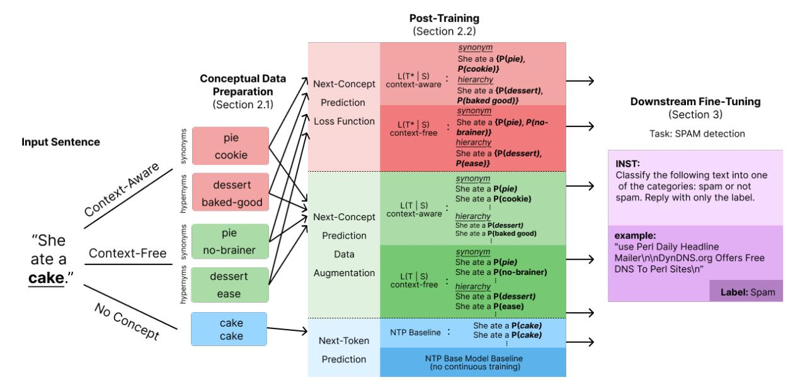

# Beyond Tokens: Concept-Level Training Objectives for LLMs

### Laya Iyer, Pranav Somani, Alice Guo, Dan Jurafsky, Chen Shani

{laya, pxsomani, azguo, jurafsky, cshani} @stanford.edu Stanford University

#### Abstract

The next-token prediction (NTP) objective has been foundational in the development of modern large language models (LLMs), driving advances in fluency and generalization. However, NTP operates at the *token* level, treating deviations from a single reference continuation as errors even when alternative continuations are equally plausible or semantically equivalent (e.g., "mom" vs. "mother"). As a result, token-level loss can penalize valid abstractions, paraphrases, or conceptually correct reasoning paths, biasing models toward surface form rather than underlying meaning. This mismatch between the training signal and semantic correctness motivates learning objectives that operate over higher-level representations. We propose a shift from tokenlevel to concept-level prediction, where concepts group multiple surface forms of the same idea (e.g., "mom," "mommy," "mother" → *MOTHER*). We introduce various methods for integrating conceptual supervision into LLM training and show that concept-aware models achieve lower perplexity, improved robustness under domain shift, and stronger performance than NTP-based models on diverse NLP benchmarks. This suggests *concept-level supervision* as an improved training signal that better aligns LLMs with human semantic abstractions.

#### 1 Introduction

Large language models (LLMs) have reshaped the landscape of natural language processing, achieving fluency and generalization once thought out of reach. At their core, however, today's LLMs are trained with a surprisingly narrow objective: predicting the next token in a sequence. This has been a powerful proxy for learning language, but it ties models to the surface level of text by rewarding them for producing the right strings, not for understanding the ideas those strings convey. This gap becomes especially pronounced as LLMs are

increasingly expected to perform abstraction and reasoning rather than mere continuation.

Humans, by contrast, do not think or communicate in tokens. We reason in concepts: semantic units that unify different linguistic expressions under a shared meaning. For example, "mom," "mommy," and "mother" all point to the concept MOTHER. Concepts also stretch beyond literal synonymy: "father" may be understood as part of the broader concept PARENT, depending on context. Concepts are flexible, context-sensitive, and hierarchically structured, capturing meaning at a level that tokens cannot [\(Holtzman et al.,](#page-5-0) [2021;](#page-5-0) [Shani et al.,](#page-6-0) [2023,](#page-6-0) [2025;](#page-6-1) [Murphy,](#page-6-2) [2004\)](#page-6-2).

This gap matters because the expectations placed on LLMs are rapidly shifting. Beyond producing fluent continuations, we now ask them to explain, reason, and think in an abstract manner, tasks that hinge on capturing meaning rather than string similarity. In this paper, we explore a different foundation: What if models were trained to predict concepts rather than tokens, by recognizing that multiple forms can stand for the same idea, and to generalize across them? Predicting the next *concept* offers such a shift: instead of optimizing for exact surface matches, models are guided to capture the semantic structures underlying language.

We formalize concepts as clusters of synonymous and contextually interchangeable forms, and integrate them into training as units of supervision. We show that predicting the next *concept*, rather than the next token, yields lower NTP perplexity scores, exhibits better robustness to domain shifts, and shows improvements on various NLP benchmarks. These suggest that concept-aware training can provide a more human-centered foundation for LLM.

Figure 1: An outline of our method. We extract context-dependent and independent synonyms and hypernyms and use them to train our NSP and NHP models. We upsample the original data for the NTP baselines. All models are fine-tuned on benchmarks.

### 2 Methods

We post-trained Llama-3-8B [\(Grattafiori et al.,](#page-5-1) [2024\)](#page-5-1) using both the standard NTP and our Next-Concept-Prediction (NCP) implementations. To avoid data contamination, we gathered new data that was not used for training the original LLM (as it did not exist then). We now detail the data preparation and training processes (see [Figure 1\)](#page-1-0).[1](#page-1-1)

#### 2.1 Conceptual Data Preparation

To avoid training Llama-3-8B on examples from its pretraining corpus, we collected data produced after its public release date (April 18, 2024). Our dataset draws from three distinct sources: YouTube comments, arXiv abstracts, and New York Times abstracts, chosen to provide diversity across informal, scientific, and journalistic domains.

#### 2.1.1 Concept Resolution

From this corpus, we extracted nouns from each sentence, treating them as core conceptual units, since nouns typically carry substantial semantic content.[2](#page-1-2) We operationalize concepts as interchangeable lexical realizations of a shared concept. Thus, for each noun, we extract two levels of resolution: (1) Synonym, and (2) Hypernym, which is an abstraction of the original noun. Meaning, if the

original noun was "cake," synonyms would include "pie" and "cookie," whereas the hypernyms would include "dessert" and "baked goods."

#### 2.1.2 Concept Extraction

As illustrated in [Figure 1,](#page-1-0) we generated conceptual training data using three complementary methods: (1) Context-Free extracts context-independent, dictionary-based synonyms and hypernyms from WordNet, (2) Context-Aware, which extracts contextual synonyms and hypernyms by prompting Llama-3-8B-Instruct with the full sentence and the target noun to produce contextually appropriate alternatives [\(Appendix B\)](#page-7-0), and (3) No Concept, which inflates the data reusing the original word in the sentence, multiple times (to train NTP baselines with matched number of repeated datapoints).[3](#page-1-3)

### 2.2 Post-Training

We post-trained on each dataset split ∈ {YouTube, arXiv, New York Times} as well as on a combined dataset, downsampling where necessary for consistency across splits. This allows us to assess whether data variation across domains leads to different levels of conceptual awareness. All NCP variants and NTP baselines were post-trained on the same underlying datapoints, differing only in the target nouns used (depending on the concept handling or NTP setup), and on the same number of datapoints (approximately 8K-1K-1K sentences

1Data and code: [https://github.com/layaiyer1/concept](https://github.com/layaiyer1/concept-aware-training)[aware-training.](https://github.com/layaiyer1/concept-aware-training)

2While verbs and adjectives can also be meaningful, we leave them for future research.

3These methods are imperfect; see [Limitations Section.](#page-5-2)

for the train-validation-test split; see Table [4](#page-7-1) for full dataset sizes per variant).

#### 2.2.1 Next Token Prediction (NTP) Baselines

We used two NTP-based baselines:

Base Model. Used without any post-training to evaluate the model's baseline performance.

NTP Baseline. Post-trained using the standard NTP on the same datapoints as the NCT models:

$$L(T \mid S) = \log (p(T \mid S, \Theta))$$

Where T is the target token, S is the input sentence, and Θ is model's parameters.

This ensures that the model is exposed to the same datapoints and training volume, while preventing it from learning concept-level signals.

#### 2.2.2 Next Concept Prediction (NCP) Models

To shift training from the token level to the concept level, we enriched our data with conceptual signals (see [Section](#page-1-4) [2.1\)](#page-1-4). Specifically, each target noun T in the corpus was paired with a set of synonym/hypernym nouns T ∗ , extracted either with or without contextual information. Using these conceptual annotations, we implemented two conceptaware training procedures:

NCP Data Augmentation. We augmented the training data using the extracted synonyms and hypernyms. For each sentence with n possible noun completions, we created n training instances, each targeting a different conceptually equivalent noun. The model was then trained using the standard NTP objective. By rewarding these lexical variations, we effectively flattened the probability distribution over next-token predictions, reducing the model's bias toward any single lexical choice.[4](#page-2-0)

NCP Loss Function. A more more direct approach is to modify the NTP loss function itself: Let T debite the original target noun, and the set of conceptually equivalent completions be T ∗ . The objective becomes predicting any completion in T ∗ , conditioned on the input sentence S and the model parameters Θ:

$$L(T^* \mid S) = \frac{1}{|T^*|} \sum_{n=1}^{N} \log (p(t_n \in T^* \mid S, \Theta))$$

[Table](#page-2-1) [1](#page-2-1) presents all the variants trained using the two NCP training paradigms (Data Augmentation and Loss Function) and two levels of concept resolution (synonyms and hypernyms).

| Variant                  | Model                                                                          | Concept Method                                           |  |  |
|--------------------------|--------------------------------------------------------------------------------|----------------------------------------------------------|--|--|
| NCP Loss                 | NSP Context-Aware NSP Context-Free NHP Context-Aware NHP Context-Free | Syn.; LLM Syn.; WordNet Hyp.; LLM Hyp.; WordNet |  |  |
| NCP Data Augmentation | NSP Context-Aware NSP Context-Free NHP Context-Aware NHP Context-Free | Syn.; LLM Syn.; WordNet Hyp.; LLM Hyp.; WordNet |  |  |
| NTP Baselines         | NTP Synonym NTP Hypernym Base Model                                      | Syn. Hyp. –                                        |  |  |

Table 1: NCP variants and NTP baselines by posttraining paradigm, concept level, and concept source. Syn. = synonym, Hyp. = hypernym. Each variant was post-trained four times, once on each dataset ∈ {YouTube comments, arXiv abstracts, New York Times abstracts, and a combination of the three domains}.

## 3 Benchmarks for Fine-Tuning

After post-training the NTP baseline and all NCP variants (Data Augmentation and Loss Function and the two levels of concept resolution), we finetuned them on seven diverse benchmarks (parameters and implementation details in [Appendix](#page-7-2) [B\)](#page-7-2):

SNLI. [\(Bowman et al.,](#page-5-6) [2015\)](#page-5-6) Stanford Natural Language Inference evaluates a model's ability to determine entailment, contradiction, or neutrality between a premise and a hypothesis.

GLUE. [\(Wang et al.,](#page-6-3) [2018\)](#page-6-3) GLUE aggregates several tasks, such as sentiment analysis, paraphrase detection, and linguistic acceptability, making it a robust testbed for general NLU capabilities.

Empathetic dialogs. [\(Rashkin et al.,](#page-6-4) [2019\)](#page-6-4) contains thousands of short conversations grounded in emotional situations, requiring the model to exhibit nuanced understanding and empathetic reasoning.

Hate speech. [\(Davidson et al.,](#page-5-7) [2017\)](#page-5-7) composed of tweets annotated for hate speech and offensive language from <hatebase.org> and challenges models to distinguish between harmful and benign content.

Spam. [\(Talby,](#page-6-5) [2020\)](#page-6-5) includes real-world email messages labeled as spam or ham.

Fake News. [\(Cartinoe5930,](#page-5-8) [2025\)](#page-5-8) is built from PolitiFact fact-checks [\(PolitiFact,](#page-6-6) [2007–2025\)](#page-6-6). It provides news/claims with fake versus real labels on contemporary U.S. political content.

Logical Fallacy. [\(Jin et al.,](#page-5-9) [2022\)](#page-5-9) reasoning patterns detection dataset spanning ad hominem, ad populum, circular reasoning, false causality, etc.

4We note that data augmentation using synonyms has been explored before by [Jungiewicz and Smywinski-Pohl](#page-5-3) ´ [\(2019\)](#page-5-3); [Kobayashi](#page-5-4) [\(2018\)](#page-5-4); [Levine et al.](#page-5-5) [\(2020\)](#page-5-5).

### 4 Results

We now compare standard NTP with NCP training for both post-training and fine-tuning procedures.

#### 4.1 Post-Training

We computed NTP perplexity scores (standard perplexity) on held-out sets from all four domains (YouTube comments, arXiv abstracts, and New York Times abstracts, and all together), without modifying the data or enriching it with concept signal. [Table 2](#page-3-0) reports the model with the lowest NTP perplexity for each pair of training-test domains across all NCP variants and NCP baselines.

Despite being trained with a different objective and modified data, concept-based models achieve competitive perplexity on held-out subsets of the original data that contain no concept signal. Notably, one model, NHP Context-Aware Data Augmentation, achieved the lowest NTP perplexity on all evaluation datasets (all scores in Table [5\)](#page-10-0).

Moreover, we explore cross-domain transfer abilities using the ratio between the NTP/NCP perplexity value of the model trained in the evaluated domain and models trained in all other domains. [Table 2](#page-3-0) shows that NCP models are better at crossdomain transfer (full scores and metric details in [Appendix](#page-9-0) [G\)](#page-9-0). Overall, NCP models demonstrate superior in-domain and cross-domain perplexity scores compared to NTP baselines.

To illustrate the qualitative difference between NTP and NCP, consider the following sentence from our data: "This word has appeared in 53 ." The NTP's top five predictions are different variations of 'articles' (singular versus plural, with and without capitalization and spaces). In contrast, the NCP models distribute the probability mass across semantically related completions: 'searches,' 'articles,' 'episodes,' and 'cases,' reflecting a broader conceptual understanding. This highlights that while NTP rewards reproducing surface strings, NCP encourages models to capture underlying semantic relationships, producing outputs that are more meaning-equivalent and less lexically rigid.

#### 4.2 Downstream Benchmark Fine-Tuning

[Table 3](#page-4-0) reports the accuracy scores of all NCP models and NTP baselines after fine-tuning on the seven benchmarks presented in Section [3.](#page-2-2) All models and baselines perform better than the non-finetuned variant, as expected. Across all seven NLP benchmarks tested, NCP models were consis-

| Train Eval |                               | Best Model           |  |  |
|---------------|-------------------------------|----------------------|--|--|
|               |                               | NSP Context          |  |  |
|               | News                          | Free Data Aug.       |  |  |
| YouTube       | ArXiv NTP Synonym Baseline |                      |  |  |
|               |                               | NSP Context-Aware    |  |  |
|               | Combined                      | & NSP Context-Free   |  |  |
|               |                               | NHP Context          |  |  |
|               | YouTube                       | Free Data Aug.       |  |  |
| News          |                               | NSP Context          |  |  |
|               | ArXiv                         | Aware Data Aug.      |  |  |
|               |                               | NSP Context-Aware    |  |  |
|               | Combined                      | & NSP Context-Free   |  |  |
|               |                               | NHP Context          |  |  |
|               | YouTube                       | Free Data Aug.       |  |  |
| ArXiv         |                               | NSP Context          |  |  |
|               | News                          | Free Data Aug.       |  |  |
|               |                               | NSP Context-Aware    |  |  |
|               | Combined                      | & NSP Context-Free   |  |  |
|               |                               | NHP Context          |  |  |
|               | YouTube                       | Free Data Aug.       |  |  |
| Combined      | News                          | NHP Context-Free     |  |  |
|               | ArXiv                         | NTP Synonym Baseline |  |  |

Table 2: [NCP models show superior cross domain robustness.] For each eval domain, we compute the NTP/NCP perplexity score of all models *not* trained on the domain and divide them by the corresponding score of the corresponding model that was trained on the eval domain. This captures the robustness to domain shifts.

tently better than all NTP baselines, highlighting the potential of concepts for LLM training.

### 5 Conclusions & Future Work

We rethink the standard NTP approach by incorporating more human-inspired supervision signals. We introduce NCP, which unifies synonymous forms into shared semantic units (at two levels of resolution and two training paradigms), enabling models to capture meaning beyond surface text. NCP has lower NTP perplexity, is more robust to domain shifts, and exceeds NTP performance, marking it as a promising foundation for LLM training. Moreover, NCT is flexible, supporting both pre- and post-training applications.

Future work includes NCP pre-training, hierarchical concept representations, and multilingual extensions. We view NTP as one of many possible training signals, whereas NCP opens the door to foundations that are not only statistically effective but also more aligned with human cognition.

Table 3: [Incorporating concept-signal into the training process of LLMs improves performance on various downstream NLP tasks.] Downstream fine-tuned accuracy scores across seven benchmarks: EMPATHETIC DIALOGUES (EMO), GLUE, HATE SPEECH (HATE), SNLI, SPAMASSASSIN (SPAM), FAKE NEWS (FAKE), LOGICAL FALLACY (LOG). Best accuracy for each dataset within a domain is in bold. A double horizontal line separates the NCP (both NSP and NHP) models from the NCP baselines. NCP models outperform NTP baselines. Notably, the NHP Context-Free Data Augmentation model is best/comparable at four out of the seven benchmarks tested. Interestingly, using the combined dataset for post-training does not yield better results compared to using domain-specific datasets.

| Variant                            | Domain   | EMO    | GLUE   | HATE   | SNLI        | SPAM   | FAKE   | LOG    |
|------------------------------------|----------|--------|--------|--------|-------------|--------|--------|--------|
|                                    | ArXiv    | 0.8425 | 0.7698 | 0.8544 | 0.8192      | 0.9828 | 0.6431 | 0.4826 |
| NSP Loss                           | News     | 0.8183 | 0.8030 | 0.8859 | 0.3515      | 0.9657 | 0.4458 | 0.5149 |
| Context-Aware                      | YouTube  | 0.8504 | 0.8433 | 0.8805 | 0.5578      | 0.9532 | 0.6166 | 0.5274 |
|                                    | Combined | 0.8493 | 0.3365 | 0.9001 | 0.3515      | 0.9782 | 0.5729 | 0.5199 |
|                                    | ArXiv    | 0.8403 | 0.8423 | 0.8490 | 0.4910      | 0.8970 | 0.5987 | 0.4826 |
| NSP Loss                           | News     | 0.8575 | 0.8427 | 0.8936 | 0.8250      | 0.6334 | 0.6505 | 0.5348 |
| Context-Free                       | YouTube  | 0.8513 | 0.7844 | 0.8319 | 0.3330      | 0.9657 | 0.6166 | 0.5274 |
|                                    | Combined | 0.7514 | 0.5879 | 0.7753 | 0.3515      | 0.9657 | 0.576  | 0.1716 |
|                                    | ArXiv    | 0.8549 | 0.8363 | 0.7806 | 0.6819      | 0.9828 | 0.4263 | 0.5299 |
| NHP Loss                           | News     | 0.7846 | 0.8549 | 0.7952 | 0.8277      | 0.9688 | 0.5757 | 0.5224 |
| Context-Aware                      | YouTube  | 0.8043 | 0.3254 | 0.7799 | 0.7948      | 0.9470 | 0.4844 | 0.4950 |
|                                    | Combined | 0.8425 | 0.8065 | 0.8855 | 0.7450      | 0.9657 | 0.6037 | 0.5274 |
|                                    | ArXiv    | 0.8566 | 0.8363 | 0.7806 | 0.6819      | 0.9828 | 0.4263 | 0.5299 |
| NHP Loss                           | News     | 0.8161 | 0.8166 | 0.9001 | 0.3706      | 0.9688 | 0.5757 | 0.4652 |
| Context-Free                       | YouTube  | 0.7767 | 0.3254 | 0.8406 | 0.7948      | 0.9470 | 0.4844 | 0.4950 |
|                                    | Combined | 0.7745 | 0.8126 | 0.8963 | 0.8271      | 0.8190 | 0.6630 | 0.5323 |
|                                    | ArXiv    | 0.8600 | 0.7637 | 0.8532 | 0.8521      | 0.9813 | 0.6197 | 0.5224 |
| NSP Context                        | News     | 0.8566 | 0.6922 | 0.8486 | 0.8362      | 0.9813 | 0.5566 | 0.0970 |
| Aware Data Aug.                    | YouTube  | 0.7762 | 0.7652 | 0.8855 | 0.8287      | 0.9750 | 0.6162 | 0.4801 |
|                                    | Combined | 0.8037 | 0.8433 | 0.8671 | 0.8240      | 0.9204 | 0.6385 | 0.5124 |
|                                    | ArXiv    | 0.8571 | 0.5829 | 0.8924 | 0.8070      | 0.9672 | 0.6256 | 0.3831 |
| NSP Context                        | News     | 0.8577 | 0.8030 | 0.7787 | 0.8505      | 0.9875 | 0.5764 | 0.5473 |
| Free Data Aug.                     | YouTube  | 0.8493 | 0.8081 | 0.8598 | 0.8287      | 0.9828 | 0.5858 | 0.5149 |
|                                    | Combined | 0.7925 | 0.8574 | 0.8909 | 0.8542      | 0.9782 | 0.5679 | 0.5299 |
|                                    | ArXiv    | 0.8093 | 0.4761 | 0.8771 | 0.8287      | 0.9844 | 0.7176 | 0.4851 |
| NHP Context                        | News     | 0.8397 | 0.8287 | 0.7983 | 0.7004      | 0.9797 | 0.5998 | 0.5174 |
| Aware Data Aug.                    | YouTube  | 0.7902 | 0.8363 | 0.8970 | 0.8457      | 0.9064 | 0.6092 | 0.5050 |
|                                    | Combined | 0.8110 | 0.8111 | 0.8759 | 0.8547      | 0.9189 | 0.6505 | 0.4776 |
|                                    | ArXiv    | 0.8673 | 0.6776 | 0.9051 | 0.7879      | 0.9891 | 0.6498 | 0.5149 |
|                                    |          |        |        |        |             |        |        |        |
| NHP Context Free Data Aug.      | News     | 0.8414 | 0.7662 | 0.8986 | 0.8187 1 | 0.9766 | 0.5866 | 0.5299 |
|                                    | YouTube  | 0.8301 | 0.5587 | 0.8940 |             | 0.9844 | 0.5784 | 0.5124 |
|                                    | Combined | 0.7913 | 0.8282 | 0.8990 | 0.8505      | 0.9485 | 0.5776 | 0.4851 |
|                                    | ArXiv    | 0.8313 | 0.7526 | 0.9043 | 0.8388      | 0.8721 | 0.6229 | 0.4876 |
| NTP Synonym Baseline Fine-Tuned | News     | 0.7548 | 0.3496 | 0.8302 | 0.8245      | 0.9111 | 0.6950 | 0.5149 |
|                                    | YouTube  | 0.8155 | 0.4987 | 0.8798 | 0.8086      | 0.9782 | 0.5761 | 0.4478 |
|                                    | Combined | 0.8380 | 0.7395 | 0.8509 | 0.8473      | 0.9189 | 0.6076 | 0.5274 |
| NTP Hypernym                       | ArXiv    | 0.8476 | 0.7149 | 0.9051 | 0.8388      | 0.9750 | 0.7129 | 0.5174 |
|                                    | News     | 0.8588 | 0.8262 | 0.8552 | 0.7550      | 0.9797 | 0.5608 | 0.5149 |
| Baseline Fine-Tuned                | YouTube  | 0.8262 | 0.8343 | 0.8986 | 0.8150      | 0.9813 | 0.4395 | 0.5100 |
|                                    | Combined | 0.7762 | 0.6247 | 0.8944 | 0.8722      | 0.9610 | 0.6392 | 0.4925 |
| Base Model                         | -        | 0.7852 | 0.3365 | 0.8083 | 0.7996      | 0.9813 | 0.6264 | 0.49   |
| Fine-Tuned                         |          |        |        |        |             |        |        |        |
| Base Model                         | -        | 0.5681 | 0.3204 | 0.7933 | 0.3144      | 0.6505 | 0.4424 | 0.0071 |
|                                    |          |        |        |        |             |        |        |        |

### 6 Limitations

While our findings highlight the promise of concept-aware training, several limitations remain. First, we explore only one paradigm to incorporate concept supervision. Other formulations, such as hierarchical concepts, cross-lingual mappings, or integration with generative objectives, may provide richer signals.

Second, our evaluation is limited to fine-tuning on classification tasks. These benchmarks already achieve high baseline accuracy, leaving little room to demonstrate the full potential of concept-level prediction. Extending evaluation to tasks that require more abstraction, such as generation, reasoning, or transfer learning, would offer a clearer picture of its benefits. Broader evaluations and larger-scale experiments are essential to fully establish its effectiveness.

Third, our approach to extracting concept signals is imperfect. The context-aware method relies on LLMs, which may introduce or amplify existing biases and inconsistencies in their understanding of concepts. The context-free method neglects the crucial role of context in shaping meaning. More robust methods are needed to induce concept representations.

#### 7 Ethical Considerations

In terms of the potential risks of our work, we realize that concepts could lead to the risk of overgeneralizing, overextending concept boundaries, and amplifying spurious associations or stereotypes. Care should be taken when defining concept clusters, especially for sensitive or demographic-related content, to avoid reinforcing biases present in the training data.

We also note that, similar to all NTP LLMs, NCP might lead to hallucinations and other types of undesired model behaviors. These were not explored in this work, and thus we recommend practitioners, as usual, to validate their artifacts before releasing them to the public.

Finally, the introduction of concept-level reasoning may shift the interpretability of model outputs: while grouping tokens into concepts can improve semantic coherence, it may obscure the model's reasoning at the token level, potentially making errors harder to detect. We encourage transparency in reporting both concept definitions and model behaviors to support responsible use.

Disclosure: LLMs were used to refine the text and design the table.

#### References

- Samuel R Bowman, Gabor Angeli, Christopher Potts, and Christopher D Manning. 2015. A large annotated corpus for learning natural language inference. In *Proceedings of the 2015 Conference on Empirical Methods in Natural Language Processing*, pages 632– 642. ACL.
- Cartinoe5930. 2025. [Politifact fake news.](https://huggingface.co/datasets/Cartinoe5930/Politifact_fake_news) Hugging Face Datasets. Accessed: 2025-10-06.
- Thomas Davidson, Dana Warmsley, Michael Macy, and Ingmar Weber. 2017. Automated hate speech detection and the problem of offensive language. In *Proceedings of ICWSM*.
- Aaron Grattafiori, Abhimanyu Dubey, Abhinav Jauhri, Abhinav Pandey, Abhishek Kadian, Ahmad Al-Dahle, Aiesha Letman, Akhil Mathur, Alan Schelten, Alex Vaughan, Amy Yang, Angela Fan, Anirudh Goyal, Anthony Hartshorn, Aobo Yang, Archi Mitra, Archie Sravankumar, Artem Korenev, Arthur Hinsvark, and 542 others. 2024. [The llama 3 herd of](https://arxiv.org/abs/2407.21783) [models.](https://arxiv.org/abs/2407.21783) *Preprint*, arXiv:2407.21783.
- Ari Holtzman, Peter West, Vered Shwartz, Yejin Choi, and Luke Zettlemoyer. 2021. Surface form competition: Why the highest probability answer isn't always right. *arXiv preprint arXiv:2104.08315*.
- Edward J. Hu, Yelong Shen, Phillip Wallis, Zeyuan Allen-Zhu, Yuanzhi Li, Shean Wang, Lu Wang, and Weizhu Chen. 2021. [Lora: Low-rank adaptation of](https://arxiv.org/abs/2106.09685) [large language models.](https://arxiv.org/abs/2106.09685) *Preprint*, arXiv:2106.09685.
- Zhijing Jin, Abhinav Lalwani, Tejas Vaidhya, Xiaoyu Shen, Yiwen Ding, Zhiheng Lyu, Mrinmaya Sachan, Rada Mihalcea, and Bernhard Schölkopf. 2022. Logical fallacy detection. *arXiv preprint arXiv:2202.13758*.
- Michał Jungiewicz and Aleksander Smywinski-Pohl. ´ 2019. Towards textual data augmentation for neural networks: synonyms and maximum loss. *Computer Science*, 20.
- Sosuke Kobayashi. 2018. Contextual augmentation: Data augmentation by words with paradigmatic relations. *arXiv preprint arXiv:1805.06201*.
- Yoav Levine, Barak Lenz, Or Dagan, Ori Ram, Dan Padnos, Or Sharir, Shai Shalev-Shwartz, Amnon Shashua, and Yoav Shoham. 2020. [SenseBERT: Driv](https://doi.org/10.18653/v1/2020.acl-main.423)[ing some sense into BERT.](https://doi.org/10.18653/v1/2020.acl-main.423) In *Proceedings of the 58th Annual Meeting of the Association for Computational Linguistics*, pages 4656–4667, Online. Association for Computational Linguistics.
- Md Mafiul Hasan Matin Mafi and Md. Sabbir Alam. 2023. [Suicidal ideation detection reddit dataset.](https://doi.org/10.17632/z8s6w86tr3.2)

- Gregory Murphy. 2004. *The big book of concepts*. MIT press.
- PolitiFact. 2007–2025. [Politifact: Fact-checks and truth](https://www.politifact.com/)[o-meter.](https://www.politifact.com/) Accessed: 2025-10-06.
- Hannah Rashkin, Eric Michael Smith, Margaret Li, and Y-Lan Boureau. 2019. Towards empathetic opendomain conversation models: A new benchmark and dataset. In *Proceedings of the 57th Annual Meeting of the Association for Computational Linguistics*, pages 5370–5381. ACL.
- Chen Shani, Liron Soffer, Dan Jurafsky, Yann Le-Cun, and Ravid Shwartz-Ziv. 2025. From tokens to thoughts: How llms and humans trade compression for meaning. *arXiv preprint arXiv:2505.17117*.
- Chen Shani, Jilles Vreeken, and Dafna Shahaf. 2023. [Towards concept-aware large language models.](https://arxiv.org/abs/2311.01866) *Preprint*, arXiv:2311.01866.
- David Talby. 2020. Spamassassin public corpus dataset. [https://huggingface.co/datasets/](https://huggingface.co/datasets/talby/spamassassin) [talby/spamassassin](https://huggingface.co/datasets/talby/spamassassin).
- Alex Wang, Amanpreet Singh, Julian Michael, Felix Hill, Omer Levy, and Samuel R Bowman. 2018. Glue: A multi-task benchmark and analysis platform for natural language understanding. In *Proceedings of the 2018 EMNLP Workshop BlackboxNLP*, pages 353–355. ACL.
- Xiang Zhang, Junbo Zhao, and Yann LeCun. 2015. Character-level convolutional networks for text classification. In *NeurIPS*.

## A Prompt to Obtain Contextual Synonym and Hypernym

#### Synonyms

System Prompt Answer the question using a comma-separated list and remove any extraneous information. An example output for a sentence will be [item1, item2, item3]. If no synonyms are found, return an empty array. Do not repeat this prompt in your output.

Message Provided a sentence and a noun of interest, the message reads: "Generate contextual synonyms for the word **noun** in the sentence **sentence**."

#### Hypernyms

System Prompt Answer the question using a comma-separated list and remove any extraneous information. An example output for a sentence will be [item1, item2, item3]. If no hypernym are found, return an empty array. Do not repeat this prompt in your output.

Message Provided a sentence and a noun of interest, the message reads: "Generate contextual hypernym for the word **noun** in the sentence **sentence**."

#### B Fine-Tuning Implementation

For each of the following tasks, we fine-tuned all models using LoRA [\(Hu et al.,](#page-5-10) [2021\)](#page-5-10) with parameters r=16 and α=16, targeting the attention and feedforward modules (q\_proj, k\_proj, v\_proj, o\_proj, gate\_proj, up\_proj, down\_proj) for efficient adaptation. Models were trained using 4-bit quantization with the AdamW 8-bit optimizer, a learning rate of 2e-4 with linear scheduling, and gradient accumulation over four steps. Each model was trained for 100 steps with a batch size of 2, employing the Alpaca instruction format for consistent prompt structuring across tasks. Training incorporated validation-based checkpointing every 20 steps to monitor convergence. This resulted in a total of 189 fine-tuned models across 9 downstream tasks, enabling us to systematically evaluate the transferability and robustness of conceptual understanding across domains.

We evaluated each fine-tuned model's ability to classify instances for the task for which it was trained. The evaluation process involved matching

each model to its input template and generating predictions using the Alpaca prompt format. We computed match accuracy by comparing lowercased, stripped predictions against ground truth labels. The evaluation focused on accuracy as the primary metric for comparing the concept-aware training paradigm against baseline approaches, with results stored in JSON format, including sample predictions for qualitative analysis. This systematic evaluation enabled direct comparison of how different post-training strategies transferred to downstream classification tasks.

### C Post-training Dataset Sizes

[Table](#page-7-1) [4](#page-7-1) depicts the different dataset sizes for each domain and model variant. These are the same dataset sizes for both the synonym based models, as well as the hierarchy based models.

Table 4: Dataset sizes for each domain and model variant.

| Domain   | Variant | Train | Val   | Test (Eval) |
|----------|---------|-------|-------|-------------|
|          | Vanilla | 8,000 | 1,002 | 986         |
| ArXiv    | Dict    | 8,000 | 1,002 | 986         |
|          | Context | 8,006 | 1,002 | 986         |
|          | Vanilla | 8,001 | 1,007 | 1,001       |
| News     | Dict    | 8,001 | 1,007 | 1,001       |
|          | Context | 9,989 | 1,007 | 1,001       |
|          | Vanilla | 8,000 | 1,004 | 964         |
| YouTube  | Dict    | 8,000 | 1,004 | 964         |
|          | Context | 8,000 | 1,004 | 964         |
| Combined | Vanilla | 8,000 | 1,002 | 986         |
|          | Dict    | 8,000 | 1,002 | 986         |
|          | Context | 8,004 | 1,002 | 986         |

### D Multi-Token Completions

Our loss function supports *multi-token* words and completions. We precompute a map word → token IDs for all targets and their completions to avoid repeated tokenization and keep training steps fast/deterministic. Using this dictionary from words (nouns of interest) to their tokenized IDs we replace the entire token span of the target word with the completion's span (which may be longer or shorter) during training. The model is then evaluated using the completions and the NCP loss function.

## E Model Size and Budget

In this paper, we use LLaMA-3-8B as our main model, which is an 8-billion-parameter model. Computational resources and GPUs were provided by the authors' research institute.

### F Dataset Descriptive Statistics

The following is additional details about each of our fine-tuning datasets:

### SNLI [\(Bowman et al.,](#page-5-6) [2015\)](#page-5-6) ([stanfordnlp/snli](https://huggingface.co/datasets/stanfordnlp/snli))

- Task: 3-way NLI (entailment/contradiction/neutral).
- Size/Splits/Labels: ∼570k pairs; train/dev/test; labels: *entailment, contradiction, neutral*.

#### • Examples from the dataset:

(1) Premise: A man inspects the uniform of a figure in an East Asian country. Hypothesis: The man is sleeping

Label: Contradiction

(2) Premise: Two men on a roof with snow shovels. Hypothesis: They are clearing snow.

Label: Entailment

#### GLUE [\(Wang et al.,](#page-6-3) [2018\)](#page-6-3) ([nyu-mll/glue](https://huggingface.co/datasets/nyu-mll/glue))

- Task: Aggregated NLU suite (acceptability, sentiment, paraphrase, NLI, STS).
- Size/Splits/Labels: 13.2k pairs; train/dev/test; labels: entailment, contradiction, neutral.

#### • Examples from the dataset:

(1) Premise: but see but you're going there and you know what you're getting into. Hypothesis: By getting involved, you understand what is in store.

Label: Entailment

(2) Premise: it is in Texas too. Hypothesis: It's not in Texas

Label: Contradiction

### Empathetic Dialogues [\(Rashkin et al.,](#page-6-4) [2019\)](#page-6-4) ([facebook/empathetic\\_dialogues](https://huggingface.co/datasets/facebook/empathetic_dialogues))

- Task: Emotion-grounded open-domain dialogue.
- Size/Splits/Labels: 76.7k/12.0k/10.9k (train/dev/test); emotion in context.

#### • Examples from the dataset:

(1) Utterance: I remember going to see the fireworks with my best friend.

Label: Sentimental

(2) Utterance: I finally finished my last exam today!

Label: Proud

### Hate Speech [\(Davidson et al.,](#page-5-7) [2017\)](#page-5-7) ([tdavidson/hate\\_speech\\_offensive](https://huggingface.co/datasets/tdavidson/hate_speech_offensive))

- Task: Tweet toxicity (hate\_speech/offensive/neither)
- Size/Splits/Labels: train/dev/test; 3 labels.

#### • Examples from the dataset:

(1) Input: @user we gotta find this h\*\*.

Label: Offensive

(2) Input: Burritos are trash

Label: Neither

• Content note: Contains offensive language.

### Spam Assassin [\(Talby,](#page-6-5) [2020\)](#page-6-5) ([talby/spamassassin](https://huggingface.co/datasets/talby/spamassassin))

- Task: Spam vs. ham email classification.
- Size/Splits/Labels: ∼21.5k messages; labels: *spam, ham*.

### • Examples from the dataset:

(1) Input: Free trial for . . .

Label: Spam

(2) Input: Meeting moved to 3pm . . . Label: Ham

### Suicidal Ideation (Reddit) [\(Mafi and Alam,](#page-5-11) [2023\)](#page-5-11) [\(Mendeley Data \(DOI\)\)](https://data.mendeley.com/datasets/z8s6w86tr3)

- Task: Spam vs. ham email classification.
- Size/Splits/Labels: 15,477 posts (paper).

#### • Examples from the dataset:

(1) Input: "I can't see a way out . . .

I'm so tired." Label: Suicidal

(2) Input: "Having a rough day but trying to stay positive."

Label: Non-suicidal

• Content note: Sensitive mental-health content.

Fake News (PolitiFact-based) [\(Cartinoe5930,](#page-5-8) [2025\)](#page-5-8) [\(Cartinoe5930/Politifact\\_fake\\_news\)](https://huggingface.co/datasets/Cartinoe5930/Politifact_fake_news)

- Task: Short political claim with fact-check label (e.g.; *true*, *false*)
- Size/Splits/Labels: train 17.1k, text 4.23k; labels: true or false.

### • Examples from the dataset:

(1) Input: PayPal has reinstated its policy to fine users \$2,500 directly from their accounts if they spread 'misinformation.

Label: False

(2) Input: Kids are resistant to COVID as opposed to older people.

Label: True

## Logical Fallacy [\(Jin et al.,](#page-5-9) [2022\)](#page-5-9) [\(tasksource/logical-fallacy\)](https://huggingface.co/datasets/tasksource/logical-fallacy)

- Task: Multi-class fallacy detection (e.g.; ad hominem, ad populum, circular reasoning, false causality)
- Size/Splits/Labels: train 2.68k, test 500; labels: ad hominem, ad populum, appeal to emotion, circular reasoning, equivocation, fallacy of credibility, fallacy of extension, fallacy of logic, fallacy of relevance, false causality, false dilemma, faulty generalization, intentional.

#### • Examples from the dataset:

(1) Input: Don't listen to Senator Bob's opinion. He is a crook, and a spiteful loony man.

Label: ad hominem

(2) Input: Did your misleading claims result in you getting promoted?

Label: intentional

Amazon Polarity [\(Zhang et al.,](#page-6-7) [2015\)](#page-6-7) [\(ama](https://huggingface.co/datasets/amazon_polarity)[zon\\_polarity\)](https://huggingface.co/datasets/amazon_polarity)

- Task: Binary review sentiment.
- Size/Splits/Labels: train 3.6M, test 400k; labels: positive, negative.

#### • Examples from the dataset:

(1) Input: A complete waste of time. Typographical errors, poor grammar, and a totally pathetic plot add up to absolutely nothing. I'm embarrassed for this author and very disappointed I actually paid for this book.

Label: negative

(2) Input: got this for my daughter in NC, she is now making prefect bread. Wish she lived closer to make me some

Label: positive

## G Cross-Domain Table

Post-training perplexity scores using both the standard NTP and our NCP for calculating these perplexity scores. The rightmost column depicts the domain-shift robustness and is calculated as follows: the perplexity score (using the relevant N\_P; NTP for baselines and NCP for all others) trained on a different domain than the evaluation is divided by the perplexity score of the corresponding model that was trained on the domain. This allows us to normalize the perplexity in a way that only preserves robustness to domain shifts. For example, the NTP perplexity score of the NTP baseline trained on *news* and evaluated on *YouTube* is 244.5672. We divide it by the NTP perplexity score of the NTP baseline trained on *YouTube* (184.3536), resulting in 1.32662015. Similar to perplexity scores, lower numbers indicate better robustness to domain shifts.

Table 5: Post-training perplexity (PPL) with NTP and concept-resolution objectives (for NCP – either NHP/NSP). The last column (N\_P/Domain N\_P) shows cross-domain transfer: PPL of a model trained on a source domain and evaluated on a target, normalized by the model trained (and evaluated) on that target with the same objective.

| Concept    | Variant                                     | Evaluated          | Domain         | NTP PPL              | NCP PPL                      | N_P/Domain N_P   |
|------------|---------------------------------------------|--------------------|----------------|----------------------|------------------------------|------------------|
| NHP        | Context-Aware                               | YouTube            | youtube        | 333.2447             | 2.7490                       | 1                |
| NHP        | Context-Free                                | YouTube            | youtube        | 333.2447             | 2.7490                       | 1                |
| NHP        | Context-Aware Data-Aug                      | YouTube            | youtube        | 92.2984              | 280 477.1748                 | 1                |
| NHP        | Context-Free Data-Aug                       | YouTube            | youtube        | 89.6938              | 350 333.1050                 | 1                |
| NTP        | Hypernyms Baseline                          | YouTube            | youtube        | 85.1368              | 312 220.9439                 | 1                |
| NHP        | Context-Aware                               | YouTube            | news           | 1968.7602            | 3.3786                       | 1.2290           |
| NHP        | Context-Free                                | YouTube            | news           | 497.7945             | 2.8012                       | 1.0190           |
| NHP        | Context-Aware Data-Aug                      | YouTube            | news           | 78.1916              | 267 162.4407                 | 0.9525           |
| NHP        | Context-Free Data-Aug                       | YouTube            | news           | 121.1747             | 292 707.2868                 | 0.8355           |
| NTP        | Hypernyms Baseline                          | YouTube            | news           | 92.3580              | 378 706.8522                 | 1.2129           |
| NHP        | Context-Aware                               | YouTube            | arxiv          | 349.2148             | 2.7853                       | 1.0132           |
| NHP        | Context-Free                                | YouTube            | arxiv          | 349.2148             | 2.7853                       | 1.0132           |
| NHP        | Context-Aware Data-Aug                      | YouTube            | arxiv          | 118.6937             | 420 902.7825                 | 1.5007           |
| NHP NTP | Context-Free Data-Aug Hypernyms Baseline | YouTube YouTube | arxiv arxiv | 105.6572 103.7129 | 270 313.4715 208 530.3614 | 0.7716 0.6679 |
| NHP        | Context-Aware                               | YouTube            | combined       | 289.4326             | 2.7863                       | 1.0136           |
| NHP        | Context-Free                                | YouTube            | combined       | 266.6112             | 2.7370                       | 0.9956           |
| NHP        | Context-Aware Data-Aug                      | YouTube            | combined       | 66.5035              | 298 317.9281                 | 1.0636           |
| NHP        | Context-Free Data-Aug                       | YouTube            | combined       | 76.9409              | 295 248.1647                 | 0.8428           |
| NTP        | Hypernyms Baseline                          | YouTube            | combined       | 82.6283              | 746 022.1188                 | 2.3894           |
| NHP        | Context-Aware                               | Combined           | youtube        | 422.6810             | 2.8459                       | 1.0291           |
| NHP        | Context-Free                                | Combined           | youtube        | 417.5940             | 2.8459                       | 1.0568           |
| NHP        | Context-Aware Data-Aug                      | Combined           | youtube        | 89.0367              | 200 920.7243                 | 0.9743           |
| NHP        | Context-Free Data-Aug                       | Combined           | youtube        | 102.9593             | 254 965.1385                 | 1.0226           |
| NTP        | Hypernyms Baseline                          | Combined           | youtube        | 115.3129             | 218 921.3433                 | 0.4557           |
| NHP        | Context-Aware                               | Combined           | news           | 1213.9497            | 3.3974                       | 1.2288           |
| NHP        | Context-Free                                | Combined           | news           | 451.0357             | 2.7685                       | 1.0282           |
| NHP        | Context-Aware Data-Aug                      | Combined           | news           | 66.9841              | 189 212.1734                 | 0.9176           |
| NHP        | Context-Free Data-Aug                       | Combined           | news           | 88.6590              | 192 357.5958                 | 0.7714           |
| NTP        | Hypernyms Baseline                          | Combined           | news           | 74.4351              | 271 243.1141                 | 0.5647           |
| NHP        | Context-Aware                               | Combined           | arxiv          | 331.7483             | 2.7873                       | 1.0080           |
| NHP        | Context-Free                                | Combined           | arxiv          | 331.7483             | 2.7873                       | 1.0353           |
| NHP        | Context-Aware Data-Aug                      | Combined           | arxiv          | 94.0573              | 282 551.9262                 | 1.3702           |
| NHP        | Context-Free Data-Aug                       | Combined           | arxiv          | 83.5826              | 191 881.4087                 | 0.7696           |
| NTP        | Hypernyms Baseline                          | Combined           | arxiv          | 87.6069              | 147 708.6478                 | 0.3074           |
| NHP        | Context-Aware                               | Combined           | combined       | 243.7188             | 2.7656                       | 1                |
| NHP        | Context-Free                                | Combined           | combined       | 227.7254             | 2.6928                       | 1                |
| NHP        | Context-Aware Data-Aug                      | Combined           | combined       | 55.5191              | 206 195.8661                 | 1                |
| NHP        | Context-Free Data-Aug                       | Combined           | combined       | 63.8804              | 249 322.4276                 | 1                |
| NTP        | Hypernyms Baseline                          | Combined           | combined       | 63.2772              | 480 380.8561                 | 1                |
| NHP        | Context-Aware                               | ArXiv              | youtube        | 198.3470             | 3.2236                       | 1.0528           |
| NHP        | Context-Free                                | ArXiv              | youtube        | 198.3470             | 3.2197                       | 1.0515           |
| NHP        | Context-Aware Data-Aug                      | ArXiv              | youtube        | 54.3881              | 142 005.4560                 | 0.7963           |
| NHP        | Context-Free Data-Aug                       | ArXiv              | youtube        | 69.5159              | 176 528.8680                 | 1.3255           |
| NTP        | Hypernyms Baseline                          | ArXiv              | youtube        | 83.9096              | 150 683.8633                 | 1.4585           |
| NHP        | Context-Aware                               | ArXiv              | news           | 1021.3224            | 4.3435                       | 1.4185           |
| NHP        | Context-Free                                | ArXiv              | news           | 268.4659             | 3.2313                       | 1.0553           |
| NHP        | Context-Aware Data-Aug                      | ArXiv              | news           | 46.8513 69.9829   | 140 642.6005 137 154.0853 | 0.7886 1.0298 |
| NHP NTP | Context-Free Data-Aug Hypernyms Baseline | ArXiv ArXiv     | news news   | 54.2679              | 194 982.2997                 | 1.8866           |
| NHP        | Context-Aware                               | ArXiv              | arxiv          | 209.9622             | 3.0619                       | 1                |
| NHP        | Context-Free                                | ArXiv              | arxiv          | 209.9622             | 3.0619                       | 1                |
| NHP        | Context-Aware Data-Aug                      | ArXiv              | arxiv          | 60.9543              | 178 357.1354                 | 1                |
| NHP        | Context-Free Data-Aug                       | ArXiv              | arxiv          | 63.5198              | 133 186.0594                 | 1                |
| NTP        | Hypernyms Baseline                          | ArXiv              | arxiv          | 58.0968              | 103 344.6714                 | 1                |
| NHP        | Context-Aware                               | ArXiv              | combined       | 183.4330             | 3.1595                       | 1.0319           |
| NHP        | Context-Free                                | ArXiv              | combined       | 188.9383             | 3.0557                       | 0.9971           |
| NHP        | Context-Aware Data-Aug                      | ArXiv              | combined       | 49.1487              | 145 251.7602                 | 0.8145           |
|            |                                             |                    |                |                      |                              |                  |

(continued)

| Concept    | Variant                                         | Evaluated            | Domain             | NTP PPL               | NHP/NSP PPL                  | N_P/Domain N_P   |
|------------|-------------------------------------------------|----------------------|--------------------|-----------------------|------------------------------|------------------|
| NHP        | Context-Free Data-Aug                           | ArXiv                | combined           | 56.2360               | 206 822.9312                 | 1.5528           |
| NTP        | Hypernyms Baseline                              | ArXiv                | combined           | 56.6354               | 336 169.0554                 | 3.2534           |
| NHP        | Context-Aware                                   | News                 | youtube            | 249.7320              | 2.7484                       | 0.9593           |
| NHP        | Context-Free                                    | News                 | youtube            | 249.7320              | 2.7484                       | 1.1180           |
| NHP        | Context-Aware Data-Aug                          | News                 | youtube            | 65.9469               | 194 415.6066                 | 1.1357           |
| NHP        | Context-Free Data-Aug                           | News                 | youtube            | 73.8743               | 251 033.5765                 | 1.4817           |
| NTP        | Hypernyms Baseline                              | News                 | youtube            | 79.8546               | 211 511.4507                 | 0.8334           |
| NHP        | Context-Aware                                   | News                 | news               | 399.0138              | 2.8651                       | 1                |
| NHP        | Context-Free                                    | News                 | news               | 189.8203              | 2.4584                       | 1                |
| NHP        | Context-Aware Data-Aug                          | News                 | news               | 38.9584               | 171 159.6621                 | 1                |
| NHP        | Context-Free Data-Aug                           | News                 | news               | 42.1878               | 169 404.3654                 | 1                |
| NTP        | Hypernyms Baseline                              | News                 | news               | 36.9524               | 253 761.9440                 | 1                |
| NHP        | Context-Aware                                   | News                 | arxiv              | 217.1768              | 2.6731                       | 0.9328           |
| NHP        | Context-Free                                    | News                 | arxiv              | 217.1768              | 2.6731                       | 1.0872           |
| NHP NHP | Context-Aware Data-Aug Context-Free Data-Aug | News News         | arxiv arxiv     | 65.9476 60.1009    | 279 835.1470 185 352.6254 | 1.6351 1.0941 |
| NTP        | Hypernyms Baseline                              | News                 | arxiv              | 63.6622               | 141 820.9889                 | 0.5587           |
| NHP        | Context-Aware                                   | News                 | combined           | 155.4530              | 2.5233                       | 0.8806           |
| NHP        | Context-Free                                    | News                 | combined           | 148.9760              | 2.4833                       | 1.0101           |
| NHP        | Context-Aware Data-Aug                          | News                 | combined           | 34.3552               | 190 031.9093                 | 1.1100           |
| NHP        | Context-Free Data-Aug                           | News                 | combined           | 39.1561               | 240 334.4371                 | 1.4184           |
| NTP        | Hypernyms Baseline                              | News                 | combined           | 36.1536               | 417 731.6536                 | 1.6462           |
|            |                                                 |                      |                    |                       |                              |                  |
| NSP        | Context-Aware                                   | YouTube              | youtube            | 1281.9174             | 3.3604                       | 1                |
| NSP NSP | Context-Free Context-Aware Data-Aug          | YouTube YouTube   | youtube youtube | 1281.9174 257.4089 | 3.3604 260 072.7351       | 1 1           |
| NSP        | Context-Free Data-Aug                           | YouTube              | youtube            | 258.3046              | 278 252.2883                 | 1                |
| NTP        | Synonyms Baseline                               | YouTube              | youtube            | 184.3536              | 663 891.0267                 | 1                |
| NSP        | Context-Aware                                   | YouTube              | news               | 5021.3823             | 3.8017                       | 1.1313           |
| NSP        | Context-Free                                    | YouTube              | news               | 5021.3823             | 3.8017                       | 1.1313           |
| NSP        | Context-Aware Data-Aug                          | YouTube              | news               | 494.5056              | 321 449.3919                 | 1.2359           |
| NSP        | Context-Free Data-Aug                           | YouTube              | news               | 553.3879              | 751 897.6226                 | 2.7022           |
| NTP        | Synonyms Baseline                               | YouTube              | news               | 244.5672              | 88 239 614.03                | 1.3266           |
| NSP        | Context-Aware                                   | YouTube              | arxiv              | 3433.2579             | 3.9910                       | 1.1876           |
| NSP        | Context-Free                                    | YouTube              | arxiv              | 2731.1732             | 4.0168                       | 1.1953           |
| NSP        | Context-Aware Data-Aug                          | YouTube              | arxiv              | 448.1877              | 948 690.9478                 | 3.6477           |
| NSP        | Context-Free Data-Aug                           | YouTube              | arxiv              | 523.8087              | 504 478.2195                 | 1.8130           |
| NTP        | Synonyms Baseline                               | YouTube              | arxiv              | 841.5366              | 508 670.5981                 | 4.5647           |
| NSP        | Context-Aware                                   | YouTube              | combined           | 1364.8438             | 315.4954                     | 93.8862          |
| NSP        | Context-Free                                    | YouTube              | combined           | 9910.6903             | 315.4954                     | 93.8862          |
| NSP        | Context-Aware Data-Aug                          | YouTube              | combined           | 194.8153              | 367 184.1088                 | 1.4118           |
| NSP        | Context-Free Data-Aug                           | YouTube              | combined           | 192.9121              | 1 415 625.616                | 5.0876           |
| NTP        | Synonyms Baseline                               | YouTube              | combined           | 162.7477              | 2 243 779.964                | 0.8828           |
| NSP        | Context-Aware                                   | Combined             | youtube            | 1675.9424             | 4.1230                       | 0.0153           |
| NSP        | Context-Free                                    | Combined             | youtube            | 1675.9424             | 4.1230                       | 0.0153           |
| NSP        | Context-Aware Data-Aug                          | Combined             | youtube            | 297.2277              | 198 108.5509                 | 0.7760           |
| NSP        | Context-Free Data-Aug                           | Combined             | youtube            | 307.2453              | 222 821.4406                 | 0.2394           |
| NSP        | Synonyms Baseline                               | Combined             | youtube            | 209.5685              | 516 784.9742                 | 1.7082           |
| NSP        | Context-Aware                                   | Combined             | news               | 3704.0467             | 4.1497                       | 0.0154           |
| NSP        | Context-Free                                    | Combined             | news               | 3704.0467             | 4.1497                       | 0.0154           |
| NSP        | Context-Aware Data-Aug                          | Combined             | news               | 289.5167              | 228 742.4686                 | 0.8961           |
| NSP        | Context-Free Data-Aug                           | Combined             | news               | 317.2183              | 499 541.8261                 | 0.5368           |
| NTP        | Synonyms Baseline                               | Combined             | news               | 159.1297              | 62 285 244.35                | 3.7888           |
| NSP        | Context-Aware                                   | Combined             | arxiv              | 1771.6198             | 4.1760                       | 0.0155           |
| NSP NSP | Context-Free Context-Aware Data-Aug          | Combined Combined | arxiv arxiv     | 1785.0295 349.5710 | 4.2526 639 379.0527       | 0.0158 2.5047 |
| NSP        | Context-Free Data-Aug                           | Combined             | arxiv              | 435.6399              | 380 467.2669                 | 0.4088           |
| NTP        | Synonyms Baseline                               | Combined             | arxiv              | 471.3260              | 358 696.7699                 | 3.8419           |
| NSP        | Context-Aware                                   | Combined             | combined           | 2717.3075             | 269.3490                     | 1                |
| NSP        | Context-Free                                    | Combined             | combined           | 2717.3075             | 269.3490                     | 1                |
| NSP        | Context-Aware Data-Aug                          | Combined             | combined           | 141.0141              | 255 268.2881                 | 1                |
| NSP        | Context-Free Data-Aug                           | Combined             | combined           | 130.5401              | 930 607.8148                 | 1                |
|            |                                                 |                      |                    |                       |                              |                  |

(continued)

| Concept | Variant                | Evaluated | Domain   | NTP PPL   | NHP/NSP PPL    | N_P/Domain N_P |
|---------|------------------------|-----------|----------|-----------|----------------|----------------|
| NTP     | Synonyms Baseline      | Combined  | combined | 122.6778  | 1 673 866.06   | 1              |
| NSP     | Context-Aware          | ArXiv     | youtube  | 1776.9550 | 5.5599         | 1.2030         |
| NSP     | Context-Free           | ArXiv     | youtube  | 1776.9550 | 5.5599         | 1.1501         |
| NSP     | Context-Aware Data-Aug | ArXiv     | youtube  | 248.6060  | 143 742.8271   | 0.3201         |
| NSP     | Context-Free Data-Aug  | ArXiv     | youtube  | 308.6261  | 172 417.5462   | 0.5997         |
| NTP     | Synonyms Baseline      | ArXiv     | youtube  | 170.6700  | 371 409.9797   | 0.3079         |
| NSP     | Context-Aware          | ArXiv     | news     | 4027.9929 | 5.5573         | 1.2025         |
| NSP     | Context-Free           | ArXiv     | news     | 4027.9929 | 5.5573         | 1.1495         |
| NSP     | Context-Aware Data-Aug | ArXiv     | news     | 267.5049  | 168 677.4707   | 0.3756         |
| NSP     | Context-Free Data-Aug  | ArXiv     | news     | 298.6867  | 344 438.8796   | 1.1981         |
| NTP     | Synonyms Baseline      | ArXiv     | news     | 112.5678  | 36 702 868.79  | 1.9408         |
| NSP     | Context-Aware          | ArXiv     | arxiv    | 1002.6701 | 4.6216         | 1              |
| NSP     | Context-Free           | ArXiv     | arxiv    | 1142.1247 | 4.8344         | 1              |
| NSP     | Context-Aware Data-Aug | ArXiv     | arxiv    | 316.4381  | 449 111.7608   | 1              |
| NSP     | Context-Free Data-Aug  | ArXiv     | arxiv    | 372.3505  | 287 483.5986   | 1              |
| NTP     | Synonyms Baseline      | ArXiv     | arxiv    | 554.2414  | 254 618.3941   | 1              |
| NSP     | Context-Aware          | ArXiv     | combined | 683.2708  | 227.0362       | 49.1250        |
| NSP     | Context-Free           | ArXiv     | combined | 683.2708  | 227.0362       | 46.9626        |
| NSP     | Context-Aware Data-Aug | ArXiv     | combined | 147.8072  | 185 486.1319   | 0.4130         |
| NSP     | Context-Free Data-Aug  | ArXiv     | combined | 104.4113  | 579 093.5982   | 2.0144         |
| NTP     | Synonyms Baseline      | ArXiv     | combined | 121.6163  | 1 201 784.535  | 0.2194         |
| NSP     | Context-Aware          | News      | youtube  | 1543.8018 | 4.0254         | 1.1013         |
| NSP     | Context-Free           | News      | youtube  | 1543.8018 | 4.0254         | 1.1013         |
| NSP     | Context-Aware Data-Aug | News      | youtube  | 255.1020  | 200 136.8360   | 0.9257         |
| NSP     | Context-Free Data-Aug  | News      | youtube  | 246.7716  | 222 645.3484   | 0.4730         |
| NTP     | Synonyms Baseline      | News      | youtube  | 163.8084  | 525 066.3462   | 0.6539         |
| NSP     | Context-Aware          | News      | news     | 1680.7794 | 3.6551         | 1              |
| NSP     | Context-Free           | News      | news     | 1680.7794 | 3.6551         | 1              |
| NSP     | Context-Aware Data-Aug | News      | news     | 171.6298  | 216 192.4155   | 1              |
| NSP     | Context-Free Data-Aug  | News      | news     | 205.1227  | 470 666.8797   | 1              |
| NTP     | Synonyms Baseline      | News      | news     | 250.4959  | 67 641 981.74  | 1              |
| NSP     | Context-Aware          | News      | arxiv    | 1870.5691 | 4.2061         | 1.1507         |
| NSP     | Context-Free           | News      | arxiv    | 1602.5725 | 4.2067         | 1.1509         |
| NSP     | Context-Aware Data-Aug | News      | arxiv    | 213.5528  | 606 818.9040   | 2.8068         |
| NSP     | Context-Free Data-Aug  | News      | arxiv    | 299.1280  | 366 432.3553   | 0.7785         |
| NTP     | Synonyms Baseline      | News      | arxiv    | 371.2635  | 343 182.1046   | 1.4821         |
| NSP     | Context-Aware          | News      | combined | 1905.4865 | 275.4430       | 75.3585        |
| NSP     | Context-Free           | News      | combined | 1905.4865 | 275.4430       | 0.0013         |
| NSP     | Context-Aware Data-Aug | News      | combined | 102.0031  | 236 488.3831   | 0.5025         |
| NSP     | Context-Free Data-Aug  | News      | combined | 79.9511   | 957 988.1020   | 0.0142         |
| NTP     | Synonyms Baseline      | News      | combined | 85.6417   | 1 600 376.4410 | 0.0458         |
|         |                        |           |          |           |                |                |

#### H F1, Precision, Recall, and AUC-PR

In addition to the main-text F1 scores, we include Precision, Recall, and area under the Precision–Recall curve (AUC-PR) to provide a more complete view of model behavior, particularly under class imbalance. All tables follow the same experimental setup and ordering as in the main results, differing only in the evaluation metric reported. Together, these metrics allow for a finer-grained analysis of trade-offs between false positives and false negatives and help contextualize performance differences across objectives, data augmentation strategies, and training domains.

| Train    | Eval     | Best Model           |  |  |  |  |
|----------|----------|----------------------|--|--|--|--|
|          | YouTube  | NTP Synonym Baseline |  |  |  |  |
|          |          | NHP Context          |  |  |  |  |
| YouTube  | News     | Aware Data Aug.      |  |  |  |  |
|          | ArXiv    | NHP Context          |  |  |  |  |
|          |          | Aware Data Aug.      |  |  |  |  |
|          | Combined | NHP Context          |  |  |  |  |
|          |          | Aware Data Aug.      |  |  |  |  |
|          | News     | NTP Synonym Baseline |  |  |  |  |
|          |          | NHP Context          |  |  |  |  |
| News     | YouTube  | Aware Data Aug.      |  |  |  |  |
|          | ArXiv    | NHP Context          |  |  |  |  |
|          |          | Aware Data Aug.      |  |  |  |  |
|          | Combined | NHP Context          |  |  |  |  |
|          |          | Aware Data Aug.      |  |  |  |  |
|          | ArXiv    | NTP Synonym Baseline |  |  |  |  |
|          | YouTube  | NTP Synonym Baseline |  |  |  |  |
| ArXiv    |          | NHP Context          |  |  |  |  |
|          | News     | Free Data Aug.       |  |  |  |  |
|          |          | NHP Context          |  |  |  |  |
|          | Combined | Free Data Aug.       |  |  |  |  |
|          |          | NHP Context          |  |  |  |  |
|          | Combined | Aware Data Aug.      |  |  |  |  |
|          |          | NHP Context          |  |  |  |  |
| Combined | YouTube  | Aware Data Aug.      |  |  |  |  |
|          |          | NHP Context          |  |  |  |  |
|          | News     | Aware Data Aug.      |  |  |  |  |
|          | ArXiv    | NHP Context          |  |  |  |  |
|          |          | Aware Data Aug.      |  |  |  |  |

Table 6: Best model using NTP perplexity scores (no ratios, unlike Table 2).

Table 7: Downstream fine-tuned F1 scores across seven benchmarks. Precision is reported for EMPATHETIC DIALOGUES (EMO), GLUE, HATE SPEECH (HATE), SNLI, SPAMASSASSIN (SPAM), FAKE NEWS (FAKE), LOGICAL FALLACY (LOG).

| Variant                             | Domain        | EMO              | GLUE             | HATE             | SNLI             | SPAM             | FAKE             | LOG              |
|-------------------------------------|---------------|------------------|------------------|------------------|------------------|------------------|------------------|------------------|
| NSP Loss Context-Aware           | ArXiv         | 0.7961           | 0.7547           | 0.5489           | 0.8134           | 0.9943           | 0.2399           | 0.4398           |
|                                     | News          | 0.7539           | 0.7864           | 0.6523           | 0.1758           | 0.9641           | 0.4780           | 0.4024           |
|                                     | YouTube       | 0.7957           | 0.8360           | 0.6463           | 0.5094           | 0.9258           | 0.3795           | 0.4892           |
|                                     | Combined      | 0.8067           | 0.1679           | 0.7128           | 0.1734           | 0.9782           | 0.0000           | 0.4686           |
|                                     | ArXiv         | 0.7924           | 0.8383           | 0.5490           | 0.4229           | 0.9570           | 0.1982           | 0.3857           |
| NSP Loss                            | News          | 0.8187           | 0.8273           | 0.5999           | 0.8044           | 0.9641           | 0.0000           | 0.4315           |
| Context-Free                        | YouTube       | 0.7977           | 0.7819           | 0.5822           | 0.1665           | 0.9745           | 0.0000           | 0.4892           |
|                                     | Combined      | 0.6189           | 0.5821           | 0.2911           | 0.1665           | 0.9785           | 0.5568           | 0.0159           |
|                                     | ArXiv         | 0.7664           | 0.8451           | 0.3252           | 0.6883           | 0.9932           | 0.6037           | 0.5143           |
| NHP Loss                            | News          | 0.7211           | 0.7541           | 0.4045           | 0.8210           | 0.9710           | 0.5579           | 0.4676           |
| Context-Aware                       | YouTube       | 0.7381           | 0.1637           | 0.3021           | 0.7885           | 0.9659           | 0.3750           | 0.4253           |
|                                     | Combined      | 0.7805           | 0.8094           | 0.6709           | 0.7490           | 0.9784           | 0.3121           | 0.4620           |
|                                     | ArXiv         | 0.8113           | 0.8451           | 0.3252           | 0.6883           | 0.9932           | 0.6037           | 0.5143           |
| NHP Loss                            | News          | 0.7708           | 0.8144           | 0.6009           | 0.1734           | 0.9819           | 0.2439           | 0.4039           |
| Context-Free                        | YouTube       | 0.7029           | 0.1637           | 0.5493           | 0.7885           | 0.9659           | 0.3750           | 0.4253           |
|                                     | Combined      | 0.7041           | 0.8160           | 0.6013           | 0.8350           | 0.9338           | 0.3034           | 0.4783           |
|                                     | ArXiv         | 0.7982           | 0.7583           | 0.7055           | 0.8373           | 0.9821           | 0.2654           | 0.4502           |
| NSP Context                         | News          | 0.8103           | 0.6097           | 0.4837           | 0.8200           | 0.9954           | 0.3409           | 0.0420           |
| Aware Data Aug.                     | YouTube       | 0.7206           | 0.7762           | 0.6461           | 0.8278           | 0.9657           | 0.3464           | 0.4585           |
|                                     | Combined      | 0.7520           | 0.8353           | 0.5830           | 0.8241           | 0.9455           | 0.5380           | 0.4625           |
|                                     | ArXiv         | 0.7982           | 0.5536           | 0.7055           | 0.7955           | 0.9744           | 0.2254           | 0.2832           |
| NSP Context                         | News          | 0.8198           | 0.8014           | 0.4776           | 0.8507           | 0.9876           | 0.5934           | 0.5184           |
| Free Data Aug.                      | YouTube       | 0.7945           | 0.8008           | 0.5422           | 0.8307           | 0.9843           | 0.2860           | 0.4517           |
|                                     | Combined      | 0.7399           | 0.8491           | 0.6084           | 0.8622           | 0.9886           | 0.3892           | 0.4941           |
|                                     | ArXiv         | 0.7538           | 0.3386           | 0.5823           | 0.8250           | 0.9899           | 0.0343           | 0.4473           |
| NHP Context                         | News          | 0.7871           | 0.8106           | 0.3444           | 0.6908           | 0.9920           | 0.4704           | 0.4835           |
| Aware Data Aug.                     | YouTube       | 0.7206           | 0.8327           | 0.6008           | 0.8482           | 0.8616           | 0.2585           | 0.4417           |
|                                     | Combined      | 0.7448           | 0.8153           | 0.5948           | 0.8633           | 0.9510           | 0.4231           | 0.4301           |
|                                     | ArXiv         | 0.8238           | 0.6647           | 0.7396           | 0.7853           | 0.9920           | 0.4483           | 0.4390           |
| NHP Context                         | News          | 0.7928           | 0.7722           | 0.5985           | 0.8188           | 0.9875           | 0.3644           | 0.4578           |
| Free Data Aug.                      | YouTube       | 0.7744           | 0.5722           | 0.6396           | 0.1734           | 0.9921           | 0.3821           | 0.4550           |
|                                     | Combined      | 0.6921           | 0.8289           | 0.7592           | 0.8498           | 0.9841           | 0.1568           | 0.4125           |
|                                     | ArXiv         | 0.7737           | 0.7354           | 0.6002           | 0.8385           | 0.9370           | 0.3559           | 0.4013           |
| NTP Synonym                         | News          | 0.6133           | 0.2340           | 0.4737           | 0.8262           | 0.9426           | 0.3431           | 0.4373           |
| Baseline Fine-Tuned                 | YouTube       | 0.7456           | 0.4487           | 0.5747           | 0.7979           | 0.9921           | 0.1960           | 0.4033           |
|                                     | Combined      | 0.7849           | 0.7206           | 0.5345           | 0.8530           | 0.9600           | 0.4473           | 0.4922           |
|                                     |               |                  |                  |                  |                  |                  |                  |                  |
|                                     | ArXiv News | 0.7904 0.8193 | 0.6620 0.8209 | 0.6610 0.5625 | 0.8397 0.7684 | 0.9820 0.9819 | 0.0799 0.5915 | 0.4242 0.4397 |
| NTP Hypernym Baseline Fine-Tuned | YouTube       | 0.7804           | 0.8346           | 0.7218           | 0.8137           | 0.9910           | 0.6347           | 0.4864           |
|                                     |               |                  |                  |                  | 0.8658           |                  |                  |                  |
|                                     | Combined      | 0.7061           | 0.6084           | 0.6822           |                  | 0.9909           | 0.5905           | 0.4282           |
| Base Model Fine-Tuned            | -             | 0.7274           | 0.1679           | 0.4078           | 0.7749           | 0.9670           | 0.0695           | 0.4125           |
| Base Model                          |               |                  |                  |                  |                  |                  |                  |                  |
|                                     | -             | 0.5370           | 0.1679           | 0.3770           | 0.1734           | 0.0000           | 0.0000           | 0.1540           |

Table 8: Downstream fine-tuned precision scores across seven benchmarks. Precision is reported for EMPA-THETIC DIALOGUES (EMO), GLUE, HATE SPEECH (HATE), SNLI, SPAMASSASSIN (SPAM), FAKE NEWS (FAKE), LOGICAL FALLACY (LOG).

| Variant                  | Domain   | EMO    | GLUE   | HATE   | SNLI   | SPAM   | FAKE   | LOG    |
|--------------------------|----------|--------|--------|--------|--------|--------|--------|--------|
|                          | ArXiv    | 0.7974 | 0.7634 | 0.5867 | 0.8247 | 0.9954 | 0.5459 | 0.5250 |
| NSP Loss                 | News     | 0.7516 | 0.7945 | 0.7285 | 0.3396 | 0.9811 | 0.4757 | 0.5442 |
| Context-Aware            | YouTube  | 0.8044 | 0.8356 | 0.6808 | 0.6086 | 0.8653 | 0.5227 | 0.6189 |
|                          | Combined | 0.8003 | 0.1122 | 0.7098 | 0.1172 | 0.9839 | 0.0000 | 0.5471 |
|                          | ArXiv    | 0.8059 | 0.8380 | 0.7260 | 0.5121 | 0.9506 | 0.5752 | 0.5021 |
| NSP Loss                 | News     | 0.4740 | 0.7945 | 0.4717 | 0.8170 | 0.9798 | 0.4740 | 0.5943 |
| Context-Free             | YouTube  | 0.8050 | 0.7958 | 0.6791 | 0.1110 | 0.9929 | 0.0000 | 0.6189 |
|                          | Combined | 0.7454 | 0.6779 | 0.2584 | 0.1110 | 0.9730 | 0.4297 | 0.0089 |
|                          | ArXiv    | 0.7539 | 0.8479 | 0.6036 | 0.7060 | 0.9887 | 0.4324 | 0.5539 |
| NHP Loss                 | News     | 0.7959 | 0.8030 | 0.6573 | 0.8228 | 0.9499 | 0.4331 | 0.5965 |
| Context-Aware            | YouTube  | 0.7868 | 0.1085 | 0.5183 | 0.8091 | 0.9976 | 0.4263 | 0.5522 |
|                          | Combined | 0.8020 | 0.8182 | 0.7090 | 0.7500 | 0.9773 | 0.5347 | 0.5255 |
|                          | ArXiv    | 0.8179 | 0.8479 | 0.6036 | 0.7060 | 0.9887 | 0.4324 | 0.5539 |
| NHP Loss                 | News     | 0.7765 | 0.8166 | 0.5779 | 0.1172 | 0.9732 | 0.5529 | 0.4681 |
| Context-Free             | YouTube  | 0.7776 | 0.5795 | 0.7134 | 0.1172 | 0.9865 | 0.4502 | 0.5786 |
|                          | Combined | 0.7482 | 0.8162 | 0.6610 | 0.8347 | 0.9204 | 0.6282 | 0.5905 |
|                          | ArXiv    | 0.7783 | 0.7778 | 0.6965 | 0.8491 | 0.9648 | 0.5721 | 0.4809 |
| NSP Context              | News     | 0.8117 | 0.6986 | 0.5640 | 0.8290 | 1.0000 | 0.5109 | 0.0339 |
| Aware Data Aug.          | YouTube  | 0.7441 | 0.7974 | 0.6667 | 0.8300 | 0.9397 | 0.5249 | 0.5470 |
|                          | Combined | 0.7878 | 0.8367 | 0.8089 | 0.8247 | 0.9852 | 0.5741 | 0.5899 |
|                          | ArXiv    | 0.7973 | 0.6169 | 0.6940 | 0.7998 | 0.9522 | 0.5532 | 0.3603 |
| NSP Context              | News     | 0.8302 | 0.8029 | 0.4717 | 0.8530 | 0.9798 | 0.4740 | 0.6136 |
| Free Data Aug.           | YouTube  | 0.8094 | 0.8040 | 0.6819 | 0.8336 | 0.9691 | 0.5294 | 0.5463 |
|                          | Combined | 0.7943 | 0.8494 | 0.7191 | 0.8691 | 0.9908 | 0.4500 | 0.5953 |
|                          | ArXiv    | 0.7809 | 0.3602 | 0.7620 | 0.8329 | 0.9799 | 0.5417 | 0.5424 |
| NHP Context              | News     | 0.7944 | 0.8104 | 0.6317 | 0.7215 | 0.9977 | 0.5406 | 0.6360 |
| Aware Data Aug.          | YouTube  | 0.7735 | 0.8412 | 0.6362 | 0.8522 | 0.9970 | 0.5837 | 0.5419 |
|                          | Combined | 0.7971 | 0.8336 | 0.8240 | 0.8635 | 1.0000 | 0.5917 | 0.5654 |
|                          | ArXiv    | 0.8308 | 0.7080 | 0.7397 | 0.7972 | 0.9977 | 0.4992 | 0.5406 |
| NHP Context              | News     | 0.7972 | 0.7794 | 0.5678 | 0.8327 | 0.9820 | 0.4908 | 0.6063 |
| Free Data Aug.           | YouTube  | 0.7901 | 0.5795 | 0.6918 | 0.1172 | 0.9865 | 0.4502 | 0.5786 |
|                          | Combined | 0.7658 | 0.8358 | 0.7376 | 0.8526 | 0.9841 | 0.4759 | 0.4806 |
|                          |          |        |        |        |        |        |        |        |
|                          | ArXiv    | 0.7783 | 0.7792 | 0.5686 | 0.8397 | 0.9801 | 0.5780 | 0.6383 |
| NTP Synonym              | News     | 0.7618 | 0.2278 | 0.8780 | 0.8268 | 0.9924 | 0.6140 | 0.5844 |
| Baseline Fine-Tuned      | YouTube  | 0.8058 | 0.5423 | 0.5658 | 0.8130 | 0.9887 | 0.5145 | 0.4998 |
|                          | Combined | 0.7883 | 0.7639 | 0.7125 | 0.8581 | 0.9371 | 0.5361 | 0.5670 |
|                          | ArXiv    | 0.7948 | 0.7310 | 0.7597 | 0.8412 | 0.9710 | 0.7561 | 0.4712 |
| NTP Hypernym             | News     | 0.8227 | 0.8272 | 0.6993 | 0.7868 | 0.9499 | 0.4646 | 0.4970 |
| Baseline Fine-Tuned      | YouTube  | 0.7929 | 0.8345 | 0.7486 | 0.8241 | 0.9821 | 0.4756 | 0.5406 |
|                          |          |        | 0.6344 | 0.7098 | 0.8696 | 0.9865 | 0.4968 | 0.4764 |
|                          | Combined | 0.7519 |        |        |        |        |        |        |
| Base Model Fine-Tuned | -        | 0.7585 | 0.1122 | 0.5532 | 0.7842 | 0.9360 | 0.6429 | 0.5527 |

Table 9: Downstream fine-tuned recall scores across seven benchmarks. Precision is reported for EMPATHETIC DIALOGUES (EMO), GLUE, HATE SPEECH (HATE), SNLI, SPAMASSASSIN (SPAM), FAKE NEWS (FAKE), LOGICAL FALLACY (LOG).

| Variant                  | Domain   | EMO    | GLUE   | HATE   | SNLI   | SPAM   | FAKE   | LOG    |
|--------------------------|----------|--------|--------|--------|--------|--------|--------|--------|
|                          | ArXiv    | 0.7986 | 0.7542 | 0.5541 | 0.8115 | 0.9932 | 0.1537 | 0.4306 |
| NSP Loss                 | News     | 0.7565 | 0.7848 | 0.6465 | 0.3345 | 0.9476 | 0.4803 | 0.4087 |
| Context-Aware            | YouTube  | 0.7910 | 0.8372 | 0.6526 | 0.5647 | 0.9954 | 0.2980 | 0.4729 |
|                          | Combined | 0.8166 | 0.3333 | 0.7210 | 0.3333 | 0.9727 | 0.0000 | 0.4582 |
|                          | ArXiv    | 0.7847 | 0.8392 | 0.5196 | 0.4748 | 0.9636 | 0.1197 | 0.3910 |
| NSP Loss                 | News     | 0.4803 | 0.8284 | 0.4850 | 0.3333 | 0.0000 | 0.7932 | 0.5034 |
| Context-Free             | YouTube  | 0.7929 | 0.7789 | 0.5526 | 0.3333 | 0.9567 | 0.0000 | 0.4729 |
|                          | Combined | 0.6049 | 0.6045 | 0.3333 | 0.3333 | 0.9841 | 0.7905 | 0.0769 |
|                          | ArXiv    | 0.7412 | 0.8438 | 0.6048 | 0.8227 | 1.0000 | 0.0177 | 0.4396 |
| NHP Loss                 | News     | 0.7833 | 0.7643 | 0.3957 | 0.8218 | 0.9932 | 0.7837 | 0.4623 |
| Context-Aware            | YouTube  | 0.7118 | 0.3333 | 0.3384 | 0.7856 | 0.9362 | 0.3347 | 0.4327 |
|                          | Combined | 0.7227 | 0.8070 | 0.5852 | 0.7552 | 0.9066 | 0.2204 | 0.4553 |
|                          | ArXiv    | 0.8054 | 0.8438 | 0.3492 | 0.6995 | 0.9977 | 1.0000 | 0.5021 |
| NHP Loss                 | News     | 0.7678 | 0.8134 | 0.6261 | 0.3333 | 0.9909 | 0.1565 | 0.4284 |
| Context-Free             | YouTube  | 0.6705 | 0.3333 | 0.5277 | 0.3333 | 0.9362 | 0.3347 | 0.4327 |
|                          | Combined | 0.6787 | 0.8158 | 0.6202 | 0.8368 | 0.9476 | 0.2000 | 0.4638 |
|                          | ArXiv    | 0.8170 | 0.7600 | 0.4973 | 0.8371 | 1.0000 | 0.1728 | 0.4687 |
| NSP Context              | News     | 0.8095 | 0.6230 | 0.4638 | 0.8173 | 0.9909 | 0.2558 | 0.0720 |
| Aware Data Aug.          | YouTube  | 0.7123 | 0.7733 | 0.6609 | 0.8291 | 0.9932 | 0.2585 | 0.4588 |
|                          | Combined | 0.7306 | 0.8377 | 0.5737 | 0.8236 | 0.9089 | 0.5061 | 0.4386 |
|                          | ArXiv    | 0.8012 | 0.5732 | 0.7246 | 0.7963 | 0.9977 | 0.1415 | 0.3090 |
| NSP Context              | News     | 0.8125 | 0.8018 | 0.4850 | 0.8522 | 0.9954 | 0.7932 | 0.5034 |
| Free Data Aug.           | YouTube  | 0.7829 | 0.8032 | 0.5242 | 0.8293 | 1.0000 | 0.1959 | 0.4466 |
|                          | Combined | 0.7192 | 0.8490 | 0.6084 | 0.8610 | 0.9863 | 0.3429 | 0.4741 |
|                          | ArXiv    | 0.7412 | 0.8438 | 0.6048 | 0.8227 | 1.0000 | 0.0177 | 0.4396 |
| NHP Context              | News     | 0.7833 | 0.8117 | 0.3593 | 0.7065 | 0.9863 | 0.4163 | 0.4730 |
| Aware Data Aug.          | YouTube  | 0.7005 | 0.8374 | 0.6299 | 0.8469 | 0.7585 | 0.1660 | 0.4368 |
|                          | Combined | 0.7227 | 0.8116 | 0.5852 | 0.8644 | 0.9066 | 0.3293 | 0.4241 |
|                          | ArXiv    | 0.8178 | 0.6633 | 0.7397 | 0.7887 | 0.9863 | 0.4068 | 0.4464 |
| NHP Context              | News     | 0.7899 | 0.7752 | 0.6354 | 0.8184 | 0.9932 | 0.2898 | 0.4456 |
| Free Data Aug.           | YouTube  | 0.7631 | 0.5725 | 0.6589 | 0.3333 | 0.9977 | 0.3320 | 0.4497 |
|                          | Combined | 0.6731 | 0.8269 | 0.7928 | 0.8492 | 0.9841 | 0.0939 | 0.4151 |
|                          |          |        |        |        |        |        |        |        |
|                          | ArXiv    | 0.7750 | 0.7315 | 0.6385 | 0.8389 | 0.8975 | 0.2571 | 0.3728 |
| NTP Synonym              | News     | 0.6154 | 0.3405 | 0.4509 | 0.8285 | 0.8975 | 0.2381 | 0.4350 |
| Baseline Fine-Tuned      | YouTube  | 0.7221 | 0.4800 | 0.5847 | 0.7952 | 0.9954 | 0.1211 | 0.4358 |
|                          | Combined | 0.7843 | 0.7428 | 0.5261 | 0.8530 | 0.9841 | 0.3837 | 0.4803 |
|                          | ArXiv    | 0.7872 | 0.6711 | 0.6681 | 0.8406 | 0.9932 | 0.0422 | 0.4307 |
| NTP Hypernym             | News     | 0.8176 | 0.8251 | 0.5352 | 0.8218 | 0.8136 | 0.8136 | 0.4483 |
| Baseline Fine-Tuned      | YouTube  | 0.7745 | 0.8354 | 0.7098 | 0.8188 | 1.0000 | 0.9537 | 0.4867 |
|                          | Combined | 0.6946 | 0.6239 | 0.6849 | 0.8644 | 0.9954 | 0.7279 | 0.4499 |
|                          |          |        |        |        |        |        |        |        |
| Base Model Fine-Tuned | -        | 0.7167 | 0.3333 | 0.4010 | 0.7718 | 1.0000 | 0.0367 | 0.3875 |

Table 10: Downstream fine-tuned AUC-PR scores across seven benchmarks. Precision is reported for EMPA-THETIC DIALOGUES (EMO), GLUE, HATE SPEECH (HATE), SNLI, SPAMASSASSIN (SPAM), FAKE NEWS (FAKE), LOGICAL FALLACY (LOG).

| Variant             | Domain   | EMO    | GLUE   | HATE   | SNLI   | SPAM   | FAKE   | LOG    |
|---------------------|----------|--------|--------|--------|--------|--------|--------|--------|
| NSP Loss            | ArXiv    | 0.8536 | 0.8321 | 0.6182 | 0.8829 | 0.9987 | 0.5256 | 0.4452 |
|                     | News     | 0.8503 | 0.8534 | 0.7015 | 0.3444 | 0.9994 | 0.4767 | 0.5466 |
| Context-Aware       | YouTube  | 0.8603 | 0.9084 | 0.6871 | 0.6679 | 0.9794 | 0.5082 | 0.5540 |
|                     | Combined | 0.8602 | 0.3417 | 0.7375 | 0.4181 | 0.9957 | 0.6259 | 0.5401 |
|                     | ArXiv    | 0.8347 | 0.9101 | 0.6479 | 0.5588 | 0.9926 | 0.5207 | 0.4835 |
| NSP Loss            | News     | 0.8021 | 0.8967 | 0.6771 | 0.3444 | 0.9937 | 0.4711 | 0.5350 |
| Context-Free        | YouTube  | 0.8579 | 0.8490 | 0.6512 | 0.3577 | 0.9953 | 0.5666 | 0.5540 |
|                     | Combined | 0.7443 | 0.7159 | 0.3818 | 0.3536 | 0.9960 | 0.4075 | 0.1166 |
|                     | ArXiv    | 0.8414 | 0.9120 | 0.5095 | 0.7862 | 0.9999 | 0.6118 | 0.5654 |
| NHP Loss            | News     | 0.8340 | 0.9043 | 0.5486 | 0.8825 | 0.9980 | 0.5130 | 0.5652 |
| Context-Aware       | YouTube  | 0.8155 | 0.3578 | 0.6258 | 0.8798 | 0.9955 | 0.4323 | 0.5191 |
|                     | Combined | 0.8276 | 0.8832 | 0.7041 | 0.8145 | 0.9986 | 0.4921 | 0.5520 |
|                     | ArXiv    | 0.8634 | 0.9120 | 0.5095 | 0.7862 | 0.9999 | 0.4550 | 0.5654 |
| NHP Loss            | News     | 0.8284 | 0.8728 | 0.6735 | 0.3749 | 0.9974 | 0.5161 | 0.5373 |
| Context-Free        | YouTube  | 0.8037 | 0.6069 | 0.6427 | 0.3977 | 0.9955 | 0.4529 | 0.5233 |
|                     | Combined | 0.7939 | 0.8885 | 0.6955 | 0.8884 | 0.9879 | 0.5667 | 0.5831 |
|                     | ArXiv    | 0.8619 | 0.8564 | 0.6458 | 0.9111 | 0.9999 | 0.5265 | 0.5265 |
| NSP Context         | News     | 0.8503 | 0.7816 | 0.6518 | 0.8889 | 0.9994 | 0.4924 | 0.1007 |
| Aware Data Aug.     | YouTube  | 0.7730 | 0.8628 | 0.6920 | 0.8976 | 0.9958 | 0.5176 | 0.5473 |
|                     | Combined | 0.8079 | 0.9031 | 0.6560 | 0.8885 | 0.9916 | 0.5660 | 0.5542 |
|                     | ArXiv    | 0.8608 | 0.6327 | 0.7132 | 0.8721 | 0.9993 | 0.5157 | 0.3754 |
| NSP Context         | News     | 0.8604 | 0.8746 | 0.5379 | 0.9153 | 0.9995 | 0.4974 | 0.6211 |
| Free Data Aug.      | YouTube  | 0.8388 | 0.8656 | 0.6197 | 0.9008 | 0.9999 | 0.4909 | 0.5700 |
|                     | Combined | 0.8148 | 0.9175 | 0.6734 | 0.9171 | 0.9986 | 0.4538 | 0.5675 |
|                     | ArXiv    | 0.8048 | 0.3009 | 0.6506 | 0.8861 | 0.9987 | 0.6118 | 0.5334 |
| NHP Context         | News     | 0.8340 | 0.8846 | 0.6180 | 0.7986 | 0.9997 | 0.5130 | 0.5501 |
| Aware Data Aug.     | YouTube  | 0.7953 | 0.9109 | 0.7297 | 0.9127 | 0.9956 | 0.5321 | 0.5129 |
|                     | Combined | 0.8273 | 0.8987 | 0.6768 | 0.9192 | 0.9972 | 0.5591 | 0.4992 |
|                     |          |        |        |        |        |        |        |        |
|                     | ArXiv    | 0.8788 | 0.7568 | 0.7500 | 0.8646 | 0.9995 | 0.5046 | 0.6078 |
| NHP Context         | News     | 0.8375 | 0.8477 | 0.6778 | 0.8874 | 0.9961 | 0.4704 | 0.5713 |
| Free Data Aug.      | YouTube  | 0.8271 | 0.6069 | 0.6897 | 0.3977 | 0.9999 | 0.4529 | 0.5233 |
|                     | Combined | 0.8150 | 0.8986 | 0.7528 | 0.9176 | 0.9969 | 0.4781 | 0.5272 |
|                     | ArXiv    | 0.8176 | 0.8255 | 0.6714 | 0.9078 | 0.9828 | 0.5384 | 0.5030 |
| NTP Synonym         | News     | 0.7643 | 0.3707 | 0.5535 | 0.9047 | 0.9925 | 0.5994 | 0.5293 |
| Baseline Fine-Tuned | YouTube  | 0.8237 | 0.5457 | 0.6541 | 0.8799 | 0.9987 | 0.4934 | 0.5205 |
|                     | Combined | 0.8265 | 0.8517 | 0.6254 | 0.9130 | 0.9882 | 0.5210 | 0.5802 |
|                     | ArXiv    | 0.8285 | 0.8127 | 0.7197 | 0.9056 | 0.9985 | 0.6426 | 0.5143 |
| NTP Hypernym        | News     | 0.8645 | 0.9018 | 0.6489 | 0.8560 | 0.9997 | 0.5219 | 0.5401 |
| Baseline Fine-Tuned | YouTube  | 0.8322 | 0.9005 | 0.7445 | 0.9019 | 0.9985 | 0.4934 | 0.5614 |
|                     | Combined | 0.7904 | 0.7005 | 0.7199 | 0.9324 | 0.9984 | 0.5313 | 0.5459 |
| Base Model          | -        | 0.7904 | 0.3306 | 0.5817 | 0.8489 | 0.9953 | 0.5439 | 0.5110 |
| Fine-Tuned          |          |        |        |        |        |        |        |        |
| Base Model          | -        | 0.6000 | 0.6667 | 0.6667 | 0.6667 | 0.8424 | 0.7162 | 0.5385 |
|                     |          |        |        |        |        |        |        |        |