#### NBER WORKING PAPER SERIES

### ATTENTION (AND MONEY) IS ALL YOU NEED: WHY UNIVERSITIES ARE STRUGGLING TO KEEP AI TALENT

Ufuk Akcigit Craig A. Chikis Emin Dinlersoz Nathan Goldschlag

Working Paper 34964 http://www.nber.org/papers/w34964

NATIONAL BUREAU OF ECONOMIC RESEARCH 1050 Massachusetts Avenue Cambridge, MA 02138 March 2026

Any opinions and conclusions expressed herein are those of the authors and do not represent the views of the U.S. Census Bureau. The Census Bureau has ensured appropriate access and use of confidential data and has reviewed these results for disclosure avoidance protection (Project 7517031: CBDRB-FY25-CES020-005, CBDRB-FY25-CES022-004, and CBDRB-FY25- CES022-005). Part of this work was completed while Nathan Goldschlag was employed by the Census Bureau. The views expressed herein are those of the authors and do not necessarily reflect the views of the National Bureau of Economic Research.

NBER working papers are circulated for discussion and comment purposes. They have not been peer-reviewed or been subject to the review by the NBER Board of Directors that accompanies official NBER publications.

© 2026 by Ufuk Akcigit, Craig A. Chikis, Emin Dinlersoz, and Nathan Goldschlag. All rights reserved. Short sections of text, not to exceed two paragraphs, may be quoted without explicit permission provided that full credit, including © notice, is given to the source.

Attention (And Money) Is All You Need: Why Universities Are Struggling to Keep AI Talent Ufuk Akcigit, Craig A. Chikis, Emin Dinlersoz, and Nathan Goldschlag NBER Working Paper No. 34964 March 2026 JEL No. I23, J45, L33, O31

#### **ABSTRACT**

We construct a novel dataset linking academic publication records to U.S. Census employer– employee data to track 42,000 AI researchers over two decades. We document systematic changes in the allocation of AI talent. Industry increasingly attracts younger and foreign-born researchers, while gender representation improves more in academia. The top 1% of publishing industry scientists now earn \$1.5 million more annually than comparable academics, a fivefold increase since 2001. Rising wage premia coincide with greater sorting into large incumbent firms. Researchers who move to industry publish less but patent more, consistent with a shift from open science toward proprietary innovation.

Ufuk Akcigit University of Chicago Department of Economics and NBER uakcigit@uchicago.edu

Craig A. Chikis University of Chicago cachikis@uchicago.edu Emin Dinlersoz U.S. Census Bureau emin.m.dinlersoz@census.gov

Nathan Goldschlag Economic Innovation Group nathan@eig.org

### **1 Introduction**

An early signal of the expanding role of firms at the frontier of AI research came in 2013, when Nobel Laureate Geoffrey Hinton, then a professor at the University of Toronto, sold a startup built out of his academic lab to Google and moved to the firm together with two of his graduate students, Alex Krizhevsky and Ilya Sutskever. This was more than a high-profile career move. It marked the beginning of a broader reorganization of AI research away from universities and toward compute-rich firms. Since then, similar moves have become common. Fei-Fei Li took leave from Stanford to lead Google Cloud's AI efforts. Yann LeCun stepped back from full-time academic life at New York University to become the first director of Meta AI Research. These are not isolated cases; they reflect a broader trend. The pattern is visible even within our own research community: one of the authors' first ever PhD students, Douglas Hanley, recently left a tenured position at the University of Pittsburgh to found an AI startup.

Recent reporting describes a "superstar" market in which top AI researchers earn salaries far beyond what universities can offer [\(Reuters,](#page-22-0) [2025\)](#page-22-0). But headlines do not answer the key economic questions: Who are the AI scientists? How large is the pay gap between academia and industry? Who leaves academia, at what stage of their career, and where do they go? And how does the move change what researchers produce in terms of papers, patents, and knowledge spillovers?

This paper addresses these critical questions using new microdata that link academic publication records to administrative employer–employee data from the U.S. Census Bureau. We track the employment, earnings, and research output of 42,000 AI researchers over two decades. After matching authors of published papers in Microsoft Academic Graph (MAG) to employment histories in the Longitudinal Employer-Household Dynamics (LEHD) data, we identify AI researchers as those whose modal field is artificial intelligence or an adjacent topic.[1](#page-2-0) For each AI researcher, we observe their quarterly earnings, the characteristics of their employer (e.g., firm age, firm size, and sector), transitions between jobs, and demographic characteristics (e.g., sex, age, race, and foreign-born status).

Using these data, we document ten key facts that characterize the post–deep learning labor market for AI talent and show how rising pay and commercialization have reshaped the organization of AI research in the United States.

- 1. *By 2019, 68% of AI researchers worked in industry, up from 48% in 2001.*
- 2. *The share of AI researchers born in the United States and working in industry has declined by 5.5 p.p.; this decline is almost entirely accounted for by a rise in the share of researchers from China (+3.8 p.p.) and India (+2.0 p.p).*
- 3. *The median age of AI researchers in industry has fallen by 2 years (39*→*37) but has remained flat in academia (42*→*42).*

1See Table [B.1](#page-29-0) in the Online Appendix for a detailed list of the specific topics.

- 4. *The female share of AI scientists in academia has risen by 13 p.p. (16%*→*29%) whereas in industry it has remained relatively flat (+4 p.p., 19%*→*23%). Academia now has greater female representation than industry.*
- 5. *In industry, the ratio of female to male average earnings has modestly widened (73%*→*72%); in academia, it has narrowed (79%*→*83%).*
- 6. *Since 2001, average academic real salaries declined, and AI researchers in academia were no exception.*
- 7. *Coinciding with the image recognition revolution kicked off by AlexNet [\(Krizhevsky et al.,](#page-21-0) [2012\)](#page-21-0), top 1% earnings in industry exploded from \$595,000 in 2001* →*\$1.94 million in 2021 (measured in 2015 dollars). Top academic salaries barely budged (\$301,000*→*\$392,000).*
- 8. *Coinciding with the publication of the transformer paper "Attention Is All You Need" [\(Vaswani et](#page-23-0) [al.,](#page-23-0) [2017\)](#page-23-0), transitions from academia to industry accelerated, and a growing share of AI academics' income began to come from secondary employment.*
- 9. *Rising job transitions from academia to industry are driven by young researchers leaving to incumbent firms (firms with greater than or equal to 1,000 employees and greater than or equal to 20 years old) and to the Professional Services and Information sectors.*
- 10. *After researchers permanently transition from academia to industry, on average their paper-writing declines (65% fewer papers per year, 30 p.p. less likely to publish a paper), patenting increases (530% more patents per year, 6 p.p. more likely to patent), and their earnings rise by 63% relative to similar job switchers within academia.*

Taken together, these facts point to a structural reorganization of the supply side of frontier innovation. AI research in the United States has shifted from a university-centered ecosystem to one increasingly dominated by large incumbent firms. This transformation is not merely a labor market story about rising salaries. It is a reallocation of scientific talent across organizational forms, with first-order implications for how knowledge is produced, diffused, and appropriated.

First, the demographic patterns we document underscore that the supply of frontier innovation is deeply intertwined with global talent flows. The growing presence of foreign-born researchers, particularly from China and India, reflects the central role of immigration in sustaining U.S. technological leadership. At the same time, the decline in the share of U.S.-born researchers in industry raises questions about the long-run domestic pipeline of scientific talent. Demographics are not peripheral to innovation; they shape its scale, composition, and resilience.

Second, the movement of young researchers toward large incumbent firms alters the structure of knowledge spillovers. Universities have traditionally served as open knowledge platforms, generating broadly diffused scientific outputs through publication and training. Our evidence shows that permanent transitions to industry are associated with a sharp decline in publishing and a large increase in patenting. This shift implies a reorientation from open science toward proprietary innovation. When frontier scientists concentrate in large firms, knowledge diffusion

may become more mediated by organizational boundaries and intellectual property regimes. The resulting equilibrium may feature both faster commercialization and weaker knowledge spillovers.

Third, the fact that transitions disproportionately flow to large, established incumbents speaks directly to questions of market concentration and competition. The superstar pay observed in AI is not evenly distributed across firms; it is concentrated in large, compute-rich organizations. When talent sorts into dominant incumbents, innovation may become increasingly tied to market power and access to proprietary data and infrastructure. This raises the possibility that competition in ideas is increasingly shaped by competition in compute, capital, and scale. The organization of innovation, in other words, is becoming inseparable from industrial structure.

Fourth, the infrastructure requirements of modern AI (e.g., massive datasets, specialized hardware, and large-scale cloud computing) have shifted the comparative advantage away from universities. The post–deep learning era is characterized by fixed costs that few academic institutions can match. As frontier research becomes more capital intensive, the boundary between science and industrial production blurs. This reorganization suggests that infrastructure policy, ranging from public compute provision to data access regimes, may be as important as traditional R&D subsidies in shaping the trajectory of innovation.

Finally, our evidence has implications for universities themselves. Flat or declining real academic salaries, combined with rising outside options, place pressure on traditional budget models built around teaching cross-subsidization and grant funding. If top faculty increasingly face industry offers that universities cannot match, institutions must reconsider how they allocate resources, structure incentives, and manage research personnel. The governance of faculty effort, intellectual property, and industry collaboration becomes central to the future of academic science. Universities are not passive bystanders in this transition; they are active participants whose policies will shape the equilibrium allocation of talent.

In short, the facts we document reveal a fundamental reallocation of scientific human capital across sectors, firms, and demographic groups. They highlight the interplay between talent supply, market structure, infrastructure, and institutional design in determining the direction and organization of innovation. Understanding this reorganization is essential for assessing both the efficiency and the distributional consequences of the AI revolution.

We now turn to the related literature.

**Literature Review** We contribute to work on AI brain drain from universities to industry.[2](#page-4-0) Most closely related are [Ahmed et al.](#page-19-0) [\(2023\)](#page-19-0), who document industry's growing dominance over AI research inputs and outputs, and [Jurowetzki et al.](#page-21-1) [\(2025\)](#page-21-1), who show that scholars transitioning to industry produce less novel work. Much of the existing literature relies on survey-based aggregates

2See, for example, [Gofman and Jin](#page-20-0) [\(2024\)](#page-20-0) and [Liang et al.](#page-21-2) [\(2024\)](#page-21-2). A broader set of papers evaluating academic out-migration shows spillover incidence on peers when academics migrate. See, for example, [Azoulay et al.](#page-19-1) [\(2017,](#page-19-1) [2019\)](#page-19-2); [Babina et al.](#page-19-3) [\(2023\)](#page-19-3); [Borjas and Doran](#page-19-4) [\(2015\)](#page-19-4); [Marx et al.](#page-22-1) [\(2015\)](#page-22-1); [Toole and Czarnitzki](#page-22-2) [\(2010\)](#page-22-2); and [Waldinger](#page-23-1) [\(2012\)](#page-23-1).

or bibliometric records. While these approaches have generated important insights, they also pose challenges for studying talent reallocation: publishing is infrequent, making real-time tracking of mobility difficult, and—as we show—researchers who leave academia sharply reduce publishing, exiting the data precisely when their trajectories become most interesting. By linking MAG to LEHD, we construct the first dataset combining bibliometric and administrative microdata for AI researchers—covering work histories, earnings, demographics, and destination firm characteristics independently of publishing activity. This yields three advances. First, we provide direct evidence on the compensation dynamics driving reallocation, documenting a fivefold widening of the top industry-academia earnings gap, a mechanism previously invoked but never measured. Second, we show that researchers leaving academia substitute sharply from papers to patents, previously unmeasured in this literature. Third, we characterize destination firms by age, size, and sector, showing that talent flows disproportionately to large incumbents rather than startups. The data infrastructure we build opens a broader research agenda on scientist career outcomes, and we view the facts here as a first step. We also contribute to work on AI and firm scale [\(Babina et](#page-19-5) [al.,](#page-19-5) [2024;](#page-19-5) [Klinger et al.,](#page-21-3) [2022;](#page-21-3) [Korinek and Vipra,](#page-21-4) [2024\)](#page-21-4), showing that talent flows to incumbents may compound previously studied scale effects, and to the "science of science" literature on R&D allocation between open science and intellectual property.[3](#page-5-0) Our analyses also relate to work on young academics' career outcomes [\(Roach and Sauermann,](#page-22-3) [2017;](#page-22-3) [Sauermann and Roach,](#page-22-4) [2014;](#page-22-4) [Stephan and Levin,](#page-22-5) [1992\)](#page-22-5) and demographics of scientists and innovators [\(Akcigit and Goldschlag,](#page-19-6) [2025;](#page-19-6) [Black and Stephan,](#page-19-7) [2010;](#page-19-7) [Freeman and Huang,](#page-20-1) [2015;](#page-20-1) [Ganguli and Gaulé,](#page-20-2) [2018;](#page-20-2) [Ginther et al.,](#page-20-3) [2011;](#page-20-3) [Jones,](#page-21-5) [2010;](#page-21-5) [Kahn and Ginther,](#page-21-6) [2017\)](#page-21-6).

The paper proceeds as follows. Section [2](#page-5-1) describes our data; Section [3](#page-7-0) describes the characteristics of AI researchers; and Section [4](#page-10-0) presents our results on earnings, out-migration rates, research productivity, and moonlighting. Section [5](#page-18-0) concludes. Online Appendix [A](#page-24-0) details the data construction, and Online Appendix [B](#page-29-1) presents additional figures and tables.

### **2 New data for studying academic employment dynamics**

### **2.1 Matching MAG with Census Records**

We construct a novel database with the employment histories of 42,000 AI researchers by linking published papers from MAG to administrative employee-employer data in the Census Bureau's LEHD database. To do this, we attach Census's disambiguated individual person identifiers, protected identification keys (PIKs), to MAG records using a modified version of the triangulation algorithm first used to match patent inventors [\(Akcigit and Goldschlag,](#page-19-6) [2025;](#page-19-6) [Dreisigmeyer et](#page-20-4) [al.,](#page-20-4) [2018;](#page-20-4) [Graham et al.,](#page-20-5) [2018\)](#page-20-5). PIKs are anonymized person-level identifiers that enable linkage across Census datasets. MAG is an open-source bibliometric dataset of academic publications.

3See, for example, [Aghion et al.](#page-19-8) [\(2008\)](#page-19-8); [Akcigit et al.](#page-19-9) [\(2021\)](#page-19-9); [Arora et al.](#page-19-10) [\(2018\)](#page-19-10); [Henderson et al.](#page-21-7) [\(1998\)](#page-21-7); [Jaffe](#page-21-8) [\(1989\)](#page-21-8); [Jensen](#page-21-9) [\(2016\)](#page-21-9); [Mazzucato](#page-22-6) [\(2024\)](#page-22-6); [Mowery and Sampat](#page-22-7) [\(2004\)](#page-22-7); [Murray and Stern](#page-22-8) [\(2007\)](#page-22-8); [Nelson](#page-22-9) [\(1959\)](#page-22-9); [Stephan](#page-22-10) [\(2015\)](#page-22-10); and [Thursby and Thursby](#page-22-11) [\(2011\)](#page-22-11).

Previous research has found its coverage competitive with other widely used sources like Scopus and Web of Science [\(Martín-Martín et al.,](#page-21-10) [2021;](#page-21-10) [Visser et al.,](#page-23-2) [2021\)](#page-23-2).[4](#page-6-0)

Our triangulation matching methodology simultaneously considers information on the individual and their employer. In addition to title, abstract, and field of study, MAG contains author names and institutional affiliations. Creating a high-quality person match to Census data typically requires a precise name, date of birth, and detailed geography [\(Wagner and Lane,](#page-23-3) [2014\)](#page-23-3). By utilizing both individual and employer information, the triangulation match can overcome a limited set of matching characteristics.

To execute the triangulation match, we extract author names and affiliations from the MAG data. We augment this with information on authors' affiliations: geographic information on where they work, as well as publicly available federal employer identification numbers (EINs) from the Integrated Postsecondary Education Data System (IPEDS) where available. With individual names, individual geography (via their associated affiliation), affiliation name, and affiliation location, our matching strategy proceeds in three stages: (1) matching authors to PIKs using the Person Validation System (PVS), (2) linking MAG affiliations to the Census Bureau's Business Register, and (3) triangulating matches in (1) and (2) using LEHD employer-employee data. This process yields author-PIK matches that can be used to collect the employment history for individuals appearing in the MAG data. Additional detail on the matching strategy is available in Appendix [A.1.](#page-24-1)

We match 63% of paper-author combinations, with 81% of papers having at least one matched author. The match rates are very stable over the sample period.[5](#page-6-1)

*Classifying AI researchers.* We classify researchers as AI researchers based on their publication histories. We use the MAG field classifications to categorize individual papers. A researcher is classified as an AI researcher if their modal field of publication (i.e., the field in which they have published the most papers) falls within the AI-related fields listed in Table [B.1.](#page-29-0)

#### **2.2 Employment Data**

We analyze worker-level earnings and employment dynamics using a jobs panel from the LEHD, a restricted-use dataset covering over 95% of U.S. private-sector employment, drawn from state unemployment insurance (UI) records [\(Graham et al.,](#page-20-6) [2022\)](#page-20-6). For each job spell, we observe quarterly earnings and the identity of the employing firm.[6](#page-6-2) We focus on the dominant, beginningof-quarter jobs (highest earnings with employment in the quarter before and during the reference

4[Visser et al.](#page-23-2) [\(2021\)](#page-23-2) claim that "Microsoft Academic [Graph] offers by far the most comprehensive coverage of the scientific literature."

5Online Appendix Figure [A.1](#page-27-0) presents additional evidence on match rates, while Table [B.2](#page-30-0) reports the rounded number of AI scientists matched in each semi-decade.

6 In all of our analyses we use "full-quarter" earnings, which requires the worker to be employed by the same firm in *t* − 1, *t*, and *t* + 1. In the absence of information about hours, this measure approximates a full quarter's worth of earnings.

quarter). Unless otherwise stated, we deflate earnings to June 2015 dollars using the consumer price index (CPI).

One limitation of the LEHD in our setting is that some relevant employment spells will not be covered by UI. First, some multiple job holding among academics, where earnings are derived from contracting or consultation relationships, are typically reported on Form 1099-MISC or 1099-NEC, which is not reported to state UI authorities. This will lead us to underestimate the extent of "moonlighting" in Section [4.4.](#page-17-0) Second, certain PhD stipend arrangements for graduate students are not UI-protected. This will create false negatives in the triangulation procedure. However, many PhD funding arrangements include employment requirements (e.g., serving as a teaching or research assistant) that generate a W-2 and hence could be triangulated, but will generally understate these students' total earnings.

*Classifying researchers in academia.* We classify as academic those AI researchers whose dominant beginning-of-quarter job is at an establishment in NAICS 6113 or 6114.[7](#page-7-1) "Industry" refers to those working outside these sectors. The transition rate is defined as the share of scientists employed in NAICS 6113 or 6114 in the previous three quarters who are now working outside those sectors. An individual becomes a "researcher" after they have written their first paper.

Linkages between MAG and our employment panel allow us to track each individual's published papers over time. We also utilize patent-PIK linkages to track AI researchers' patent grants each period [\(Akcigit and Goldschlag,](#page-19-6) [2025\)](#page-19-6).

### **3 Who are AI researchers?**

Our newly constructed data document several systematic changes in the organization and composition of AI research over the past two decades. Panel [1a](#page-8-0) shows that the employment of AI researchers has shifted steadily toward industry. Around 2000, fewer than half of AI researchers were employed in industry; by 2019, this share had risen to nearly 70%. Research outputs point in the same direction, but with an important distinction. The industry share of AI patents increased from 86% to 95%, while the industry share of AI papers rose more modestly, from 27% to 32%. The contrast in levels is informative: papers are more closely aligned with open science and broad diffusion, while patents are designed to secure appropriation and facilitate commercial exploitation [\(Akcigit et al.,](#page-19-9) [2021\)](#page-19-9). Taken together, these patterns suggest that the shift of AI researchers into industry has been accompanied by a tilt in observed output toward more commercially oriented and more readily appropriable forms of knowledge production.

Panel [1b](#page-8-0) shows that the age profile of AI researchers has diverged across sectors. In academia, the median age remained essentially flat at about 42, even as non-AI academic fields become slightly younger. In industry, the median age of AI researchers fell from 39 to 37, with no comparable

7NAICS 6113 is defined as "Colleges, Universities, and Professional Schools" and NAICS 6114 is defined as "Business Schools and Computer and Management Training."

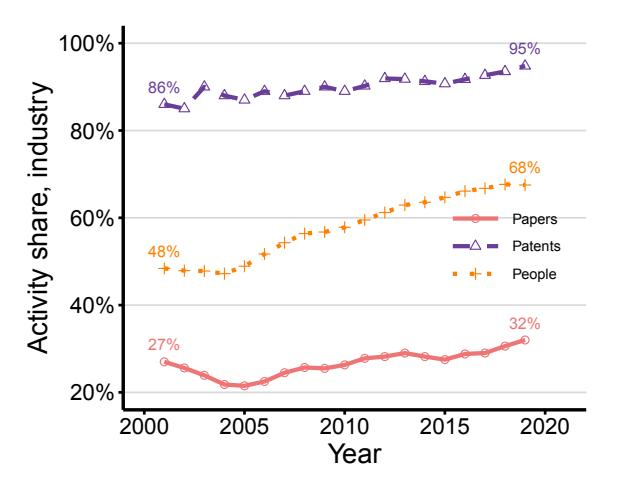

#### (a) **Industry share of patents, papers, and researchers in AI**

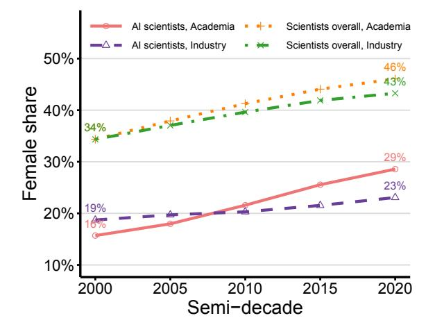

(c) **Female share among researchers**

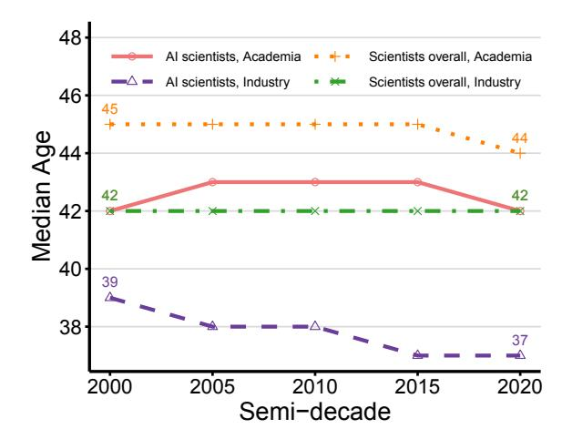

(b) **Median age of researchers in academia and industry**

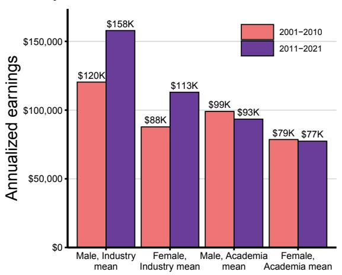

(d) **Earnings of AI researchers in industry and academia by sex**

Figure 1: **Summary statistics**

*Notes:* Median age refers to pseudo-median age (see Online Appendix [A.4\)](#page-28-0). Annualized earnings are calculated by deflating quarterly earnings of dominant, beginning-of-quarter jobs to June 2015 values using CPI; taking the mean (or pseudo-quantile) of their natural log in a given year; and then exponentiating and multiplying by 4. "Industry" refers to earnings of scientists working outside NAICS 6113 and 6114; "Academia" refers to AI scientists working within NAICS 6113 or 6114. "AI" scientists are identified using the field identifiers of their papers as discussed in Section [2.1.](#page-5-2)

change among non-AI industry scientists, who are older to begin with. Notably, this pattern is even starker at the top end of the earnings distribution.[8](#page-8-1) In industry, top earners' median age fell by three years, from 44 to 41, while rising in academia and either rising or remaining flat in both academia and industry for the broader scientific community. This pattern aligns with industry drawing in relatively young AI talent (Section [4\)](#page-10-0) rather than broad-based demographic change in the scientific workforce.[9](#page-8-2)

8Figure [B.1](#page-32-0) in the Online Appendix shows the median age for top 10% earners in academia and industry across AI and the broader scientific community.

9Table [B.3](#page-30-1) in the Online Appendix provides further summary statistics on the age distribution; notably, the age

Gender composition has also evolved unevenly across sectors. As shown in Panel [1c](#page-8-0) the female share among academic AI researchers increased substantially, rising from 16% in the early 2000s to about 29% by 2020. In industry, however, the increase was more modest, from about 19% to 23%. These differences are even starker for top earners. The female share among top earning AI researchers in industry rose only 1 p.p. (11% to 12%), while among top earning academics the female share more than doubled (8% to 18%).[10](#page-9-0) Panel [1d](#page-8-0) reports corresponding earnings patterns. Real salaries of AI researchers rose in industry for both men and women, whereas average academic salaries declined in real terms over the same period. Across both decades, a sizable gender wage gap remains—on the order of 30% in industry (= 1 − 88/120 or = 1 − 113/158) and 20% in academia (= 1 − 79/99 or = 1 − 77/93)—and is 2 p.p. larger in the more recent decade for industry and substantially larger in industry versus academia across periods. The gap among top earners has widened significantly rising from 20% (= 1 − 200/249) to 28% (= 1 − 324/450) between 2001-2010 and 2011-2021.[11](#page-9-1)

Panels [2a](#page-10-1) and [2b](#page-10-1) describe changes by place of birth of AI researchers. In the first decade, over half of AI researchers were U.S.-born; by the second decade, this share declined to about 45%. Over the same period, the composition of foreign-born researchers shifted, with increases among China- and India-born researchers and a relative decline among Europe- and Russia-born researchers. Changes in shares were mediated by overall sector growth: between 2001-2010 there were approximately 7, 500 AI researchers in industry, rising to 18, 000 by 2011-2021.[12](#page-9-2) Thus declines in relative shares admit large increases in levels: there was an approximate increase of 4,300 U.S.-born researchers (= 0.45 × 18, 000 − 0.51 × 7, 500); 2,300 Chinese-born researchers (= 0.19 × 18, 000 − 0.15 × 7, 500); and 1,200 Indian researchers (= 0.10 × 18, 000 − 0.08 × 7, 500) to industry. Panel [2b](#page-10-1) shows that average salaries vary substantially by place of birth, with U.S. born AI researchers earning less than several foreign-born groups and experiencing slower wage growth.

Finally, Panels [2c](#page-10-1) and [2d](#page-10-1) present analogous evidence by race. The share of white AI researchers declined from 63% to 56%, while the share of Asian researchers increased by an identical amount. Salary growth also differs across groups: while average earnings were similar across white and Asian researchers in the 2000s, Asian researchers experienced faster wage growth over the subsequent decade than white researchers. These patterns are descriptive but suggest that changes in demand for AI researchers have coincided with shifts in both workforce composition and relative earnings.

distribution for AI scientists is first order stochastic dominated by that for scientists overall at the inter-quartile percentiles.

10See Figure [B.2](#page-33-0) for additional details.

11See Figure [B.3](#page-35-0) in the Online Appendix.

12See Table [B.2](#page-30-0) in the Online Appendix for additional sample counts.

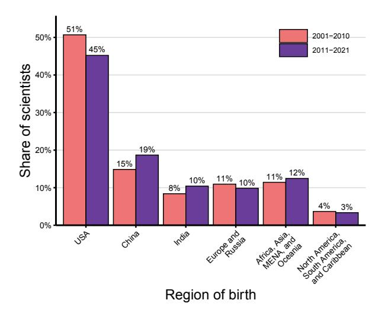

# (a) Share of industry AI researchers by region of birth

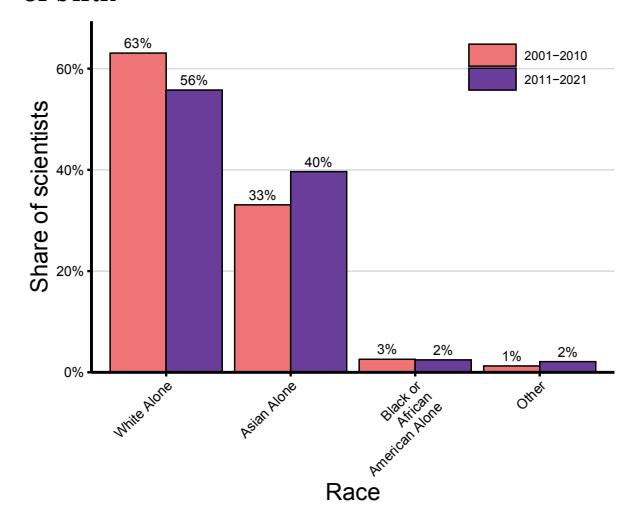

(c) Share of industry AI researchers by race

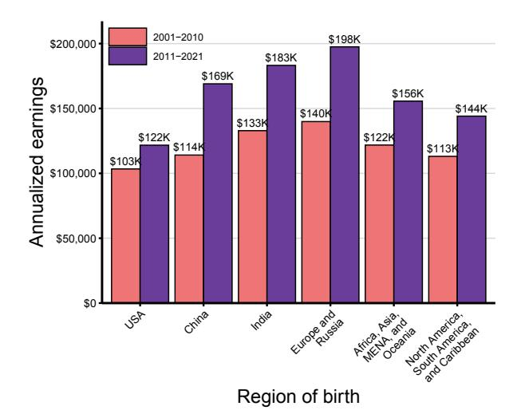

(b) Earnings of industry AI researchers by region of birth

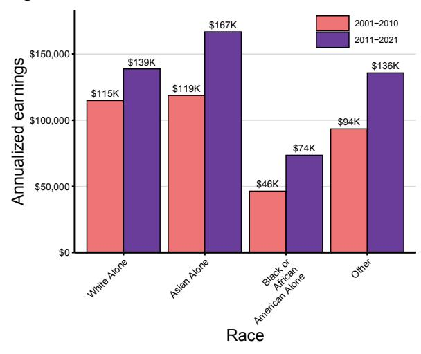

(d) Earnings of industry AI researchers by race

Figure 2: Summary statistics

*Notes:* Annualized earnings are calculated by deflating quarterly earnings of dominant, beginning-of-quarter jobs to June 2015 values using CPI; taking the mean (or pseudo-quantile) of their natural log in a given year; and then exponentiating and multiplying by 4. "Industry" refers to earnings of AI scientists working outside NAICS 6113 and 6114; "Academia" refers to AI scientists working within NAICS 6113 or 6114. "AI" scientists are identified using the field identifiers of their papers as discussed in Section 2.1.

#### 4 Core results

We characterize the earnings and employment dynamics of AI researchers over time, finding two major breakpoints that correspond to technological breakthroughs in AI. These were accompanied by sharp increases in compensation—especially at the top end of the earnings distribution—and appreciable out-migration of AI talent from academia to industry.

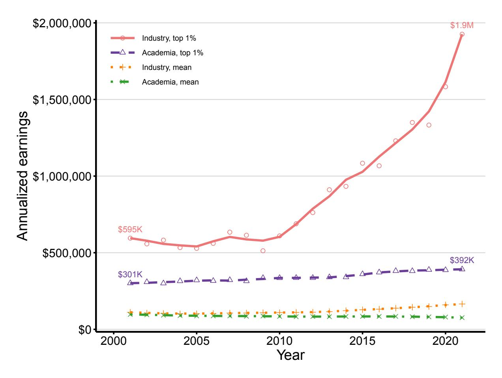

Figure 3: **Earnings Summary Statistics for AI Scientists by Year**

*Notes:* Top 1% refers to the pseudo-99th percentile of earnings (see Online Appendix [A.4\)](#page-28-0). Annualized earnings are calculated by deflating quarterly earnings of dominant, beginning-of-quarter jobs to June 2015 values using CPI; taking the mean (or pseudo-99th percentile) of their natural log in a given year; and then exponentiating and multiplying by 4. "Industry" refers to earnings of AI scientists working outside NAICS 6113 and 6114; "Academia" refers to AI scientists working within NAICS 6113 or 6114. Points represent raw data values, and lines represent a three-year moving average of underlying data.

#### **4.1 Earnings**

In Figure [3](#page-11-0) we show the average and top 1% annual earnings of AI researchers over our study period.[13](#page-11-1) AI researcher earnings in industry began to increase significantly in the 2010s, with the largest gains concentrated among the top 1% of earners. Top 1% earnings, shown in the solid orange line, more than tripled from 2001 to 2021, rising from about \$595,000 to over \$1.9M per year (in 2015 dollars). Researchers in academia, over the same period, saw much more modest earnings gains. As is evident from the dashed purple line, even among the top 1% of academic earners, earnings only rose by about 30%. Strikingly, our figures for top 1% compensation in industry are likely to be somewhat understated: while LEHD captures wage income from exercised stock

13Throughout the paper, we alternate between top 1% and top 10% earnings thresholds depending on the analysis. This reflects Census Bureau disclosure requirements, which prohibit reporting statistics based on small cell sizes; finer cuts of the data by demographic characteristics often necessitate using the broader threshold.

options and vested equity, it does not include the value of unexercised options or any realized or unrealized capital gains.

One other result that bears consideration are average academic earnings for AI scientists. Nominal earnings for academic AI scientists rose from \$73,000 in 2001 to \$87,000 in 2021, meaning real earnings declined by 22%. To benchmark this figure, we note that the National Center for Education Statistics (NCES) reports that faculty salaries at degree-granting universities for all subjects declined modestly in real terms, from \$79,963 in 2001 to \$79,421 in 2021 (in June 2015 dollars).[14](#page-12-0) As validation of our sample's representativeness, Figure [B.4a](#page-36-0) reports mean earnings for all scientists in our data, which declined from \$85,930 to \$85,200—a 0.8% decline that closely matches both the level and trend in the NCES data (0.7% decline). The two series also co-move at shorter horizons: between 2020 and 2021, a period of high inflation, real earnings fell by 4.7% in the NCES data and by 2.4% in ours. The sharper decline in mean earnings for AI academics likely reflects compositional forces: the rapid growth of the field has brought an increasing share of non-faculty researchers—PhD students and adjunct faculty—whose reported earnings in academia are lower and may be further compressed due to reporting conventions (see Section [2\)](#page-5-1).

To further put these changes into perspective, we compare them to trends for scientists more broadly. While industry earnings growth outpaced academic salaries across all scientific fields, the divergence is far more dramatic in AI. The gap between top 1% industry and academic salaries for publishing scientists grew by 75% among scientists overall (= (1.3 − 0.53)/(0.84 − 0.40) − 1) compared to 400% for AI researchers (= (1.9 − 0.39)/(0.60 − 0.30) − 1).[15](#page-12-1)

The sharp rise in top AI salaries in the early 2010s coincided with a set of complementary developments that fundamentally changed the trajectory of artificial intelligence. The release of the ImageNet to the research community in 2009, followed by the launch of the ImageNet Large Scale Visual Recognition Challenge in 2010, provided the first large-scale benchmark with millions of labeled images, enabling systematic evaluation of machine learning algorithms at an unprecedented scale. At the same time, advances in GPU-based computing made it feasible to train much larger neural networks on these datasets. Recognizing the potential of combining large datasets, scalable computing infrastructure, and new deep learning methods, technology companies such as Google, Microsoft, and Meta began expanding their AI research teams and investing heavily in distributed computing systems capable of training these models (for example, the creation of Google Brain in 2011, which trained large neural networks on clusters of roughly 16,000 CPUs). The turning point came when deep learning methods demonstrated dramatic performance gains: in 2012, the ImageNet challenge was won by AlexNet, developed by Alex Krizhevsky, Ilya Sutskever, and Geoffrey Hinton, which reduced classification error by a large margin relative to previous approaches. The convergence of data (ImageNet), compute (GPUs and large-scale clusters), and improved algorithms (deep neural networks) created a technological

14Data can be found on the [NCES website](https://nces.ed.gov/programs/digest/d23/tables/dt23_316.10.asp) in Table 316.10 of the Digest of Education Statistics.

15See Figure [B.4a](#page-36-0) for additional details.

inflection point. As these complements came together, the expected productivity of frontier AI research increased sharply, triggering rapid growth in corporate investment and a surge in demand for specialized AI talent. In 2013, Hinton joined Google and became emeritus at the University of Toronto—symbolizing the broader migration of AI researchers from academia to industry.

#### **4.2 Transition Rates**

As industry compensation began to rise, annual transitions out of academia also increased. Figure [4a](#page-14-0) shows the percent of AI researchers in academia that transition to industry. Overall academic out-migration rose by 55% (= 3.4%/2.2% − 1) through the 2010s and into the early 2020s. Exit from academia was disproportionately concentrated among younger AI researchers, as shown in greater detail below.[16](#page-13-0) These transitions tended to be durable. Approximately 70% of transitioning AI scientists remained in industry within five years of leaving academia.

We see a second major shift that occurred in 2017 in the allocation of AI talent in Figure [4b.](#page-14-0) Transitions to incumbent firms—defined as those over 20 years old with more than 1,000 employees increased by more than 46% for young AI researchers after 2017 (= 3.8/2.6 − 1) while the transitions to non-incumbents remained flat.[17](#page-13-1)

This shift toward incumbents in 2017 coincided with the publication of the landmark paper "Attention Is All You Need" by Alphabet researchers [\(Vaswani et al.,](#page-23-0) [2017\)](#page-23-0). The transformer architecture it introduced scaled effectively with data and compute, suiting commercial applications. Large incumbent tech firms were uniquely positioned to seize this opportunity: they combined vast proprietary datasets, high-cost infrastructure, and top young scientists to train massive models and embed them across core products.

What sectors do AI researchers tend to transition to? Figure [4c](#page-14-0) shows the destination sectors for AI researchers leaving academia by age group averaged over our sample period. Researchers under 30 years old leaving academia are most often going to the Professional, Scientific, and Technical Services (NAICS 54) or Information (NAICS 51) sectors.[18](#page-13-2) Those over 45 years old, in contrast, were much less likely to join the Information sector and instead tended to flow to the Healthcare and Social Assistance sector (NAICS 62).

16After a significant drop due to the 2008 financial crisis, hiring more than recovered, with the share of young AI researchers under 40 leaving academia rising from about 4.4% in 2010 to 6.6% in 2021. See Figure [B.5](#page-37-0) in the Online Appendix.

17The gap between transitions to incumbents versus non-incumbent firms for AI researchers over 40 is much more muted, with increased transitions to both. See Online Appendix in Figure [B.6.](#page-38-0)

18NAICS 54 includes computer systems design and related services (5415), where major technology firms classify significant portions of their operations. Previous work finds NAICS 51 and 54 are key sectors for AI business formation [\(Dinlersoz et al.,](#page-20-7) [2024\)](#page-20-7) and AI adoption [\(Bonney et al.,](#page-19-11) [2024\)](#page-19-11).

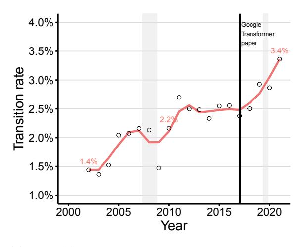

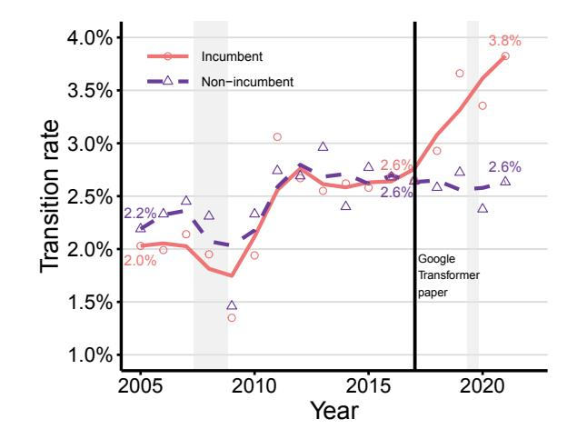

#### (a) Overall transition rate

## (b) Young researcher transition rate, incumbents vs. non-incumbents

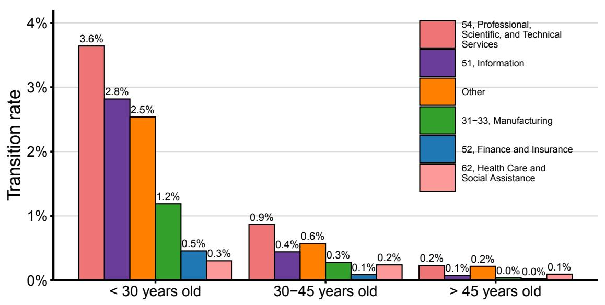

#### (c) Transition rate by destination sector

Figure 4: Transition Rates for AI Scientists by Year and Age

Notes: Shaded grey areas denote NBER recessions. The transition rate is defined as the number of scientists working outside of NAICS 6113 and 6114 who, within the previous three quarters, did work within NAICS 6113 or 6114, divided by the total number of scientists who worked in NAICS 6113 or 6114 in the previous three quarters. It is reported for each year in Panel 4a. Panel 4b breaks down the young (< 40 years old) transition rate by the characteristics of the destination firm of the scientist. Summing the transition rate in Panel 4b yields the overall transition rate for workers < 40 years old (up to rounding errors) which is reported in the Online Appendix in Figure B.5. The split by incumbent/non-incumbent destination firms for workers  $\ge$  40 years old is reported in the Online Appendix in Figure B.6. Transition rate data for Figure 4c is pooled across our sample period 2001-2021. In Panels 4a and 4b, points represent raw data values, and lines represent a three-year moving average of underlying data.

#### 4.3 Research Output

We might expect the reallocation of AI talent to industry to affect the composition of AI innovations since universities and firms tend to engage in different types of innovative activity (Akcigit et

al., 2021). To examine this, we use our researcher-level data to study research output before and after exiting academia. Rather than comparing leavers to stayers, we compare only movers (those transitioning out of academia to those transitioning within academia, controlling for a rich set of observable characteristics). Restricting to movers ensures both groups have a revealed willingness to change affiliations, differencing out selection effects common to all transitions and improving the plausibility of parallel pre-trends. Data are pooled across job transitions between 2004-2018, as we study outcomes three years before and after the transition, and our full data range from 2001-2021.

To measure the differences in output before and after the transition we estimate the following event study regression:

(1) 
$$y_{it}^{acf} = \mathbf{F}\mathbf{E}_{ic} + \mathbf{F}\mathbf{E}_{tacf} + \sum_{\tau \in \{-3,\dots,3\} \setminus \{-1\}} \beta_{\tau} \mathbb{I}\{t - c = \tau\} + \varepsilon_{it}^{acf}$$

We regress the outcome of an individual scientist i at time t who is a years old and makes an industry job transition in year c, publishing in field f on a rich set of fixed effects which control for time-invariant person-cohort effects and person-invariant field-cohort-age-time effects. 19 The regression is estimated at annual frequency. Our outcomes include: whether or not the researcher publishes a paper or patent (extensive margin); the count of published papers and patents (intensive margin); and the log real earnings of researchers before and after their job transitions.

Our regression design is the "stacked" difference-in-differences (DiD) estimator used in Cengiz et al. (2019). By interacting all fixed effects with the year of treatment, c, this approach provides a convex-weighted average of heterogeneous effects (Baker et al., 2022; Cunningham, 2021). The estimator compares individuals transitioning from academia to industry (treated units) against those transitioning between academic positions (control units). All comparisons occur within field-year-age-cohort cells, ensuring that treated and control units face similar labor market conditions and career timing. More details of how we construct our regression sample can be found in the Online Appendix A.3.

Estimates of Equation 1 are shown in Figure 5. Each point captures the average difference in outcomes between those transitioning to industry relative to those transitioning within academia, relative to the gap in the year prior to the transition ( $\tau = -1$ ) at various horizons,  $\tau$ .20

When AI scientists transition to industry, their relative probability of writing papers three years following the transition declines by 30 percentage points, representing a one-third reduction from pre-transition levels. Conversely, and consistent with researchers in industry focusing on applied

&lt;sup>19Field f is the modal field of the researcher—field is a paper-level outcome, so researchers have potentially many fields they publish in; we always take the dominant or modal one. Individuals i may be repeated as units in our sample if, for example, they move jobs in multiple years: hence we interact all fixed effects with c, the year of the move. We set  $c = \infty$  for control units.

&lt;sup>20Full regression details are reported in the Online Appendix in Table B.4.

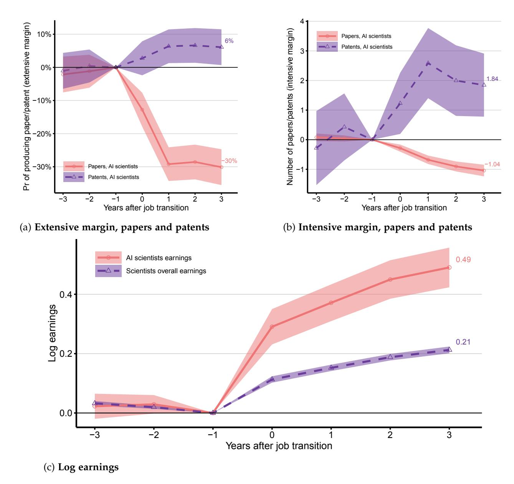

Figure 5: **Event Studies for Paper-writing, Patent-writing, and Earnings upon Transitioning from Academia to Industry**

*Notes:* Panel [5a](#page-16-0) shows the results of an event study where the dependent variable is an indicator for any paper- or patent-writing activity. Panel [5b](#page-16-0) shows the results of an event study where the dependent variable is the count of papers or patents authored by AI scientists. In this specification, we utilize pseudo-Poisson maximum likelihood (PPML) regression [\(Bergé,](#page-19-13) [2025;](#page-19-13) [Correia et al.,](#page-20-10) [2020\)](#page-20-10). Panel [5c](#page-16-0) shows the results of an event study where the dependent variable is the natural logarithm of annualized real earnings. "AI" scientists are identified using the field identifiers of their papers as discussed in Section [2.1;](#page-5-2) "scientists overall" include all scientists matched from MAG to Census. In this specification, we utilize ordinary least squares (OLS). Ribbons around point estimates represent 95% confidence intervals of estimates. Standard errors are clustered at the person-cohort level.

research, these scientists' relative patenting propensity increases by 6 percentage points—a 1.5-fold increase from pre-transition levels. Statistical tests for pre-trends show no evidence of differential trajectories before job transitions.

Results along the intensive margin are meaningfully larger. Three years following the transition, paper publishing declines by 64% (= exp(−1.04) − 1), while patenting increases by 530% (= exp(1.84) − 1). Both estimates are highly statistically significant and show minimal evidence of pre-trends.

Given that both those transitioning to another academic institution and those leaving academia altogether are selecting into a job change, we should expect both groups on average to experience increased earnings after the move [\(Hyatt and McEntarfer,](#page-21-11) [2012;](#page-21-11) [Hyatt et al.,](#page-21-12) [2014;](#page-21-12) [Hyatt,](#page-21-13) [2015\)](#page-21-13). Consistent with the sharp rise in earnings realized by industry AI scientists (Figures [3](#page-11-0) and [B.4b\)](#page-36-0), we find that AI scientists leaving academia experience much larger earnings gains compared to those moving within academia. AI scientists transitioning to industry experience 63% (= exp(0.49) − 1) higher earnings relative to those transitioning within academia. For context, this premium is 23% (= exp(0.21) − 1) among the broader scientist population—closer to figures reported for the general U.S. labor market.[21](#page-17-1)

#### **4.4 Multiple Job-Holding**

AI researchers do not have to leave academia entirely to participate in industry research; they may retain their university post while working for a private AI lab on the side. We evaluate the prevalence of this using multiple job holding in our employment data.[22](#page-17-2) We compute the share of AI researchers whose dominant (highest-earning), beginning-of-quarter job (with earnings in *t* − 1 and *t*) is in academia that hold multiple jobs along with the share of their total income from those secondary jobs.

We compare the average share of multiple-job holders early in our data (2001-2016) and later in our data (2017-2021). We use 2017 as the breakpoint to coincide with the "transformer" paper and when transitions sharply diverged toward "incumbent" firms (Figure [4b\)](#page-14-0). We find an increase in the rate of multiple job holding among AI scientists, measured both in raw counts and in shares of overall income. While the multiple job-holding rate among scientists overall has remained unchanged, the share of academic AI scientists holding multiple jobs rose by 16% (= 11.5%/9.9% − 1).[23](#page-17-3)

Consistent with rising industry pay premia, a growing share of AI scientist income is coming from secondary jobs. Between 2001 and 2016, 6.3% of total AI scientist earnings came from secondary employment in industry; over 2017-2021, this share rose to 7.6%. These numbers are flat or declining for the broader population of scientists, where the share of income from multiple job holding remained roughly flat at 5%.[24](#page-17-4)

21In particular using the same LEHD data, the median change in earnings for workers making a within-quarter job-to-job transition is 3.5-9% [\(Hyatt,](#page-21-13) [2015\)](#page-21-13).

22Our documentation of moonlighting is likely an undercount. Secondary income reported on Forms 1099-MISC or 1099-NEC, which is earned through contracting or consulting relationships, would go unobserved in our data.

23See Table [B.6](#page-34-0) in the Online Appendix for additional details.

24See Table [B.6](#page-34-0) in the Online Appendix for additional details.

### **5 Conclusion**

Using a novel dataset linking publication records to administrative employer–employee data, we document profound changes in AI talent allocation over two decades. The compensation gap between top industry and academic AI researchers widened from roughly \$294,000 to \$1.5 million annually—a fivefold increase since 2001. This divergence coincided with accelerating academic out-migration, particularly among early-career researchers, and an increasing concentration of talent flows toward large, incumbent technology firms rather than startups.

These patterns reflect a structural reorganization of frontier AI research. Researchers who transition to industry reduce paper production by approximately 63% while increasing patent filings nearly sixfold, consistent with a shift from open science toward proprietary and commercially oriented innovation. Even among those who remain in academia, moonlighting has risen substantially.

Frontier AI research has become increasingly capital intensive and concentrated within large firms. As scientific talent reallocates from universities to compute-rich incumbents, concerns arise not only about the distribution of rents, but also about spillovers, contestability, and independent scrutiny. Universities may no longer be able to compete at the frontier of computational scale, but they continue to play a central role in preserving open science, training general human capital, and providing outside options in the market for research talent. They also contribute to accountability through peer review, replication, benchmarking, and independent evaluation. In addition, universities are well positioned to conduct longer-horizon research on robustness, alignment, and safety, areas that may receive less emphasis under commercial incentives. The longrun performance of the AI innovation system will depend in part on whether these institutional functions remain strong.

This paper does not attempt to characterize the optimal allocation of AI scientists between academia and the private sector. Such an exercise would require a structural model of knowledge production and market structure that is beyond our scope. Our goal is instead to document the magnitude and direction of the recent reallocation and to provide systematic empirical evidence on the evolving role of universities in frontier AI research. We hope that the facts and data assembled here can serve as inputs for future structural work and as empirical benchmarks for subsequent research on institutional design and innovation dynamics.

### **References**

- **Aghion, Philippe, Mathias Dewatripont, and Jeremy C. Stein**, "Academic Freedom, Privatesector Focus, and the Process of Innovation," *RAND Journal of Economics*, 2008, *39* (3), 617–635.
- **Ahmed, Nur, Muntasir Wahed, and Neil C. Thompson**, "The Growing Influence of Industry in AI Research," *Science*, 2023, *379* (6635), 884–886.
- **Akcigit, Ufuk and Nathan Goldschlag**, "Measuring the Characteristics and Employment Dynamics of U.S. Inventors," *Journal of Economic Growth*, June 2025, *30* (2), 237–269.
- **, Douglas Hanley, and Nicolas Serrano-Velarde**, "Back to Basics: Basic Research Spillovers, Innovation Policy, and Growth," *Review of Economic Studies*, January 2021, *88* (1), 1–43.
- **Arora, Ashish, Sharon Belenzon, and Andrea Patacconi**, "Decline of Science in Corporate R&D," *Strategic Management Journal*, 2018, *39* (1), 3–32.
- **Azoulay, Pierre, Christian Fons-Rosen, and Joshua S. Graff Zivin**, "Does Science Advance One Funeral at a Time?," *American Economic Review*, August 2019, *109* (8), 2889–2920.
- **, Ina Ganguli, and Joshua Graff Zivin**, "Mobility of Elite Life Scientists: Professional and Personal Determinants," *Research Policy*, April 2017, *46* (3), 573–590.
- **Babina, Tania, Alex Xi He, Sabrina T Howell, Elisabeth Ruth Perlman, and Joseph Staudt**, "Cutting the Innovation Engine: How Federal Funding Shocks Affect University Patenting, Entrepreneurship, and Publications," *Quarterly Journal of Economics*, 01 2023, *138* (2), 895–954.
- **, Anastassia Fedyk, Alex He, and James Hodson**, "Artificial Intelligence, Firm Growth, and Product Innovation," *Journal of Financial Economics*, 2024, *151*, 103745.
- **Baker, Andrew C., David F. Larcker, and Charles C. Y. Wang**, "How Much Should We Trust Staggered Difference-in-Differences Estimates?," *Journal of Financial Economics*, May 2022, *144* (2), 370–395.
- **Bergé, Laurent**, "fixest: Fast Fixed-Effects Estimations," <https://github.com/lrberge/fixest> 2025. GitHub repository. Accessed February 15, 2026.
- **Black, Grant C. and Paula E. Stephan**, "The Economics of University Science and the Role of Foreign Graduate Students and Postdoctoral Scholars," *NBER Chapters*, 2010, pp. 129–161.
- **Bonney, Kathryn, Cory Breaux, Catherine Buffington, Emin Dinlersoz, Lucia Foster, Nathan Goldschlag, John Haltiwanger, Zachary Kroff, and Keith Savage**, "Tracking Firm Use of AI in Real Time: A Snapshot from the Business Trends and Outlook Survey," *Working Papers*, March 2024. Number: 24-16.
- **Borjas, George J. and Kirk B. Doran**, "Cognitive Mobility: Labor Market Responses to Supply Shocks in the Space of Ideas," *Journal of Labor Economics*, July 2015, *33* (S1), S109–S145.

- **Borusyak, Kirill, Xavier Jaravel, and Jann Spiess**, "Revisiting Event-Study Designs: Robust and Efficient Estimation," *The Review of Economic Studies*, November 2024, *91* (6), 3253–3285.
- **Cengiz, Doruk, Arindrajit Dube, Attila Lindner, and Ben Zipperer**, "The Effect of Minimum Wages on Low-Wage Jobs," *Quarterly Journal of Economics*, August 2019, *134* (3), 1405–1454.
- **Chow, Melissa C., Teresa C. Fort, Christopher Goetz, Nathan Goldschlag, James Lawrence, Elisabeth Ruth Perlman, Martha Stinson, and T. Kirk White**, "Redesigning the Longitudinal Business Database," 2021. NBER Working Paper Nr. 28839.
- **Correia, Sergio, Paulo Guimarães, and Thomas Zylkin**, "ppmlhdfe: Fast Poisson Estimation with High-Dimensional Fixed Effects," *Stata Journal*, March 2020, *20* (1), 95–115.
- **Cunningham, Scott**, *Causal Inference: The Mixtape*, New Haven London: Yale University Press, 2021.
- **Dinlersoz, Emin, Can Dogan, and Nikolas Zolas**, "Starting Up AI," *Working Papers*, March 2024. Number: 24-09.
- **Dreisigmeyer, David, Nathan Goldschlag, Marina Krylova, Wei Ouyang, and Elisabeth Perlman**, "Building a Better Bridge: Improving Patent Assignee-Firm Links," 2018. U.S. Census Bureau CES Working Paper Nr. 18-01.
- **Freeman, Richard B. and Wei Huang**, "Collaborating with People Like Me: Ethnic Coauthorship within the United States," *Journal of Labor Economics*, July 2015, *33* (S1), S289–S318. Publisher: The University of Chicago Press.
- **Ganguli, Ina and Patrick Gaulé**, "Will the U.S. Keep the Best and the Brightest (as Post-docs)? Career and Location Preferences of Foreign STEM PhDs," 2018. NBER Working Paper No. 24838.
- **Ginther, Donna K., Walter T. Schaffer, Joshua Schnell, Beth Masimore, Faye Liu, Laurel L. Haak, and Raynard Kington**, "Race, Ethnicity, and NIH Research Awards," *Science (New York, N.Y.)*, August 2011, *333* (6045), 1015–1019.
- **Gofman, Michael and Zhao Jin**, "Artificial Intelligence, Education, and Entrepreneurship," *Journal of Finance*, 2024, *79* (1), 631–667. \_eprint: https://onlinelibrary.wiley.com/doi/pdf/10.1111/jofi.13302.
- **Graham, Matthew, Erika McEntarfer, Kevin McKinney, Stephen Tibbets, and Lee Tucker**, "LEHD Snapshot Documentation, Release S2021\_R2022Q4," 2022. U.S. Census Bureau CES Working Paper Nr 22-51.
- **Graham, Stuart J. H., Cheryl Grim, Tariqul Islam, Alan C. Marco, and Javier Miranda**, "Business Dynamics of Innovating Firms: Linking U.S. Patents with Administrative Data on Workers and Firms," *Journal of Economics & Management Strategy*, 2018, *27* (3), 372–402.

- **Henderson, Rebecca, Adam B. Jaffe, and Manuel Trajtenberg**, "Universities as a Source of Commercial Technology: A Detailed Analysis of University Patenting, 1965-1988," *Review of Economics and Statistics*, 1998, *80* (1).
- **Hyatt, Henry R.**, "Decline in Job-to-Job Flows," *IZA World of Labor*, 2015, (175).
- **and Erika McEntarfer**, "Job-to-Job Flows and the Business Cycle," *SSRN Electronic Journal*, 2012.
- **, , Kevin McKinney, Stephen Tibbets, and Doug Walton**, "Job-to-Job (J2J) Flows: New Labor Market Statistics from Linked Employer-Employee Data," *SSRN Electronic Journal*, 2014.
- **Jaffe, Adam B.**, "Real Effects of Academic Research," *American Economic Review*, 1989, *79* (5), 957–970.
- **Jensen, Richard A.**, "University–Industry Linkages in the Support of Biotechnology Discoveries," *Annual Review of Resource Economics*, October 2016, *8* (Volume 8, 2016), 377–396.
- **Jones, Benjamin F.**, "Age and Great Invention," *Review of Economics and Statistics*, 2010, *92* (1), 1–14.
- **Jurowetzki, Roman, Daniel S. Hain, Kevin Wirtz, and Stefano Bianchini**, "Private Sector Is Hoarding AI Researchers: What Implications for Science?," *AI & Society*, June 2025, *40* (5), 4145–4152.
- **Kahn, Shulamit and Donna Ginther**, "Women and STEM," 2017. NBER Working Paper No. 23525.
- **Klinger, Joel, Juan Mateos-Garcia, and Konstantinos Stathoulopoulos**, "Narrowing of AI Research?," January 2022. arXiv:2009.10385 [cs].
- **Korinek, Anton and Jai Vipra**, "Concentrating Intelligence: Scaling and Market Structure in Artificial Intelligence," *Economic Policy*, 11 2024, *40* (121), 225–256.
- **Krizhevsky, Alex, Ilya Sutskever, and Geoffrey E Hinton**, "ImageNet Classification with Deep Convolutional Neural Networks," in "Advances in Neural Information Processing Systems," Vol. 25 Curran Associates, Inc. 2012.
- **Liang, Lizhen, Han Zhuang, James Zou, and Daniel E. Acuna**, "The complementary contributions of academia and industry to AI research," September 2024. arXiv:2401.10268 [cs].
- **Martín-Martín, Alberto, Mike Thelwall, Enrique Orduna-Malea, and Emilio Delgado López-Cózar**, "Google Scholar, Microsoft Academic, Scopus, Dimensions, Web of Science, and OpenCitations' COCI: A Multidisciplinary Comparison of Coverage via Citations," *Scientometrics*, January 2021, *126* (1), 871–906.

- **Marx, Matt, Jasjit Singh, and Lee Fleming**, "Regional disadvantage? Employee non-compete agreements and brain drain," *Research Policy*, March 2015, *44* (2), 394–404.
- **Mazzucato, Mariana**, *The Entrepreneurial State: Debunking Public vs Private Sector Myths*, Penguin Books, 2024.
- **Mowery, David C. and Bhaven N. Sampat**, "The Bayh-Dole Act of 1980 and University–Industry Technology Transfer: A Model for Other OECD Governments?," *Journal of Technology Transfer*, December 2004, *30* (1), 115–127.
- **Murray, Fiona and Scott Stern**, "Do Formal Intellectual Property Rights Hinder the Free Flow of Scientific Knowledge?: An Empirical Test of the Anti-Commons Hypothesis," *Journal of Economic Behavior & Organization*, August 2007, *63* (4), 648–687.
- **Nelson, Richard R.**, "The Simple Economics of Basic Scientific Research," *Journal of Political Economy*, 1959, *67* (3), 297–306.
- **Rapino, Melanie A. and Alison K. Fields**, "Mega Commuting in the U.S: Time and Distance in Defining Long Commutes Using the 2006-2010 American Community Survey, Time and Distance in Defining Long Commutes Using the 2006-2010 American Community Survey," 2013.
- **Reuters**, "OpenAI, Google, xAI Battle for Superstar AI Talent, Shelling Out Millions," *Reuters*, May 2025. Accessed: 2026-02-13.
- **Roach, Michael and Henry Sauermann**, "Declining Interest in an Academic Career," *PLOS ONE*, September 2017, *12* (9).
- **Sauermann, Henry and Michael Roach**, "Not All Scientists Pay to Be Scientists: PhDs' Preferences for Publishing in Industrial Employment," *Research Policy*, 2014, *43* (1), 32–47.
- **Stephan, Paula**, *How Economics Shapes Science*, Cambridge, Mass.: Harvard University Press, 2015.
- **Stephan, Paula F. and Sharon G. Levin**, *Striking the Mother Lode in Science: The Importance of Age, Place, and Time*, New York, NY: Oxford University Press, 1992.
- **Sun, Liyang and Sarah Abraham**, "Estimating dynamic treatment effects in event studies with heterogeneous treatment effects," *Journal of Econometrics*, December 2021, *225* (2), 175–199.
- **Thursby, Jerry and Marie Thursby**, "University-Industry Linkages in Nanotechnology and Biotechnology: Evidence on Collaborative Patterns for New Methods of Inventing," *Journal of Technology Transfer*, December 2011, *36* (6), 605–623.
- **Toole, Andrew A. and Dirk Czarnitzki**, "Commercializing Science: Is There a University "Brain Drain" from Academic Entrepreneurship?," *Management Science*, September 2010, *56* (9), 1599– 1614.

- **Vaswani, Ashish, Noam Shazeer, Niki Parmar, Jakob Uszkoreit, Llion Jones, Aidan N. Gomez, Lukasz Kaiser, and Illia Polosukhin**, "Attention Is All You Need," August 2017. arXiv:1706.03762 [cs].
- **Visser, Martijn, Nees Jan van Eck, and Ludo Waltman**, "Large-Scale Comparison of Bibliographic Data Sources: Scopus, Web of Science, Dimensions, Crossref, and Microsoft Academic," *Quantitative Science Studies*, April 2021, *2* (1), 20–41.
- **Wagner, Deborah and Mary Lane**, "The Person Identification Validation System (PVS): Applying the Center for Administrative Records Research and Applications' (CARRA) Record Linkage Software," 2014. U.S. Census Bureau CES Working Paper Nr 2014-01.
- **Waldinger, Fabian**, "Peer Effects in Science: Evidence from the Dismissal of Scientists in Nazi Germany," *Review of Economic Studies*, April 2012, *79* (2), 838–861.

# Online Appendix

*— —*

Ufuk Akcigit Craig A. Chikis Emin Dinlersoz Nathan Goldschlag March 9, 2026

### **A Data**

### **A.1 Matching MAG with Census Records**

We construct a database containing the employment history of 42,000 AI researchers by linking data on published papers from Microsoft Academic Graph to administrative employee-employer data in the Census Bureau's Longitudinal Employer-Household Dynamics (LEHD) database. To do this, we attach Census's disambiguated individual person identifiers, protected identification keys (PIKs), to MAG records using a modified version of the triangulation algorithm first used to match patent inventors (Akcigit and [Goldschlag,](#page-19-6) [2025;](#page-19-6) [Dreisigmeyer](#page-20-4) et al., [2018;](#page-20-4) [Graham](#page-20-5) et al., [2018\).](#page-20-5) PIKs are disambiguated, anonymized person-level identifiers that enable linkage across Census survey and administrative datasets. MAG is an open-source bibliometric dataset providing data on academic publications scraped from the internet. Previous research has found its coverage is competitive to other widely used bibliometric data sources like Scopus and Web of Science [\(Martín-Martín](#page-21-10) et al., [2021;](#page-21-10) [Visser](#page-23-2) et al., [2021\)](#page-23-2).[25](#page-24-2)

The triangulation matching methodology requires information on the individual and their employer. In addition to title, abstract, and field of study, the MAG data also contains author names and their institutional affiliations. Creating a high quality person match to Census data typically requires, in the absence of a social security number, a precise name, date of birth, and detailed geography [\(Wagner](#page-23-3) and Lane, [2014\)](#page-23-3). By utilizing both individual and employer information, the triangulation match can overcome a limited set of matching characteristics.

For author affiliation we extract the name of the institution and its associated geographic information. Although MAG provides geographic coordinates for some institutions, many of these are missing. We manually geocode affiliations with missing geographic data. We augment affiliation name and location data with publicly available federal employer identification numbers (EINs) from the Integrated Postsecondary Education Data System (IPEDS) where available. For authors we extract and clean the elements of the person name captured in the MAG data. We then associate the author's institutional geography to the individual for the purposes of matching.

25[Visser](#page-23-2) et al. [\(2021\)](#page-23-2) claim that "Microsoft Academic [Graph] offers by far the most comprehensive coverage of the scientific literature" [\(Visser](#page-23-2) et al., [2021\).](#page-23-2)

With individual names, individual geography (via their associated affiliation), affiliation name, and affiliation location, our matching strategy proceeds in three stages: (1) matching authors to PIKs using the Person Validation System (PVS), (2) linking MAG affiliations to the Census Bureau's Business Register, and (3) triangulating matches in (1) and (2) using LEHD employer-employee data.

*Matching Individuals* We submit MAG author-affiliation records to PVS, searching for individuals in zip codes within a 50-mile radius of each affiliation's coordinates. This geographic constraint accounts for typical commuting patterns while limiting false positive matches.[26](#page-25-0) This process yields paper-author records with zero or more matched PIKs. The relatively limited name and geographic information we submit to PVS results in many paper-author records receiving multiple PIK matches.

Our use of PVS faces two key limitations. First, the MAG data contains institutional rather than personal addresses, making it difficult to match individuals that live far from their associated affiliation.[27](#page-25-1) Second, MAG name quality varies substantially. About 16% of authors have first or last names with just a single character. The former issue will tend to generate false negatives and the latter generates false positives. The triangulation methodology is uniquely suited to addressing false positives by leveraging additional information on employers.

*Matching Affiliations* We match affiliations via combinations of EIN, name, and geography to the Census Bureau's Business Register (BR), the universe of non-farm employer business establishments. In the BR, each firm, potentially with many establishments, is organized as a "firmid".[28](#page-25-2) When available, we perform an exact match on EIN. For cases that either do not have an EIN or the EIN is not found in the BR we use fuzzy name matching with geographic blocking. The MAG data contains a relatively limited set of unique affiliations, which allows us to manually validate ambiguous matches. This process yields a single firm identifier match for each affiliation.

*Triangulation* Finally, we disambiguate paper-author records that receive multiple PIKs through PVS by combining the paper-author-PIK matches (from PVS), affiliation-firmid matches (from the BR process), and employee-employer records from the LEHD. Combining the PVS and affiliation-BR matches yields potential matches with unique combinations of paper-author-PIK-affiliation-firmid. For each of these potential matches we search the LEHD for jobs that link the PIK and firmid within a +/- 2 year window around the paper's publication date.

We match 63% of paper-author combinations with 81% of papers having at least one matched author. The match rates are very stable over the sample period (Figure [A.1\)](#page-27-0). Table [B.2](#page-30-0) reports the rounded number of AI scientists we match in each semi-decade.

2697% of U.S. workers commute fewer than 50 miles to work [\(Rapino and Fields,](#page-22-12) [2013\)](#page-22-12).

27This is relatively common in academic research, where scholars often have multiple academic appointments, sometimes even traversing national boundaries.

28For multi-establishment firms (MU), firmid's are a firm alpha (produced by the Census); for single-establishment firms (SU), firmid's are the establishment's EIN. More information on the construction of firmid's can be found in [Chow et al.](#page-20-11) [\(2021\)](#page-20-11).

*Classifying AI researchers.* We classify researchers as AI researchers based on their publication histories. We use the MAG field classifications to categorize individual papers. A researcher is classified as an AI researcher if their modal field of publication (i.e., the field in which they have published the most papers) falls within the AI-related fields listed in Table [B.1.](#page-29-0) [29](#page-26-1)

Figure [A.1](#page-27-0) shows match rates from MAG to Census for our AI and scientists overall samples by paper and by paper-author record. A unique record in MAG is a paper-author-affiliation triple—affiliations are duplicated for relatively few paper-author pairs so when calculating match rates we do so at the paper-author level. Match rates are largely stable across time and across fields. A paper is said to be matched if at least one of its listed authors is successfully triangulated; triangulation is discussed in Section [2.1.](#page-5-2) As discussed in Section [2.1,](#page-5-2) the comparatively low paper-author match rate arises from two key data limitations:

- 1. MAG data lists institutional, not personal addresses. Therefore, individuals who reside more than 50 miles from their listed affiliation will fail to be triangulated. This is a fairly common arrangement in academic settings where faculty will often publish papers listing an honorary or professional affiliation (e.g., the National Bureau of Economic Research for Economics) that may even traverse international boundaries.
- 2. Name quality is very heterogeneous across MAG. 16% of authors in MAG have only a single character for their first or last name (with the single-character last name especially challenging our triangulation algorithm).

#### **A.2 Annualizing Quarterly Earnings Data**

We construct annual employment records from quarterly data focusing on dominant beginning-ofquarter (BoQ) jobs with non-missing full-quarter earnings. A beginning-of-quarter job has positive earnings in both the current and prior quarters. A full-quarter job has positive earnings in the current, prior, and subsequent quarters. For each person-year, we calculate average quarterly earnings for all dominant BoQ jobs, then select the job with the highest average full-quarter earnings as the annual observation.

#### **A.3 Defining Treatment and Control Cohorts for the Event Studies**

We define a job transition as a year-over-year change in an individual's dominant employer. Individuals transitioning from academia to industry constitute our treatment group; those transitioning between academic positions serve as the comparison group. We assign individuals to cohorts based on their transition year, *c*.

*Anticipation effects and the pre-transition year.* In voluntary job transitions, the year immediately before the transition (*τ* = −1) is likely to reflect anticipation and job-search behavior rather than

29These fields are "Artificial intelligence"; "Machine learning"; "Computer vision"; "Pattern recognition"; "Natural language processing"; "Mathematical optimization"; and "Data science."

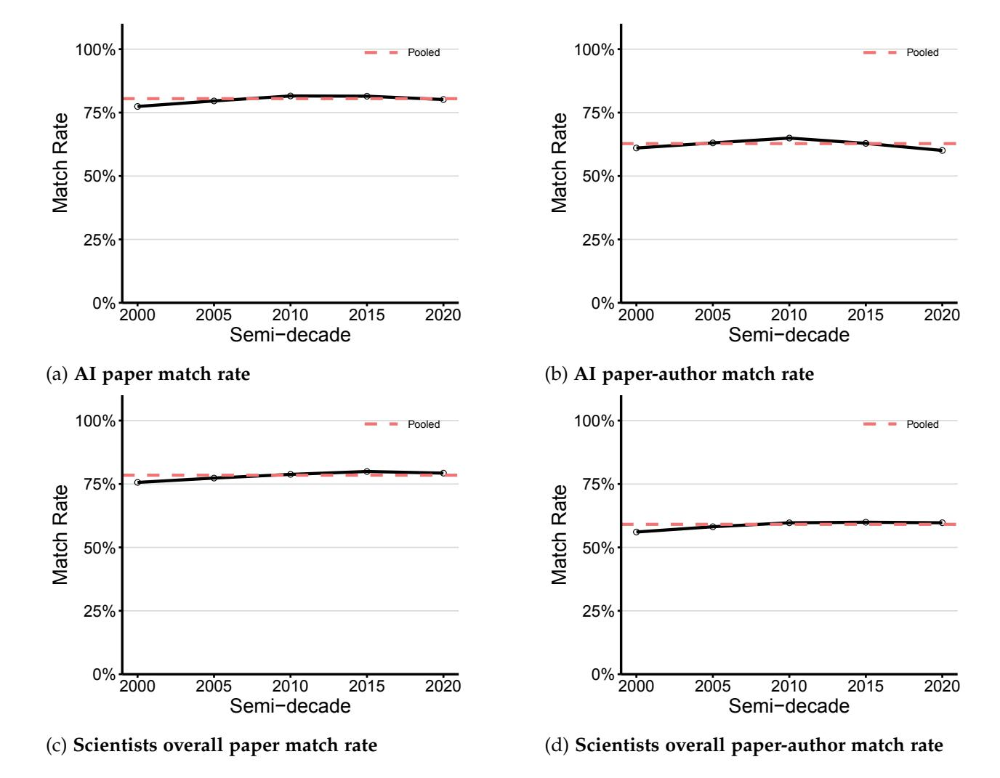

Figure A.1: **MAG to Census match rates.**

*Notes:* Each panel presents match statistics from MAG to Census. Panel [A.1a](#page-27-0) presents the match rate by semi-decade and overall (e.g., "pooled") for AI papers in MAG. A paper is considered matched if at least one of its authors is matched using the triangulation process discussed in Section [2.1.](#page-5-2) Panel [A.1b](#page-27-0) presents the match rate by semi-decade for AI paper-author pairs in MAG. A paper-author pair is considered matched if it is successfully triangulated using the process discussed in Section [2.1.](#page-5-2) Panels [A.1c](#page-27-0) and [A.1d](#page-27-0) report match statistics by semi-decade and overall for the entire population of MAG (e.g., "scientists overall").

stable baseline earnings. For example, individuals may reduce their work intensity at their current employer while searching for or negotiating a new position, generating a temporary earnings decline that would bias pre-trend comparisons. We therefore exclude this year from the analysis entirely. This is equivalent to using *τ* = −2 as the effective baseline period and allowing for one period of anticipation effects, as recommended in the recent event-study literature (see, e.g. [Borusyak et al.,](#page-20-12) [2024;](#page-20-12) [Sun and Abraham,](#page-22-13) [2021\)](#page-22-13) After excluding this year, we reindex event time so that *τ* ∈ {−3, . . . , 3}, where *τ* = −1 corresponds to two calendar years before the transition.

*Sample restrictions.* We impose two sets of restrictions on all transitions. The first ensures data completeness: we require positive annualized earnings for the transition year, three years posttransition, and three of the four pre-transition years (excluding the dropped pre-transition year).[30](#page-28-1) The second ensures clean sector identification: individuals transitioning to industry must report non-academic NAICS codes for four years following the transition (*τ* ∈ {0, 1, 2, 3} in calendar time) and academic NAICS codes for four years preceding it (*τ* ∈ {−4, −3, −2, −1} in calendar time), where academic NAICS codes are 6113 and 6114. Individuals in the comparison group must report academic NAICS codes throughout the full eight-year window. Importantly, these restrictions require consistent sector classification but do not require individuals to remain at the same employer for the duration of the window.

*Comparison units.* Because we use a stacked estimator, comparison-group individuals (e.g., the never-treated) are repeated across cohorts *c*, resulting in a very large effective comparison sample. To reduce computational burden without sacrificing precision, we draw a 25% random sample of the comparison group for each cohort in the earnings regressions for "scientists overall." Results are highly robust to alternative random draws. For the regressions covering only AI scientists, the comparison group is small enough that we include the full comparison group.

#### **A.4 Percentiles and Rounding Rules**

Our data complies with Federal Statistical Research Data Center disclosure avoidance measures. These rules primarily affect our analysis in two areas: rounding protocols and the reporting of distributional percentiles.

For distributional analysis, we report pseudo-percentiles rather than exact percentiles to maintain confidentiality. For example, when analyzing top 1% earnings, we report the pseudo-99th percentile. The pseudo-99th percentile is calculated by first determining the exact 99th percentile, then taking the average of 11 components: (1) the five observations immediately above the exact percentile, (2) the five observations immediately below the exact percentile, and (3) the exact percentile value itself.

30Since our outcome variable is log earnings, we require strictly positive earnings.

#### **A.5 Accessing Code and Data for Replication**

Any opinions and conclusions expressed herein are those of the authors and do not represent the views of the U.S. Census Bureau. The Census Bureau has ensured appropriate access and use of confidential data and has reviewed these results for disclosure avoidance protection (Project 7517031: CBDRB-FY25-CES020-005, CBDRB-FY25-CES022-004, and CBDRB-FY25-CES022-005).

Most of the empirical results in the paper use confidential microdata from the U.S. Census Bureau. To gain access to the Census microdata and the codes needed to replicate all the results follow the directions here on how to write a proposal for access to the data via a Federal Statistical Research Data Center (FSRDC): <https://www.census.gov/about/adrm/ced/apply-for-access.html>

You must request access to the following datasets:

- 1. County Business Patterns Business Register (CBPBR) (2001-2021)
- 2. Longitudinal Business Database (LBD) (2001-2021)
- 3. Longitudinal Employer-Household Dynamics (LEHD) (2001-2021)
- 4. Inventor-PIK crosswalk of [Akcigit and Goldschlag](#page-19-6) [\(2025\)](#page-19-6)
- 5. MAG (Microsoft Academic Graph) Author-PIK crosswalk of Project 7517031

### **B Additional Figures and Tables**

In this section we present additional results and information referenced in the main text.

Table [B.1](#page-29-0) gives the list of MAG field identifiers we use to identify authors in the artificial intelligence space. We discuss this procedure in more detail in Section [2.1.](#page-5-2)

| MAG fieldid | Field description           |
|-------------|-----------------------------|
| 154945302   | Artificial intelligence     |
| 119857082   | Machine learning            |
| 31972630    | Computer vision             |
| 178980831   | Pattern recognition         |
| 204321447   | Natural language processing |
| 126255220   | Mathematical optimization   |
| 2522767166  | Data science                |
|             |                             |

Table B.1: **AI fields in Microsoft Academic Graph.**

*Notes:* The table shows the MAG fields selected to classify papers as being in the artificial intelligence space.

Table [B.2](#page-30-0) reports rounded counts of AI scientists and scientists overall in industry and academia for each semi-decade between 2001-2021 and pooled across sectors and semi-decades. As can be seen, in the early part of our sample the majority of AI scientists work in academia; this shifts markedly over the years as more and more individuals transition to industry.

| Semi-decade Inc | AI       | AI       | Scientists overall | Scientists overall | Unique AI  | Unique             |
|-----------------|----------|----------|--------------------|--------------------|------------|--------------------|
|                 | Industry | Academia | Industry           | Academia           | Offique Af | scientists overall |
| 2000            | 3,500    | 3,800    | 252,000            | 329,000            | 6,800      | 543,000            |
| 2005            | 6,900    | 6,000    | 409,000            | 462,000            | 12,000     | 797,000            |
| 2010            | 12,000   | 8,200    | 585,000            | 565,000            | 19,000     | 1,062,000          |
| 2015            | 20,000   | 11,000   | 795,000            | 668,000            | 29,000     | 1,341,000          |
| 2020            | 22,500   | 12,000   | 775,000            | 570,000            | 34,000     | 1,302,000          |
| Pooled          | 28,000   | 20,500   | 1,100,000          | 1,060,000          | 42,000     | 1,739,000          |

Table B.2: Counts of AI and scientists overall by semi-decade and sector.

*Notes:* The table shows the rounded counts of AI and scientists overall by semi-decade and sector (industry vs. academia). Pooled counts the number of unique individuals in each column (since individuals may repeat across years, this number will not generally be the sum of the time series). The right-most columns report the numbers of unique individuals in AI and amongst scientists overall which is generally not equal to the sum of industry and academia due to job transitions within semi-decades. "Industry" refers to earnings of AI scientists working outside NAICS 6113 and 6114; "Academia" refers to AI scientists working within NAICS 6113 or 6114. "AI" scientists are identified using the field identifiers of their papers as discussed in Section 2.1.

Table B.3 shows selected summary statistics for the age distribution for scientists overall and AI scientists. AI scientists tend to be younger by 2.4 years, on average, and the age distribution for scientists overall first-order stochastic dominates the age distribution for AI scientists (for the pseudo-percentiles that have been disclosed). data are pooled across our sample.

| Statistic                   | AI scientists | Scientists overall |
|-----------------------------|---------------|--------------------|
| Mean                        | 42.83         | 45.19              |
| Std. Dev.                   | 11.38         | 11.76              |
| 25 th percentile | 34.00         | 36.00              |
| 50 th percentile | 41.00         | 44.00              |
| 75 th percentile | 50.00         | 54.00              |

Table B.3: Age distribution of scientists in the data.

*Notes:* The table shows selected summary statistics of scientist age for AI scientists and scientists overall. It pools across years. Reported percentiles are pseudo-percentiles (Appendix A.4). "AI" scientists are identified using the field identifiers of their papers as discussed in Section 2.1.

Tables B.5 and B.4 present the full results for the difference-in-differences regressions we present in Figure 5 in the main text. They contain information on the pre-period levels of papers, patents, and earnings, showing a meaningful degree of balance in pre-treatment outcomes, in spite of not explicitly matching on these outcomes.

Table B.6 presents summary statistics on the prevalence of multiple job holding in our data. An individual whose dominant, beginning-of-quarter job is in academia (sectors 6113 and 6114) is said to hold a secondary, non-academic job if she earns positive income from an establishment owned by a firm distinct from the individual's primary employer whose sector is outside sectors 6113 and 6114.

Figure B.1 shows the median age of researchers in academia and industry for AI scientists and scientists overall in the top 10% of the earnings distribution for their respective sectors. It is a

| Relative time      | Papers    |           | Patents   |           | Log earnings |            |
|--------------------|-----------|-----------|-----------|-----------|--------------|------------|
|                    | Extensive | Intensive | Extensive | Intensive | AI           | Scientists |
|                    | margin    | margin    | margin    | margin    | scientists   | overall    |
| −3                 | -0.02     | 0.08      | -0.01     | -0.28     | 0.02         | 0.03       |
|                    | (0.03)    | (0.07)    | (0.01)    | (0.64)    | (0.02)       | (0.00)     |
| −2                 | -0.01     | 0.04      | 0.00      | 0.43      | 0.03         | 0.02       |
|                    | (0.03)    | (0.05)    | (0.01)    | (0.58)    | (0.02)       | (0.00)     |
| 0                  | -0.13     | -0.29     | 0.03      | 1.23      | 0.29         | 0.11       |
|                    | (0.03)    | (0.06)    | (0.01)    | (0.53)    | (0.03)       | (0.01)     |
| 1                  | -0.29     | -0.68     | 0.06      | 2.59      | 0.37         | 0.15       |
|                    | (0.03)    | (0.07)    | (0.01)    | (0.60)    | (0.03)       | (0.01)     |
| 2                  | -0.29     | -0.90     | 0.07      | 2.00      | 0.45         | 0.19       |
|                    | (0.03)    | (0.09)    | (0.01)    | (0.61)    | (0.03)       | (0.01)     |
| 3                  | -0.30     | -1.04     | 0.06      | 1.84      | 0.49         | 0.21       |
|                    | (0.03)    | (0.10)    | (0.01)    | (0.54)    | (0.03)       | (0.01)     |
| Average value in   |           |           |           |           |              |            |
| −1, Treated τ = | 0.65      | 2.09      | 0.04      | 0.06      | 9.56         | 9.69       |
| Average value in   |           |           |           |           |              |            |
| τ = −1, Control | 0.66      | 3.39      | 0.03      | 0.04      | 10.02        | 9.92       |
| N                  | 13500     | 13500     | 13500     | 13500     | 13500        | 602000     |
| 2 Adj. R        | 0.52      | 0.31      | 0.62      | 0.75      | 0.77         | 0.76       |
| Wald test p-values | 0.74      | 0.57      | 0.47      | 0.50      | 0.19         | 0.00       |

Table B.4: **Event studies for papers, patents, and earnings.**

*Notes:* The table shows selected statistics of the dynamic DiD regression discussed above—Equation [1.](#page-15-1) Each row reports point estimates and standard errors for each relative treatment time dummy. Extensive margin results have the interpretation of propensities; intensive margin results have the interpretation of semi-elasticities. For papers and patents, intensive-margin regressions are run using PPML (pseudo-Poisson maximum likelihood); for earnings we run OLS with the natural logarithm of real earnings as the dependent variable. The numbers in parentheses below the point estimates are standard errors; we cluster standard errors by person-cohort (*i* × *c*). The last three rows report the number of observations used in estimation; the adjusted-*R* 2—for PPML regressions, we report the pseudo-adjusted *R* 2—and a Wald test which reports the *p*-value for the null hypothesis that the pre-treatment dummies (*τ* ∈ {−3, −2}) are jointly equal to zero. In all cases except the earnings regression for "Scientists overall" we fail to reject the null at conventional statistical levels.

companion figure to Figure [1b](#page-8-0) in the main text, showing broadly similar results. Top earners in AI industry are getting younger, even as AI scientists in academia and scientists overall across sectors are getting older. Top industry earners in AI, however, are generally younger throughout our sample.

Figure [B.2](#page-33-0) shows the share of top 10% earners in each field and sector that are female. It is a companion figure to Figure [1c](#page-8-0) in the main text, showing broadly similar results. Top earners in AI are effectively as female as they were in 2001 (11% → 12%); in academia and across academia and industry for the broader scientific community, female representation has more than doubled.

Figure [B.3](#page-35-0) shows richer summary statistics for earnings split by sex, for both AI researchers and scientists overall. From the left, the first eight bars replicate what is shown in the main text in Figure [1d.](#page-8-0) The next eight show earnings summary statistics for the top 10% of earners for men

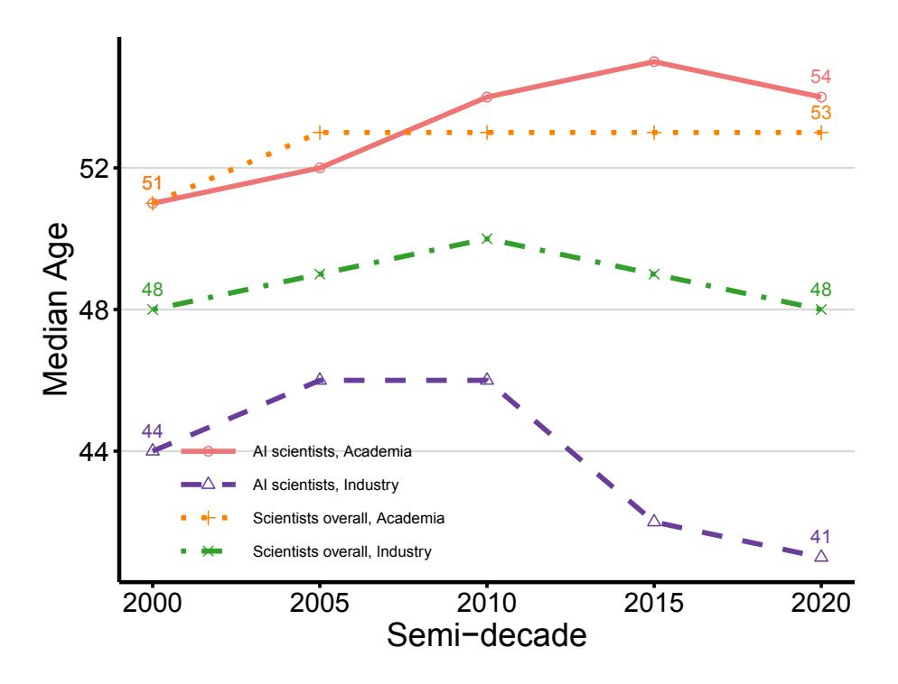

Figure B.1: **Median age of Top 10% researchers in academia and industry.**

*Notes:* The figure plots the median age of individuals in the top 10% of the earnings distribution in academia and in industry for AI researchers and scientists overall. The median, here, is the pseudo-median (Section [A.4\)](#page-28-0). "Industry" refers to earnings of scientists working outside NAICS 6113 and 6114; "Academia" refers to AI scientists working within NAICS 6113 or 6114. "AI" scientists are identified using the field identifiers of their papers as discussed in Section [2.1.](#page-5-2)

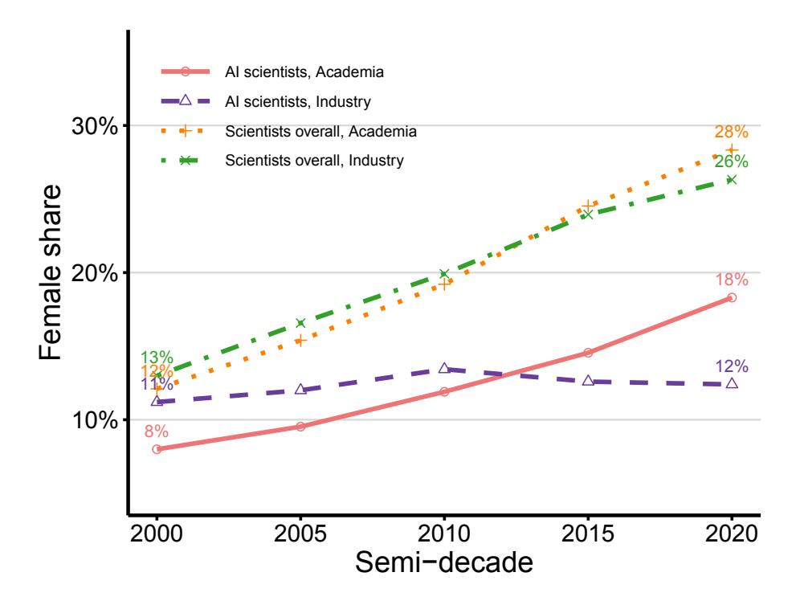

Figure B.2: **Female share among Top 10% researchers in academia and industry.**

*Notes:* The figure plots the share of top 10% earners in AI and amongst scientists overall in industry and in academia who are female. "Industry" refers to earnings of scientists working outside NAICS 6113 and 6114; "Academia" refers to AI scientists working within NAICS 6113 or 6114. "AI" scientists are identified using the field identifiers of their papers as discussed in Section [2.1.](#page-5-2) "Industry" refers to earnings of scientists working outside NAICS 6113 and 6114; "Academia" refers to AI scientists working within NAICS 6113 or 6114. "AI" scientists are identified using the field identifiers of their papers as discussed in Section [2.1.](#page-5-2)

|                                        | Papers    |           | Patents   |           | Log earnings |            |
|----------------------------------------|-----------|-----------|-----------|-----------|--------------|------------|
|                                        | Extensive | Intensive | Extensive | Intensive | AI           | Scientists |
|                                        | margin    | margin    | margin    | margin    | scientists   | overall    |
| I{t ≥ c}                         | -0.24     | -0.72     | 0.06      | 1.90      | 0.38         | 0.15       |
|                                        | (0.02)    | (0.06)    | (0.01)    | (0.36)    | (0.03)       | (0.01)     |
| Average value in −1, Treated τ = | 0.65      | 2.09      | 0.04      | 0.06      | 9.56         | 9.69       |
| Average value in τ = −1, Control | 0.66      | 3.39      | 0.03      | 0.04      | 10.02        | 9.92       |
| N                                      | 13500     | 13500     | 13500     | 13500     | 13500        | 602000     |
| 2 Adj. R                            | 0.52      | 0.31      | 0.62      | 0.75      | 0.77         | 0.76       |

Table B.5: **Static DiD regression results.**

*Notes:* The table shows selected statistics of the static DiD regression:

$$y_{it}^{acf} = \mathbf{F}\mathbf{E}_{ic} + \mathbf{F}\mathbf{E}_{tacf} + \beta\mathbb{I}\{t \geq c\} + \varepsilon_{it}^{acf}.$$

The first row reports point estimates; extensive margin results have the interpretation of propensities; intensive margin results have the interpretation of semi-elasticities. For papers and patents, intensive-margin regressions are run using PPML (pseudo-Poisson maximum likelihood; see [Bergé,](#page-19-13) [2025;](#page-19-13) [Correia et al.,](#page-20-10) [2020\)](#page-20-10); for earnings we run OLS with the natural logarithm of real earnings as the dependent variable. The numbers in parentheses below the point estimates are standard errors; we cluster standard errors by person-cohort (*i* × *c*). The last two rows report the number of observations used in estimation and the adjusted-*R* 2 ; for PPML regressions, we report the adjusted pseudo-*R* 2 .

|                   | AI researchers |           | All researchers |           | All academic workers |           |
|-------------------|----------------|-----------|-----------------|-----------|----------------------|-----------|
|                   | 2001-2016      | 2017-2021 | 2001-2016       | 2017-2021 | 2001-2016            | 2017-2021 |
| Job-weighted      | 9.9%           | 11.5%     | 9.4%            | 9.5%      | 12.6%                | 12.8%     |
| Earnings-weighted | 6.3%           | 7.6%      | 5.1%            | 5.0%      | 3.6%                 | 3.7%      |

Table B.6: **Multiple job holding before and after 2017.**

*Notes:* The table shows rates of multiple job holding for two periods: pre-transformer paper (2001-2016) and posttransformer paper (2017-2021). Multiple job holding measured on a job-weighted or earnings-weighted basis has increased for AI researchers (by 1.3-1.6 p.p.) but has remained relatively flat for scientists overall and for all employees whose dominant BoQ job is in sectors 6113 or 6114 (e.g., "All academic workers").

and women in industry and academia. As mentioned in the main text, the earnings disparity between men and women has risen substantially, by 8 p.p. (20% = 1 − 200/249 in 2001-2010 to 28% = 1 − 324/450 in 2011-2021). Among top earners in industry, amongst all scientists, pay disparity has actually declined slightly, from 44% = 1 − 200/359 to 40% = 1 − 264/441.

Figure [B.4](#page-36-0) shows more detailed summary statistics for AI and overall scientists earnings by year. Top 1% earners in industry among "scientists overall" have seen large pay gains in recent years (+49% = 1.25/0.84 − 1), but the rise is dwarfed by the gain shown in the main text in Figure [3](#page-11-0) (a gain of +220% = 1.9/0.6 − 1). Top 1% earnings in academia have risen for both AI scientists (Figure [3\)](#page-11-0) and scientists overall (Figure [B.4a\)](#page-36-0), but once you drop down to top 10%, the gains are considerably less stark, rising just 1% = 186/184 − 1 for AI and 16% = 221/191 − 1 for scientists overall.

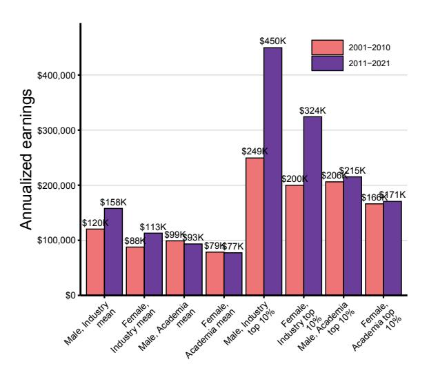

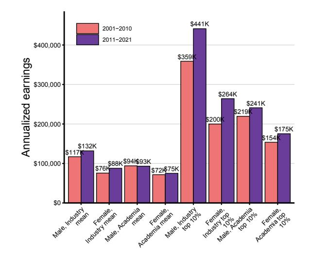

- (a) Earnings of AI scientists in industry and academia by sex
- (b) Earnings of scientists overall in industry and academia by sex

Figure B.3: Earnings of scientists across sectors by sex.

*Notes:* The figure shows mean and top 10% earnings for AI and scientists overall in industry and in academia, split by sex. Annualized earnings are calculated by deflating quarterly earnings of dominant, beginning-of-quarter jobs to June 2015 values using CPI; taking the mean (or pseudo-quantile) of their natural log in a given year; and then exponentiating and multiplying by 4. "Industry" refers to earnings of scientists working outside NAICS 6113 and 6114; "Academia" refers to AI scientists working within NAICS 6113 or 6114. "AI" scientists are identified using the field identifiers of their papers as discussed in Section 2.1.

Figure B.5 shows the transition rate for young (< 40 years old) and old ( $\ge$  40 years old) AI researchers. Young AI researchers transition out of academia at a rate that is roughly 6 times higher. Moreover, much of the rise in the overall transition rate is accounted for by younger researchers, whose transition rates have risen from 3.1% in the beginning of the sample to 6.6% at the end. Transition rates for younger AI researchers notably accelerated after the end of the Great Recession in 2009.

Figure B.6 shows the transition rate for AI researchers  $\geq$  40 years old split by destination firm characteristics (e.g., whether a firm is an "incumbent" or not, defined as a firm that is older than 20 years and has greater than 1,000 employees). It is a companion figure to Figure 4b in the main text. It shows that older workers have generally lower transition rates and that their flows into incumbent firms mildly increased since publication of the transformer paper by Google researchers in 2017.

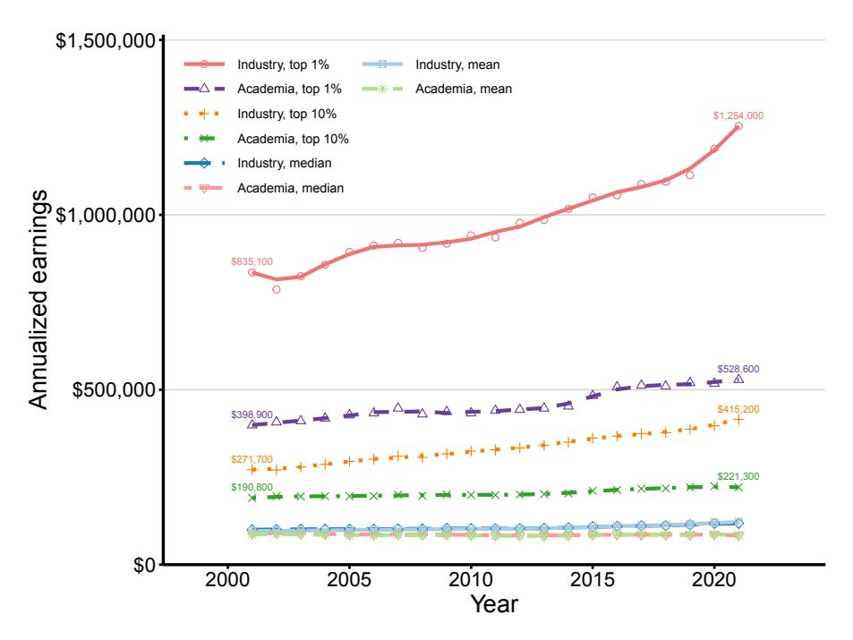

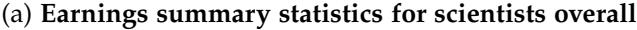

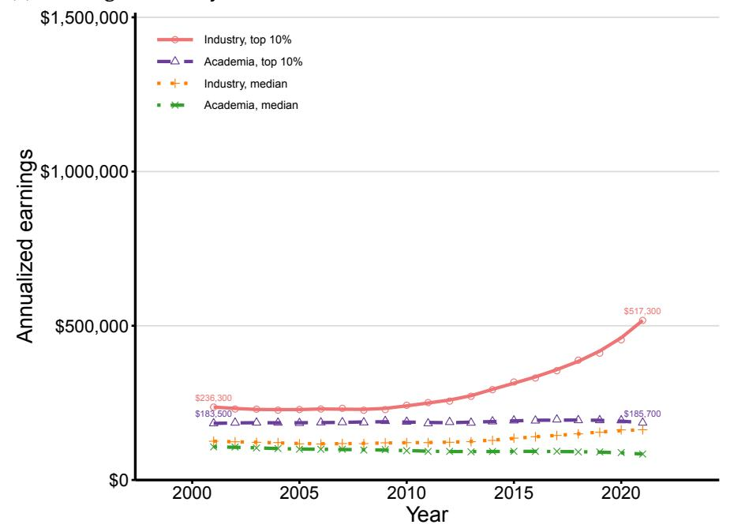

(b) **Earnings summary statistics for AI scientists**

Figure B.4: **Earnings summary statistics for AI and scientists overall by year.**

*Notes:* The figure shows various earnings summary statistics for scientists overall (Panel [B.4a\)](#page-36-0) and AI scientists (Panel [B.4b\)](#page-36-0) for each year between 2001 and 2021. Annualized earnings are calculated by deflating quarterly earnings of dominant, beginning-of-quarter jobs to June 2015 values using CPI; taking the mean (or pseudo-quantile) of their natural log in a given year; and then exponentiating and multiplying by 4. "Industry" refers to earnings of scientists working outside NAICS 6113 and 6114; "Academia" refers to AI scientists working within NAICS 6113 or 6114. "AI" scientists are identified using the field identifiers of their papers as discussed in Section [2.1.](#page-5-2)

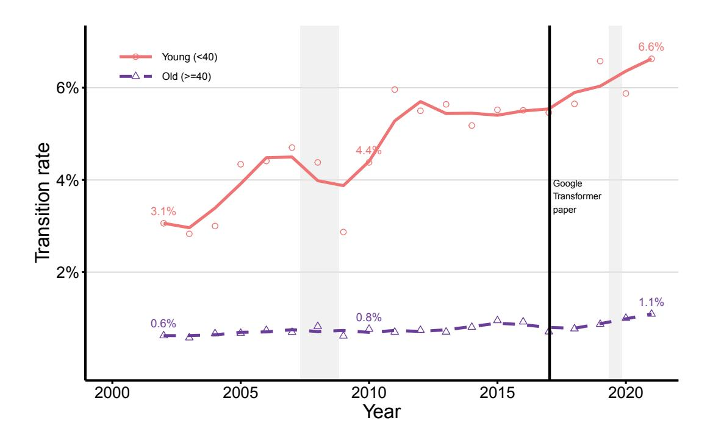

Figure B.5: **Old and young researcher transition rates.**

*Notes:* Shaded grey areas denote NBER recessions. The figure shows transition rates split by broad age bins (AI scientists less than and greater than or equal to 40 years old). The transition rate is defined as the number of scientists working outside of NAICS 6113 and 6114 who, within the previous three quarters, did work within NAICS 6113 or 6114, divided by the total number of scientists who worked in NAICS 6113 or 6114 in the previous three quarters. Points represent raw data values, and lines represent a three-year moving average of underlying data.

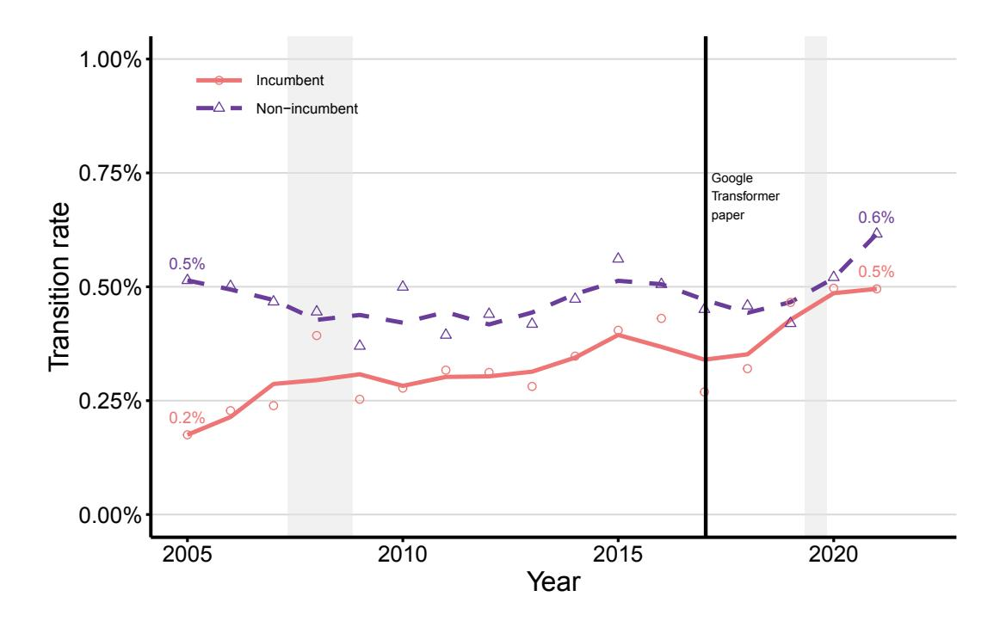

Figure B.6: **Old researcher transition rate, incumbents vs. non-incumbents.**

*Notes:* Shaded grey areas denote NBER recessions. The figure shows transition rates split by destination firm characteristics (incumbent vs. non-incumbent status) for AI researchers older than 40 years old. The transition rate is defined as the number of scientists working outside of NAICS 6113 and 6114 who, within the previous three quarters, did work within NAICS 6113 or 6114, divided by the total number of scientists who worked in NAICS 6113 or 6114 in the previous three quarters. Points represent raw data values, and lines represent a three-year moving average of underlying data.