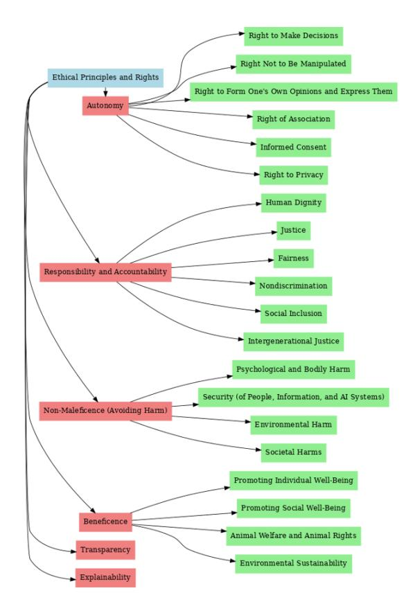
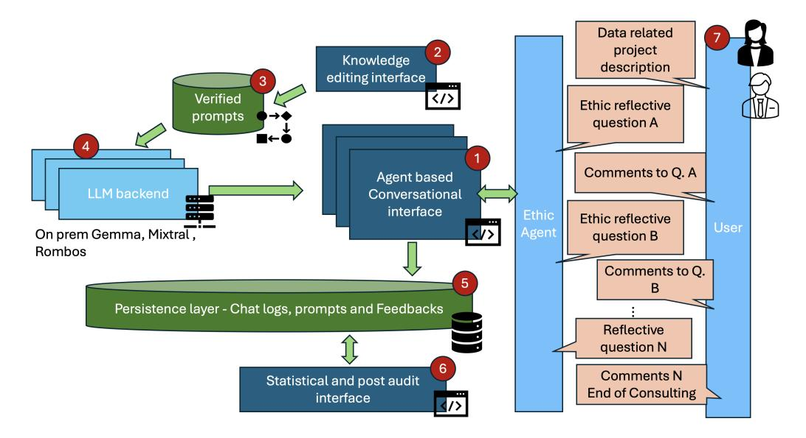
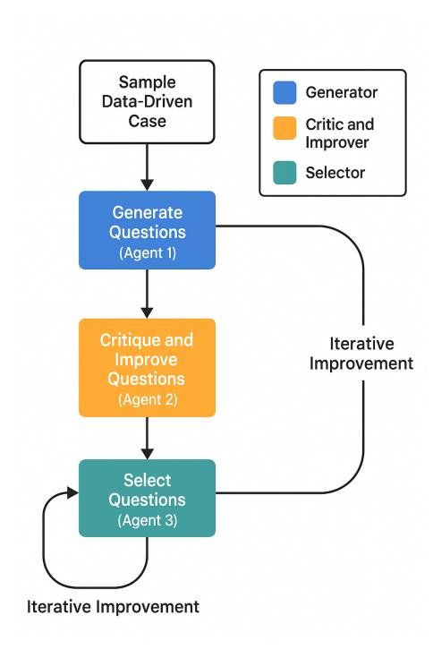
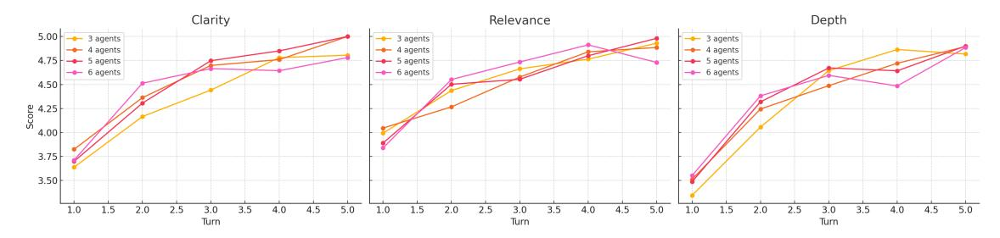

# Aspect-Constrained Reflective Question Generation for Data-Driven Project Evaluation Using Large Language Models

*Abstract*—The increasing adoption of machine learning and large language models (LLMs) in financial applications has intensified the need for systematic and scalable mechanisms to support structured reflection across multiple evaluation dimensions. While prior work has highlighted ethical and social considerations in data-driven systems, existing approaches—such as static checklists or general-purpose LLMs—often lack controllability, coverage, and reproducibility. In this work, we present a dialogue-based system for aspect-constrained reflective question generation, grounded in a structured taxonomy of 26 predefined dimensions grouped into six high-level categories: autonomy, responsibility and accountability, non-maleficence, beneficence, transparency, and explainability. The system is implemented as an LLM-based chatbot that generates context-aware reflection questions conditioned on explicit aspect constraints, enabling systematic coverage and consistency across project descriptions. We conduct a comprehensive system-level evaluation comparing the proposed approach with general-purpose LLMs and static questionnaires. Using both expert-based output quality ratings and controlled multi-agent simulations, we assess relevance, clarity, depth, coverage, and convergence properties of the generated questions. Results show that the proposed system consistently outperforms baseline approaches across multiple quality dimensions and benefits from multi-agent refinement strategies. Overall, this work demonstrates how aspect-constrained LLM prompting and multi-agent optimization can be combined to produce high-quality reflective questions, offering a technically grounded approach to structured decision-support in data-driven project evaluation.

*Index Terms*—AI governance, socio-ethical risk, LLM, dialogue system, reflection questions, banking, on-prem deployment

# I. INTRODUCTION

The increasing adoption of machine learning and large language models (LLMs) in financial and organizational settings has expanded the scope of data-driven project evaluation beyond purely technical performance criteria. While issues such as data quality, bias, robustness, and generalization can often be addressed through established engineering practices, many projects still lack systematic support for structured reflection across non-functional evaluation dimensions, such as accountability, transparency, ethics or potential societal impact.

In practice, such reflection is commonly supported by static checklists, informal discussions, or ad-hoc use of generalpurpose LLMs. These approaches exhibit several limitations: they offer limited controllability over which evaluation dimensions are addressed, produce inconsistent coverage across projects, and are difficult to evaluate or reproduce. As a result, reflective assessment often remains fragmented, strongly dependent on individual expertise, and insufficiently supported by scalable technical tools.

To address these limitations, we formulate reflective assessment as an *aspect-constrained text generation task*. Instead of treating reflection as an unstructured or purely manual activity, we generate reflection questions conditionally on explicit, predefined evaluation aspects. This formulation enables systematic coverage of relevant dimensions, comparability across project descriptions, and quantitative evaluation of generated outputs.

Building on this formulation, we present a dialogue-based system for aspect-constrained reflective question generation. The system operationalizes a structured taxonomy of evaluation dimensions as explicit control signals for LLM-based question generation and supports iterative refinement through multi-agent interaction. Reflection questions are generated in a context-aware manner, while maintaining reproducibility and alignment with predefined aspects.

This work makes three main contributions:

- 1) We introduce a structured taxonomy of 26 predefined ethical evaluation dimensions, organized into six high-level categories—autonomy, responsibility and accountability, non-maleficence, beneficence, transparency, and explainability—which serve as explicit conditioning variables for reflective question generation.
- 2) We design and implement an LLM-based, on-premise chatbot that generates aspect-conditioned, context-aware reflection questions, enabling consistent and reproducible coverage across heterogeneous project descriptions.
- 3) We conduct a comprehensive system-level evaluation combining controlled output-quality metrics, multi-agent refinement experiments, and expert-based comparative assessments against general-purpose LLMs and static questionnaires.

Experimental results show that the proposed approach consistently improves relevance, clarity, depth, and coverage of generated reflection questions compared to baseline methods, while multi-agent refinement further enhances output quality with rapid convergence. Overall, this work demonstrates how aspect-constrained prompting and multi-agent LLM architectures can be combined to support structured, reproducible reflection in ethical evaluation of data-driven project, providing a technically grounded solution suitable for real-world governance and documentation workflows.

#### II. BACKGROUND

Data-driven projects in large organizations are commonly subject to structured review processes across their lifecycle, involving multiple stakeholders such as business, legal, and IT units. Formal requirements—particularly those related to data protection and regulatory compliance—are typically addressed through established governance, risk, and compliance (GRC) workflows. However, these processes primarily focus on legal and procedural aspects and provide limited technical support for structured reflection on broader, non-functional evaluation dimensions.

In practice, reflection on such dimensions is often supported by qualitative discussions, written feedback, or static decision aids. These assessments are frequently conducted in an ad-hoc manner and rely heavily on individual expertise. As a result, systematic and reproducible coverage of evaluation dimensions remains limited, especially when assessments must be performed consistently across a large number of heterogeneous projects.

This limitation is particularly pronounced in early project phases, where descriptions are incomplete and design choices remain flexible. Common decision-support tools—such as static checklists or predefined question catalogs—offer limited adaptability to project context and provide no explicit mechanism for ensuring balanced coverage across predefined evaluation dimensions. Prior work has shown that such tools often fail to elicit sufficiently detailed or context-sensitive responses in practice [1].

To address these challenges, we adopt a dialogue-based approach that formulates project reflection as a *controlled text generation task*. By leveraging a structured taxonomy of predefined evaluation dimensions as explicit control signals, reflection questions can be generated dynamically and conditioned on both project context and selected aspects. In this work, we focus on the technical design, implementation, and empirical evaluation of such a system, assessing its ability to generate high-quality, aspect-aligned reflection questions under controlled experimental conditions.

# III. RELATED WORK

Research on data-driven systems has increasingly emphasized the importance of non-functional evaluation dimensions beyond predictive performance, including privacy, fairness, transparency, and accountability [2], [3]. These concerns have motivated the development of conceptual frameworks intended to structure project evaluation and reflection. From a systems perspective, however, many existing approaches remain difficult to operationalize in a scalable, controllable, and empirically evaluable manner, particularly when applied across heterogeneous project contexts.

#### *A. Frameworks and Decision Aids for Structured Evaluation*

Prior work has proposed taxonomies and assessment frameworks to organize evaluation dimensions relevant to datadriven systems. Saltz et al. [4] identify recurring ethical and governance themes in data science projects, while Olteanu et al. [5] analyze methodological risks associated with social data and highlight the need for structured assessment to identify potential failure modes. These works provide important conceptual foundations but do not directly address how such dimensions can be operationalized within adaptive technical systems.

Several decision-support frameworks attempt to translate evaluation dimensions into guiding questions. The Data Ethics Decision Aid (DEDA) [6], for example, adopts a dialogical structure to support project assessment in public-sector contexts. While such tools offer structured guidance, they typically rely on static question sets and have seen limited empirical validation as scalable and adaptive decision-support systems, particularly in settings requiring consistent coverage across diverse project descriptions.

#### *B. Limitations of Static and Unconstrained Approaches*

A common limitation of existing decision aids is their reliance on static artifacts, such as predefined checklists or fixed question catalogs. Although easy to deploy, these tools exhibit limited sensitivity to project-specific context and provide no explicit mechanism for ensuring balanced coverage across multiple evaluation dimensions. As a result, their outputs are often inconsistent across projects and poorly suited for systematic quality assessment [1].

Recent advances in large language models (LLMs) enable flexible generation of natural language questions and explanations, including in alignment-sensitive domains such as ethical reasoning and value-oriented assessment [7]. However, unconstrained use of general-purpose LLMs introduces challenges related to controllability, reproducibility, and reliance on proprietary cloud-based models. In applied domains such as finance, these limitations motivate a shift toward *controlled text generation*, where outputs are explicitly conditioned on predefined constraints. Structured prompting, aspectconditioned generation, and human-in-the-loop designs have been proposed as mechanisms for reducing variability and improving reliability [8].

Building on these insights, our work formulates reflective question generation as a constraint-driven generation problem. In contrast to static decision aids and unconstrained LLM prompting, we combine a structured taxonomy with LLMbased dialogue and multi-agent refinement, and provide a comprehensive empirical evaluation of output quality under controlled experimental conditions.

# IV. HARMONIZATION OF STRUCTURED EVALUATION FRAMEWORKS

*A. Structured Evaluation Dimensions in Data-Driven Projects*

Evaluation of data-driven projects commonly extends beyond predictive performance to include non-functional dimensions such as data governance, accountability, transparency, and interpretability. Together with legal and regulatory constraints, these considerations are often discussed under the umbrella of ethical, legal, and social implications (ELSI), a concept established in large-scale scientific and technological programs [9]–[11].

From a systems perspective, such considerations can be treated as *structured evaluation dimensions* rather than normative judgments. They provide a shared vocabulary for characterizing project properties that are not captured by performance metrics alone. The primary technical challenge is therefore not the conceptual identification of relevant dimensions, but their operationalization in a way that enables consistent, scalable, and reproducible evaluation across heterogeneous project descriptions.

#### *B. Operational Limitations of Existing Decision Aids*

Most existing decision-support approaches rely on static artifacts, such as predefined checklists or fixed question catalogs. While easy to deploy, these tools exhibit limited sensitivity to project-specific context and provide no explicit mechanism for ensuring balanced coverage across multiple evaluation dimensions. In practice, this often leads to fragmented or inconsistent assessments, particularly in early project phases where information is incomplete [1].

Addressing these limitations requires decision-support mechanisms that can dynamically generate evaluation prompts while remaining explicitly constrained by a predefined schema. From a technical standpoint, this motivates treating project reflection as a *controlled text generation task*, where outputs are conditioned on explicit dimensions and can be evaluated using reproducible quality metrics.

#### *C. Taxonomy Design and Framework Harmonization*

To support controlled generation, we adopt a structured taxonomy that consolidates evaluation dimensions relevant to data-driven projects. The taxonomy comprises 26 predefined dimensions organized into six high-level categories: autonomy, responsibility and accountability, non-maleficence, beneficence, transparency, and explainability. These categories serve as explicit control variables for downstream reflective question generation.

The taxonomy is synthesized by harmonizing overlapping concepts from several established frameworks, including Anticipatory Technology Ethics (ATE) [12], Ethical Impact Assessment (EIA) [13], Ethical Issues of Emerging ICT Applications (ETICA) [14], [15], and the Assessment List for Trustworthy Artificial Intelligence (ALTAI) developed by the European Commission [16]. Rather than applying these frameworks independently, overlapping and partially redundant concepts are consolidated into a unified schema suitable for controlled text generation.

For compatibility with organizational workflows, the taxonomy has been aligned with internal risk and governance classification schemes (details anonymized for review). In this work, however, we focus on its technical role as a control

Fig. 1. Proposed structured evaluation framework

schema: it defines the conditioning space for reflective question generation and enables systematic evaluation of coverage and alignment across generated outputs (Figure 1).

## V. ASPECT-CONSTRAINED REFLECTIVE QUESTION GENERATION

#### *A. Problem Formulation*

We formulate reflective question generation for data-driven project evaluation as an *aspect-constrained text generation problem*. The objective is to generate context-aware reflection questions that are explicitly conditioned on predefined evaluation dimensions. This formulation enables reproducible generation, systematic coverage across dimensions, and empirical assessment of output quality, while reducing the variability and inconsistency of unconstrained prompting.

Let d ∈ D denote a textual description of a data-driven project, including information about objectives, data sources, modeling approaches, and intended use. Let R = {r1, . . . , r6} denote a fixed set of evaluation dimensions corresponding to autonomy, responsibility and accountability, non-maleficence, beneficence, transparency, and explainability. These dimensions define the control space for question generation and ensure that each generated question is explicitly aligned with a single evaluation aspect.

#### *B. Representation and Aspect-Conditioned Prompting*

The project description d is mapped to a semantic representation ed = ϕ(d) using an encoder ϕ, capturing both technical and contextual information relevant for reflective assessment. The representation serves as a shared input for all downstream generation steps and enables consistent conditioning across evaluation dimensions. For each evaluation dimension ri ∈ R, an aspect-conditioned prompt pi(ed) is constructed by combining the project representation with a dimension-specific instruction. This instruction encodes the semantic scope of the corresponding evaluation dimension and constrains the generator to focus on a single aspect at a time. By design, aspect-conditioned prompting prevents cross-aspect drift and improves interpretability of generated questions with respect to the underlying taxonomy.

#### *C. Question Generation and Quality Control*

An LLM-based generator fRQG produces candidate reflection questions conditioned on the aspect-specific prompts. For a given project description, the resulting set of questions is

$$Q_{\text{gen}} = \bigcup_{r_i \in \mathcal{R}} f_{\text{RQG}}(p_i(e_d)),$$

where each question is associated with the evaluation dimension that triggered its generation. This formulation enforces coverage across dimensions at generation time rather than relying on post-hoc assessment. Generated questions are evaluated using output-quality criteria that capture relevance to the targeted evaluation dimension, clarity, depth, humanlikeness, engagement, and overall coverage. Let s(q, ri) denote an aggregated quality score for question q with respect to dimension ri . A minimum quality threshold τ is used to filter low-quality outputs, yielding a refined question set that can be compared systematically across models, prompting strategies, and system configurations.

#### *D. Multi-Agent Refinement Pipeline*

To improve robustness and reduce variability in generated questions, we employ a multi-agent refinement pipeline comprising three functional roles. A *Question Generation Agent* produces an initial set of aspect-conditioned candidate questions. A *Critique and Optimization Agent* evaluates these candidates against the predefined quality criteria and revises questions that fall below the quality threshold. Finally, a *Selection and Voting Agent* aggregates agent-level evaluations and selects a final question set using a voting or scoring mechanism. This pipeline enables iterative improvement of question quality while maintaining explicit control over the addressed evaluation dimensions. Multi-agent interaction is used strictly as a quality optimization and selection mechanism, rather than as an autonomous decision-making process.

## *E. Pipeline Summary*

Input → Aspect-Conditioned Generation → Quality Evaluation and Refinement → Selection

Overall, this formulation treats reflective assessment as a controlled and evaluable generation process. By combining explicit aspect constraints with quality-aware filtering and multi-agent refinement.

# VI. SYSTEM IMPLEMENTATION FOR ASPECT-CONSTRAINED PROJECT EVALUATION

To operationalize aspect-constrained reflective question generation, we implement an agent-based dialogue system that supports structured and reproducible project evaluation across multiple non-functional dimensions. The system is designed as a technical decision-support tool that dynamically generates context-aware evaluation prompts conditioned on a predefined taxonomy. Rather than relying on static checklists or templates, project evaluation is treated as a controlled text generation task, enabling systematic coverage, configurability, and empirical assessment of output quality.

Figure 2 provides an overview of the system architecture. The system is deployed on-premise and leverages large language models (LLMs). Taxonomy definitions and prompting strategies can be adapted at runtime, allowing flexible experimentation without redeployment and supporting reproducible evaluation across heterogeneous project descriptions.

# *A. Agent-Based Dialogue and Control Flow*

The central coordination component implements an agentbased conversational interface following a ReAct-style architecture. User-provided project descriptions serve as the input context for generation. All subsequent interactions are explicitly schema-driven: each generation step is conditioned on a predefined evaluation dimension, ensuring consistent coverage and alignment across sessions.

For each dimension, the number and depth of generated questions can be configured. The dialogue proceeds sequentially across dimensions and is terminated automatically once all aspects have been addressed. Dialogue context is maintained across interaction turns to ensure coherence, while session boundaries are enforced to prevent context leakage and to preserve reproducibility.

#### *B. LLM Backend and Prompting Strategy*

The backend is implemented using a Hugging Face Text Generation Inference (TGI) server deployed on an on-premise GPU cluster. Multiple LLMs are supported, including Mixtral 8x7B, Gemma 3 24B, and Rombos 2.4 14B, enabling controlled comparison across architectures.

To ensure consistent behavior across models, the system employs a cross-LLM prompt templating strategy. All models receive identical, taxonomy-conditioned prompts, allowing systematic evaluation of generation quality.

#### *C. Multi-Agent Refinement and Selection*

To reduce output variability and improve robustness, the system incorporates a multi-agent refinement pipeline. Multiple agents independently generate and critique candidate questions, after which a selection agent aggregates agentlevel scores and selects a final set using a voting mechanism.

Fig. 2. System architecture for aspect-constrained reflective question generation

TABLE I System-Level Reflective Question Quality Ratings (Mean  $\pm$  Std, Expert Evaluation), Coverage is evaluated using an expert heuristic score with a separate scale, whereas all other metrics are rated on a 5-point Likert scale.

| Metric         | Gemma 3 24B     | Mixtral 8x7B    | Qwen 2.5 32B    |
|----------------|-----------------|-----------------|-----------------|
| Relevance      | 4.40±0.13       | 4.08±0.18       | 3.49±0.21       |
| Clarity        | $4.46 \pm 0.22$ | $4.03\pm0.17$   | $3.62 \pm 0.16$ |
| Depth          | $4.52 \pm 0.20$ | $4.00 \pm 0.22$ | $3.47\pm0.16$   |
| Human-likeness | $4.28 \pm 0.17$ | $4.21\pm0.16$   | $3.73\pm0.19$   |
| Engagement     | $4.39 \pm 0.18$ | $4.06 \pm 0.21$ | $3.48 \pm 0.22$ |
| Coverage       | $1.06 \pm 0.11$ | $1.04 \pm 0.13$ | $1.00\pm0.02$   |

Multi-agent interaction is used strictly as an optimization and selection mechanism, rather than as an autonomous decision-making process. This design enables systematic assessment of refinement effects, including improvements in relevance, clarity, and depth, as well as convergence behavior under different agent configurations.

#### D. Persistence, Documentation, and Evaluation Support

All generated questions, prompts, and interaction metadata are stored in a structured persistence layer to support traceability and post-hoc analysis. Dialogue artifacts are treated as system interaction outputs rather than user data. A documentation component aggregates session outputs into standardized summaries that can be exported for reporting and analysis. Output-level evaluation focuses exclusively on properties of the generated text artifacts—such as coverage, consistency, and alignment with predefined evaluation dimensions—closing the loop between generation, storage, and empirical assessment.

#### VII. RESULTS

#### A. System-Level Model Comparison

Table I summarizes reflective question quality across onpremise LLM backends. Overall, Gemma 3 24B achieves

TABLE II ONE-WAY ANOVA RESULTS FOR MODEL COMPARISON WITH EFFECT SIZES  $(\eta^2)$ 

| Criterion          | F-statistic | p-value                | $\eta^2$ |
|--------------------|-------------|------------------------|----------|
| Relevance          | 168.52      | $6.92 \times 10^{-28}$ | 0.55     |
| Clarity            | 126.29      | $2.86 \times 10^{-24}$ | 0.52     |
| Insightfulness     | 179.49      | $1.06 \times 10^{-28}$ | 0.58     |
| Human-likeness     | 76.16       | $1.71 \times 10^{-18}$ | 0.42     |
| Attention-grabbing | 125.45      | $3.44 \times 10^{-24}$ | 0.55     |
| Coverage           | 1.76        | 0.179                  | 0.05     |

the highest mean scores across all Likert-rated criteria, with particularly strong performance in clarity (4.46  $\pm$  0.22) and insightfulness/depth (4.52  $\pm$  0.20). Mixtral 8x7B consistently ranks second across most criteria, while Qwen 2.5 32B shows the lowest mean ratings, especially for relevance (3.49  $\pm$ 0.21) and engagement (3.48  $\pm$  0.22). The ANOVA results (Table II) indicate statistically significant differences between models for relevance  $(F = 168.52, p = 6.92 \times 10^{-28})$ , clarity ( $F = 126.29, p = 2.86 \times 10^{-24}$ ), insightfulness  $(F = 179.49, p = 1.06 \times 10^{-28})$ , human-likeness (F =76.16,  $p = 1.71 \times 10^{-18}$ ), and engagement (F = 125.45,  $p = 3.44 \times 10^{-24}$ ). Effect sizes are large across these criteria  $(\eta^2$  in the range 0.42–0.58), indicating that model choice explains a substantial share of the variance in ratings. Coverage does not differ significantly across models (p = 0.179), suggesting that—under a fixed prompting template—models tend to address a comparable spread of dimensions, while differing strongly in output quality.

# B. Multi-Agent Refinement Improves Quality with Diminishing Returns

1) Multi-agent simulation for reflection question generation: Figure 3 illustrates the generator-critic-selector pipeline. Figure 4 shows that iterative refinement improves output

Fig. 3. Multi-agent flowchart for 3 agents simulation

quality over rounds, with the largest gains typically observed in depth, reflecting the value of critique-and-rewrite for strengthening analytical specificity. Improvements in clarity and relevance are most pronounced in early rounds and begin to saturate after approximately 3–4 iterations, indicating diminishing returns beyond this point.

Across agent configurations, increasing the number of agents yields higher initial quality and stronger improvements for depth, consistent with the hypothesis that diversified critique signals help reduce superficial or generic questions. However, the marginal benefit decreases with additional agents and rounds. These findings support a practical operating point of approximately three refinement rounds, with three agents providing a strong efficiency–quality trade-off, and five to six agents preferable when maximizing depth is prioritized.

# *C. Expert-Based Comparative Assessment Against Baselines*

Table V reports the expert-based comparative assessment across 20 evaluators and three scenarios. The ES chatbot achieves the highest mean ratings for clarity & coherence (4.46 ± 0.31), usefulness (4.31 ± 0.27), and user experience (4.43 ± 0.31). For relevance & depth, ChatGPT-5 attains the highest mean (4.35 ± 0.25), while the ES chatbot remains competitive (4.43 ± 0.29). The static questionnaire baseline scores substantially lower across all dimensions (e.g., usefulness 3.29 ± 0.30), indicating that interactive generation systems outperform fixed artifacts on perceived output quality.

Effect sizes (Table VI) confirm that the ES chatbot provides large improvements over the questionnaire across all criteria (Cohen's d between 2.50 and 3.46). Compared to ChatGPT-4o and ChatGPT-5, the ES chatbot shows smaller but practically meaningful differences concentrated in clarity, usefulness, and user experience, consistent with the benefit of taxonomyconditioned prompting and structured interaction. Preference

TABLE III USER STUDY: FINAL SYSTEM PREFERENCES FROM 20 PARTICIPANTS

| Model         | Participants Preferring |  |  |
|---------------|-------------------------|--|--|
| ES Chatbot    | 11                      |  |  |
| ChatGPT-4o    | 5                       |  |  |
| ChatGPT-5     | 3                       |  |  |
| Questionnaire | 1                       |  |  |

data (Table III) further supports these results: 11 out of 20 evaluators selected the ES chatbot as their overall preferred system, followed by ChatGPT-4o (5), ChatGPT-5 (3), and the questionnaire (1). Taken together, the results indicate that taxonomy conditioning and multi-agent refinement improve perceived output quality—particularly clarity, usefulness, and interaction quality—while general-purpose LLMs can remain competitive on perceived depth under some scenarios.

# *D. Summary of Findings*

Across experiments, we observe three consistent patterns: (i) on-premise model choice substantially affects reflective question quality across relevance, clarity, depth, human-likeness, and engagement, (ii) multi-agent refinement improves question quality but converges within a small number of rounds, and (iii) the proposed system outperforms a static questionnaire baseline by a large margin and shows targeted advantages over general-purpose LLMs in clarity, usefulness, and user experience.

# VIII. EVALUATION

We evaluate the proposed system as an approach to aspect-constrained reflective question generation for datadriven project evaluation. All experiments focus on outputlevel properties of generated text artifacts (e.g., relevance, clarity, depth, coverage) and are designed to be reproducible. The evaluation comprises three complementary parts: (i) a system-level comparison of on-premise LLM backends, (ii) a multi-agent refinement experiment, and (iii) an expert-based comparative assessment against general-purpose LLMs and a static questionnaire baseline.

#### *A. System-Level Model Comparison*

- *a) Task.:* Given a project scenario d and a set of evaluation dimensions R, each model generates reflective questions conditioned on the corresponding aspect prompts. Outputs are evaluated under identical prompts and generation constraints.
- *b) Dataset.:* We curate 25 project scenarios covering diverse AI and data-driven use cases. Each scenario is annotated with one or more taxonomy dimensions from R = {r1, . . . , r6} (autonomy, responsibility & accountability, non-maleficence, beneficence, transparency, explainability) to guide aspect-conditioned generation.

Fig. 4. Convergence of clarity, Relevance and Depth Over turns and Agent count

TABLE IV EVALUATION CRITERIA FOR REFLECTIVE QUESTION QUALITY

| Criterion      | Description                         | Rating Scale    |
|----------------|-------------------------------------|-----------------|
| Relevance      | Appropriateness of the question     | 1–5 Likert      |
|                | with respect to the given ethical   |                 |
|                | aspect                              |                 |
| Clarity        | Degree to which the question is     | 1–5 Likert      |
|                | understandable and clearly phrased  |                 |
| Insightfulness | Capacity of the question to provoke | 1–5 Likert      |
|                | deep or expert-level reflection     |                 |
| Human-likeness | Similarity of the question to what  | 1–5 Likert      |
|                | a human expert might ask            |                 |
| Attention      | Likelihood that the question chal   | 1–5 Likert      |
| grabbing       | lenges or engages the user          |                 |
| Coverage       | Balance and variety of questions    | Heuristic score |
|                | across all ethical aspects          |                 |

- *c) Models.:* We compare three on-premise LLM backends served via Hugging Face TGI: Mixtral 8x7B, Gemma 3 24B, and Qwen 2.5 32B. Prompts are standardized using a cross-LLM templating strategy to ensure comparability.
- *d) Criteria and rating scales.:* Generated questions are rated using the criteria in Table IV: relevance (aspect alignment), clarity, insightfulness/depth, human-likeness, engagement (attention-grabbing), and coverage across dimensions. Likert-based criteria use 1–5 scales; coverage is computed as a heuristic score based on balance and variety across dimensions.
- *e) Raters and aggregation.:* Outputs are rated by five human evaluators; additionally, we include a prompted LLM rater as a secondary signal. Scores are aggregated per model, scenario, and criterion.
- *f) Statistics.:* We test for differences across models using one-way ANOVA for each criterion and report effect sizes (η 2 ) (Table II). Descriptive statistics are summarized in Table I.

#### *B. Multi-Agent Refinement Evaluation*

We evaluate whether a generator–critic–selector pipeline improves question quality and how rapidly it converges. The pipeline follows three roles (Figure 3): (i) a generator produces one question per dimension, (ii) a critique-and-rewrite agent revises candidates, and (iii) a selector agent chooses the best candidates via scoring/voting.

- *a) Protocol.:* For a fixed scenario and set of dimensions, the system generates an initial set Q1, produces revised candidates Q2, and selects the final set. The loop is repeated for multiple refinement rounds and agent counts.
- *b) Metrics.:* We track quality trajectories over rounds (relevance, clarity, depth), convergence behavior, coverage stability, and computational trade-offs as a function of the number of agents. Figure 4 reports representative convergence curves.
- *C. Expert-Based Comparative Assessment Against Baselines*
- *a) Systems.:* We compare: (i) the proposed ES chatbot (taxonomy-conditioned generation + refinement), (ii) ChatGPT-4o, (iii) ChatGPT-5, and (iv) a static questionnaire baseline.
- *b) Design.:* We conduct a within-subjects study with 20 domain-informed evaluators. Each evaluator assesses all four systems using the same three standardized scenarios; system order is randomized to mitigate ordering effects. Interaction time is capped at 10 minutes per scenario and system.
- *c) Measures.:* Evaluators rate outputs along four dimensions: relevance & depth, clarity & coherence, usefulness for structured project evaluation, and overall user experience (Tables V and VI). Open-ended comments are collected to contextualize ratings; thematic coding is performed with interrater reliability reported via Cohen's κ.
- *d) Data handling and scope.:* The evaluation collects only output-level ratings and anonymized qualitative comments on generated text artifacts. No personal data beyond basic evaluator metadata are stored, and no inferences are made about evaluators' beliefs, values, or behavioral outcomes. The study is strictly limited to assessing perceived quality, coverage, and consistency of system-generated reflection questions under controlled experimental conditions.

#### IX. CONCLUSION

This paper presented an on-premise, agent-based dialogue system for aspect-constrained reflective question generation in ethical evaluation of data-driven project. By operationalizing a structured taxonomy as an explicit control schema, the system enables configurable generation of context-aware evaluation prompts suitable for governance and documentation workflows.

TABLE V USER STUDY: COMPARATIVE SYSTEM RATINGS (MEAN ± STD ACROSS 20 PARTICIPANTS AND 3 CASES)

| Model         |             | Relevance & Depth Clarity & Coherence | Usefulness  | User Experience |
|---------------|-------------|---------------------------------------|-------------|-----------------|
| ES Chatbot    | 4.43 ± 0.29 | 4.46 ± 0.31                           | 4.31 ± 0.27 | 4.43 ± 0.31     |
| ChatGPT-4o    | 4.31 ± 0.29 | 4.41 ± 0.30                           | 4.11 ± 0.27 | 4.19 ± 0.29     |
| ChatGPT-5     | 4.35 ± 0.25 | 4.01 ± 0.30                           | 4.06 ± 0.28 | 4.01 ± 0.23     |
| Questionnaire | 3.48 ± 0.32 | 3.60 ± 0.28                           | 3.29 ± 0.30 | 3.68 ± 0.29     |

TABLE VI USER STUDY: PAIRWISE SYSTEM COMPARISONS (COHEN'S d EFFECT SIZES). STRONG EFFECTS > 0.8, MODERATE ≈ 0.5, WEAK ≈ 0.2.

| Comparison                   |               | Relevance & Depth Clarity & Coherence | Usefulness      | User Experience |
|------------------------------|---------------|---------------------------------------|-----------------|-----------------|
| ES Chatbot vs. Questionnaire | 3.11 (strong) | 2.96 (strong)                         | 3.46 (strong)   | 2.50 (strong)   |
| ES Chatbot vs. ChatGPT-4o    | 0.41 (weak)   | 0.55 (moderate)                       | 0.71 (moderate) | 0.82 (moderate) |
| ChatGPT-4o vs. Questionnaire | 2.72 (strong) | 2.79 (strong)                         | 2.87 (strong)   | 1.76 (strong)   |
| ChatGPT-5 vs. Questionnaire  | 3.03 (strong) | 1.41 (strong)                         | 2.65 (strong)   | 1.26 (strong)   |
| ChatGPT-5 vs. ES Chatbot     | 0.30 (weak)   | 0.65 (moderate)                       | 0.88 (strong)   | 0.95 (strong)   |
| ChatGPT-5 vs. ChatGPT-4o     | 0.15 (weak)   | 1.33 (strong)                         | 0.18 (weak)     | 0.69 (moderate) |

Empirical results from system-level benchmarking, multiagent refinement experiments, and expert-based comparative assessment show that taxonomy-conditioned prompting improves clarity, usefulness, and consistency of generated questions relative to unconstrained generation and static questionnaires. Multi-agent refinement further enhances output quality, with gains converging within a small number of iterations, supporting practical deployment under computational constraints.

Future work will focus on extending taxonomy management and portability across domains, exploring multilingual configurations, and strengthening integration with organizational reporting and audit pipelines. More broadly, the proposed framework demonstrates how controlled text generation and agent-based refinement can support structured evaluation tasks in applied data science settings.

# ACKNOWLEDGMENT

This work was partly supported by \*\*\*blinded\*\*\*.

# REFERENCES

- [1] M. Baader, M. Egorov, B. Renerte, C. Tanner, A. F. Wagner, and N. Witt, "Testing contemplation questions as a tool to promote integrity in organizations," *SSRN Electronic Journal*, 2025. [Online]. Available: https://ssrn.com/abstract=5118991
- [2] E. Vigano, M. Christen, B. S. Elger, M. Ienca, M. Loi, C. Schneble, ` M. Burri, C. Hauser, and D. Shaw, "Ethical, legal and social issues of big data: A comprehensive overview," *White Paper of the ELSI Task Force for the National Research Programme "Big Data" (NRP 75)*, April 2022, available at SSRN: https://ssrn.com/abstract=4081192.
- [3] M. D. Dubber, F. Pasquale, and S. Das, Eds., *The Oxford Handbook of Ethics of AI*. Oxford, UK: Oxford University Press, 2020. [Online]. Available: https://doi.org/10.1093/oxfordhb/9780190067397.001.0001
- [4] J. S. Saltz and N. Dewar, "Data science ethical considerations: a systematic literature review and proposed project framework," *Ethics and Inf. Technol.*, vol. 21, no. 3, p. 197–208, Sep. 2019. [Online]. Available: https://doi.org/10.1007/s10676-019-09502-5
- [5] A. Olteanu, C. Castillo, F. Diaz, and E. Kıcıman, "Social data: Biases, methodological pitfalls, and ethical boundaries," *Frontiers in Big Data*, vol. 2, 2019. [Online]. Available: https://www.frontiersin.org/journals/ big-data/articles/10.3389/fdata.2019.00013
- [6] A. S. Franzke, I. Muis, and M. T. Schafer, "Data ethics decision ¨ aid (deda): a dialogical framework for ethical inquiry of ai and data projects in the netherlands," *Ethics and Inf. Technol.*, vol. 23, no. 3, p. 551–567, Sep. 2021. [Online]. Available: https://doi.org/10.1007/s10676-020-09577-5

- [7] D. Dillion, D. Mondal, N. Tandon, and K. Gray, "Ai language model rivals expert ethicist in perceived moral expertise," *Scientific Reports*, vol. 15, no. 4084, February 2025. [Online]. Available: https://www.nature.com/articles/s41598-025-19377-9
- [8] M. Queloz, "Can ai rely on the systematicity of truth? the challenge of modelling normative domains," *Philosophy and Technology*, vol. 38, no. 34, pp. 1–27, 2025.
- [9] E. T. Juengst, "Self-critical federal science? the ethics experiment within the u.s. human genome project," *Social Philosophy and Policy*, vol. 13, no. 2, p. 63–95, 1996.
- [10] E. Marshall, "The genome program's conscience: A research program on the ethical, legal, and social implications of genome studies, launched as an" afterthought," is now the world's biggest bioethics program," *Science*, 1996.
- [11] D. D. Dolan, S. S.-J. Lee, and M. K. Cho, "Three decades of ethical, legal, and social implications research: Looking back to chart a path forward," *Cell Genomics*, vol. 2, no. 7, p. 100150, 2022. [Online]. Available: https://www.sciencedirect.com/science/article/pii/ S2666979X22000878
- [12] P. A. E. Brey, "Anticipating ethical issues in emerging it," *Ethics and Information Technology*, vol. 14, no. 4, pp. 305–317, 2012.
- [13] D. Wright, "A framework for the ethical impact assessment of information technology," *Ethics and Information Technology*, vol. 13, no. 3, pp. 199–226, 2011.
- [14] B. C. Stahl, J. Timmermans, and C. Flick, "Ethics of emerging information and communication technologies: On the implementation of responsible research and innovation," *Science and Public Policy*, vol. 44, no. 3, pp. 369–381, 09 2016. [Online]. Available: https://doi.org/10.1093/scipol/scw069
- [15] B. Stahl, R. Heersmink, P. Goujon, C. Flick, J. Hoven van den, K. Wakunuma, V. Ikonen, and M. Rader, "Identifying the ethics of emerging information and communication technologies: An essay on issues, concepts and method," *International Journal of Technoethics*, vol. 1, no. 4, pp. 20–38, 2010.
- [16] D. Golpayegani, H. J. Pandit, and D. Lewis, "Comparison and analysis of 3 key ai documents: Eu's proposed ai act, assessment list for trustworthy ai (altai), and iso/iec 42001 ai management system," in *Artificial Intelligence and Cognitive Science*, L. Longo and R. O'Reilly, Eds. Cham: Springer Nature Switzerland, 2023, pp. 189–200.