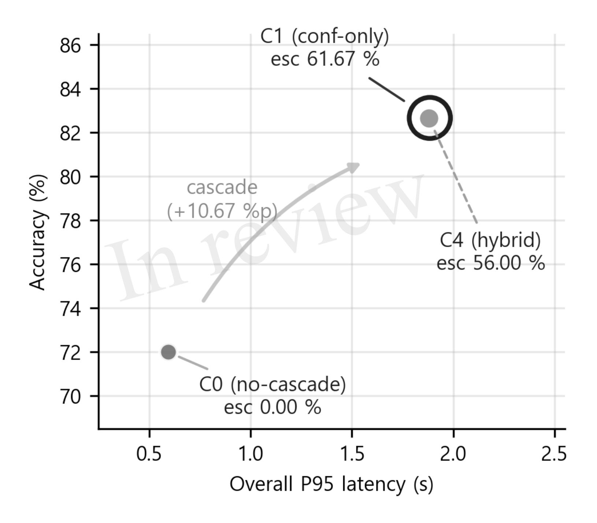
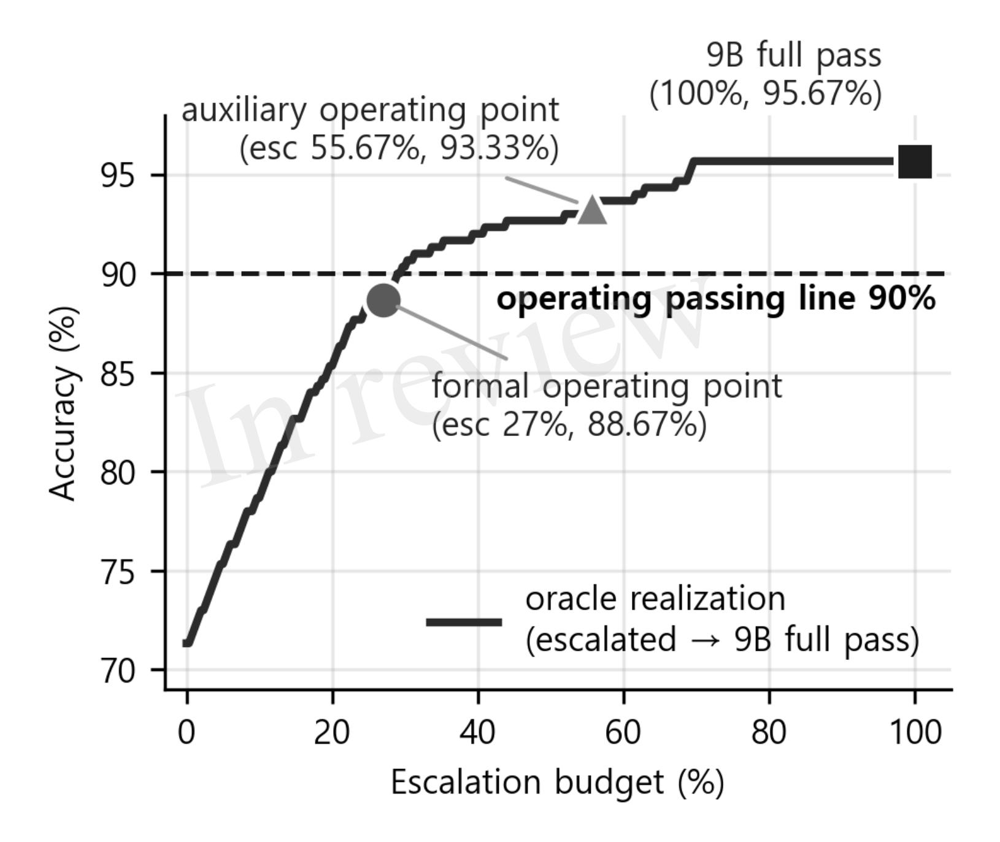
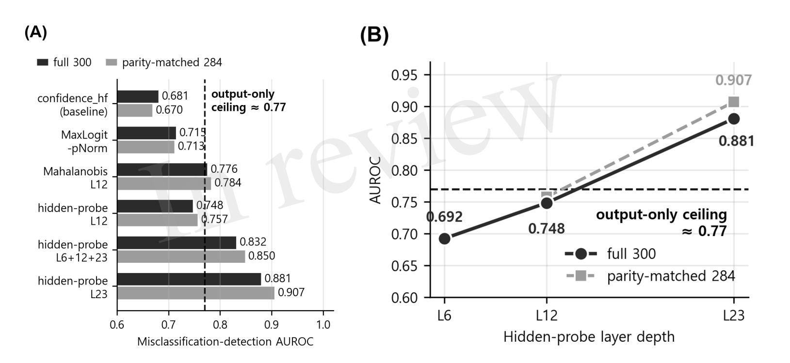
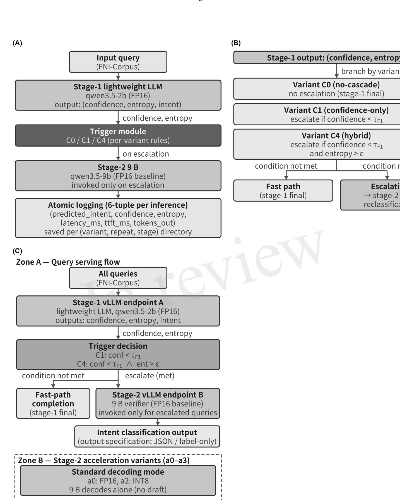

# Cascade Routing of Lightweight and Medium LLMs for AlOps Intent Classification in Financial Air-Gapped Networks

Namkyu Kang1, Boyoung Kim1\*

1Seoul School of Integrated Sciences and Technologies, Seoul, Republic of Korea

#### Submitted to Journal:

Frontiers in Computer Science

#### Specialty Section:

**Networks and Communications** 

#### Article type:

Original Research Article

#### Manuscript ID:

1946095

#### Received on:

23 Jul 2026

#### Journal website link:

www.frontiersin.org

#### Scope Statement

This manuscript addresses network operation automation based on artificial intelligence for IT operations (AlOps) in air-gapped financial networks, a problem of network control and on-premises inference infrastructure that fits the Networks and Communications section of Frontiers in Computer Science. In this setting, intent classification maps operators' natural-language commands to operational targets and forms the entry point of automated network control. Because external cloud APIs are blocked, we deploy a lightweight two-stage cascade router entirely on-premises, escalating only unreliable queries from a lightweight model to a larger model to reconcile single-GPU resource efficiency with classification reliability. Under a factorial design in a vLLM PagedAttention serving environment, we characterize escalation-trigger discriminability, hidden-state probing, calibration quality, and the strict P95 latency constraints representative of production network operations. These contributions connect large language model serving with the resource, latency, and reliability concerns that define on-premises network-operations infrastructure. The work therefore fits the section's focus on network control and computing systems, ensuring it reaches the most relevant reviewers and readers within this specialty.

#### Conflict of interest statement

The authors declare that the research was conducted in the absence of any commercial or financial relationships that could be construed as a potential conflict of interest

#### Credit Author Statement

**Boyoung Kim**: Project administration, Resources, Supervision, Validation, Writing – review & editing. **Namkyu Kang**: Conceptualization, Data curation, Formal Analysis, Investigation, Methodology, Resources, Software, Visualization, Writing – original draft, Writing – review & editing.

#### Keywords

AlOps, Air-Gapped Networks, Cascade Routing, Escalation Trigger, Hidden-State Probe

#### **Abstract**

Word count: 200

Financial institutions operate in air-gapped environments under network-segregation regulations, so deploying large language models (LLMs) requires on-premises inference. This study verifies the classification reliability and escalation-trigger discriminability of a lightweight two-stage cascade router for intent classification, in which a lightweight model (qwen3.5-2b) escalates low-confidence or high-entropy queries to a 9B model (qwen3.5-9b). Under a 12-cell factorial design (three triggers × four acceleration variants) on the FNI-Corpus (Financial Network Intent Corpus; seven intent classes; evaluation corpus of 300 queries × 5 repeats) with vLLM PagedAttention, the cascade improved accuracy from 72.00% to 82.67% (+10.67 percentage points, 95% CI [+5.67, +15.67]; weighted F1 0.681  $\rightarrow$  0.815), yet fell short of the operating line (90% accuracy, 0.85 weighted F1). Output-distribution signals correlated above 0.95, so trigger discrimination (AUROC) plateaued near 0.77, and the hybrid trigger only marginally reduced escalation. In contrast, a hidden-state probe (L23) broke this ceiling, reaching AUROC 0.881 (0.907 parity-matched) on the calibration corpus and 0.980 on the held-out evaluation corpus. MTP self-speculation kept every variant P95 within 0.594–2.15 s (target P95  $\leq$  5 s), while the cascade worsened calibration error (ECE 0.135  $\rightarrow$  0.241). These findings empirically demonstrate that classification-reliability gains arise from exploiting internal representations, not post-hoc calibration.

#### Funding information

This work was supported by aSSIST University

#### Funding statement

The author(s) declare that financial support was received for the research and/or publication of this article.

#### *Ethics statements*

#### *Studies involving animal subjects*

Generated Statement: No animal studies are presented in this manuscript.

#### *Studies involving human subjects*

Generated Statement: No human studies are presented in the manuscript.

#### *Inclusion of identifiable human data*

Generated Statement: No potentially identifiable images or data are presented in this study.

#### *Data availability statement*

Generated Statement: The datasets presented in this article are not readily available because **The dataset (the Financial Network Intent Corpus, FNI-Corpus) cannot be made publicly available because it derives from the operational command-and-query patterns of a regulated financial air-gapped network. The following restrictions apply. First, the data originate inside an air-gapped environment governed by financial network-segregation regulations and institutional information-security controls that prohibit exporting operational records outside the segregated network. Second, the data are subject to data-sovereignty restrictions that bar their transfer or public deposit. Third, release could expose sensitive details of the institution's internal network operations.** . Requests to access the datasets should be directed to **bykim2@assist.ac.kr**.

#### *Generative AI disclosure*

No Generative AI was used in the preparation of this manuscript. In review

# Cascade Routing of Lightweight and Medium LLMs for AIOps Intent Classification in Financial Air-Gapped Networks

- 1 Namkyu Kang1, Bo-Young Kim2\*
- 1Seoul AI School, aSSIST University, Seoul, South Korea
- 2Seoul AI School, aSSIST University, Seoul, South Korea
- 4 \* Correspondence: Bo-Young Kim, bykim2@assist.ac.kr
- 5 *Word count: 11529* | *Figures: 5* | *Tables: 10*
- 6 **Keywords:** AIOps, Air-Gapped Networks, Cascade Routing, Escalation Trigger, Hidden-State Probe
- 7 Abstract
- 8 Financial institutions operate in air-gapped environments under network-segregation regulations, so
- 9 deploying large language models (LLMs) requires on-premises inference. This study verifies the
- 10 classification reliability and escalation-trigger discriminability of a lightweight two-stage cascade
- router for intent classification, in which a lightweight model (qwen3.5-2b) escalates low-confidence
- or high-entropy queries to a 9B model (qwen3.5-9b). Under a 12-cell factorial design (three triggers
- 13 × four acceleration variants) on the FNI-Corpus (Financial Network Intent Corpus; seven intent
- classes; evaluation corpus of 300 queries × 5 repeats) with vLLM PagedAttention, the cascade
- 15 improved accuracy from 72.00% to 82.67% (+10.67 percentage points, 95% CI [+5.67, +15.67];
- weighted F1 0.681  $\rightarrow$  0.815), yet fell short of the operating line (90% accuracy, 0.85 weighted F1).
- weighted 1 0.001 / 0.013), yet tell short of the operating line (50% decuracy, 0.03 weighted 11).
- Output-distribution signals correlated above 0.95, so trigger discrimination (AUROC) plateaued near
- 18 0.77, and the hybrid trigger only marginally reduced escalation. In contrast, a hidden-state probe
- 19 (L23) broke this ceiling, reaching AUROC 0.881 (0.907 parity-matched) on the calibration corpus
- and 0.980 on the held-out evaluation corpus. MTP self-speculation kept every variant P95 within
- 21 0.594–2.15 s (target P95  $\leq$  5 s), while the cascade worsened calibration error (ECE 0.135  $\rightarrow$  0.241).
- 22 These findings empirically demonstrate that classification-reliability gains arise from exploiting
- 23 internal representations, not post-hoc calibration.

#### 24 1 Introduction

- 25 Financial institutions operate their core business systems under financial data localization regulations
- 26 (European Parliament and Council of the European Union, 2016) and network-segregation controls,
- 27 and many institutions implement these controls as air-gapped environments physically isolated from
- 28 the external internet. What these regulations codify is network-segregation and segmentation controls
- 29 (Basel Committee on Banking Supervision, 2011; International Organization for Standardization,
- 30 2022; PCI Security Standards Council, 2022). Air-gapped deployment is a representative
- 31 implementation adopted to satisfy these requirements. Under these constraints, deploying a large
- 32 language model (LLM) for operational tasks requires on-premises inference in which every inference
- runs inside the air-gapped network, because external cloud API calls are blocked.

- However, continuously serving a large LLM under the single-GPU resource constraints of an air-
- 35 gapped network imposes substantial GPU-occupancy and cost burdens. A representative mitigation is
- cascade routing, which selects models of different costs according to input difficulty (Chen et al.,
- 37 2023; Wang et al., 2023; Ding et al., 2025): a lightweight model handles most inputs and escalates
- only those it cannot judge reliably to a larger model, reducing upper-model calls to target resource
- 39 efficiency and classification quality together. In air-gapped networks, the entry point of network
- 40 operation automation based on artificial intelligence for IT operations (AIOps) (Dang et al., 2019;
- Notaro et al., 2021) is intent classification, which maps operators' natural language commands and
- 42 queries to processing targets, and a two-stage cascade combining a lightweight and a larger model is
- a candidate architecture for performing it with both resource efficiency and classification reliability.
- Cascade routing (Chen et al., 2023; Wang et al., 2023; Ding et al., 2025), confidence-based
- escalation and failure detection (Hendrycks and Gimpel, 2017; Geifman and El-Yaniv, 2017), and
- on-premises inference infrastructure for lightweight LLMs (Kwon et al., 2023) have each matured as
- 47 independent research topics, but have not been verified together in the single context of air-gapped
- 48 network operations. Although the tools for diagnosing how well a signal identifies misclassified
- 49 queries are well established in failure detection research (Hendrycks and Gimpel, 2017; Geifman and
- 50 El-Yaniv, 2017), what discriminative power the trigger of a lightweight cascade under air-gapped
- conditions actually exhibits, and where its ceiling originates, have not been reported; even a recent
- attempt to unify routing and cascading (Dekoninck et al., 2025) does not cover the strict P95 latency
- constraints of air-gapped networks or the diagnosis of trigger discrimination. At which limit trigger
- discrimination saturates, and whether a signal surpasses it, are thus key open questions for deploying
- a lightweight cascade in operations. The effect of the stage-2 output format on cascade classification
- quality, when the upper model reclassifies an escalated query, has likewise not been systematically
- addressed in the routing literature.
- addressed in the fourting interactive.
- To fill this gap, this study empirically verifies, on a single domain and a single protocol, under which
- 59 conditions a lightweight two-stage cascade router for operational intent classification in air-gapped
- 60 financial networks works and where its limits originate. The contributions are fourfold. First, we
- verify the classification reliability of a lightweight two-stage cascade in this domain under
- operational latency constraints and quantify that its absolute accuracy ceiling forms below 90%.
- 63 Second, comparing a confidence-entropy hybrid trigger directly against a confidence-only trigger on
- 64 the same threshold calibration, we reveal that output-signal redundancy confines trigger
- discrimination to a fixed ceiling that rank-preserving post-hoc calibration does not change. Third, we
- empirically demonstrate that the model's internal representation (a hidden-state probe) provides an
- orthogonal signal beyond the output distribution and breaks this ceiling. Fourth, along a planned
- output-specification axis contrasting JSON-structured with label-only output, we empirically
- output-specification axis contrasting 35014-structured with facet-only output, we empiricany
- demonstrate that enforcing JSON only on stage-2 incurs consistent losses in accuracy, calibration,
- and latency, concentrated on multi-intent primary-order distortion, and fix the cost-accuracy position
- of the cascade with a same-deployment 9B full-pass anchor.
- 72 These findings delineate the applicable scope and limits of lightweight cascades in air-gapped
- operational automation and indicate that the path to higher classification reliability lies in exploiting
- 74 the model's internal representations rather than in post-hoc calibration of confidence. The remainder
- of this paper reviews related work (Section II), presents the experimental plan and three research
- questions (Section III), reports the results and a preliminary deployment diagnosis (Section IV), and
- synthesizes the findings, implications, and limitations (Section V).

#### 2 Related Work

#### 79 **2.1** LLM Cascades and Model Routing

- 80 LLM cascades and model routing optimize inference cost and quality simultaneously by selecting
- 81 models of different costs according to input difficulty. FrugalGPT by Chen et al. (2023) arranges
- 82 LLMs in ascending order of cost and invokes the next only when the preceding response's confidence
- 83 is low, improving cost-quality trade-offs in general NLP and question answering (QA). Tabi by
- Wang et al. (2023) adopts a confidence-only dispatcher, forwarding to the larger model only the
- queries whose lightweight-model confidence falls below a threshold; the confidence-only trigger of
- this study takes this dispatcher family as its direct comparison baseline. BEST-Route by Ding et al.
- 87 (2025) allocates test-time optimal compute with a learned router but does not constrain the
- deployment topology of escalation targets, unlike the air-gapped configuration in which both stage
- models operate inside the isolated network. Mozannar and Sontag (2020), who formalized learning-
- 90 to-defer, assume a human expert as the deferral target, a topology distinct from this study's two-LLM
- cascade on a single GPU; Narasimhan et al. (2025) combined speculative decoding with cascades to
- 92 shorten deferral latency.
- 93 Recent work has moved toward unifying routing and cascading. Dekoninck et al. (2025) integrated
- 94 the two paradigms into one decision framework defining cost-quality optima in general inference
- environments, but this unified theory does not cover the P95 latency constraints of air-gapped
- 96 networks, the verification of classification reliability, or the diagnosis of escalation trigger
- 97 discrimination, in contrast to this study's empirical verification on a single domain and protocol.
- 98 C3PO by Valkanas et al. (2025) optimizes the cascade policy in a label-free self-supervised manner
- 99 with conformal prediction bounding the probability of exceeding a cost budget; SATER by Shen et
- al. (2025) improves token efficiency with confidence-aware rejection; and the agreement-based
- cascading of Kolawole et al. (2025) uses per-stage ensemble agreement as a training-free escalation
- signal. These studies diversified the cost control and signal design of cascades, but they target
- reasoning, open-ended generation, or general classification; they established cost-quality
- optimization in general domains without addressing where the absolute accuracy ceiling forms in a
- specific operational domain or at which limit the discriminative power of the escalation trigger
- signals remains.

107

# 2.2 Confidence Estimation and Failure Detection Signals

- Because the escalation decision depends on the lightweight model estimating its own
- misclassification risk, confidence estimation and failure detection are the direct foundation for trigger
- design. Hendrycks and Gimpel (2017) proposed the max-softmax probability as the baseline for
- misclassification and out-of-distribution (OOD) detection, and observed that a detector on the
- softmax KL divergence, monotonically equivalent to entropy, correlates strongly with the max-
- softmax (confidence) detector, prior evidence that confidence and entropy can carry essentially the
- same information. Geifman and El-Yaniv (2017) formalized response withholding from the risk-
- 115 coverage perspective of selective classification.
- That calibration and detection constitute separate axes is another key background. Guo et al. (2017)
- demonstrated that post-hoc calibration such as temperature scaling does not change predictions or
- accuracy, and Minderer et al. (2021) reconfirmed that calibration and accuracy are distinct
- dimensions. Because post-hoc calibration readjusts confidence through rank-preserving monotone
- transformations, it cannot, by definition, change detection discrimination (AUROC, the area under
- the receiver operating characteristic curve), which depends only on ranks. This study verifies this
- principle directly with a negative control.

- 123 A further line of work extends detection signals beyond the output distribution. Warren and Dras
- 124 (2025) proposed a bi-directional cascade that exploits intermediate-layer representations inside the
- model as proxy confidence, pointing out the limits of prior cascade deferral that had used final-layer
- max-softmax or entropy as a single signal. Lee et al. (2018) detected OOD and adversarial samples
- 127 with the Mahalanobis distance in representation space, Cattelan and Silva (2024) evaluated post-hoc
- methods for repairing the confidence estimators of selective classification, and the Semantic Entropy
- Probe of Kossen et al. (2024) predicted hallucination risk from hidden states alone, without sample
- generation. Jaeger et al. (2023) reexamined the evaluation practices of failure detection and
- recommended metrics such as AURC. These studies enriched confidence and detection signals, but
- most either use a single output signal in general classification and OOD contexts or propose internal
- representations in isolation; no prior work in the air-gapped financial intent domain has combined
- and compared the two output signals (confidence and entropy) on the same threshold calibration
- while also evaluating the model's internal representation as an orthogonal trigger signal under the
- same protocol. This study fills exactly this gap, directly addressing the discrimination limits of
- escalation triggers and their potential improvement.
- 138 The output format in which stage-2 produces a response after escalation is also a design variable that
- governs the realization quality of the cascade. Tam et al. (2024) revealed that format restrictions such
- as JSON and XML degrade the reasoning performance of LLMs, yet reported that for classification
- tasks a schema that narrows the answer space instead improves performance, presenting the
- 142 conventional view that format restrictions are beneficial in classification. The Format Tax of Lee et
- al. (2026) established that the dominant factor in this degradation is not constrained decoding itself
- but the prompt-level format instruction, and that its effect is pronounced in open-weight models.
- Dottxt (2024), by contrast, argued from a failure to reproduce that structured output is harmless when
- the prompt is designed appropriately. These studies, however, target mathematics, reasoning, and
- general classification, and the effect of the stage-2 output format of a cascade on multi-intent
- classification accuracy, confidence signals, and escalation quality has received little systematic
- attention. This study addresses this axis directly as an output-format diagnosis, characterizing the loss
- in accuracy, calibration, and latency that JSON enforcement on stage-2 incurs relative to label-only
- in lightweight open-weight routing, together with its mechanism.

# 2.3 Inference Infrastructure and Intent Classification in Air-Gapped Financial Networks

- On-premises inference of lightweight LLMs is a prerequisite for air-gapped operations, and
- infrastructure serving multiple models efficiently on a single GPU underpins the physical realization
- of a cascade. PagedAttention by Kwon et al. (2023) manages the KV cache in pages to serve multiple
- requests without conflicts on a single GPU, the foundation for the isolated serving of stage-1 and
- stage-2 in this study. DeepSpeed-Inference by Aminabadi et al. (2022) and FlexGen by Sheng et al.
- 158 (2023) raise the throughput of large-model inference under limited resources. In quantization
- research, Jin et al. (2024) and Kurtic et al. (2025) analyzed reduced-precision trade-offs on accuracy
- and latency; in particular, the report that weight-only quantization prevails in synchronous single-
- stream deployment whereas W8A8 is advantageous in asynchronous continuous batching grounds
- the interpretation of the INT8 acceleration variants here.
- 163 The legitimacy of air-gapped operations is prescribed by industry and regulatory literature. The
- operational risk controls of the BCBS (Basel Committee on Banking Supervision, 2011), the
- network-segregation controls of ISO/IEC 27001:2022 (International Organization for
- Standardization, 2022), and the segmentation requirements of PCI-DSS v4.0 (PCI Security Standards
- 167 Council, 2022) mandate network segregation for financial systems; the CPMI-IOSCO PFMI

- 168 (Committee on Payments and Market Infrastructures and IOSCO, 2012) requires operational
- reliability; the EU AI Act (European Parliament and Council of the European Union, 2024) requires
- 170 record keeping for high-risk AI; the GDPR (European Parliament and Council of the European
- Union, 2016) requires data sovereignty under restrictions on the cross-border transfer of personal
- data; and the OECD privacy framework (Organisation for Economic Co-operation and Development,
- 173 2013) requires security safeguards for personal data. These infrastructure and regulatory studies
- established the technical and institutional requirements of air-gapped inference, but they have not
- been combined with an empirical study that quantitatively verifies cascade classification reliability
- and trigger discrimination in that environment. In short, no reported study combines cascade routing,
- 177 confidence-based escalation triggers, and on-premises lightweight-LLM inference to verify the
- 178 classification reliability of a lightweight two-stage cascade under the strict P95 latency constraints of
- air-gapped operations and to quantitatively diagnose the discriminative power of the escalation
- trigger signals.
- The task this study actually addresses in such air-gapped environments is the intent classification of
- operational commands and queries, so intent classification research in conversational natural
- language understanding (NLU) serves as the reference point for evaluation design. This task
- 184 constitutes the entry stage of AIOps. The AIOps literature, however, has matured around anomaly
- detection, failure prediction, and root-cause analysis (Dang et al., 2019; Notaro et al., 2021), whereas
- the stage that classifies operators' natural language commands and queries has received relatively
- little attention. Liu et al. (2019) and the Snips platform of Coucke et al. (2018) presented protocols
- and data for benchmarking the NLU performance of conversational agents, and the operating passing
- line of this study (F1  $\geq$  0.85) was set primarily with reference to Liu et al. (2019), who directly
- reported intent classification performance. MASSIVE by FitzGerald et al. (2023) defined an intent
- and slot labeling schema across 51 languages and was consulted in designing the label system of the
- 192 FNI-Corpus, an intent query dataset for financial network operations curated in-house for this study.
- Larson et al. (2019) constructed a dataset that couples intent classification with out-of-scope
- prediction, providing the basis for treating the unknown class as a separate stratum in this study.
- HELM by Liang et al. (2023) established a standardized multi-metric evaluation protocol, which
- informed the metric system of this study. While general-domain NLU intent classification has thus
- matured, no study has addressed the operational intents and multi-intent queries of air-gapped
- 198 financial networks in combination with the reliability verification of a lightweight two-stage cascade;
- this study addresses this gap for the first time with the FNI-Corpus.

#### 3 Experimental Plan

# 3.1 Cascade Router Framework and Research Design

- 202 This study directly addresses the classification reliability of a lightweight two-stage cascade and the
- 203 discriminative power of its escalation trigger signals under the strict P95 latency constraints of air-
- 204 gapped operational environments, through three research questions on a single domain and a single
- 205 protocol.

200

- The evaluation target is the two-stage cascade router shown in Fig. 1A. Every input query is first
- classified by the lightweight LLM (qwen3.5-2b) of stage-1, which produces the predicted intent
- 208 together with two certainty signals: the top-1 softmax probability (confidence) and the Shannon
- 209 entropy over the top-5 softmax distribution (entropy). Confidence is the softmax probability of the
- 210 predicted intent-label token over the entire vocabulary, distinct from a conditional posterior
- 211 renormalized over the seven classes alone; whether this output-distribution signal reflects class

- 212 uncertainty, and where the ceiling of its discriminative power originates, is diagnosed in the
- 213 discrimination analysis. Only the queries with low confidence or high entropy are forwarded to the
- 214 larger 9B model (gwen3.5-9b) of stage-2 for reclassification. This escalation architecture, delegating
- 215 only difficult inputs to the larger model, is grounded in learning-to-defer and cascade deferral theory
- 216 (Mozannar and Sontag, 2020; Narasimhan et al., 2025), and the two models run as separate endpoints
- on vLLM's PagedAttention-based serving, so stage-2 calls are isolated without KV cache conflicts
- 218 (Kwon et al., 2023).
- 219 The rule by which stage-1 decides which queries to forward to stage-2 is called the trigger, and this
- study compares three variants with different trigger rules, as shown in Fig. 1B. C0 is the no-cascade
- baseline that classifies with stage-1 alone and provides the reference against which the cascade effect
- is compared. C1 decides escalation with the confidence signal alone, adopting the confidence-only
- trigger of Tabi by Wang et al. (2023). C4 is the hybrid trigger of this study, which combines the
- 224 confidence and entropy signals with an AND condition. These three trigger variants (C0/C1/C4),
- 225 together with the four acceleration variants (a0–a3) that vary the precision and speculative decoding
- of stage-2 serving, form the two comparison axes of this study.
- 227 On this system, this study poses the following three research questions to verify under which
- conditions the lightweight two-stage cascade works and where its limits originate. In the three
- research questions below, stage-1, C0, C1, C4, trigger, and escalation are used in the senses defined
- above.
- RQ1 (Cascade effectiveness). On the same domain and the same threshold calibration procedure, do
- the cascade variants (C1 and C4) raise classification accuracy and weighted F1 above stage-1 alone
- 233 (C0)?
- RQ2 (Iso-rate dominance of trigger design). Under conditions where the escalation rates are similar
- 235 (iso-rate), does the hybrid trigger attain higher accuracy at the same invocation cost, or the same
- accuracy at a lower invocation cost, than the confidence-only trigger?
- 237 RQ3 (Ceiling and remedy of trigger discrimination). At which ceiling does the misclassification-
- 238 detection discrimination of the escalation trigger saturate, and can an orthogonal signal beyond the
- 239 output distribution raise this ceiling as a remedy?
- 240 These three research questions correspond to the effectiveness, invocation cost, and discrimination
- analyses, respectively; the effectiveness and invocation cost analyses draw their data from the 12-cell
- measurements on the evaluation corpus (crossed with the acceleration axis), and the discrimination
- 243 analysis from the hidden-state collection on the calibration corpus, extending the trigger signals to
- 244 the model's internal representations. All three share the three trigger variants operating on the same
- stage-1 output as their common comparison targets (Fig. 1B). The six operational deployment criteria
- 246 (hereafter the six operational criteria) are heterogeneous axes diagnosed independently rather than
- aggregated into a single score, so their simultaneous satisfaction is excluded from the formal tests of
- 248 this report. The stage-2 output-specification axis and the counterfactual full-pass anchor are included
- 240 this report. The stage 2 output specification and the counterfactors are pass underfor the interfactors.
- as the planned diagnosis and reference baseline of stage-2 realization quality, whereas re-running the
- downstream accuracy-latency Pareto that applies a better detector to escalation is excluded and left to
- 251 future work, because the hidden-state signal is not exposed by the vLLM serving path and thus
- requires a separate deployment evaluation.
- 253 The experimental environment is a single 48 GB GPU (NVIDIA L40S, AWS EC2 g6e.xlarge),
- 254 whose memory headroom loads the stage-2 9B model in FP16 (about 18 GB); INT8 quantization

- 255 (about 10 GB) (Aminabadi et al., 2022) is evaluated as a stage-2 acceleration variant, not to relieve
- 256 memory constraints.

258

# 3.2 Common Experimental Apparatus

# 3.2.1 Factorial Design and Model and Acceleration Variants

- The common apparatus of this study is a 12-cell ( $3 \times 4$ ) factorial design, shown in Fig. 2A, that
- 260 crosses the trigger axis, which determines the escalation rule, with the acceleration axis, which
- determines the serving mode of stage-2 (9B). The trigger axis varies the escalation rule of the cascade
- 262 (no-cascade, confidence-only, and confidence-entropy hybrid), and the acceleration axis varies the
- precision of stage-2 (FP16 baseline versus INT8) and whether speculative decoding is applied. The
- acceleration variants are defined as a0 (FP16, standard decoding), a1 (FP16 + MTP self-speculative
- decoding), a2 (INT8, standard decoding), and a3 (INT8 + MTP); MTP (multi-token prediction) self-
- speculation performs speculative decoding with stage-2 itself, without loading an additional draft
- 267 model. All 12 cells were measured with the same evaluation metrics, separating the trigger effect and
- 268 the stage-2 acceleration effect as an orthogonal ablation. Because the no-cascade variant C0 does not
- call stage-2 and is independent of the acceleration axis, the four cells  $C0 \times a0$ –a3 converge to a single
- stage-1-only condition, so the 12-cell design comprises nine substantive conditions (one stage-1-
- only, four confidence-cascade, and four hybrid-cascade), with the four C0 cells serving as identical
- observations of the stage-1 baseline.
- As shown in Table 1, the stage-1 (FP16) and stage-2 models are fixed. Because both belong to a
- single vendor family (Owen 3.5), the draft-target tokenizer vocabulary identity required for MTP
- self-speculation is trivially satisfied, so stage-2 applies self-speculative decoding without a
- 276 replacement draft model; cross-family backbone generalization is beyond this report's scope.

# 277 3.2.2 Experimental Environment and Serving Architecture

- The experimental environment was configured as shown in Supplementary Table S1. All
- experiments were conducted with a single vLLM version (0.19.0). This environment conforms to the
- 280 network-segregation and segmentation controls of the air-gapped financial network (Basel
- 281 Committee on Banking Supervision, 2011; International Organization for Standardization, 2022; PCI
- Security Standards Council, 2022); external LLM API calls are blocked, and all models and libraries
- are mirrored into the air-gapped network.
- Figure 1C shows the serving topology (Zone A) and the stage-2 acceleration modes (Zone B): the
- 285 two models are served in isolation as separate vLLM endpoints on a single GPU, every query enters
- stage-1 to produce confidence and entropy, and only queries satisfying the trigger are escalated to
- stage-2, which runs in standard or MTP speculative decoding by acceleration variant.

#### 288 **3.2.3** Trigger Variants and Evaluation Metrics

- As shown in Table 1, this study evaluates three trigger variants along the escalation-rate axis, directly
- comparing the confidence-only trigger of Tabi (Wang et al. (2023)) with this study's confidence +
- entropy hybrid trigger; BEST-Route (Ding et al. (2025)) is referenced as adjacent learned-router
- 292 work
- 293 The evaluation client invoked each guery as a single inference unit, recording a 6-tuple of predicted
- intent, confidence, entropy, latency, TTFT, and output token count; on an escalate decision the query

- was invoked again on the stage-2 endpoint and recorded with the same 6-tuple. This isolation
- 296 measures the trigger effect and the stage-2 acceleration effect separately as an orthogonal ablation.
- As shown in Supplementary Table S2, this study uses four metric categories to verify the cascade
- 298 router's classification reliability and stage-2 burden. The metric system draws on the calibration
- framework of Guo et al. (2017), the NLU benchmark reporting of Liu et al. (2019), and the HELM
- 300 multi-metric protocol of Liang et al. (2023), while reflecting the P95 latency target set for the air-
- 301 gapped environment with reference to the operational reliability requirements of CPMI-IOSCO
- 302 PFMI Principle 17 (Committee on Payments and Market Infrastructures and IOSCO, 2012).
- The operational SLO in Supplementary Table S2 is this study's operating target of P95  $\leq$  5 s, and the
- 304 ECE (expected calibration error) is the bin-weighted mean gap between confidence and observed
- accuracy, better near 0. Classification performance takes single-label 7-class prediction as the
- primary unit, with accuracy and weighted F1 as primary metrics. Multi-intent exact match is an
- auxiliary diagnostic checking the full match of the model's intent list on multi-intent queries, and
- because it measures a different target it does not conflict with the single-label evaluation.
- The metrics in Supplementary Table S2 were computed per unit pairing one variant (a trigger variant
- crossed with a stage-2 acceleration variant) with one of the five repeats. Both per-repeat raw values
- and 5-repeat aggregates (mean, stdev, CI95) were retained, and all confidence intervals were
- 312 computed with a paired bootstrap (B = 10,000, master seed = 42) (Efron and Tibshirani, 1993), which
- evaluates the two conditions on the same query bundle in every resample so that query difficulty
- affects both sides identically. All subsequent bootstrap resampling uses the same B and seed.

# 3.2.4 Threshold Derivation and Operational Evaluation Criteria

- The two thresholds  $\tau$  F1 and  $\varepsilon$  were learned on the 900-row calibration corpus as the points that
- maximize weighted F1 in a 200-step threshold sweep. This corpus comprises records of predicted
- intent, ground truth, confidence, and entropy, collected by running stage-1 three times. Because the
- three repeats reproduce identical predictions under greedy deterministic decoding (temperature =
- 320 0.0), the statistical unit for threshold derivation and confidence-interval estimation is the 300 unique
- 321 queries rather than 900, and the repeats themselves serve only to check serving nondeterminism and
- 322 to estimate latency variance. This procedure optimizes the detector against correctness labels,
- following the probabilistic dispatcher of Tabi (Wang et al., 2023) and the calibration procedure of
- Guo et al. (2017). The CI of each candidate was estimated with a paired bootstrap, and the escalation
- rate was capped at 30%. The results are shown in Supplementary Table S3 and are reproducible
- 326 under the same threshold derivation setting (fixed seed).

- How well the two-signal triggers at these thresholds select escalation targets (the queries stage-1 has
- misclassified) is diagnosed in the discrimination analysis. The operating point here is a first-pass
- value from a detector F1 sweep; taking the 9B reclassification of all 300 evaluation queries as input,
- the formal operating point was re-derived by a two-dimensional joint selection on end-to-end
- weighted F1 (stratified 5-fold, escalation  $\leq 30\%$ ), giving  $\tau$  F1 = 0.4951 /  $\epsilon$  = 2.2252, used in the
- output-format diagnosis. Supplementary Table S3 is retained as the first-pass record.
- In addition, this study defines the six operational criteria in Supplementary Table S4 so that the
- cascade router can be checked in advance against operational criteria derived from external
- academic, industrial, and regulatory literature. Supplementary Table S4 is a traceability matrix
- linking each criterion to its measurement indicator, pass threshold, and grounding literature.
- 337 Spanning heterogeneous axes (regulatory compliance, classification quality, latency, calibration

- reliability, resource efficiency, and data sovereignty), the criteria are not aggregated into a single
- score but evaluated independently. Cost efficiency lies outside the measurement scope because GPU-
- 340 hour accounting presupposes concurrent-load throughput, which the single-stream sequential
- measurement does not provide; preliminary evidence for the remaining five criteria is given in the
- 342 preliminary deployment diagnosis.

# 3.2.5 Stage-2 Output Specification and Counterfactual Full-Pass Anchor Construction

- 344 The 12-cell factorial design addresses the trigger and acceleration axes and fixes the stage-2 output
- 345 specification to JSON structured output. Given that a formatting burden of structured output has been
- reported (Tam et al., 2024; Lee et al., 2026), and that in this system the JSON constraint is a design
- 347 asymmetry imposed only on stage-2, the output specification can act independently on the
- reclassification quality of escalated queries. This design therefore places the output specification on a
- separate axis and plans an A/B (a paired contrast swapping only the compared element while holding
- all else fixed) of the two specifications, JSON structured and label-only. The JSON structured
- 351 specification produces a primary intent, an intents list, and a self-reported confidence as a single
- object, with a response length of about 32 tokens. The label-only specification lists intent labels
- separated by commas and takes the confidence from the first-token logprob, with a response length of
- about 3 tokens. The two specifications hold fixed the prompt body, which includes the class
- definitions and multi-intent exemplars, and swap only the output instruction, cycling through the
- same endpoint of the same serving environment without re-serving, under INT8, no-think, and 5-
- repeat conditions. That swapping the output specification does not affect stage-1 is confirmed by the
- no-cascade variant C0 as a control.
- This diagnosis applies the formal operating point ( $\tau$  F1 = 0.4951 /  $\epsilon$  = 2.2252), with an auxiliary
- operating point at a larger escalation budget ( $\tau$  F1 = 0.6815) to separate the operating-point
- dependence of the gap. The 12-cell analysis is reported on the JSON specification and the output-
- specification analysis on the two-specification contrast, measuring different axes of the same
- 363 apparatus.

371

343

- The counterfactual full-pass anchor is a standalone 9B baseline that processes every guery with the
- upper model without escalation, fixing, in the same deployment, the attainable ceiling toward which
- escalation is directed. The 300 evaluation gueries are reclassified in full with the same 9B model,
- precision, and endpoint as cascade stage-2; because accuracy is invariant to repetition under greedy
- deterministic decoding (temperature = 0.0, no-think), the 5 runs estimate only latency variance. The
- deterministic decoding (temperature 0.0, no-timik), the 3 runs estimate only latency variance. The
- cascade and the standalone 9B baseline are compared query by query on the same 300 queries with a
- 370 McNemar exact test and paired bootstrap.

# 3.3 Analysis Design for Cascade and Trigger Evaluation

- This section analyzes the 12-cell apparatus and the calibration corpus from the three perspectives of
- effectiveness, invocation cost, and discrimination, adjudicating the three research questions in turn.
- For effectiveness, the three trigger variants were compared on the reference acceleration variant a0
- 375 (Table 1) to measure whether the cascade variants raise classification accuracy and weighted F1 over
- stage-1 alone, judged against the operating passing line (Acc  $\geq$  90% and W-F1  $\geq$  0.85) set with
- reference to prior NLU benchmarks (Liu et al., 2019; Coucke et al., 2018); Δaccuracy and ΔW-F1
- were computed with paired bootstrap 95% CIs.
- For invocation cost, we examined whether the hybrid trigger, at escalation rates similar to the
- confidence-only trigger, attains higher accuracy at the same cost or the same accuracy at a lower cost

- 381 (iso-rate dominance), and then measured, as an orthogonal ablation swapping the acceleration axis on
- 382 the same trigger and corpus, how stage-2 precision (FP16 versus INT8) and speculative decoding
- 383 (MTP) affect the latency and throughput of escalation calls; the adjudication metrics are the latency
- 384 and trigger-efficiency categories of Supplementary Table S2, with the iso-rate Δaccuracy of C4
- 385 versus C1 computed by paired bootstrap.
- 386 For discrimination, we diagnosed where the ceiling of the confidence- and entropy-driven triggers
- 387 originates and whether an orthogonal signal beyond the output distribution can raise it. Two
- 388 principles underlie the signal collection design. First, calibration and detection are separate axes:
- 389 post-hoc calibration such as temperature scaling readjusts confidence through a monotone
- 390 transformation that leaves the query ranking intact, so by definition it cannot change detection
- 391 AUROC, which depends only on ranks (Guo et al., 2017) (verified directly with a negative control),
- 392 and raising discrimination therefore requires a different kind of signal. Second, signals that carry the
- 393 same information cannot exceed the ceiling however they are combined, so if confidence and entropy
- 394 correlate strongly they select escalation targets no better under any combination or threshold.
- 395 As shown in Supplementary Table S5, the trigger signals were collected in three tiers by
- 396 computational cost and data availability: output-distribution signals (tier 1) from stage-1's top-
- 397 logprobs without additional inference; internal representation signals (tier 2) via a 1-pass forward of
- stage-1; and conditional normalization (tier 3) readjusting the two tiers with statistics conditioned on 398
- 399 predicted class and complexity, grounded in the per-class deviations observed here and in neural
- 400 network calibration (Guo et al., 2017).
- 401 The tier 1 signals, margin and tail mass, are computed from stage-1's top-10 logprobs without
- 402 additional inference (Hendrycks and Gimpel, 2017; Geifman and El-Yaniv, 2017). Tier 2 is not
- 403 exposed by vLLM, so a 1-pass forward of HF transformers dumped the 2048-dimensional hidden
- 404 states of intermediate layers L6/L12/L23 and the precise logits, from which five signals were
- 405 produced: the hidden-state linear probe (Warren and Dras, 2025), the Mahalanobis distance (Lee et
- 406 al., 2018), and MaxLogit-pNorm, energy, and MaxLogit (Cattelan and Silva, 2024).
- 407 Each signal is defined as follows. In tier 1, margin (top1 – top2) is the probability gap between the
- 408 top and second intents, shrinking as the decision boundary becomes ambiguous (its sign inverted as a
- 409 detection signal), and tail mass is the sum of the tail probabilities excluding the top candidate. In tier
- 410 2, the hidden-state linear probe reduces the hidden state to 50 dimensions with principal component
- 411 analysis (PCA) and predicts correctness with logistic regression; the Mahalanobis distance measures,
- 412 without training, how far a sample lies from the feature-distribution center of its predicted class; and
- 413 MaxLogit-pNorm, energy, and MaxLogit take, respectively, the maximum p-norm-normalized logit,
- 414 the logsumexp of the full-vocabulary logits, and the maximum logit. These precise-logit signals use
- 415 the full vocabulary, so they are computed from the HF forward dump rather than the tier 1 top-
- 416 logprobs.
- 417 Transferring hidden-state signals from the HF forward path to the deployment pipeline (vLLM
- 418 serving) requires prediction parity between the two paths. This study ran a parity gate comparing HF
- 419 forward and vLLM server predictions query by query, reporting the agreement rate and confidence
- 420 correlation; below the 99% threshold, results are dual-reported on the full corpus (the signal's own
- 421 discrimination) and the parity-matched subset (deployment transferability).
- 422 Discrimination was evaluated with misclassification-detection AUROC as the primary metric and
- 423 AURC and FPR@95TPR as auxiliary metrics. AUROC measures how well a signal separates

- misclassified queries, treated as positives (0.5 random to 1.0 perfect); AURC (area under the risk-
- coverage curve) integrates the error rate accumulated over coverage when queries are accepted in
- order of signal certainty, with lower values better; and FPR@95TPR is the false positive rate at 95%
- detection recall (TPR), with lower values better. To prevent overfitting on the small sample (300 per
- 428 corpus), class- and complexity-stratified nested cross-validation (CV;  $5 \times 5$ ) and query-level
- bootstrap were applied (Hendrycks and Gimpel, 2017; Jaeger et al., 2023). Orthogonality and
- 430 redundancy of signals were tested with pairwise  $\triangle$ AUROC and signal correlations, and the separation
- of calibration and detection was tested with a negative control of rank-preserving monotone
- transformations (square, sqrt, logit, and Platt scaling), where Platt scaling is a representative
- 433 monotone transformation that post-hoc calibrates scores with a logistic function. Figure 2B diagrams
- 434 this protocol as three processes: metric computation, robust estimation, and hypothesis testing.

## 3.4 Data, Experimental Process, and Statistical Analysis Plan

- The dataset was constructed to reflect air-gapped financial operations scenarios. As shown in
- Supplementary Table S6, the seven intent classes were defined from the natural language command
- and query patterns of operations teams inside an actual financial air-gapped network (routing
- changes, troubleshooting, manual lookup, command registration, calculation, and composite
- operations), with reference to the NLU benchmarking protocol of Liu et al. (2019) and the intent and
- slot labeling schema of the MASSIVE multilingual NLU dataset of FitzGerald et al. (2023), and were
- curated in-house to reflect the specifics of this domain. The dataset is named the FNI-Corpus
- 443 (Financial Network Intent Corpus), a name first assigned in this study.
- This study separates two corpora by role. The calibration corpus (900 rows = 3 stage-1 repeats  $\times$  300
- queries) was used for threshold derivation and signal discrimination measurement, and the evaluation
- corpus (300 gueries × 5 repeats) for final cascade performance measurement; the separation prevents
- 447 the thresholds from overfitting the evaluation set. The two corpora share the 7-class scheme and
- labeling procedure but have independent query compositions. The hidden-state dumps were extracted
- with the same harness on each corpus, so discrimination is compared directly against the output-
- signal baselines of the same corpus; the data lineage is restated in the experimental results.
- The distributions of per-class stage-1 accuracy, mean confidence, and mean entropy on the
- calibration corpus are presented with the effectiveness results. Because the signal-correctness relation
- differs across classes, a single global threshold can hardly reflect per-class differences, which is the
- direct ground for the class-conditional normalization introduced in the discrimination analysis.
- The natural language query distribution of this domain is well suited to verifying a cascade router:
- external cloud LLM calls are blocked, making on-premises serving mandatory (Basel Committee on
- Banking Supervision, 2011); multi-intent queries arise naturally, so the limits of standalone
- 458 lightweight-LLM classification appear in a form suitable for measuring cascade value; and operations
- teams' real-time needs provide a quantitative latency criterion (P95  $\leq$  5 s). Moreover, every escalation
- 460 limit to the first and a quantitative transfer (150 = 05). The first transfer of the first transfer of the first transfer of the first transfer of the first transfer of the first transfer of the first transfer of the first transfer of the first transfer of the first transfer of the first transfer of the first transfer of the first transfer of the first transfer of the first transfer of the first transfer of the first transfer of the first transfer of the first transfer of the first transfer of the first transfer of the first transfer of the first transfer of the first transfer of the first transfer of the first transfer of the first transfer of the first transfer of the first transfer of the first transfer of the first transfer of the first transfer of the first transfer of the first transfer of the first transfer of the first transfer of the first transfer of the first transfer of the first transfer of the first transfer of the first transfer of the first transfer of the first transfer of the first transfer of the first transfer of the first transfer of the first transfer of the first transfer of the first transfer of the first transfer of the first transfer of the first transfer of the first transfer of the first transfer of the first transfer of the first transfer of the first transfer of the first transfer of the first transfer of the first transfer of the first transfer of the first transfer of the first transfer of the first transfer of the first transfer of the first transfer of the first transfer of the first transfer of the first transfer of the first transfer of the first transfer of the first transfer of the first transfer of the first transfer of the first transfer of the first transfer of the first transfer of the first transfer of the first transfer of the first transfer of the first transfer of the first transfer of the first transfer of the first transfer of the first transfer of the first transfer of the first transfer of the first transfer of the first transfer of the first transfer of the
- decision and confidence score is logged atomically per stage and preserved in the audit trail, so
- decision paths remain traceable and auditable, conforming to the record-keeping controls of EU AI
- Act Art. 12 (European Parliament and Council of the European Union, 2024) and ISO/IEC
- 463 27001:2022 Annex A.8.15 (International Organization for Standardization, 2022).
- As shown in Fig. 2C, this study proceeded through the following seven procedures. The outputs of
- each procedure were recorded atomically, and the 12-cell cascade measurements and the hidden-state
- signal collection share the calibration of procedures 1–2 on the same stage-1.

- In procedures 1 and 2, stage-1 was run three times on the calibration corpus to collect 900 rows (the
- 468 4-tuple of predicted intent, ground truth, confidence, and entropy plus the top-10 logprobs), and
- 469 τ F1, ε, and the calibration AUROC and AURC were derived by bootstrap (Supplementary Table
- S3). In procedure 3, a 3-query smoke check before each run confirmed the endpoint formats and
- signal computation, with stage-1 TTFT and p95 recorded as live calibration. In procedures 4 and 5,
- 472 the 12-cell design, the output-specification A/B, and the same-deployment standalone 9B baseline
- were executed on the evaluation corpus with greedy deterministic decoding at the formal operating
- point, and per-condition summary statistics (p50/p95 latency, escalation rate, mean confidence and
- entropy, ECE, fast- and escalated-path Conf-Acc Gap, multi-intent exact match) were aggregated
- 476 under the same atomic-logging protocol. In procedure 6, the output signals (margin and tail) were
- computed from the persisted top-logprobs, and the hidden layers L6/L12/L23 and precise logits were
- dumped on the calibration corpus through an HF transformers 1-pass forward with the HF-vLLM
- parity gate. Finally, in procedure 7, the 12-cell and iso-rate  $\Delta$  metrics were computed with paired
- bootstrap 95% CIs, the output specifications with a query-level McNemar exact test, the standalone
- 9B baseline as a paired comparison on the same 300 queries, and the hidden-state AUROC, AURC,
- and FPR@95TPR with nested stratified CV (5  $\times$  5), reporting pairwise  $\triangle$ AUROC, signal
- 483 correlations, and the negative control.
- All paired comparisons computed 95% confidence intervals with a paired bootstrap, raising B to
- 485 50,000 when the CI was unstable, with multiplicity over the pre-registered comparisons corrected by
- Holm-Bonferroni step-down (family-wise  $\alpha = 0.05$ ) (Holm, 1979). For comparisons whose
- deterministic execution leaves zero repeat variance, such as the output-format A/B, a query-level
- 488 McNemar exact test is applied. Effect sizes were reported as absolute differences (percentage points)
- with paired Cohen's d (Cohen, 1988); as robustness checks, mixed-effects models (variant + query
- random effects, lme4) (Bates et al., 2015) and the Wilcoxon signed-rank test (Wilcoxon, 1945) were
- applied as auxiliary analyses, and a GLMM (generalized linear mixed model, glmer) with a binomial
- link was used for correctness (0/1) outcomes. When deterministic execution collapses the paired CI
- of a classification metric to [0, 0], the possibility of vanished variance is noted alongside the results.
- 494 As data cleaning rules, empty queries of length 0 and runs in which vLLM terminated abnormally
- caused the entire run to be rerun and excluded, and TTFT-guard triggering was recorded.

# 4 Results and Analysis

496

#### 497 4.1 Cascade Effectiveness Results

- This section measured the classification effectiveness of the three cascade variants on the 300 queries
- of the evaluation corpus; the variant definitions, escalation thresholds ( $\tau$ \_F1 and  $\epsilon$ ), experimental
- environment, endpoint configuration, and corpus composition are as defined above, and the
- invocation cost metrics (latency, throughput, escalation rate) are reported in the next section.
- Table 2 presents the classification effectiveness of the three trigger variants on a0, the reference
- acceleration variant that serves stage-2 in FP16 without acceleration (Table 1). Cascade variants C1
- and C4 both recorded an accuracy of 82.67%, 10.67 percentage points above baseline C0 (paired
- bootstrap 95% CI = [+5.67, +15.67]). Weighted F1 likewise improved from 0.681 for C0 to 0.815 for
- 506 C1 and C4, a gain of about 0.134.
- 507 The classification metrics in Table 2 were produced by deterministic execution and are hardware-
- independent: all 5 repeats yield identical outputs for the same query, so the standard deviation is 0.0
- and the 95% CIs were computed by paired bootstrap over the per-condition summary statistics.

- 510 Stage-1 mean confidence and entropy are likewise identical across all variants by deterministic
- 511 identity.
- 512 These results show that applying the cascade improves classification accuracy, since the lower bound
- of the paired CI of  $\triangle$  accuracy (+5.67 percentage points) is clearly above 0. However, the 82.67% and
- 514 0.815 of C1 and C4 both fall short of the operating passing line (Acc  $\geq$  90% and W-F1  $\geq$  0.85), set
- with reference to prior NLU benchmarks (Liu et al., 2019; Coucke et al., 2018), so the cascade is
- effective but the absolute accuracy ceiling forms below 90% in this air-gapped financial intent
- domain. The reasons are diagnosed along two axes: the limited discriminative power of the trigger
- (examined in the discrimination analysis) and the stage-2 output-format constraint applied when the
- 519 upper model reclassifies an escalated query (examined in the output-format diagnosis).
- The accuracy gain is most pronounced in multi-intent exact match, which roughly doubles under the
- cascade (Table 2), indicating that the cascade's gains concentrate on the reclassification of composite
- and boundary queries.
- Table 3 shows the per-class stage-1 accuracy and confidence signal distribution on the calibration
- 524 corpus, diagnosing the per-class weakness structure of the cascade router and grounding the class-
- 525 conditional normalization of the discrimination analysis.
- In Table 3, n is the number of queries per class (single-run basis). The lowest-accuracy classes,
- manual query and unknown, have the highest mean entropy and lowest mean confidence, whereas
- 528 calculation attains high accuracy despite low confidence, so the signal-correctness relation differs
- across classes, directly grounding both the limits of a single global threshold and class-conditional
- 530 normalization.

- For classes with high entropy and low confidence (manual query, unknown, command registration),
- the confidence signals select escalation targets fairly well, whereas for calculation, with low
- confidence yet high accuracy, they cause unnecessary escalation. This per-class divergence
- constrains the single global thresholds to a discrimination ceiling, whose quantification and remedy
- are the tasks of the discrimination analysis.
- As shown in Fig. 3, applying the cascade increases P95 latency while raising accuracy: the baseline
- 537 C0 sits in the lower left and the cascaded C1 and C4 move to the upper right, their near-overlapping
- 538 points visualizing identical accuracy at nearly identical latency.

# 4.2 Trigger Invocation Cost Results

- This section measured the invocation cost of the three trigger variants on the same a0 basis in terms
- of escalation rate, latency, and throughput, and diagnosed the effect of the acceleration axis on cost
- 542 (Table 4). C4's escalation rate is 5.67 percentage points lower than C1's (a relative 9.2%), reducing
- stage-2 calls, so throughput falls in proportion to escalation cost while C4 recovers slightly over C1.
- The latency and throughput in Table 4 were measured on the same GPU (L40S 48 GB), with the
- escalation rate identical across all 5 repeats by deterministic execution. The throughput reduction is
- 546 tied directly to the escalation rate, so C4's lower-escalation design recovers part of the throughput,
- and further throughput efficiency is tied to strengthening the trigger's discriminative power.
- As shown in Table 5, from the iso-rate perspective, C4 achieved the same accuracy as C1 (82.67%, Δ
- 549 = 0, paired CI = [0.00, 0.00]) at a lower escalation rate (56.00% versus 61.67%). That the two

- variants' accuracy, weighted F1, and macro F1 are exactly identical shows that the second condition
- of the hybrid criterion (entropy  $> \varepsilon$ ) merely removes some queries from the escalation set already
- selected by the confidence-only condition, without changing any classification outcome. This pattern
- is a direct consequence of the redundancy of the trigger signals.
- The sign convention in Table 5 subtracts C1 from C4, which attained the same accuracy with fewer
- stage-2 calls, showing the hybrid trigger's potential for invocation cost savings but no additional
- advantage in accuracy or F1. Trigger dominance is therefore supported only in the limited iso-rate
- sense.

- To separate whether the cascade's latency increase stems from the cumulative stage-1 burden or from
- stage-2 invocation cost, per-stage P95 is reported separately (Supplementary Table S7) and the four
- acceleration variants (Table 1) are compared.
- Stage-1 P95 was nearly identical across all variants, whereas stage-2 P95 bears about 2.7 times the
- stage-1 load (Supplementary Table S7). The total P95 difference between the two cascade variants is
- negligible, because with numerous escalated queries the P95 quantile converges toward the mean
- escalation cost. The cascade's latency increase therefore stems almost entirely from stage-2
- invocation cost (about 84% of total P95) rather than from stage-1, and the hybrid criterion's
- evaluation overhead has no measurable effect on stage-1 latency; the stable TTFT-to-latency ratio
- confirms the distribution was not contaminated by anomalous delays.
- As shown in Table 6, comparing the acceleration variants on the total P95 of cascade variant C1
- reveals how stage-2 precision and speculative decoding affect escalation cost, an orthogonal ablation
- swapping only stage-2 serving on the same trigger and corpus.
- In Table 6, C0 involves no escalation and reflects only standalone stage-1 latency regardless of
- acceleration variant, and the P95 differences of C1 and C4 reveal the acceleration effects. The first
- key finding is that INT8 quantization alone does not shorten escalation latency but increases it (C1
- P95 from 1.885 s under FP16 to 2.15 s under INT8). The W8A8 INT8 path fails to convert its
- memory savings into latency reduction in a single-GPU, short-output environment because of mixed-
- 576 precision dequantization overhead and immature INT8 kernels (Jin et al., 2024); this is consistent
- with Kurtic et al. (2025), who report that W4A16 weight-only quantization is most efficient in
- 578 synchronous single-stream deployment while W8A8 prevails in asynchronous continuous batching.
- Second, MTP self-speculation recovers escalation latency: FP16 + MTP and INT8 + MTP both
- returned to about 1.70 s (Table 6). Even with this domain's short classification outputs (mostly 3
- tokens), MTP speculative decoding meaningfully reduces the stage-2 escalation cost, whereas INT8
- alone fails to function as an accelerator. Across all variants, P95 lay well within the operating target
- of P95  $\leq$  5 s (Committee on Payments and Market Infrastructures and IOSCO, 2012).

# 4.3 Trigger Discrimination Ceiling and Remedy Results

- The effectiveness and cost analyses demonstrated that the cascade improves accuracy without
- clearing the operating passing line (90%) and that the hybrid trigger only reduces escalation slightly,
- with no classification advantage over the confidence-only trigger. The trigger-side root of these two
- limits is the redundancy of the output-distribution signals: when they correlate strongly and carry
- essentially the same information, no combination or threshold adjustment selects escalation targets
- better, so stage-1 misclassifications remain on the fast path and accuracy stays at its ceiling. This
- section measured that ceiling directly as the misclassification-detection discrimination of the

- escalation trigger and verified whether an orthogonal signal beyond the output distribution could
- raise it, measuring both output-only and hidden-state signals on both corpora; the hidden-state signals
- are extracted by a linear probe from HF forward dumps generated with the same harness for each
- corpus, so output and internal signals are contrasted directly on a single corpus.
- The four output signals in Table 7 are computed directly from stage-1's intent probability distribution
- and all measure essentially the same dimension, each quantifying how concentrated the predictive
- distribution is on a particular class. The two combiners are meta-signals trained by logistic regression
- 599 to predict misclassification probability, produced only as out-of-fold predictions of the nested CV to
- prevent train-evaluation leakage: [conf + ent] combines only confidence and entropy, while [+ class-
- 601 cond + complexity] adds class-conditional normalization (z-normalizing each signal by the mean and
- standard deviation of its predicted intent class rather than a global baseline, correcting the per-class
- baselines of Table 3) and a one-hot complexity encoding (single-intent, multi-intent, or ambiguous).
- The discrimination of the output-distribution signals remained at a ceiling, redundant with one
- another: the AUROC of confidence and entropy stayed short of upper-tier discrimination (Hendrycks
- and Gimpel, 2017) on both corpora (Table 7). The decisive diagnosis is the inter-signal correlations:
- corr(1 confidence, entropy) = 0.977 / 0.982 and corr(1 confidence, margin) = 0.950 / 0.948
- 608 (calibration / evaluation corpus), so the three output signals carry essentially identical information
- 609 (Hendrycks and Gimpel, 2017).
- Even margin, defined differently from confidence, was redundant with it (correlation 0.948), its
- standalone AUROC falling below the baseline and its pairwise  $\triangle$ AUROC deteriorating (Table 7); the
- simple combiner of confidence and entropy likewise yielded no significant gain. Redundant signals
- thus cannot exceed the ceiling, which is the mechanical cause of the Table 5 phenomenon where the
- 614 C4 hybrid trigger could not beat the C1 confidence-only trigger in classification accuracy. Second,
- the discrimination gain comes not from adding signals but from class- and complexity-conditional
- normalization: the combiner [+ class-cond + complexity] rose significantly to 0.9137 on the
- evaluation corpus ( $\Delta + 0.126$ , P < 0.001) and 0.7700 on the calibration corpus, reflecting the per-class
- signal-correctness differences of Table 3.
- As Table 7 shows, the AUROC of the output-distribution signals clusters at similar levels on both
- 620 corpora, and only the conditional normalization combiner rises distinctly, visualizing that output-
- signal redundancy constrains discrimination to a ceiling, with the gain beyond it from conditional
- 622 normalization rather than added signals.
- That this ceiling does not stem from a lack of calibration was confirmed by a negative control:
- applying global monotone transformations (square, sqrt, logit, Platt sigmoid) to confidence preserves
- ranks and leaves AUROC exactly unchanged ( $\triangle AUROC = 0.000000$ ). Since post-hoc calibration
- does not change predictions or accuracy (Guo et al., 2017; Minderer et al., 2021), it cannot change
- rank-based detection AUROC either: calibration and detection are separate problems, and raising
- trigger discrimination requires a different kind of signal, not calibration.
- The four output-distribution signals, correlating above 0.95, remained redundant with discrimination
- at a ceiling of about 0.77 on the calibration corpus. Because this ceiling rises neither with additional
- signals nor with post-hoc calibration, this section verifies the linear probe of the model's internal
- representation as an orthogonal signal candidate outside the output distribution.
- As shown in Table 8, the model's internal representation signals exceed this output-only ceiling. The
- linear probe on L23, a late layer, recorded an AUROC of 0.8807 on the full 300 queries and 0.9070

- on the parity-matched 284 queries of the calibration corpus. The full-300 basis measures the
- discriminative power of the signal itself, while the parity-matched basis, a clean subset on which HF
- 637 forward predictions agree with the deployment vLLM server predictions, estimates transferability to
- deployment (the rationale for separating the two is detailed at the end of this section). This
- discrimination reproduces on the held-out evaluation corpus (L23 0.9804 / 0.9831), confirming the
- ceiling break is not an artifact specific to one corpus. Because the evaluation corpus is itself more
- separable for misclassification detection (its confidence baseline rises from 0.68 to 0.88), the absolute
- AUROCs are higher across the board, yet the hidden-probe advantage persists. The pairwise
- $\Delta$ AUROC of L23 against the confidence\_hf baseline is significant on both corpora (P < 0.001; Table
- 8 NOTE), so the gain reflects the signal itself rather than sampling variation, and an orthogonal
- signal beyond the output distribution demonstrably exists on both corpora.
- This table yields three key findings. First, layer depth governs discrimination: AUROC rises with
- depth from L6 through L12 to L23 (Table 8), so late layers favor correctness separation, and the
- single late layer L23 outperforms the concatenation of the three layers. The concatenation falls below
- single L23 because PCA50 preserves variance rather than labels, so high-variance but low-
- discrimination components from the early layers occupy the fixed 50-dimension budget and weaken
- L23's discriminative directions; the late layer already carries a refined form of the early layers'
- information, so the concatenation adds redundancy rather than orthogonality and raises the risk of
- small-sample overfitting. This layer-depth probing is consistent with the intermediate-layer direction
- of Warren and Dras (2025); the monotone superiority along depth (L6 < L12 < L23) is what this
- study newly quantified. The L23 probe is stable across six seeds under the conservative PCA50 and
- strong regularization, so the result is not an artifact of chance or overfitting.
- Second, the three precise-logit signals (MaxLogit, Energy, MaxLogit-pNorm), derived from the
- single source of the output-layer logits, converge to AUROC 0.70–0.72, only marginally above the
- baseline (Cattelan and Silva, 2024), whereas the training-free Mahalanobis L12 (Lee et al., 2018)
- outperforms this cluster, showing that the geometry of the representation space is more informative
- than logit scalars. Third, the hidden signal's orthogonality proved decisive on ambiguous queries:
- confidence hf falls to 0.188 on the Ambiguous stratum, below the random level of 0.5 (its
- discrimination direction inverted), whereas the hidden-probe L12 records 0.772 there, compensating
- for the region where the output signals lose discrimination and directly demonstrating that
- redundancy is inferior to orthogonality.
- As shown in Fig. 4A, the hidden-state signals exceed the output-only ceiling ( $\approx 0.77$ ): the figure plots
- the six main signals of Table 8 (the precise-logit cluster represented by MaxLogit-pNorm)
- successively surpassing the ceiling from the confidence hf baseline up to hidden-probe L23 on both
- 669 bases.
- As shown in Fig. 4B, this discrimination gain is governed by hidden-probe layer depth, AUROC
- rising monotonically as the layer deepens from L6 through L12 to L23.
- These discrimination results share the same dump as the Semantic Entropy Probe (Kossen et al.,
- 673 2024), which predicts uncertainty from hidden states alone without samples, so they scale without the
- P95 cost of sample-based signals. Transferability to deployment is diagnosed by the parity gate: HF-
- vLLM prediction parity was 94.67% on the calibration corpus and 92.67% on the evaluation corpus,
- both below the 99% threshold, with disagreements concentrated on adjacent intent boundaries
- 677 (routing command versus routing query) interpreted as HF-eager versus vLLM-flash-attention
- kernel differences flipping the argmax. The full-300 figure (discrimination itself) and the parity-

- matched figure (deployment transfer estimate) are therefore dual-reported on both corpora, and
- 680 formal transfer is deferred until these disagreements are resolved.
- As shown in Supplementary Table S8, applying the cascade improved classification accuracy at the
- cost of degraded calibration. Stage-1 alone was in a mild under-confidence regime (mean confidence
- below accuracy), whereas under the cascade the overall ECE rose to 0.2413, with the degradation
- concentrated on the escalated path: the escalated-path Conf-Acc Gap is about three times the fast-
- path gap.
- These results show that stage-2 responds to escalated difficult queries with high confidence that its
- accuracy does not match, so over-confidence accumulates on the escalated path, and the overall ECE
- of every variant exceeds the operational criterion (ECE  $\leq$  0.10), so the cascade's accuracy gain is not
- accompanied by a calibration gain (Guo et al., 2017). Combined with the negative control above
- (monotone transformation  $\triangle AUROC = 0$ ), this demonstrates that the calibration and detection axes
- are separate problems, so improving discrimination may require orthogonal internal signals rather
- than post-hoc calibration. The over-confidence of the escalated path itself arises from how stage-2
- confidence is computed, whose cause and remedy are diagnosed in the next section.
- In summary, the discrimination analysis revealed that the trigger-side root of the two limits is the
- trigger-discrimination ceiling (about 0.77 on the calibration corpus) caused by output-signal
- redundancy, and confirmed that the model's internal representation (hidden-state probe L23) provides
- orthogonal information that breaks it, at 0.881 overall and 0.907 as the deployment transfer estimate.
- Whether this gain translates into fast-path accuracy under the same escalation budget requires the
- same-deployment standalone 9B baseline, secured in the next section, while re-running the
- downstream pipeline that applies the hidden-probe trigger remains future work discussed in the
- 701 conclusion.

# 4.4 Stage-2 Output-Format Diagnosis and Counterfactual Full-Pass Verification

- Whereas the discrimination analysis addressed the trigger's limits in selecting escalation targets, this
- section diagnosed the realization quality with which the upper model actually reclassifies escalated
- queries. Holding the prompt body fixed, we swapped only the output specification between JSON
- structured and label-only in the same serving environment. In light of work reporting the formatting
- burden of structured output (Tam et al., 2024; Lee et al., 2026), the verification target is whether the
- JSON constraint imposed only on stage-2 limits reclassification quality. The analysis was conducted
- at the formal operating point ( $\tau$  F1 = 0.4951,  $\epsilon$  = 2.2252), with an auxiliary operating point at a larger
- 710 escalation budget ( $\tau$  F1 = 0.6815) for the dominance-direction test.
- 711 Table 9 presents the classification and cost of the two output specifications at the formal operating
- 712 point. Label-only output exceeded JSON in accuracy and weighted F1 for C1 and was about 1 s
- lower in total P95 latency, while C0 had identical accuracy under both specifications, confirming as a
- 714 control that the output specification did not affect stage-1. On the escalated set alone the gap was
- sharper (C1 97.53% versus 92.59%; C4 100.00% versus 96.97%). This measurement served stage-2
- in INT8, but a re-run in FP16 (the anchor) yielded identical accuracy and weighted F1 to every digit,
- with predictions matching query by query (C1 and C4, 300/300 each), confirming that in greedy
- 718 deterministic classification precision does not affect accuracy and that the FP16 tables (the FP16
- result tables above) and the INT8 measurements here are equivalent on the accuracy axis; latency
- was slightly higher under INT8, reproducing under the label-only regime the standalone INT8
- 121 latency increase of Table 6.

- The dominance direction is statistically clear at the auxiliary operating point with the larger
- escalation budget (Supplementary Table S9): the McNemar exact test found zero queries that JSON
- got right and label-only got wrong, so the label-only advantage constitutes strict dominance. For C1,
- 725 16 of the 21 JSON excess errors (76%) had the intent set correct but the primary order inverted,
- whereas label-only had none; JSON parsing failures and key omissions were 0, so the point of failure
- was not format compliance but the selection of the primary meaning. While the gap's magnitude was
- operating-point dependent, the dominance direction favored label-only at both operating points. This
- 729 primary-order distortion arises because the schema forces a decomposition into a primary intent and
- an intents list, so the intent set is identified but the order is distorted while filling the primary slot;
- label-only output, whose first token is the primary, has no such distortion point.
- 732 Switching the output specification also restored calibration. The JSON self-reported confidence
- degenerated to three discrete values, the direct cause of the accumulated over-confidence on the
- escalated path (Supplementary Table S8) (Sun et al., 2026), whereas label-only obtained a continuous
- confidence from the first-token logprob, so the escalated ECE recovered to 0.036–0.044 and the path-
- weighted calibration ECE (stage-1 confidence on the fast path, stage-2 logprob confidence on the
- escalated path) to 0.098 for C1 and 0.109 for C4. The calibration worsening thus arose not from
- model capacity but from how the stage-2 output specification computes confidence, and is largely
- resolved by the output-specification switch.
- Switching the output specification also reduced latency: as the stage-2 output shrank from about 32
- to 3 tokens, the stage-2 P95 dropped within the same INT8 regime, and the INT8 and MTP
- acceleration-axis verdict of Table 6 is retained as a diagnosis of the JSON regime.
- The standalone 9B baseline fixes, in the same deployment, the attainable ceiling of the upper model
- toward which escalation is directed. Reclassifying all 300 evaluation gueries with the same model.
- precision, and endpoint as cascade stage-2 attained 95.67% accuracy and 0.9526 weighted F1,
- exceeding the operating passing line (deterministically identical across 5 runs). The cascade at the
- 747 formal operating point reached within -7.0 percentage points of this baseline while holding stage-2
- calls to 27%, a 73% reduction in upper-model calls, and the baseline strictly dominated the cascade
- on the paired 300 queries (McNemar b = 21, c = 0, P < 0.001). The latency is reported honestly:
- because this task has a short 3-token output dominated by prefill, the standalone 9B baseline was
- lower than the cascade even at P95 (0.383 versus 0.506 s), so the cascade's benefit lies not in latency
- 751 lower than the customer of the 195 (0.505 versus 0.500 s), so the customer has not in the first in the customer of the 195 (0.505 versus 0.500 s), so the customer has not in the first in the customer of the 195 (0.505 versus 0.500 s), so the customer of the 195 (0.505 versus 0.500 s), so the customer of the 195 (0.505 versus 0.500 s), so the customer of the 195 (0.505 versus 0.500 s), so the customer of the 195 (0.505 versus 0.500 s), so the customer of the 195 (0.505 versus 0.500 s), so the customer of the 195 (0.505 versus 0.500 s), so the customer of the 195 (0.505 versus 0.500 s), so the customer of the 195 (0.505 versus 0.500 s), so the customer of the 195 (0.505 versus 0.500 s), so the customer of the 195 (0.505 versus 0.500 s), so the 195 (0.505 versus 0.500 s), so the 195 (0.505 versus 0.500 s), so the 195 (0.505 versus 0.500 s), so the 195 (0.505 versus 0.500 s), so the 195 (0.505 versus 0.500 s), so the 195 (0.505 versus 0.500 s), so the 195 (0.505 versus 0.500 s), so the 195 (0.505 versus 0.500 s), so the 195 (0.505 versus 0.500 s), so the 195 (0.505 versus 0.500 s), so the 195 (0.505 versus 0.500 s), so the 195 (0.505 versus 0.500 s), so the 195 (0.505 versus 0.500 s), so the 195 (0.505 versus 0.500 s), so the 195 (0.505 versus 0.500 s), so the 195 (0.505 versus 0.500 s), so the 195 (0.505 versus 0.500 s), so the 195 (0.505 versus 0.500 s), so the 195 (0.505 versus 0.500 s), so the 195 (0.505 versus 0.500 s), so the 195 (0.505 versus 0.500 s), so the 195 (0.505 versus 0.500 s), so the 195 (0.505 versus 0.500 s), so the 195 (0.505 versus 0.500 s), so the 195 (0.505 versus 0.500 s), so the 195 (0.505 versus 0.500 s), so the 195 (0.505 versus 0.500 s), so the 195 (0.505 versus 0.500 s), so the 195 (0.505 versus 0.500 s), so the 195 (0.505 versus 0.500 s), so the 195 (0.505 versus 0.500 s), so the 195 (0.505 versus 0.500 s), so the 195 (0.505 versus 0.500 s), so the 195 (0.505 versus 0.500 s), so the 195 (0.505 versus 0.500 s), so the 195 (0.505 versus 0.500 s), so the 195 (0.505 versus 0.500 s), so
- reduction but in the 73% call reduction, which leaves headroom in GPU occupancy and co-hosting
- capacity, complementary to the space-axis memory reduction of INT8 quantization (upper-model
- residency from about 18 GB to 10 GB (Kurtic et al., 2025)); recent systems studies in which cascade
- serving, multi-model co-hosting, and quantized batch serving each raise concurrent-load throughput
- 756 (Jiang et al., 2025; Duan et al., 2024; Lin et al., 2025) support this direction, but concurrent-load
- throughput was not measured under single-stream sequential timing and is presented only as a
- qualitative implication. Fig. 5 shows accuracy rising with the escalation budget, needing about 29–
- 759 35% to clear the 90% passing line and reaching 95.67% at the 100% budget, so the 90% ceiling is a
- function of the output specification and the escalation budget, not an absolute ceiling.
- The residual errors of the label-only regime converge on the out-of-scope boundary: the residual
- errors of C1 and of the standalone 9B baseline concentrate in the Ambiguous stratum (unknown
- recall 0.40 and 0.567). The residual weakness thus lies not in model capacity but along the unknown
- class boundary definition, connecting to the class diagnosis (Table 3) and the out-of-scope stratum
- (Larson et al., 2019). Multi-intent exact match fell to 45.71% at the formal operating point, reflecting
- the reduced opportunity for stage-2 to reclassify composite intents as escalation fell to 27%.

# 4.5 Preliminary Diagnosis for Operational Deployment

- Table 10 reports results for the five measured air-gapped operational criteria (Supplementary Table
- 769 S4)

767

- In Table 10, air-gap suitability, real-time latency, and data sovereignty were satisfied, whereas
- classification quality (cascade W-F1 0.815, improving on stage-1's 0.681 but below the passing line)
- and calibration reliability (ECE rising from 0.135 to 0.241) fell short.
- 773 These two failing verdicts are a diagnosis of the JSON output regime. Under the label-only regime
- the weighted F1 reaches 0.876–0.927 across operating points, satisfying the classification-quality
- criterion, and calibration recovers to an escalated ECE of 0.036–0.044 and a path-weighted ECE of
- 776 0.098. The 90% accuracy criterion, however, holds only when the escalation budget is about 29–35%
- or more, and at the formal operating point under the escalation  $\leq 30\%$  constraint it falls short at
- 778 88.67%. Thus the weighted F1 and calibration shortfalls are resolved by the output-specification
- switch, and what remains is the accuracy criterion under the escalation budget constraint.
- 780 The three satisfied criteria correspond to the regulation-fixed, non-negotiable prerequisites for
- deployment in an air-gapped financial network: air-gap suitability to network isolation (Basel
- 782 Committee on Banking Supervision, 2011; International Organization for Standardization, 2022; PCI
- Security Standards Council, 2022), data sovereignty to keeping all inference, logs, and confidence
- scores on-premises (European Parliament and Council of the European Union, 2016; European
- Parliament and Council of the European Union, 2024; Organisation for Economic Co-operation and
- Development, 2013), and real-time latency to real-time processing (Committee on Payments and
- Market Infrastructures and IOSCO, 2012). Because all three are met, with latency clearing the 5 s
- 788 P95 target by a wide margin, the cascade router passes the infrastructure, sovereignty, and
- 789 responsiveness gates mandated by regulation and is structurally admissible in an air-gapped financial
- environment. The actual realization of air-gap suitability, however, is not complete with blocking
- external calls alone; it also requires deployment, security, and governance controls, including offline
- model ingestion, model and container integrity verification, dependency mirroring, telemetry
- deactivation, model-revision and serving-version pinning, GPU memory partitioning and queue
- policy, timeout and failure handling, audit-trail retention, and a model-update approval procedure.
- 795 The mirroring, vLLM 0.19.0 version pinning, and per-execution atomic logging applied in this study
- constitute the reproducibility and audit subset of these controls, while the remaining governance
- 797 elements remain deployment considerations for migration to a closed network.
- The two failing criteria, by contrast, are residual tasks addressable on the model side rather than by
- changing the deployment architecture: classification quality by strengthening escalation-selection
- discrimination and calibration reliability by post-hoc recalibration. This report empirically
- demonstrated that the calibration criterion and the weighted F1 axis are already satisfied through the
- output-specification switch, leaving the accuracy criterion under the escalation budget constraint.
- Having met the regulatory prerequisites, the lightweight cascade router can therefore first be
- considered for a staged, assistive introduction in which human review absorbs the misclassified and
- 805 over-confident cases, while migration to fully autonomous operation is deferred until the two residual
- criteria are met; remediation directions are discussed in the conclusion.

#### 5 Conclusion

- This study verified a lightweight two-stage cascade router for operational intent classification in air-
- gapped financial networks, using a 12-cell factorial design crossing three trigger variants with four

- acceleration variants, diagnosing escalation-trigger discrimination by extending it to the model's
- internal representations, and fixing the improvement path and cost-accuracy position of the cascade
- with an A/B diagnosis of the stage-2 output format and a same-deployment standalone 9B baseline.
- The results established the following for the three research questions.
- First, the cascade improved classification accuracy to 82.67% for both cascade variants, a rise of
- 815 10.67 percentage points over the no-cascade baseline (weighted F1 0.681  $\rightarrow$  0.815), with the gain
- concentrated on composite and boundary queries. This falls short of the operating passing line (90%)
- accuracy and 0.85 weighted F1), so the accuracy ceiling forms below 90% under the JSON stage-2
- regime. Switching stage-2 to label-only, however, raised accuracy to 88.67% at the formal operating
- point, close to but still below 90%, and widening the escalation budget to about 29–35% crossed 90%
- and reached 93.33% at the widened operating point, so the 90% ceiling is a function of the output
- specification and the escalation budget rather than an absolute value.
- Second, the hybrid trigger exhibited no classification advantage over the confidence-only trigger. The
- output-distribution signals (confidence, entropy, margin, tail) were redundant at correlations above
- 824 0.95, so trigger discrimination remained at a ceiling of about 0.77 on the calibration corpus, and the
- hybrid trigger merely matched the confidence-only trigger's accuracy with less escalation (56.00%)
- versus 61.67%); trigger dominance held only in the limited iso-rate sense.
- Third, the model's internal representation broke this ceiling. The linear probe on late-layer hidden
- states (L23) recorded an AUROC of 0.881 (full 300) and 0.907 (parity-matched 284, where HF and
- vLLM predictions agree), clearly exceeding the output-only ceiling and reproducing on the held-out
- evaluation corpus (0.980 / 0.983), and it recovered discrimination even in the ambiguous query
- region where the output signals lose it.
- On the acceleration side, INT8 quantization alone did not shorten escalation latency in this short-
- output environment, whereas MTP self-speculation recovered it and kept every variant within the
- operating target (P95  $\leq$  5 s) by a wide margin. Applying the cascade also worsened calibration error
- from 0.135 to 0.241, because the JSON self-reported confidence of stage-2 degenerated into a few
- discrete values; we empirically demonstrated that a continuous confidence from the first-token
- logprob under the label-only regime recovers the escalated-path ECE to 0.036–0.044.
- The theoretical contributions of this study are fourfold. First, it quantified, in an air-gapped financial
- intent cascade, that the redundancy of output-distribution signals confines escalation-trigger
- discrimination to a ceiling of about 0.77. This redundancy had been observed in general classification
- and OOD contexts (Hendrycks and Gimpel, 2017); aligning with Warren and Dras (2025), who
- extended deferral signals to internal representations, this study empirically demonstrated in an
- operational domain that the model's internal representation surpasses that output-signal ceiling.
- 844 Second, a negative control established that calibration and detection are separate axes: rank-
- preserving monotone transformations of confidence left detection AUROC exactly unchanged.
- confirming that post-hoc calibration (Guo et al., 2017; Minderer et al., 2021) lowers calibration error
- 847 without improving trigger discrimination. Third, it located where the accuracy ceiling of a
- lightweight cascade forms in a specific operational domain, complementing cascade research that
- reported cost-quality gains in general domains (Chen et al., 2023), and demonstrated that this ceiling
- shifts with the stage-2 output format and the escalation budget. Fourth, it empirically demonstrated
- that the stage-2 output specification is a design variable governing cascade realization quality:
- enforcing JSON output only on stage-2 incurred consistent losses in accuracy, calibration, and
- latency relative to label-only (McNemar strict dominance), concentrated on distortion of the primary

order while the primary intent is separated from the intents list, which, combined with the samedeployment standalone 9B baseline, fixes the cost-accuracy position of the cascade.

From an operational standpoint, this study offers two practical implications. Of the five measured 856 857 criteria, air-gap suitability, real-time latency, and data sovereignty were satisfied, confirming that a lightweight two-stage cascade meets the infrastructure, latency, and data-sovereignty requirements of 858 859 air-gapped deployment, whereas classification quality (weighted F1 > 0.85) and calibration reliability 860 (ECE  $\leq$  0.10) fell short under the JSON regime. The diagnosis yields a remedy priority for these two 861 criteria. First, switching the stage-2 output from JSON to label-only is a zero-cost change that does 862 not alter the deployment architecture and recovered weighted F1 and calibration error together, 863 resolving much of the shortfall. Second, the remaining 90% accuracy criterion is cleared by widening 864 the escalation budget to about 29–35%. Third, raising selection efficiency at the same budget calls for 865 strengthening trigger discrimination, for which the effective signal is the orthogonal internal signal 866 this study demonstrated rather than recalibrated confidence. The justification for adopting a cascade, 867 moreover, lies in resource efficiency rather than latency: because standalone processing by the upper 868 model was even faster at this task scale, the value of the cascade is a 73% reduction in upper-model 869 calls, which leaves headroom in GPU occupancy and co-hosting capacity, complementary to the 870 space-axis memory reduction when INT8 quantization lowers the upper model's residency from 871 about 18 GB to 10 GB (Kurtic et al., 2025); concurrent-load throughput was not measured and is 872 confined to a qualitative implication. This defines a migration path: because the regulation-fixed 873 prerequisites of network isolation, real-time responsiveness, and data sovereignty are already met, an 874 assistive deployment in which escalation and human review compensate for the quality and 875 calibration gaps is the primary point of application at the current stage, and migration to fully 876 autonomous operation is justified only after the two remaining criteria are met. In this path, the intent 877 classification performed by the cascade router is the entry point of AIOps-based network operations 878 automation in air-gapped networks (Dang et al., 2019; Notaro et al., 2021), so the classification-879 reliability remedies and the escalation-budget operating point established in this study constitute a 880 precondition for the input quality of the subsequent automation stages for failure management and 881 operational query processing.

This study has five limitations, each leading to a concrete follow-up task. First, the data-lineage separation of earlier versions has been resolved, though cross-corpus transfer remains: the hidden dumps were regenerated on the evaluation corpus with the same harness, and the L23 probe discrimination reproduced (AUROC 0.980 / 0.983), confirming that the calibration observation is not an artifact specific to one corpus; because the contrast used nested CV within each corpus, however, direct cross-corpus transfer (training on calibration and applying to evaluation) remains a follow-up task. Second, HF-vLLM parity, the premise for transfer to the deployment environment, stands at 94.67%, below the 99% threshold; the 16 disagreements concentrate on adjacent intent boundaries, so formal transfer of the hidden-state results is confirmed only after they are resolved, and this report dual-reports the full 300 and the parity-matched subset as a conservative estimate. Third, the sample is small at 300 per corpus; detector overfitting was mitigated with nested CV, strong regularization, and seed robustness, but reconfirmation on an external validation set and generalization beyond the single vendor family (Qwen 3.5) must be verified. Fourth, the downstream effect of improved discrimination is not yet complete: the same-deployment standalone 9B baseline was secured, but rerunning the downstream pipeline that actually applies the hidden-probe trigger to escalation remains outstanding, and because the hidden-state probe is not exposed by the vLLM serving path it requires a separate forward pass at every stage-1 call, so the latency and resource cost of its online deployment must be evaluated in that re-run. Fifth, the output-format diagnosis is scoped to a single open-weight family, a single Korean-language domain, and a prompt-level format instruction

882

883

884

885

886

887

888

889

890

891

892

893

894

895

896

897

898

899

- 901 (schema-constrained decoding and the few-shot exemplar composition axis were held fixed and
- untested), and concurrent-load throughput was not measured under single-stream sequential timing,
- so extension to other model families, languages, constrained decoding, and concurrent-load
- onditions is needed. Resolving these five tasks would settle the operational transferability of
- lightweight cascades under cross-corpus transfer, deployment-environment parity, a Pareto against
- the standalone 9B baseline, and generalization conditions.

#### 907 Conflict of Interest

- The authors declare that the research was conducted in the absence of any commercial or financial
- relationships that could be construed as a potential conflict of interest.

#### 910 **Author Contributions**

- NK designed the study, implemented the cascade-router system and experiments, analyzed the
- 912 results, and wrote the manuscript. BYK supervised the research, advised on the study design and
- analysis, and revised the manuscript. Both authors approved the submitted version.

# 914 **Funding**

915 This work was supported by aSSIST University.

# 916 Acknowledgments

- The authors thank the reviewers for their constructive comments on earlier versions of this
- 918 manuscript.

#### 919 References

- 920 Aminabadi, R. Y., Rajbhandari, S., Awan, A. A., Li, C., Li, D., Zheng, E., Ruwase, O., Smith, S.,
- 21 Zhang, M., Rasley, J., & He, Y. 2022. DeepSpeed-Inference: Enabling Efficient Inference of
- Transformer Models at Unprecedented Scale. In Proc. Int. Conf. High Perform. Comput. 1-15.
- 923 https://doi.org/10.1109/SC41404.2022.00051
- 924 Basel Committee on Banking Supervision. 2011. Principles for the Sound Management of
- 925 Operational Risk.
- Bates, D., Mächler, M., Bolker, B., & Walker, S. 2015. "Fitting Linear Mixed-Effects Models Using
- 927 lme4." J. Stat. Softw. 67, no. 1: 1-48. https://doi.org/10.18637/jss.v067.i01
- 928 Cattelan, L. F. P. & Silva, D. 2024. How to Fix a Broken Confidence Estimator: Evaluating Post-hoc
- Methods for Selective Classification with Deep Neural Networks. In Proc. 40th Conf. Uncertainty
- 930 Artif. Intell. (UAI). arXiv:2305.15508
- Chen, L., Zaharia, M., & Zou, J. 2023. FrugalGPT: How to Use Large Language Models While
- 932 Reducing Cost and Improving Performance. arXiv:2305.05176
- Cohen, J. 1988. Statistical Power Analysis for the Behavioral Sciences. Hillsdale, NJ, USA:
- 934 Lawrence Erlbaum.

- Ommittee on Payments and Market Infrastructures and Board of the International Organization of
- 936 Securities Commissions. 2012. Principles for Financial Market Infrastructures.
- Coucke, A., Saade, A., Ball, A., Bluche, T., Caulier, A., Leroy, D., Doumouro, C., Gisselbrecht, T.,
- Caltagirone, F., Lavril, T., Primet, M., & Dureau, J. 2018. Snips Voice Platform: An Embedded
- 939 Spoken Language Understanding System for Private-by-Design Voice Interfaces. arXiv:1805.10190
- Dang, Y., Lin, Q., & Huang, P. 2019. AIOps: Real-World Challenges and Research Innovations. In
- Proc. IEEE/ACM 41st Int. Conf. Softw. Eng.: Companion (ICSE-Companion). 4-5.
- 942 https://doi.org/10.1109/ICSE-Companion.2019.00023
- Dekoninck, J., Baader, M., & Vechev, M. 2025. A Unified Approach to Routing and Cascading for
- 944 LLMs. In Proc. 42nd Int. Conf. Mach. Learn. (ICML). arXiv:2410.10347
- Ding, D., Mallick, A., Zhang, S., Wang, C., Madrigal, D., Hipolito Garcia, M. D. C., Xia, M.,
- Lakshmanan, L. V. S., Wu, Q., & Rühle, V. 2025. BEST-Route: Adaptive LLM Routing with Test-
- Time Optimal Compute. In Proc. 42nd Int. Conf. Mach. Learn. (ICML). arXiv:2506.22716
- 948 Dottxt. 2024. Say What You Mean: A Response to 'Let Me Speak Freely'.
- 949 Duan, J., Lu, R., Duanmu, H., Li, X., Zhang, X., Lin, D., Stoica, I., & Zhang, H. 2024. MuxServe:
- 950 Flexible Spatial-Temporal Multiplexing for Multiple LLM Serving. In Proc. 41st Int. Conf. Mach.
- 951 Learn. (ICML). arXiv:2404.02015
- Efron, B. & Tibshirani, R. J. 1993. An Introduction to the Bootstrap. New York, NY, USA: Chapman
- 953 & Hall/CRC.
- European Parliament and Council of the European Union. 2016. Regulation (EU) 2016/679 on the
- Protection of Natural Persons with Regard to the Processing of Personal Data (General Data
- 956 Protection Regulation).
- 957 European Parliament and Council of the European Union. 2024. Regulation (EU) 2024/1689 Laying
- 958 Down Harmonised Rules on Artificial Intelligence (Artificial Intelligence Act).
- 959 FitzGerald, J., Hench, C., Peris, C., Mackie, S., Rottmann, K., Sanchez, A., Nash, A., Urbach, L.,
- Kakarala, V., Singh, R., Ranganath, S., Crist, L., Britan, M., Leeuwis, W., Tur, G., & Natarajan, P.
- 961 2023. MASSIVE: A 1M-Example Multilingual Natural Language Understanding Dataset with 51
- Typologically-Diverse Languages. In Proc. 61st Annu. Meeting Assoc. Comput. Linguistics (ACL).
- 963 4277-4302. https://doi.org/10.18653/v1/2023.acl-long.235
- Geifman, Y. & El-Yaniv, R. 2017. Selective Classification for Deep Neural Networks. In Proc. Adv.
- 965 Neural Inf. Process. Syst. (NeurIPS). 4878-4887. arXiv:1705.08500
- Guo, C., Pleiss, G., Sun, Y., & Weinberger, K. Q. 2017. On Calibration of Modern Neural Networks.
- 967 In Proc. 34th Int. Conf. Mach. Learn. (ICML). 1321-1330.
- Hendrycks, D. & Gimpel, K. 2017. A Baseline for Detecting Misclassified and Out-of-Distribution
- 969 Examples in Neural Networks. In Proc. 5th Int. Conf. Learn. Represent. (ICLR). arXiv:1610.02136

- Holm, S. 1979. "A Simple Sequentially Rejective Multiple Test Procedure." Scand. J. Statist. 6, no.
- 971 2: 65-70.
- 972 International Organization for Standardization. 2022. Information Security, Cybersecurity and
- 973 Privacy Protection Information Security Management Systems Requirements (ISO/IEC
- 974 27001:2022).
- Jaeger, P. F., Lüth, C. T., Klein, L., & Bungert, T. J. 2023. A Call to Reflect on Evaluation Practices
- 976 for Failure Detection in Image Classification. In Proc. 11th Int. Conf. Learn. Represent. (ICLR).
- 977 arXiv:2211.15259
- Jiang, Y., Fu, F., Zhao, W., Rabanser, S., Zhang, J., Lane, N. D., & Yuan, B. 2025. Cascadia: An
- 979 Efficient Cascade Serving System for Large Language Models. arXiv:2506.04203
- Jin, R., Du, J., Huang, W., Liu, W., Luan, J., Wang, B., & Xiong, D. 2024. A Comprehensive
- 981 Evaluation of Quantization Strategies for Large Language Models. arXiv:2402.16775
- Kolawole, S., Dennis, D., Talwalkar, A., & Smith, V. 2025. Agreement-Based Cascading for
- 983 Efficient Inference. arXiv:2407.02348
- Kossen, J., Han, J., Razzak, M., Schut, L., Malik, S., & Gal, Y. 2024. Semantic Entropy Probes:
- Robust and Cheap Hallucination Detection in LLMs. arXiv:2406.15927
- Kurtic, E., Marques, A., Pandit, S., Kurtz, M., & Alistarh, D. 2025. 'Give Me BF16 or Give Me
- 987 Death'? Accuracy-Performance Trade-Offs in LLM Quantization. In Proc. 63rd Annu. Meeting
- 988 Assoc. Comput. Linguistics (ACL). arXiv:2411.02355
- 989 Kwon, W., Li, Z., Zhuang, S., Sheng, Y., Zheng, L., Yu, C. H., Gonzalez, J. E., Zhang, H., & Stoica,
- 990 I. 2023. Efficient Memory Management for Large Language Model Serving with PagedAttention. In
- 991 Proc. 29th Symp. Oper. Syst. Princ. (SOSP). 611-626. https://doi.org/10.1145/3600006.3613165
- Larson, S., Mahendran, A., Peper, J. J., Clarke, C., Lee, A., Hill, P., Kummerfeld, J. K., Leach, K.,
- 293 Laurenzano, M. A., Tang, L., & Mars, J. 2019. An Evaluation Dataset for Intent Classification and
- 994 Out-of-Scope Prediction. In Proc. Conf. Empirical Methods Natural Lang. Process. and 9th Int. Joint
- 995 Conf. Natural Lang. Process. (EMNLP-IJCNLP). 1311-1316. https://doi.org/10.18653/v1/D19-1131
- Lee, K., Lee, K., Lee, H., & Shin, J. 2018. A Simple Unified Framework for Detecting Out-of-
- 997 Distribution Samples and Adversarial Attacks. In Proc. Adv. Neural Inf. Process. Syst. (NeurIPS).
- 998 7167-7177. arXiv:1807.03888
- 999 Lee, I. Y., D'Antoni, L., & Berg-Kirkpatrick, T. 2026. The Format Tax. arXiv:2604.03616
- Liang, P. 2023. Holistic Evaluation of Language Models. arXiv:2211.09110
- 1001 Lin, Y., Tang, H., Yang, S., Zhang, Z., Xiao, G., Gan, C., & Han, S. 2025. QServe: W4A8KV4
- 1002 Quantization and System Co-design for Efficient LLM Serving. In Proc. Conf. Mach. Learn. Syst.
- 1003 (MLSys). arXiv:2405.04532

- Liu, X., Eshghi, A., Swietojanski, P., & Rieser, V. 2019. Benchmarking Natural Language
- 1005 Understanding Services for Building Conversational Agents. In Proc. 10th Int. Workshop Spoken
- 1006 Dialogue Syst. Technol. (IWSDS). 165-183. https://doi.org/10.1007/978-981-15-9323-9 15
- 1007 Minderer, M., Djolonga, J., Romijnders, R., Hubis, F., Zhai, X., Houlsby, N., Tran, D., & Lucic, M.
- 1008 2021. Revisiting the Calibration of Modern Neural Networks. In Proc. Adv. Neural Inf. Process.
- 1009 Syst. (NeurIPS). 15682-15694. arXiv:2106.07998
- Mozannar, H. & Sontag, D. 2020. Consistent Estimators for Learning to Defer to an Expert. In Proc.
- 1011 37th Int. Conf. Mach. Learn. (ICML). 7076-7087. arXiv:2006.01862
- Narasimhan, H., Jitkrittum, W., Rawat, A. S., Kim, S., Gupta, N., Menon, A. K., & Kumar, S. 2025.
- Faster Cascades via Speculative Decoding. In Proc. 13th Int. Conf. Learn. Represent. (ICLR).
- 1014 arXiv:2405.19261
- Notaro, P., Cardoso, J., & Gerndt, M. 2021. "A Survey of AIOps Methods for Failure Management."
- 1016 ACM Trans. Intell. Syst. Technol. 12, no. 6: 1-45. https://doi.org/10.1145/3483424
- Organisation for Economic Co-operation and Development. 2013. The OECD Privacy Framework.
- 1018 PCI Security Standards Council. 2022. Payment Card Industry Data Security Standard (PCI DSS),
- 1019 Version 4.0.
- Shen, Y., Liu, Y., Huang, Z., Yin, R., Zheng, X., & Huang, X. 2025. SATER: A Self-Aware and
- Token-Efficient Approach to Routing and Cascading. In Proc. Conf. Empirical Methods Natural
- 1022 Lang. Process. (EMNLP). arXiv:2510.05164
- Sheng, Y., Zheng, L., Yuan, B., Li, Z., Ryabinin, M., Chen, B., Liang, P., Ré, C., Stoica, I., & Zhang,
- 1024 C. 2023. FlexGen: High-Throughput Generative Inference of Large Language Models with a Single
- 1025 GPU. In Proc. 40th Int. Conf. Mach. Learn. (ICML). 31094-31116.
- Sun, A., Sun, T., & Geng, J. 2026. The Score Granularity Gap in Black-Box LLM Classification: A
- 1027 Comparative Study of Confidence Constructions. arXiv:2606.22179
- 1028 Tam, Z. R., -K. Wu, C., -L. Tsai, Y., -Y. Lin, C., -Y. Lee, H., & -N. Chen, Y. 2024. Let Me Speak
- Freely? A Study on the Impact of Format Restrictions on Performance of Large Language Models. In
- 1030 Proc. Conf. Empirical Methods Natural Lang. Process.: Industry Track (EMNLP Industry). 1218-
- 1031 1236. arXiv:2408.02442
- Valkanas, A., Pal, S., Rumiantsev, P., Zhang, Y., & Coates, M. 2025. C3PO: Optimized Large
- Language Model Cascades with Probabilistic Cost Constraints for Reasoning. In Proc. Adv. Neural
- 1034 Inf. Process. Syst. (NeurIPS). arXiv:2511.07396
- Wang, Y., Chen, K., Tan, H., & Guo, K. 2023. Tabi: An Efficient Multi-Level Inference System for
- Large Language Models. In Proc. 18th Eur. Conf. Comput. Syst. (EuroSys). 233-248.
- 1037 https://doi.org/10.1145/3552326.3587438
- Warren, D. & Dras, M. 2025. Bi-directional Model Cascading with Proxy Confidence.
- 1039 arXiv:2504.19391

| 1041                 | https://doi.org/10.2307/3001968                                                                                                                                                                                                                                                                        |
|----------------------|--------------------------------------------------------------------------------------------------------------------------------------------------------------------------------------------------------------------------------------------------------------------------------------------------------|
| 1042                 | Data Availability Statement                                                                                                                                                                                                                                                                            |
| 1043 1044 1045 | The datasets presented in this article are not readily available because they originate from a regulated air-gapped financial environment and are subject to institutional security and data-sovereignty restrictions. Requests to access the datasets should be directed to the corresponding author. |
| 1046                 | Figure Legends                                                                                                                                                                                                                                                                                         |
| 1047 1048 1049 | <b>Figure 1.</b> Two-stage cascade router: system architecture and serving. (A) System architecture of the two-stage cascade router. (B) Trigger branching flow. (C) Serving architecture and stage-2 acceleration modes.                                                                              |
| 1050 1051 1052 | <b>Figure 2.</b> Experimental design and procedure. (A) 12-cell $(3 \times 4)$ factorial design (trigger axis × acceleration axis). (B) Composition of the discrimination evaluation protocol. (C) Experimental procedure flow (procedures 1–7).                                                       |
| 1053 1054         | <b>Figure 3.</b> Scatter plot of accuracy versus P95 latency by variant (a0 FP16, 5-repeat mean; esc = escalation rate)                                                                                                                                                                                |
| 1055 1056         | <b>Figure 4.</b> Discrimination of the internal representation (hidden-state) signals (Table 8, calibration corpus). (A) AUROC of the six main hidden-state signals. (B) AUROC by hidden-probe layer depth.                                                                                            |
| 1057 1058         | <b>Figure 5.</b> Accuracy sensitivity to the escalation budget (evaluation corpus, escalated queries labeled by the 9B full pass)                                                                                                                                                                      |
| 1059                 | Tables                                                                                                                                                                                                                                                                                                 |

Wilcoxon, F. 1945. "Individual Comparisons by Ranking Methods." Biometrics Bull. 1, no. 6: 80-83.

1040

1060

Table 1. Cascade experimental variants (acceleration and trigger axes)

| Definition                         | Comparison role                                                                          |  |
|------------------------------------|------------------------------------------------------------------------------------------|--|
|                                    |                                                                                          |  |
| FP16, standard decoding (baseline) | Precision and acceleration reference                                                     |  |
| FP16 + MTP self-speculation        | Effect of speculative decoding alone                                                     |  |
| INT8, standard decoding            | Effect of quantization alone                                                             |  |
| INT8 + MTP self-speculation        | Quantization combined with speculative decoding                                          |  |
| _                                  | FP16, standard decoding (baseline)  FP16 + MTP self-speculation  INT8, standard decoding |  |

| C0 | No 9B calls (stage-1 alone)                                         | Reference baseline (no-cascade)                    |
|----|---------------------------------------------------------------------|----------------------------------------------------|
| C1 | Escalate if confidence below $\tau_F1$                              | Confidence-only trigger (Tabi family, Wang (2023)) |
| C4 | Escalate if confidence below $\tau_F1$ and entropy above $\epsilon$ | Confidence + entropy hybrid trigger (this study)   |

1062 NOTE. Stage-1 is fixed at qwen3.5-2b (FP16) and stage-2 at qwen3.5-9b.  $\tau_F1$  and  $\epsilon$  are the confidence and entropy thresholds derived in §III.B.4.

Table 2. Classification effectiveness by variant on stage-2 FP16 (a0) (5 repeats, mean [95% CI])

| Metric              | C0                   | C1                   | C4                   |
|---------------------|----------------------|----------------------|----------------------|
| Acc (%)             | 72.00 [72.00, 72.00] | 82.67 [82.67, 82.67] | 82.67 [82.67, 82.67] |
| Weighted F1         | 0.681 [0.681, 0.681] | 0.815 [0.815, 0.815] | 0.815 [0.815, 0.815] |
| Macro F1            | 0.638 [0.638, 0.638] | 0.802 [0.802, 0.802] | 0.802 [0.802, 0.802] |
| Multi-intent EM (%) | 38.57                | 84.29                | 80.00                |
| Overall EM (%)      | 59.67                | 84.33                | 84.67                |

Table 3. Stage-1 per-class accuracy and confidence signal distribution (calibration corpus, in descending order of accuracy)

| Class                | n  | Accuracy | Mean confidence | Mean entropy |  |
|----------------------|----|----------|-----------------|--------------|--|
| troubleshooting      | 47 | 0.915    | 0.683           | 1.334        |  |
| routing_query        | 54 | 0.833    | 0.746           | 1.242        |  |
| calculation          | 52 | 0.827    | 0.533           | 1.975        |  |
| routing_command      | 48 | 0.646    | 0.726           | 1.317        |  |
| command_registration | 33 | 0.515    | 0.459           | 2.109        |  |
| unknown              | 30 | 0.467    | 0.452           | 2.172        |  |

| manual_query | 36 | 0.444 | 0.403 | 2.318 |
|--------------|----|-------|-------|-------|

# Table 4. Invocation cost summary by variant (a0 FP16, 5-repeat mean)

| Variant | Escalation (%)       | Avg latency (s) | P95 latency (s) | Throughput (QPS) | Ratio to C0 |
|---------|----------------------|-----------------|-----------------|------------------|-------------|
| C0      | 0.00 [0.00, 0.00]    | 0.559           | 0.594           | 1.789            | 1.000       |
| C1      | 61.67 [61.67, 61.67] | 1.337           | 1.885           | 0.748            | 0.418       |
| C4      | 56.00 [56.00, 56.00] | 1.262           | 1.880           | 0.792            | 0.443       |

# Table 5. Iso-rate trigger dominance (C4 versus C1, a0 basis)

| Metric              | C1 (confidence-only) | C4 (hybrid) | Difference (C4 – C1)   |
|---------------------|----------------------|-------------|------------------------|
| Accuracy (%)        | 82.6                 | 7 82.67     | 0.00 [0.00, 0.00]      |
| Weighted F1         | 0.81                 | 5 0.815     | 0.000                  |
| Escalation rate (%) | 61.6                 | 56.00       | -5.67 (relative -9.2%) |
| Throughput (QPS)    | 0.74                 | 8 0.792     | +0.044                 |

# Table 6. P95 latency comparison across acceleration variants (C1 escalation basis, 5-repeat mean)

| Acceleration variant | Stage-2 precision / speculation | C0 P95 (s) | C1 P95 (s) | C4 P95 (s) |
|----------------------|---------------------------------|------------|------------|------------|
| a0                   | FP16 / none (baseline)          | 0.594      | 1.885      | 1.880      |
| a1                   | FP16 / MTP                      | 0.66       | 1.70       | 1.68       |
| a2                   | INT8 / none                     | 0.67       | 2.15       | 2.15       |
| a3                   | INT8 / MTP                      | 0.60       | 1.71       | 1.70       |

Table 7. Misclassification-detection AUROC of the output-distribution signals (nested CV, 95% CI)

| Signal                               | Calibration corpus AUROC | Evaluation corpus AUROC | Pairwise ΔAUROC versus confidence (evaluation corpus) |
|--------------------------------------|-----------------------------|----------------------------|-------------------------------------------------------|
| confidence (baseline)                | 0.6623 [0.591, 0.733]       | 0.7867 [0.731, 0.839]      | _                                                     |
| entropy                              | 0.6773 [0.605, 0.747]       | 0.8026 [0.751, 0.851]      | (redundant)                                           |
| margin (top1 – top2)                 | 0.6311 [0.557, 0.703]       | 0.7606 [0.702, 0.815]      | -0.026 [-0.045, -0.008], P = 0.996                    |
| tail mass                            | 0.6879 [0.618, 0.752]       | 0.8014 [0.751, 0.851]      | +0.015 [-0.023, +0.053], P = 0.232                    |
| combiner [conf + ent]                | 0.6546 [0.583, 0.726]       | 0.8012 [0.748, 0.853]      | (null)                                                |
| combiner [+ class-cond + complexity] | 0.7700 [0.707, 0.831]       | 0.9137 [0.868, 0.953]      | +0.126 [+0.067, +0.183], P < 0.001                    |

Table 8. AUROC of the model's internal representation signals (calibration and evaluation corpora, nested CV)

| Signal                                           | Calibration full- | Calibration parity-284 | Evaluation full- 300 | Evaluation parity-278 |
|--------------------------------------------------|-------------------|------------------------|-------------------------|-----------------------|
| confidence_hf (baseline)                         | 0.6814            | 0.6699                 | 0.8838                  | 0.8623                |
| MaxLogit (-max_logit, precise logits)            | 0.7069            | 0.7033                 | 0.8953                  | 0.8846                |
| Energy (-logsumexp, precise logits)              | 0.7005            | 0.7005                 | 0.8842                  | 0.8794                |
| MaxLogit-pNorm (p = 2, precise logits)           | 0.7154            | 0.7125                 | 0.8950                  | 0.8862                |
| Mahalanobis L12 (predicted class, training-free) | 0.7761            | 0.7837                 | 0.6670                  | 0.7286                |
| hidden-probe L12 (PCA50 + LR)                    | 0.7484            | 0.7575                 | 0.9441                  | 0.9414                |

| hidden-probe L6+12+23 (concat) | 0.8324 | 0.8496 | 0.9844 | 0.9847 |
|-----------------------------------|--------|--------|--------|--------|
| hidden-probe L23 (PCA50 + LR)  | 0.8807 | 0.9070 | 0.9804 | 0.9831 |

NOTE. Parity-matched is the subset on which HF forward predictions agree with the vLLM server predictions (calibration 284/300, evaluation 278/300). The pairwise  $\Delta$ AUROC of L23 against the confidence\_hf baseline is +0.197 (full 300) and +0.237 (parity 284) on calibration and +0.095 (full 300) and +0.119 (parity 278) on evaluation, with P < 0.001 in all four cases. Among the other calibration gains, MaxLogit-pNorm p=2 is +0.034 (P = 0.045), hidden-probe L12 is +0.066 (P = 0.067), and concat is +0.151 (P = 0.0005). The 95% CI of L23 is 0.8807 [0.834, 0.921] and 0.9070 [0.867, 0.940] on calibration and 0.9804 [0.966, 0.992] and 0.9831 [0.970, 0.994] on evaluation

Table 9. Classification and cost by stage-2 output format (evaluation corpus, INT8,  $\tau$ \_F1 = 0.4951 /  $\epsilon$  = 2.2252, 5-repeat mean)

| Variant (output spec) | Acc (%) | Weighted F1 | ECE (escalated) | Escalation (%) | Stage-2 P95 (s) | Total P95 (s) |
|--------------------------|---------|----------------|-----------------|----------------|--------------------|---------------|
| C0 (shared)              | 71.33   | 0.655          | Y               | 0.00           | _                  | 0.209         |
| C1 (JSON)                | 87.33   | 0.858          | 0.036           | 27.00          | 1.397              | 1.539         |
| C1 (label-only)          | 88.67   | 0.876          | 0.036           | 27.00          | 0.359              | 0.506         |
| C4 (JSON)                | 86.67   | 0.851          | 0.004           | 22.00          | 1.386              | 1.525         |
| C4 (label-only)          | 87.33   | 0.861          | 0.044           | 22.00          | 0.361              | 0.494         |

#### Table 10. Preliminary diagnosis matrix for the operational criteria (five measured criteria)

| Criterion               | Threshold             | Measured (a0 FP16)                                              | Diagnosis                                    |
|-------------------------|-----------------------|-----------------------------------------------------------------|----------------------------------------------|
| Air-gap suitability     | 0% external API calls | 0 external calls (all models and libraries mirrored in advance) | PASS                                         |
| Classification quality  | $F1 \geq 0.85$        | W-F1 0.681 (C0) / 0.815 (C1/C4)                                 | FAIL (cascade 0.815 < 0.85, close but short) |
| Real-time latency       | P95 ≤ 5 s             | P95 0.594–2.15 s (all variants and accelerations)               | PASS (wide margin)                           |
| Calibration reliability | $ECE \le 0.10$        | ECE 0.135 (C0) / 0.241 (C1/C4)                                  | FAIL (all variants short)                    |

| Data sovereignty | 100% on-premises | All inference, logs, and confidence scores kept on premises | PASS |
|------------------|------------------|-------------------------------------------------------------------|------|
|                  |                  |                                                                   |      |

1093 NOTE. This diagnosis is on the a0 FP16 and JSON regime; the re-verdict of the two failing criteria under the label-only regime is 1094 addressed in the main text.

(A)

Trigger axis: escalation rule

| serving mode                      | <b>12-cell</b> (3×4)          | C0 stage-1 only | <b>C1</b> conf < τ F1 | <b>C4</b> conf < τ F1 ∧ ent > ε |
|-----------------------------------|-------------------------------|--------------------|-------------------------------------|--------------------------------------------------|
| Acceleration axis: stage-2 servin | <b>a0</b> FP16 baseline | C0, a0             | C1, a0                              | C4, a0                                           |
|                                   | <b>a1</b> FP16+ MTP     | C0, a1             | C1, a1                              | C4, a1                                           |
|                                   | a2 INT8                    | C0, a2             | C1, a2                              | C4, a2                                           |
|                                   | <b>a3</b> INT8 + MTP    | C0, a3             | C1, a3                              | C4, a3                                           |

■ a0 row = classification & precision baseline ■ a1, a2, a3 = stage-2 acceleration variants

(B)

# Input: collected signals (output distribution + internal representation)

300 queries, correct/incorrect label per signal

## A. Metric computation

- primary: misclassification-detection AUROC (misclassification = positive;
   0.5 random → 1.0 perfect)
- auxiliary: AURC (risk-coverage curve)
- auxiliary: FPR@95TPR (FPR at 95 % TPR)

score each signal

#### **B.** Robust estimation

- nested stratified CV (5 × 5)
   stratified by class × complexity
   (guards small-sample n = 300 overfitting)
- query-level bootstrap (B = 10,000, seed = 42) → 95 % confidence intervals

# C. Two hypothesis tests

- ① orthogonal vs redundant: pairwise ΔAUROC (bootstrap) + inter-signal correlations
- ② negative control: rank-preserving monotone transforms (square, sqrt, logit, Platt)

  → ΔAUROC = 0

# Conclusion

empirically demonstrates that calibration and detection constitute separate axes

(C)

# Procedure 1

Collect stage-1 calibration corpus (900 rows)

#### **Procedure 2**

Derive thresholds  $(\tau_{F1}, \epsilon)$ 

# Procedure 3

Smoke check & live calibration

# **Procedure 4**

Run 12-cell cascade (C0/C1/C4 × a0–a3, 5 repeats) + output-spec A/B, 9B full-pass anchor (formal operating point)

# **Procedure 5**

Aggregate statistics (mean/stdev/CI95) (12-cell, A/B, full-pass anchor)

# Procedure 6

Collect hidden-state signals + HF↔vLLM parity

#### **Procedure 7**

Statistical tests & AUROC analysis + McNemar (output specs), cascade versus full-pass paired