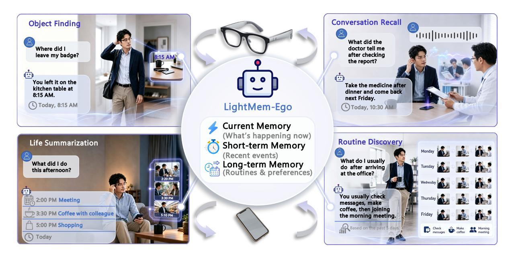
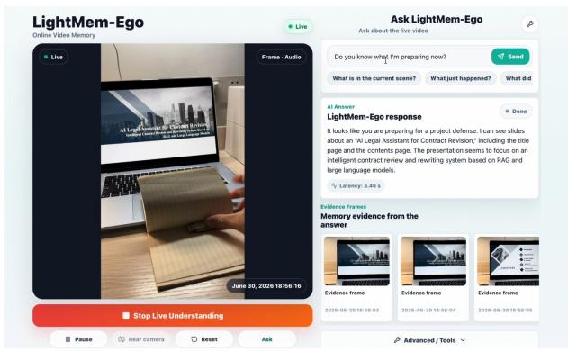
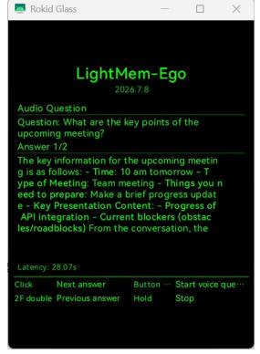
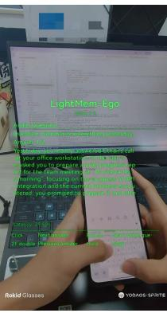
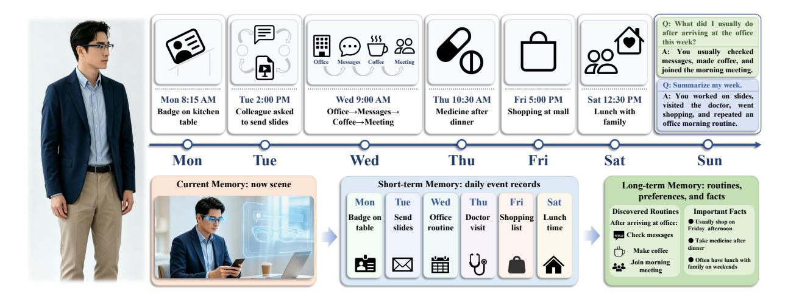

# LightMem-Ego: Your AI Memory for Everyday Life

Yijun Chen1\*, Boyi Xiao2\*, Yixian Zhao1\*, Haoting Xia3\*, Buqiang Xu1 , Jizhan Fang1 , Yanya Li1 , Yaqi Zheng1 , Xuehai Wang1 , Zirui Xue1 , Liuxin Zhang4 , Hui Li4 , Ningyu Zhang1†

1Zhejiang University 2South China University of Technology 3Central China Normal University 4Lenovo Group Limited ie\_yijunchen@outlook.com, zhangningyu@zju.edu.cn

## Abstract

Personal AI assistants on mobile and wearable devices continuously perceive users' daily lives through visual and audio streams. However, answering queries about past experiences requires lightweight multimodal memory that can continuously accumulate, organize, and retrieve long-term experiences, which remains challenging. To address this challenge, we present LightMem-Ego, a lightweight streaming multimodal memory system for everyday-life assistance. The system continuously captures egocentric visual and audio streams, aligns them on a shared timeline, and organizes them into a hierarchical memory consisting of current, short-term, and long-term memory. Given a user query, LightMem-Ego dynamically routes retrieval to the appropriate memory level and generates answers grounded in multimodal evidence. The demonstration can be deployed on smartphones and AI glasses, supporting object finding, conversation recall, life summarization, routine discovery, and personalized assistance[1](#page-0-0) .

## 1 Introduction

Personal memory is a fundamental part of everyday intelligence. People constantly rely on memory to recall where they placed an object, what someone just said, what happened during a meeting, or how their routines change over time. As smartphones and AI glasses become natural interfaces for capturing egocentric visual and audio streams, they create a new opportunity for AI assistants: instead of only answering isolated questions, an assistant can become a memory companion for everyday life [\(Huang et al.,](#page-6-0) [2025b;](#page-6-0) [Yang et al.,](#page-7-0) [2025,](#page-7-0) [2026\)](#page-7-1). Such a system could help users find misplaced items, recall recent conversations, summarize daily activities, and reason over long-term habits and routines

[\(Yang et al.,](#page-7-0) [2025;](#page-7-0) [Tang et al.,](#page-7-2) [2026;](#page-7-2) [Gao et al.,](#page-6-1) [2026;](#page-6-1) [Deng et al.,](#page-6-2) [2026\)](#page-6-2).

Recent multimodal large language models have made human-computer interaction more natural by combining vision, speech, and language [\(Long](#page-7-3) [et al.,](#page-7-3) [2025;](#page-7-3) [Yeo et al.,](#page-8-0) [2025;](#page-8-0) [OpenAI,](#page-7-4) [2024;](#page-7-4) [Gem](#page-6-3)[ini Team,](#page-6-3) [2025\)](#page-6-3). Meanwhile, wearable devices and smartphones provide practical channels for continuous, hands-free perception in daily environments [\(Huang et al.,](#page-6-0) [2025b;](#page-6-0) [Yang et al.,](#page-7-0) [2025,](#page-7-0) [2026;](#page-7-1) [Jiang](#page-7-5) [et al.,](#page-7-5) [2026;](#page-7-5) [Deng et al.,](#page-6-2) [2026\)](#page-6-2). However, turning such interfaces into everyday memory assistants requires addressing three fundamental challenges: First, egocentric experience arrives as continuous visual-audio streams without explicit event boundaries, requiring assistants to transform raw observations into coherent event-level experiences. Second, continuously accumulated experiences must be incrementally organized into current, short-term, episodic, and semantic memory while remaining efficient for long-term deployment. Third, user queries naturally span multiple temporal horizons, requiring dynamic routing across different memory levels instead of relying on a single context window or flat retrieval store. Together, these challenges call for an experience-centric memory system that can continuously capture, organize, retrieve, and reason over everyday life [\(Tang et al.,](#page-7-2) [2026;](#page-7-2) [Xiao](#page-7-6) [et al.,](#page-7-6) [2026;](#page-7-6) [Wang et al.,](#page-7-7) [2026;](#page-7-7) [Alam et al.,](#page-6-4) [2026;](#page-6-4) [Gao et al.,](#page-6-1) [2026\)](#page-6-1).

To address these challenges, we present LightMem-Ego, a deployable streaming multimodal memory system for everyday-life assistance. LightMem-Ego connects lightweight smartphone or AI-glasses-style clients with a backend that ingests egocentric visual-audio streams, segments recent observations into events, and organizes them into a three-level memory hierarchy: current memory for ongoing context, short-term memory for recent micro-events, and long-term memory for consolidated episodes and semantic facts [\(Packer](#page-7-8)

\* Equal contribution.

† Corresponding author.

1 <https://github.com/zjunlp/LightMem-Ego>.

Figure 1: Overview of LightMem-Ego's motivating scenarios and memory hierarchy. The system supports everyday memory assistance across object finding, conversation recall, life summarization, and routine discovery by routing user queries to current, short-term, and long-term memory.

[et al.,](#page-7-8) [2023;](#page-7-8) [Chhikara et al.,](#page-6-5) [2025;](#page-6-5) [Fang et al.,](#page-6-6) [2025;](#page-6-6) [Xu et al.,](#page-7-9) [2026\)](#page-7-9). During question answering, a memory router selects evidence according to the temporal scope and intent of the query, enabling grounded responses about the present, the recent past, and long-term routines within a unified interface. The system supports continuous frame streams, audio chunks, synchronized timestamps, and modular ASR, vision-language, language model, retrieval, and storage components. We demonstrate LightMem-Ego on representative egocentric memory tasks, including object finding, conversation recall, life summarization, and routine discovery (Figure [1\)](#page-1-0), and report quantitative results on retrieval, question answering, and latency against application-oriented baselines without explicit multimodal long- and short-term memory.

# 2 Related Work

Conversational Memory. Conversational memory extends LLM-based assistants from stateless, single-session interaction to persistent agents that can retain, update, and retrieve user-specific information over time [\(Du,](#page-6-7) [2026;](#page-6-7) [Li et al.,](#page-7-10) [2025;](#page-7-10) [Fang](#page-6-6) [et al.,](#page-6-6) [2025;](#page-6-6) [Chhikara et al.,](#page-6-5) [2025\)](#page-6-5). Product systems such as ChatGPT Memory and research systems such as MemGPT and Mem0 demonstrate complementary designs: the former emphasizes personalized continuity, while the latter study explicit memory management through hierarchical context, external storage, consolidation, and retrieval [\(Ope-](#page-7-4) [nAI,](#page-7-4) [2024,](#page-7-4) [2026;](#page-7-11) [Chhikara et al.,](#page-6-5) [2025;](#page-6-5) [Packer](#page-7-8) [et al.,](#page-7-8) [2023\)](#page-7-8). These systems motivate LightMem-Ego's use of persistent, queryable memory, but they mainly focus on language-centric interaction rather than streaming egocentric multimodal experience.

Wearable and Mobile AI Assistants. Wearable and mobile AI assistants place multimodal interaction in the user's physical environment. Wearable systems and smart-glasses agents use egocentric perception for real-time situated assistance [\(Huang](#page-6-0) [et al.,](#page-6-0) [2025b,](#page-6-0)[a;](#page-6-8) [Yang et al.,](#page-7-0) [2025,](#page-7-0) [2026;](#page-7-1) [Zhou et al.,](#page-8-1) [2026\)](#page-8-1). Related benchmarks and prototypes further evaluate glasses-style agents and connect visual understanding with physical-world actions [\(Jiang](#page-7-5) [et al.,](#page-7-5) [2026;](#page-7-5) [Tu et al.,](#page-7-12) [2026;](#page-7-12) [Liu et al.,](#page-7-13) [2026;](#page-7-13) [Pu](#page-7-14) [et al.,](#page-7-14) [2025;](#page-7-14) [Yang et al.,](#page-7-0) [2025\)](#page-7-0). On smartphones, multimodal assistants increasingly combine language, vision, voice, and on-screen understanding [\(OpenAI,](#page-7-4) [2024;](#page-7-4) [Gemini Team,](#page-6-3) [2025\)](#page-6-3). However, most systems still focus on current-context perception and response, rather than explicit long-horizon memory of everyday experience.

Multimodal Personal Memory. Multimodal personal memory studies how daily experience can be captured, organized, and queried over time. Memory-augmented video agents build intermediate representations for temporally grounded reasoning over long videos [\(Fan et al.,](#page-6-9) [2024;](#page-6-9) [Long et al.,](#page-7-3) [2025;](#page-7-3) [Yeo et al.,](#page-8-0) [2025;](#page-8-0) [Tian et al.,](#page-7-15) [2025\)](#page-7-15). Personalized egocentric retrieval and VQA recover user-

(a) Web client. (b) Glasses app UI. (c) First-person overlay.

Figure 2: Interfaces of LightMem-Ego across web and wearable deployments. The web client visualizes live multimodal capture and retrieved evidence; the glasses client app provides a lightweight interaction surface; and the first-person overlay illustrates how memory-grounded responses are presented in the user's egocentric view.

specific events from long-context recordings [\(Tang](#page-7-2) [et al.,](#page-7-2) [2026;](#page-7-2) [Xiao et al.,](#page-7-6) [2026;](#page-7-6) [Wang et al.,](#page-7-7) [2026;](#page-7-7) [Alam et al.,](#page-6-4) [2026\)](#page-6-4). Lifelogging and egocentric-life systems organize daily archives for retrieval and assistance [\(Tran et al.,](#page-7-16) [2025;](#page-7-16) [Yang et al.,](#page-7-0) [2025\)](#page-7-0), while life-journaling systems move toward semantic activity summarization from mobile sensing and language models [\(Xu et al.,](#page-7-17) [2025\)](#page-7-17). These works motivate LightMem-Ego's streaming hierarchical memory design.

# 3 LightMem-Ego

LightMem-Ego is a streaming multimodal memory system for everyday-life assistance. It connects smartphones or wearable devices with a backend that captures multimodal life streams, organizes them into hierarchical memory, and answers user questions through explicit memory retrieval. The system combines online updates for current and short-term memory with asynchronous consolidation into long-term episodic and semantic stores, allowing it to support both immediate scene understanding and retrospective reasoning over past experience. Figure [2](#page-2-0) shows the deployed interfaces of LightMem-Ego across web, glasses-client, and first-person wearable views.

#### 3.1 Multimodal Life Capture

We represent everyday experience as a temporally ordered multimodal stream:

$$\mathcal{X} = \{x_t\}_{t=1}^T, \qquad x_t = (v_t, a_t, m_t), \quad (1)$$

where vt , at , and mt denote visual observations, audio observations, and auxiliary metadata, respectively. The capture layer is lightweight: it collects, normalizes, and timestamps raw inputs from smartphones or wearable devices, and forwards them

to the backend without heavy client-side reasoning. In online deployment, the primary interface is a unified frame–audio stream, in which image frames and short audio chunks are uploaded to the same session. All modalities are aligned on a shared session timeline using the relative timestamp τ = t−t0, which is preserved for downstream event building, transcript backfilling, and retrieval. Beyond video and audio, the same interface can incorporate side-channel context such as coarse location, screen activity, or lightweight sensor cues.

#### 3.2 Event Segmentation

Given the captured stream X , LightMem-Ego incrementally partitions it into short event segments E = {ei} N i=1, where each segment corresponds to a contiguous interval on the shared timeline. Segmentation is driven by temporal continuity and crossframe change signals, enabling lightweight microevent construction under streaming conditions without semantic parsing of every frame. Each segment stores its temporal span, representative frames, provisional visual description, and aligned or pending audio context. As more evidence arrives, transcripts and refined descriptions are asynchronously attached to existing segments. These segments form the basic units for downstream memory construction and can represent everyday experiences such as meetings, walking episodes, shopping moments, or conversations.

#### 3.3 Hierarchical Memory

LightMem-Ego organizes captured experience into a hierarchical memory system:

$$\mathcal{M} = \{ \mathcal{M}_{cur}, \mathcal{M}_{st}, \mathcal{M}_{lt} \}, \tag{2}$$

where Mcur, Mst, and Mlt denote current, shortterm, and long-term memory, respectively. Mcur acts as a lightweight working memory over the most recent multimodal observations and active event state, enabling immediate responses about the ongoing scene. Mst stores recent event segments together with representative visual evidence, provisional or refined descriptions, and transcript context when available. Stable short-term events are then consolidated into long-term memory Mlt, which contains episodic memory Mepi for eventcentered past experiences and semantic memory Msem for higher-level regularities such as routines, preferences, and relationships. This hierarchy separates fast online interaction from slower memory consolidation while preserving both event-specific and abstract personal knowledge.

## 3.4 Edge-Oriented Efficiency

LightMem-Ego targets mobile and AI-glasses deployment by keeping edge processing lightweight and shifting memory construction to the backend. The client samples, compresses, timestamps, and uploads low-rate frames and short audio chunks, avoiding heavy VLM or LLM inference on resource-constrained devices. The online backend path updates Mcur as a rolling buffer and builds Mst from temporal continuity and crossframe changes, while costly operations such as ASR backfilling, event refinement, indexing, and semantic extraction run asynchronously.

Query-time cost is also reduced. Stable events are consolidated into a event-centric long-term memory, where multimodal evidence is pre-aligned under event anchors. User-facing inference therefore retrieves compact event records rather than raw streams or fragmented modality-specific evidence. A query router selects the cheapest sufficient source: Mcur for current-scene queries, Mst for recent recall, and Mlt for retrospective or routine-level questions. This keeps wearable interaction responsive while slower memory updates run in the background.

#### 3.5 Experience Retrieval and QA

Given a user query q, LightMem-Ego first routes the query to appropriate memory sources and then generates an answer from retrieved evidence. Formally, retrieval produces a query-specific evidence set R(q) ⊆ Mcur ∪ Mst ∪ Mlt. The routing process is guided by the temporal scope and semantic intent of the query, naturally supporting timeaware, person-aware, place-aware, and event-aware retrieval. Retrieved evidence may include recent observations, short-term event records, episodic entries, semantic summaries, timestamps, representative frames, and transcript snippets. These heterogeneous signals are fused into a compact evidence view Eq, and the final answer is generated as yˆ = f(q, Eq). By making retrieval explicit and memory-grounded, LightMem-Ego supports both immediate questions about the present scene and retrospective questions about who, where, when, and what happened in the user's past experience.

# 4 Demonstration

Figure [3](#page-4-0) summarizes the main demonstration scenarios of LightMem-Ego. We organize the demo around everyday memory needs that span immediate scene understanding, recent event recall, and long-term routine reasoning.

Immediate Assistance. LightMem-Ego supports immediate assistance and short-horizon recall in mobile and AI-glasses settings. For example, users may ask *Where did I leave my badge?*, *When did I last hold my keys?*, or *What am I looking at now?* In these cases, the system retrieves relevant recent observations and event segments, and returns answers grounded in temporally localized memory evidence. This case demonstrates how online perception and short-term memory can work together in everyday environments.

Conversation Recall. LightMem-Ego also supports recall of recent spoken interactions. After a meeting or conversation, users can ask questions such as *What did the doctor tell me after checking the report?* or *What did my colleague ask me to do?* The system combines short-term event memory with aligned transcript context to recover the relevant conversational episode. This shows the value of multimodal memory for recovering spoken information beyond one-shot speech transcription.

Life Summarization and Routine Discovery. Beyond recovering isolated facts, LightMem-Ego can summarize recent experiences and reason over repeated patterns. A user may ask *What did I do this afternoon?*, *Summarize what happened during lunch*, or *What do I usually do after arriving at the office?* The system aggregates event-centered evidence across multiple segments and, when appropriate, draws on long-term semantic memory to identify recurring activities, preferences, and

Figure 3: Representative demonstration scenarios of **LightMem-Ego**. The system supports immediate assistance, conversation recall, life summarization, and routine discovery by retrieving evidence from hierarchical memory.

routines. This scenario illustrates the ability of LightMem-Ego to move from event recall to higher-level summarization and habit-level reasoning.

#### 5 Quantitative Evaluation

#### 5.1 Evaluation Setup

We evaluate LightMem-Ego on three daily memory scenarios: object finding, conversation recall, and life summarization. For each scenario, we construct queries with manually annotated gold evidence. We report retrieval performance with Recall@1/3/5 and MRR, QA performance with LLM-and human-judged accuracy, and interactive latency with P50 / P90 retrieval, generation, and end-to-end QA time on phone and glasses-style clients.

| Scenario            | R@1  | R@3   | R@5   | MRR   |
|---------------------|------|-------|-------|-------|
| Object Finding      | 22.2 | 66.7  | 77.8  | 0.454 |
| Conversation Recall | 44.4 | 55.6  | 55.6  | 0.481 |
| Life Summarization  | 88.9 | 100.0 | 100.0 | 0.944 |
| Overall             | 51.9 | 74.1  | 77.8  | 0.627 |

Table 1: Memory retrieval accuracy across everyday-life scenarios. R@k denotes Recall@k, and MRR measures the reciprocal rank of the first relevant memory entry.

#### **5.2** Memory Retrieval Accuracy

Table 1 summarizes retrieval accuracy in the three demonstration scenarios. LightMem-Ego retrieves relevant memory evidence within the top-3 results for most queries, achieving 74.1 overall R@3 and 0.627 MRR. The results suggest that the hierarchical memory store provides sufficiently accurate evidence selection for downstream experience QA in everyday object finding, conversation recall, and life summarization settings.

| Scenario            | LLM-Judge | Human Acc. |  |
|---------------------|-----------|------------|--|
| Object Finding      | 44.4      | 55.6       |  |
| Conversation Recall | 33.3      | 33.3       |  |
| Life Summarization  | 77.8      | 77.8       |  |
| Overall             | 51.9      | 55.6       |  |

Table 2: Experience QA accuracy on daily scenarios.

#### 5.3 Experience Question Answering Accuracy

Table 2 reports QA accuracy against annotated experience evidence. LightMem-Ego obtains 51.9 LLM-judged accuracy and 55.6 human-judged accuracy overall, with the best performance on life summarization. These results indicate that, when relevant evidence is retrieved, the system can produce usable memory-grounded answers for the demonstrated everyday QA scenarios, while fine-grained object finding and conversation recall remain more challenging in the current prototype.

| Stage           | Ph      | Phone   |         | Glasses-style |  |
|-----------------|---------|---------|---------|---------------|--|
| Suige           | P50     | P90     | P50     | P90           |  |
| Short-term memo | ory QA  |         |         |               |  |
| Retrieval       | 13 ms   | 15 ms   | 14 ms   | 29 ms         |  |
| Answer gen.     | 5.77 s  | 10.38 s | 6.10 s  | 9.79 s        |  |
| End-to-end QA   | 5.86 s  | 10.95 s | 7.01 s  | 9.96 s        |  |
| Long-term memo  | ry QA   |         |         |               |  |
| Retrieval       | 4.09 s  | 15.39 s | 10.39 s | 28.93 s       |  |
| Answer gen.     | 9.00 s  | 22.40 s | 9.25 s  | 22.62 s       |  |
| End-to-end QA   | 14.87 s | 35.15 s | 19.96 s | 42.70 s       |  |

Table 3: Latency breakdown by memory scope and client. P50 / P90 are 50th / 90th percentile latencies.

#### 5.4 Latency on Mobile and Wearable Clients

Table 3 reports the runtime of LightMem-Ego on phone and glasses-style clients. For short-term

| System                  | Platform and Input                           | Real-time Visual-Audio Stream | Current / Short-term MM Memory | Long-term MM Episodic Memory | Long-term Semantic Memory | Timestamped Evidence Retrieval |
|-------------------------|----------------------------------------------|-------------------------------------|--------------------------------------|------------------------------------|---------------------------------|--------------------------------------|
| ChatGPT Memory          | Text chat                                    | —                                   | —                                    | —                                  | Partial                         | —                                    |
| Mem0-style memory       | Text and agent memory                        | —                                   | Partial                              | —                                  | ✓                               | Partial                              |
| Memories.ai             | Video archives and visual memory platform | Partial                             | Partial                              | ✓                                  | Partial                         | Partial                              |
| Gemini Live             | Phone                                        | ✓                                   | Partial                              | —                                  | —                               | —                                    |
| Ray-Ban Meta AI Glasses | Glasses                                      | Partial                             | Partial                              | —                                  | —                               | —                                    |
| Vinci                   | Phone or wearable camera                     | ✓                                   | ✓                                    | Partial                            | Partial                         | Partial                              |
| VisualClaw              | Streaming video with agent workspace      | Partial                             | Partial                              | —                                  | Partial                         | Partial                              |
| VisionClaw              | Smart glasses                                | ✓                                   | Partial                              | —                                  | —                               | Partial                              |
| Egocentric Co-Pilot     | Smart glasses with web agents                | ✓                                   | ✓                                    | Partial                            | Partial                         | Partial                              |
| EgoButler               | AI-glasses egocentric video and audio     | Partial                             | Partial                              | Partial                            | Partial                         | ✓                                    |
| LightMem-Ego            | Phone and glasses-style client               | ✓                                   | ✓                                    | ✓                                  | ✓                               | ✓                                    |

Table 4: Capability comparison with representative commercial assistants, text-based memory systems, and egocentric multimodal assistants. The table compares publicly described system capabilities rather than experimentally measured performance. We mark a capability as supported only when it is implemented as an explicit first-class component. *Partial* indicates limited, implicit, offline, session-level, or modality-restricted support; — indicates that the capability is not explicitly supported or not publicly described.

memory QA, the system achieves interactive response times, with P50 end-to-end latency of 5.86s on phone and 7.01s on the glasses-style client. Long-term memory QA requires additional retrieval and evidence aggregation, leading to higher P50 latency of 14.87s and 19.96s, respectively. This latency profile is consistent with the intended usage of the demo: recent-memory queries support near-interactive assistance, while long-term queries remain practical for retrospective recall and life-summary interactions.

# 5.5 Capability Comparison with Existing Assistants and Memory Systems

We further compare LightMem-Ego with representative commercial assistants, text-based memory systems, and recent egocentric multimodal assistants in terms of publicly described capabilities. As shown in Table [4,](#page-5-0) existing systems cover different parts of the design space: ChatGPT Memory and Mem0-style systems mainly focus on conversational or text-based agent memory, while Memories.ai explores long-term visual memory for searchable video archives [\(OpenAI,](#page-7-4) [2024,](#page-7-4) [2026;](#page-7-11) [Chhikara et al.,](#page-6-5) [2025;](#page-6-5) [Memories.ai,](#page-7-18) [2026\)](#page-7-18). Gemini Live and Ray-Ban Meta AI Glasses support real-time multimodal interaction, while recent egocentric assistants such as Vinci, VisualClaw, VisionClaw, Egocentric Co-Pilot, and EgoButler explore real-time perception, wearable assistance, tool use, or long-context egocentric QA [\(Huang](#page-6-0) [et al.,](#page-6-0) [2025b;](#page-6-0) [Tu et al.,](#page-7-12) [2026;](#page-7-12) [Liu et al.,](#page-7-13) [2026;](#page-7-13) [Yang et al.,](#page-7-1) [2026,](#page-7-1) [2025\)](#page-7-0). However, these systems generally do not expose an explicit hierarchy that jointly supports current multimodal memory,

short-term event memory, long-term multimodal episodic memory, semantic routine memory, and timestamped evidence retrieval.

In contrast, LightMem-Ego is designed specifically for everyday-life memory assistance over streaming visual-audio experience. Rather than emphasizing only in-the-moment perception, textbased personalization, or agentic task execution, it organizes user experience into current, short-term, and long-term memory stores, enabling both immediate assistance and retrospective experience QA such as object finding, conversation recall, life summarization, and routine discovery.

## 6 Conclusion

We introduced LightMem-Ego, a streaming multimodal memory system for everyday-life assistance. The system connects mobile and wearable multimodal capture with hierarchical memory construction and memory-grounded question answering, enabling support for object finding, conversation recall, life summarization, and routine understanding within a single backend. Our demonstration and evaluation suggest that explicit long-horizon multimodal memory is a promising systems direction for personal AI assistants.

Ultimately, building real-world personal AI assistants requires moving beyond language understanding alone toward the ability to capture, organize, and recall human experience over time. LightMem-Ego takes a step in this direction by showing how multimodal memory can support AI systems that not only understand utterances, but also understand lived experience.

# Limitations

LightMem-Ego remains constrained by several system-level factors. Its current implementation relies on upstream API calls for speech recognition, visual understanding, language generation, and retrieval-based question answering, making both accuracy and latency sensitive to external model reliability, runtime variation, and rate limits. Errors in transcripts, visual descriptions, or timestamp alignment may further propagate into memory construction and affect answer faithfulness. In addition, maintaining multimodal memory over continuous egocentric streams still incurs nontrivial overhead, as the system repeatedly performs segmentation, summarization, embedding, indexing, and storage. The memory update mechanism is also preliminary: it lacks a principled policy for revising, merging, forgetting, or promoting memories. Future work will improve efficiency, robustness, and adaptive memory lifecycle management for longer and more diverse deployments.

# Ethical and Privacy Considerations

LightMem-Ego relies on egocentric visual and audio streams, which may contain sensitive information about users and nearby bystanders, including private conversations, faces, documents, locations, screens, and daily routines. Because the system converts these streams into persistent and queryable memory, privacy risks can arise from both raw data and derived representations such as transcripts, event summaries, embeddings, and long-term semantic memories.

The current prototype is intended as a research demonstration and has not yet implemented a complete privacy-preserving pipeline. It does not automatically redact sensitive content, manage bystander consent, enforce fine-grained access control, or provide mature retention and deletion policies. Future work will integrate privacy protection into the memory lifecycle, including on-device preprocessing, selective capture, sensitive-content filtering, encrypted storage, user-controlled memory editing and deletion, and privacy-aware consolidation that avoids promoting incidental sensitive information into long-term memory.

## References

Samiul Alam, Shakhrul Iman Siam, Michael J Proulx, James Fort, Richard Newcombe, Hyo Jin Kim, and

Mi Zhang. 2026. [Supermemory-vqa: An egocen](https://arxiv.org/abs/2606.00825)[tric visual question-answering benchmark for long](https://arxiv.org/abs/2606.00825)[horizon memory.](https://arxiv.org/abs/2606.00825) *arXiv preprint arXiv:2606.00825*.

Prateek Chhikara, Dev Khant, Saket Aryan, Taranjeet Singh, and Deshraj Yadav. 2025. [Mem0: Building](https://doi.org/10.3233/FAIA251160) [production-ready AI agents with scalable long-term](https://doi.org/10.3233/FAIA251160) [memory.](https://doi.org/10.3233/FAIA251160) In *ECAI 2025 - 28th European Conference on Artificial Intelligence, 25-30 October 2025, Bologna, Italy - Including 14th Conference on Prestigious Applications of Intelligent Systems (PAIS 2025)*, volume 413 of *Frontiers in Artificial Intelligence and Applications*, pages 2993–3000. IOS Press.

Xinle Deng, Yida Xue, Yijun Chen, Mingjun Mao, Ruobin Zhong, Buqiang Xu, Jizhan Fang, Haoming Xu, Tingwei Wu, Yajing Xu, et al. 2026. [Mobilemem:](https://iclr.cc/virtual/2026/10012468) [Evaluating long-horizon memory for language agents](https://iclr.cc/virtual/2026/10012468) [in real-world mobile environments.](https://iclr.cc/virtual/2026/10012468) In *ICLR 2026 Workshop on Lifelong Agents: Learning, Aligning, Evolving*.

Pengfei Du. 2026. [Memory for autonomous LLM](https://doi.org/10.48550/ARXIV.2603.07670) [agents:mechanisms, evaluation, and emerging fron](https://doi.org/10.48550/ARXIV.2603.07670)[tiers.](https://doi.org/10.48550/ARXIV.2603.07670) *CoRR*, abs/2603.07670.

Yue Fan, Xiaojian Ma, Rujie Wu, Yuntao Du, Jiaqi Li, Zhi Gao, and Qing Li. 2024. [Videoagent: A](https://doi.org/10.1007/978-3-031-72670-5_5) [memory-augmented multimodal agent for video un](https://doi.org/10.1007/978-3-031-72670-5_5)[derstanding.](https://doi.org/10.1007/978-3-031-72670-5_5) In *Computer Vision - ECCV 2024 - 18th European Conference, Milan, Italy, September 29- October 4, 2024, Proceedings, Part XXII*, Lecture Notes in Computer Science, pages 75–92. Springer.

Jizhan Fang, Xinle Deng, Haoming Xu, Ziyan Jiang, Yuqi Tang, Ziwen Xu, Shumin Deng, Yunzhi Yao, Mengru Wang, Shuofei Qiao, Huajun Chen, and Ningyu Zhang. 2025. [Lightmem: Lightweight and](https://doi.org/10.48550/ARXIV.2510.18866) [efficient memory-augmented generation.](https://doi.org/10.48550/ARXIV.2510.18866) *CoRR*, abs/2510.18866.

Hengjian Gao, Kaiwei Zhang, Shibo Wang, Mingjie Chen, Qihang Cao, Xianfeng Wang, Yucheng Zhu, Xiongkuo Min, Wei Sun, Dandan Zhu, and Guangtao Zhai. 2026. [Lifeeval: A multimodal benchmark for](https://doi.org/10.48550/ARXIV.2603.00490) [assistive AI in egocentric daily life tasks.](https://doi.org/10.48550/ARXIV.2603.00490) *CoRR*, abs/2603.00490.

Gemini Team. 2025. [Gemini 2.5: Pushing the frontier](https://doi.org/10.48550/ARXIV.2507.06261) [with advanced reasoning, multimodality, long con](https://doi.org/10.48550/ARXIV.2507.06261)[text, and next generation agentic capabilities.](https://doi.org/10.48550/ARXIV.2507.06261) *CoRR*, abs/2507.06261.

Yifei Huang, Jilan Xu, Baoqi Pei, Yuping He, Guo Chen, Mingfang Zhang, Lijin Yang, Zheng Nie, Jinyao Liu, Guoshun Fan, Dechen Lin, Fang Fang, Kunpeng Li, Chang Yuan, Xinyuan Chen, Yaohui Wang, Yali Wang, Yu Qiao, and Limin Wang. 2025a. [An egocen](https://doi.org/10.48550/ARXIV.2503.04250)[tric vision-language model based portable real-time](https://doi.org/10.48550/ARXIV.2503.04250) [smart assistant.](https://doi.org/10.48550/ARXIV.2503.04250) *CoRR*, abs/2503.04250.

Yifei Huang, Jilan Xu, Baoqi Pei, Lijin Yang, Mingfang Zhang, Yuping He, Guo Chen, Xinyuan Chen, Yaohui Wang, Zheng Nie, Jinyao Liu, Dechen Lin, Fang Fang, Kunpeng Li, Chang Yuan, Yu Qiao, Yali Wang, and Limin Wang. 2025b. [Vinci: A real-time](https://doi.org/10.1145/3749513)

- [smart assistant based on egocentric vision-language](https://doi.org/10.1145/3749513) [model for portable devices.](https://doi.org/10.1145/3749513) *Proc. ACM Interact. Mob. Wearable Ubiquitous Technol.*, 9(3):88:1–88:33.
- Zhuohang Jiang, Xu Yuan, Haohao Qu, Shanru Lin, Kanglong Liu, Wenqi Fan, and Qing Li. 2026. [SU-](https://doi.org/10.48550/ARXIV.2602.22683)[PERGLASSES: benchmarking vision language mod](https://doi.org/10.48550/ARXIV.2602.22683)[els as intelligent agents for AI smart glasses.](https://doi.org/10.48550/ARXIV.2602.22683) *CoRR*, abs/2602.22683.
- Zhiyu Li, Shichao Song, Chenyang Xi, Hanyu Wang, Chen Tang, Simin Niu, Ding Chen, Jiawei Yang, Chunyu Li, Qingchen Yu, Jihao Zhao, Yezhaohui Wang, Peng Liu, Zehao Lin, Pengyuan Wang, Jiahao Huo, Tianyi Chen, Kai Chen, Kehang Li, Zhen Tao, Junpeng Ren, Huayi Lai, Hao Wu, Bo Tang, Zhenren Wang, Zhaoxin Fan, Ningyu Zhang, Linfeng Zhang, Junchi Yan, Mingchuan Yang, Tong Xu, Wei Xu, Huajun Chen, Haofeng Wang, Hongkang Yang, Wentao Zhang, Zhi-Qin John Xu, Siheng Chen, and Feiyu Xiong. 2025. [Memos: A memory OS for AI system.](https://doi.org/10.48550/ARXIV.2507.03724) *CoRR*, abs/2507.03724.
- Xiaoan Liu, Daeho Lee, Eric J. Gonzalez, Mar González-Franco, and Ryo Suzuki. 2026. [Vision](https://doi.org/10.48550/ARXIV.2604.03486)[claw: Always-on AI agents through smart glasses.](https://doi.org/10.48550/ARXIV.2604.03486) *CoRR*, abs/2604.03486.
- Lin Long, Yichen He, Wentao Ye, Yiyuan Pan, Yuan Lin, Hang Li, Junbo Zhao, and Wei Li. 2025. [See](https://doi.org/10.48550/ARXIV.2508.09736)[ing, listening, remembering, and reasoning: A mul](https://doi.org/10.48550/ARXIV.2508.09736)[timodal agent with long-term memory.](https://doi.org/10.48550/ARXIV.2508.09736) *CoRR*, abs/2508.09736.
- Memories.ai. 2026. [Memories.ai: Ai video analysis and](https://memories.ai/) [visual memory platform.](https://memories.ai/) Accessed: 2026-07-11.
- OpenAI. 2024. [Gpt-4o system card.](https://doi.org/10.48550/ARXIV.2410.21276) *CoRR*, abs/2410.21276.
- OpenAI. 2026. [Openai GPT-5 system card.](https://doi.org/10.48550/ARXIV.2601.03267) *CoRR*, abs/2601.03267.
- Charles Packer, Vivian Fang, Shishir G. Patil, Kevin Lin, Sarah Wooders, and Joseph E. Gonzalez. 2023. [Memgpt: Towards llms as operating systems.](https://doi.org/10.48550/ARXIV.2310.08560) *CoRR*, abs/2310.08560.
- Kevin Pu, Ting Zhang, Naveen Sendhilnathan, Sebastian Freitag, Raj Sodhi, and Tanya R. Jonker. 2025. [Promemassist: Exploring timely proactive assistance](https://doi.org/10.1145/3746059.3747770) [through working memory modeling in multi-modal](https://doi.org/10.1145/3746059.3747770) [wearable devices.](https://doi.org/10.1145/3746059.3747770) In *Proceedings of the 38th Annual ACM Symposium on User Interface Software and Technology, UIST 2025, Busan, Korea, 28 September 2025 - 1 October 2025*, pages 56:1–56:19. ACM.
- Yuanmin Tang, Jue Zhang, Xiaoting Qin, Jing Yu, Meikang Qiu, Gaopeng Gou, Gang Xiong, Lin Qingwei, Saravan Rajmohan, Dongmei Zhang, and Qi Wu. 2026. [Egomemory: Memory-augmented personal](https://www.microsoft.com/en-us/research/publication/egomemory-memory-augmented-personalized-retrieval-for-long-context-egocentric-video/)[ized retrieval for long-context egocentric video.](https://www.microsoft.com/en-us/research/publication/egomemory-memory-augmented-personalized-retrieval-for-long-context-egocentric-video/) In *ACL Findings*.

- Shulin Tian, Ruiqi Wang, Hongming Guo, Penghao Wu, Yuhao Dong, Xiuying Wang, Jingkang Yang, Hao Zhang, Hongyuan Zhu, and Ziwei Liu. 2025. [Ego-r1:](https://doi.org/10.48550/ARXIV.2506.13654) [Chain-of-tool-thought for ultra-long egocentric video](https://doi.org/10.48550/ARXIV.2506.13654) [reasoning.](https://doi.org/10.48550/ARXIV.2506.13654) *CoRR*, abs/2506.13654.
- Allie Tran, Werner Bailer, Duc-Tien Dang-Nguyen, Graham Healy, Steve Hodges, Björn Þór Jónsson, Luca Rossetto, Klaus Schoeffmann, Minh-Triet Tran, Lucia Vadicamo, and Cathal Gurrin. 2025. [The state](https://doi.org/10.48550/ARXIV.2506.06743)[of-the-art in lifelog retrieval: A review of progress at](https://doi.org/10.48550/ARXIV.2506.06743) [the ACM lifelog search challenge workshop 2022-24.](https://doi.org/10.48550/ARXIV.2506.06743) *CoRR*, abs/2506.06743.
- Haoqin Tu, Jianwen Chen, Zijun Wang, Siwei Han, Juncheng Wu, Hardy Chen, Haonian Ji, Kaiwen Xiong, Jiaqi Liu, Peng Xia, et al. 2026. [Visual](https://arxiv.org/abs/2606.16295)[claw: A real-time, personalized agent for the physical](https://arxiv.org/abs/2606.16295) [world.](https://arxiv.org/abs/2606.16295) *arXiv preprint arXiv:2606.16295*.
- Ziyang Wang, Yue Zhang, Shoubin Yu, Ce Zhang, Zengqi Zhao, Jaehong Yoon, Hyunji Lee, Gedas Bertasius, and Mohit Bansal. 2026. [Egomemrea](https://doi.org/10.48550/ARXIV.2605.09874)[son: A memory-driven reasoning benchmark for](https://doi.org/10.48550/ARXIV.2605.09874) [long-horizon egocentric video understanding.](https://doi.org/10.48550/ARXIV.2605.09874) *CoRR*, abs/2605.09874.
- Junbin Xiao, Shenglang Zhang, Pengxiang Zhu, and Angela Yao. 2026. [Ego-grounding for personal](https://doi.org/10.48550/ARXIV.2604.01966)[ized question-answering in egocentric videos.](https://doi.org/10.48550/ARXIV.2604.01966) *CoRR*, abs/2604.01966.
- Buqiang Xu, Yijun Chen, Jizhan Fang, Ruobin Zhong, Yunzhi Yao, Yuqi Zhu, Lun Du, and Shumin Deng. 2026. [Structmem: Structured memory for long](https://doi.org/10.48550/ARXIV.2604.21748)[horizon behavior in llms.](https://doi.org/10.48550/ARXIV.2604.21748) *CoRR*, abs/2604.21748.
- Huatao Xu, Zilin Zeng, Panrong Tong, Mo Li, and Mani B. Srivastava. 2025. [Autolife: Automatic](https://doi.org/10.1145/3770683) [life journaling with smartphones and llms.](https://doi.org/10.1145/3770683) *Proc. ACM Interact. Mob. Wearable Ubiquitous Technol.*, 9(4):226:1–226:29.
- Jingkang Yang, Shuai Liu, Hongming Guo, Yuhao Dong, Xiamengwei Zhang, Sicheng Zhang, Pengyun Wang, Zitang Zhou, Binzhu Xie, Ziyue Wang, Bei Ouyang, Zhengyu Lin, Marco Cominelli, Zhongang Cai, Bo Li, Yuanhan Zhang, Peiyuan Zhang, Fangzhou Hong, Joerg Widmer, Francesco Gringoli, Lei Yang, and Ziwei Liu. 2025. [Egolife: Towards](https://doi.org/10.1109/CVPR52734.2025.02690) [egocentric life assistant.](https://doi.org/10.1109/CVPR52734.2025.02690) In *IEEE/CVF Conference on Computer Vision and Pattern Recognition, CVPR 2025, Nashville, TN, USA, June 11-15, 2025*, pages 28885–28900. Computer Vision Foundation / IEEE.
- Sicheng Yang, Yukai Huang, Weitong Cai, Shitong Sun, Fengyi Fang, You He, Yiqiao Xie, Jiankang Deng, Hang Zhang, Jifei Song, and Zhensong Zhang. 2026. [Egocentric co-pilot: Web-native smart-glasses agents](https://doi.org/10.1145/3774904.3792996) [for assistive egocentric AI.](https://doi.org/10.1145/3774904.3792996) In *Proceedings of the ACM Web Conference 2026, WWW 2026, Dubai, United Arab Emirates, originally scheduled for April 13-17, 2026, rescheduled for June 29 - July 3, 2026*, pages 8862–8873. ACM.

Woongyeong Yeo, Kangsan Kim, Jaehong Yoon, and Sung Ju Hwang. 2025. [Worldmm: Dynamic mul](https://doi.org/10.48550/ARXIV.2512.02425)[timodal memory agent for long video reasoning.](https://doi.org/10.48550/ARXIV.2512.02425) *CoRR*, abs/2512.02425.

Wei Zhou, Xuanhe Zhou, Shaokun Han, Hongming Xu, Guoliang Li, Zhiyu Li, Feiyu Xiong, and Fan Wu. 2026. [Are we ready for an agent-native memory](https://doi.org/10.48550/ARXIV.2606.24775) [system?](https://doi.org/10.48550/ARXIV.2606.24775) *CoRR*, abs/2606.24775.