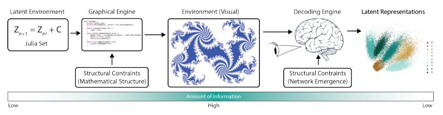

# A Theory of Natural Intelligence

Christoph von der Malsburg1,2,3\*, Thilo Stadelmann2,4† and Benjamin F. Grewe3†

1\*Frankfurt Institute for Advanced Studies, Frankfurt, Germany. 2Centre for Artificial Intelligence, Zurich University of Applied Sciences, Winterthur, Switzerland.

3 Institute of Neuroinformatics, University of Zurich and ETH Zurich, Zurich, Switzerland.

4European Centre for Living Technology, Venice, Italy.

\*Corresponding author(s). E-mail(s): malsburg@fias.uni-frankfurt.de; Contributing authors: stdm@zhaw.ch; bgrewe@ethz.ch; †These authors contributed equally to this work.

#### Abstract

Introduction: In contrast to current AI technology, natural intelligence – the kind of autonomous intelligence that is realized in the brains of animals and humans to attain in their natural environment goals defined by a repertoire of innate behavioral schemata – is far superior in terms of learning speed, generalization capabilities, autonomy and creativity. How are these strengths, by what means are ideas and imagination produced in natural neural networks? Methods: Reviewing the literature, we put forward the argument that both our natural environment and the brain are of low complexity, that is, require for their generation very little information and are consequently both highly structured. We further argue that the structures of brain and natural environment are closely related. Results: We propose that the structural regularity of the brain takes the form of net fragments (self-organized network patterns) and that these serve as the powerful inductive bias that enables the brain to learn quickly, generalize from few examples and bridge the gap between abstractly defined general goals and concrete situations. Conclusions: Our results have important bearings on open problems in artificial neural network research.

#### 2 Natural Intelligence

Keywords: Ontogenesis, emergence, structural regularity, net fragments, visual perception, scene representation, homeomorphic mapping, inductive bias, autonomous behavior

### 1 Introduction

There may be different kinds of intelligence. We here concentrate on the one that is epitomized in humans and animals. This kind of intelligence is often defined as the ability to successfully pursue general goals in varying contexts, goals such as feeding oneself, avoiding danger or creating offspring. The emphasis of our communication is on the neural mechanisms that generate this ability, our main point being that besides nature and nurture the process is dominated by a third generative factor, emergence. In this context, 'nature' refers to the influence of the genes and therewith to that of evolution, while 'nurture' to that of experience, instruction and education. We would like to maintain here that neither quantitatively nor qualitatively genes and experience alone can account for the structure of the nervous system nor the intelligence it supports, leaving a large gap to be closed by emergence.

On the quantitative side, as to 'nature', the human genome contains one gigabyte of information (3.3 billion nucleotides of DNA [\[1\]](#page-11-0)) while one petabyte is required to describe the connectivity of the human brain[1](#page-1-0) . In the case of humans, 'nurture' during the first years of life is provided for by an environment (the nursery, the family, toys, books etc.) that is deliberately kept simple and could be simulated in its visual aspects on the basis of a virtual reality program of a few gigabytes. Additionally, the rate at which humans absorb information into permanent memory is estimated [\[2\]](#page-11-1) at only 1−2 bits per second, signifying a couple of gigabits over a long lifetime. These amounts of information are to be compared to the petabyte needed to list all connections in the brain.

The qualitative side is the essence of the problem we want do address: how can intelligence, in terms of ideas, imaginations and insights surpass so much everything that has been 'programmed' into the genes, and how can it learn so fast and generalize so boldly beyond all the examples it has seen before?

To deal with the quantitative side of the problem one has to distinguish the raw amount of information needed to describe a structure from the minimal amount of information required to generate it. The latter, the bit length of the shortest algorithm that can generate the structure, is called Kolmogorov complexity [\[3\]](#page-11-2) and may be smaller by many orders of magnitude than the amount of information required to describe the structure. An extreme example of low Kolmogorov complexity is illustrated in Figure [1.](#page-2-0) Obviously, nature and nurture need only gigabytes to construct, respectively instruct, the brain. A logical consequence of this efficiency is that the brain is totally dominated by structural regularity, so that instead of from all randomly possible connectivity

1014 synapses, each taking 33 bits to address one of the 1010 neurons of the brain.

Fig. 1 Illustration of Kolmogorov complexity. Julia sets (middle panel) need, literally, infinite amounts of information to be described, but very little information suffices to generate them (left; recursive definition and mathematical grammar). Perception and efficient learning are possible by reducing the flood of sensory signals produced by the environment to an underlying low-complexity description (right).

patterns among its neurons nature and nurture only need to pick from a vastly smaller space of pre-structured patterns. A central thesis of our communication is that the structural regularity implied by this low Kolmogorov complexity acts as the domain-specific inductive bias that any system needs [\[4,](#page-12-0) [5\]](#page-12-1) or [\[6,](#page-12-2) ch. 2.7] to be able to learn efficiently.

The remainder of this paper is organized as follows: In Section [2](#page-2-1) we put forward the hypothesis that the Kolmogorov algorithm of the brain is network self-organization as studied extensively on the example of the ontogenetic development of retino-topic connections. In Section [3](#page-4-0) we discuss a small number of cognitive sample processes that are in need to be understood and implemented. In Section [4](#page-5-0) we try to make plausible how net fragments can serve as basis to solve these problems and in Section [5](#page-9-0) we discuss the relevance of the perspective we are creating to open problems within the current field of AI.

# 2 Network Self-Organization as Kolmogorov Algorithm of the Brain

What is the type of mechanism, the concise Kolmogorov algorithm, by which the connectivity of the brain and hence the structural regularity is generated under genetic guidance? We suggest to adopt as paradigm the experimentally and theoretically well-studied mechanism of the ontogenesis of retinotopic connections: The axons growing out from the retinae of vertebrates reach their target structures (e.g., the optic tectum) in more or less random order, but after a relatively brief period they order themselves so as to establish a smooth mapping conserving geometry [\[7\]](#page-12-3). Of all the mechanisms that have been proposed to explain the process only one survived comparison to experiment, network self-organization [\[8,](#page-12-4) [9\]](#page-12-5). Its general idea is quite simple. An initial connectivity supports spontaneous activity. This activity acts back by synaptic plasticity to alter the network, and this loop, from connectivity to activity and back to connectivity, continues until a stationary state, an attractor network, is reached.

#### 4 Natural Intelligence

Therefore we propose that network self-organization, as displayed in the retino-tectal system, is the Kolmogorov algorithm generating the wiring of the brain. Sensory signals, as soon as they become available, participate in the mechanism, co-determining the attractor networks that are allowed to form. Attractor networks can be characterized by optimizing two properties: sparsity and consistency. A network is sparse if it has a small number of connections converging on or diverging from any neuron and connectivity is consistent if it supports high-order temporal correlations between sets of signals arriving at any given neuron. This consistency means that a network is dominated by sets of alternative signal pathways (of approximately equal conduction delay) between many pairs of source and target neurons [\[10\]](#page-12-6).

As result of such network self-organization, the brain develops as an overlay of attractor networks ('net fragments') [\[11\]](#page-12-7). Each net fragment comprises a set of neurons and the connections among them. If a set of neurons is activated again and again for a sufficient total time its internal connectivity can converge towards an attractor state. There is positive feedback between the activity of the set and the structure of its connectivity. As large sets of neurons are very unlikely to occur more than once, only small sets will be given a chance to establish themselves as net fragments. Each neuron can be part of several net fragments.

Many systems of low Kolmogorov complexity and implied high regularity arise by emergence. Such systems are composed of building elements that interact by physical, chemical, mechanical etc. forces. Well-known examples are soap bubbles or crystals: Under appropriate conditions (e.g., low temperature in a liquid) large-scale ordered configurations arise in which the forces between the elements interlock such as to lend the configuration stability. In these, weak interactive forces between the building elements (e.g., molecules) can achieve large-scale stability only by interlocking in consistent configurations. In the brain, where quite a number of connections have to conspire (i.e., fire simultaneously) to activate a neuron, a vanishingly small subset of all possible connectivity patterns is singled out by their ability to dynamically self-stabilize as attractors of network self-organization.

After sufficient self-organization of the system larger sets of neurons can only be active as interlocking net fragments, each of which can only become active in the context of overlapping other fragments. This favors the activation of large coherent nets, that is, networks which, if given sufficient time, would be attractors under network self-organization. The term 'net' emphasizes composition of smaller fragments, although a net can itself be a fragment of larger nets.

In order not to be caught in local optima, network self-organization needs to start from an initial state that already establishes a coarse global structure from which it can proceed in a coarse-to-fine manner (for which a gradual tightening of inhibitory strength over the course of development [\[12,](#page-12-8) [13\]](#page-12-9) may be the basis). This initial connectivity structure, set up by earlier ontogenetic processes which rely on genetically controlled emergence [\[14\]](#page-12-10) establishes gross connectivity between sensor organs, effector organs and the behavioral control circuits enabling animals to already function at the time of birth.

In the next sections we will give a sample of typical cognitive processes that are to be implemented and understood (Section [3\)](#page-4-0), will explain how net fragments can serve to do so (Section [4\)](#page-5-0) and how this framework supports efficient learning, generalization and autonomy (Section [5\)](#page-9-0).

# 3 Cognitive Processes to be Implemented

What essential functions are at the basis of natural intelligence? A lioness stalking pray in the savanna has to integrate a complex array of factors into one coherent strategy in order to be successful. One little disturbing factor can throw off the whole situation. It may be that this complexity of natural situations, in distinction to the logical simplicity of classical AI accomplishments, is responsible for Moravec's paradoxon ("it is comparatively easy to make computers exhibit adult level performance on intelligence tests or playing checkers, and difficult or impossible to give them the skills of a one-year-old when it comes to perception and mobility" [\[15,](#page-12-11) p. 15]).

The organization of behavior within a given scene is based on a representation of that scene in the brain. Scene representation, a contested concept [\[16,](#page-12-12) [17\]](#page-12-13), does not imply static and complete rendering of detail as in a photographic image but is rather to be seen as an organizational framework putting abstract interpretations of scene lay-out and scene elements in relation to each other and to potential actions and emotional responses. This framework supports quick flashes of attention which materialize detailed reconstructions of narrow sectors of the scene. Scene representations have to be built up by perception. Perception is difficult because sensory data are insufficient and ambiguous and contain in only entangled form the different factors (shape, color, material, motion etc.) that make up the scene. Perception is therefore to be seen as an active process that constructs a model of the scene that uniquely explains the sensory signals and their changes under motion.

According to ethologists, animal and human behavior is defined and controlled by a number of drives (such as to satiate hunger or avoid danger), each of which is laid down under genetic guidance in a schematic form [\[18,](#page-13-0) [19\]](#page-13-1). A behavioral schema can be activated by a sensory trigger feature, executes a behavioral response, evaluates the outcome and is modified by the experience. The basic behavioral machinery, which serves a function analogous to a computer user acting through the machine's operating system, is the fruit of evolutionary trial and error over many generations, and presumably is laid down in the style of business process models or Petri-nets in terms of relatively few appropriately connected neurons or neural pools. To integrate this basic machinery in a meaningful way into the flow of scene representations is, however, a very complex affair and is the basic goal of learning.

Even beyond the organization of behavior, there is a long tradition [\[20–](#page-13-2) [22\]](#page-13-3) or [\[23,](#page-13-4) pp. 147–172] of discussing schemata as basis for understanding phenomena and define meaning. It therefore seems important to have a clear view how concrete instances can be related to abstract schemata.

Learning takes place inside tasks that are governed by the behavioral drives. The currently active drive decides which elements of the scene are relevant, focuses attention accordingly and curtails the scene representation to its needs. The drive, as originally defined and further developed by experience, can be seen as an abstract scene description that can serve to shape and interpret actual scenes as schema instantiations. This setting, a behavioral schema-interpreted scene, serves to powerfully constrain the learning process.

How can these functions be understood and implemented on the basis of net fragments?

### 4 Net Fragments as Implementation Medium

As we have argued, both our natural environment and our brain have very low Kolmogorov complexity (cf. Figure [1\)](#page-2-0). We take computer graphics and virtual reality as models for the structure of our natural environment, and we take network self-organization, as studied on the example of the ontogenesis of retinotopy, as the mechanism by which the connectivity of the brain arises. We further note that for a system to efficiently learn it needs to have a strong bias towards its domain [\[4,](#page-12-0) [5\]](#page-12-1) or [\[6,](#page-12-2) ch. 2.7]. As the human brain indeed learns very efficiently we feel encouraged to propose the hypothesis that the connectivity structures that result from network self-organization, together with the neural dynamics that governs their activation in the establishment of scene representations (see below) are the inductive bias, the a priori structure (compare [\[20\]](#page-13-2)), that tunes the brain to the natural environment.

In the remainder of this section we will discuss how net fragments can serve to implement structures and processes, taking vision as sample modality.

#### 4.1 Data Structure of Primary Visual Cortex

Primary visual cortex is populated with a collection of feature detector neurons with an abundance of short-range lateral excitatory connections between them [\[24\]](#page-13-5). Sensory signals coming from a point within the retina in response to visual input activate a subset of the feature neurons whose receptive fields cover that point and its immediate environment. Different local textures activate different such sets. Within some months of early experience network self-organization will re-arrange the excitatory connections within each of these sets and with neurons in the neighborhood. There are 100 times more neurons in primary visual cortex compared to the number of axons coming out of the retina [\[25\]](#page-13-6), opening the way to sparse codes (as in [\[26\]](#page-13-7)). Visual input first briefly activates an exuberance of neurons, most of which will then be silenced (by, e.g., balanced inhibition [\[27\]](#page-13-8)) leaving only the small subset of those neurons active that can support each other by lateral connections inside net fragments (for a model of this process see [\[28\]](#page-13-9)). (Membership in activated fragments is perhaps indicated by bursting activity [\[29,](#page-13-10) [30\]](#page-13-11).) As result of early visual experience

texture patches (at the scale of the range of lateral connections) that dominate the statistics of the input will therefore become represented by net fragments.

This developing structure of the primary visual cortex resembles associative memory [\[31,](#page-14-0) [32\]](#page-14-1), except that due to the short range of lateral connections it has the two-dimensional topological structure of the visual field and that its stored local states are defined on a statistical basis. The local net fragments can be compared to the codebook vectors of some image compression algorithms [\[33\]](#page-14-2). They can be considered as filters that interpret the actual visual input in terms of patterns previously experienced with statistical significance. They suppress redundancy and regularize responses, as is important, for instance, to extract stereo depth [\[34\]](#page-14-3) or motion. The net fragments that respond to the surface of a coherent object overlap in terms of neurons and connections and thus form a coherent net, covering the object. Net fragments can thus be seen as implementation of the Gestalt laws [\[35\]](#page-14-4), and the coherent nets they form as realization of the 'force fields' that that movement is speaking of. The coherence of a net covering the cortical region occupied by an object can serve as basis for figure-ground discrimination [\[36\]](#page-14-5).

The example illustrates the power of net fragments as inductive bias. Local texture-representing net fragments as such could be replaced by the higherlevel feature neurons of deep learning systems. However, due to neuron-wise overlap net fragments in distinction to those are exclusively activated when merging into a coherent field, a Gestalt. Net fragments and their dynamics thus naturally render the topological structure of the continuous surfaces that dominate our environment and allows them to be handled as a whole, as seen in the next subsection.

#### 4.2 Invariant Object Representation

A concrete object can appear in the visual cortex in an infinitude of versions differing in position, size, orientation and other factors. In all these versions the object image gets represented, as just discussed, by coherent nets composed of local net fragments. To store and later recognize the object when it appears in the retina in transformed version it is necessary to lay down connections that permit to construct, in response to visual input, nets that represent views of the object independent of its position, orientation etc. In the human brain these invariant representations presumably are located in infero-temporal cortex [\[37\]](#page-14-6). There is psychophysical evidence [\[38\]](#page-14-7) that for a large class of structured object types the visual system is able to construct such invariant representations out of shape primitives that are common to such objects. We propose to see these shape primitives be represented as net fragments which have the flexibility to adapt to the shape of actual objects in spite of metric deformations, depth rotation and of course position within object-centered coordinates. The identity and relative position of these shapeprimitive-representing net fragments can then serve to identify the object type [\[38\]](#page-14-7) and serve as basis for manipulation.

To enable such invariant responses to the position- etc. variant representation of objects in the primary cortices the proposal has been made [\[39–](#page-14-8)[41\]](#page-14-9) that there are rapidly switchable connections ('shifter circuits') between the primary visual cortices and invariant representations in infero-temporal cortex that can connect nets in those two areas in a structure-preserving way. In both areas the object is represented by a two-dimensional field of neighborhoodconnected neurons. A mapping between them is called structure preserving ('homeomorphic') if it is smooth (connecting neighbors in one field to neighbors in the other) and connects only neurons of the same type.

Simple versions of invariant object recognition on the basis of shifter circuits have been demonstrated [\[41–](#page-14-9)[43\]](#page-14-10). Shifter circuits are composed of net fragments and can be formed by network self-organization [\[44\]](#page-15-0). Active maps that connect variant images with their invariant representation as well as the movements and deformations of those maps constitute valuable information (as argued in the introduction of [\[41\]](#page-14-9)), so that, for instance, the shape of an object rotating in front of the eyes can be deduced from the deformation of this map. The separation of visual object representation into external coordinates ('where') and internal structure ('what') is an important example of the disentanglement of sensory patterns into the factors they contain.

The example of invariant object representation again illustrates the power of self-organized net fragments as inductive bias. Different views onto the same object or surface are related by homeomorphy, and net fragments are a natural way to form homeomorphic mappings. Such mappings, seen as dynamic entities, can track and model the movements of objects and surfaces in the environment and their relations to the eye. They are an essential element needed to reconstruct and model in the brain the geometry, kinematics and dynamics of the natural environment.

It is tempting to see invariant visual object representation as a special case of the more general problem of representing the relationship between abstract schemata and instances they apply to. Assuming that this relationship has the character of a homeomorphic mapping (preserving types of entities and their relations) it is conceivable that the ensemble of schema, instance and mapping between them comes to be represented by a coherent net composed of previously established fragments, just as in the example of invariant object representation.

#### 4.3 Net Fragments as Data Structure of the Mind

There is a broad consensus of seeing neurons as atoms of meaning [\[45\]](#page-15-1). As such, individual neurons may refer to entities on any level of complexity, but in doing so they act merely as labels, while beyond a low level of complexity they cannot render unambiguously the specific structure of what they refer to. To do this requires a compositional data structure (as convincingly argued in [\[46\]](#page-15-2)). The lack of compositionality in artificial neural networks is referred to as the binding problem [\[40,](#page-14-11) [47\]](#page-15-3).

We here argue that net fragments are the brain's compositional data structure and its solution to the binding problem. It is illustrated by the visual representation of objects in both the variant and the invariant versions. Individual feature neurons can, in response to visual input, fire stably only in the context of a net fragment they are part of (see Subsection [4.1](#page-5-1) or [\[28\]](#page-13-9)), and this net fragment can do so only when overlapping with other net fragments (as neurons only fire as part of a net fragment they are part of), so that the response to the input actually is that of a net spanning the whole object as currently pictured. This net is a one-time structure rendering the never-repeating way the object appears at any moment. It responds holistically, as result of a collective effect [\[48\]](#page-15-4), just as the Gestalt psychologists [\[35\]](#page-14-4) would have it, and it still renders the Gestalt in minute detail. A hierarchy of features of various complexity levels is represented by nested net fragments of different size.

A good composite data structure has to be able to exert effect on the basis of its structure and be productive in the sense of giving rise to analogous structures [\[46\]](#page-15-2). Our example of invariant visual object recognition illustrates this condition. The actual recognition takes place by the activation of a net forming a homeomorphic point-to-point mapping between the invariant and the variant representation. This net gets created by the activation of net fragments each of which connects a small region in the plane with the variant representation (primary visual cortex) with a corresponding small region in the invariant representation (infero-temporal cortex). These 'maplets' are activated by homeomorphy between the small regions they connect and they overlap such as to form a coherent global map between variant and invariant representations of the object, as demonstrated in [\[39,](#page-14-8) [40\]](#page-14-11). Consequently it takes just one exposure to a new object type and formation and storage of a model thereof in the invariant domain to recognize that type of object independently of transformation state. This explains the brain's ability [\[49\]](#page-15-5) to recognize novel objects in altered position and pose after a single brief exposure. The representation of objects is compositional and productive, as requested by [\[46\]](#page-15-2), in that the composite mappings can serve any object and represent the position, size and orientation of the variant object image, the invariant representation of an object can render a large number of variant versions thereof, and the net fragments in the two domains can be re-used for an infinitude of different objects.

Compositionality applies also to representing cognitive structure in terms of submodalities (in vision, for instance, texture, color, motion, form, size, position etc.). Whereas sensory signals contain submodalities in implicit form, specific submodality patterns can be represented separately within their own specialized cortical regions. Submodalities are basically independent of each other – object form, for instance, abstracting from position, size, surface texture or coloring. Concrete mental objects can be constructed by linking them together with the help of maps of connections as described above, in a process analogous to the way computer graphics creates visual output by mapping different sub-modalities to each other and into the virtual camera.

Mental objects thus constructed are to be seen as larger net fragments composed as mergers of pre-existing net fragments. In a sufficiently pre-trained brain such nets, once selected by input, are stable constructs that are attractors both in terms of the fast dynamics of neural activation and inactivation and the slow dynamics of network self-organization. Like in associative memory [\[31\]](#page-14-0), active neurons are pushed by a number of simultaneously firing excitatory connections into a high-activity state, while silent neurons are reliably suppressed by converging inhibitory connections. Such network states can be characterized as of high consistency – consistency between different signals arriving on individual neurons and consistency between the set of currently active neurons and and their connectivity. Network self-organization works on a slower time-scale by performing something like a stochastic gradient descent of neural connections with a cost function, at each individual neuron, that favors binary dynamics with either a highly excited or deeply suppressed state.

#### 4.4 Neural Dynamics: How a Trained Brain Perceives

Perception is difficult due to the paucity and ambiguity of sensory signals and because scene representations have to be spontaneously constructed such as to uniquely explain the sensory input. Given the speed with which our brain routinely performs the task, this construction cannot be based on sequential memory search. To this speed we offer the following explanation. The sensory signals in their great ambiguity reach and alert all net fragments that are compatible with them. Among these, some overlap and dynamically support each other while others are mutually inhibitory. Buried in this dynamics is (given, of course, sufficient previous experience) the comprehensive net that represents the scene. Due to its pervasive consistency of all connections this net prevails in the dynamic process, establishes itself and inhibits all incompatible net fragments. The activation of this net is due to a collective process [\[48\]](#page-15-4) comparable to a phase transition [\[50\]](#page-15-6) (like magnetization) instead of to sequential search.

# 5 Relevance to Open Problems

Grave limitations [\[51](#page-15-7)[–54\]](#page-15-8) of contemporary AI [\[55\]](#page-15-9) have to do, first, with inability to generalize sufficiently beyond human-provided examples. We trace this inability to the lack, in current systems, of a sufficiently powerful inductive bias for learning. Inductive biases are specific to application domains [\[4–](#page-12-0)[6\]](#page-12-2). We accordingly focus on what we call natural intelligence which is tuned to solving general problems in our natural environment.

So far, we have argued that our natural environment has low Kolmogorov complexity, interpreting today's virtual reality systems (which have low complexity) as sufficiently convincing approximation to that environment. We have further noted that the brain also is of low Kolmogorov complexity and have subscribed to the view that its connectivity structure arises by emergence realized by network self-organization. We have taken the brain's tremendous power to learn and generalize from scant examples as indication that emerging connectivity structures (net fragments) are the data structure of the brain and constitute its inductive bias for learning.

As to learning, two stages have to be distinguished: First, a system has to develop the toolbox that is necessary to model the surrounding scene. Second, once it is in a position to model specific arrangements and processes it can learn to relate them in finer and finer detail to its set of behavioral schemata and the corresponding goals. For brains, the first stage is partly reached in pre-natal development under genetic guidance, partly by sensory-motor experimentation by the young individual. In the context of AI, this stage is modeled in the field of developmental robotics [\[56\]](#page-15-10).

For brains, learning in the second stage is, by comparison to current AI technology, powerfully alleviated by two factors. First, during scene construction in interaction with and under the influence of a currently ruling behavioral schema the schema-relevant scene elements are labeled as such by their mapping to and from the schema. This goes a long way towards credit assignment during the evaluation of the ongoing experience and suppresses irrelevant detail. Second, the essential structure to be picked up from the current situation (object, motion pattern, etc.) is already modeled as part of the scene representation, not only in concrete detail but also on more abstract levels. It is therefore possible to tie together all essential elements of the situation – the relevant scene elements, their relative arrangement, their roles as defined in the behavioral schema – by strengthening or creating a small number of connections to fixate the experience. This fixation has to happen at an appropriately abstract level (the ability to find this level being a subject for an appropriate kind of meta-learning), so that the particular experience generalizes to analogous situations.

For AI systems, however, this generalization ability is still to be realized. The presented methods could therefore, if properly implemented, mitigate the above-mentioned problems of sample efficiency (including slow learning) and generalization in a principled and unified way, with the effect of leading to results that can approach common sense (compare with compartmentalised approaches in [\[57–](#page-15-11)[59\]](#page-16-0)).

A second set of weaknesses of present AI technology revolves around low level of autonomy. In typical applications rather narrow goals are formulated by humans, application-specific data are collected and human-tuned architectures and hyper-parameter settings are empirically determined [\[60\]](#page-16-1). This limits systems to specific applications and causes great expense, which is well illustrated by the enormous time and investment in terms of human effort necessary to develop autonomous vehicles. True autonomy requires a complete (in some sense) set of abstract goals and behavioral schemata together with the ability to (learn to) relate these schemata to concrete situations. The difficulty of this is due to the enormous distance in terms of abstraction between concrete scene elements and the representations of general goals. We suggest that this distance is bridged by homeomorphic relationships, and that these homeomorphic relationships can be found with the help of composition of net fragments.

The superiority of human intelligence over that of animals is due to a very rich complement of culturally acquired schemata many of which are absorbed in verbal or symbolic form. We are born with a behavioral repertoire that is very similar in principle to that of a range of animal species, but soon new goals are acquired, grafted upon a small set of innate behavior patterns (such as wanting to please or imitate social partners) acting as gateways. It has been argued that higher intellectual abilities grow in the individual as layers of generalization by analogy, starting with the sensory-motor coordination structure acquired early in life [\[56,](#page-15-10) [61\]](#page-16-2). So far it hasn't been possible to model and artificially replicate that process. We suggest that the missing element is a potently pre-conditioned data structure and that network self-organization is providing this pre-conditioning in our brain.

### 6 Conclusion

A deep riddle of our existence is the question how the ideas and imaginations in our mind arise. Super-natural influences and exotic force fields or quantum processes are widely invoked. According to our proposal mental phenomena appear like mathematical structures, which are singled out by the condition of logical consistency and seem to be there even before being discovered by mathematicians.

### Acknowledgements

This work was conducted during the first author's stay as visiting professor at the UZH/ETH Institute of Neuroinformatics and the ZHAW Centre for AI, financed by UZH/ETH. The authors are grateful for the catalytic effect brought about by the Mindfire Foundation and helpful discussions with Rodney Douglas.

### References

- [1] Consortium, T.I.H.G.M.: A physical map of the human genome. Nature 409, 934–941 (2001). <https://doi.org/10.1038/35057157>
- [2] Landauer, T.K.: How much do people remember? some estimates of the quantity of learned information in long-term memory. Cognitive Science 10(4), 477–493 (1986). [https://doi.org/10.1016/S0364-0213\(86\)80014-3](https://doi.org/10.1016/S0364-0213(86)80014-3)
- [3] Kolmogorov, A.: On tables of random numbers. Theoretical Computer Science 207 (2), 387–395 (1998). [https://doi.org/10.1016/](https://doi.org/10.1016/S0304-3975(98)00075-9) [S0304-3975\(98\)00075-9](https://doi.org/10.1016/S0304-3975(98)00075-9)

- [4] Geman, S., Bienenstock, E., Doursat, R.: Neural networks and the bias/variance dilemma. Neural Computation 4, 1–58 (1992)
- [5] Wolpert, D.H.: The lack of a priori distinctions between learning algorithms. Neural Computation 8, 1341–1390 (1996)
- [6] Mitchell, T.M.: Machine Learning. McGraw-Hill, New York (1997)
- [7] Goodhill, G.J.: Contributions of theoetical modeling to the understanding of neural map development. Neuron 56, 301–311 (2007)
- [8] Willshaw, D.J., von der Malsburg, C.: How patterned neural connections can be set up by self-organization. Proceedings of the Royal Society of London, Series B 194, 431–445 (1976)
- [9] Willshaw, D.J., von der Malsburg, C.: A marker induction mechanism for the establishment of ordered neural mappings: its application to the retinotectal problem. Phil. Trans. R. Soc. Lond. B 287, 203–243 (1979)
- [10] von der Malsburg, C., Bienenstock, E.: A neural network for the retrieval of superimposed connection patterns. Europhysics Letters 3, 1243–1249 (1987)
- [11] von der Malsburg, C.: Concerning the neural code. J. Cog. Sci. 19 (4), 511–550 (2018). <https://doi.org/10.17791/jcs.2018.19.4.511>
- [12] Li, Y.-t., Ma, W.-p., Pan, C.-j., Zhang, L.I., Tao, H.W.: Broadening of cortical inhibition mediates developmental sharpening of orientation selectivity. Journal of Neuroscience 32(12), 3981–3991 (2012). [https://doi.org/](https://doi.org/10.1523/JNEUROSCI.5514-11.2012) [10.1523/JNEUROSCI.5514-11.2012](https://doi.org/10.1523/JNEUROSCI.5514-11.2012)
- [13] Lim, L., Mi, D., Llorca, A., Marı´n, O.: Development and functional diversification of cortical interneurons. Neuron 100, 294–313 (2018)
- [14] Waddington, C.H.: The Strategy of the Genes. Ruskin House, London, Great Britain (1957)
- [15] Moravec, H.: Mind Children. Harvard University Press, Cambridge, Massachusetts (1988)
- [16] Freeman, W.J., Skarda, C.A.: Representations: Who needs them? In: JL, M., Weinberger, N., Lynch, G. (eds.) Third Conference, Brain Organization and Memory: Cells, Systems and Circuits. Guilford Press, New York, Oxford (1990)
- [17] O'Regan, J.K., No¨e, A.: A sensorimotor account of vision and visual consciousness. Behavioral and Brain Sciences 24(5), 939–973 (2001). [https:](https://doi.org/10.1017/S0140525X01000115) [//doi.org/10.1017/S0140525X01000115](https://doi.org/10.1017/S0140525X01000115)

- [18] Shettleworth, S.: Cognition, Evolution, and Behavior (2nd Ed.). Oxford University Press, Oxford (2010)
- [19] Kilmer, W.L., McCulloch, W.S., Blum, J.: A model of the vertebrate central command system. International Journal of Man-Machine Studies 1, 279–309 (1969)
- [20] Kant, I.: Critique of Pure Reason. Cambridge University Press, Cambridge, England (Original work published in 1781) (1781/1999)
- [21] Piaget, J.: Langage et Pens´ee Chez L'enfant, p. 43. Delachaux et Niestl´e, Neuchˆatel (1923)
- [22] Bartlett, F.C.: Remembering: A Study in Experimental and Social Psychology. Cambridge University Press, Cambridge, England (1932)
- [23] Johnson, M.: The Body in the Mind: The Bodily Basis of Meaning, Imagination, and Reason. University of Chicago Press, Chicago (1987)
- [24] Kandel, E., Schwartz, J., Jessell, T., Siegelbaum, S., Hudspeth, A.: Principles of Neural Science, 5th Ed. McGraw-Hill, New York (2012)
- [25] Leuba, G., Kraftsik, R.: Changes in volume, surface estimate, threedimensional shape and total number of neurons of the human primary visual cortex from midgestation until old age. Anat Embryol 190, 351–366 (1994). <https://doi.org/10.1007/BF00187293>
- [26] Olshausen, B.A., Field, D.J.: Emergence of simple-cell receptive fields properties by learning a sparse code for natural images. Nature 381, 607– 609 (1996)
- [27] Vogels, T., Sprekeler, H., Zenke, F., Clopath, C., Gerstner, W.: Inhibitory plasticity balances excitation and inhibition in sensory pathways and memory networks. Science 334, 1569–73 (2011)
- [28] Wansch, J.: An associative network based on balanced inhibition. Master's thesis, Goethe University, Frankfurt (January 2020)
- [29] Payeur, A., Guerguiev, J., Zenke, F., Richards, B., Naud, R.: Burstdependent synaptic plasticity can coordinate learning in hierarchical circuits. Nat Neurosci 24(7), 1010–1019 (2021). [https://doi.org/10.1038/](https://doi.org/10.1038/s41593-021-00857-x) [s41593-021-00857-x](https://doi.org/10.1038/s41593-021-00857-x)
- [30] Naud, R., Sprekeler, H.: Sparse bursts optimize information transmission in a multiplexed neural code. Proceedings of the National Academy of Sciences 115(27), 6329–6338 (2018). [https://doi.org/10.1073/pnas.](https://doi.org/10.1073/pnas.1720995115) [1720995115](https://doi.org/10.1073/pnas.1720995115)

- [31] Hopfield, J.J.: Neural networks and physical systems with emergent collective computational abilities. Proceedings of the National Academy of Sciences 79(8), 2554–2558 (1982). [https://doi.org/10.1073/pnas.79.8.](https://doi.org/10.1073/pnas.79.8.2554) [2554](https://doi.org/10.1073/pnas.79.8.2554)
- [32] Krotov, D., Hopfield, J.J.: Dense associative memory is robust to adversarial inputs. Neural Computation (12), 3151–3167 (2018)
- [33] Taubman, D., Marcellin, M.W.: Jpeg-2000 Image Compression: Fundamentals, Standards and Practice. Kluwer Academic Publishers, Dordrecht (2002)
- [34] Marr, D., Poggio, T.: Cooperative computation of stereo disparity. Science 194, 283–287 (1976)
- [35] Ellis, W.E. (ed.): A Source Book of Gestalt Psychology. Routledge & Kegan Paul, London (1950)
- [36] Shi, J., Malik, J.: Normalized cuts and image segmentation. IEEE Trans. Pattern Anal. Mach. Intell. 22(8), 888–905 (2000)
- [37] Rolls, E.T.: Learning invariant object and spatial view representations in the brain using slow unsupervised learning. Frontiers in Computational Neuroscience 15 (2021). <https://doi.org/10.3389/fncom.2021.686239>
- [38] Biederman, I.: Recognition-by-components: a theory of human image understanding. Psychol Rev. 94, 115–147 (1987)
- [39] Anderson, C.H., van Essen, D.C.: Shifter circuits: A computational strategy for dynamic aspects of visual processing. PNAS 84, 6297–6301 (1987)
- [40] von der Malsburg, C.: The correlation theory of brain function. Internal report, 81-2, Max-Planck-Institut f¨ur Biophysikalische Chemie, Postfach 2841, 3400 G¨ottingen, FRG (1981/1994). Reprinted in E. Domany, J.L. van Hemmen, and K.Schulten, editors, Models of Neural Networks II, chapter 2, pages 95–119. Springer, Berlin, 1994.
- [41] Arathorn, D.W.: Map-Seeking Circuits in Visual Cognition – A Computational Mechanism for Biological and Machine Vision. Standford Univ. Press, Stanford, California (2002)
- [42] Olshausen, B., CH, A., Van Essen, D.: A multiscale dynamic routing circuit for forming size- and position-invariant object representations. Journal of Computational Neuroscience 2, 45–62 (1995)
- [43] Wolfrum, P., Wolff, C., L¨ucke, J., von der Malsburg, C.: A recurrent

- dynamic model for correspondence-based face recognition. Journal of Vision 8, 1–18 (2008). doi:10.1167/8.7.34
- [44] Fernandes, T., von der Malsburg, C.: Self-organization of control circuits for invariant fiber projections. Neural Computation 27, 1005–1032 (2015). [https://doi.org/10.1162/NECO](https://doi.org/10.1162/NECO_a_00725) a 00725
- [45] Quiroga, R., Reddy, L., Kreiman, G., Koch, C., Fried, I.: Invariant visual representation by single neurons in the human brain. Nature 435, 1102– 1107 (2005)
- [46] Fodor, J.A., Pylyshyn, Z.W.: Connectionism and cognitive architecture: A critical analysis. Cognition 28(1), 3–71 (1988). [https://doi.org/10.1016/](https://doi.org/10.1016/0010-0277(88)90031-5) [0010-0277\(88\)90031-5](https://doi.org/10.1016/0010-0277(88)90031-5)
- [47] Roskies, A.L.: Introduction: The binding problem. Neuron 24, 7–9 (1999)
- [48] Fano, U.: A common mechanism of collective phenomena. Rev. Mod. Phys. 64, 313–319 (1992). <https://doi.org/10.1103/RevModPhys.64.313>
- [49] Biederman, I., Bar, M.: One-shot viewpoint invariance in matching novel objects. Vision Research 39, 2885–2899 (1999)
- [50] Stanley, H.: Introduction to Phase Transitions and Critical Phenomena. Clarendon Press, Oxford (1971)
- [51] Marcus, G.: Deep learning: A critical appraisal. arXiv preprint arXiv:1801.00631 (2018)
- [52] Shrestha, A., Mahmood, A.: Review of deep learning algorithms and architectures. IEEE Access 7, 53040–53065 (2019). [https://doi.org/10.1109/](https://doi.org/10.1109/ACCESS.2019.2912200) [ACCESS.2019.2912200](https://doi.org/10.1109/ACCESS.2019.2912200)
- [53] Zador, A.M.: A critique of pure learning and what artificial neural networks can learn from animal brains. Nature communications 10(1), 1–7 (2019)
- [54] Tuggener, L., Schmidhuber, J., Stadelmann, T.: Imagenet as a representative basis for deriving generally effective cnn architectures. arXiv preprint arXiv:2103.09108 (2021)
- [55] Schmidhuber, J.: Deep learning in neural networks: An overview. Neural networks 61, 85–117 (2015)
- [56] Lee, M.: How to Grow a Robot: Developing Human-Friendly, Social AI. MIT Press, Boston, MA (2020)
- [57] Botvinick, M., Ritter, S., Wang, J.X., Kurth-Nelson, Z., Blundell, C.,

- Hassabis, D.: Reinforcement learning, fast and slow. Trends in Cognitive Sciences 23(5), 408–422 (2019). [https://doi.org/10.1016/j.tics.2019.](https://doi.org/10.1016/j.tics.2019.02.006) [02.006](https://doi.org/10.1016/j.tics.2019.02.006)
- [58] Sejnowski, T.J.: The unreasonable effectiveness of deep learning in artificial intelligence. Proceedings of the National Academy of Sciences 117(48), 30033–30038 (2020). <https://doi.org/10.1073/pnas.1907373117>
- [59] Zellers, R., Holtzman, A., Peters, M., Mottaghi, R., Kembhavi, A., Farhadi, A., Choi, Y.: PIGLeT: Language grounding through neurosymbolic interaction in a 3D world. In: Proceedings of the 59th Annual Meeting of the Association for Computational Linguistics and the 11th International Joint Conference on Natural Language Processing (Volume 1: Long Papers), pp. 2040–2050. Association for Computational Linguistics, Online (2021). <https://doi.org/10.18653/v1/2021.acl-long.159>
- [60] Stadelmann, T., Amirian, M., Arabaci, I., Arnold, M., Duivesteijn, G.F., Elezi, I., Geiger, M., L¨orwald, S., Meier, B.B., Rombach, K., Tuggener, L.: Deep learning in the wild. In: IAPR Workshop on Artificial Neural Networks in Pattern Recognition, pp. 17–38 (2018). Springer
- [61] Lakoff, G., Nunez, R.E.: Where Mathematics Come From. How The Embodied Mind Brings Mathematics Into Being. Basic Books, New York, NY (2000)