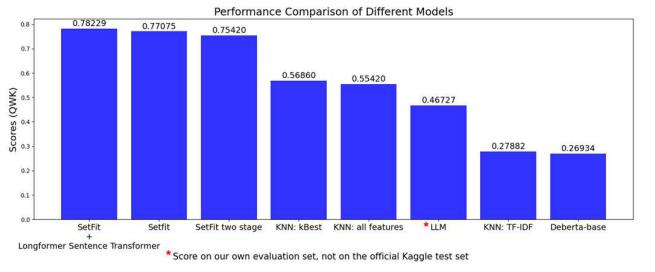

# SetFit for Automated Essay Scoring: Extending Longformer to a Sentence Transformer

Leon Krug *Computer Science and Information Technology Lucerne University of Applied Sciences and Arts* Luzern, Switzerland 0009-0005-4095-8998

Jannik Bundeli *Computer Science and Information Technology Lucerne University of Applied Sciences and Arts*  Luzern, Switzerland 0009-0004-9712-7231

Jannine Meier *Computer Science and Information Technology Lucerne University of Applied Sciences and Arts*  Luzern, Switzerland 0009-0007-2758-9483

Elena Nazarenko *Computer Science and Information Technology Lucerne University of Applied Sciences and Arts* Luzern, Switzerland 0000-0001-6880-525X

*Abstract***— Automated Essay Scoring (AES) is a challenging task requiring models to evaluate writing quality with human-like consistency while being computationally efficient and scalable. Current approaches often rely on computationally intensive prompt engineering or resource-heavy transformer models, limiting their practical application. In this study, we present a novel prompt-free approach using SetFit for AES that achieves competitive accuracy while significantly reducing computational overhead. Unlike traditional transformer-based models such as DeBERTa, SetFit enables sentence transformer fine-tuning with contrastive learning, making it suitable for essay scoring even in low-data regimes. To handle full-length essays, we extended Longformer into a custom sentence transformer with a 4096-token context window, overcoming the 512-token limitation of standard transformer architectures. Our fine-tuned model, published on Hugging Face, has gained over 6,000 downloads, indicating strong community interest in efficient, prompt-free approaches. Our results demonstrate that SetFit with an extended Longformer sentence transformer achieves competitive performance, making it a viable alternative to computationally expensive models. Beyond essay scoring, our approach shows promise for other longform text analysis tasks such as legal document review, research paper assessment, and content quality evaluation in educational contexts. This work contributes to the growing exploration of efficient NLP methods for educational assessment, offering a practical alternative to resource-intensive prompt-based solutions.** 

*Keywords—SetFit, Automated Essay Scoring (AES), Longformer, Sentence Transformers* 

#### I. INTRODUCTION

This paper presents one of the first applications of SetFit for Automated Essay Scoring (AES), demonstrating its viability as a lightweight yet competitive alternative to traditional transformer-based models.

## *A. Contributions*

#### *1) Custom Sentence Transformer for AES*

We extend Longformer [1] into a sentence transformer, allowing SetFit to process essays exceeding 512 tokens while maintaining efficient contrastive learning.

*2) Competing Performance with Lower Computational Costs* 

Compared to DeBERTa and other baselines, our approach achieves high accuracy while significantly reducing resource consumption.

## *3) Publicly available model*

Our fine-tuned model was published on Hugging Face [2], where it has received significant interest, with thousands of downloads [3] from the research community.

#### *B. Automated Essay Scoring Approaches*

Early methods for Automated Essay Scoring (AES) [4] focused on handcrafted features such as word counts, lexical diversity, and syntactic complexity, which were then fed into statistical or regression-based models. While efficient and interpretable, these techniques often failed to assess deeper elements such as coherence, argument strength, and contextual meaning.

Models like DeBERTa excel at extracting deep semantic representations from text, making them particularly suitable for scoring essays on characteristics such as organization, style, and content relevance [5]. DeBERTa builds upon prior transformer architectures, such as BERT and RoBERTa, but introduces two novel techniques: a disentangled attention mechanism and an enhanced mask decoder. These innovations enable the model to capture both the content and positional relationships of words more accurately, thereby significantly improving its performance on various natural language understanding tasks.

SetFit (Sentence Transformer Fine-Tuning) is a relatively new approach to text classification that emphasizes efficiency and adaptability, particularly in low-data scenarios [6]. SetFit builds on sentence transformers derived from pre-trained transformer models like BERT. The innovation of SetFit lies in its ability to achieve competitive results without relying on prompts, a common limitation of existing few-shot learning methods.

## *C. Sentence Embedding and Long Documents*

Standard BERT-like architectures have a 512-token input limit, which can truncate key content of an essay. Architectures like Longformer and BigBird overcome this by modifying the self-attention mechanism to handle entire essays more efficiently, preserving full-document context for more accurate assessments.

## *D. What is SetFit?*

SetFit (Sentence Transformer Fine-Tuning) is a lightweight and efficient approach to text classification, particularly wellsuited for few-shot or low-resource scenarios. Unlike promptbased methods, SetFit fine-tunes a sentence transformer in a contrastive Siamese manner. It learns semantic relationships from sentence pairs before training a simple classification head on the resulting embeddings [6]. This approach reduces reliance on large labeled datasets, which is especially beneficial for AES, where certain scoring categories may be underrepresented. By leveraging contrastive learning, SetFit can generate more robust training signals from limited data, thereby improving classification performance even with small sample sizes.

#### II. METHODOLOGY

In this section, we'll walk through our structured methodology, which is carefully crafted to leverage advanced NLP techniques for effective AES.

## *A. Overview of Approach*

Our approach follows a structured workflow. Firstly, essays undergo an EDA to examine patterns and inconsistencies. Secondly, text is converted into dense vector representations using our fine-tuned sentence transformer [1], and finally, SetFit is trained using contrastive learning.

## *B. Datasets*

We evaluated on two primary datasets: the Persuade 2.0 Corpus and the Kaggle-only dataset from the AES 2.0 competition [7]. The Persuade 2.0 Corpus comprises approximately 13,000 essays spanning a wide range of topics, along with writing styles, providing robust support for model development. The Kaggle-only dataset comprises 4,500 essays, which also serve as the competition's private test set. Each essay is annotated with scores ranging from 1 to 6. Essays average 250-500 words in length, significantly longer than typical sentence classification datasets.

#### *C. Score Description*

The score descriptions in the table below were used to assess the essays and grade them [8].

TABLE I. SCORING CRITERIA FOR ESSAYS

| Score          | Description                                                                                                                                       |  |
|----------------|---------------------------------------------------------------------------------------------------------------------------------------------------|--|
| 6 – Excellent  | Clear mastery with minimal errors. Outstanding critical thinking, strong evidence, well-organized, and skilled language use.                |  |
| 5 – Strong     | Reasonable mastery with occasional errors. Strong critical thinking, generally appropriate evidence, well organized, and good language use. |  |
| 4 – Competent  | Adequate mastery with some lapses. Competent critical thinking, sufficient evidence, generally organized, and fair language use.            |  |
| 3 – Developing | Limited mastery with weaknesses. Inconsistent critical thinking, weak evidence, limited organization, and noticeable language flaws.        |  |
| 2 – Weak       | Little mastery with serious flaws. Weak critical thinking, insufficient evidence, poor organization, and frequent language errors.          |  |
| 1 – Poor       | Very little or no mastery. No clear argument, disorganized structure, fundamental language issues, and pervasive grammar errors.            |  |

## *D. Preprocessing*

SetFit requires no preprocessing because it utilizes pretrained embeddings specifically designed to handle raw text directly, thereby simplifying the workflow and preserving the natural linguistic features essential for effective scoring.

#### *E. Custom Longformer-Based Sentence Transformer*

## *1) Base Model Selection*

Given the long-form nature of essays, we required a base model capable of processing more than 512 tokens. Since no pre-existing English sentence transformer met this requirement, we selected allenai/longformer-base-4096 [9] as our foundation due to its efficient processing of longer documents.

#### *2) Fine-Tuning a Sentence Transformer*

We fine-tuned the Longformer model following the tutorial from the Sentence Transformer webpage [10] into a sentence transformer using datasets such as all-nli-pair [11], all-nli-pairclass [11], all-nli-pair-score [11], all-nli-triplet [11], stsb [12], quora [13] and natural-questions [14]. These datasets provide a robust foundation for training embeddings that are well-suited for text similarity and classification tasks.

We employed triplet loss with anchor-positive-negative sentence pairs to refine the model's discrimination of subtle writing quality and coherence, which is essential for an accurate AES.

The model was trained using triplet loss for 3 epochs with a batch size of 16 and a learning rate of 2e-5. Training was done using PyTorch on dual RTX 4090 GPUs, taking approximately 5.2 hours. We saved checkpoints every 500 steps and selected the model with the best validation loss [15].

#### *3) Two-Stage Learning Approach*

We used a two-stage training strategy to improve generalization: first, we trained on the Persuade 2.0 Corpus to learn diverse essay structures and styles; then we fine-tuned on the Kaggle-only dataset to specialize in that competition's essays. Our model combines SetFit with a Longformer-based sentence transformer to handle long-form AES.

#### III. EXPERIMENTS

This section presents our experimental setup, outlining the evaluation process, baseline comparisons, and key findings. Our objective is to assess the effectiveness of our **SetFit + Longformer Sentence Transformer** approach for AES by benchmarking it against both traditional Machine Learning (ML) models and transformer-based baselines.

To ensure a fair evaluation, we compare our method against various baselines, including distance-based models such as **K-Nearest Neighbors (KNN)** and transformer architectures like **DeBERTa** and **Few-Shot GPT-4**.

Following this, we analyze our experimental results, including the effectiveness of feature selection and benchmarking performance, to gain a deeper understanding of the impact of different configurations on model accuracy.

## *A. Software Frameworks*

Our experiments were implemented using Hugging Face's Transformers, Sentence-Transformers, and PyTorch. We also employed Weights & Biases (W&B) for experiment tracking and hyperparameter tuning.

#### *1) Hardware Setup*

Experiments were conducted on two NVIDIA GeForce RTX 4090, 24 CPU cores and 48 Logical CPU cores.

#### *B. Evaluation Metrics*

To assess the performance of our model, we used Quadratic Weighted Kappa (QWK) as the primary evaluation metric. QWK measures the agreement between predicted and actual scores, penalizing predictions that deviate further from the true score. This metric is widely used in AES research due to its sensitivity to ordinal scale differences and ability to evaluate nuanced prediction errors.

#### *1) SetFit Fine-Tuning and Hyperparameter Optimization*

To optimize model performance, we fine-tuned SetFit using CosineSimilarityLoss. We performed extensive hyperparameter tuning for several key hyperparameters using W&B.

#### *2) Baseline Comparisons*

We compared our **SetFit + Longformer Sentence Transformer approach** with multiple baselines, including traditional ML and transformer-based models.

#### *a) K-Nearest Neighbors (KNN)*

KNN, a simple distance-based method, was tested with **TF-IDF vectors** and extracted linguistic features using different neighbor settings (n = 3, 9, 15, 21, 27). While computationally inexpensive, KNN struggled with high-dimensional data and memory usage.

#### *b) Vanilla Longformer Classification*

We evaluated **Longformer-base-4096** without fine-tuning it as a sentence transformer. This highlighted the impact of our custom fine-tuning, as the baseline model was less effective in capturing semantic relationships.

## *c) DeBERTa*

Among transformer-based baselines, DeBERTa was selected due to its strong performance in text classification tasks. We fine-tuned DeBERTa-v3-small using the AES dataset, applying a regression head to predict essay scores. While DeBERTa demonstrated high accuracy, it required extensive training, resulting in high GPU costs and memory usage, making it a more computationally expensive solution than SetFit.

## *d) Few-Shot GPT-4*

We tested **GPT-4o-mini** with **four-shot prompting**, providing a detailed rubric and labeled examples for essay scoring. Though it captured general essay quality well, it lacked consistency and transparency and incurred high API costs for large-scale evaluation.

#### *C. Experimental Findings*

In analyzing the experimental results, we evaluated the effectiveness of each component of our methodology. Notably, the SetFit two-stage training strategy, which aims to enhance model adaptability and generalization, did not yield the expected improvement in accuracy.

## *1) Optimal Hyperparameter Setup Fine-tuning*

TABLE II. HYPERPARAMETERS

| Hyperparameter | Description                                                                                              | Value       |  |
|----------------|----------------------------------------------------------------------------------------------------------|-------------|--|
| num_iterations | Controls the number of sentence pair generations                                                      | 10          |  |
| num_per_score  | Determines how many samples per essay score are used for training                                  | 130         |  |
| use_amp        | Enables Automatic Mixed Precision for computational efficiency                                     | True        |  |
| batch_size     | Number of samples processed per update                                                                | 8           |  |
| learning_rate  | Step size for updating model weights                                                                  | 5e-05       |  |
| optimizer      | Algorithm that updates model weights during training                                                  | adamw_torch |  |
| training_steps | Number of updates performed during training                                                           | 4000        |  |
| embedding_dim  | Size of the vector representing each input, ensuring compatibility with existing NLP frameworks | 768         |  |

#### *2) Results Benchmarking*

TABLE III. RESULTS BENCHMARKING

| Method            | Configuration                                   | QWK Score                 |
|-------------------|-------------------------------------------------|---------------------------|
| TF-IDF            | 500D reduced to 250 via SVD, 21 neighbors | 0.412* / 0.27882 (Kaggle) |
| All Features      | 1,121D feature vector, 18 neighbors          | 0.6742*                   |
| Selected Features | SelectKBest (mutual_15), 18 neighbors     | 0.6789*                   |

\*This score refers to our own evaluation set, distinct from the Kaggle test set.

## IV. RESULTS AND DISCUSSION

#### *A. Comparison*

Fig. 1. Performance Comparison of Different Models. 'SetFit + Longformer base model' denotes our custom extension of SetFit with a 4096-token Longformer base

Our best result was achieved by our fine-tuned SetFit model, which utilized our custom extension of SetFit with a 4096-token Longformer base, yielding a QWK score of 0.78229 on the test set.

Additionally, our few-shot GPT-4 baseline achieved a mean QWK score of 0.46 (±0.08), as detailed in Table III. While this result is promising for general essay quality estimation, GPT-4 was outperformed by our custom SetFit-based approach, particularly in terms of consistency and cost-effectiveness.

A notable observation was that two-stage learning did not significantly improve performance, unlike DeBERTa-based approaches, which require domain adaptation. This suggests that contrastive learning in SetFit generalizes well even from limited data, reducing the need for dataset-specific fine-tuning.

#### *1) Computational Efficiency*

Compared to fully fine-tuned transformers like DeBERTa, SetFit required significantly fewer training iterations. While exact step requirements for DeBERTa vary depending on dataset size and hyperparameter settings, typical fine-tuning runs range between 20,000 and 30,000 steps. In our experiments, SetFit achieved comparable accuracy in just 10,000 steps.

SetFit is designed explicitly for computational efficiency. In [6], they report training time reductions of up to 123× compared to conventional methods. In our experiments, training took approximately 5.2 hours on dual RTX 4090 GPUs with 37.92GB of VRAM. This is on par or faster than typical DeBERTa fine-tuning runs (often exceeding 6 hours on similar hardware). These gains stem from SetFit's architecture, which fine-tunes only the classification head post contrastive learning.

#### *B. Summary of Contributions*

*1) Adoption of a 4096-token Sentence Transformer with SetFit* 

By extending the token limit, we effectively addressed the challenge of processing lengthy student essays, allowing for more comprehensive context capture. This makes the model applicable beyond AES, including legal document analysis, academic paper assessment, and long-text classification tasks.

#### *2) Empirical Performance Gains*

Through rigorous experimentation, we showcased that SetFit can achieve near-state-of-the-art AES results, outperforming baselines that rely solely on traditional ML or simpler embedding strategies.

## *C. Limitations*

Our approach demonstrates strong performance with significant computational efficiency advantages over both traditional transformer fine-tuning and prompt-based methods. The primary limitation of our work stems from the dataset rather than the methodology.

The uneven distribution of essay scores, with fewer examples of excellent (6) and poor (1) essays, affected model calibration at these extremes. Performance analysis reveals higher variance in predictions for these underrepresented categories, indicating the need for targeted data collection or augmentation strategies in future work to enhance robustness across the entire scoring range.

#### V. CONCLUSION

In this work, we evaluated the effectiveness of various AES approaches, ranging from traditional ML methods to advanced transformer-based techniques. SetFit emerged as the most balanced solution, providing both robust performance and faster experimentation cycles, primarily due to its contrastive finetuning approach and ability to handle varied linguistic contexts.

## *A. Future Directions*

Future work could explore BigBird, a natural extension of the context window, which is 8192 tokens, for improved efficiency and performance on long documents.

Additionally, techniques such as back-translation, paraphrasing, or semi-supervised learning may help diversify training data and further improve model robustness.

#### REFERENCES

- [1] I. Betalgy, M. E. Peters and A. Cohan, "Longformer: The Long-Document Transformer", 2022. arXiv:2004.05150
- [2] "Huggingface Repository," 2025. [Online]. Available: https://huggingface.co/Leo1212/longformer-base-4096-sentencetransformers-all-nli-stsb-quora-nq. [Accessed 05 11 2025].
- [3] "Longformer Repository," 2025. [Online]. Available: https://huggingface.co/api/models/Leo1212/longformer-base-4096 sentence-transformers-all-nli-stsb-quoranq?expand%5B%5D=downloads&expand%5B%5D=downloadsAllTim e. [Accessed 05 11 2025].
- [4] B. Hamner, J. Morgan, lynnvandev, M. Shermis and T. Vander Ark, "The Hewlett Foundation: Automated Essay Scoring," 2012. [Online]. Available: https://kaggle.com/competitions/asap-aes. [Accessed 11 05 2025].
- [5] P. He, X. Liu, J. Gao and W. Chen, "DeBERTa: Decoding-enhanced BERT with disentangled attention," 2021.
- [6] L. Tunstall, N. Reimers, U. E. S. Jo, L. Bates, D. Korat, M. Wasserblat and O. Pereg, "Efficient Few-Shot Learning Without Prompts," 2022.
- [7] S. Crossley, P. Baffour, J. King, L. Burleigh, W. Reade and M. Demkin, "Kaggle Learning Agency Lab - Automated Essay Scoring 2.0," 2024. [Online]. Available: https://kaggle.com/competitions/learning-agencylab-automated-essay-scoring-2.
- [8] S. Crossley, P. Baffour, J. King, L. Burleigh, W. Reade and M. Demkin, "Kaggle Score Description," 2024. [Online]. Available: https://www.kaggle.com/competitions/learning-agency-lab-automatedessay-scoring-2/data.
- [9] "Sentence Transformers Webpage," [Online]. Available: https://huggingface.co/allenai/longformer-base-4096.
- [10] "Sentence Transformers Finetuning," [Online]. Available: https://gist.github.com/Leo1212/a1e470aa587ea998c92db1719c2237dd.
- [11] "Sentence Transformers," [Online]. Available: https://huggingface.co/datasets/sentence-transformers/all-nli.
- [12] "Sentence Transformers stbs," [Online]. Available: https://huggingface.co/datasets/sentence-transformers/stsb.
- [13] "Sentence Transformers Quora," [Online]. Available: https://huggingface.co/datasets/sentence-transformers/quora-duplicates.
- [14] "Sentence Transformers Natural Questions," [Online]. Available: https://huggingface.co/datasets/sentence-transformers/natural-questions.
- [15] "Hugging FaceSetfit + Longformer," [Online]. Available: https://huggingface.co/Leo1212/longformer-base-4096-sentencetransformers-all-nli-stsb-quora-nq