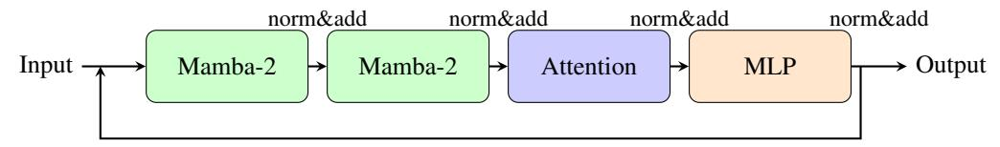
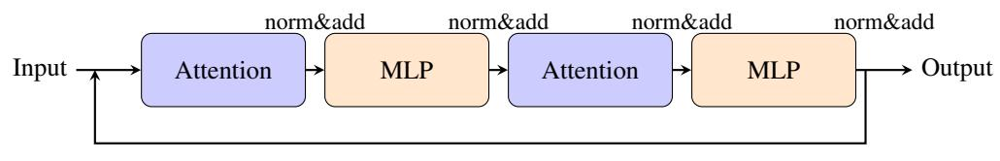
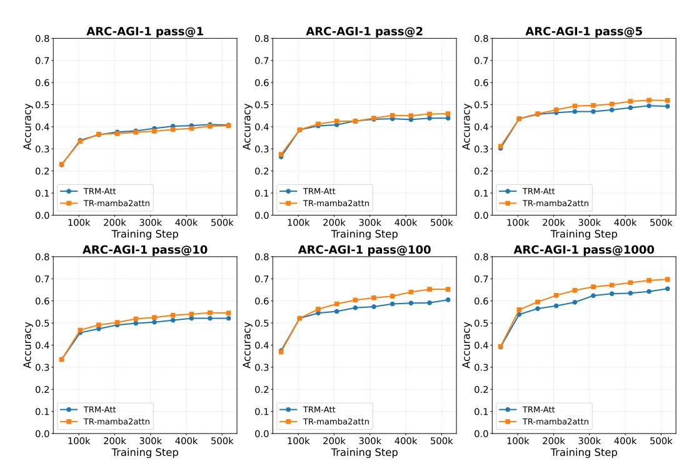
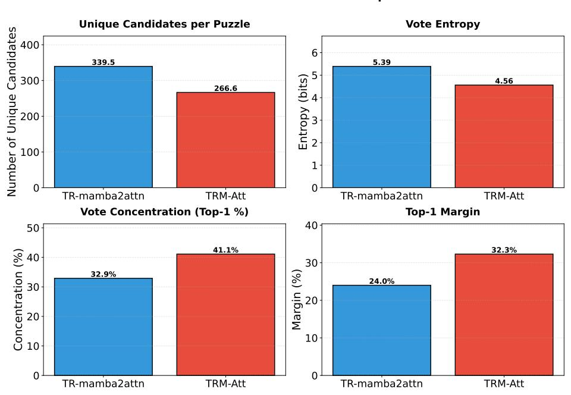

# TINY RECURSIVE REASONING WITH MAMBA-2 AT-TENTION HYBRID

Wenlong Wang & Fergal Reid Intercom Dublin, Ireland {wenlong.wang,fergal.reid}@intercom.io

# ABSTRACT

Recent work on recursive reasoning models like TRM demonstrates that tiny networks (7M parameters) can achieve strong performance on abstract reasoning tasks through latent recursion—iterative refinement in hidden representation space without emitting intermediate tokens. This raises a natural question about operator choice: Mamba-2's state space recurrence is itself a form of iterative refinement, making it a natural candidate for recursive reasoning—but does introducing Mamba-2 into the recursive scaffold preserve reasoning capability? We investigate this by replacing the Transformer blocks in TRM with Mamba-2 hybrid operators while maintaining parameter parity (6.83M vs 6.86M parameters). On ARC-AGI-1, we find that the hybrid improves pass@2 (the official metric) by +2.0% (45.88% vs 43.88%) and consistently outperforms at higher K values (+4.75% at pass@100), whilst maintaining pass@1 parity. This suggests improved candidate coverage—the model generates correct solutions more reliably—with similar top-1 selection. Our results validate that Mamba-2 hybrid operators preserve reasoning capability within the recursive scaffold, establishing SSM-based operators as viable candidates in the recursive operator design space and taking a first step towards understanding the best mixing strategies for recursive reasoning.

# 1 INTRODUCTION

Large language models have excelled in reasoning tasks such as mathematics, code generation, and logical inference through chain-of-thought prompting [\(Wei et al.,](#page-9-0) [2022\)](#page-9-0), iterative refinement, and sampling with aggregation [\(Wang et al.,](#page-9-1) [2022b;](#page-9-1) [Yao et al.,](#page-10-0) [2023\)](#page-10-0). A growing body of literature suggests that the *recursive process*—rather than model scale alone—is central to reasoning capability [\(Saunshi et al.,](#page-9-2) [2025;](#page-9-2) [Feng et al.,](#page-8-0) [2023\)](#page-8-0). This represents a fundamental shift from "bigger models" to "more thinking time," where performance scales with inference-time computation rather than parameter count alone.

Most compute-scaling approaches operate in token space, producing visible intermediate steps that can be inspected and verified [\(Wei et al.,](#page-9-0) [2022;](#page-9-0) [Nye et al.,](#page-9-3) [2021\)](#page-9-3). However, chain-of-thought models often expend computational resources on tokens unrelated to reasoning—for instance, tokens serving grammatical or stylistic purposes. Two key questions remain open: whether this is the most efficient approach, and whether non-reasoning tokens serve any purpose beyond providing additional forward passes for the model to "ponder" before producing an answer. The purported visibility and interpretability of explicit reasoning traces is also challenged by questions of faithfulness: the stated reasoning may not reflect the model's actual computation [\(Lanham et al.,](#page-9-4) [2023\)](#page-9-4).

An emerging alternative is *latent recursion*: iterative refinement in hidden representation space without emitting intermediate tokens [\(Geiping et al.,](#page-9-5) [2025;](#page-9-5) [Saunshi et al.,](#page-9-2) [2025;](#page-9-2) [Hao et al.,](#page-9-6) [2024\)](#page-9-6). The Tiny Recursive Model (TRM) [\(Jolicoeur-Martineau,](#page-9-7) [2025\)](#page-9-7) and Hierarchical Recursive Model (HRM) [\(Wang et al.,](#page-9-8) [2025a\)](#page-9-8) exemplify this approach by addressing the challenging ARC-AGI dataset with extremely tiny models. Specifically, TRM achieves 44.6% on ARC-AGI-1 with only 7M parameters through repeated latent updates. This dramatically outperforms comparably-sized models that lack recursive depth, and notably surpasses many commercial LLM APIs on this benchmark. What enables such small recursive models to succeed where large-scale models struggle remains not fully understood, but evidence increasingly points to the recursive process itself as the key ingredient.

TRM and similar recursive reasoning models assume attention-heavy Transformer blocks as the perstep operator. This raises a key question: can alternative operators—particularly those with inherent recurrence like state space models—enter the *design space of recursive reasoning* without degrading capability? Recent literature demonstrates that Mamba-2 hybrid models serve as strong candidates for language tasks [\(Gu & Dao,](#page-9-9) [2024;](#page-9-9) [Dao & Gu,](#page-8-1) [2024;](#page-8-1) [Lenz et al.,](#page-9-10) [2025\)](#page-9-10), and are particularly promising for test-time computation due to their efficient inference speed [\(Wang et al.,](#page-9-11) [2025b\)](#page-9-11). Mamba-2's state space recurrence (ht = atht−1 + Btxt) is itself a form of iterative refinement, making it a natural and potentially more efficient substrate for recursive reasoning. Validating that such operators preserve reasoning capability within the recursive scaffold is a necessary first step before exploring deeper questions—such as whether the recursive loop can be internalised into SSM state updates, leveraging Mamba's inherent inner recurrence rather than relying solely on outer-loop iteration.

We present a TRM variant where Transformer blocks are replaced with a Mamba-2 + attention hybrid operator [\(Gu & Dao,](#page-9-9) [2024;](#page-9-9) [Dao & Gu,](#page-8-1) [2024\)](#page-8-1), parameter-matched to the original. Our contributions are:

- C1: We are the first Mamba-hybrid model for recursive latent reasoning.
- C2: Empirical validation on ARC-AGI-1 showing improved pass@2 performance (+2.0%), with supplementary results on Sudoku and Maze demonstrating competitive accuracy.
- C3: Analysis of pass@K patterns revealing a coverage-vs-selection trade-off: the hybrid improves candidate diversity while maintaining top-1 selection quality.

# 2 BACKGROUND

#### 2.1 TRM: RECURSIVE REASONING WITH TINY NETWORKS

The Hierarchical Reasoning Model (HRM) [\(Wang et al.,](#page-9-8) [2025a\)](#page-9-8) first demonstrated that extremely small models could achieve remarkable performance on abstract reasoning through latent recursion. With only 27M parameters, HRM achieved 40.3% on ARC-AGI-1—dramatically outperforming comparably-sized models and notably surpassing many commercial LLM APIs on this benchmark. This result challenged conventional wisdom that reasoning capability requires massive scale.

Building on HRM's success, the Tiny Recursive Model (TRM) [\(Jolicoeur-Martineau,](#page-9-7) [2025\)](#page-9-7) proposed a simplified architecture that achieves even stronger performance with fewer parameters (5– 7M). TRM maintains two latent states: zH (high-level) and zL (low-level), updated through H outer cycles and L inner cycles:

$$z_L^{(t+1)} = f(z_L^{(t)}, z_H^{(t)} + \text{embed}(x))$$
 (1)

$$z_H^{(t+1)} = f(z_H^{(t)}, z_L^{(T_L)}) \tag{2}$$

where f is the learned update function (a stack of Transformer blocks). A key architectural difference: HRM uses two separate models to process zL and zH, whilst TRM finds that a single shared model suffices, enabling the dramatic parameter reduction whilst improving performance to 44.6% on ARC-AGI-1.

## 2.2 ARC-AGI EVALUATION PROTOCOL

The Abstraction and Reasoning Corpus (ARC) [\(Chollet,](#page-8-2) [2019\)](#page-8-2) evaluates abstract reasoning through visual puzzles. The evaluation protocol used in TRM expands each test input into ∼880 augmentations via dihedral transformations and colour permutations. The model runs once per augmentation, predictions are inverse-transformed back to the original space, and results are aggregated by (vote count, average confidence). The pass@K metric measures whether the correct answer appears in the top-K ranked predictions.

Official metric: ARC-AGI uses pass@2 as the primary measurement system to account for tasks with explicit ambiguity requiring two guesses, and to catch unintentional ambiguity or dataset mistakes [\(Foundation,](#page-8-3) [2025\)](#page-8-3). More broadly, pass@K measures *candidate-set coverage*—whether the model generates the correct answer among its diverse predictions—whilst lower K values (especially pass@1) reflect *winner selection*—whether the aggregation correctly ranks the answer first.

## 2.3 MAMBA-2 AS AN ALTERNATIVE MIXER

State Space Models (SSMs) offer an alternative to attention for sequence modeling, addressing the quadratic complexity of Transformers. Mamba [\(Gu & Dao,](#page-9-9) [2024\)](#page-9-9) introduces *selective* SSMs, where model parameters vary with input, enabling the model to selectively propagate or forget information. The core mechanism processes sequences through a recurrent state update:

$$h_t = \bar{A}_t h_{t-1} + \bar{B}_t x_t \tag{3}$$

where ht is the hidden state, xt is the input, and A¯ t, B¯ t are input-dependent parameters. Mamba-2 [\(Dao & Gu,](#page-8-1) [2024\)](#page-8-1) simplifies this to ht = atht−1 + Btxt (where at is a scalar), achieving 2–8× faster training through improved hardware utilization via Structured State Space Duality (SSD).

From an operator viewpoint, TRM repeatedly applies an update function to refine latent states. The original TRM uses bidirectional attention for cross-position communication. Mamba-2 provides an alternative mixer with linear complexity. While Mamba excels at sequential dependencies, it processes information causally in one direction. We therefore explore *hybrid* designs that combine Mamba-2's efficient sequential processing with explicit cross-position mixing (attention or dense MLP) to capture bidirectional dependencies.

# 3 METHOD

## 3.1 ARCHITECTURE: TRM WITH HYBRID UPDATE OPERATOR

We preserve TRM's recursive structure while replacing the per-step operator. The recursion schedule remains unchanged: Hcycles = 3 outer loops and Lcycles = 4–6 inner loops, with the same state representation (zH, zL) and output heads (LM prediction + Q-halt signal for adaptive computation).

What changes: We swap the Transformer blocks for hybrid block stacks. Figure [1](#page-3-0) illustrates the architectural differences between the original TRM and our hybrid variants. We experiment with two variants:

- TR-mamba2attn: As shown in Figure [1,](#page-3-0) this variant replaces the attention-only blocks with a Mamba-2 → Mamba-2 → Attention → MLP pipeline, combining sequential state space processing with cross-position attention.
- TR-mamba2mlpt: Similar to TR-mamba2attn, but replaces the attention block with MLPt, which operates on the transposed sequence dimension for all-to-all cross-position communication without attention.

We did not use a pure Mamba model because Mamba's sequential processing is causal by nature, processing information in one direction. For sequence-to-sequence tasks like Sudoku, Maze, and ARC-AGI, bidirectional processing is essential to capture dependencies across the entire spatial grid. For simplicity, we use attention and MLP-t blocks to provide the necessary cross-position information flow, complementing Mamba-2's sequential processing capabilities.

### 3.2 PARAMETER MATCHING

To isolate the effect of the operator choice, we match parameters:

• Hidden size: 512

• TRM-attn: 6.83M parameters

• TR-mamba2attn: 6.86M parameters

• Mamba-2 specifics: dstate = 128, headdim = 64, expand = 2

(a) TR-mamba2attn: Mamba-2 blocks followed by Attention and MLP.

(b) TRM-Att: the original TRM attention model.

Figure 1: Architecture comparison: (a) TR-mamba2attn with Mamba-2 hybrid operator and (b) TRM-attn with attention-based operator. Both use post-norm residual connections (norm&add) between components.

## 3.3 NORMALISATION CHOICE: WHY POST-NORM MATTERS

A critical implementation detail for recursive models is the normalisation placement. Modern LLMs typically use pre-norm:

$$h_{t+1} = h_t + F(\text{Norm}(h_t)) \tag{4}$$

However, in unrolled recursion where the same residual module is applied T times, pre-norm can allow the residual stream magnitude to grow with t (approximately √ t or worse if updates are correlated), eventually causing NaN failures.

Post-norm resolves this by re-normalising after each residual add:

$$h_{t+1} = \text{Norm}(h_t + F(h_t)) \tag{5}$$

This bounds the hidden state scale regardless of recursion depth. HRM [\(Wang et al.,](#page-9-8) [2025a\)](#page-9-8) originally motivated post-norm for Q-learning convergence stability in their Adaptive Computation Time mechanism. TRM [\(Jolicoeur-Martineau,](#page-9-7) [2025\)](#page-9-7) removed the Q-learning objective (finding its contribution to generalisation marginal) whilst retaining post-norm in its architecture, but did not explicitly discuss why. We argue that post-norm is essential for recursion stability itself, independent of Qlearning: it bounds the residual stream magnitude across recursive unrolling, preventing divergence. We follow this design and use post-norm (RMSNorm) in all our experiments.

# 4 EXPERIMENTS

#### 4.1 EXPERIMENTAL SETUP

Benchmarks: We evaluate on three tasks from the TRM benchmark suite:

- ARC-AGI-1: Abstract reasoning puzzles with up to 30×30 grids, 12-token vocabulary
- Sudoku-Extreme: 9×9 constraint satisfaction puzzles
- Maze-30×30-Hard: Path-finding through 30×30 mazes

Models: We compare four variants:

- TRM-attn: Original attention-based TRM (6.83M params)
- TRM-mlp-t: TRM with MLP-t blocks (5M params on Sudoku, 19M on ARC/Maze)
- TR-mamba2attn: Mamba-2 + Attention hybrid (6.86M params)

Table 1: ARC-AGI-1 Pass@K results. The hybrid (TR-mamba2attn) improves pass@2 (the official metric) by +2.0% and consistently outperforms at higher K values, with the gap growing to +4.75% at K=100, whilst maintaining pass@1 parity.

| K                         | 1              | 2              | 5              | 10             | 100            | 1000           |
|---------------------------|----------------|----------------|----------------|----------------|----------------|----------------|
| TRM-attn TR-mamba2attn | 40.75 40.50 | 43.88 45.88 | 49.25 51.88 | 52.13 54.50 | 60.50 65.25 | 65.50 69.75 |
| ∆                         | −0.25          | +2.00          | +2.63          | +2.37          | +4.75          | +4.25          |

Table 2: Sudoku-Extreme exact accuracy. MLP-t variants outperform attention-based models, with TR-mamba2mlpt slightly underperforming the TRM-mlp-t baseline, suggesting constraint satisfaction benefits from dense cross-position mixing.

| Model         | Params | Accuracy (%) |
|---------------|--------|--------------|
| TRM-attn      | 6.83M  | 72.2         |
| TR-mamba2attn | 6.86M  | 66.5         |
| TRM-mlp-t     | 5.00M  | 87.4         |
| TR-mamba2mlpt | 6.28M  | 84.2         |

• TR-mamba2mlpt: Mamba-2 + MLP-t hybrid (6.28M params on Sudoku, 13.24M on ARC/Maze)

Evaluation: Sudoku uses exact accuracy; ARC uses pass@K with K ∈ {1, 2, 5, 10, 100, 1000} after augmentation and voting.

#### 4.2 RESULTS

ARC-AGI-1 (Table [1\)](#page-4-0): TRM-mlp-t achieves 29.6% pass@2 (19M parameters) as reported in the original TRM paper; we did not reproduce this result to conserve computational resources, instead focusing on the more capable attention-based TRM which warrants detailed investigation. TR-mamba2mlpt achieves 32.125% pass@2 (13.24M parameters)—a +2.5% improvement over the reported TRM-mlp-t baseline. We focus comparison on attention-based models. The hybrid (TRmamba2attn) outperforms on pass@2 by +2.0% (45.88% vs 43.88%), and the advantage grows at higher K values, reaching +4.75% at K=100. The hybrid maintains near-parity at pass@1 (−0.25%), indicating similar top-1 selection whilst improving candidate coverage. This pattern is consistent throughout training—the hybrid's pass@2 and pass@100 curves pull ahead of attention after the first few epochs and maintain the lead, as shown in Figure [2.](#page-5-0)

Sudoku (Table [2\)](#page-4-1): The MLP-t variants achieve the strongest results, with TRM-mlp-t reaching 87.4% (the best) and TR-mamba2mlpt achieving 84.2%—both substantially outperforming attention-based models (TRM-attn: 72.2%, TR-mamba2attn: 66.5%). This suggests that constraint satisfaction on small, fixed grids (9×9) benefits from dense all-to-all communication rather than selective attention or sequential processing.

Maze (Table [3\)](#page-5-1): In contrast to Sudoku, both MLP-t variants completely fail on the larger 30×30 grids (0.0% accuracy), whilst TR-mamba2attn achieves 80.6% versus 60.8% for TRM-attn. Training shows high variance across checkpoints (fluctuating between 6–85% accuracy), making these results preliminary. The complete failure of MLP-t on this task highlights the importance of contextdependent architectural choices: dense mixing succeeds on small grids but fails to scale to larger spatial reasoning tasks.

Table 3: Maze- $30 \times 30$ -Hard exact accuracy. Training shows high variance across checkpoints for all models. Both MLP-t variants fail on this task, whilst TR-mamba2attn achieves 80.6% at the final checkpoint, though results remain preliminary given instability.

| Model         | Params | Accuracy (%) |
|---------------|--------|--------------|
| TRM-attn      | 6.83M  | 60.8         |
| TR-mamba2attn | 6.86M  | 80.6         |
| TRM-mlp-t     | 19.0M  | 0.0          |
| TR-mamba2mlpt | 13.24M | 0.0          |

Figure 2: Training curves for ARC-AGI-1 across all pass@K metrics. The hybrid (TR-mamba2attn, orange) consistently outperforms the baseline (TRM-attn, blue) at pass@2 (the official metric) and higher K values throughout training, whilst maintaining pass@1 parity. The gap emerges early and remains stable, demonstrating that improved candidate coverage is a consistent property rather than a late-training phenomenon.

#### 5 DISCUSSION

#### 5.1 INTERPRETING THE PASS@K PATTERN

The ARC-AGI-1 evaluation protocol provides important context for interpreting pass@K metrics. The original test set contains 400 puzzles with 419 test inputs (19 puzzles have two test inputs, each scored independently), which are augmented through dihedral transformations and colour permutations to yield 368,150 total test instances—an average of  $\sim 880\times$  augmentation per test input. Each augmentation produces a prediction, which is then inverse-transformed and aggregated through voting. In this setting, pass@1000 effectively measures whether the correct answer appears *anywhere* within the model's predicted candidate set across all augmentations. The hybrid model achieves 69.75% at pass@1000 versus 65.50% for TRM-attn (+4.25%), indicating that the hybrid exhibits better *coverage*: the correct solution is more likely to be generated somewhere within its diverse candidate pool.

#### **ARC-AGI-1 Evaluation Statistics Comparison**

Figure 3: Evaluation statistics on ARC-AGI-1 comparing TR-mamba2attn (hybrid) and TRM-attn (baseline). The hybrid generates more unique candidates per puzzle and exhibits higher vote entropy (indicating diverse exploration), whilst TRM-attn shows higher vote concentration on the top-1 candidate and larger top-1 margin (indicating decisive selection). These statistics provide quantitative evidence for the coverage vs selection trade-off observed in pass@K curves.

The ARC results reveal a *coverage vs selection* trade-off. The hybrid improves pass@2 by +2.0%, and this advantage grows at higher K values:

- Coverage (pass@2 and higher K): The hybrid generates the correct solution within its candidate set more often, improving candidate diversity.
- **Selection** (pass@1): Both models rank the correct solution first at similar rates (nearparity), so the hybrid's coverage gain does not come at the expense of top-1 selection.

To validate this hypothesis, we analyse the prediction statistics from the final checkpoints of both models on the ARC-AGI-1 evaluation set. Figure 3 quantifies this trade-off through four key candidate metrics. The hybrid generates substantially more unique candidates per puzzle (339.5 vs 266.6, +27%) with higher vote entropy (5.39 vs 4.56), indicating greater diversity in the candidate pool. Conversely, TRM-attn exhibits stronger selection: 41.1% of votes concentrate on the top-1 candidate (vs 32.9% for hybrid), with a larger top-1 margin (32.3% vs 24.0%). This explains the pass@K pattern: the hybrid's broader exploration yields more correct candidates within the pool (improving pass@K), whilst TRM-attn's more decisive voting concentrates on fewer high-confidence predictions (maintaining pass@1 parity). Mamba-2's sequential processing appears to contribute different solution trajectories during augmentation, increasing the diversity of the candidate pool without degrading the quality of the best prediction.

#### 5.2 DIFFICULTY-STRATIFIED ANALYSIS

Stratifying puzzles by difficulty sharpens this picture. We define difficulty using the average correct-vote share across both models (a model-agnostic measure): puzzles where neither model reliably produces the correct answer are "hard," and those where correct answers dominate the candidate pool are "easy." We stratify all 419 test inputs at a 15% correct-vote-share threshold: hard (<15%, N=246) and easy ( $\ge15\%$ , N=173). On hard test inputs, the hybrid gains +4.9 pp at pass@5 over TRM-attn. The mechanism is intuitive: when the correct answer is rare in the candidate pool, the

hybrid's flatter vote distribution avoids concentrating votes on a single dominant—but wrong candidate, preserving the correct answer's chance of surfacing at higher K. On easy puzzles, the pattern reverses: TRM-attn gains +4.6 pp at pass@1, because its sharper vote concentration more reliably promotes an already-dominant correct answer to the top rank. The aggregate pass@K pattern—near-parity at pass@1, growing hybrid advantage at higher K—is the net effect of these two opposing trends. At pass@5, the two models also solve partially disjoint puzzle sets (31 hybridonly vs 23 TRM-attn-only), suggesting that different mixing strategies contribute complementary strengths.

### 5.3 MAMBA-2 ENTERS THE RECURSIVE OPERATOR DESIGN SPACE

The key finding is that the hybrid excels at candidate coverage on ARC-AGI, improving pass@2 by +2.0% with growing advantages at higher K values (+4–5% at high K), whilst maintaining top-1 parity. Improved pass@2 performance on ARC alongside competitive results across Sudoku and Maze validates that introducing Mamba-2 into the recursive scaffold does not degrade reasoning capability—and on coverage metrics, improves it. This establishes Mamba-2 hybrid operators as viable candidates in the recursive operator design space, and motivates deeper investigation into the interaction between outer-loop recursion and SSMs' inherent inner recurrence.

# 6 RELATED WORK

Explicit CoT and token-space compute: Chain-of-thought prompting [\(Wei et al.,](#page-9-0) [2022\)](#page-9-0) and selfconsistency [\(Wang et al.,](#page-9-1) [2022b\)](#page-9-1) scale reasoning by producing visible intermediate steps. A theoretical study proves that standard, bounded-depth Transformers are mathematically incapable of directly solving basic arithmetic or linear equations unless the model size grows super-polynomially [\(Feng et al.,](#page-8-0) [2023\)](#page-8-0), providing theoretical grounding for why explicit reasoning steps are necessary. Tree of Thoughts [\(Yao et al.,](#page-10-0) [2023\)](#page-10-0) and scratchpads [\(Nye et al.,](#page-9-3) [2021\)](#page-9-3) extend this to search and planning. We study recursive reasoning in latent space, which shares the same philosophy by extending the effective model depth through looping forward passes over the operator model.

Implicit/latent CoT: Recent work connects chain-of-thought reasoning to latent reasoning by gradually converting explicit CoT models. [Deng et al.](#page-8-4) [\(2024\)](#page-8-4) explore removing intermediate reasoning steps entirely or partially, though this approach generally lags behind explicit CoT in accuracy when no additional latent looping is provided. [Hao et al.](#page-9-6) [\(2024\)](#page-9-6) replace text tokens with continuous thought vectors, arguing that latent variables can encode multiple alternative future steps simultaneously. [Zelikman et al.](#page-10-1) [\(2024\)](#page-10-1) use reinforcement learning to incentivise models to generate internal thoughts. More recently, [Jolicoeur-Martineau](#page-9-7) [\(2025\)](#page-9-7); [Wang et al.](#page-9-8) [\(2025a\)](#page-9-8) demonstrate that dual hidden states enable strong reasoning capability with tiny models (7M parameters) on specific reasoning benchmarks. Our work is directly built on TRM, replacing Transformer blocks with Mamba-2 hybrid operators and achieving improved ARC-AGI pass@K performance whilst maintaining competitive pass@1 accuracy.

Looped Transformers: [Dehghani et al.](#page-8-5) [\(2019\)](#page-8-5) first established the fundamental architecture for looped transformers with Universal Transformers. [Saunshi et al.](#page-9-2) [\(2025\)](#page-9-2) explicitly study "Looped Transformers" denoted as (k ⊗ L), where a k-layer block is looped L times, proving that these loops generate "latent thoughts" and can simulate chain-of-thought reasoning steps. [Yang et al.](#page-9-12) [\(2024\)](#page-9-12) demonstrate that a looped transformer with 1 layer can match the performance of a standard 12-layer transformer by iterating the loop, focusing on emulating iterative algorithms like gradient descent. [Geiping et al.](#page-9-5) [\(2025\)](#page-9-5) propose a depth-recurrent architecture featuring a core recurrent block sandwiched between a prelude and coda, where the core block is iterated r times (randomly sampled during training) to allow the model to "think" in latent space. Although all these papers loop the operator model (transformer), input injection has been mentioned in multiple literature as a key design choice.

Efficient backbones: State space models (SSMs) offer linear-time sequence modeling as an alternative to quadratic-complexity attention. [Gu & Dao](#page-9-9) [\(2024\)](#page-9-9) introduce Mamba, which achieves lineartime performance through selective state spaces that dynamically modulate which information to retain or forget. [Dao & Gu](#page-8-1) [\(2024\)](#page-8-1) establish a theoretical duality between transformers and SSMs, showing that structured state space models can be viewed as a generalization of attention mechanisms, leading to Mamba-2 with improved efficiency and expressiveness. Hybrid architectures combining attention and SSMs have shown promise: [Lenz et al.](#page-9-10) [\(2025\)](#page-9-10) demonstrate that Jamba, a hybrid Transformer-Mamba model, achieves competitive performance at scale whilst maintaining efficiency benefits. More recently, [Wang et al.](#page-9-11) [\(2025b\)](#page-9-11) explore Mamba's potential for test-time compute scaling, proposing M1 as a Mamba-based reasoning model that leverages the linear complexity to enable more intensive inference-time computation. Our work extends this direction by integrating Mamba-2 into recursive reasoning architectures, combining the efficiency of SSMs with the iterative refinement capabilities of looped transformers.

Normalisation in recursion: Pre-norm vs post-norm affects training dynamics [\(Xiong et al.,](#page-9-13) [2020\)](#page-9-13). DeepNet [\(Wang et al.,](#page-9-14) [2022a\)](#page-9-14) and ReZero [\(Bachlechner et al.,](#page-8-6) [2021\)](#page-8-6) address stability in deep networks. HRM [\(Wang et al.,](#page-9-8) [2025a\)](#page-9-8) specifically motivates post-norm for recursive Q-learning stability.

# 7 CONCLUSION

We investigated whether Mamba-2—whose state space recurrence is itself a form of iterative refinement—can enter the design space of operators for TRM-style recursive reasoning without degrading capability. By replacing Transformer blocks with Mamba-2 hybrid operators (parametermatched), we found:

- ARC-AGI: +2.0% improvement on pass@2 (the official metric) with growing advantages at higher K values, suggesting better candidate coverage
- Coverage-vs-selection trade-off: Mamba-2's sequential processing contributes distinct solution trajectories, increasing candidate diversity without degrading top-1 quality. Difficulty stratification further shows the two operators solve partially disjoint puzzle sets, reinforcing that different mixing strategies bring complementary strengths within the recursive design space.
- Post-norm: Critical for stable recursive computation

Our results validate that Mamba-2 hybrid operators can enter the recursive operator design space with competitive performance, taking a firm first step towards understanding the best mixing strategies for recursive reasoning. Future work should investigate whether the recursive loop can be internalised into SSM state updates—leveraging Mamba's inherent inner recurrence—alongside compute-normalised evaluation.

# REFERENCES

Thomas Bachlechner, Bodhisattwa Prasad Majumder, Huanru Henry Mao, Garrison W Cottrell, and Julian McAuley. Rezero is all you need: Fast convergence at large depth. *arXiv preprint arXiv:2003.04887*, 2021.

Franc¸ois Chollet. On the measure of intelligence. *arXiv preprint arXiv:1911.01547*, 2019.

Tri Dao and Albert Gu. Transformers are ssms: Generalized models and efficient algorithms through structured state space duality. *International conference on machine learning*, 2024.

Mostafa Dehghani, Stephan Gouws, Oriol Vinyals, Jakob Uszkoreit, and Łukasz Kaiser. Universal transformers. *International Conference on Learning Representations*, 2019.

Yuntian Deng, Yejin Choi, and Samuel Ritter. From explicit cot to implicit cot: Learning to internalize cot step by step. *arXiv preprint arXiv:2405.14838*, 2024.

Guhao Feng, Bohang Zhang, Yuntian Gu, Haotian Ye, Di He, and Liwei Wang. Towards revealing the mystery behind chain of thought: A theoretical perspective. *Advances in Neural Information Processing Systems*, 36, 2023.

ARC Prize Foundation. Announcing arc-agi-2 and arc prize 2025. [https://arcprize.org/](https://arcprize.org/blog/announcing-arc-agi-2-and-arc-prize-2025) [blog/announcing-arc-agi-2-and-arc-prize-2025](https://arcprize.org/blog/announcing-arc-agi-2-and-arc-prize-2025), 2025.

- Jonas Geiping, Sean McLeish, Neel Jain, John Kirchenbauer, Siddharth Singh, Brian R Bartoldson, Bhavya Kailkhura, Abhinav Bhatele, and Tom Goldstein. Scaling up test-time compute with latent reasoning: A recurrent depth approach. *arXiv preprint arXiv:2502.05171*, 2025.
- Albert Gu and Tri Dao. Mamba: Linear-time sequence modeling with selective state spaces. In *Conference on Language Modeling*, 2024.
- Shibo Hao, Sainbayar Gu, Haotian Ma, Joshua Jiahua Hong, Zhen Wang, Daisy Zhe Wang, and Zhiting Hu. Training large language models to reason in a continuous latent space. *arXiv preprint arXiv:2412.06769*, 2024.
- Alexia Jolicoeur-Martineau. Less is more: Recursive reasoning with tiny networks. *arXiv preprint arXiv:2510.04871*, 2025.
- Tamera Lanham, Anna Chen, Ansh Radhakrishnan, Benoit Steiner, Carson Denison, Danny Hernandez, Dustin Li, Esin Durmus, Evan Hubinger, Jackson Kernion, et al. Measuring faithfulness in chain-of-thought reasoning. *arXiv preprint arXiv:2307.13702*, 2023.
- Barak Lenz, Opher Lieber, Alan Arazi, Amir Bergman, Avshalom Manevich, Barak Peleg, Ben Aviram, Chen Almagor, Clara Fridman, Dan Padnos, Daniel Gissin, Daniel Jannai, Dor Muhlgay, Dor Zimberg, Edden M. Gerber, Elad Dolev, Eran Krakovsky, Erez Safahi, Erez Schwartz, Gal Cohen, Gal Shachaf, Haim Rozenblum, Hofit Bata, Ido Blass, Inbal Magar, Itay Dalmedigos, Jhonathan Osin, Julie Fadlon, Maria Rozman, Matan Danos, Michael Gokhman, Mor Zusman, Naama Gidron, Nir Ratner, Noam Gat, Noam Rozen, Oded Fried, Ohad Leshno, Omer Antverg, Omri Abend, Or Dagan, Orit Cohavi, Raz Alon, Ro'i Belson, Roi Cohen, Rom Gilad, Roman Glozman, Shahar Lev, Shai Shalev-Shwartz, Shaked Haim Meirom, Tal Delbari, Tal Ness, Tomer Asida, Tom Ben Gal, Tom Braude, Uriya Pumerantz, Josh Cohen, Yonatan Belinkov, Yuval Globerson, Yuval Peleg Levy, and Yoav Shoham. Jamba: A hybrid transformer-mamba language model. In *International Conference on Learning Representations*, 2025.
- Maxwell Nye, Anders Johan Andreassen, Guy Gur-Ari, Henryk Michalewski, Jacob Austin, David Biber, David Dohan, Aitor Lewkowycz, Maarten Bosma, David Luan, Charles Sutton, and Augustus Odena. Show your work: Scratchpads for intermediate computation with language models. *arXiv preprint arXiv:2112.00114*, 2021.
- Nikunj Saunshi, Nishanth Dikkala, Zhiyuan Li, Sanjiv Kumar, and Sashank J. Reddi. Reasoning with latent thoughts: On the power of looped transformers. *International Conference on Learning Representations*, 2025.
- Guan Wang, Jin Li, Yuhao Sun, Xing Chen, Changling Liu, Yue Wu, Meng Lu, Sen Song, and Yasin Abbasi Yadkori. Hierarchical reasoning model. *arXiv preprint arXiv:2506.21734*, 2025a.
- Hongyu Wang, Shuming Ma, Li Dong, Shaohan Huang, Dongdong Zhang, and Furu Wei. Deepnet: Scaling transformers to 1,000 layers. *arXiv preprint arXiv:2203.00555*, 2022a.
- Junxiong Wang, Wen-Ding Li, Daniele Paliotta, Daniel Ritter, Alexander M Rush, and Tri Dao. M1: Towards scalable test-time compute with mamba reasoning models. *arXiv preprint arXiv:2504.10449*, 2025b.
- Xuezhi Wang, Jason Wei, Dale Schuurmans, Quoc Le, Ed Chi, Sharan Narang, Aakanksha Chowdhery, and Denny Zhou. Self-consistency improves chain of thought reasoning in language models. *International Conference on Learning Representations*, 2022b.
- Jason Wei, Xuezhi Wang, Dale Schuurmans, Maarten Bosma, Brian Ichter, Fei Xia, Ed Chi, Quoc Le, and Denny Zhou. Chain-of-thought prompting elicits reasoning in large language models. *Advances in Neural Information Processing Systems*, 35:24824–24837, 2022.
- Ruibin Xiong, Yunchang Yang, Di He, Kai Zheng, Shuxin Zheng, Chen Xing, Huishuai Zhang, Yanyan Lan, Liwei Wang, and Tie-Yan Liu. On layer normalization in the transformer architecture. In *International Conference on Machine Learning*, pp. 10524–10533. PMLR, 2020.
- Liu Yang, Kangwook Lee, Robert D Nowak, and Dimitris Papailiopoulos. Looped transformers are better at learning learning algorithms. *International Conference on Learning Representations*, 2024.

Shunyu Yao, Dian Yu, Jeffrey Zhao, Izhak Shafran, Thomas L Griffiths, Yuan Cao, and Karthik Narasimhan. Tree of thoughts: Deliberate problem solving with large language models. *Advances in Neural Information Processing Systems*, 36, 2023.

Eric Zelikman, Georges Harik, Yijia Shao, Varuna Jayasiri, Nick Haber, and Noah D Goodman. Quiet-star: Language models can teach themselves to think before speaking. *Conference on Language Modeling*, 2024.