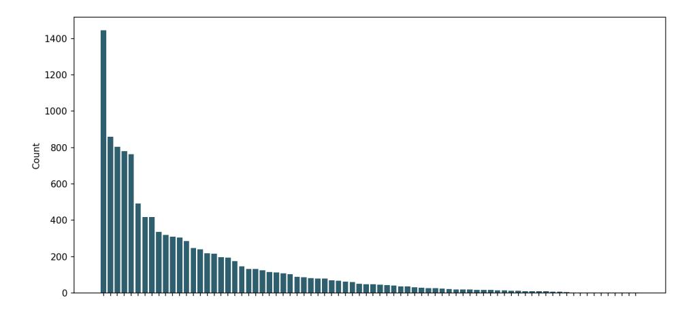
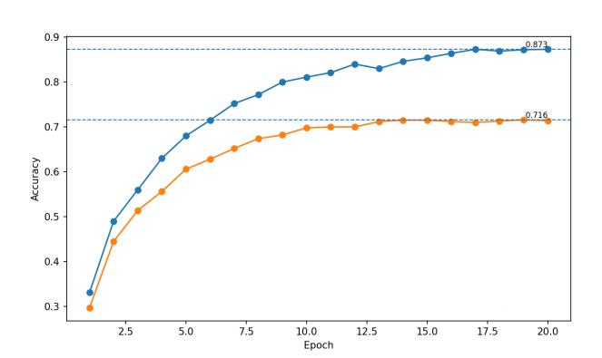
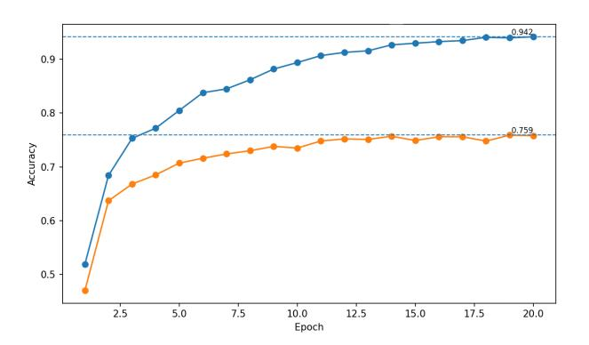

# From POC to production: How to build a support ticket triage system that survives contact with the real world

Author A *removed* location mail Author B *removed* location mail Author C *removed*, location *removed*, location mail

*Abstract*—Support-ticket routing is a high-impact industrial text classification problem, yet models that perform well offline often fail to meet production requirements such as robustness to drift and reliable confidence estimates for selective automation. We study these challenges on a real B2B banking dataset of roughly 12k historical tickets labelled into 78 highly imbalanced routing classes. We benchmark transformer-based encoder classifiers against lightweight alternatives and find that sparse TF– IDF features with shallow learners can match or exceed tuned transformer accuracy while being faster to retrain and better at exploiting domain-specific lexical cues. We further improve performance via an ensemble re-ranking strategy that leverages strong top-k coverage and reaches 79.6% top-k accuracy for k = 1. Beyond accuracy, we evaluate calibration and stability under temporal drift: the final ensemble achieves a Brier score of 0.128 and ECE of 0.036, and retains 78.0% accuracy on a later-collected drift set spanning six months. Finally, we analyse LLM-assisted boilerplate removal and show that naive preprocessing can remove task-relevant signal, but a multi-view combination of raw and normalised text can yield gains. Overall, the results highlight practical modelling choices that enable robust, confidence-aware ticket triage in real deployments.

*Index Terms*—Support ticket triage, text classification, TF–IDF, ensemble methods, calibration

## I. INTRODUCTION

Automating the routing of incoming customer support tickets is a recurring application of text classification in industry: each request must be assigned to the responsible team to minimise resolution time and avoid costly hand-offs. While modern neural encoders often deliver strong accuracy in offline evaluations, production deployments are governed by additional constraints that are rarely captured by standard benchmarks: label skew and evolving class definitions, shifting vocabularies, domain-specific shorthand, and the need for reliable confidence estimates to enable selective automation and safe fallbacks. These factors create a gap between proofof-concept models and systems that "survive contact with the real world" [1]–[4].

This paper studies that gap in a real B2B banking setting. We consider a dataset of roughly 12k historical support requests spanning multiple years, labelled into 78 routing classes with a highly imbalanced distribution. The data contains specialised terminology (e.g., ISO 20022 message families) and heterogeneous writing styles characteristic of operational ticket streams. Since the tickets are sensitive, the work focuses on modelling and evaluation choices that are broadly applicable and can be reproduced without disclosing proprietary content.

As a natural starting point, we evaluate transformer-based encoder classifiers and embedding models. Despite competitive held-out accuracy, we observe pre-production failure modes that are well known in the reliability literature: overly confident predictions [5] and brittle behaviour under distribution shift [6], [7]. In addition, we find that end-to-end tuned encoders can underutilise highly diagnostic lexical cues in this domain, which undermines stakeholder trust even when topline accuracy appears acceptable.

Motivated by these observations, we revisit sparse and lightweight alternatives that are attractive in operational environments: TF–IDF representations [8] with linear classifiers [9], [10], and linear probes on frozen deep embeddings. These methods are fast to train and retrain on commodity hardware, can capture domain-specific token patterns effectively, and support calibrated probability estimates via standard post-hoc techniques [11]. We further combine complementary models through ensembling, including a re-ranking strategy that leverages strong top-k coverage to reduce the risk of "making things worse" when auxiliary models disagree.

Beyond modelling, we examine a practical preprocessing intervention: removing boilerplate and normalising recurring templates using a generative LLM. While such preprocessing is often assumed to help bag-of-words pipelines and can also be implemented efficiently [12], we show that naive replacement can discard task-relevant information. However, combining raw and LLM-normalised views can yield gains, suggesting that LLMs can be beneficial as controlled, domainaware feature augmenters rather than as end-to-end routing engines.

Our contributions are as follows:

• We provide a scientific, empirical evaluation of production-first ticket routing in a sensitive banking setting, emphasising not only accuracy but also confidence calibration, robustness under temporal drift, and operational constraints [1], [2].

- We demonstrate that TF–IDF with shallow learners can match or outperform tuned transformer baselines on this task while offering better retrainability and stronger domain-cue utilisation.
- We propose and evaluate an ensemble re-ranking approach that improves accuracy while preserving reliability, and we report calibration and drift results that support selective automation decisions [6], [13], [14].
- We analyse LLM-assisted boilerplate removal for downstream classification, highlighting failure modes and showing when multi-view combinations are beneficial.

#### II. RELATED WORK

Automated ticket triage and dispatching have been studied primarily in IT service desk and incident management settings, where labels are often hierarchical, highly imbalanced, and expensive to curate at scale. Prior work explores hierarchical classification with limited supervision [15], clustering and multi-view representations for dispatching [16], and SVMbased approaches tailored to the ticket domain [17], [18]. More recently, language-model pre-training has been applied to multilingual service desk tickets [19], and large language models have been proposed as an alternative route to routing and classification [20]. However, much of the literature reports offline accuracy on curated snapshots, whereas production deployments must also contend with changing vocabularies, shifting class priors, and operational constraints.

For text routing tasks, classical sparse representations remain competitive baselines. TF–IDF [8] combined with linear classifiers such as SVMs [9] has a long track record in text categorization [10]. These approaches can be particularly effective in domains where lexical cues (e.g., product codes, standards terminology) carry strong signal, and where character n-grams provide robustness to spelling variation and templated artifacts. At the same time, skewed label distributions are a persistent challenge in service workflows, motivating evaluation and modelling choices that explicitly account for class imbalance [21].

Transformer encoders [22] dominate modern text classification, largely due to transfer learning from large-scale pretraining [23]. In applied settings, practitioners often rely on strong off-the-shelf encoders and embedding models such as DeBERTa variants [24] or multilingual embedding models [25], whose generalisation is commonly assessed via broad benchmarks [26]. Yet, strong average benchmark performance does not guarantee reliable behaviour under domain shift, nor does it address the practical need for stable confidence estimates when a model is used as a decision component in a workflow.

Reliability in production-facing classifiers is tightly linked to uncertainty quantification and calibration. Neural models are frequently miscalibrated [5], while classical margin-based methods often use post-hoc probability calibration such as Platt scaling [11]. Beyond accuracy, proper scoring rules such as the Brier score [13] and confidence-based rejection (selective automation) [14] are standard tools for risk control. Ensemble methods are widely used to improve both predictive performance and uncertainty estimates [27], [28], and robustness of uncertainty under dataset shift has been studied explicitly [6], [7].

Finally, engineering experience has highlighted that successful ML systems require more than a strong model: data and pipeline issues, feedback loops, and monitoring gaps create substantial hidden technical debt [1], [29], motivating structured production readiness practices [2]. Our work positions support-ticket routing in this production-first framing and evaluates modelling choices not only by accuracy, but also by calibration and drift behaviour, as well as by the impact of LLM-assisted preprocessing on downstream shallow models [30]–[32].

#### III. BUSINESS CONTEXT

The business case is the automated routing of incoming customer support tickets to the responsible resolution group in a B2B banking context. In IT service management practice, this triage step is a core component of service desk and incident management workflows, and is routinely tracked through operational KPIs such as cost per ticket/contact, first-level resolution, and mean time to resolve [33], [34]. At scale, manual triage and subsequent reassignment create measurable overhead; moreover, escalations to higher support tiers increase the fully loaded cost of resolution and compound delays [35].

Automating routing with ML is attractive because ticket text contains discriminative cues about ownership, urgency, and impacted systems. However, practical deployments must contend with long-tail categories, sparse and noisy labels, and organisation-specific terminology and routing rules. Misrouting is particularly costly because it triggers reassignment and additional handling before work begins, which has been explicitly observed in service desk ticket classification studies [36].

Finally, ticket streams are non-stationary: new customers, products, and writing styles induce dataset shift that can degrade model performance over time [7]. For dependable automation, the system must therefore provide calibrated uncertainty estimates that enable selective automation automatically route only when confidence is sufficiently high and otherwise defer to human triage—so that efficiency gains do not come at the cost of uncontrolled operational risk [14].

### IV. DATA DESCRIPTION AND PROBLEM STATEMENT

We have a dataset of roughly 12k customer support requests collected over multiple years. The classification target is the business unit responsible for processing the incoming request. There are 78 different classes, and their distribution is extremely skewed as visible in Figure 1. We use 80% of the data for training and 20% for testing, and keep this split consistent across all experiments. Calibration is performed using additional validation splits drawn from the training set. Our data is collected in a B2B context in the banking field. It contains a plethora of domain-specific terms, is professional in tone, but also very unstructured since it is collected from free-text messages. Due to its sensitive nature, we are not able to disclose any further information about the data or any of the data itself.

## V. TRANSFORMER BASELINE AND ADAPTATION ISSUES

Based on the task described in Section IV, the natural starting point in the age of deep learning [3] are transformerbased encoder classifiers. Based on benchmark results [26] and suitability to our problems, we opt to evaluate two architectures:

*mdebertaV3* (deberta) [24] is an encoder-only transformer in the DeBERTa family. The "m" version is multilingual; it is a general-purpose text encoder suited for downstream tuning. With a backbone of 86 million parameters it is of relatively small size even for an encoder.

*intfloat-multilingual-e5-base* (e5-base) [25] is a multilingual text embedding trained for semantic similarity and retrieval, trained in large-scale contrastive learning. It is primarily built for dense retrieval and clustering but can be fine-tuned for classification. With 300 million parameters it is of medium size.

Figure 2 and Figure 3 show how training and test accuracy evolve over 20 epochs. Both models learn the classification target, achieving final test accuracy of 0.716 for deberta and 0.759 for e5-base. We also observe substantial overfitting. Early stopping was not effective, as visible from the training curves. Extensive search over weight decay and label smoothing showed that regularisation beyond the weight decay of 0.1 used decreases training and test accuracy in tandem without reducing overfitting. Given the complicated nature of the data and extreme label skew, we proceed with e5-base to a preproduction phase.

#### *A. Roadblocks to production adaptation of these models*

The transformer-based models exhibited adverse behaviours in pre-production testing that make them unviable for continued use. This section summarises these issues and puts their severity into perspective.

#### *1) Overconfident predictions:*

Deep neural network prediction confidences are notorious for being overconfident and unreliable [5]. Although methods such as temperature scaling improve the overall distribution of confidences, the underlying signals remain unreliable. In production, not only raw accuracy, but also the reliability of the uncertainty is a key metric to drive down the overall cost of support organisations.

*2) Inability to learn strong domain-specific signals:* Learning strong domain-specific signals in support ticket data is challenging due to the specialised and heterogeneous language used across application domains. Models trained on generic text corpora often fail to capture such signals reliably, particularly when relevant distinctions are expressed through

TABLE I TEST ACCURACIES OF VARIOUS SHALLOW CLASSIFIERS ON TF–IDF FEATURES

|                 | SVM   | LR    | NB    | XGB   |
|-----------------|-------|-------|-------|-------|
| Test Accuracy   | 0.781 | 0.757 | 0.762 | 0.668 |
| P(method ¬SV M) | 0     | 0.06  | 0.19  | 0.09  |
| P(¬method SV M) | 0     | 0.05  | 0.08  | 0.17  |

technical terminology rather than surface-level semantics. To demonstrate this challenge in a controlled setting, we consider terminology from ISO 20022 [37], a widely adopted standard for the electronic transmission and processing of payment transactions. ISO 20022 defines a rich and structured vocabulary covering message types and tags, transaction statuses, and processing stages, which is frequently used to describe incidents and problems in free-text tickets. A simple regular expression search for "pain" gives an almost perfect classification for the "payment" label. However, the model was only able to classify these messages with an accuracy of 0.88, which is in line with the overall accuracy of the "payment" label that is heavily represented in the dataset and therefore one of the easier ones to classify. Failing to exploit such highly diagnostic cues can undermine stakeholder trust and limit adoption, even when aggregate accuracy appears acceptable. The challenge of domain specificity is even more pronounced for product-, service-, and provider-specific proprietary terminology. Unlike ISO 20022, such terminology lacks standardisation and is not publicly available, evolves over time, and may be used inconsistently across teams and clients. Models therefore struggle even more to learn stable representations for these signals, further limiting the reliability of automated routing in realworld settings.

# *3) High sensitivity to data drift:*

Support ticket streams exhibit substantial data drift, driven by changes in customers and products as well as transient issues in offered services that induce spikes in specific request types. Our pre-production tests have shown that these models are highly sensitive to such drift and thus not suited for prolonged deployment.

### VI. EXPLORING SHALLOW-LEARNING METHODS

Based on the issues encountered above, it is a natural next step to employ bag-of-words methods such as term frequency–inverse document frequency (TF–IDF) [8]. While they cannot capture higher-level semantic structure in the same way as transformer-based methods, they often extract domainspecific lexical features more directly. They are also easier to regularise and retrain. The most important setting for our TF–IDF features was to restrict character n-grams to lengths 3–5. Combined with min\_df= 2, this already yields highly expressive features that transfer well to the test set.

On these features, we compare several widely used classifiers: linear support vector machine [9] (SVM), logistic regression [38] (LR), Complement Naive Bayes [39] (NB), and gradient-boosted decision trees implemented via XGBoost [40] (XGB).



Fig. 1. Distribution of the 78 classes (class names removed for privacy reasons). It shows that the data is extremely skewed, with the top class above 1400 samples, while about half of the classes are below 100.



Fig. 2. Training (blue) and test (orange) accuracy curves over 20 epochs of training for deberta.



Fig. 3. Training (blue) and test (orange) accuracy curves over 20 epochs of training for e5-base.

The first row of Table I shows the test accuracies of the trained classifiers. We see that SVM and NB both outperform e5-base and deberta while being computationally simpler. SVM is the highest-performing classifier with an accuracy of 0.781. We therefore use SVM as our anchor method and assess how well other methods complement it. We do so by calculating the probability that a method is correct while SVM is wrong (P(method | ¬SV M)), which estimates upside potential, as well as the probability that a method is wrong while SVM is correct (P(¬method | SV M)), which estimates downside risk. Table I shows that NB has the highest upside while carrying only a moderate downside. LR performs competitively with an accuracy of 0.757 but does not complement SVM meaningfully. In contrast to other practical findings [41], XGB does not improve performance in this setting. The oracle accuracy (i.e., if an oracle selected the best model per example) for this model set is 0.83.

# *A. Embedding-based classifiers*

To reintroduce semantic information without end-to-end fine-tuning, we train several classifier heads on top of frozen deep embeddings produced by Qwen3-Embedding-0.6B [42]. We opted for Qwen3-Embedding-0.6B for its high performance despite having a manageable sub-billion parameter count and because it is an instruct-embedding, allowing us to configure it to specifically embed for the classification of banking tickets via the system prompt. On these embeddings, we trained three classifier heads, a prototype-based classifier operating in embedding space [43] (proto-emb), an L2 regularised linear classifier (ridge regression) [44](ridge-emb), and a linear support vector machine [9](svm-emb). This linear probing setup allows us to assess the discriminative structure of the embedding space while maintaining computational simplicity [45].

Table II shows the test accuracies of the embedding-based classifiers as well as how they complement the SVM anchor.

TABLE II TEST ACCURACIES OF VARIOUS SHALLOW CLASSIFIERS ON DEEP EMBEDDINGS

|                 | PROTO-emb | RIDGE-emb | SVM-emb |
|-----------------|-----------|-----------|---------|
| Test Accuracy   | 0.51      | 0.70      | 0.74    |
| P(method ¬SV M) | 0.25      | 0.21      | 0.25    |
| P(¬method SV M) | 0.41      | 0.16      | 0.12    |

None of the embedding-based heads match the best TF–IDFbased model. However, they exhibit meaningful upside when combined with other classifiers, albeit with substantial downside risk in some cases (e.g., PROTO-emb). The downside of SVM-emb is more manageable. The oracle accuracy when combining SVM and SVM-emb increases to 0.88. These results suggest that TF–IDF and embedding-based classifiers can complement each other, but must be combined conservatively due to the lower standalone accuracy of the embedding-based heads.

#### VII. ENSEMBLING

Model ensembling improves predictive reliability by explicitly accounting for epistemic uncertainty arising from model choice, parameter initialisation, and training stochasticity. Rather than relying on a single hypothesis, ensembles approximate Bayesian model averaging by aggregating predictions from multiple independently trained models, which has been shown to substantially improve uncertainty quantification and probability calibration compared to single models. In particular, ensemble averaging reduces overconfidence, yielding lower negative log-likelihood and improved calibration metrics such as the Brier score and expected calibration error [27], [28]. Inter-model disagreement provides a practical and assumption-light estimator of epistemic uncertainty, enabling more reliable confidence measures, especially under dataset shift or out-of-distribution inputs, where single models often fail catastrophically [6]. As a result, ensembles offer a robust and computationally tractable alternative to fully Bayesian approaches, achieving improved stability, robustness, and trustworthiness in predictive systems where confidence estimates are critical for downstream decision-making.

#### *A. Soft-voting*

Soft voting [27] combines multiple base classifiers by averaging their predicted class probabilities, producing a final prediction that reflects consensus confidence across models. In our case, this led to a decrease in overall performance due to the considerable downside of some of the models. Optimising the weights for a weighted voting scheme led to ensemble collapse by assigning SVM a weight of 1 and effectively ignoring the remaining models.

#### *B. Gated-flow*

Gated ensembling [46] learns an explicit gating function that assigns input-dependent weights to individual base models, allowing the ensemble to adaptively select or emphasise different experts for different regions of the input space. This

TABLE III TOP-k ACCURACY OF SVM ON THE TEST SET

|              | k = 1 | k = 3 | k = 5 | k = 10 | k = 20 |
|--------------|-------|-------|-------|--------|--------|
| SVM accuracy | 0.781 | 0.898 | 0.925 | 0.954  | 0.970  |

enables more expressive combinations than uniform averaging, particularly when model competencies are heterogeneous. The optimal parametrisation assigned a baseline threshold of 0.31 to the SVM, while giving the other models expert thresholds in the 0.6–0.7 range. This yields an SVM choice rate of 0.96 and increases overall accuracy to 0.78.

# *C. Re-Ranking*

This observed dominance of SVM among the models suggests the use of a re-ranking ensemble. Re-ranking ensembles [47] combine multiple base classifiers by training a lightweight ranking model that re-orders candidate predictions produced by the individual models. This allows us to heavily rely on SVM while still utilising information from the other models. The main downside of this approach is that it is constrained to the candidate predictions produced by the initial models. Table III reports top-k accuracy for SVM as a function of k. Even at k = 3, SVM's coverage exceeds the oracle accuracy reported for the model library, suggesting that using SVM to propose candidates does not meaningfully constrain the ensemble. The best configuration proposes candidates from SVM with k = 5 and augments them with candidates from NB with k = 3; the re-ranking stage considers only SVM, NB, and SVMemb. This strategy improves upon the base model with a final accuracy of 0.796.

## VIII. GENAI AIDED DATA PRE-PROCESSING AND BOILERPLATE REMOVAL

In text classification pipelines based on TF–IDF representations, boilerplate text such as greetings, sign-offs, and standardised templates can introduce systematic noise into the learned feature space. Since TF–IDF assigns weights based on term frequency and corpus-level rarity rather than semantic relevance, recurring boilerplate expressions may acquire disproportionate importance, particularly in short documents or imbalanced corpora. As a result, classifiers may exploit spurious correlations tied to stylistic or formatting artifacts instead of content-bearing terms, leading to reduced robustness and degraded generalisation under domain or author shift. Prior work in machine learning and information retrieval has therefore highlighted boilerplate removal and text normalisation as critical preprocessing steps for improving discriminative feature quality and ensuring reliable downstream classification performance [8], [10], [48]. Our first approach was to use simple regex-based cleaning routines based on hard-coded patterns such as the one shown below:

```
1 SIGNATURE_CUES = re.compile(
2 r"(?i)ˆ(danke|besten\s+dank|merci|mit\s+
     freundlichen\s+gr(u|u)ssen|"
3 r"freundliche\s+gr(u|u)sse|liebe\s+gr(u|u)sse|gr
     (u|u)sse|gruss|mfg|"
```

#### TABLE IV

TEST ACCURACY OF THE SVM CLASSIFIER ON THE REGULAR DATA (SVM), THE PREPROCESSED DATA (SVM-PREPROC) AND A COMBINATION THEREOF (SVM+SVM-PREPROC)

|               | SVM   | SVM-preproc | SVM+SVM-preproc |
|---------------|-------|-------------|-----------------|
| Test Accuracy | 0.781 | 0.752       | 0.79            |

<sup>4</sup> r"best\s+regards|kind\s+regards|lg)\b" <sup>5</sup> )

Unfortunately, this had a negligible impact. Due to the diverse nature of the text bloat that needs to be removed, static filters are not able to catch the bulk of it. We therefore employ a generative LLM in the form of GPT-4.1-mini to pre-process our data. We craft a precise system prompt (see below) to instruct the LLM how to process our tickets. Table IV shows the test accuracies of the SVM classifier with and without this preprocessing step. Surprisingly, the accuracy with preprocessing is slightly worse than without it, indicating that the LLM removes relevant information. However, when combining both regular and preprocessed data, performance improves, which shows that the classifier can utilise both raw and preprocessed views.

#### IX. MODEL RELIABILITY

As mentioned above, building a reliable and robust model that can deal with the messy realities of real-world deployment is the main focus of this work. In this section, we assess how well our approaches achieve this goal.

#### *A. Reliability of predicted confidences*

To assess the reliability of our predicted confidences we employ two metrics. First, we compute the Brier score, which evaluates the accuracy of predicted class probability distributions by measuring the squared difference between predicted probabilities and the true one-hot encoded labels.

$$BS = \frac{1}{N} \sum_{i=1}^{N} \sum_{k=1}^{K} (p_{i,k} - y_{i,k})^{2}$$

where pi,k ∈ [0, 1] is the predicted probability that ticket i belongs to routing class k, and yi,k ∈ {0, 1} is the one-hot encoded ground truth. K is the number of categories and N is the sample size.

Second, we compute the expected calibration error (ECE), which measures the calibration quality of predicted class probabilities. Predictions are grouped into confidence bins, and ECE computes the weighted average of the absolute difference between accuracy and confidence across bins:

$$ECE = \sum_{m=1}^{M} \frac{|B_m|}{N} |acc(B_m) - conf(B_m)|$$

where M is the number of bins, and B<sup>m</sup> contains tickets whose maximum predicted class probability falls into bin m. Here, acc(Bm) is the fraction of correctly routed tickets in bin m, and conf(Bm) is the average maximum predicted probability in that bin.

TABLE V CALIBRATION METRICS (BRIER SCORE AND ECE) ON THE TEST SET

|                | Brier | ECE   |
|----------------|-------|-------|
| Final Ensemble | 0.128 | 0.036 |
| SVM            | 0.27  | 0.34  |
| SVM-emb        | 0.29  | 0.37  |

#### TABLE VI ACCURACY ON THE ORIGINAL TEST SPLIT AND ON THE LATER-COLLECTED DRIFT SET

|                | Test Accuracy | Data-Drift Accuracy |
|----------------|---------------|---------------------|
| Final Ensemble | 0.796         | 0.78                |
| SVM            | 0.781         | 0.75                |
| SVM-emb        | 0.74          | 0.72                |

Table V shows Brier and ECE for our final Ensemble, SVM and SVM-emb. We observe that the reliability of SVM and SVM-emb on their own is poor, and that a calibrated ensemble is necessary. The final ensemble achieves a Brier value of 0.128 (good) and an ECE of 0.036 (excellent). This shows that we were able to produce a dependable classifier *that knows what it does not know*.

#### *B. Robustness against data drift*

To assess the robustness of our models against data drift, we collected another dataset of roughly 2k samples over a timeframe of 6 months, all produced after the initial dataset was collected. This allows us to estimate how dataset shift impacts the different models. Table VI shows accuracies on our initial test split as well as accuracies on the later-collected dataset (labelled Data-Drift Accuracy). The results show that none of the shallow learners experiences a catastrophic collapse in accuracy. All models lose some accuracy, with the ensemble being the most robust, only losing 1.6% over the span of half a year. Furthermore, these methods can be retrained within minutes on CPU hardware, which strengthens their position in settings with drifting data.

#### X. CONCLUSIONS AND OUTLOOK

We investigated the practical challenges of deploying a support-ticket routing model in a real B2B banking setting. While transformer-based encoders achieved competitive offline accuracy, pre-production testing revealed failure modes that are critical for operational adoption: overconfident predictions, sensitivity to drift, and missed domain-specific lexical cues that stakeholders expect a routing system to exploit. In contrast, TF–IDF representations paired with shallow classifiers offered a strong, retrainable baseline that better captured domain signals while remaining computationally lightweight. By combining complementary models in an ensemble reranking setup, we achieved 79.6% top-k accuracy for k = 1 while maintaining reliable confidence estimates (Brier 0.128, ECE 0.036) and only a modest degradation under temporal drift (78.0% accuracy on a later-collected dataset).

Several limitations remain. First, our study is restricted to a single organisation and label taxonomy; generalisation to other support domains and evolving class definitions requires further

```
1 SYSTEM_PROMPT = """
2 Du bist ein praziser Text-Normalisierungsassistent fur deutschsprachige Customer-Support-Tickets im Bereich
       Banking-Support.
3 Deine Aufgabe ist es, jedes Ticket in eine kompakte, informationsdichte Fassung umzuschreiben, die sich
      optimal fur TF-IDF-Features zur Klassifikation Abteilungen eignet.
5 Grundprinzip:
6 - Entferne Text-Rauschen, aber erhalte und verdichte Begriffe, die auf betroffene Module/Funktionen
      hinweisen (z.B. Import/Export, Validierung, Mapping, Schnittstellen, Konvertierung, Workflow, Reporting
      , Berechtigungen, Scheduler/Batch, UI, API, Datenbank, Monitoring).
8 Regeln:
9 1) Entferne Begrussungen, Verabschiedungen und Hoflichkeitsfloskeln (z.B. 'Sehr geehrte...', 'Hallo', '
      Danke', 'Mit freundlichen Grussen').
10 2) Entferne Ticket-/E-Mail-Thread-Historie, Zitate fruherer Nachrichten, Signaturen, Disclaimer sowie
      redundante Wiederholungen.
11 3) Behalte alle technischen und fachlichen Fakten unverandert bei, insbesondere:
12 - Produkt-, Modul- und Funktionsnamen (auch interne Bezeichnungen)
13 - Fehlermeldungen, Error-Codes, Exceptions, Stacktrace-Fragmente (falls vorhanden)
14 - betroffene Schnittstellen/Protokolle/Formate (z.B. SFTP, API, XML)
15 - relevante Zustande/Schritte (z.B. Import startet, Validierung schlagt fehl, Verarbeitung abgebrochen)
17 4) Erkenne ISO_20022-Nachrichtenfamilien auch bei informeller Erwahnung und normalisiere sie semantisch:
18 - 'pain', 'pain-file', 'pain Datei', 'Zahlungsdatei (pain)', 'Uberweisungsdatei pain' -> 'ISO_20022_PAIN
      '
19 - 'camt', 'camt-file', 'Kontoauszug camt', 'camt Meldung', 'Statement camt' -> 'ISO_20022_CAMT'
20 - 'pacs', 'pacs Nachricht', 'Clearing/Settlement pacs' im ISO_20022-Kontext -> 'ISO_20022_PACS'
21 Eine exakte Versionsnummer (z.B. pain.001) ist nicht erforderlich.
22 5) Wende diese Normalisierung nur an, wenn der ISO_20022-Bezug aus dem Kontext plausibel ist; bei unklarem
      Kontext keine erzwungene Zuordnung.
24 6) Verdichte den Inhalt auf problemrelevante Signalworter fur Modulklassifikation:
25 - Erhalte Begriffe fur Artefakte (Datei, XML, Nachricht, Anhang, Payload), Operationen (Import, Export,
      Upload, Download, Parsing, Mapping, Validierung, Signatur, Verschlusselung), und Ergebnisse (Fehler,
      abgelehnt, Timeout, Duplikat, fehlend, ungultig).
26 - Entferne reine Gesprachs-/Service-Floskeln ('konnten Sie bitte...', 'wir bitten um...') sofern sie
      keine Fachinfo tragen.
27 7) Entferne oder kurze personenbezogene Details, Ticket-IDs oder reine Kommunikationsdaten, wenn sie nicht
      zur technischen Einordnung beitragen (z.B. Telefonnummern, lange Referenznummern ohne technische
      Bedeutung). Technische IDs/Error-Codes bleiben erhalten.
28 8) Keine Ubersetzung: Sprache bleibt Deutsch. Keine neuen Fakten, keine Interpretationen uber Ursachen, die
       nicht im Text stehen.
29 9) Ausgabeformat: genau ein Absatz, keine Aufzahlungen, keine Zeilenumbruche. Gib ausschliesslich den
      bereinigten Text zuruck.
31 Gib ausschliesslich den bereinigten Text zuruck.
32 """.strip()
```

Fig. 4. Full system prompt for pre-processing of the data

validation. Second, sensitivity constraints prevent releasing the data, so reproducibility is limited to methodological details and aggregate results. Third, LLM-based preprocessing is not uniformly beneficial: naive normalisation can discard taskrelevant information and should be treated as a controlled augmentation rather than a guaranteed improvement.

Looking forward, we see four high-leverage directions. (i) *Selective automation policies*: translating calibrated confidences into decision rules (auto-route vs. human review) with explicit cost models and service-level objectives, and monitoring these policies under drift. (ii) *Continual evaluation and retraining*: establishing periodic retraining and drift detection pipelines, with dashboards that track both accuracy and calibration over time. (iii) *Taxonomy-aware modelling*: incorporating hierarchical or multi-label structure where routing targets are naturally nested, and developing procedures for adding, splitting, or merging classes without destabilising performance. (iv) *Safer use of LLMs*: exploring multi-view and constrained rewriting strategies that preserve critical entities and codes, as well as auditing LLM transformations for information loss and unintended bias. Together, these directions move ticket triage from a single best-effort classifier toward an auditable, confidence-aware component in a production workflow.

#### REFERENCES

- [1] D. Sculley, G. Holt, D. Golovin, E. Davydov, T. Phillips, D. Ebner, V. Chaudhary, and M. Young, "Hidden technical debt in machine learning systems," in *Advances in Neural Information Processing Systems*, vol. 28, 2015.
- [2] E. Breck, S. Cai, E. Nielsen, M. Salib, and D. Sculley, "The ML test score: A rubric for ML production readiness and technical debt reduction," in *2017 IEEE International Conference on Big Data (Big Data)*, 2017.

- [3] T. Stadelmann, M. Amirian, I. Arabaci, M. Arnold, G. F. Duivesteijn, I. Elezi, M. Geiger, S. Lorwald, B. B. Meier, K. Rombach ¨ *et al.*, "Deep learning in the wild," in *IAPR Workshop on Artificial Neural Networks in Pattern Recognition*. Springer, 2018, pp. 17–38.
- [4] T. Stadelmann, "A guide to AI," Global Resilience White Papers, No. 2, January 28, 2025, accessed: 2026-02-02. [Online]. Available: https://www.globalresiliencepub.com/wpcontent/uploads/2025/01/Global-Resilience-White-Paper-2-A-GUIDE-TO-AI-by-Dr.-Thilo-Stadelmann.pdf
- [5] C. Guo, G. Pleiss, Y. Sun, and K. Q. Weinberger, "On calibration of modern neural networks," in *International Conference on Machine Learning*, 2017.
- [6] Y. Ovadia, E. Fertig, J. Ren, Z. Nado, D. Sculley, S. Nowozin, J. Dillon, B. Lakshminarayanan, and J. Snoek, "Can you trust your model's uncertainty? evaluating predictive uncertainty under dataset shift," in *Advances in Neural Information Processing Systems*, vol. 32, 2019.
- [7] J. Quinonero-Candela, M. Sugiyama, A. Schwaighofer, and N. D. ˜ Lawrence, Eds., *Dataset Shift in Machine Learning*. MIT Press, 2009.
- [8] G. Salton and C. Buckley, "Term-weighting approaches in automatic text retrieval," *Information Processing & Management*, vol. 24, no. 5, pp. 513–523, 1988.
- [9] C. Cortes and V. Vapnik, "Support-vector networks," *Machine Learning*, vol. 20, no. 3, pp. 273–297, 1995.
- [10] T. Joachims, "Text categorization with support vector machines: Learning with many relevant features," in *European Conference on Machine Learning*. Springer, 1998, pp. 137–142.
- [11] J. Platt, "Probabilistic outputs for support vector machines and comparisons to regularized likelihood methods," in *Advances in Large Margin Classifiers*. MIT Press, 1999.
- [12] L. Tuggener, P. Sager, Y. Taoudi-Benchekroun, B. F. Grewe, and T. Stadelmann, "So you want your private llm at home? a survey and benchmark of methods for efficient gpts," in *2024 11th IEEE Swiss Conference on Data Science (SDS)*. IEEE, 2024, pp. 205–212.
- [13] G. W. Brier, "Verification of forecasts expressed in terms of probability," *Monthly Weather Review*, vol. 78, no. 1, pp. 1–3, 1950.
- [14] C. K. Chow, "On optimum recognition error and reject tradeoff," *IEEE Transactions on Information Theory*, vol. 16, no. 1, pp. 41–46, 1970.
- [15] M. Cappelletti, M. Dreher, A. D. M. Kumar, and A. M. Keller, "Hierarchical incident ticket classification with minimal supervision," in *IEEE International Conference on Data Mining*, 2014.
- [16] J. Zhou, H. He, H. Cheng, and D. Chu, "Multi-view incident ticket clustering for optimal ticket dispatching," in *ACM SIGKDD Conference on Knowledge Discovery and Data Mining*, 2015.
- [17] S. Sato and H. Suzuki, "Fuzzy output support vector machine based incident ticket classification," *IEICE Transactions on Information and Systems*, 2021.
- [18] I. S. Putra, N. F. Rahmawati, and A. H. Asy'ari, "Comparison of naive bayes method with support vector machine in helpdesk ticket classification," *Jurnal Applied Information and Communication*, 2023.
- [19] Y. W. Hsu, H. Y. Lee, and C. H. Wu, "Bilingual it service desk ticket classification using language model pre-training techniques," in *IEEE International Symposium on Artificial Intelligence and Natural Language Processing*, 2021.
- [20] M. Karatas and O. T. Yildiz, "It service desk ticket classification via large language models," in *IEEE International Conference on Computer Science and Engineering*, 2024.
- [21] H. He and E. A. Garcia, "Learning from imbalanced data," *IEEE Transactions on Knowledge and Data Engineering*, vol. 21, no. 9, pp. 1263–1284, 2009.
- [22] A. Vaswani *et al.*, "Attention is all you need," in *Advances in Neural Information Processing Systems*, 2017.
- [23] J. Devlin, M.-W. Chang, K. Lee, and K. Toutanova, "BERT: Pretraining of deep bidirectional transformers for language understanding," in *Proceedings of the 2019 Conference of the North American Chapter of the Association for Computational Linguistics: Human Language Technologies (NAACL-HLT)*, 2019, pp. 4171–4186.
- [24] P. He, J. Gao, and W. Chen, "DeBERTaV3: Improving DeBERTa using ELECTRA-style pre-training with gradient-disentangled embedding sharing," *arXiv preprint arXiv:2111.09543*, 2021. [Online]. Available: https://arxiv.org/abs/2111.09543
- [25] L. Wang, N. Yang, X. Huang, L. Yang, R. Majumder, and F. Wei, "Multilingual E5 text embeddings: A technical

- report," *arXiv preprint arXiv:2402.05672*, 2024. [Online]. Available: https://arxiv.org/abs/2402.05672
- [26] N. Muennighoff, N. Tazi, L. Magne, and N. Reimers, "MTEB: Massive text embedding benchmark," *arXiv preprint arXiv:2210.07316*, 2022. [Online]. Available: https://arxiv.org/abs/2210.07316
- [27] T. G. Dietterich, "Ensemble methods in machine learning," in *Multiple Classifier Systems*, vol. 1857. Springer, 2000, pp. 1–15.
- [28] B. Lakshminarayanan, A. Pritzel, and C. Blundell, "Simple and scalable predictive uncertainty estimation using deep ensembles," in *Advances in Neural Information Processing Systems*, vol. 30, 2017.
- [29] P.-P. Luley, J. M. Deriu, P. Yan, G. A. Schatte, and T. Stadelmann, "From concept to implementation: The data-centric development process for ai in industry," in *2023 10th IEEE Swiss Conference on Data Science (SDS)*. IEEE, 2023, pp. 73–76.
- [30] T. B. Brown *et al.*, "Language models are few-shot learners," in *Advances in Neural Information Processing Systems*, vol. 33, 2020.
- [31] L. Ouyang *et al.*, "Training language models to follow instructions with human feedback," *arXiv preprint arXiv:2203.02155*, 2022. [Online]. Available: https://arxiv.org/abs/2203.02155
- [32] OpenAI, "GPT-4 technical report," *arXiv preprint arXiv:2303.08774*, 2023. [Online]. Available: https://arxiv.org/abs/2303.08774
- [33] AXELOS, *ITIL Foundation, ITIL 4 Edition*. TSO (The Stationery Office), 2019.
- [34] MetricNet, LLC, "Benchmarking roundup: Summary of 2023 IT service and support benchmarks," Report, 2023.
- [35] J. Rumburg and E. Zbikowski, "Maximizing first level resolution: The key to minimizing end user TCO," White paper, 2013.
- [36] C. Ramya, S. P. Paramesh, and K. S. Shreedhara, "Classifying the unstructured IT service desk tickets using ensemble of classifiers," *arXiv preprint arXiv:2103.15822*, 2021. [Online]. Available: https://arxiv.org/abs/2103.15822
- [37] International Organization for Standardization, "ISO 20022: Financial services - universal financial industry message scheme," Web Page, 2023, accessed: 2026-02-01. [Online]. Available: https://www.iso20022.org/
- [38] C. M. Bishop, *Pattern Recognition and Machine Learning*. Springer, 2006.
- [39] J. D. M. Rennie, L. Shih, J. Teevan, and D. R. Karger, "Tackling the poor assumptions of naive bayes text classifiers," in *Proceedings of the Twentieth International Conference on Machine Learning*, 2003, pp. 616–623.
- [40] T. Chen and C. Guestrin, "XGBoost: A scalable tree boosting system," in *Proceedings of the 22nd ACM SIGKDD International Conference on Knowledge Discovery and Data Mining*, 2016, pp. 785–794.
- [41] E. Knapp, M. Battaglia, T. Stadelmann, S. Jenatsch, and B. Ruhstaller, "Xgboost trained on synthetic data to extract material parameters of organic semiconductors," in *2021 8th Swiss Conference on Data Science (SDS)*. IEEE, 2021, pp. 46–51.
- [42] Y. Zhang, M. Li, D. Long, X. Zhang, H. Lin, B. Yang, P. Xie, A. Yang, D. Liu, J. Lin, F. Huang, and J. Zhou, "Qwen3 embedding: Advancing text embedding and reranking through foundation models," *arXiv preprint arXiv:2506.05176*, 2025.
- [43] J. Snell, K. Swersky, and R. Zemel, "Prototypical networks for fewshot learning," in *Advances in Neural Information Processing Systems*, vol. 30, 2017.
- [44] A. E. Hoerl and R. W. Kennard, "Ridge regression: Biased estimation for nonorthogonal problems," *Technometrics*, vol. 12, no. 1, pp. 55–67, 1970.
- [45] G. Alain and Y. Bengio, "Understanding intermediate layers using linear classifier probes," in *International Conference on Learning Representations*, 2016.
- [46] R. A. Jacobs, M. I. Jordan, S. J. Nowlan, and G. E. Hinton, "Adaptive mixtures of local experts," *Neural Computation*, vol. 3, no. 1, pp. 79–87, 1991.
- [47] R. Caruana, A. Niculescu-Mizil, G. Crew, and A. Ksikes, "Ensemble selection from libraries of models," in *Proceedings of the Twenty-First International Conference on Machine Learning*, 2004.
- [48] C. Kohlschutter, P. Fankhauser, and W. Nejdl, "Boilerplate detection ¨ using shallow text features," in *Proceedings of the Third ACM International Conference on Web Search and Data Mining*, 2010, pp. 441–450.