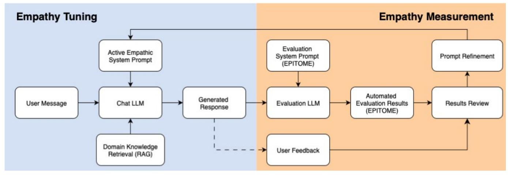

# Towards Empathy Tuning of LLM-Based Conversational Agents

*Blinded Blinded Blinded Blinded*

*Abstract***—Empathy is increasingly incorporated into large language model (LLM)–based conversational systems, particularly in healthcare settings. However, a persistent gap remains between the empathy expressed by these systems and the empathy expected and perceived by end users. This misalignment limits the effectiveness, trust, and acceptance of empathic AI, especially in emotionally sensitive domains such as cancer support. To address this challenge, this paper proposes empathy-tuning for developers to systematically align system-delivered empathy with user expectations. Central to this approach is the assumption that empathy is not one-size-fits-all, as users require different forms and intensities of empathy depending on context and timing. We operationalise empathy tuning through a structured, developer-guided pipeline and demonstrate it via a prototypical implementation using the EPITOME framework. The approach is evaluated with prompt-based experiments and user studies in cancer-related scenarios. Our findings show that empathy in LLM-based systems can be tuned and that calibrated empathy improves alignment between system-generated and userperceived empathy, while also highlighting the need for dynamic, runtime adaptation of empathic behaviour depending on conversation content.**

*Keywords—empathy tuning, conversational agents, LLMs, digital health, cancer*

#### I. INTRODUCTION

Empathy is a cornerstone of patient-centred oncology care, supporting trust, treatment adherence [1], [2], and psychosocial well-being [3]. However, cancer patients frequently report gaps in empathic communication due to time pressure, resource constraints, and systemic burdens within healthcare systems [4]. These challenges have increased interest in scalable, technology-mediated forms of emotional and informational support that complement rather than replace human care. In this context, large language model (LLM)–based conversational agents have emerged as promising tools, capable of producing fluent, context-aware dialogue and engaging patients through natural language interaction.

Recent research showed that LLMs can simulate empathic communication and that empathic responses can positively influence users' emotional states and perceived support [5]. Yet growing empirical evidence reveals a key limitation: the empathy expressed by LLM-based systems often does not align with what users expect or perceive [6]. AI-generated empathy may appear scripted, exaggerated, or contextually inappropriate, particularly in sensitive domains such as healthcare. This mismatch indicates that empathy should not be treated as a single, static system property.

In oncology, this challenge is especially pronounced. Cancer patients' emotional and informational needs vary across individuals, contexts, and moments, leading to differing expectations of empathic behaviour. Overly generic or emotionally intense responses risk being perceived as "false empathy," creating additional burden rather than support. While prior work has examined empathic response generation or empathy evaluation in isolation [7], current approaches focus on the empathy measurement component but not on the empathy adaptation. Existing measurement instruments include CARE [8] and the Jefferson Scale of Empathy [9] developed for clinicians and automated frameworks such as EPITOME [10].

This paper addresses this gap by proposing empathy-tuning as an AI systems development task and introducing an empathytuning pipeline that supports developers in aligning systemdelivered empathy with user-expected empathy. We validate the approach through a prototypical retrieval-augmented chatbot for cancer care, combining EPITOME-based automated evaluation with user-reported empathy ratings. Our results show that empathy can be systematically tuned and that calibrated empathy, as opposed to maximised empathy, improves alignment between expressed and perceived empathy. By offering insights into context-sensitive empathic behaviour, this work contributes practical guidance for improved trustworthy, human-centred empathic AI systems in oncology.

# II. RELATED WORK

Empathy is a central element of effective human interaction and is commonly conceptualised as comprising both cognitive understanding of a patient's perspective and affective responsiveness to their emotional state [3]. Empathic communication in healthcare is associated with increased patient trust and improved treatment adherence [1]. In oncology, clinician empathy has been linked to reduced patient anxiety and distress, as well as higher patient satisfaction [11]. Despite its recognised importance, many cancer patients report unmet emotional needs during treatment [12], [13].

Conversational agents are increasingly explored as supportive tools in cancer care [14]. Early healthcare chatbots relied largely on rule-based interaction, whereas advances in large language models (LLMs) enable more flexible, contextaware dialogues. A randomised controlled trial showed that an AI chatbot delivering structured educational content improved patient knowledge and perceived support among breast cancer patient [15], while a prospective randomised study reported reduced anxiety and depression scores among chemotherapy patients using a ChatGPT-based counselling assistant [16].

1

Fig. 1 Empathy tuning pipeline (chat LLM: gpt-4.1-mini, evaluation LLM: meta-llama-3-70b-instruct).

However, aligning empathy in AI-generated dialogue with user needs remains challenging due to its subjective and multidimensional nature. The EPITOME framework introduced a computational approach for quantifying empathy-related dialogue features, including emotional reactions and interpretations [10], with subsequent work proposing extensions and alternative metrics such as DIFF-EPITOME [17]. While these approaches represent important progress, they primarily address the measurement of expressed empathy and offer limited support for calibrating system behaviour to align systemgenerated empathy with users' perceived and context-dependent empathy needs.

# III. EMPATHY TUNING

## *A. Concept and System*

We conceptualise empathy tuning as an iterative alignment process between system-expressed empathy and user-perceived empathy. It is based on the assumption that empathy is not fixed but must be adapted based on measurement and feedback. The process follows an iterative cycle of (1) adaptation of empathic behaviour, (2) objective measurement of expressed empathy, and (3) refinement based on subjective user feedback. This framing positions empathy tuning as a developer-guided calibration task rather than a one-off optimisation.

We operationalise this concept through a modular conversational system based on an empathy tuning pipeline for controlled adaptation, measurement, and feedback (Fig. 1). The system is implemented as a chatbot for cancer support and functions both as a research instrument and a working prototype. Instead of more static fine-tuning the underlying LLM, empathy is adapted more dynamically through structured system prompting, enabling systematic comparison and reproducibility.

Our architecture comprises two tightly coupled modules: Empathy Tuning and Empathy Measurement, linked through an iterative loop with user feedback. Each response is generated from three inputs: (a) the user's free-text message, (b) an active empathic system prompt that defines communicative behaviour with calibrated empathy, and (c) domain knowledge retrieved via a Retrieval-Augmented Generation (RAG) for medically grounded information.

Adaptation was realised through versioned empathic system prompts that specify tone, emotional sensitivity, and conversational strategy. We used prompts based on Maheswaran et. al. [18], shown in TABLE I. Each prompt version is persistently linked to its generated responses, enabling longitudinal comparison across iterations. Measurement is performed separately and feeds back into prompt refinement. All prompts, responses, and evaluations are persistently stored, supporting traceability and reproducibility across tuning cycles.

TABLE I. BASE PROMPTS

| Version | Prompt                                                                                                                                                                                                                               |  |  |  |
|---------|--------------------------------------------------------------------------------------------------------------------------------------------------------------------------------------------------------------------------------------|--|--|--|
| P0      | Please give the corresponding response to the User according to the existing context. You only need to provide the next round of response of Assistant.                                                                        |  |  |  |
| P1      | Please give the corresponding response to the User according to the existing context. Comprehend the emotional state of the User and respond accordingly. You only need to provide the next round of response of Assistant. |  |  |  |
| P2      | Respond to the User as the Assistant in an empathetic way. You only need to provide the next immediate response of the Assistant in the conversation.                                                                          |  |  |  |

#### *B. Experimental Evaluation*

The experimental evaluation addressed two research questions: RQ1, *how do different system prompt formulations affect the expression of empathy in LLM-generated responses as measured by the EPITOME framework*; and RQ2, *how does automatically measured empathy relate to user-perceived empathy when interacting with an conversational agent*.

Empathy was evaluated at the turn level using a dual approach that combines automated EPITOME scoring with user-reported empathy ratings. Automated evaluation was based on the EPITOME framework, which models empathy as a communicative process comprising three dimensions: *Emotional Reactions, Interpretations, and Explorations*. Each response is scored discretely along these dimensions, enabling consistent comparison across prompt versions (Table I).

Automated measurement was performed by a secondary LLM configured with a structured evaluation prompt that operationalises the EPITOME criteria. For each agent response, the evaluator assigned scores for all three dimensions and, where applicable, provided brief textual justifications. This produced structured, machine-readable outputs that support aggregation and quantitative comparison at the prompt level. EPITOME served as the primary mechanism for assessing how prompt formulations influence expressed empathy.

In parallel, user-perceived empathy was collected directly in the chat interface using a five-point Likert-scale rating after each response. These ratings capture subjective experience and complement the automated analysis by reflecting how empathy is perceived in practice.

Both evaluation streams were integrated into an administrative dashboard that aggregates results by prompt version. This enabled direct comparison between measured and perceived empathy, highlighting areas of alignment and divergence. The resulting insights informed iterative prompt refinement, closing the empathy tuning loop.

## *C. User Study*

The system was validated with a multi-stage user study, moving from controlled prompt experiments to real-world cancer support settings. The study comprised experimental prompt testing, hallway testing with non-patient participants using think-aloud, an in-depth interview with a cancer patient, and observational testing within a cancer support organisation. Across all stages, qualitative data from interviews and observations were analysed thematically to examine perceptions of empathy, authenticity, trust, and acceptance. These insights were interpreted alongside automated and userbased evaluation results to assess the system's strengths, limitations, and contextual suitability.

## IV. RESULTS

## *A. Prompt-Level Empathy Performance*

Our experimental evaluation showed systematic differences in empathic performance across prompt formulations. Baseline prompts that focused solely on factual correctness consistently achieved EPITOME scores of zero across all dimensions, indicating that our LLM did not express empathy by default without explicit guidance. Prompts containing generic empathy directives (e.g., "respond empathetically" or "recognise emotions") produced modest gains, yielding weak EPITOME scores (1,1,1). While these responses used polite and supportive language, they lacked emotional specificity, contextual interpretation, and meaningful exploration.

In contrast, the highest empathy scores were obtained with structured empathy prompts that operationalised empathy through explicit procedural instructions. Prompts directing the system to (1) express compassion using concrete language, (2) explicitly infer and name user emotions, and (3) ask open, emotionally sensitive questions consistently achieved maximum EPITOME scores (2,2,2) across Emotional Reactions, Interpretations, and Explorations, as shown in Table II.

Table II. RESULTS IN TERMS OF EPITOME

|    | Prompt Emotional Reaction Interpretations Explorations |   |   | Average |
|----|--------------------------------------------------------|---|---|---------|
| P0 | 1                                                      | 2 | 2 | 1.67    |
| P1 | 2                                                      | 2 | 2 | 2       |
| P2 | 2                                                      | 2 | 1 | 1.67    |

Overall, the results demonstrate a strong relationship between prompt specificity and measured empathy. Abstract or vague empathy instructions were insufficient, whereas structured, example-driven prompts enabled reliable empathic behaviour as defined by the EPITOME framework.

#### *B. EPITOME Measured vs. User-Perceived Empathy*

Comparison of automated EPITOME measurements with user feedback showed partial alignment but clear divergence. Although higher EPITOME scores were generally associated with greater perceived empathy, maximised automated empathy did not consistently lead to higher user satisfaction. Responses achieving full EPITOME scores were sometimes described as overly scripted, emotionally excessive, or inauthentic. In contrast, responses with moderate empathy scores were often preferred for their calm tone, restrained emotional expression, and perceived sincerity. These findings suggest that while EPITOME captures expressed empathy effectively, it does not fully reflect user-perceived authenticity.

# *C. User Study Results*

*a) Hallway Testing:* Participants generally recognised empathic qualities in the chatbot's responses and described interactions as emotionally reassuring and supportive. Empathy was perceived most strongly when responses acknowledged emotions early, maintained a calm and measured tone, and avoided excessive emotional intensity. Tone, timing, and pacing were repeatedly identified as critical to empathy perception. Responses that validated emotions before offering information were consistently described as supportive. However, repeated phrasing led some responses to feel generic or scripted, reducing perceived authenticity. Despite these limitations, all participants stated they would recommend the chatbot to others in emotionally stressful situations, even if they were unsure about sustained personal use. This suggests that the chatbot was viewed as emotionally beneficial, though not comparable to human interaction.

*b) Cancer Patient Interview:* The cancer patient interview highlighted distinct emotional and informational priorities. The participant emphasised the importance of being treated as a whole person rather than as a diagnosis and expressed strong sensitivity to what they perceived as false empathy. Overly emotional or scripted responses were described as intrusive and burdensome rather than supportive. In contrast, direct and needs-oriented questions (e.g., "What is needed?") were valued as more respectful and emotionally appropriate. The participant also stressed the importance of reliable, science-based information, reflecting prior difficulties with misleading or contradictory online sources. While the chatbot's attempt at emotional support was recognised, limited adaptability to individual communication preferences constrained its effectiveness. These findings underscore the need for personalisation and restraint in empathic AI interactions in healthcare.

*c) Cancer Support Group Testing:* Testing within members of a cancer support organisation revealed adoption barriers that outweighed the system's empathic capabilities. Most participants declined to interact with the chatbot, citing limited digital literacy, privacy concerns, and distrust of AI systems. Participants, predominantly from the baby boomer generation, strongly emphasised human connection, viewing empathy as inherently human and not transferable to artificial systems. Resistance was directed less at the chatbot's behaviour than at the concept of AI-mediated emotional support. Notably, a contrast emerged between explicit and implicit AI use: while participants expressed scepticism towards "AI tools," some reported positive experiences with AI-generated content when it was not explicitly framed as AI. This suggests that resistance may be shaped by perception and framing rather than functionality alone.

## V. DISCUSSION

Our results show that empathy in LLM-based conversational agents can be systematically increased through structured prompt engineering and assessed using automated metrics. Although highly structured prompts achieved maximal empathy scores, user feedback showed that overly explicit or scripted empathy can undermine perceived authenticity. Empathy perception depended more on tone, timing, and moderation than on emotional intensity alone. These findings underscore the need for calibrated, user-sensitive empathic behaviour and indicate that technical optimisation must be complemented by attention to trust, context, and user acceptance. Moreover, the results expose the limits of static, developer-driven tuning and point to the need for future work on dynamic, runtime adaptation of empathic behaviour in LLM-based systems.

## VI. CONCLUSION

This paper introduced a framework for tuning and measuring empathy in LLM-based conversational agents through structured prompting, retrieval-augmented generation, and combined automated and user-based evaluation. Our preliminary evaluation results show that empathic behaviour can be systematically shaped via procedural prompt design, but also reveal a consistent gap between measured empathy and perceived authenticity. According to our study subject, effective empathic interaction relies on calibrated, context-sensitive responses rather than maximal emotional expression. Overall, the findings demonstrate that empathic AI is feasible, but its deployment requires alignment with user expectations.

## ACKNOWLEDGMENT

## BLINDED FOR DOUBLE-BLIND REVIEW

. The study and paper were authored by the researchers; ChatGPT and Grammarly were used for language editing.

## REFERENCES

- [1] F. Derksen, J. Bensing, and A. Lagro-Janssen, "Effectiveness of empathy in general practice: a systematic review," Br J Gen Pract, vol. 63, no. 606, pp. e76–e84, Jan. 2013, doi: 10.3399/bjgp13X660814.
- [2] E. J. Martin, S. E. Rich, J. A. Jones, and K. V. Dharmarajan, "Communication skill frameworks: applications in radiation oncology," Annals of Palliative Medicine, vol. 8, no. 3, pp. 29304–29304, Jul. 2019, doi: 10.21037/apm.2019.03.03.
- [3] B. Gong, X. Zhang, C. Lu, C. Wu, and J. Yang, "The effectiveness of Balint groups at improving empathy in medical and nursing education: a systematic review and meta-analysis of randomized controlled trials," BMC Medical Education, vol. 24, no. 1, p. 1089, Oct. 2024, doi:

- 10.1186/s12909-024-06098-3.
- [4] F. Taleghani, E. Ashouri, M. Memarzadeh, and M. Saburi, "Barriers to empathy-based care: oncology nurses' perceptions," Int J Health Care Qual Assur, vol. 31, no. 3, pp. 249–259, Apr. 2018, doi: 10.1108/IJHCQA-12-2016-0185.
- [5] D. Chen et al., "Patient perceptions of empathy in physician and artificial intelligence chatbot responses to patient questions about cancer," npj Digit. Med., vol. 8, no. 1, p. 275, May 2025, doi: 10.1038/s41746-025- 01671-6.
- [6] L. Seitz, "Artificial empathy in healthcare chatbots: Does it feel authentic?," Computers in Human Behavior: Artificial Humans, vol. 2, no. 1, p. 100067, Jan. 2024, doi: 10.1016/j.chbah.2024.100067.
- [7] V. Sorin et al., "Large Language Models and Empathy: Systematic Review," J Med Internet Res, vol. 26, p. e52597, Dec. 2024, doi: 10.2196/52597.
- [8] S. W. Mercer, M. Maxwell, D. Heaney, and G. C. Watt, "The consultation and relational empathy (CARE) measure: development and preliminary validation and reliability of an empathy-based consultation process measure," Fam Pract, vol. 21, no. 6, pp. 699–705, Dec. 2004, doi: 10.1093/fampra/cmh621.
- [9] M. Hojat et al., "The Jefferson Scale of Physician Empathy: Development and preliminary psychometric data," Educational and Psychological Measurement, vol. 61, no. 2, pp. 349–365, 2001, doi: 10.1177/00131640121971158.
- [10] A. Sharma, A. Miner, D. Atkins, and T. Althoff, "A Computational Approach to Understanding Empathy Expressed in Text-Based Mental Health Support," in Proceedings of the 2020 Conference on Empirical Methods in Natural Language Processing (EMNLP), Online: Association for Computational Linguistics, 2020, pp. 5263–5276. doi: 10.18653/v1/2020.emnlp-main.425.
- [11] H. Hoffstädt et al., "Patients' and Clinicians' Perceptions of Clinician-Expressed Empathy in Advanced Cancer Consultations and Associations with Patient Outcomes," Palliat Med Rep, vol. 1, no. 1, pp. 76–83, Jun. 2020, doi: 10.1089/pmr.2020.0052.
- [12] C.-L. Siao, W.-C. Chang, C.-H. Chen, Y.-H. Lee, and Y.-H. Lai, "Symptoms, distress, finances, social support, resource utilization, and unmet care needs of patients with gynecological cancer," Eur J Oncol Nurs, vol. 72, p. 102686, Oct. 2024, doi: 10.1016/j.ejon.2024.102686.
- [13] H. Faller et al., "Satisfaction with information and unmet information needs in men and women with cancer," J Cancer Surviv, vol. 10, no. 1, pp. 62–70, Feb. 2016, doi: 10.1007/s11764-015-0451-1.
- [14] X. Jiang, X. Yuan, H. Zhao, and J. Peng, "The Effectiveness and Feasibility of Conversational Agents in Supporting Care for Patients With Cancer: Systematic Review and Meta-Analysis," J Med Internet Res, vol. 27, p. e76968, Aug. 2025, doi: 10.2196/76968.
- [15] M. Shaban, Y. M. Osman, N. A. Mohamed, and M. M. Shaban, "Empowering breast cancer clients through AI chatbots: transforming knowledge and attitudes for enhanced nursing care," BMC Nursing, vol. 24, no. 1, p. 994, Jul. 2025, doi: 10.1186/s12912-025-03585-w.
- [16] O. Akdogan et al., "Effect of a ChatGPT-based digital counseling intervention on anxiety and depression in patients with cancer: A prospective, randomized trial," European Journal of Cancer, vol. 221, May 2025, doi: 10.1016/j.ejca.2025.115408.
- [17] Y.-J. Lee, C.-G. Lim, and H.-J. Choi, "Does GPT-3 Generate Empathetic Dialogues? A Novel In-Context Example Selection Method and Automatic Evaluation Metric for Empathetic Dialogue Generation," in Proceedings of the 29th International Conference on Computational Linguistics, N. Calzolari, C.-R. Huang, H. Kim, J. Pustejovsky, L. Wanner, K.-S. Choi, P.-M. Ryu, H.-H. Chen, L. Donatelli, H. Ji, S. Kurohashi, P. Paggio, N. Xue, S. Kim, Y. Hahm, Z. He, T. K. Lee, E. Santus, F. Bond, and S.-H. Na, Eds., Gyeongju, Republic of Korea: International Committee on Computational Linguistics, Oct. 2022, pp. 669–683. Accessed: Sep. 15, 2025. [Online]. Available: https://aclanthology.org/2022.coling-1.56/
- [18] "Probing the Inherent Ability of Large Language Models for Generating Empathetic Responses | IEEE Conference Publication | IEEE Xplore." Accessed: Feb. 02, 2026. [Online]. Available: https://ieeexplore.ieee.org/document/11081499