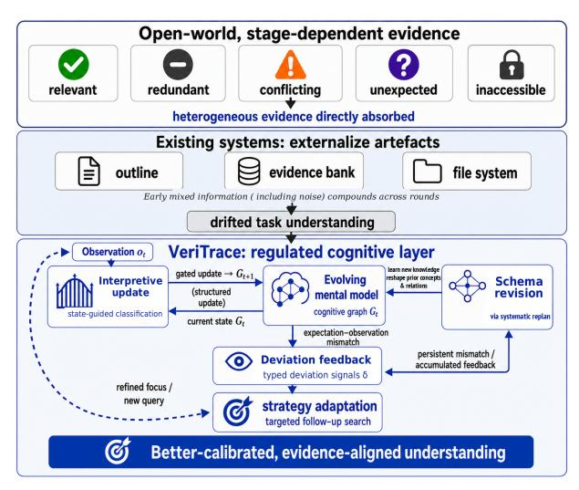
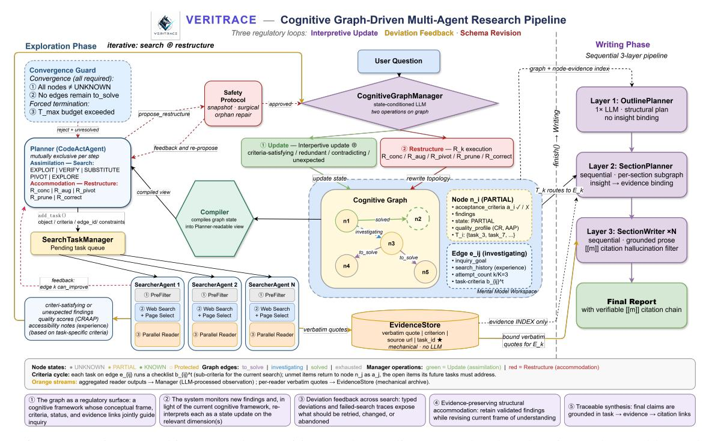
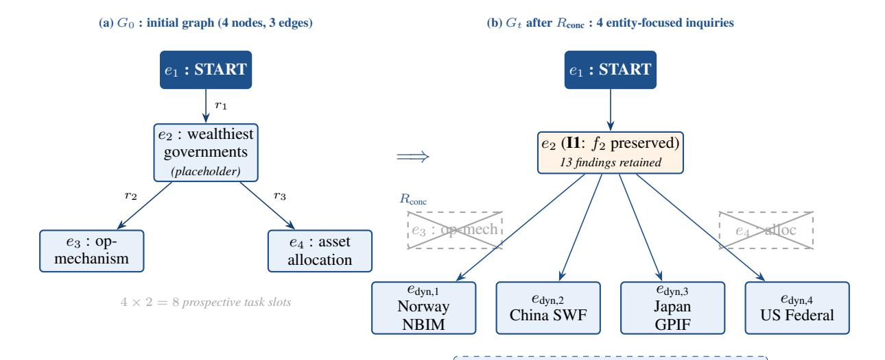
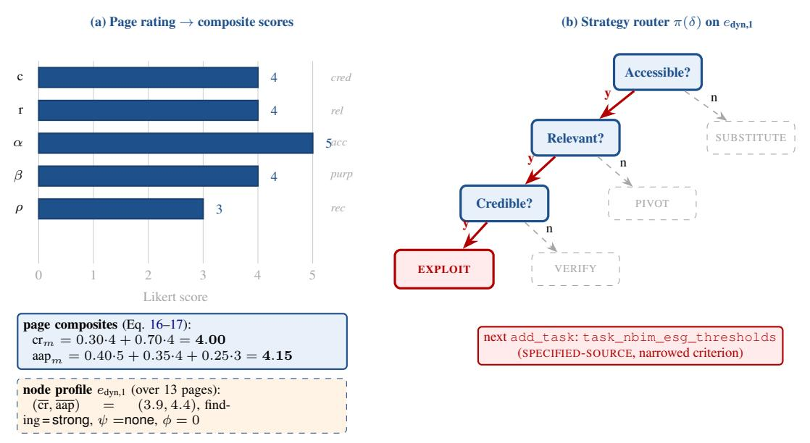
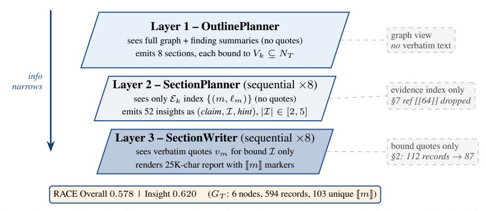

# VeriTrace: Evolving Mental Models for Deep Research Agents

Haolang Zhao<sup>1,\*</sup> Yunbo Long<sup>1,\*</sup> Lukas Beckenbauer<sup>1,2</sup> Alexandra Brintrup<sup>1,3†</sup>

<sup>1</sup>Department of Engineering, University of Cambridge

<sup>2</sup>TUM School of Management, Technical University of Munich

<sup>3</sup>The Alan Turing Institute

{hz496, y1892, ab702}@cam.ac.uk lukas.beckenbauer@tum.de

\*Equal contribution. †Corresponding author.

#### **Abstract**

Deep research agents face vast, interdependent, and pervasively uncertain information. Existing systems explore what evolving intermediate representations should look like, but leave their evolution to the LLM's implicit reasoning. Without explicit regulation, the intermediate layer is easily contaminated by mixed-quality information and propagates errors along its dependencies, so model scale often ends up substituting for absent regulation. We argue that an agent's mental model should instead evolve through explicit feedback that continuously aligns task understanding with reality, and identify three regulatory loops: interpretive update, deviation feedback, and schema revision. We realise this in VeriTrace, a cognitive-graph framework that explicitly implements the three loops. Using matched Qwen3.5-27B backbones, VeriTrace improves over the strongest matched baseline by 4.22 pp on DeepResearch Bench (DRB) Insight (1.49 pp Overall) and by 5.9 pp Overall win rate on DeepConsult. With Config-DeepSeek, it achieves the strongest reproducible open-source result on DRB.

#### <span id="page-0-1"></span>1 Introduction

Large language model (LLM) agents are increasingly used for long-horizon information exploration, such as synthesizing multi-source evidence for open-ended research questions (Du et al., 2025) and navigating scientific literature in autonomous research pipelines (Lu et al., 2026). Such tasks confront the agent with information that is both voluminous and structurally interdependent. Findings must be compacted for the agent to reason over, and dependencies among them must be preserved so that one concept's findings can inform another's inquiry. These pressures push deep research systems beyond the LLM context window toward a persistent, structured intermediate layer.

Recent deep research systems therefore externalise intermediate research artefacts across search

<span id="page-0-0"></span>

Figure 1: Regulated cognitive layer for DeepResearch.

rounds. WebWeaver (Li et al., 2025b) co-evolves a dynamic outline with an evidence bank. Omni-Think (Xi et al., 2025) expands an information tree and distils a conceptual pool. FS-Researcher (Zhu et al., 2026) maintains todos and an acceptance checklist. These systems advance the question of what form an evolving intermediate layer should take, so that the agent can absorb as much knowledge as possible and organise future inquiry from it. But deep research is inherently uncertain and structurally interdependent. Without proper regulation, the intermediate layer is easily contaminated by mishandled, mixed-quality information, and propagates along dependencies to distort subsequent inquiry. We therefore address a different question. What regulatory loops can enable this intermediate layer to adapt to such messiness and keep the system's task understanding evolving in a healthy direction consistent with reality?

We treat the intermediate layer as the agent's mental model of the task. This mental model is neither the transient working memory of any single decision nor a stable long-term memory that does not fully participate in decisions; it is a dynamic representation of the agent's current learning status,

evidence insights, and what remains uncertain. We identify three explicit feedback loops central to this regulation [\(Figure 1\)](#page-0-0).

The first is interpretive update. Each new finding is read against the model already in place. As rounds accumulate, the model develops a sharper sense of what each concept already covers and still needs. An incoming finding is no longer just absorbed but classified as confirming, contradicting, gap-filling, or as a surprise outside the current framing. The state actively shapes what counts as a usable observation rather than passively accumulating them all. Without interpretive update, the system is distracted by mixed and noisy findings, loses track of its current research state and cannot target the dimensions whose evidence would most improve task understanding. Our ablation in [§5.2](#page-6-0) confirms this. Removing this loop causes the system to terminate when its store appears full rather than when concepts are actually resolved, and to dispatch fewer follow-up searches even on under-resolved concepts.

The second is deviation feedback. The planner specifies what each concept expects from its next search. Each search outcome is then scored against these expectations, producing a signal that measures how far the actual evidence falls from what the planner assumed obtainable. The planner adjusts its search strategy according to this signal. Without deviation feedback, failure degenerates into undifferentiated retry rather than targeted correction. Our ablation in [§5.2](#page-6-0) confirms this. Removing this loop inflates search volume without proportional quality gain.

The third is schema revision. When accumulated feedback shows the current framing itself diverges substantially from reality, the agent systematically revises its understanding of each concept and the relations among them, which in turn reshapes its plan. Otherwise the agent stays confined to its initial framing and cannot calibrate against evidence. Our ablation in [§5.2](#page-6-0) confirms this. Removing this loop noticeably degrades performance on harder, error-prone queries.

These loops are designed in response to the specific characteristics of deep research, not chosen arbitrarily. A system either implements them explicitly or delegates them to implicit LLM reasoning. The latter is a core reason deep research appears scale-hungry: model scale ends up substituting for missing regulatory loops, which is why FS-Researcher and EnterpriseDR drop substantially

once the backbone is held fixed [\(Table 3\)](#page-6-1).

The separation of these loops also reflects cognitive-science accounts of self-regulation. Metacognition motivates interpretive update [\(Flavell,](#page-8-1) [1979;](#page-8-1) [Nelson and Narens,](#page-9-4) [1990\)](#page-9-4). Predictive processing motivates deviation feedback [\(Clark,](#page-8-2) [2013;](#page-8-2) [Hohwy,](#page-8-3) [2013\)](#page-8-3). Assimilation and accommodation motivate schema revision [\(Piaget,](#page-9-5) [1952\)](#page-9-5). We treat these as design vocabulary, not cognitive-equivalence claims.

In VeriTrace, we instantiate the agent's mental model as a cognitive graph ([§3\)](#page-2-0). Nodes are concepts under inquiry, edges are inquiry relations among them, and each node stores acceptance criteria, accumulated findings, and quality history. A cognitive graph manager interprets new observations against the current graph state and produces structured updates, realising interpretive update. A CR-AAP-inspired quality assessor [\(Blakeslee,](#page-8-4) [2004\)](#page-8-4) measures the gap between expected and observed evidence and routes the planner to five search strategies, realising deviation feedback. When accumulated feedback shows the framing is wrong, five structural operations revise the agent's frame of understanding, and subsequent search is reorganised to test and fill the revised structure, realising schema revision.

We evaluate VeriTrace on DeepResearch Bench and DeepConsult. Under a controlled comparison with matched Qwen3.5-27B backbones, VeriTrace outperforms the strongest matched baseline by 4.22 percentage points (pp) on the Insight dimension of DeepResearch Bench (1.49 pp Overall) and by 5.9 pp Overall win rate on DeepConsult. With Config-DeepSeek, VeriTrace further achieves the strongest reproducible open-source result on Deep-Research Bench (Overall 55.77, Insight 59.56).

Our contributions are threefold. (1) We identify three feedback loops as central regulatory mechanisms for an agent's mental model under pervasive uncertainty. (2) We present VeriTrace, a cognitivegraph implementation organised around concepts rather than sub-tasks, with evidence preserved under structural revision. (3) Comprehensive experimental studies show that explicit regulatory loops improve deep research performance beyond backbone scale alone.

# 2 Related Work

Knowledge structures in deep research systems. Deep research agents require intermediate artefacts

that persist across search rounds and guide later search, filtering, and synthesis decisions. Existing systems differ mainly in how they materialise these artefacts. Agents like WebThinker (Li et al., 2025a) rely on the LLM context window for implicit carry-over, while FS-Researcher (Zhu et al., 2026) drives search from todos and an acceptance checklist over a file-system store. More structured systems organise artefacts hierarchically, including WebWeaver's co-evolving outline and evidence bank (Li et al., 2025b), OmniThink's information tree and conceptual pool (Xi et al., 2025), and Mind2Report's knowledge-enriched chapter tree (Cheng et al., 2026). Our focus is not which storage form best preserves intermediate artefacts, but what regulatory conditions allow the intermediate layer to improve its task understanding over long research trajectories.

Cognitive-science framing. We use cognitive science as a design vocabulary rather than a claim of cognitive equivalence. *Metacognition* (Flavell, 1979) and the monitoring–control view of metamemory (Nelson and Narens, 1990) cast learning as monitoring what one knows and adjusting inquiry accordingly, motivating interpretive update. *Predictive processing* (Clark, 2013; Hohwy, 2013) frames action as driven by expectation–observation mismatch, motivating deviation feedback. Piaget's contrast between *assimilation* into existing structure and *accommodation* of the structure itself (Piaget, 1952) motivates schema revision.

Replanning versus reframing. A related line revises plans after detecting problems. EnterpriseDR (Prabhakar et al., 2025) reflects on gaps at the knowledge level to drive dynamic replanning, accumulating knowledge accordingly. Schema revision instead restructures the concept labels, their relations, and the inquiry goals that together define how evidence insights are organised and where search goes next, and then reorganises search to fill and test the revised frame. Thus, a framing error is corrected, rather than diluted by accumulating knowledge within the wrong frame (§5.2).

#### <span id="page-2-0"></span>3 Method

#### 3.1 Overview

VeriTrace centres the research loop on a cognitive graph (Figure 2). A **planner** reads a compiled view of the graph state (Appendix II) and issues structured actions, while parallel **searchers** gather evidence and a lightweight **reader** extracts find-

ings with page-level quality scores. The **cognitive graph manager** then assimilates observations into the graph state (Appendix III). The loop alternates between assimilation and accommodation. Unresolved edges trigger search, deviation feedback routes follow-up strategies (§3.4), and restructuring is invoked when accumulated feedback no longer fits the current frame of understanding (§3.5, §3.6). Once all nodes leave *unknown* and all edges are resolved, the writing pipeline produces the final report from the graph and evidence store (§3.7, with Appendix XVI giving a feature-level comparison against open-source baselines on the three loops).

#### <span id="page-2-1"></span>3.2 Cognitive Graph

**Definition 1** (Cognitive Graph). A cognitive graph at time t is a tuple  $G_t = (S_t, C_t)$ . The structural state  $S_t = (N_t, E_t, N_{\text{user}})$  consists of a node set  $N_t$ , an edge set  $E_t \subseteq N_t \times N_t$ , and a protected subset  $N_{\text{user}} \subseteq N_t$  (nodes for dimensions explicitly specified in the user's question); the content state  $C_t = (C_t^N, C_t^E)$  consists of node content  $C_t^N = \{c_i^t\}_{n_i \in N_t}$  and edge content  $C_t^E = \{c_{ij}^t\}_{e_{ij} \in E_t}$ .

<span id="page-2-2"></span>**Definition 2** (Concept Node Content). Each node  $n_i \in N_t$  carries  $c_i^t = (a_i^t, f_i^t, s_i^t, \boldsymbol{q}_i^t, \mathcal{T}_i^t)$ : acceptance criteria  $a_i^t \in \mathcal{L}$  that have not yet been satisfied by current findings  $f_i^t$ , findings  $f_i^t$  (a set of atomic findings, monotonically accumulated on the regular update path), cognitive state  $s_i^t \in \{\text{UNKNOWN}, \text{PARTIAL}, \text{KNOWN}\}$ , quality profile  $\boldsymbol{q}_i^t = (\overline{\text{cr}}_i^t, \overline{\text{aap}}_i^t) \in [1, 5]^2$ , and associated task IDs  $\mathcal{T}_i^t \subseteq \mathbb{N}$ . Here  $\mathcal{L}$  is the space of natural language descriptions. The cognitive state is determined by:

$$s_i^t = \sigma(a_i^t, f_i^t) = \begin{cases} \text{KNOWN} & a_i^{\text{core}, t} \subseteq \text{sat}(f_i^t) \\ \text{PARTIAL} & a_i^{\text{core}, t} \not\subseteq \text{sat}(f_i^t) \land f_i^t \neq \emptyset \\ \text{UNKNOWN} & f_i^t = \emptyset \end{cases}$$

where  $a_i^{\text{core},t}$  is the core criteria subset at t and  $\operatorname{sat}(f_i^t)$  the criteria satisfied by current findings.  $\sigma$  is realised as a structured LLM judgment (Appendix III).

<span id="page-2-3"></span>**Definition 3** (Edge Content). Each edge  $e_{ij} \in E_t$  carries  $c_{ij}^t = (g_{ij}, b_{ij}^t, h_{ij}^t, k_{ij}^t, u_{ij}^t)$ : inquiry goal  $g_{ij} \in \mathcal{L}$  as the strategic question this edge investigates, task-specific acceptance criteria  $b_{ij}^t \in \mathcal{L}$  that break  $g_{ij}$  into checkable items for the most recent task on this edge, search history  $h_{ij}^t \in \mathcal{L}^*$ , attempt count  $k_{ij}^t \in \{0, \dots, K\}$  (K=3), and status  $u_{ij}^t$  taking one of to-solve, investigating, solved, or exhausted.

<span id="page-3-0"></span>

Figure 2: VeriTrace architecture. The cognitive graph coordinates regulated exploration and traceable synthesis.

#### <span id="page-3-3"></span>3.3 Content Evolution (Assimilation)

At each search step, the planner selects an unresolved edge  $e_{ij}$  from  $G_t$  and dispatches a search task (full task schema in Figure 10). For each task, the planner instantiates  $b_{ij}^t$  as concrete sub-criteria of  $g_{ij}$ , drawing on  $a_i$  to target what node  $n_i$  still owes. These criteria serve as the prior expectation that the searcher executes and the reader extracts and scores findings against. A searcher executes the task with access to the task specification and local context (the target node and its upstream neighbours, not the full graph); for each retrieved page, a reader extracts findings and computes per-page CR-AAP quality scores. The combined output forms the observation  $o_t = (\hat{f}_t, \hat{q}_t)$ , where  $\hat{f}_t$  are extracted findings and  $\hat{q}_t$  are quality scores. The cognitive graph manager then interprets  $o_t$  through the lens of  $G_t$ , routing each finding to  $n_i$  by default and to  $n_k$   $(k \neq j)$  when it aligns with  $a_k$ . This prior-guided interpretation is the core of assimilation. Each relevant finding is classified against  $b_{ij}^t$ and  $f_i^t$  as criterion-satisfying, redundant, contradictory, or unexpected, where unexpected requires both relevance to the user's original question on  $n_i$ 's dimension and absence from every entry of  $b_{ij}^{t}$ . At task closure, entries of  $b_{ij}^{t}$  left unsatisfied by  $o_t$  are retained in  $a_i^{t+1}$ , so  $n_j$  carries them across edges as residual criteria shaping its next task.

The resulting update set  $\mathcal{U}_t = \{(j, \Delta c_i^t)\}$  thus

contains  $n_j$  by default and may span additional nodes:

<span id="page-3-2"></span>
$$\forall (j, \Delta c_j^t) \in \mathcal{U}_t : \begin{cases} f_j^{t+1} = f_j^t \oplus_G \Delta f_j^t, \\ \mathbf{q}_j^{t+1} = \operatorname{agg}(\mathbf{q}_j^t, \Delta \mathbf{q}_j^t), \\ s_j^{t+1} = \sigma(a_i^{t+1}, f_i^{t+1}). \end{cases}$$
(2)

Nodes not referenced in  $\mathcal{U}_t$  retain their state. Equation 2 realises **interpretive update**:  $\oplus_G$  folds each classified finding into the node's two-level finding structure ( $item\_findings$  or  $cross\_item\_findings$ ) rather than a flat list, then recomputes  $s_j^{t+1} = \sigma(a_j^{t+1}, f_j^{t+1})$  so the system tracks how far each concept is resolved. Redundant findings are not re-added; contradictions are recorded in a percriterion contradictions list preserving prior evidence; unexpected discoveries are routed to a dedicated channel. The latter two are surfaced as candidate triggers for **schema revision** (Appendix III).

When a search task for  $e_{ij}$  contributes findings to node  $n_k$   $(k \neq j)$ , the task identifier is registered in  $n_k$ 's associated task set:  $\mathcal{T}_k^{t+1} = \mathcal{T}_k^t \cup \{ \text{task}_t \}$ . This cross-node linkage is essential for the writing pipeline (§3.7).

# <span id="page-3-1"></span>3.4 Deviation Detection and Strategy Selection

<span id="page-3-4"></span>**Definition 4** (Deviation Signal). *Upon completing a search targeting node*  $n_j$ , the system computes a deviation signal in  $\mathcal{D} \triangleq [1, 5]^2 \times \{0, 1\} \times [1, 4]$ :

$$\delta_i^t = \left(\overline{\operatorname{cr}}_i^t, \ \overline{\operatorname{aap}}_i^t, \ \phi_i^t, \ \psi_i^t\right) \in \mathcal{D} \tag{3}$$

with content relevance  $\overline{\operatorname{cr}} \in [1,5]$  (evidence-need alignment), source credibility  $\overline{\operatorname{aap}} \in [1,5]$  (independent of relevance), accessibility barrier  $\phi \in \{0,1\}$ , and unexpected-finding strength  $\psi \in [1,4]$ . The orthogonality of  $\overline{\operatorname{cr}}$  and  $\overline{\operatorname{aap}}$  enables differential diagnosis (Appendix VIII).

The planner selects a search strategy through a mapping  $\pi: \mathcal{D} \to \mathcal{A}_{\text{search}}$  that partitions the deviation space into five regions. We define predicates  $\text{ACCESSIBLE}(\delta) \triangleq (\phi = 0)$ ,  $\text{REL}(\text{evant})(\delta) \triangleq (\overline{\text{cr}} \geq \tau_h)$ ,  $\text{CRED}(\text{ible})(\delta) \triangleq (\overline{\text{aap}} \geq \tau_h)$ , and  $\text{UNEX}(\text{pected})(\delta) \triangleq (\psi \geq \tau_\psi)$ . The mapping is (evaluated in priority order):

<span id="page-4-2"></span>
$$\pi(\delta) = \begin{cases} \text{SUBSTITUTE} & \neg \text{ACCESSIBLE} \\ \text{EXPLOIT} & \text{Rel} \land \text{Cred} \\ \text{VERIFY} & \text{Rel} \land \neg \text{Cred} \\ \text{PIVOT} & \neg \text{Rel} \land \text{UNEX} \\ \text{EXPLORE} & \text{otherwise} \end{cases}$$
(4)

exploit refines within the current source family; verify cross-checks against authoritative sources; substitute switches source type when blocked; pivot routes an unexpected finding to a new edge; explore broadens keywords or language. Threshold values and execution details are in Appendix VI.

#### <span id="page-4-0"></span>3.5 Framework Evolution (Accommodation)

When repeated strategy adaptations on an edge leave  $\delta_j^t$  in the same deviation region, or when contradictions accumulate across the graph, the planner concludes that the current framing itself is misaligned rather than merely under-informed, and proposes a restructuring operation  $R_k \in \mathcal{A}_{\text{struct}}$  that revises the frame of understanding (concept labels, relations, inquiry goals, and criteria), thereby influencing the planner's future inquiry plans while preserving evidence under invariant **I1** (§3.5):

$$S_{t+1} = R_k(S_t, C_t), \quad \mathcal{A}_{\text{struct}} = \left\{ \begin{array}{l} R_{\text{conc}}, R_{\text{aug}}, R_{\text{pivot}}, \\ R_{\text{prune}}, R_{\text{correct}} \end{array} \right\}$$
(5)

The equations below describe the semantic effect of each  $R_k$  on  $S_t$ ; the concrete edits, including free symbols such as  $E_{\rm old}$ ,  $E_{\rm reorg}$ ,  $N_{\rm abs}$ , and  $N_{\rm item}$ , are produced at execution time by a separate graph-manager component under a multi-phase safety protocol (Appendix IV).

**Local effects** on nodes/edges:

$$\begin{split} R_{\text{conc}}(n_{i}): N_{t+1} = N_{t} \cup \{n_{i_{1}}, \dots, n_{i_{m}}\}, \\ E_{t+1} = E_{t} \cup \{(n_{i}, n_{i_{k}})\}_{k=1}^{m} \qquad (6) \\ R_{\text{aug}}: N_{t+1} = N_{t} \cup \{n_{\text{new}}\}, \ E_{t+1} = E_{t} \cup \{e_{\text{new}}\} \ (7) \\ R_{\text{pivot}}: N_{t+1} = (N_{t} \setminus N_{\text{abs}}) \cup N_{\text{item}}, \\ E_{t+1} = (E_{t} \setminus E_{\text{old}}) \cup E_{\text{reorg}} \qquad (8) \\ R_{\text{prune}}(n_{i}): N_{t+1} = N_{t} \setminus \{n_{i}\}, \ E_{t+1} = E_{t} \setminus \{e \ni n_{i}\}, \\ n_{i} \notin N_{\text{user}}, \ f_{i}^{t} = \emptyset \qquad (9) \end{split}$$

**Cascading effect.** When evidence at  $n_i$  contradicts a premise on which downstream nodes were planned,  $R_{\text{correct}}$  targets the affected subgraph  $\downarrow n_i \triangleq \{n_j \in N_t \mid n_i \leadsto n_j\}$ . Inquiry plans  $(g_{kj}, a_j)$  on  $\downarrow n_i$  are revised subject to **I1** (§3.5):

$$R_{\text{correct}}(n_i) : S_t |_{\exists n_i} \longmapsto S'_t$$
 (10)

**Structural invariants.** Let  $N_{\text{user}}$  denote the nodes corresponding to dimensions explicitly named in the user query. All  $R_k \in \mathcal{A}_{\text{struct}}$  satisfy:

I1 (Immutable Past): 
$$\forall n_j : f_j^t \neq \emptyset \Rightarrow f_j^{t+1} \supseteq f_j^t$$
 (11)

**I2** (Dim. Protection): 
$$N_{\text{user}} \subseteq N_{t+1}$$
 (12)

I1 is enforced by append-only updates to  $f_j^t$ , with one documented exception for noise-item cleanup (Appendix IV). I2 is enforced as a veto condition during execution: any proposal violating  $N_{\text{user}}$  membership is rejected (Appendix IV).

#### <span id="page-4-1"></span>3.6 System Dynamics

At each time step, the planner inspects  $G_t$  and decides between two mutually exclusive actions: dispatching a search task (assimilation) or proposing a restructuring operation (accommodation). The two never co-occur within a single step:

<span id="page-4-3"></span>
$$G_{t+1} = \begin{cases} \left( S_t, \ \Gamma(G_t, o_t) \right) & \text{search step} \\ \left( R_k(S_t, C_t), \ C_t \right) & \text{restructuring step} \end{cases}$$
(13)

In the common case, the planner dispatches search tasks and the system assimilates observations into  $C_t$ . Deviation signals  $\delta_j^t$  accumulate over successive search steps; the planner uses these to select search strategies (§3.4) and attempts to resolve deviations through strategy adaptation. Only when accumulated signals indicate that the current frame itself is fundamentally wrong, the planner forgoes search and instead proposes a restructuring operation, modifying  $S_t$  while leaving  $C_t$  unchanged. After restructuring, the system resumes assimilation on the updated topology.

**Termination.** The search loop terminates at step T when:

$$\forall n_i \in N_T: \ s_i^T \neq \text{Unknown}$$
  $\wedge \ \nexists \ e_{ij} \in E_T: \ u_{ij}^T = \text{To-solve}$ 

Nodes leave *unknown* only when the planner's scheduling reaches their edges; topologically distant nodes thus remain *unknown* until selected. A soft budget  $T_{\text{max}}$  enforces termination if convergence is not reached (Appendix X).

#### <span id="page-5-0"></span>3.7 Writing Pipeline

Upon termination, the cognitive graph  $G_T$  and an evidence store  $\mathcal{E}$  jointly feed a three-layer writing pipeline. The evidence store accumulates structured records extracted by readers throughout the search loop:

$$\mathcal{E} = \left\{ \left( m, v_m, w_m, \ell_m, \operatorname{src}_m, \operatorname{task}_m \right) \right\}_{m=1}^M$$
 (14)

where  $v_m \in \mathcal{L}$  is a verbatim quote from the source page,  $w_m \in \mathcal{L}$  is the reader's finding summary,  $\ell_m \in \mathcal{L}$  is the acceptance criterion this finding addresses,  $\mathrm{src}_m$  is the source URL, and  $\mathrm{task}_m$  is the originating search task identifier. A single source page may produce multiple records. Records enter  $\mathcal{E}$  without further LLM processing; this mechanical side-channel ensures citation traceability.

Each node  $n_k$ 's evidence subset  $\mathcal{E}_k \subseteq \mathcal{E}$  collects records whose  $\operatorname{task}_m \in \mathcal{T}_k$ . The pipeline narrows information and decision authority in lockstep (Appendix IX): **Outline planner**: reads  $G_T$  with findings  $f_k^T$ ; outputs sections, each mapped to a node subset  $V_k \subseteq N_T$ . **Section planner** (sequential): reads  $V_k$ 's findings, the index  $\{(m, \ell_m) : m \in \bigcup_{n_k \in V_k} \mathcal{E}_k\}$  (each  $\ell_m$  already names an acceptance criterion of the section), and prior sections' plans; produces insights bound to 2–5 evidence IDs. **Section writer** (sequential): receives insights with bound records from  $\bigcup_{n_k \in V_k} \mathcal{E}_k$  unlocked; renders prose with [m] citations.

#### 4 Experimental Setup

#### 4.1 Benchmarks

We evaluate on **DeepResearch Bench** (Du et al., 2025), comprising 100 complex research queries in Chinese and English. It employs two evaluation frameworks: (1) **RACE**, which assesses report quality via four LLM-judged dimensions (Comprehensiveness, Insight, Instruction Following, and Readability), scored relative to expert reference reports (0.5 = reference parity); and (2) **FACT**, which measures citation reliability through Effective Citations and Citation Accuracy. We additionally evaluate on **DeepConsult** (Lim et al., 2025), a 102-query pairwise benchmark judged by gemini-2.5-pro, to test cross-benchmark transfer; results are reported in Table 4.

#### 4.2 Baselines and Model Configuration

We compare against two categories of systems. **Proprietary systems** include Claude-DeepResearch, OpenAI-DeepResearch, Gemini-2.5-Pro-DeepResearch, Doubao-DeepResearch,

<span id="page-5-1"></span>

| Config          | P/S          | Reader         | Writer       |
|-----------------|--------------|----------------|--------------|
| Config-3B       | Q3.5-35B-A3B | Q3.5-35B-A3B   | Q3.5-35B-A3B |
| Config-27B      | Q3.5-27B     | Q3.5-35B-A3B   | Q3.5-27B     |
| Config-Plus     | Q3.5-Plus    | Q3.5-122B-A10B | Q3.6-Plus    |
| Config-DeepSeek | DSv4-Pro     | DSv4-Flash     | DSv4-Pro     |

Table 1: Q = Qwen, DSv4 = DeepSeek-V4. P/S = Planner/Searcher. The Cognitive Graph Manager uses the P/S model in Qwen (Yang et al., 2025) configurations and the Reader's model in Config-DeepSeek (DeepSeek-AI, 2026). PreFilter details are in Appendix VII.

and Kimi-Researcher, with results cited from official leaderboards as their implementations are not publicly available. **Open systems with disclosed methodology** include LangChain Open Deep Research, EnterpriseDR, WebWeaver, RhinoInsight, and FS-Researcher, each evaluated under its best reported backbone. For the controlled comparison (Table 3), we further rerun the three systems with both released code and a published paper (WebWeaver, EnterpriseDR, and FS-Researcher) under our shared Qwen3.5-27B configuration to isolate architectural contributions from model capability. The per-role model configurations used by Veri-Trace are shown in Table 1.

#### <span id="page-5-2"></span>5 Results

#### 5.1 Main Results

Table 2 reports DeepResearch Bench performance. Within the Qwen family, VeriTrace remains close across three configurations, with Overall scores ranging from 51.96 to 53.50. Switching to a different open-source backbone family with Config-DeepSeek lifts Overall to 55.77, giving the strongest reproducible open-source result in the table. On the *Insight* dimension, Config-DeepSeek (59.56) and Config-Plus (57.08) achieve the best and second-best scores across all listed systems.

To isolate architectural contributions from model capability, Table 3 compares systems under the shared Qwen3.5-27B backbone. VeriTrace achieves the highest Overall score (+1.49 pp over WebWeaver) and leads all baselines on two of the four RACE dimensions (Insight and Instruction Following), with its largest margin on Insight (+4.22 pp over WebWeaver).

To test if the architectural gain transfers beyond DeepResearch Bench, we also evaluate on DeepConsult under the shared Qwen3.5-27B backbone. As shown in Table 4, VeriTrace reaches 81.1% Overall win rate, +5.9 pp over the strongest matched baseline (WebWeaver, 75.2%), with higher average score and NWR. Per-dimension results are reported in Appendix XVII.

<span id="page-6-3"></span>

| Method                                                       | Comp.        | Insight          | Instr.       | Read.        | Overall | Eff.c. | C.acc.       |
|--------------------------------------------------------------|--------------|------------------|--------------|--------------|---------|--------|--------------|
| Claude-DeepResearch (Anthropic, 2025)                        | 45.34        | 42.79            | 47.58        | 44.66        | 45.00   | _      | _            |
| OpenAI-DR (OpenAI, 2025)                                     | 46.46        | 43.73            | 49.39        | 47.22        | 46.45   | 39.79  | 75.01        |
| Gemini-2.5-Pro-DR (Google, 2025)                             | 49.51        | 49.45            | 50.12        | 50.00        | 49.71   | 165.34 | 78.30        |
| Doubao-DeepResearch (ByteDance, 2025)                        | 44.84        | 40.56            | 47.95        | 44.69        | 44.34   | 52.62  | 52.86        |
| Kimi-Researcher (Moonshot AI, 2025)                          | 44.96        | 41.97            | 47.14        | 45.59        | 44.64   | _      | _            |
| LangChain-Open-Deep-Research(GPT-5) (LangChain, Inc., 2023)  | 50.06        | 50.76            | 51.31        | 49.72        | 50.60   | 22.44  | 34.74        |
| EnterpriseDR(Gemini-2.5-Pro) (Prabhakar et al., 2025)        | 49.70        | 51.24            | 50.52        | 50.61        | 50.62   | _      | 72.50        |
| WebWeaver (Qwen3-235B-A22B-Instruct-2507) (Li et al., 2025b) | 51.29        | 51.00            | 49.98        | 48.89        | 50.62   | 166.73 | <u>78.25</u> |
| RhinoInsight(Gemini-2.5-Pro) (Lei et al., 2025)              | 50.51        | 51.45            | 51.72        | 50.00        | 50.92   | _      | _            |
| FS-Researcher (Claude-Sonnet-4.5) (Zhu et al., 2026)         | <u>54.25</u> | 55.85            | 52.47        | <u>51.54</u> | 53.94   | 139.91 | 76.17        |
| VeriTrace (Config-3B)                                        | 50.85        | 55.22            | 50.38        | 49.08        | 51.96   | -      | -            |
| VeriTrace (Config-27B)                                       | 50.84        | 55.86            | 50.72        | 49.29        | 52.28   | 134.20 | 68.46        |
| VeriTrace (Config-Plus)                                      | 52.84        | 57.08            | 51.65        | 49.61        | 53.50   | _      | _            |
| VeriTrace (Config-DeepSeek)                                  | 56.28        | <del>59.56</del> | <u>52.24</u> | 51.98        | 55.77   | 235.66 | 73.28        |

Table 2: DeepResearch Bench performance. Bold and underline indicate best and second-best scores.

<span id="page-6-1"></span>

| System (Qwen3.5-27B)   |       |         | RACE   |       |         |
|------------------------|-------|---------|--------|-------|---------|
|                        | Comp. | Insight | Instr. | Read. | Overall |
| WebWeaver              | 51.75 | 51.64   | 49.22  | 49.17 | 50.79   |
| FS-Researcher          | 47.83 | 47.05   | 48.74  | 49.37 | 48.03   |
| Enterprise-DR          | 47.82 | 50.17   | 49.30  | 48.91 | 49.16   |
| VeriTrace (Config-27B) | 50.84 | 55.86   | 50.72  | 49.29 | 52.28   |

Table 3: Controlled RACE comparison: shared Qwen3.5-27B backbone, isolating architecture.

<span id="page-6-2"></span>

| System        | Win% | Avg. Score | NWR   |
|---------------|------|------------|-------|
| Enterprise-DR | 64.7 | 6.11       | 0.769 |
| FS-Researcher | 72.8 | 6.49       | 0.797 |
| WebWeaver     | 75.2 | 6.81       | 0.859 |
| VeriTrace     | 81.1 | 6.94       | 0.887 |

Table 4: DeepConsult Overall under Qwen3.5-27B (102 queries; judge: gemini-2.5-pro). Avg. Score is 0-10 with 5 as tie; NWR is computed over non-tie outcomes.

#### <span id="page-6-0"></span>5.2 Ablation Study

We design four ablations targeting the three loops from §1 and the topological substrate that schema revision operates on. A1 (deviation feedback) removes the deviation signal  $\delta$  and strategy selector  $\pi$ , forcing the planner to decide search directions from implicit reasoning over raw findings. A2 (schema revision) restricts  $A_{\text{struct}}$  to  $\{R_{\text{aug}}, R_{\text{prune}}\}$ , the subset already available in existing systems. A3 (interpretive update) replaces  $\bigoplus_G$  with naive text concatenation. A4 (topological substrate) flattens the cognitive graph to a parallel list of dimensions, removing edges and hop distances. Afull stacks all four. Implementation details are in Appendix XI. Accommodation-sensitive subset. line successfully applies  $R_{\text{conc}}/R_{\text{pivot}}/R_{\text{correct}}$  on 11 queries, forming a natural accommodationsensitive subset (Table 6). On this subset, A2, A3, and  $A_{\text{full}}$  cluster in the same severe range (-4.75, -5.18, -4.78 pp), while A4 is markedly lighter (-2.52 pp). These two contrasts raise two questions: why is A3 worse than A2, and why is A4 lighter than A2?

Why A3 is worse than A2. A3 (no interpretive update) should not, in principle, be tied to schema

<span id="page-6-5"></span>

| System                                       | Overal | $\Delta$ | W/L   | Srch.         | Succ.   |
|----------------------------------------------|--------|----------|-------|---------------|---------|
| Full VeriTrace (baseline)                    | 52.28  |          |       | 1.00×         | 100/100 |
| <ul> <li>Deviation feedback (A1)</li> </ul>  | 50.52  | -1.65    | 20/66 | $1.31 \times$ | 86/100  |
| <ul> <li>Schema revision (A2)</li> </ul>     | 51.28  | -1.02    | 41/55 | $1.02 \times$ | 96/100  |
| <ul> <li>Interpretive update (A3)</li> </ul> | 50.75  | -1.52    | 33/66 | $0.42 \times$ | 99/99   |
| <ul> <li>Graph topology (A4)</li> </ul>      | 51.39  | -0.89    | 43/56 | $1.18 \times$ | 99/99   |
| - All four (A <sub>full</sub> )              | 49.80  | -2.48    | 12/88 | 0.55×         | 100/100 |

Table 5: Ablation on RACE Overall. Δ: matched per-query mean diff; **W/L**: wins/losses vs. Full; **Srch.**: search-call ratio; **Succ.**: queries finished within 90 min.

<span id="page-6-4"></span>

| Ablation                    | Accomm. $\Delta$ | Other $\Delta$ |
|-----------------------------|------------------|----------------|
| A1 $(n=8/78)$               | −0.71 pp         | −1.75 pp       |
| A2 $(n=10/86)$              | -4.75 pp         | -0.59  pp      |
| A3 $(n=11/88)$              | -5.18  pp        | -1.07  pp      |
| A4 $(n=11/88)$              | -2.52  pp        | -0.69  pp      |
| $A_{\text{full}} (n=11/89)$ | −4.78 pp         | -2.20  pp      |

Table 6: Per-query  $\Delta$  (ablation — baseline) split by whether the baseline applied  $R_{\rm conc}/R_{\rm pivot}/R_{\rm correct}$  successfully. A1 misses q2/q12/q14, A2 misses q6 (timeouts).

revision. Yet traces show that A3 still triggers restructuring operations, and on the accommodation-sensitive subset it falls further than A2, which directly disables the *R*-operations. Without interpretive update maintaining a coherent state, the restructuring that does fire becomes a side effect rather than a correction. Interpretive update provides the cognitive basis on which *R*-operations can make informed judgments; it is the precondition for schema revision to act correctively at all.

Why A4 is lighter than A2. A4 (flattened to a list) is in fact lighter on the accommodation-sensitive subset than A2 (graph with restricted R-operations). This is not evidence that lists outperform graphs: full VeriTrace still outperforms A4 overall (Table 5). The reason is specific: dependency-bearing topology better captures conceptual dependencies, but under long-horizon uncertainty small models misjudge such structures, and a single misjudgment cascades along dependencies, making the graph *less* fault-tolerant than a flat list. Paired with an adequate repair mechanism, this fault-tolerance penalty is removed and the graph's in-

herent advantage is restored. This sharpens what schema revision is for: the precondition that lets a dependency-bearing representation realise its advantage on small models.

Deviation feedback (A1). Removing the deviation signal δ raises search calls to 1.31×, drops success rate within budget to 86%, and lowers Overall by 1.65 pp—the largest single-ablation drop. The planner still perceives that information is missing but cannot identify the type of mismatch or select a matching escape strategy; it can only append homogeneous searches until budget is exhausted. If implicit LLM judgment could substitute for δ, removing it should not simultaneously inflate search volume and depress quality.

A3's coverage beyond accommodation. Outside the accommodation-sensitive subset, A3 still loses 1.07 pp on the remaining 88 queries, with search dispatch contracting to 0.42×. Combined with the analysis above, this indicates that interpretive update is not only the cognitive basis for restructuring but also the baseline maintenance mechanism for mental-model evolution as a whole: every query's plan evolution depends on the coherent state that it sustains. This is the empirical grounding for treating it as a foundational loop in [§1](#page-0-1) rather than a localised mechanism.

Afull. Afull's search ratio of 0.55× sits between A1 (1.31×) and A3 (0.42×), reflecting a mixture of two failure modes: it inherits A3's contracted external search, partially offset by A1's tendency to over-append. On the accommodation-sensitive subset, −4.78 pp matches the A2/A3 ceiling; on the remaining 89 queries, −2.20 pp reflects the compounded broad-coverage failure of interpretive update and deviation feedback.

# 6 Discussion

Insight consistency: how the loops drive the mental model toward reality. Insight measures the quality of integrative reasoning, and our experiments show this dimension does depend on reasoning power [\(Table 2\)](#page-6-3). Yet with small backbones, VeriTrace's Insight still surpasses baselines that use Claude-Sonnet-4.5 and other frontier backbones. Reasoning power matters, but it is clearly not the only determinant of Insight, or this would not happen. The difference lies not only in how strong the model is when it reasons, but in what it reasons over. Even a strong backbone, integrating over a mental model polluted by mixed information and noise,

and misaligned in its frame, produces analysis built on distorted information. The three loops do not change single-pass reasoning; across the search process they give the agent three capacities: (1) critical learning, monitoring the current understanding to judge which new evidence the current frame needs and how to fold it in; (2) deviation awareness, typing each search deviation so the system can distinguish a strategic failure from a framing failure; and (3) frame rebuilding, restructuring the frame once evidence shows it is wrong so it better holds incoming information. These three capacities let the agent maintain a fact-consistent mental model whose frame is not derailed, so that the final writing and reasoning rest on fact-consistent logic and yield valuable judgments and recommendations.

Scale and regulation create headroom along different axes. We do not claim that scale is unimportant, or that regulation replaces scale, but that part of the apparent scale dependence in deep research stems from missing regulatory loops. Within VeriTrace, scaling the backbone yields modest Overall gains. Under a fixed backbone [\(Table 3\)](#page-6-1), however, VeriTrace exceeds the strongest matched baseline by clear margins on both Overall and Insight, and removing the regulatory loops (Afull, [Ta](#page-6-5)[ble 5\)](#page-6-5) drops the system below that baseline; with other components held fixed, this excludes attributing the gain to writer quality or prompt style. The same holds on Overall: VeriTrace produces the strongest reproducible open-source result in [Ta](#page-6-3)[ble 2,](#page-6-3) exceeding several systems that use frontier closed-source backbones.

# 7 Conclusion

We presented VeriTrace, a cognitive-graph implementation that regulates a deep research agent's mental model through three feedback loops, namely interpretive update, deviation feedback, and schema revision, steering the model toward what reality supports rather than treating persistent artefacts as larger memory stores. Controlled comparisons and ablations show that explicit regulatory loops improve performance beyond backbone scale. More broadly, VeriTrace operationalises selfregulation as an executable mechanism rather than a cognitive-science metaphor, complementary to scaling. As agents take on longer-horizon, more uncertain tasks beyond deep research, we argue that the maturity of their self-regulation should become a primary lens for evaluating and diagnosing them.

# Limitations

(1) Evaluation centres on DeepResearch Bench and DeepConsult; generalisability to other openenvironment tasks such as web navigation, scientific discovery, and exploratory debugging remains to be validated. (2) Restructuring triggers are heuristic; we provide no formal optimality guarantees. (3) The cognitive graph is built from scratch per task with no cross-task transfer. (4) Experiments use a limited set of non-frontier Qwen and DeepSeek configurations; broader validation across additional model families remains future work.

# Ethical Considerations

This work raises several considerations common to deep research agents. First, the system retrieves and quotes from public web sources; we limit re-use to bounded verbatim excerpts attached to source URLs, respect robots-exclusion directives, and do not circumvent paywalled or login-gated content. Second, automated open-domain retrieval is inherently exposed to low-quality and contested sources: although our framework attenuates this through source-quality scoring and explicit recording of cross-source contradictions, residual citation drift and framing bias from early retrievals cannot be eliminated, and outputs should be treated as agent-assisted drafts requiring human verification before use in high-stakes domains such as medicine, law, or finance. Third, deep research agents consume substantially more compute than single-shot completion; the design choices described in the paper bound but do not remove this overhead, and we encourage batched execution on shared hardware. Fourth, the benchmarks used contain no personal identifiers, but production deployments on usersupplied queries should adopt standard privacypreserving practices.

# References

- <span id="page-8-8"></span>Anthropic. 2025. [Claude takes research to new places.](https://www.anthropic.com/news/research) Accessed: 2026-05-22.
- <span id="page-8-4"></span>Sarah Blakeslee. 2004. [The CRAAP test.](https://commons.emich.edu/loexquarterly/vol31/iss3/4) *LOEX Quarterly*, 31(3):6–7.
- <span id="page-8-10"></span>ByteDance. 2025. [Doubao: Ai assistant with deep re](https://apps.apple.com/cn/app/%E8%B1%86%E5%8C%85/id6683305962)[search reports.](https://apps.apple.com/cn/app/%E8%B1%86%E5%8C%85/id6683305962) App Store listing. Accessed: 2026- 05-22.
- <span id="page-8-6"></span>Mingyue Cheng and 1 others. 2026. Mind2report: A cognitive deep research agent for expert-level

- commercial report synthesis. *arXiv preprint arXiv:2601.04879*.
- <span id="page-8-2"></span>Andy Clark. 2013. Whatever next? predictive brains, situated agents, and the future of cognitive science. *Behavioral and Brain Sciences*, 36(3):181–204.
- <span id="page-8-7"></span>DeepSeek-AI. 2026. Deepseek-v4: Towards highly efficient million-token context intelligence.
- <span id="page-8-0"></span>Mingxuan Du, Benfeng Xu, Chiwei Zhu, Xiaorui Wang, and Zhendong Mao. 2025. Deepresearch bench: A comprehensive benchmark for deep research agents. *arXiv preprint arXiv:2506.11763*.
- <span id="page-8-1"></span>John H. Flavell. 1979. Metacognition and cognitive monitoring: A new area of cognitive–developmental inquiry. *American Psychologist*, 34(10):906–911.
- <span id="page-8-9"></span>Google. 2025. [Deep research is now available on gemini](https://blog.google/products-and-platforms/products/gemini/deep-research-gemini-2-5-pro-experimental/) [2.5 pro experimental.](https://blog.google/products-and-platforms/products/gemini/deep-research-gemini-2-5-pro-experimental/) Accessed: 2026-05-22.
- <span id="page-8-14"></span>Taicheng Guo, Xiuying Chen, Yaqi Wang, Ruidi Chang, Shichao Pei, Nitesh V. Chawla, Olaf Wiest, and Xiangliang Zhang. 2024. Large language model based multi-agents: A survey of progress and challenges. *arXiv preprint arXiv:2402.01680*.
- <span id="page-8-3"></span>Jakob Hohwy. 2013. *[The Predictive Mind](https://doi.org/10.1093/acprof:oso/9780199682737.001.0001)*. Oxford University Press, Oxford.
- <span id="page-8-13"></span>Sirui Hong, Mingchen Zhuge, Jonathan Chen, Xiawu Zheng, Yuheng Cheng, Ceyao Zhang, Jinlin Wang, Zili Wang, Steven Ka Shing Yau, Zijuan Lin, and 1 others. 2024. MetaGPT: Meta programming for a multi-agent collaborative framework. In *The Twelfth International Conference on Learning Representations*.
- <span id="page-8-16"></span>Yuxuan Huang, Yihang Chen, Haozheng Zhang, Kang Li, Huichi Zhou, Meng Fang, Linyi Yang, Xiaoguang Li, Lifeng Shang, Songcen Xu, and 1 others. 2025. Deep research agents: A systematic examination and roadmap. *arXiv preprint arXiv:2506.18096*.
- <span id="page-8-11"></span>LangChain, Inc. 2023. [LangChain: Building applica](https://python.langchain.com/)[tions with LLMs through composability.](https://python.langchain.com/)
- <span id="page-8-12"></span>Yu Lei, Shuzheng Si, Wei Wang, Yifei Wu, Gang Chen, Fanchao Qi, and Maosong Sun. 2025. Rhinoinsight: Improving deep research through control mechanisms for model behavior and context. *arXiv preprint arXiv:2511.18743*.
- <span id="page-8-15"></span>Guohao Li, Hasan Abed Al Kader Hammoud, Hani Itani, Dmitrii Khizbullin, and Bernard Ghanem. 2023. CAMEL: Communicative agents for "mind" exploration of large language model society. In *Advances in Neural Information Processing Systems*.
- <span id="page-8-5"></span>Xiaoxi Li, Jiajie Jin, Guanting Dong, Hongjin Qian, Yongkang Wu, Ji-Rong Wen, Yutao Zhu, and Zhicheng Dou. 2025a. Webthinker: Empowering large reasoning models with deep research capability. In *NeurIPS*.

- <span id="page-9-1"></span>Zijian Li, Xin Guan, Bo Zhang, Shen Huang, Houquan Zhou, Shaopeng Lai, Ming Yan, Yong Jiang, Pengjun Xie, Fei Huang, Jun Zhang, and Jingren Zhou. 2025b. Webweaver: Structuring web-scale evidence with dynamic outlines for open-ended deep research. *arXiv preprint arXiv:2509.13312*.
- <span id="page-9-7"></span>Abel Lim, Saahil Jain, Vincent Seng, and adamp. 2025. Deepconsult: A deep research benchmark for consulting / business queries. [https://github.com/youdotcom-oss/](https://github.com/youdotcom-oss/ydc-deep-research-evals) [ydc-deep-research-evals](https://github.com/youdotcom-oss/ydc-deep-research-evals).
- <span id="page-9-14"></span>Yunbo Long, Yuhan Liu, and Liming Xu. 2026. [Emo](https://arxiv.org/abs/2604.07003)[mas: Emotion-aware multi-agent system for high](https://arxiv.org/abs/2604.07003)[stakes edge-deployable negotiation with bayesian or](https://arxiv.org/abs/2604.07003)[chestration.](https://arxiv.org/abs/2604.07003) *Preprint*, arXiv:2604.07003.
- <span id="page-9-15"></span>Yunbo Long, Yuhan Liu, Liming Xu, and Alexandra Brintrup. 2025. [Emodebt: Bayesian-optimized emo](https://arxiv.org/abs/2503.21080)[tional intelligence for strategic agent-to-agent debt](https://arxiv.org/abs/2503.21080) [recovery.](https://arxiv.org/abs/2503.21080) *Preprint*, arXiv:2503.21080.
- <span id="page-9-0"></span>Chris Lu, Cong Lu, Robert Tjarko Lange, Yutaro Yamada, Shengran Hu, Jakob Foerster, David Ha, and Jeff Clune. 2026. Towards end-to-end automation of ai research. *Nature*, 651(8107):914–919.
- <span id="page-9-10"></span>Moonshot AI. 2025. [Kimi-Researcher: End-to-end rl](https://moonshotai.github.io/Kimi-Researcher/) [training for emerging agentic capabilities.](https://moonshotai.github.io/Kimi-Researcher/) Accessed: 2026-05-22.
- <span id="page-9-4"></span>Thomas O. Nelson and Louis Narens. 1990. Metamemory: A theoretical framework and new findings. In *Psychology of Learning and Motivation*, volume 26, pages 125–173. Academic Press.
- <span id="page-9-9"></span>OpenAI. 2025. Introducing deep research. [https://openai.com/index/](https://openai.com/index/introducing-deep-research/) [introducing-deep-research/](https://openai.com/index/introducing-deep-research/). Accessed: 2026-05-22.
- <span id="page-9-5"></span>Jean Piaget. 1952. *The Origins of Intelligence in Children*. International Universities Press.
- <span id="page-9-6"></span>Akshara Prabhakar, Roshan Ram, Zixiang Chen, Silvio Savarese, Frank Wang, Caiming Xiong, Huan Wang, and Weiran Yao. 2025. Enterprise deep research: Steerable multi-agent deep research for enterprise analytics. *arXiv preprint arXiv:2510.17797*.
- <span id="page-9-12"></span>Chen Qian, Wei Liu, Hongzhang Liu, Nuo Chen, Yufan Dang, Jiahao Li, Cheng Yang, Weize Chen, Yusheng Su, Xin Cong, and 1 others. 2024. Chatdev: Communicative agents for software development. In *Proceedings of the Annual Meeting of the Association for Computational Linguistics*.
- <span id="page-9-11"></span>Qingyun Wu, Gagan Bansal, Jieyu Zhang, Yiran Wu, Shaokun Zhang, Erkang Zhu, Beibin Li, Li Jiang, Xiaoyun Zhang, and Chi Wang. 2023. Autogen: Enabling next-gen LLM applications via multi-agent conversation. *arXiv preprint arXiv:2308.08155*.

- <span id="page-9-2"></span>Zekun Xi, Wenbiao Yin, Jizhan Fang, Jialong Wu, Runnan Fang, Yong Jiang, Pengjun Xie, Fei Huang, Huajun Chen, and Ningyu Zhang. 2025. Omnithink: Expanding knowledge boundaries in machine writing through thinking. In *Proceedings of the 2025 Conference on Empirical Methods in Natural Language Processing*, pages 956–976.
- <span id="page-9-13"></span>Annie Xie, Dylan Losey, Ryan Tolsma, Chelsea Finn, and Dorsa Sadigh. 2021. Learning latent representations to influence multi-agent interaction. In *Conference on Robot Learning*, pages 575–588. PMLR.
- <span id="page-9-8"></span>An Yang, Anfeng Li, Baosong Yang, Beichen Zhang, Binyuan Hui, Bo Zheng, Bowen Yu, Chang Gao, Chengen Huang, Chenxu Lv, and 1 others. 2025. Qwen3 technical report. *arXiv preprint arXiv:2505.09388*.
- <span id="page-9-3"></span>Chiwei Zhu, Benfeng Xu, Mingxuan Du, Shaohan Wang, Xiaorui Wang, Zhendong Mao, and Yongdong Zhang. 2026. FS-researcher: Test-time scaling for long-horizon research tasks with file-system-based agents. *arXiv preprint arXiv:2602.01566*.

# I Background: LLM-Based Multi-Agent Decision Making

LLM multi-agent systems. LLM multi-agent systems (LLM-MAS) coordinate role-specialised language-model agents through explicit protocols rather than a single end-to-end chain-of-thought. Cooperative frameworks such as AutoGen [\(Wu](#page-9-11) [et al.,](#page-9-11) [2023\)](#page-9-11) and MetaGPT [\(Hong et al.,](#page-8-13) [2024\)](#page-8-13) show that exchanging structured artefacts between roles can outperform monolithic prompting on complex tasks. More broadly, recent LLM-agent studies have explored how agents can plan, communicate, and act over structured intermediate states, extending language-model reasoning beyond purely textual generation [\(Guo et al.,](#page-8-14) [2024;](#page-8-14) [Li et al.,](#page-8-15) [2023;](#page-8-15) [Qian et al.,](#page-9-12) [2024\)](#page-9-12).

Beyond cooperative task-solving, some work treats agent decisions as control over structured non-textual variables. For example, agent behaviour can be parameterised by latent strategic states rather than only by natural-language instructions [\(Xie et al.,](#page-9-13) [2021\)](#page-9-13). This perspective is related to VeriTrace's use of an explicit cognitive graph, although our focus is evidence organisation rather than negotiation policy learning.

Most current deep research agents [\(Du et al.,](#page-8-0) [2025;](#page-8-0) [Huang et al.,](#page-8-16) [2025\)](#page-8-16), however, are still driven by a single planner that calls tools sequentially and relies on the LLM context to integrate evidence across rounds. In high-stakes negotiation,

[Long et al.](#page-9-14) [\(2026\)](#page-9-14) instead study Bayesian orchestration over multiple agents, showing how explicit coordination mechanisms can support risk-sensitive decision-making. VeriTrace follows the broader principle of explicit coordination, but specialises it for verifiable research traces and evidence-state restructuring.

Multi-agent decision formulation. We assume a small set of role-specialised agents—a planner, K parallel searchers, a reader, and a manager that coordinate through a single shared, structured state rather than direct message passing among workers [\(Wu et al.,](#page-9-11) [2023;](#page-9-11) [Hong et al.,](#page-8-13) [2024;](#page-8-13) [Guo](#page-8-14) [et al.,](#page-8-14) [2024\)](#page-8-14). At each step, only the planner makes high-level decisions, and these decisions are *actiontyped*: the planner chooses between dispatching evidence-gathering actions and proposing operations that revise the shared state itself. This follows the planner/worker decomposition that has proven effective for long-horizon LLM-agent tasks [\(Li et al.,](#page-8-15) [2023;](#page-8-15) [Qian et al.,](#page-9-12) [2024\)](#page-9-12). Workers execute the dispatched actions independently; the manager folds their observations back into the shared state via a deterministic update operator. Related work has explored debt negotiation policies for multiagent decision-making [\(Long et al.,](#page-9-15) [2025\)](#page-9-15). In contrast, our setting uses structured shared states to support evidence verification rather than credit negotiation.

# <span id="page-10-0"></span>II Cognitive Graph Data Model

Section [3.2](#page-2-1) defines the cognitive graph abstractly as G<sup>t</sup> = (S<sup>t</sup> , Ct) over node and edge content. This appendix specifies the concrete fields each node and edge carries, since several method-level claims (cross-node routing in [§3.3,](#page-3-3) axis rotation in [§3.5,](#page-4-0) evidence linking in [§3.7\)](#page-5-0) depend on the layout below.

Concept Node. A Concept node n<sup>i</sup> groups its fields into six slots:

Identity & topology. A UUID *id*; a humanreadable *name* (placeholders such as "[supplier]" allowed before discovery); *node\_type* ∈ {*start*, *placeholder*, *discovered*}; *hop\_distance* (BFS layer from the user-question root); *discovery\_dependency* (upstream node IDs whose findings must be known before this node's edges become searchable).

Constraints. *type\_constraint* (e.g., "a company") and *condition\_constraints* (a list of filtering

predicates derived from the user query); these are static throughout a run.

Acceptance criteria. Criteria attached to tasks targeting n<sup>i</sup> come in two priority classes: *core\_criteria* (required for KNOWN) and *supplementary\_criteria* (feed the quality profile only). They accumulate on n<sup>i</sup> as a<sup>i</sup> in [§3.3;](#page-3-3) the corepriority subset is a core i . The manager reconciles findings against both classes and stores the residues as *core\_pending* and *supplementary\_pending* (Appendix [III\)](#page-11-0); the node flips to KNOWN when *core\_pending* becomes empty.

Findings (the items mechanism). Findings are stored as a two-level structure rather than a flat list. *discovered\_items* is the set of concrete entities found for this node (e.g., {Scale AI, Appen, . . . }); *item\_findings* indexes per-item attributes ({Scale AI: {revenue\_2024: "\$1B [[3]]", . . . }}); *cross\_item\_findings* stores patterns spanning items (e.g., {market\_consolidation: "top three firms control 60% [[1]]"}). The (item, attribute) decomposition is what enables axis rotation by Rpivot ([§3.5\)](#page-4-0).

Quality and deviation tracking. *quality\_profile* aggregates per-page CR-AAP into the two means (cr<sup>t</sup> j , aap<sup>t</sup> j ) plus three categorical labels: *finding\_strength* ∈ {*strong*, *moderate*, *weak*, *none*} (coverage of *core\_pending*); *unexpected\_strength* (the categorical ψ t j used by the strategy router; Appendix [V\)](#page-13-0); and *accessibility\_barriers*, a list of barrier types (*paywall*, *login\_required*, *requires\_download*, *dynamic\_load*). ϕ t j in Definition [4](#page-3-4) is the indicator of this list being non-empty.

Audit trail. *contradictions* (typed five-tuples; Appendix [III\)](#page-11-0); *unexpected\_discoveries* (free-form, criterion-divergent findings from Reader Part B); *temporal\_notes* (a single-string aggregation of time-sensitive context across the node's findings, e.g., "Scale AI terminated June 2024; data as of Dec 2023", distinct from the page-level *temporal\_context* emitted by the reader); *related\_tasks* (the IDs of tasks whose findings touched this node, used by the writer to fetch the right evidence subset Ek); *cited\_refs* (global ref indices appearing in the node's findings).

RelationEdge. An edge eij holds an *inquiry\_goal* (a self-contained search question), pertask acceptance criteria *core\_criteria* and *supplementary\_criteria* (instantiated per attempt as b t ij ), *task\_type* ∈ {*open*, *specified*} with optional *specified\_source* when the user named one, an *attempt\_count* k t ij capped at K = 3, and a *state* u t ij ∈

{*to-solve*, *investigating*, *solved*, *exhausted*}. Each attempt appends a *search\_history* entry (query, summary, planner feedback) so the planner can read past attempts before issuing a strategy choice.

State machine. A node's *cognitive\_state* is determined entirely by the assimilation update of [§3.3:](#page-3-3) *unknown* when no task has touched it, *partial* once any finding is written, *known* once *core\_pending* is empty. *start* is reserved for user-anchored entities that bypass search. An edge's *state* follows: *to-solve* until first dispatch, *investigating* between attempts, *solved* once a core <sup>j</sup> ⊆ sat(f t j ), *exhausted* when k t ij = K without convergence, at which point the planner is required to switch strategy or propose restructuring ([§3.6\)](#page-4-1).

# <span id="page-11-0"></span>III Cognitive Graph Update Procedure

The cognitive graph manager realises the operator Γ of [§3.3](#page-3-3) once per completed search task. It performs four steps in sequence: *extract* discovered items from the searcher's response, *route* each finding to the appropriate finding container, *reconcile* the findings against the task's acceptance criteria, and *branch* divergent material into the contradiction, unexpected, or search-experience side channels. The procedure operates on the target node n<sup>j</sup> of edge eij and is driven by a single LLM call using the update prompt (Figure [11,](#page-34-0) item 3).

Step 1: extract discovered items. A *discovered item* is an entity that directly answers the node's inquiry goal: an organisation, product, system, or distinct option. The manager builds the *discovered\_items* list from the searcher's response, excluding metadata that does not stand as a research target on its own (people names, dates, events, locations, raw metrics). Rankings, top-N lists, and ordered enumerations discovered during search are stored as ordered arrays in *cross\_item\_findings* so that the ranking context survives subsequent rounds.

Step 2: route findings by attribution. Every finding is routed by an attribution test. *If the finding can be attributed to one specific entry of* discovered\_items, it enters *item\_findings* as a per-item attribute keyed by the item name (e.g., *{Scale AI: {market\_position: ...}}*). *Otherwise*, when it describes a pattern, trend, ranking, or insight that spans items, it enters *cross\_item\_findings*, either as a single-sentence string or as an ordered array. Each value carries [[m]] citations to the source

records in E. Empty findings are also recorded: a confirmed negative result (e.g., "no public record of this partnership") is itself a finding worth keeping, since it removes the criterion from *pending* for the planner.

Step 3: reconcile against acceptance criteria. The manager compares the aggregate findings against the edge's *core\_criteria* and *supplementary\_criteria*. The residue, i.e., criteria not yet covered by any finding, is written back as *core\_pending* and *supplementary\_pending* on n<sup>j</sup> . The pending lists are residues, not copies: an empty *core\_pending* is precisely the condition a core <sup>j</sup> ⊆ sat(f t j ) that flips n<sup>j</sup> to *known*. Coverage is judged at the criterion level rather than by labelling each individual finding, since one criterion may require several findings together (e.g., a market-share criterion may need both a total figure and per-firm shares before it counts as covered).

Step 4: branch divergent material. Findings that fit neither *item\_findings* nor *cross\_item\_findings* are routed into one of three side channels.

Contradictions. When a new finding clashes with an existing one on the same criterion, the manager appends a structured record to n<sup>j</sup> .*contradictions* with fields {*criterion*, *old\_claim*, *new\_claim*,*resolution*, *kept*}, where *resolution* is a free-form rationale stating why one claim was retained (typically citing authority, recency, or source type) and *kept* ∈ {*old*, *new*} records which claim survives in the active findings. The recorded contradictions are surfaced to the planner in the next round as candidate triggers for Rcorrect ([§3.5\)](#page-4-0).

Unexpected discoveries. A finding is admitted to *unexpected\_discoveries* only if (i) it would help address the dimension of the original question that the inquiry goal targets, and (ii) it lies completely outside every entry of the acceptance criteria. Both conditions must hold; condition (i) excludes offtopic noise, condition (ii) excludes Part-A material the reader simply forgot to attribute. Each entry is a one-sentence description with [[m]] citations, ranked by contribution to the inquiry goal.

Search experience. A separate channel records the inability to access information rather than the information itself. The manager populates *search\_experience* from two sources only: access failures reported by the searcher (e.g., HTTP errors, CAPTCHA, timeout) and confirmed data absence (the searched material verifiably does not exist or is not publicly available). The mutual-exclusion rule is explicit in the prompt: any finding that conveys actual information (even partial, dated, or tangential) belongs to item\_findings or cross\_item\_findings, never to search\_experience. The reader's accessibility\_notes (Appendix V) feed both search\_experience and the node-level accessibility\_barriers flag in quality\_profile.

**Cross-node routing.** The default and overwhelmingly common case is a single entry on the planner-specified target node  $n_j$ . The manager additionally admits an update on a different node  $n_k$  ( $k \neq j$ ) when a finding satisfies one of  $n_k$ 's own acceptance criteria in  $a_k$  rather than  $n_j$ 's; the finding is written to  $n_k$ , and the originating task is recorded in  $n_k$ 's associated task set,  $\mathcal{T}_k^{t+1} = \mathcal{T}_k^t \cup \{ \text{task}_t \}$ , so the writing pipeline can later trace which task supplied each node's evidence. *start* nodes are immutable search anchors and are never included in *cognitive\_updates*; information about a *start* entity is recorded on the relevant exploration node instead.

Planner view (compiler). The planner does not consume  $G_t$  directly. A graph compiler renders  $G_t$  into a Markdown planning context: per-node summaries (state, constraints, findings, quality profile, accessibility barriers, contradictions, recent unexpected discoveries) and per-edge sections grouped by status (solved, investigating, exhausted, to-solve), with search history shown for investigating edges. Verbatim evidence quotes are not included; the planner sees abstracted findings and quality signals only. This bounded rendering caps the planner's prefill at  $O(|V_{\rm frontier}|)$  regardless of total graph size.

An excerpt from query 14 after the first search task completes (translated for typographic clarity; structure preserved from the system's Markdown rendering; emoji omitted and replaced by bracketed labels):

```
## Current Cognitive Graph State
**Structure type**: mixed

### Entity Nodes
- [START] Math x Quantum crossover (e1, hop=0)
- [KNOWN] Main research teams (e2, hop=1)
- Discovered: MIT CTP-LI, Stanford QFARM,

Waterloo IQC,
Oxford QG, ETH QIT, BIMSA, ... [17 total]
- Cross-item insights:
- geographic distribution [[5]][[12]]
- math-tool innovation: Quon, ZX-calculus

([18]]
- Supplementary pending: team_size_and_history
- Unexpected (2):
- "BIMSA Quon language [[36]]" ...
```

```
- Quality: CR=3.9 AAP=4.3 | finding=strong,

→ unexpected=moderate

### Resolved inquiry goals
- e1 --has_main_teams--> e2

### To-solve inquiry goals
- e2 --research_directions--> [...]
- e2 --funding_sources--> [...]
- e2 --industry_partners--> [...]
```

# <span id="page-12-0"></span>IV Restructuring Operations and Safety Protocol

Section 3.5 defines the abstract operator family  $\mathcal{A}_{\text{struct}} = \{R_{\text{conc}}, R_{\text{aug}}, R_{\text{pivot}}, R_{\text{prune}}, R_{\text{correct}}\}$ . This appendix specifies (i) the two-stage architecture that realises these operators, (ii) the primitive edit alphabet they compile to, (iii) one concrete realisation example per operator, and (iv) the multiphase safety protocol under which edits are applied.

**Two-stage architecture.** The planner does not directly edit the graph. It emits an intent  $\rho_t = (k, rationale)$  via PROPOSE\_RESTRUCTURE, with  $k \in \mathcal{A}_{\text{struct}}$  naming the operator class and rationale a free-form justification grounded in  $\delta_j^t$  and the contradictions log. The cognitive graph manager then translates this intent into a concrete sequence over the primitive edit alphabet

```
\Sigma = \{ \text{ add_node, add_edge,} \\ \text{remove_node, modify_node,} \quad (15) \\ \text{modify_edge} \}.
```

There is no explicit *remove\_edge*. An edge is removed only as a side effect of REMOVE\_NODE, which deletes the node together with all of its incident edges. Omitting a standalone edge deletion is deliberate: removing a node's sole incoming edge would detach it from the user-question root, and Phase 2 reconnection would then restore reachability by re-adding a bridging edge, so a standalone edge deletion is cancelled by the architecture rather than realised.

# Operator semantics and example realisations. The five abstract operators each compile to a characteristic $\Sigma$ -pattern.

 $R_{\mathrm{conc}}$  (concretisation). Triggered when a single concept node accumulates a list of discovered\_items that downstream edges must investigate per-item. Realisation: m ADD\_NODE for the children, m ADD\_EDGE from the parent, and rerouting of any pre-existing downstream edges to the appropriate child. Example. A node "Technology Routes" with discovered items {RL, end-to-end, modular,

sim-to-real} expands into four child nodes, each inheriting the downstream "maturity assessment" edge.

 $R_{\mathrm{aug}}$  (augmentation). Triggered when Part-B insights or contradictions reveal a question dimension absent from the initial graph. Realisation: ADD\_NODE (the new dimension) plus ADD\_EDGE (wiring it into the relevant subgraph). A candidate dimension is admitted only if it materially helps answer the original question, not merely a tangential topic.

 $R_{\rm pivot}$  (axis rotation). Triggered when the cognitive graph contains an  $N \times M$  structure (N items  $\times$  M dimension nodes) but the searched evidence reveals that information co-locates by item, not by dimension: a single source per item covers all M dimensions.

Realisation: N ADD\_NODE (one per item, with the M dimensions absorbed into the new node's  $core\_criteria$ ), N ADD\_EDGE (parent to each item), and M REMOVE\_NODE (the dimension nodes whose content has migrated).

Example. "Semiconductor Product Lines" with downstream dimension nodes {tech advantages, market share, supply-chain risk} pivots into four product-line nodes (mobile / server / AI / memory chips), each with one inquiry that bundles all three dimensions; the dimension nodes are removed. Net effect:  $4\times 3=12$  tasks collapse to 4.

 $R_{\rm prune}$  (pruning). Triggered when search has established that a future node is irrelevant to the original question. Realisation: REMOVE\_NODE, with cascading deletion of incident edges. The manager refuses the proposal if (a) the node is in  $N_{\rm user}$  (I2), (b) the node has non-empty findings  $f_i^t \neq \emptyset$  (I1), or (c) the rationale cites local search difficulty rather than structural irrelevance.

 $R_{\text{correct}}$  (premise correction). Triggered when an open contradiction at  $n_i$  invalidates a premise on which downstream nodes were constructed. Realisation: MODIFY\_EDGE on each  $e_{kj}$  for  $n_j \in \downarrow n_i$  (rewriting  $g_{kj}$ ) and MODIFY\_NODE on each affected  $n_j$  (rewriting  $a_j$ ).  $f_j^t$  is left untouched by these primitives, satisfying I1.

Example. A node investigating firm X's strategy reveals that X was acquired by Y in late 2024, contradicting the premise of independent operation on which several downstream nodes (X's partnership pipeline, capital structure) were constructed.  $R_{\rm correct}$  rewrites those downstream inquiry goals around X's role within Y's portfolio while preserving the acquisition-discovery finding on  $n_i$ .

**Phase 1: surgical edit.** The manager receives  $\rho_t$ ,  $S_t$ , and the protected sets ( $N_{\text{user}}$  and any node with  $f_i^t \neq \emptyset$ ), and emits a single  $\Sigma$ -sequence. Any RE-MOVE\_NODE targeting a node in  $N_{\text{user}}$  is refused, enforcing **I2**. On refusal,  $S_{t+1} = S_t$  and the rejection reason is returned to the planner.

Phase 2: orphan reconnection. A Phase-1 edit may disconnect nodes from the user-question root by removing intermediate dimensions. The manager runs up to five reconnection rounds, each adding bridging edges to restore reachability while respecting the protected sets. If reachability is not restored within five rounds, the system rolls back to the snapshot  $\widetilde{S}_t$  taken before Phase 1.

**Invariants in execution.** I1 holds for the evidence stored in  $\mathcal{E}$ , which has no deletion path. The cognitive-graph attribution layer  $(f_j^t)$  is also append-only under all primitives except one: MOD-IFY\_NODE admits a *remove\_items* parameter that lets the planner discard the per-item attribution of a discovered entity it has reclassified as not a research target (e.g., a noise entry inadvertently recorded).

The verbatim quotes in  $\mathcal E$  are unaffected by this revision; only the (item, attribute) mapping in  $item\_findings$  is removed. REMOVE\_NODE requires  $f_i^t = \emptyset$  for  $R_{\text{prune}}$  and is refused by Phase 1 on any node carrying findings; the remaining primitives only add. I2 holds because Phase 1 catches  $N_{\text{user}}$  deletions before they commit.

# <span id="page-13-0"></span>V Reader Output and Unexpected Findings

The reader runs once per page selected by the searcher and produces two streams that feed different downstream consumers. Part A populates  $f_j^t$ ; Part B populates the divergence signal  $\psi_j^t$  used by the strategy router (§3.4). Splitting them prevents Part A's prior expectations from filtering out genuinely unexpected content.

Part A: criterion-aligned findings. For each entry in the per-task acceptance criteria  $b_{ij}^t$ , the reader returns either a finding or marks it as a gap. A finding has three required fields: a one-sentence answer, a 200–500 character verbatim quote from the page, and the source URL. The verbatim quote is the load-bearing constraint: findings without an exact-string quote that supports the answer are dropped before they reach the manager. This is what makes each (answer, evidence) pair a citation-traceable record in the evidence store  $\mathcal{E}$  (§3.7). A criterion

is *satisfied* only when the evidence contains values that can be cited verbatim in a final report (numbers, named entities, dated facts), not merely metadata describing where data exists.

Part B: divergence track. Independently of Part A, the reader is asked what the page reveals beyond  $b_{ij}^t$ . The output is a single field unexpected\_insights, a list of {label, insight, evidence} entries. The prompt directs the reader to look for four kinds of content under this field: facts that contradict or nuance the planner's assumptions, important entities or relationships not asked about, timeline events that change the picture, and leads worth investigating further. These four are guidance for what counts as unexpected; they are not separate output fields.

**Defining "unexpected".** A Part-B insight qualifies as unexpected only if both conditions hold: (i) it would help answer the dimension of the original question that this task targets, and (ii) it lies outside every entry of  $b_{ij}^t$  and every active entry of  $a_k$  for the immediate neighbours of  $n_j$  in  $G_t$ . Condition (i) is what distinguishes "unexpected" from "off-topic noise"; condition (ii) is what distinguishes "unexpected" from Part A material the reader simply forgot to attribute. Failures of (i) are dropped; failures of (ii) are reclassified into Part A by the manager.

From Part B to  $\psi_j^t$ . The manager aggregates Part-B insights across all pages of the current task into a single ordinal  $\psi_j^t \in \{none, weak, moderate, strong\}$ , scored from the joint volume and topical coherence of the insights (rather than from any single page). This ordinal is the categorical signal consumed by the UNEX predicate (Eq. 4); the [1,4] interval in Definition 4 is a linear projection used for notational uniformity with CR/AAP. The threshold  $\tau_{\psi}$  corresponds to "moderate or stronger" on this ordinal scale (Appendix VI).

Accessibility notes. The reader also emits a binary accessibility indicator  $\phi_m \in \{0,1\}$  with a reason tag for each page; the node-level flag  $\phi_j^t = \max_m \phi_m$  is the third component of  $\delta_j^t$ . Detection rubric, exclusion rule from CR-AAP aggregation, and routing implications are in Appendix VIII.

#### <span id="page-14-0"></span>VI Search Strategy Execution

Section 3.4 defines the strategy router  $\pi:\mathcal{D}\to\mathcal{A}_{search}$  as a priority-ordered case mapping. This appendix specifies (i) the threshold values that instantiate the predicates, (ii) the operational semantics of each branch, and (iii) the form of the planner's next ADD\_TASK call once a strategy is chosen.

Thresholds.  $\tau_h = 3.5$  (mid-Likert, between "adequate" and "good") instantiates both REL and CRED.  $\tau_{\psi}$  corresponds to "moderate or stronger" on the four-level  $unexpected\_strength$  ordinal (Appendix V). ACCESSIBLE( $\delta$ )  $\equiv$  ( $|accessibility\_barriers| = 0$ ) uses the indicator  $\phi_j^t$  directly. An auxiliary low-quality threshold  $\tau_l = 2.5$  governs structural escalation: when  $\overline{cr}_j^t < \tau_l$  and  $\overline{aap}_j^t < \tau_l$ , the manager raises a quality-gap signal that the planner consumes as input to  $\mathcal{A}_{struct}$  (§3.5).

**Branch semantics.** *exploit* (REL  $\land$  CRED). The current source family is delivering. The next ADD\_TASK keeps source type and language fixed and narrows the inquiry goal to a sub-criterion of  $a_j^{\text{core}}$  that the prior pages partially answered, typically a deeper attribute of an item already in *discovered items*.

*verify* (REL  $\land \neg \mathsf{CRED}$ ). Content fits but authority is weak. The next ADD\_TASK targets the same criterion in a different source family (primary documents over news, peer-reviewed over blog, official over secondary). One successful cross-source attempt is sufficient; over-verification is explicitly discouraged. If a prior *verify* on the same edge also yielded  $\overline{\mathsf{aap}} < \tau_h$ , the planner accepts high-CR sources and triangulates by source count instead, since the domain's authority ceiling is intrinsically low.

*substitute* ( $\neg$ ACCESSIBLE). Data exists but is gated. The next ADD\_TASK relaxes both source type and authority: paywalled paper  $\rightarrow$  press release; closed site  $\rightarrow$  open mirror; native document  $\rightarrow$  analyst summary. The planner is instructed to suggest source *directions* (e.g., "industry-analysis blogs", "news deep-dives") rather than lock to a specific URL.

**pivot** ( $\neg$ REL  $\land$  UNEX). The original direction is barren but Part B uncovered something topical. The planner reads *unexpected\_discoveries*, picks one entry, and either (a) creates a new task on the same edge with the goal rewritten around the unexpected angle, or (b) creates a new edge to a fresh

node when the discovery names a distinct entity. Case (b) is the typical mechanism for in-search graph growth.

explore (default). Neither content fits nor a clear pivot exists; the landscape is undermapped. The next ADD\_TASK broadens keywords, swaps query language (English ↔ Chinese; up to three languages on multilingual queries), and falls back to broader engines. The planner is explicitly instructed to *map* the landscape, not guess a new direction; guessing is reserved for *pivot*, which has unexpected discoveries to ground it.

**Re-evaluation cadence.**  $\pi(\delta_j^t)$  is recomputed at the close of each task on  $e_{ij}$ . The strategy is therefore not a one-shot routing decision but the planner's running diagnosis. Edges that reach  $k_{ij} = K$  without ever escaping the same deviation region (e.g., three consecutive *explore* attempts that all yield  $\overline{cr} < \tau_h$ ) are exactly the structurally-misaligned edges that trigger  $\mathcal{A}_{\text{struct}}$  proposals (§3.5).

#### <span id="page-15-1"></span>VII PreFilter Stage

Role. PreFilter is a lightweight pre-screening stage that performs a binary classification on each raw search-engine result (title + snippet) before any full-page reading: read (send to the Reader for verbatim extraction) or skip (off-topic or duplicate). The classification is intentionally conservative: when unsure, the prompt instructs the model to classify as read, so PreFilter only prunes obviously irrelevant or redundant pages rather than acting as a relevance scorer. This keeps the Reader's context window from being saturated by clearly off-topic hits while preserving recall on borderline cases.

**Per-configuration assignment.** PreFilter is deliberately assigned a lighter model than the Reader, since binary classification on title + snippet does not require deep reasoning (Table 7).

<span id="page-15-2"></span>

| Config          | PreFilter    | Reader         |
|-----------------|--------------|----------------|
| Config-3B       | Q3.5-35B-A3B | Q3.5-35B-A3B   |
| Config-27B      | Q3.5-35B-A3B | Q3.5-35B-A3B   |
| Config-Plus     | Q3.5-35B-A3B | Q3.5-122B-A10B |
| Config-DeepSeek | DSv4-Flash   | DSv4-Flash     |

Table 7: PreFilter and Reader model assignments. In three configurations, PreFilter shares the Reader's lightweight backbone; in Config-Plus, PreFilter is dropped to Q3.5-35B-A3B while the Reader uses the heavier Q3.5-122B-A10B for cost efficiency.

Why a lightweight model suffices. Running Pre-Filter on a small, parallel-batched LLM sharply reduces the number of expensive read operations downstream: in Config-Plus, the Reader processes only  $\sim\!148$  pages per query against  $\sim\!580$  search hits returned (a  $\sim\!74\%$  reduction; cf. Appendix XIV), leaving the Reader free to spend its full token budget on the read subset. The Reader still performs the load-bearing verbatim-quote check on every page it sees (Appendix V), so PreFilter's conservative bias does not propagate downstream errors. The full PreFilter prompt is reproduced as Agent 5 in Appendix XVIII.

# <span id="page-15-0"></span>VIII Reader Scoring Mechanism

CR-AAP (Blakeslee, 2004) supplies two orthogonal evidence-quality axes that we use to instantiate the page-level scores feeding both the node profile  $q_j^t$  (Definition 2) and the relevance/credibility components of the deviation signal  $\delta_j^t$  (Definition 4). This appendix specifies the Reader's per-page scoring rubric, the page-to-node aggregation, and the categorical strength labels that the strategy router consumes.

**Per-page Likert ratings.** For each retrieved page m, the Reader produces five ratings in  $\{1,\ldots,5\}$  from anchored rubrics (Table 8): currency  $c_m$ , relevance  $r_m$ , authority  $\alpha_m$ , accuracy  $\beta_m$ , and purpose  $\rho_m$ . Anchors are explicit at both ends: score 5 requires the conditions in Table 8; score 1 is the inverse condition (out-of-date, off-topic, anonymous, unsourced, promotional). Intermediate scores degrade in the Reader's prompt with explicit boundary descriptions for each step rather than leaving the midpoint unspecified.

Obtained vs. exists. The relevance dimension carries a load-bearing constraint that distinguishes data the Reader extracted from data the page merely describes. A page that says "this platform provides 10 years of market data" but does not expose the values themselves is rated  $r_m \leq 2$ , regardless of how relevant the topic is. The operational test in the prompt is: can the findings on this page be cited directly in a final report? If the answer is no, namely data behind a paywall, download, login, or dynamic load that the Reader could not bypass, then that information is recorded in accessibility\_notes (Appendix V) and explicitly excluded from  $r_m$ . This prevents a structural failure mode in which evidence appears high-authority and on-

<span id="page-16-0"></span>

| Symbol     | Dimension | Score 5 (anchor high)                                                                                                                             | Score 1 (anchor low)                                                                                                       |  |  |
|------------|-----------|---------------------------------------------------------------------------------------------------------------------------------------------------|----------------------------------------------------------------------------------------------------------------------------|--|--|
| $c_m$      | Currency  | Within target temporal window (e.g., ≤ 6 months for time-sensitive queries; matched period for historical queries).                               | Wrong era; likely invalid due to age.                                                                                      |  |  |
| $r_m$      | Relevance | Findings directly substantiate one or more core criteria with citable values (numbers, dates, named entities); usable verbatim in a final report. | No substantive connection, or key data exists only behind an inaccessible barrier (routed to <i>accessibility_notes</i> ). |  |  |
| $\alpha_m$ | Authority | Primary source, peer-reviewed venue, of-<br>ficial organisational publication, or recog-<br>nised expert author.                                  | Anonymous, unattributable, or self-published with no editorial gate.                                                       |  |  |
| $\beta_m$  | Accuracy  | Claims verifiable, upstream citations present, no factual errors against the cognitive graph.                                                     | Unsupported assertions; sensational or contradicting known facts.                                                          |  |  |
| $\rho_m$   | Purpose   | Educational or analytical intent; objective tone; no commercial interest.                                                                         | Agenda-driven; misleading framing; undisclosed conflicts.                                                                  |  |  |

Table 8: Per-page CR-AAP rubric used by the Reader. Both ends of each dimension are anchored; intermediate scores degrade with prompt-specified boundaries between adjacent levels. The five raw ratings combine into the page-level composites  $cr_m$ ,  $aap_m$  via Eq. 16–17.

topic on paper but is not actually available for the writer to cite.

**Composites.** The two page-level composites are weighted sums

$$\operatorname{cr}_{m} = 0.30 \, c_{m} + 0.70 \, r_{m}, \tag{16}$$

$$aap_m = 0.40 \alpha_m + 0.35 \beta_m + 0.25 \rho_m, \quad (17)$$

so  $\operatorname{cr}_m$ ,  $\operatorname{aap}_m \in [1,5]$ . The relative weight  $w_R^{\operatorname{cr}} = 0.70$  encodes that, for research-style queries, content alignment dominates recency when the two compete; the descending  $w^{\operatorname{aap}}$  entries reflect that authority carries more signal than internal accuracy or rhetorical purpose for the long-tail sources typical of low-visibility research.

**Page-to-node aggregation.** Let  $P_j^t$  denote the page set retrieved on  $n_j$  up to time t, capped at  $|P_j^t| \leq 50$  by the rolling window of Appendix III. The node-level entries of  $q_j^t = (\overline{\operatorname{cr}}_j^t, \overline{\operatorname{aap}}_j^t)$  are perpage means:

$$\begin{split} & \overline{\mathbf{cr}}_j^t = \frac{1}{|P_j^t|} \sum_{m \in P_j^t} \mathbf{cr}_m, \\ & \overline{\mathbf{aap}}_j^t = \frac{1}{|P_j^t|} \sum_{m \in P_j^t} \mathbf{aap}_m. \end{split}$$

The means feed the REL and CRED predicates of the strategy router (Eq. 4); per-axis minima are tracked alongside  $q_j^t$  to surface a single weak page in an otherwise strong batch as a quality-gap signal.

Categorical strength labels. Two ordinal labels on  $q_j^t$  are produced by the cognitive graph manager (not the Reader) at task closure, summarising the entire batch of findings on  $n_j$ :

- finding\_strength  $\in$  {none, weak, moderate, strong} rates the substantive coverage of  $n_j$ 's pending criteria across the task's pages: multiple core criteria answered with cited evidence is strong; thin evidence with major gaps is weak.
- <span id="page-16-2"></span><span id="page-16-1"></span>• unexpected\_strength (the categorical  $\psi_j^t$  used by Eq. 4) rates the joint volume and topical coherence of Part-B insights aggregated across all pages of the task (Appendix V): discoveries that open a plausible new direction relevant to the original question are strong; minor observations are weak.

These ordinals are LLM-judged at the batch level rather than thresholded from per-page scores, because both "substantive coverage" and "coherent unexpected angle" are properties of the finding set as a whole, not of any single page.

Accessibility detection. For each retrieved page m, the Reader emits a binary indicator  $\phi_m \in \{0,1\}$  together with one of four reason tags (paywall, login\_required, requires\_download, dynamic\_load). Detection is prompt-based, not based on HTTP status: the Reader infers the barrier from page text such as "log in to view", "subscription required", or "download the full dataset". HTTP-level detection would miss a substantial fraction of barriers, since many gated pages return 200 with a teaser body. Inaccessible pages contribute only  $\phi_m$  and the reason tag, and are excluded from Eq. 16–17 so that an inaccessible page cannot drag down the per-page composites of accessible pages in the same batch. The node-level flag is the disjunction

 $\phi_j^t = \max_{m \in P_j^t} \phi_m$ , and the third component of  $\delta_j^t$  in Definition 4; whenever  $\phi_j^t = 1$ , the strategy router routes the next attempt on  $e_{ij}$  to *substitute* (Eq. 4).

Why orthogonality matters. The two CR-AAP axes are scored and aggregated independently. This is what enables differential diagnosis at the strategy router: a high-authority but off-topic source reports as  $(\overline{\operatorname{cr}}_j^t < \tau_h, \ \overline{\operatorname{aap}}_j^t \geq \tau_h)$  and routes to *explore*, whereas a topic-aligned but uncredible source reports as  $(\overline{\operatorname{cr}}_j^t \geq \tau_h, \ \overline{\operatorname{aap}}_j^t < \tau_h)$  and routes to *verify*. Collapsing the two axes into a scalar quality score would render these two cases indistinguishable and force the planner back onto undifferentiated retry.

# <span id="page-17-0"></span>IX Writing Pipeline

The three-layer writing pipeline (§3.7) consumes the terminal cognitive graph  $G_T$  and the evidence store  $\mathcal{E}$  and produces the final report through three LLM stages whose information access narrows in lockstep with their decision authority. This appendix specifies the input, output, and information boundary of each layer, and the two safeguards that make citations traceable.

**Laver 1 — outline planner.** A single LLM call reads the cognitive graph (root anchor nodes without findings are skipped) together with an evidence-availability index that lists, per node, the distinct m values present in  $\mathcal{E}$  together with each record's criterion tag. It produces a structured outline whose top level captures the overall theme and an enumeration of user requirements, and whose section list contains entries (section\_id, title, description, answers\_aspect,  $V_k$ ), where  $V_k$  is the relevant\_node\_ids subset whose findings the section covers and answers\_aspect records which aspect of the original user question the section answers. The availability index is what prevents proposing sections backed by too-thin evidence: if no node in a candidate  $V_k$  carries enough records, the section is dropped at this layer rather than padded with prose later.

**Layer 2** — **section planner.** S section planners run sequentially, one per section. Each planner sees *only* the findings of its bound subgraph  $V_k$ , an evidence *index* restricted to that section  $\{(m, \ell_m) : m \in \bigcup_{n_k \in V_k} \mathcal{E}_k\}$  (each  $\ell_m$  already names an acceptance criterion of the section), and the already-completed plans of earlier-numbered sections (with

their [m] markers stripped, so prior citations cannot leak as inputs). Crucially, the planner does not see the verbatim quotes  $v_m$  at this layer, only the index. The sequential ordering is what enables cross-section deduplication: each section's prompt instructs the planner to skip any insight semantically subsumed by a prior section. Its output is a list of insights with bound evidence: each insight is a tuple  $(claim, \mathcal{I}, hint)$  where  $\mathcal{I} \subseteq \mathcal{E}_k$ ,  $|\mathcal{I}| \in [2, 5]$ , and hint is an optional  $presentation\_hint \in \{table, list, comparison, narrative\}$  that the writer may consult.

Layer 3 — section writer. S section writers run sequentially. Each writer receives the section spec, the planned insights with their bound evidence IDs, and the verbatim quotes  $v_m$  for those IDs only; all other records in  $\mathcal E$  are filtered out before the prompt is constructed. The writer also receives a tail of the previously written sections for narrative continuity, capped by a configurable character budget (default 15,000 characters; per-language ceilings of 20,000 for Chinese and 40,000 for English when raised); the citation markers in that tail are stripped, so the writer cannot re-cite evidence from earlier sections. The writer renders prose with [m] markers anchored to the bound evidence IDs.

**Two citation safeguards.** The pipeline guards against citation drift at two layers. *Information boundary:* the writer's evidence input is restricted to the section's bound subset, so [m] values for records outside that subset are unavailable at generation time. *Post-filter:* after generation, a deterministic regex filter strips any [m] whose m is not in  $\bigcup_{(c,\mathcal{I})\in plan_k}\mathcal{I}$ , logging each removal for audit. The information boundary is the primary defence; the post-filter catches the rare case where a writer hallucinates a marker outside the visible set.

Evidence store insertion.  $\mathcal{E}$  is populated incrementally during the search loop, not at write time. Each reader output yields one or more records; two transformations are applied at insertion. Local-to-global remapping translates each reader's per-page index into the global m-space used by the writer, so the same source page cited in different tasks receives a single canonical m. URL deduplication collapses multiple records sharing the same  $src_m$  into one entry while preserving the criterion-keyed verbatim quote  $v_m$ : a single source page yields multiple records only when the reader extracts evidence under several acceptance criteria, with each

record tagged by its own ℓm. Records enter E without further LLM processing; this mechanical sidechannel is what keeps the writer's [[m]] resolvable to a verbatim quote at audit time.

# <span id="page-18-0"></span>X Termination Control

Termination is governed by the planner's *finish()* action, together with a code-level convergence guard and a wall-clock soft deadline. The two conditions of [§3.6](#page-4-1) describe the ideal termination state; their enforcement is split across mechanical and prompt layers.

Convergence guard. A call to *finish()* signals the planner's intent to terminate, but the system applies a guard before accepting it. The guard mechanically enforces the node-level condition ∀n<sup>i</sup> ∈ N<sup>T</sup> : s T i ̸= UNKNOWN, i.e., every node must carry at least one finding. The edge-level condition is enforced at the prompt layer rather than the code layer: the planner is instructed to either explore each remaining *to-solve* edge or prune the node it targets via *propose\_restructure()* with Rprune before calling *finish()*. In practice, stale *to-solve* edges typically target nodes that are themselves still *unknown*, and are therefore caught by the node-level guard as a side effect. When the guard fires, the call is rejected with a structured message listing each offending node (with its incoming edges for context), and the planner is required to either (i) dispatch additional search tasks targeting these nodes, or (ii) call *propose\_restructure()* with *remove\_node* (Rprune) for nodes whose accumulated evidence shows them irrelevant. The planner cannot bypass the guard; the response slot in the task graph is cleared and the loop continues until the condition holds or the soft deadline fires.

Soft deadline. A wall-clock soft deadline Tmax (default 70 minutes; configurable via *SOFT\_DEADLINE\_MINUTES*) caps long-running queries. When it fires, two things happen. *First*, *add\_task()* rejects any new search dispatch, returning the message "soft deadline reached: call *finish()* to write the report". *Second*, the manager invokes *\_enforce\_soft\_deadline*, which removes every remaining *unknown* node from G<sup>t</sup> so that the next *finish()* call passes the convergence guard. The writing pipeline ([§3.7\)](#page-5-0) is then invoked on the resulting partial graph. An independent iteration cap *max\_turn* (default 20 planning turns, with a hard ceiling at 3×*max\_turn* total iterations) protects

against runaway loops in pathological cases that escape the wall-clock check.

Action exclusivity. The three planner actions *add\_task()*, *propose\_restructure()*, and *finish()* are mutually exclusive within a single planner turn: each must be issued in its own code block, with no other actions in the same block. The *add\_task()* vs. *propose\_restructure()* dichotomy implements the search/restructuring split of Eq. [13;](#page-4-3) *finish()* sits on top of both as a third exclusive option, applied only at the end of a turn and accepted only when the convergence guard passes.

# <span id="page-18-1"></span>XI Ablation Experiment Details

We report four ablations targeting the three regulatory loops of [§1](#page-0-1) plus the topological substrate that schema revision operates on, together with their full combination Afull. All ablations preserve the search interface, the Reader's criterion-aligned extraction (Part A), the evidence store E, and the three-layer writing pipeline ([§3.7\)](#page-5-0); modifications are confined to the cognitive layer defined in [§3.2–](#page-2-1) [§3.6.](#page-4-1) All variants run on the same 100 DeepResearch Bench queries with Config-27B and identical external dependencies (Serper, Jina Reader, identical sampling temperature), so that ablation differences attribute to the cognitive layer rather than the system substrate.

Table [9](#page-19-0) delineates the precise boundary of each ablation, allowing reviewers to see at a glance which components are removed and which are preserved. Each subsection then provides the conceptual definition together with the rationale for any concomitant modifications.

# XI.1 A1: Deviation feedback

A<sup>1</sup> removes the deviation signal δ t j (Definition [4\)](#page-3-4) and the strategy router π (Eq. [4\)](#page-4-2), forcing the planner to decide search directions from implicit reasoning over findings alone. Concretely, the Reader no longer emits CR-AAP scores or the Part-B unexpected\_insights, the node-level quality profile q t j is no longer aggregated, and the fivestrategy table (EXPLOIT / VERIFY / PIVOT / EX-PLORE / SUBSTITUTE) is removed from the planner prompt. The prompt-level removal is a necessary corollary: the strategy router π takes δ as input, and retaining the strategy table without the deviation signal would leave a dangling instruction that could spuriously activate strategies on absent input, contaminating the ablation's semantics. All other

<span id="page-19-0"></span>

| Component                                                                   | $A_1$        | $A_2$        | $A_3$        | $A_4$              | $A_{\rm full}$ |
|-----------------------------------------------------------------------------|--------------|--------------|--------------|--------------------|----------------|
| Cognitive layer                                                             |              |              |              |                    |                |
| Deviation signal $\delta_i^t$ (CR/AAP/ $\phi/\psi$ )                        | ×            | $\checkmark$ | $\checkmark$ | $\checkmark$       | ×              |
| Strategy router $\pi: \mathcal{D} \to \mathcal{A}_{\text{search}}$          | ×            | $\checkmark$ | $\checkmark$ | $\checkmark$       | ×              |
| State fusion $\bigoplus_G$ (Manager LLM reinterpretation)                   | $\checkmark$ | $\checkmark$ | ×            | $\checkmark$       | ×              |
| KNOWN state transition                                                      | $\checkmark$ | $\checkmark$ | ×            | $\checkmark$       | ×              |
| Contradiction tuples / cross-node routing $\mathcal{T}_k^{t+1}$             | $\checkmark$ | $\checkmark$ | ×            | $\checkmark$       | ×              |
| Restructure ops $\{R_{\text{conc}}, R_{\text{pivot}}, R_{\text{correct}}\}$ | $\checkmark$ | ×            | $\checkmark$ | $\times^{\dagger}$ | ×              |
| Restructure ops $\{R_{\text{aug}}, R_{\text{prune}}\}$                      | $\checkmark$ | $\checkmark$ | $\checkmark$ | $\checkmark$       | $\checkmark$   |
| Edge set $E_t$ exposed to planner                                           | $\checkmark$ | $\checkmark$ | $\checkmark$ | ×                  | ×              |
| hop_distance/discovery_dependency                                           | $\checkmark$ | $\checkmark$ | $\checkmark$ | ×                  | ×              |
| Upstream-neighbour context to searcher                                      | $\checkmark$ | $\checkmark$ | $\checkmark$ | ×                  | ×              |
| Shared infrastructure (preserved across all ablations)                      |              |              |              |                    |                |
| Searcher's structured output with $\llbracket m \rrbracket$ citations       | ✓            | ✓            | ✓            | $\checkmark$       | ✓              |
| Reader Part A with verbatim-quote constraint                                | $\checkmark$ | $\checkmark$ | $\checkmark$ | $\checkmark$       | $\checkmark$   |
| Evidence store $\mathcal E$ and $\llbracket m \rrbracket$ traceability      | $\checkmark$ | $\checkmark$ | $\checkmark$ | $\checkmark$       | $\checkmark$   |
| Three-layer writing pipeline                                                | $\checkmark$ | $\checkmark$ | $\checkmark$ | $\checkmark$       | $\checkmark$   |
| Invariants I1 / I2                                                          | $\checkmark$ | $\checkmark$ | $\checkmark$ | $\checkmark$       | $\checkmark$   |

Table 9: Component-level boundary of each ablation.  $\checkmark$  preserved;  $\times$  removed. †:  $A_4$  restricts  $A_{\text{struct}}$  as a logical consequence of substrate flattening rather than an additional ablation (see §XI.4).

mechanisms are preserved:  $\bigoplus_G$  still interprets findings against the current  $G_t$ ,  $\mathcal{A}_{\text{struct}}$  remains complete, and the topology remains a graph.

#### **XI.2** $A_2$ : Schema revision

 $A_2$ restricts from  $\mathcal{A}_{\text{struct}}$  $\{R_{\text{conc}}, R_{\text{aug}}, R_{\text{pivot}}, R_{\text{prune}}, R_{\text{correct}}\}$ to  $\{R_{\text{aug}}, R_{\text{prune}}\}$ , the subset that existing systems can already realise through outline expansion and section pruning.  $R_{\rm conc}$  (concretisation),  $R_{\rm pivot}$ (axis rotation), and  $R_{\text{correct}}$  (premise correction) are blocked at three levels (prompt documentation, API call, and runtime execution), so that even an attempted invocation by the planner is intercepted. The two-phase safety protocol (Appendix IV) and invariants I1/I2 remain unchanged, and the rest of the cognitive graph  $(\delta, \oplus_G, \text{topology})$  is unaffected. Thus  $A_2$  isolates the contribution of the three systematic restructuring operations beyond simple addition and removal.

#### **XI.3** $A_3$ : Interpretive update

 $A_3$  replaces the interpretive-update operator  $\oplus_G$  with text concatenation. One clarification is needed up front: **this does not mean node content becomes unstructured prose**. The Searcher's output is itself shaped by its own prompt constraints into a coherent inquiry-centred answer that addresses each acceptance criterion in turn and carries [[m]] citation markers (see Figure 12 for the Searcher prompt). What  $A_3$  removes is the Manager LLM's secondary reinterpretation on top of this output. In

the regular update path,  $\oplus_G$  re-examines each finding in the context of  $G_t$ , classifying it against  $b_{ij}^t$  and  $f_j^t$  as criterion-satisfying, redundant, contradictory, or unexpected; recording contradictions as five-tuples; and routing cross-node material via  $\mathcal{T}_k^{t+1}$ .  $A_3$  strips this prior-guided reinterpretation entirely, appending the Searcher's alreadyorganised output to the target node verbatim.

Because the downstream consumers of  $\oplus_G$  are removed alongside it, the cognitive state  $\sigma$  no longer has the basis for a transition to KNOWN. Nodes mechanically advance from UNKNOWN to PARTIAL on the first non-empty summary, and edge exhaustion becomes the sole termination signal. This is again a necessary corollary: the KNOWN judgement depends on the residual pending criteria that  $\oplus_G$  maintains, and without the secondary interpretation those residues cannot be updated; allowing the transition would let the state machine advance on inconsistent grounds. The graph topology,  $\mathcal{A}_{\text{struct}}$ , and the evidence store  $\mathcal{E}$  are unchanged.

#### <span id="page-19-1"></span>**XI.4** $A_4$ : Topological substrate

 $A_4$  flattens the structural state  $S_t = (N_t, E_t)$  from a graph to a parallel list of dimensions. The edge set  $E_t$  is no longer exposed to the planner, hop\_distance and discovery\_dependency are eliminated, and the Searcher receives no upstream-neighbour context. All LLM-visible prompts are stripped of graph, edge, upstream, downstream, and hop terminology and reframed in terms of "research dimen-

sions", to avoid leaving conceptual residues that would mislead the planner after the substrate has changed.

Consistent with the substrate flattening, A<sup>4</sup> also restricts Astruct to {Raug, Rprune}. This concomitant change is not an additional ablation but a logical consequence of the substrate change: Rconc subdivides a node into children with new edges, Rpivot rotates dependency direction between nodes, and Rcorrect propagates revisions along downstream subgraphs. All three are defined over graph structure and have neither conceptual grounding nor an executable target on a flat list. The Manager LLM and the deviation signal δ are unaffected: Γ still produces structured updates and CR-AAP still drives strategy selection. Thus A<sup>4</sup> isolates the contribution of graph topology as a representational substrate.

# XI.5 Afull: All four mechanisms ablated

Afull stacks A1, A2, A3, and A<sup>4</sup> simultaneously. The result is a minimal system that dispatches parallel searches over a flat list, accumulates the Searcher's output without secondary reinterpretation, decides next actions from the planner's implicit reading of accumulated text, and admits only Raug/Rprune when restructuring. Both regulatory loops (deviation feedback and schema revision) and the entire structured cognitive layer are removed, leaving only the search, reading, and writing infrastructure.

A subtle interaction between two failure modes is worth noting in Afull. When run alone, A<sup>3</sup> contracts the external search ratio to 0.42× baseline because the Manager no longer tracks pending criteria, leading the planner to underestimate uncovered gaps and terminate prematurely. When run alone, A<sup>1</sup> inflates the external search ratio to 1.31× because the absence of deviation signals traps the planner in inefficient retries. When stacked, A3's premature termination preempts A1's deadlock tendency, yielding an intermediate ratio of 0.55× and a 0% timeout rate. This complementary-failure pattern is discussed further in [§5.](#page-5-2)

# XII Case Study: Sovereign Wealth Investment (Query 53)

We trace one full assimilation/accommodation cycle on DeepResearch Bench query 53 ("Researching how the world's wealthiest governments invest") to make the three loops concrete on a single

trajectory. The query is illustrative because its firstround search exposes a textbook *concept-vs-entity* mismatch in the initial framing: the planner had assumed a single "wealthiest governments" node feeding two abstract dimension nodes, but the evidence actually co-locates by investing entity. The system recognises the mismatch, proposes Rconc, and after restructuring continues on a topology that compresses what would have been 4 × 2 = 8 task slots into 4 entity-focused investigations. Final RACE Overall is 0.578 (Insight 0.620), placing the query in the top quartile of VeriTrace's Englishlanguage runs.

### XII.1 Trajectory at a glance

The full trajectory comprises 9 planner iterations across 4 search turns, summarised in Table [10.](#page-22-0) The remainder of this appendix walks through three pivotal moments: the Rconc decision in [§XII.2,](#page-20-0) the deviation-driven strategy routing in [§XII.3,](#page-22-1) and the termination guard plus three-layer writing pipeline in [§XII.4.](#page-25-0)

# <span id="page-20-0"></span>XII.2 Initial graph and the Rconc trigger

The Cognitive Graph Manager parses the query into four entities and three edges (Figure [6,](#page-25-1) left panel). e<sup>1</sup> (*start*) anchors the user question; e<sup>2</sup> is a placeholder for the wealthiest-governments list; e<sup>3</sup> asks how those governments *operate* their wealth; e<sup>4</sup> asks how they *allocate* assets. Edges r<sup>2</sup> :e2→e<sup>3</sup> and r<sup>3</sup> :e2→e<sup>4</sup> encode the planner's prior assumption that two parallel dimensional investigations follow once e<sup>2</sup> is populated.

The planner's first add\_task call on r<sup>1</sup> targets e<sup>2</sup> with two core acceptance criteria; after the search executes and the Cognitive Graph Manager assimilates the response, e<sup>2</sup> carries 13 discovered\_items indexed by global [[m]] refs, plus two Reader Part-B unexpected\_insights. Figure [3](#page-21-0) reproduces both the issued task and the resulting compiled graph state that the planner reads on the next turn.

After Round 1 on r1, the planner detects a structural rather than informational gap. The deviation profile shows e<sup>2</sup> accumulating 13 strong findings (GDP-leading top-10, SWF top-5, plus Reader Part-B unexpected\_insights on state-level pensions exceeding national SWFs and foreign shell companies distorting GDP figures), while downstream dimensions would inherit none of the per-entity distribution they require; Reader pages consistently bundle "operating mechanism

```
Round 1: first task and resulting graph state
```

```
(a) Planner's first add_task on r1:
```

```
add_task(
    node_name = "task_wealthiest_governments_definition_ranking",
    cognitive_edge_id = "r1", cognitive_target_id = "e2",
    task_type = "open",
    core_criteria = [
        "definition and indicators of governmental wealth",
        "country/government wealth rankings and top 10"],
    supplementary_criteria = [
        "data-source institutions",
        "consistency across indicators",
        "composite assessment methods"],
    node_content = """
    Goal: explore the definition of 'world's wealthiest
    governments' and the currently accepted ranking.
    Constraints: prefer 2023-2024 data; international
    organisations / academic / authoritative finance
    media. Do NOT presuppose a single canonical
    definition -- let the search reveal how the concept
    is operationalised in practice.""")
```

(b) Cognitive graph state after Round 1 (compiled view, what the Planner reads next turn):

```
## Current Cognitive Graph State
**Structure type**: convergence
### Entity Nodes
- [START] User question (e1, hop=0)
- [PARTIAL] Wealthiest governments list (e2, hop=1)
 - Discovered items (top-GDP):
   US [[1]], China [[1]], Germany [[2]], Japan [[2]],
   UK [[7]], India [[6]], France [[2]], ...
 - Discovered items (SWF-managers):
   PBoC ($3.7T) [[16]], NBIM ($2.1T) [[17]],
   SAFE ($1.95T) [[16]], GPIF ($1.88T) [[19]],
   CIC (\$1.57T) [[17]]
 - Cross-item insights:
   - definitional split: GDP vs gov assets [[6]][[33]]
   - top-3 SWFs control >50% of global SWF AUM [[18]]
```

```
- Unexpected (Reader Part-B):
    - state pensions may exceed nat'l SWFs [[35]]
    - shell companies distort GDP figures [[3]]
  - Quality: CR=3.6 AAP=3.7 finding=strong, unexpected=moderate
  - Supplementary pending: gov_balance_sheet_rankings
### To-solve inquiry goals
- e2 --operating_mechanism--> e3 (r2, 0/3)
- e2 --asset_allocation--> e4 (r3, 0/3)
```

Figure 3: What the Planner sees at the start of Turn 2. (a) The first add\_task dispatched on edge r<sup>1</sup> targets e<sup>2</sup> with two core acceptance criteria. (b) After the search executes and the Cognitive Graph Manager assimilates, e<sup>2</sup> carries 13 discovered\_items indexed by global [[m]] refs, plus two Reader Part-B unexpected\_insights. This is the input on which the planner emits the reflection in Figure [4.](#page-23-0)

<span id="page-22-0"></span>

| Turn (iter) | Planner action                                                                                         | Outcome / signal                                                                                                                      |
|-------------|--------------------------------------------------------------------------------------------------------|---------------------------------------------------------------------------------------------------------------------------------------|
| 0           | parse $G_0$                                                                                            | 4 nodes, 3 edges; $e_2$ , $e_3$ , $e_4$ UNKNOWN                                                                                       |
| 1           | add_task on $r_1$                                                                                      | 42 URLs, 13 findings on $e_2$ ; $\overline{cr} = 3.6$ , $\overline{aap} = 3.7$ , find = strong                                        |
| 2 (r)       | reflect, no code (Figure 4)                                                                            | co-occurrence diagnosis on $e_2$ ; candidate ops $R_{\rm conc}$ + $R_{\rm pivot}$ resolved to single $R_{\rm conc}$                   |
| 2 (a)       | $\begin{array}{l} \texttt{propose\_restructure}(R_{\texttt{conc}}) \\ (\texttt{Figure 5}) \end{array}$ | Phase 1: +4 nodes, +4 edges; cascade-remove $e_3$ , $e_4$ ; violations = 0                                                            |
| 3           | 4 parallel add_tasks on $r_{\rm dyn,14}$                                                               | all 4 nodes $\rightarrow$ PARTIAL; $\pi$ =EXPLOIT on each                                                                             |
| 4–6         | 4 follow-ups (3 EXPLOIT, 1 PIVOT)                                                                      | $e_{\text{dyn,k}} \rightarrow \text{KNOWN}; \text{task\_gov\_fiscal\_health\_ranking}$ writes back to $e_2$ via $\mathcal{T}_2^{t+1}$ |
| 7           | termination reflection (Figure 8) $\rightarrow$ finish()                                               | $G_T$ : 6 nodes, 594 evidence records, 103 unique $[\![m]\!]$                                                                         |
| 8           | writing pipeline (3 layers)                                                                            | 8 sections, 52 insights, 25K-char report                                                                                              |

Table 10: Query 53 trajectory. Each row is one planner iteration; Turn 2 is split into reflect (R) and act (A) sub-iterations to surface the two-step pattern. Figure cross-references in the planner-action column point to the verbatim reasoning logs shown in this appendix. Source: run log q053\_parallel\_\*.log.

+ asset allocation" by investing entity rather than by dimension. Rather than searching, the planner emits its full deviation analysis as a thinking-only iteration with no executable code (Figure 4), identifying two candidate operators,  $R_{\rm conc}$  (concretise  $e_2$ ) and  $R_{\rm pivot}$  (rotate the dimension-vsentity axis), and resolving that  $R_{\rm conc}$  with bundled core\_criteria already subsumes  $R_{\rm pivot}$ , so a single operator suffices.

On the next iteration planner the commits this analysis structured а propose\_restructure call. The Manager's evaluation independently echoes the same dual-operator framing ("concretisation plus axis rotation"), and its Phase 1 edits are reproduced verbatim from the log. Figure 5 also shows the four parallel add\_task calls dispatched immediately after the restructure, so the reader can see what the new topology turns into operationally.

The before/after structural change is visualised in Figure 6:  $e_3$  and  $e_4$  are cascade-removed, four entity-focused nodes  $e_{dyn,1...4}$  branch from  $e_2$ , and the bundled criteria of the deleted edges are inherited by each new edge.

# <span id="page-22-1"></span>XII.3 Deviation signal, strategy router, next task

After restructuring, the four entity-focused tasks run in parallel. We zoom into task\_nbim\_investment\_profile to make the deviation-to-strategy chain concrete. A representative high-quality page (NBIM's own Government Pension Fund Global annual report) scores  $(c,r,\alpha,\beta,\rho)=(4,4,5,4,3)$ , yielding via Eq. 16–17 the page-level composites  ${\rm cr}_m=4.00$  and  ${\rm aap}_m=4.15$ . Aggregating across the 13 pages of the task gives the node profile  $(\overline{{\rm cr}}_{{\rm dyn},1},\overline{{\rm aap}}_{{\rm dyn},1})=(3.9,4.4)$  with finding\_strength=strong and no accessi-

bility barriers. The strategy router  $\pi$  then evaluates the predicates of Eq. 4 in priority order; Figure 7 traces the full Likert-to-composite-to-decision chain.

The strategy router's choice materialises as the following add task call:

```
add_task(node_name = "task_nbim_esg_thresholds",
```

Note the task\_type="specified" field and the named source: this is what EXPLOIT (*narrow within the same source family*) compiles to mechanically.

The same procedure on the other three new nodes yields three further EXPLOIT-class follow-ups. On  $e_2$ , where Reader Part-B flagged a missing fiscal-health dimension, the planner instead routes to PIVOT and creates task\_gov\_fiscal\_health\_ranking, which writes back to  $e_2$  via cross-node routing  $\mathcal{T}_2^{t+1}$  (Definition 2). A single  $(\overline{cr}, \overline{aap}, \phi, \psi)$  tuple per node thus yields four different next-task templates across four nodes in the same turn: the deviation signal is an active selector, not a passive monitor

At convergence the same selector mechanism flips polarity: rather than triggering exploit/pivot, it triggers termination. After 4 entity-focused tasks plus 4 follow-ups (3 EXPLOIT, 1 PIVOT), all 5 entity nodes reach PARTIAL or KNOWN, but Searcher feedback continues to flag can\_improve=True

```
Planner reflection on round-1 findings (verbatim from log, translated)
Findings review:
 e2 now contains substantive findings:
 - definitional split: GDP vs gov assets
 - GDP top-10 (US, CN, DE, JP, UK, ...)
 - SWF top-5 (PBoC, NBIM, SAFE, GPIF, CIC)
 - unexpected_insights (Reader Part-B):
   * state pensions may exceed nat'l SWFs
   * shell companies distort GDP figures
Downstream impact and concretisation:
 - r2 (op-mechanism): per-entity inquiry,
   info lives in different sources.
 - r3 (asset-allocation): per-entity too.
 Conclusion: e2 should be concretised.
 Two classes:
   (1) GDP-leading economies (~10)
   (2) SWF managers (~5-6, e.g. China)
 => integrate to ~8-10 investing subjects.
Axis-rotation diagnosis:
 r2/r3 info co-occurs BY SUBJECT,
 not by dimension. Reports on NBIM
 cover both operation AND allocation;
 no single source covers all subjects
 on one dimension.
 => fold r2/r3 criteria into each
    subject's inquiry, avoid N x M.
Restructure decision:
 op_type = R_conc + R_pivot
 => R_conc with bundled core_criteria
    absorbs the rotation; one operator
    suffices for this state.
```

Figure 4: The planner's free-form deviation analysis on the round-1 findings, emitted as a thinking-only iteration with no executable code. Reader Part-B unexpected\_insights feed into the diagnosis alongside Part-A acceptance criteria. The planner identifies two candidate operators (Rconc and Rpivot) and resolves that one absorbs the other under bundled core\_criteria. The structured propose\_restructure call follows on the next iteration (Figure [5\)](#page-24-0).

```
Rconc execution on e2 and Turn 3 dispatch (verbatim from log)
Planner intent (op_type=R_conc):
 "world's wealthiest governments" actually appears as two
 classes of subject: (1) top-GDP economies and (2) sovereign
 wealth managers (Norway NBIM \$2.1T, China PBoC/SAFE/CIC
 \$7.2T, Japan GPIF \$1.9T). The two downstream dimensions
 co-occur by subject, not by dimension. Concretise e2 into
 4 subject nodes; fold r2/r3 criteria into each subject's
 inquiry, collapsing 4x2=8 prospective tasks into 4.
Manager Phase 1 edits (added=4, removed=2, violations=0):
 + add_node e_dyn_1 Norway NBIM (\$2.1T)
 + add_node e_dyn_2 China SWF system (PBoC/SAFE/CIC, \$7.2T)
 + add_node e_dyn_3 Japan GPIF (\$1.9T)
 + add_node e_dyn_4 US Federal investment system
 + add_edge r_dyn_1 .. r_dyn_4 (e2 -> e_dyn_k)
 - remove_node e3 (cascade: r2)
 - remove_node e4 (cascade: r3)
 protected = {e1, e2} (N_user)
 preserved = f_2^t (I1: 13 findings on e2 untouched)
Manager evaluation:
 "Search has identified four primary investing subjects;
 downstream dimensions co-occur by subject. Concretisation
 plus axis rotation into 4 focused tasks is a reasonable
 cognitive-graph evolution."
Aftermath: Turn 3 dispatches 4 parallel tasks (one per new entity):
 add_task(node_name = "task_nbim_investment_profile",
     cognitive_target_id = "e_dyn_1", task_type = "open",
     core_criteria = [
         "fund size and AUM trajectory",
         "operating mechanism (mandate, governance)",
         "asset allocation by class and geography"],
     ...)
 add_task(node_name = "task_china_swf_investment_profile",
     cognitive_target_id = "e_dyn_2", task_type = "open",
     core_criteria = [
         "PBoC/SAFE/CIC division of labour",
         "operating mechanism per entity",
         "asset allocation per entity"],
 # (+ task_gpif_investment_profile, task_us_federal_investment_profile)
```

Figure 5: The complete Rconc trace from the run log, plus the four parallel add\_tasks the planner dispatches on the next turn. Acceptance criteria of the deleted dimension nodes are folded into each new edge's core\_criteria, so each edyn,k inherits both "operating mechanism" and "asset allocation" as bundled inquiry. Phase 2 reachability check passes with no orphans.

<span id="page-25-1"></span>

Figure 6: Cognitive graph before (a) and after (b) Rconc on query 53. Findings on e<sup>2</sup> are preserved (I1); e3, e<sup>4</sup> are cascade-removed because their inquiry criteria fold into the new entity-focused edges, turning 4 × 2 = 8 prospective task slots into 4.

on each remaining edge. The planner's termination reflection (Figure [8\)](#page-25-2) then partitions the residual gaps into search-recoverable and structurallyunrecoverable categories, and emits finish() on the basis of the latter rather than continuing to expend budget on signals that further search cannot close.

# Termination reasoning (verbatim log) Termination check: - 0 UNKNOWN nodes; all 5 entity nodes (e1, e2, e\_dyn\_1..4) PARTIAL or KNOWN. - 4 investigating edges at 2/3 attempts; Searcher feedback still flags can\_improve=True on every edge. Capability-boundary diagnosis: r1 (gov fiscal-health rankings): structural absence: IMF and World Bank hold the data but publish no unified ranking. r\_dyn\_1 (NBIM coal-revenue threshold): disclosure form: NBIM exclusion is qualitative, not quantitative. r\_dyn\_2 (IMF submission technical channel): sensitivity: API/FTP specs kept private. r\_dyn\_3 (GPIF voting-against trigger): access barrier: deep PDF content beyond Searcher's page\_limit. Decision: Residual gaps are structural / disclosure / sensitivity / access barriers, not search-strategy failures. Further search would inflate cost without raising recall. => emit finish().

<span id="page-25-2"></span>Figure 8: Planner reasoning at the convergence guard. The deviation profile distinguishes searchrecoverable gaps from gaps that further search cannot close (structural absence, disclosure form, sensitivity, access barriers), allowing the planner to emit finish() rather than continuing to expend budget against can\_improve=True signals.

each rdyn,k inherits bundled criteria {op-mech, asset-alloc} ⇒ 8 prospective slots collapse to 4 entity-focused tasks

#### <span id="page-25-0"></span>XII.4 Three writing layers on a 6-node graph

On termination G<sup>T</sup> has 6 nodes, 594 evidence records in E, and 103 unique global [[m]] refs. The three-layer pipeline narrows information access in lockstep with decision authority (Figure [9\)](#page-27-1). *Layer 1 (OutlinePlanner)* sees the full graph but only finding summaries (no quotes) and the per-node evidence-availability index, and emits an outline of 8 sections each bound to a node subset V<sup>k</sup> (e.g. V<sup>7</sup> = {edyn,1, edyn,3, e2} for the governance-evolution section). *Layer 2 (SectionPlanner)* runs sequentially across §1–§8; each planner sees only its section's evidence index {(m, ℓm)} restricted to S nk∈V<sup>k</sup> Ek, and returns insights as (*claim*, I, *hint*) tuples with |I| ∈ [2, 5] (52 insights total on this run). On §7, the planner attempted to bind ref [[64]] to an insight on Norway's exclusion-decision pause; the postfilter caught that [[64]] was outside E<sup>7</sup> and stripped it before the insight reached the writer (logged verbatim as [SectionPlanner] Removed invalid evidence refs {64}). *Layer 3 (SectionWriter)* runs sequentially with each writer seeing only the verbatim quotes v<sup>m</sup> for its section's

<span id="page-26-0"></span>

Figure 7: From a Reader page rating to a strategy choice on edyn,1. The path Accessible-yes → Rel-yes → Cred-yes selects EXPLOIT, which routes the next add\_task to a narrowed sub-criterion within the same source family.

#### bound I.

One paragraph from §2 reads (translated): "*NBIM's exclusion guidelines specify that companies with more than* 30% *of revenue from thermalcoal extraction are subject to product-based exclusion* [[19]]*; the same threshold applies to thermal-coal-fired power generation* [[19]] [[27]]*, with conduct-based exclusion further triggered by serious environmental damage or systematic human-rights violations* [[21]]." All three [[m]] markers resolve to NBIM's own *Observation and Exclusion Guidelines* document and a Norwegian Ministry of Finance regulation, both retrieved on the EXPLOIT-routed follow-up of the previous subsection. The chain is therefore traceable end-to-end: Reader Part-A's verbatim quote → E insertion → SectionPlanner binding → SectionWriter rendering → post-filter audit.

# XII.5 Why this case demonstrates all three loops

The trajectory exhibits all three loops in a single cycle. *Interpretive update* made the diagnosis possible: e2's discovered\_items list and the peritem co-occurrence pattern are state recorded by Γ, not facts re-derived on each turn; Reader Part-B unexpected\_insights (state pensions, shellcompany GDP distortion) entered the planner's reflection alongside Part-A acceptance criteria. *Deviation feedback* stopped the planner from grinding on r2/r3: the deviation profile carried both "strong" findings on the placeholder *and* the absence of any

per-entity distribution that downstream dimensions would have needed, exposing a structural rather than informational gap. *Schema revision* converted the diagnosis into action: Rconc rewrote topology while preserving f<sup>2</sup> untouched, and the new topology compressed eight prospective tasks into four entity-focused investigations that all closed within one round each.

Deviation feedback manifests at both ends of this trajectory in opposite modes. At Rconc the typed deviation profile triggers a structural revision (Figure [4\)](#page-23-0). At finish() the same profile distinguishes search-recoverable gaps from unrecoverable ones (structural absence, disclosure form, sensitivity, access barriers; Figure [8\)](#page-25-2), stopping the search rather than continuing on can\_improve=True signals. The corresponding ablations on this query show A<sup>3</sup> failing the trigger entirely (no discovered\_items for the planner to read off) and A<sup>2</sup> running the original 4×2 = 8-task topology to budget exhaustion. This failure-mode contrast drives the −4.75/−5.18 pp gap on the accommodation-sensitive subset [\(Ta](#page-6-4)[ble 6\)](#page-6-4).

<span id="page-27-1"></span>

Figure 9: Three-layer writing pipeline on query 53. Information access narrows in lockstep with decision authority: Layer 1 sees the graph but no quotes; Layer 2 sees the section's evidence index but no quotes; Layer 3 sees the bound quotes only.

# XIII Use of Large Language Models

We use large language models in two distinct roles. *As components of the system under study*, LLMs serve as the planner, searcher, reader, prefilter, writer, and cognitive graph manager agents within VeriTrace. Per-role backbone assignments and perconfiguration details are reported in Table [1,](#page-5-1) Appendix [VII,](#page-15-1) and Appendix [XV.](#page-28-0)

*As writing and presentation assistants*, the authors used LLMs in several auxiliary capacities: grammar polishing, table formatting, and sentence-level rephrasing in the manuscript; drafting and debugging code for the implementation; and assisting with figure generation, which the authors then reviewed and edited. All technical claims, methodological designs, derivations, and experimental analyses were authored and verified by human authors; no LLM-generated text or code was incorporated without verification against the underlying experiments, and no LLM was used to ideate the metacognitive framework or its theoretical motivation.

# <span id="page-27-0"></span>XIV Cost Analysis

End-to-end cost decomposes naturally over Veri-Trace's four agent roles and the three writing layers. We report per-query consumption and US-dollar cost computed by applying Alibaba Cloud Bailian per-model rates (Table [11\)](#page-27-2) to the per-model token breakdown released in evidence/\*.json's usage\_stats. Tokens reflect prefill plus decode; input and output tokens are priced separately. CNY rates are converted to USD at the May 2026 spot rate of 7.2 CNY/USD.

<span id="page-27-2"></span>

| Model          | ¥in/M | ¥out/M | \$in/M | \$out/M |
|----------------|-------|--------|--------|---------|
| Q3.5-35B-A3B   | 0.4   | 3.2    | 0.056  | 0.444   |
| Q3.5-27B       | 0.6   | 4.8    | 0.083  | 0.667   |
| Q3.5-Plus      | 0.8   | 4.8    | 0.111  | 0.667   |
| Q3.5-122B-A10B | 0.8   | 6.4    | 0.111  | 0.889   |
| Q3.6-Plus      | 2.0   | 12.0   | 0.278  | 1.667   |
| DSv4-Flash     | 1.0   | 2.0    | 0.139  | 0.278   |
| DSv4-Pro       | 12.0  | 24.0   | 1.667  | 3.333   |

Table 11: Per-token rates (per 1M tokens). Source: Alibaba Cloud Bailian public pricing, regular (non-cached) rates as of May 2026. USD column uses 7.2 CNY/USD. Q = Qwen, DSv4 = DeepSeek-V4. Cached-input rates (¥1/M for DSv4-Pro, ¥0.2/M for DSv4-Flash) are ignored here for conservative reporting.

Cost composition for Config-DeepSeek. Of the \$1.96 per-query cost, the DSv4-Pro path (Planner, Searcher, and Writer) contributes \$1.73 (88%, \$1.33 input + \$0.40 output), and the DSv4-Flash path (Cognitive Graph Manager, Reader, and PreFilter) contributes \$0.23 (12%). The inputdominated cost profile (75% input vs 25% output) reflects the fact that Planner and Searcher repeatedly re-prompt the same cognitive graph context across multi-turn search dialogues. Enabling Bailian's cached-input rate (¥1/M for DSv4-Pro, a 12× discount on cached prefixes) would reduce overall input cost by approximately 50–80% in practice (depending on prefix reuse), lowering the realised per-query cost to roughly \$0.7–\$1.2.

| Config          | LLM/q | in (K/q) | out (K/q) | Search/q | Wall/q (min) | \$in/q | \$out/q | Total \$/q (¥) |
|-----------------|-------|----------|-----------|----------|--------------|--------|---------|----------------|
| Config-3B       | 260   | 2261     | 1391      | 57.05    | 45.80        | 0.127  | 0.618   | 0.74 (¥5.35)   |
| Config-27B      | 212   | 1592     | 1106      | 47.31    | 57.41        | 0.112  | 0.521   | 0.63 (¥4.56)   |
| Config-Plus     | 264   | 2224     | 1348      | 59.45    | 64.78        | 0.284  | 1.102   | 1.39 (¥9.98)   |
| Config-DeepSeek | 225   | 1750     | 461       | 46.59    | 40.61        | 1.461  | 0.495   | 1.96 (¥14.08)  |

Table 12: Per-query cost across configurations (means over 99–100 queries' usage\_stats; rates from Table [11\)](#page-27-2). Config-DeepSeek uses DSv4-Pro for the Planner, Searcher, and Writer, and DSv4-Flash for the Cognitive Graph Manager, Reader, and PreFilter. Although DSv4-Pro is the most expensive component (15× Q3.6-Plus's input rate, 2× output rate), the per-query cost stays moderate because DSv4-Flash handles the high-volume Manager/Reader/PreFilter roles.

# <span id="page-28-0"></span>XV Reproducibility Checklist

We summarise every artefact and configuration parameter required to reproduce the results in this paper. All numbered items are released with the code repository unless marked otherwise.

| Models and APIs                       |                                                                                     |  |  |
|---------------------------------------|-------------------------------------------------------------------------------------|--|--|
| Config-3B (all roles)                 | Qwen3.5-35B-A3B (3B active / 35B total)                                             |  |  |
| Config-27B                            | Planner/Searcher/Writer: Qwen3.5-27B (dense); Reader/PreFilter: Qwen3.5-35B-A3B     |  |  |
| Config-Plus                           | Planner/Searcher/CGM: Qwen3.5-Plus (17B/397B); PreFilter:<br>Qwen3.5-35B-A3B;       |  |  |
|                                       | Reader: Qwen3.5-122B-A10B (10B active); Writer: Qwen3.6-Plus (17B/397B)             |  |  |
| Config-DeepSeek                       | Planner/Searcher/Writer:<br>DeepSeek-V4-Pro (49B active / 1.6T total); Reader/Pre   |  |  |
|                                       | Filter/CGM: DeepSeek-V4-Flash                                                       |  |  |
| LLM judge for RACE                    | Gemini 2.5 Pro (gemini-2.5-pro, Vertex AI)                                          |  |  |
| LLM judge for DeepConsult             | Gemini 2.5 Pro (gemini-2.5-pro, Vertex AI)                                          |  |  |
| Search engine                         | Serper Google API (SERPER_API_KEY)                                                  |  |  |
| Page-content retrieval                | Jina Reader (r.jina.ai); PDF/Excel/CSV via dedicated parsers                        |  |  |
| Hyperparameters fixed across all runs |                                                                                     |  |  |
| τh (Rel/Cred threshold)               | 3.5 (between Likert "adequate" and "good"); Appendix VI                             |  |  |
| τl (low-quality threshold)            | 2.5; gates structural escalation                                                    |  |  |
| τψ (unexpected threshold)             | "moderate or stronger" on the 4-level ordinal; gates the UNEX predicate             |  |  |
| K (max attempts per edge)             | 3; Definition 3, Appendix III                                                       |  |  |
| Tmax (soft deadline)                  | 70 wall-clock minutes (SOFT_DEADLINE_MINUTES); independent iteration cap            |  |  |
|                                       | max_turn= 20 with 3× hard ceiling; Appendix X                                       |  |  |
| Quality-profile cap                   | 50 most-recent records per node; Appendix III                                       |  |  |
| Phase 2 orphan-repair rounds          | ≤ 5 before rollback; Appendix IV                                                    |  |  |
| SectionPlanner  I                     | [2, 5] ref-ids per insight                                                          |  |  |
| SectionWriter context window          | default 15K-character tail (PREVIOUS_TEXT_MAX_CHARS); per-language ceilings 20K     |  |  |
|                                       | (CN) / 40K (EN); Appendix IX                                                        |  |  |
| Reader verbatim quote length          | 200–500 characters per finding                                                      |  |  |
| Datasets and protocols                |                                                                                     |  |  |
| DeepResearch Bench                    | 100 queries (CN+EN), official RACE pipeline; Du et al. (2025)                       |  |  |
| DeepConsult                           | 102 queries; OpenAI DR reference reports as bundled in the DeepConsult release (Lim |  |  |
|                                       | et al., 2025); judge: Gemini 2.5 Pro                                                |  |  |

Table 13: Reproducibility checklist.

# <span id="page-29-0"></span>XVI Loop Comparison Across Deep Research Systems

The three loops introduced in [§1](#page-0-1) (*interpretive update*, *deviation feedback*, and *schema revision*) are not VeriTrace-specific design preferences but properties that, in our analysis, support a calibrated and evolving model of the task across long search horizons. Table [15](#page-31-0) compares VeriTrace against the three open-source baselines along these three axes.

# <span id="page-29-1"></span>XVII DeepConsult Win/Tie/Loss Evaluation

We present per-dimension Win/Tie/Loss rates following the LLM-judged DeepConsult protocol [\(Lim et al.,](#page-9-7) [2025\)](#page-9-7) (Gemini 2.5 Pro, 102 queries), using the same evaluation pipeline as Table [4.](#page-6-2) Each row compares VeriTrace (Config-27B) against one of the baselines with respect to the OpenAI Deep Research reference report. Baseline numbers are taken directly from their respective generated evaluation files, while the VeriTrace results are obtained from its corresponding evaluation bundle, as summarized in Table [14.](#page-30-0)

<span id="page-30-0"></span>

| Dim.      | System        | Win% | Tie% | Lose% | Avg. | NWR   |
|-----------|---------------|------|------|-------|------|-------|
| -         | Enterprise-DR | 53.9 | 20.6 | 25.5  | 4.89 | 0.679 |
| Instr.    | FS-Researcher | 69.6 | 8.8  | 21.6  | 5.37 | 0.763 |
| Follow.   | WebWeaver     | 67.6 | 17.6 | 14.7  | 5.72 | 0.821 |
|           | VeriTrace     | 73.5 | 15.7 | 10.8  | 6.00 | 0.872 |
| ~         | Enterprise-DR | 71.6 | 13.7 | 14.7  | 6.56 | 0.829 |
| Compre-   | FS-Researcher | 77.5 | 3.9  | 18.6  | 6.78 | 0.806 |
| hens.     | WebWeaver     | 90.2 | 5.9  | 3.9   | 7.76 | 0.958 |
|           | VeriTrace     | 90.2 | 5.9  | 3.9   | 7.31 | 0.958 |
|           | Enterprise-DR | 73.5 | 12.8 | 13.7  | 7.24 | 0.843 |
| Complete- | FS-Researcher | 80.4 | 7.8  | 11.8  | 7.72 | 0.872 |
| ness      | WebWeaver     | 85.3 | 8.8  | 5.9   | 8.22 | 0.936 |
|           | VeriTrace     | 98.0 | 1.0  | 1.0   | 8.62 | 0.990 |
|           | Enterprise-DR | 59.8 | 17.6 | 22.6  | 5.76 | 0.726 |
| Writing   | FS-Researcher | 63.7 | 14.7 | 21.6  | 6.10 | 0.747 |
| Quality   | WebWeaver     | 57.8 | 19.6 | 22.6  | 5.56 | 0.720 |
| <b>Q</b>  | VeriTrace     | 62.8 | 13.7 | 23.5  | 5.85 | 0.727 |
| Overall   | Enterprise-DR | 64.7 | 16.2 | 19.1  | 6.11 | 0.769 |
|           | FS-Researcher | 72.8 | 8.8  | 18.4  | 6.49 | 0.797 |
|           | WebWeaver     | 75.2 | 13.0 | 11.8  | 6.81 | 0.859 |
|           | VeriTrace     | 81.1 | 9.1  | 9.8   | 6.94 | 0.887 |

Table 14: Per-dimension DeepConsult results under the matched Qwen3.5-27B backbone (102 queries; judge: gemini-2.5-pro). Win/Tie/Lose are percentages; Avg. is the 0–10 score, with 5 denoting a tie. Dimension-level NWR is computed as  $\frac{Win}{Win+Lose}$ , excluding ties; Overall NWR is the arithmetic mean of the four dimension-level NWRs rather than a pooled win rate. Bold indicates the best result within each dimension. VeriTrace achieves the best Overall NWR and leads on Instruction Following and Completeness; in Comprehensiveness, it ties WW on Win/Tie/Lose/NWR but has a lower Avg. by 0.45 points. Writing Quality is the only dimension where FS-Researcher leads on Win% and Avg.

<span id="page-31-0"></span>

| System                                        | Interpretive update                                                                                                                                                                                                                                                                                                                                                                                                                                                  | Deviation feedback                                                                                                                                                                                                                                                                                                                      | Schema revision                                                                                                                                                                                                                                                                                                                                                                                                                  |
|-----------------------------------------------|----------------------------------------------------------------------------------------------------------------------------------------------------------------------------------------------------------------------------------------------------------------------------------------------------------------------------------------------------------------------------------------------------------------------------------------------------------------------|-----------------------------------------------------------------------------------------------------------------------------------------------------------------------------------------------------------------------------------------------------------------------------------------------------------------------------------------|----------------------------------------------------------------------------------------------------------------------------------------------------------------------------------------------------------------------------------------------------------------------------------------------------------------------------------------------------------------------------------------------------------------------------------|
| VeriTrace (ours)                              | ✓<br>Each finding is interpreted<br>against the concept's current state:<br>classified against the target con<br>cept's current criteria and accu<br>mulated evidence, not in isola<br>tion, and the result is written back<br>to that concept's resolution state<br>sj and residual criteria, so the<br>system tracks how far each con<br>cept is resolved and re-targets<br>search at the specific criteria it<br>still leaves unsatisfied (Γ, §3.3,<br>App. III). | ✓<br>Before each search the plan<br>ner declares what the concept<br>expects to obtain; the outcome<br>is scored against that expecta<br>tion into a typed deviation sig<br>nal, which routes the planner to<br>a matching correction strategy<br>rather than an undifferentiated<br>retry (§3.4, App. VI).                             | ✓<br>When<br>accumulated<br>feed<br>back<br>shows<br>the<br>framing<br>it<br>self diverges from reality, struc<br>tural operators rewrite concepts<br>and<br>their<br>relations<br>while<br>ev<br>idence is preserved (invariant<br>I1), and the revised framing in<br>turn reshapes the plan, so the<br>agent escapes its initial framing<br>(Rconc/Rpivot/Rcorrect, App. IV).                                                  |
| WebWeaver (Li et al.,<br>2025b)               | ✘<br>Evidence<br>updates<br>the<br>re<br>port outline without being inter<br>preted against any concept's cur<br>rent state, and the outline carries<br>no per-concept resolution state,<br>let alone its unsatisfied criteria;<br>the system tells only whether the<br>outline looks complete, not how<br>far each concept is resolved.                                                                                                                             | ✘<br>The<br>planner<br>only<br>judges<br>whether evidence is sufficient for<br>a comprehensive outline; with no<br>per-search declared expectation,<br>outcomes are never scored into a<br>typed deviation, and missing evi<br>dence triggers more search rather<br>than a matching correction strat<br>egy.                            | ✘<br>The report outline is continu<br>ously restructured, but on report<br>sections, not an explicit concept<br>structure: structural revision is<br>left to the LLM's implicit reason<br>ing, with no operator that rewrites<br>concepts and their inquiry rela<br>tions while preserving evidence.<br>Our A2 ablation shows implicit<br>reasoning alone is insufficient<br>for such restructuring on harder<br>queries (§5.2). |
| FS-Researcher<br>(Zhu<br>et al., 2026)        | ✘<br>Evidence<br>is<br>filed<br>into<br>a<br>topic-organised knowledge base<br>without being interpreted against<br>any concept's current state.<br>Its<br>only criteria are a static, task<br>level acceptance checklist (files<br>present, format, coverage), not<br>per-concept criteria that track<br>what each concept still owes; so<br>the system cannot tell how far any<br>individual concept is resolved.                                                  | ✘<br>The Context Builder decides<br>whether to keep searching from<br>a coarse sense that information<br>is still missing; it declares no<br>per-search expectation and scores<br>no outcome into a typed devia<br>tion, so a shortfall triggers an<br>other undifferentiated browsing<br>round, not a matching correction<br>strategy. | ✘<br>Todos and files can be added or<br>reordered, but the concept struc<br>ture of its knowledge is never re<br>structured when the framing di<br>verges from reality; revision stays<br>at the task/file level, not the con<br>cept structure.                                                                                                                                                                                 |
| Enterprise-DR<br>(Prab<br>hakar et al., 2025) | ✘<br>Reflection detects gaps and<br>contradictions, but only over a<br>global running summary with<br>no explicit per-concept resolution<br>state; these judgements stay at the<br>summary level and never become<br>an update to how far any individ<br>ual concept is resolved, so the<br>system stops when the summary<br>looks complete rather than when<br>each concept is actually resolved.                                                                   | ✘<br>Reflection detects knowledge<br>gaps in prose, but without a per<br>search declared expectation it can<br>not type the deviation or route a<br>matching strategy; missing infor<br>mation triggers more search, not<br>targeted correction.                                                                                        | ✘<br>Reflection re-plans a flat<br>todo list, but the initial concep<br>tual framing is never structurally<br>rewritten when the framing di<br>verges from reality; it cannot es<br>cape a wrong frame.                                                                                                                                                                                                                          |

Table 15: Loop feature matrix: each deep research system against the three loops of VeriTrace. ✓: realised as an explicit, typed mechanism; ✘: absent or left to the LLM's implicit reasoning. The empirical consequences of each loop are isolated by ablations A1 (deviation feedback), A2 (schema revision), and A3 (interpretive update) in [Table 5.](#page-6-5)

# <span id="page-32-0"></span>XVIII Full Prompt Library

Simple-mode summary. For readers who want a one-line view of each agent role before reading the verbatim prompts, the twelve roles are summarised in Table [16.](#page-33-1) The full prompts (with the {var} placeholders that the system substitutes at runtime) follow in Figure [10,](#page-33-0) [11,](#page-34-0) [12,](#page-35-0) [13,](#page-36-0) and [14.](#page-37-0)

The five figures reproduce a simplified skeleton of each prompt: the complete control-flow logic is shown, while few-shot examples and verbose errorhandling fragments (roughly 60% of total prompt length) are omitted for space. The full prompts will be released with the code upon publication.

<span id="page-33-1"></span>

| Role                              | One-line job                                                                                                                                               |  |
|-----------------------------------|------------------------------------------------------------------------------------------------------------------------------------------------------------|--|
| Search-side roles                 |                                                                                                                                                            |  |
| 1. Planner                        | Reads the cognitive graph, picks one of {add_task, propose_restructure, finish}.                                                                           |  |
| 2. CGM (parse mode)               | Turns the user question into the initial concept-level cognitive graph G0.                                                                                 |  |
| 3. CGM (update mode)              | Implements Γ (App. III): classifies each finding as criterion-satisfying, redundant, contradictory, or unex<br>pected.                                     |  |
| 4. Searcher                       | Runs web_search / multi_search / select_pages; emits [[m]]-cited synthesis.                                                                                |  |
| 5. PreFilter                      | Drops only off-topic or duplicate results; permissive by design.                                                                                           |  |
| 6. Reader                         | Extracts criterion-tagged findings with mandatory verbatim quotes (Part A) plus unexpected insights (Part B).                                              |  |
| Verification + writing-side roles |                                                                                                                                                            |  |
| 7. Evidence Verifier              | Gate before E: rejects or corrects answers not supported by the verbatim quote.                                                                            |  |
| 8. OutlinePlanner                 | Layer 1: decides S sections and the node subset Vk ⊆ NT each section covers.                                                                               |  |
| 9. SectionPlanner                 | Layer 2: emits (claim, I) insight pairs with  I  ∈ [2, 5] from Ek.                                                                                         |  |
| 10. SectionWriter                 | Layer 3: writes one section at a time; only sees Ek; [[m]] markers are post-filtered against bound evidence.                                               |  |
| Restructuring (App. IV)           |                                                                                                                                                            |  |
| 11. Phase 1 (surgical)            | Applies Rk ∈ Astruct on the modifiable subgraph; refuses under a multi-criterion rubric (e.g., Nuser deletion,<br>weak rationale, aggregation-only nodes). |  |
| 12. Phase 2 (orphan repair)       | Reattaches orphans via BFS up to five rounds; rolls back to Get otherwise.                                                                                 |  |

Table 16: One-line summary of the twelve VeriTrace agent prompts. Full text is reproduced in Figure [10,](#page-33-0) [11,](#page-34-0) [12,](#page-35-0) [13,](#page-36-0) and [14;](#page-37-0) placeholders {var} are substituted at runtime.

#### <span id="page-33-0"></span>VeriTrace agent prompts — Planner and Cognitive Graph Manager 1. Planner (CodeAct) *(*core/react\_prompt.py*)* You are a search planner managing search tasks on a cognitive graph. Your goal is to progressively build a knowledge graph to answer complex questions. ## Core Principle Your sole mission is to fully and thoroughly answer the user's original question. When findings or unexpected\_discoveries reveal important content the user did not anticipate (background factors, new research directions, specific source types), actively follow those discoveries and dig deeper. The cognitive graph externalises your current understanding -- it shows what you know, what you don't know, and what to search next. ## Role Definition You are the Architect of the search process. You do not search the web directly; you maintain a graph object whose nodes are search tasks and whose edges are dependencies. You iteratively expand the graph until all cognitive-graph edges are explored or removed. ## Capability boundary (Searcher can ONLY ...) 1. Search the public web; 2. Read publicly accessible pages and PDFs. The Searcher CANNOT: download files, perform page interactions (clicks/forms/downloads), extract large structured datasets, access paywalled or login-gated content, or call arbitrary APIs. ## Information-flow boundary The cognitive graph is YOUR private workspace. The Searcher automatically receives the direct parent node's findings as background, but cannot see the full graph. Cognitive-graph content is ONLY updated through search results. ## API (sandboxed) add\_task(node\_name, node\_content, task\_objective, attention\_notes, is\_verification, cognitive\_edge\_id, cognitive\_target\_id, task\_type, specified\_source, core\_criteria, supplementary\_criteria) # assimilation: dispatch a search task propose\_restructure(op\_type, reasoning) # accommodation: R\_k in A\_struct finish() # termination: subject to convergence guard ## Strategy selection (consume the deviation signal delta\_j) exploit | verify | substitute | pivot | explore -- selected by pi(delta).

Figure 10: VeriTrace agent prompts (1/5): Planner (CodeAct). Continued in Figure [11,](#page-34-0) [12,](#page-35-0) [13,](#page-36-0) and [14.](#page-37-0)

#### <span id="page-34-0"></span>VeriTrace agent prompts — Cognitive Graph Manager

#### 2. Cognitive Graph Manager — parse mode *(*cognitive\_graph\_manager.py*)*

```
You are a cognitive-graph parsing expert. Parse the user's question into a
concept-level cognitive graph -- extract research dimensions and conceptual
relationships, rather than predicting specific entities.
Output schema (JSON):
  "thinking_summary": "...",
  "entities": [{"id":"e1", "name":"...", "type":"start|placeholder",
                "cognitive_state":"START|UNKNOWN", "type_constraint":"...",
                "condition_constraints":[...], "hop_distance":int,
                "discovery_dependency":"e_<src>"}],
  "relations": [{"id":"r1", "source":"e_i", "target":"e_j", "type":"...",
                 "inquiry_goal":"a searchable question",
                 "state":"to_solve", "task_type":"open|specified",
                 "specified_source":null|"..."}],
   "structure": {"type":"serial|parallel|convergence|mixed",
                "parallel_chains":[...], "convergence_nodes":[...]}
```

#### 3. Cognitive Graph Manager — update mode ([§3.3,](#page-3-3) Γ) *(*cognitive\_graph\_manager.py*)*

```
You are a Cognitive Graph Update Expert. Given the Searcher's response and
the current graph G_t, perform a four-step update on the target node n_j:
```

```
1. Extract discovered_items: organisations, products, or systems that
   directly answer the inquiry goal (exclude metadata).
```

- 2. Route findings by attribution: per-item attributes -> item\_findings; patterns/rankings spanning items -> cross\_item\_findings.
- 3. Reconcile against acceptance criteria: residual unsatisfied criteria are written back as core\_pending / supplementary\_pending.
- 4. Branch divergent material:
  - Contradictions on the same criterion -> contradictions list as records {criterion, old\_claim, new\_claim, resolution, kept}.
  - Unexpected (relevant to original question AND outside criteria) -> unexpected\_discoveries list.
  - Access failures or confirmed data absence -> search\_experience (mutually exclusive with findings).

Cross-node routing: findings whose semantic content matches a non-target node n\_k are admitted to n\_k via T\_k^{t+1} = T\_k^t U {task\_t}; capped at 1-2 new edges per task. START nodes are immutable.

Figure 11: VeriTrace agent prompts (2/5): Cognitive Graph Manager (parse + update modes). Continues from Figure [10.](#page-33-0)

#### <span id="page-35-0"></span>4. Searcher *(*graph.py*)*

```
You are a web search agent. Your task is to search for information and provide
comprehensive answers with citations.
## Available Tools
1. web_search: {"query": "..."} # single query
2. multi_search: {"queries": ["q1", "q2", "q3"]} # max 5 queries; results
                                                       deduplicated and merged
3. select_pages: {"indices": [0, 2, 5]} # dispatched to parallel
                                                       Reader agents
## Multi-search usage by task type
- SPECIFIED SOURCE: combine source expressions x topic keywords, e.g.
 ["site:williamreed.com Top 100 confectionery",
  "\"William Reed\" Top 100 confectionery companies",
  "\"William Reed Business Media\" confectionery ranking 2024"]
- OPEN EXPLORATION: use different angles -- keywords, perspectives, languages.
## Output
Return a synthesis that answers the search task with [[m]] citations indexed
to a local ref2url map; the orchestrator remaps these to global ref-ids.
```

### 5. PreFilter (Stage 1) *(*prefilter.py*)*

```
You are a search result filter. Your ONLY job is to remove results that are
completely off-topic or duplicate. When in doubt, KEEP the result -- the
Searcher needs to read broadly, including sources that might seem
low-authority, in order to verify the user's claims.
Inputs: task content, acceptance criteria, list of (index, url, snippet).
Output: {"read": [...indices...], "skip": [...indices...],
          "reasoning": "brief: why each skipped result is off-topic or dup"}
```

#### 6. Reader (dual-track Part A + Part B) *(*reader.py*)*

```
You are a precise information extractor. TWO tasks:
  1. Extract structured answers to acceptance criteria (Part A)
  2. Discover valuable information BEYOND the criteria (Part B)
## Part A rules
- COMPLETENESS: extract ALL information the page contains; no shortcuts.
- DATA ACCURACY: when reading tables, list ALL column headers first, count
  from LEFT to RIGHT, include both row and column position when citing
  numbers.
- EVIDENCE REQUIREMENT (mandatory): every finding MUST include a direct,
  verbatim quote (200-500 characters) copied from the page. If you cannot
  find an exact quote that supports a finding, DO NOT report that finding.
  "evidence" is NOT your summary -- it is the page's own words.
- Two evidence types: descriptive (verbatim sentences) and table evidence
  (complete row + headers on next line).
## Part B rules
Surface unexpected_insights: facts that (i) help address the original
```

```
question's dimension and (ii) lie completely outside all acceptance
criteria. Look for: contradictions to Planner assumptions, important
unasked entities/relationships, timeline changes, follow-up leads.
## Output (flat JSON; not nested under part_a/part_b)
{"findings": {"<criterion>": {"answer":..., "evidence":...}},
 "gaps": [...],
 "unexpected_insights": [{"label":..., "insight":..., "evidence":...}],
 "quality_scores": {"currency":int, "relevance":int, ...},
 "temporal_context": "single string about page's effective time",
 "accessibility_notes": [{"criterion":..., "barrier":...,
                          "detail":..., "alternative_hint":...}]}
```

Figure 12: VeriTrace agent prompts (3/5): Searcher + PreFilter + Reader.

```
VeriTrace agent prompts — verification + writing-side planning
7. Evidence Verifier (evidence_verifier.py)
Check whether the answer matches the evidence, and correct it if there are
errors.
**Task goal***
                          {task goal}
**Acceptance criteria**: {criterion}
**Answer**:
               {answer}
Output: a corrected answer if the original is unsupported or contradicted by
the evidence quotes; flag any hallucinations before findings are admitted to
the evidence store E.
8. OutlinePlanner (Layer 1) (outline_planner.py)
You are a professional research report architect. Design a report outline
 structure that directly answers the user's original question.
 - Original question q
- Cognitive graph summary (only nodes with non-empty findings; empty roots
  are skipped)
 - Evidence-availability index: per node, the distinct ref_idx values in E
Rules:
- One section per major aspect requested by the prompt.
- Bind each section to a node subset V_k of N_T (relevant_node_ids).
- Skip sections whose evidence is too thin to support analysis.
Output (JSON list of sections): [{"section_id":int, "title":str, "description":str,
   "answers_aspect":str, "relevant_node_ids":[...]}]
9. SectionPlanner (Layer 2) (section_planner.py)
You are a senior research analyst. Plan insights and their evidence bindings
for ONE report section.
 - The section spec (title, description, answers_aspect, V_k)
- Subgraph findings for V_k
- Evidence index for the section: {(ref_idx, criterion)} restricted to E_k = {m : task_m in T_k^T}
 - previous_plans: insights of all earlier-numbered sections (no markers)
 - Each insight is a (claim, evidence_ids) pair.
 - |evidence_ids| in [2, 5], drawn EXCLUSIVELY from E_k (no cross-section
 - Skip any insight semantically subsumed by a prior one (cross-section
  deduplication).
```

Figure 13: VeriTrace agent prompts (4/5): Evidence Verifier + writing-side planning (OutlinePlanner / SectionPlanner); see Figure 14 for the writer + restructuring.

#### <span id="page-37-0"></span>VeriTrace agent prompts — writer + restructuring

### 10. SectionWriter (Layer 3) *(*section\_writer.py*)*

```
You are a senior research analyst and report writer. Write ONE high-quality
analytical section for the report.
Inputs you see:
- Original question
- Full report outline (so this section continues the narrative)
- Section spec + planned insights with bound evidence_ids
- Section evidence subset E_k (verbatim quotes v_m + finding summaries f_m)
- previous_text: 15K-char tail of earlier-written sections (continuity only)
Rules:
- Embed [[m]] citation markers for each cited evidence ref. Refs from other
  sections are NOT visible at generation time.
- A post-filter (FilterInvalidCitations) strips any [[m]] whose m is not in
  the section's bound evidence; removals are logged for audit.
- Write one claim per paragraph; do not repeat insights from previous_text.
```

# 11. Restructuring Phase 1 (surgical) *(LLM stage of Appendix [IV\)](#page-12-0)*

```
You are a graph editor. Apply operator R_k in
{R_aug, R_prune, R_conc, R_pivot, R_correct} on the modifiable subgraph
(nodes outside N_user with empty findings, edges with status to_solve).
Evaluate each proposed change against a multi-criterion rubric.
Refusal conditions include (non-exhaustive):
- deletion target is in N_user (enforces I2);
- rationale cites local search difficulty ("search has been difficult",
  "no results found") rather than structural misalignment;
- merge would produce a pure aggregation node with no acceptance
  criteria of its own (Searcher cannot aggregate across arbitrary
  upstream nodes);
- proposed deletion contradicts evidence already in f_j^t (violates I1).
On refusal, the snapshot G_tilde is restored and the rejection reason
is returned to the Planner.
```

#### 12. Restructuring Phase 2 (orphan repair) *(LLM stage of Appendix [IV\)](#page-12-0)*

```
After Phase~1, some nodes may be unreachable from the user-question root.
Detect orphans via BFS: N_orphan = N(G') \ Reachable(root, E(G')).
Propose reattachment edges that connect each orphan to an existing reachable
node, preserving the protected sets P^N (nodes with findings or in N_user)
and P^E (edges with search history).
You have at most 5 rounds. If orphans remain after the 5th round, the entire
restructuring is rolled back to G_tilde.
```

Figure 14: VeriTrace agent prompts (5/5): SectionWriter (Layer 3) + Restructuring Phase 1 (surgical edit) + Phase 2 (orphan repair). Continues from Figure [10,](#page-33-0) [11,](#page-34-0) [12,](#page-35-0) and [13.](#page-36-0)