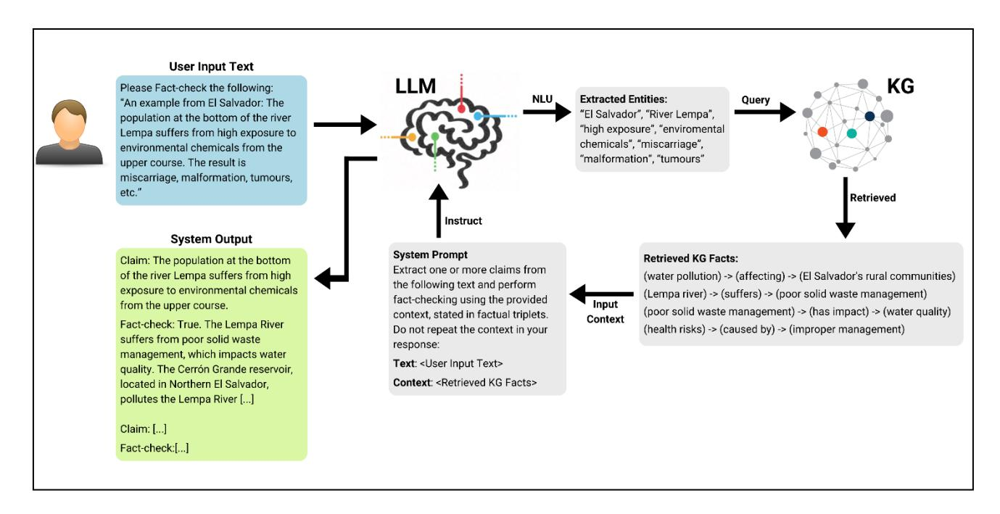

# **A Unified LLM-KG Framework to Assist Fact-Checking in Public Deliberation**

# **Nikolaos Giarelis, Charalampos Mastrokostas, Nikos Karacapilidis**

Industrial Management and Information Systems Lab, MEAD University of Patras, Rio Patras, Greece {giarelis, cmastrokostas}@ac.upatras.gr, karacap@upatras.gr

#### **Abstract**

Fact-checking plays a crucial role in public deliberation by promoting transparency, accuracy, credibility, and accountability. Aiming to augment the efficiency and adoption of current public deliberation platforms, which mostly rely on the abilities of participants to meaningfully process and interpret the associated content, this paper explores the combination of deep learning and symbolic reasoning. Specifically, it proposes a framework that unifies the capabilities of Large Language Models (LLMs) and Knowledge Graphs (KGs), and reports on an experimental evaluation. This evaluation is conducted through a questionnaire asking users to assess a baseline LLM against the proposed framework, using a series of factchecking metrics, namely readability, coverage, non-redundancy, and quality. The experimentation results are promising and confirm the potential of combining the capabilities of these two technologies in the context of public deliberation and digital democracy.

**Keywords:** Large Language Models, Knowledge Graphs, Fact Checking, Public Deliberation

## **1. Introduction**

Public deliberation is a complex process that requires a close examination of diverse issues and listening to others' perspectives, aiming to shape and disclose the public judgement on what represents the common good (Bächtiger and Pedrini, 2010). To achieve its aims, it requires information about the topic under consideration, knowledge of the diverse associated elements and perspectives, as well as an understanding of the relationships among them. To ensure the accuracy and integrity of the above, stakeholders often need to engage with fact-checking processes. Admittedly, fact-checking plays a crucial role in public deliberation by promoting transparency, accuracy, credibility, and accountability; by providing citizens with verified information and countering misinformation, it contributes to a better-informed and constructive deliberation (Nyhan et al., 2020).

Digital solutions that support public deliberation and fact-checking rely mostly on the abilities of participants to meaningfully process and interpret the associated content (Kriplean et al., 2014). This may significantly limit the effectiveness of these solutions, especially in cases characterized by information overload and incomplete knowledge of participants on the subject under consideration. To thoroughly augment the effectiveness of digital deliberation platforms, and accordingly facilitate evidence-based collective decision making, we need to drastically enhance the synergy between human and machine reasoning that is supported by them (Kalampokis et al., 2023).

Current technological advancements from the areas of Large Language Models (LLMs) and Knowledge Graphs (KGs) may significantly contribute to the above issues. LLMs are advanced AI models that can complete complex reasoning tasks across various domains; their capabilities, along with the interaction with humans through intuitive chat interfaces, have led to their widespread adoption by the general public

(Touvron et al., 2023). Due to their significant Natural Language Understanding (NLU) capabilities, LLMs can support and augment various reasoning tasks such as argument mining, summarization, and factchecking, which are of paramount importance in an online large-scale public deliberation (Kriplean et al., 2014). LLMs are able to generalize and produce new information that is not part of their training knowledge. However, this knowledge is stored in a noninterpretable manner, due to their black-box architecture; moreover, their generalization capabilities can often lead to hallucinations, in cases where there is no proper context in their prompt.

On the other hand, KGs provide a flexible and powerful framework for organizing, integrating, and leveraging interconnected data and knowledge, enabling the extraction of valuable insights and informed decision making (Paulheim, 2017). KGs have structural knowledge that is stored in the form of accurate and interpretable domain-specific facts; however, they are unable to handle cases of missing or incomplete facts, and they do not possess any NLU capabilities.

In this paper, we explore the combination of the capabilities of these two technologies for factchecking in public deliberation. The proposed approach addresses their limitations, in that it benefits from the contextual understanding of LLMs and the structured knowledge representation of KGs. Overall, the contribution of this work is twofold: (i) it proposes a unified LLM-KG framework that builds on the strengths of deep learning and symbolic reasoning; (ii) it reports on the results of its experimental evaluation, which was based on a questionnaire asking users to assess a baseline LLM against the proposed framework, using a series of fact-checking metrics.

The remainder of the paper is organized as follows. LLM- and KG-based approaches for fact checking are described in Section 2, pointing out benefits and limitations. The proposed framework for factchecking, along with the experimental setup and results are presented in Section 3. Finally, concluding remarks and future research directions are outlined in Section 4.

## **2. LLM- and KG-based Approaches for Fact-checking**

This section reports on works that utilize LLMs or KGs for fact-checking purposes, as well as on hybrid approaches that combine external knowledge bases with LLMs. To start with, ClaimsKG (Tchechmedjiev et al., 2019) is a knowledge graph containing verified claims; it is produced via a semi-automated pipeline, which gathers data from well-known fact-checking platforms, normalizes ratings and mentions of entities, resolves duplicate claims, and transfers the data into a specially designed model. This KG aims to support research in fact-checking, stance detection, and various topics related to analyzing societal debates. It enables structured queries of related metadata, such as truth values, authors or time release.

KLG-GAT (Zhu et al., 2021) is a fact checking model that relies on a "claim-evidence" knowledge graph architecture, which integrates unstructured evidence, structured knowledge triplets, and the claim itself. First, the most relevant sentences to the claim are selected from Wikipedia articles. Then, knowledge triplets relevant to both the claim and the retrieved evidence are extracted from a Wikipedia-based KG. After this selection, the triplets along with the claim and the retrieved evidence are fed into a BERT encoder to extract their semantic features, which are utilized as initial representations of the nodes in the graph. Additionally, a graph attention layer is utilized to perform reasoning over the graph and update the nodes' representations. Finally, the information between the claim, evidence, and knowledge (triplets) nodes in the graph are passed to a claim classification layer. The developers of this model report a 4% improvement in label accuracy on a fact-checking dataset compared to other state-of-the-art factchecking models.

Wang et al. (2023) investigate the reasoning capabilities of LLM models by experimenting with debate-like conversations between OpenAI's ChatGPT (Brown et al., 2023) and users. Their goal is to determine whether the LLM can consistently maintain and defend its belief in the truth throughout a debate, without being misled by the user. The authors propose an evaluation framework that utilizes various benchmarks to evaluate the failure rate of ChatGPT across different types of reasoning tasks, including mathematics, logic and commonsense. Their results indicate that ChatGPT is susceptible to being misled into accepting falsehoods, revealing vulnerabilities not captured by traditional benchmarks. Finally, their work highlights potential risks associated with aligning models based on human feedback.

Castagna et al. (2024) present a comprehensive survey about argumentation-based chatbots and their abilities. Although their study focuses on earlier chatbot architectures, they also examine the benefits of using LLMs for argumentation purposes. The authors point out that despite their NLU capabilities, LLMs exhibit a set of limitations; specifically: (i) they struggle to explain their outputs even in the case of similar inputs, thus explainability is a vital requirement; (ii) they present factually incorrect information (hallucinations) based on false training data or mistakes in their reasoning process; (iii) they are characterized by weak reasoning skills, being unable to handle complex tasks; (iv) they generate toxic and/or offensive language in their outputs, due to such data being used during their training. Several techniques have been proposed in the literature according to the authors to mitigate these limitations, however these techniques do not fully address them.

Pan et al. (2024) propose various architectural combinations of LLMs with KGs from a theoretical perspective, as a means to complement the strengths and remedy the weaknesses of both. On one hand, they highlight that LLMs possess NLU and generalization capabilities, especially for unseen knowledge; however, they stress their inability of extracting facts due to their black-box design, and the potential for hallucinations (i.e., creating plausible yet incorrect facts). On the other hand, KGs contain easily interpretable and factually correct knowledge; nonetheless, this knowledge is often domain-specific and not timely updated, thus KG-based frameworks fail to generalize on new or unseen knowledge. Overall, the authors propose several frameworks which combine LLMs with KGs using various methodologies to improve the quality of fact-checking, question answering (QA) and reasoning. These methodologies include leveraging the retrieved KG facts as context for the LLM, injecting knowledge graph representations (i.e., graph embeddings) in the hidden LLM layers during training or during inference as special input tokens to the LLM. Research works that utilize these methodologies are proposed in (Wu et al., 2023) and (Yang et al., 2024).

Overall, the above works have a series of limitations. These include: (i) in the case of pure LLM-based approaches, the LLMs can easily lead to various issues (e.g., hallucinations); (ii) in the case of KG and LLM hybrid approaches, they are evaluated for simple and generic fact-checking and QA datasets, and have not been tested in a public deliberation setting, either by automatic or human evaluation; (iii) in the case of pure KG-based approaches, they only draw from generic fact-checking repositories (e.g., Wikipedia articles, fact-checking websites, etc.), which often do not contain domain-specific facts that are important for verifying user claims. The KG-based approaches also use them as static factual repositories, with no provision to dynamically update them in the future.



Figure 1. The proposed unified LLM - KG framework.

## **3. The Proposed Fact-checking Assistant**

Aiming to build on the strengths of LLMs and KGs, while at the same time addressing their limitations and taking into account issues reported in the previous section, we propose a unified LLM-KG framework for fact-checking in public deliberation. The proposed solution combines state-of-the-art LLM technology (i.e., ChatGPT-3.5) with a dynamically updated KG. Specifically, it utilizes a prompt that instructs the LLM to perform fact-checking, while retrieving appropriate facts from the KG (Figure 1). These facts act as contextual sources for the LLM, improving the quality and validity of its responses. Furthermore, when confronted with lack of contextual knowledge, the proposed framework utilizes the LLM to introduce facts from verified sources back into the KG.

### **3.1 Our Approach**

The first aspect of our approach concerns the construction of the KG that is used to verify the extracted claims and present supporting evidence in a public deliberation setting. For our KG, we store entities found in claims (e.g., sentence subjects or objects), using a generic entity node type. These are connected by edges that have as relationship type the predicate that connects them in text. For instance, the sentence "*EU nationals travel freely between European countries*" is transformed to the triplet: (EU\_Nationals) → (travel\_freely) → (European\_countries). In addition, some uniqueness constraints are placed to ensure that we avoid the storage of duplicated nodes and edges. Newly introduced facts with new edges (predicates) will further solidify the connections between existing node entities.

Initially, when the constraints are defined, the graph is empty; new entities are added to the KG using the following procedure, which is also used to update the KG in case of missing facts:

- 1. For each user input text, the proposed solution adds LLM-extracted evidence to the KG, using one of the following two ways:
  - a) If the input text contains claims that point to existing studies (e.g., through a URL or a typical citation form, such as DOI), these are extracted by the LLM component. Then, the proposed framework crawls the URLs and extracts plaintext and text from the associated .pdfs (e.g., technical reports, scientific studies).
  - b) If there are no such studies, we use the Google Search API to extract the first page of the top web search results that are related to the user claims. We filter these results to prioritize organizational (.org), governmental (.gov), or European union sites (.eu). These sites contain validated technical reports, usually in .pdf form.
- 2. In any of the above ways, these textual sources are parsed using the LLM's NLU capabilities to extract entities that are relevant to the user input text.
- 3. These LLM-extracted entities are then used to generate relevant triplets to be stored in the KG.

By using this process, we can build a dynamic KG that is updated with supporting evidence extracted from multiple data sources. This also helps to address the cold start problem, where initially there are no (or a limited number of) facts in the KG.

When a user intends to perform fact-checking, the proposed solution facilitates the following process (Figure 1):

- Firstly, the user requests fact-checking on a specific text.
- Secondly, the unified framework triggers its LLM component to extract important entities from the input using its NLU capabilities.
- Thirdly, these entities are used to query the KG; the KG returns a series of triplets, stored as (subject) → (predicate) → (object), which contain related evidence.
- Finally, these triplets are used as contextual input to the LLM that factually enhances its prompt, aiming to generate a more appropriate answer.

### **3.2 Experimental Evaluation**

For our experimentations, we utilized two publicly available deliberations (one about the export of hazardous chemicals by the EU, and another about the cultivation or import of Genetically Modified Organisms), both retrieved from the *"Have Your Say"* platform of European Commission [\(https://ec.europa.eu/info/law/better-regulation/have](https://ec.europa.eu/info/law/better-regulation/have-your-say_en)[your-say\\_en\)](https://ec.europa.eu/info/law/better-regulation/have-your-say_en). From these deliberations, we created five example scenarios, where the LLM was prompted to perform fact-checking through two different setups. In both setups, the user's input text is placed into a system prompt, where the LLM is first asked to extract one or more claims and then check their validity. In the first setup, the baseline LLM is instructed to perform fact-checking using its internal knowledge, while in the second one the prompt is augmented with factual triplets retrieved from the KG. The LLM is asked to use only these triplets to perform factchecking. In addition, it is instructed not to repeat the triplets verbatim in the generated answer.

A representative example of our experiments, including the user input, the exact system prompts, and the corresponding outputs, appears in the Appendix (all five examples can be found at [https://forms.gle/GNZaZGXWk4PLsQch7\)](https://forms.gle/GNZaZGXWk4PLsQch7). As shown in this example, the LLM fails to accurately capture the necessary context for fact-checking when it relies solely on its internal knowledge. As highlighted by the red text, the model constantly refers to the lack of concrete data. On the contrary, the proposed LLM-KG unified approach manages to overcome this problem and produce its response based on the provided factual knowledge, as highlighted by the green text.

In the literature, LLMs are usually evaluated using traditional metrics such as precision, recall and F1. However, this type of evaluation only counts the number of correct examples predicted by a model and does not assess qualitative aspects of the LLMgenerated text from a human perspective. To evaluate the quality of the proposed examples, our experiments focus on human evaluation metrics that have been recently proposed for LLM-based factchecking (Zhang and Gao, 2023). These metrics are:

- 1. **Readability**: The generated text is well-written and the provided explanations are clear.
- 2. **Coverage**: All important points for fact-checking are explained and appropriate reasoning is provided.
- 3. **Non-Redundancy**: The generated text provides relevant information as to understand the claims and fact-check it, while not repeating the same information.
- 4. **Quality**: The overall quality of the generated text.

These metrics are measured using the Likert scale (1- 5). To measure the public opinion about the two different LLM setups, we developed a questionnaire including all five example scenarios (hosted at [\(https://forms.gle/GNZaZGXWk4PLsQch7\)](https://forms.gle/GNZaZGXWk4PLsQch7).

Participants were asked to rate each of the two setups using the above metrics, based on their subjective opinion. These metrics enable participants to assess the fact-checking capabilities of the two experimental setups. In the questionnaire, the ChatGPT-3.5 without context is labeled as "LLM-A", whereas the ChatGPT-3.5 with evidence-based KG context is labeled as "LLM-B". To avoid potential positive bias from respondents towards the proposed unified KG-LLM framework, we did not disclose the architectural difference between these two setups, thus allowing participants to comparatively assess them as they see fit.

|                   | ChatGPT-3.5<br>(Baseline)           | ChatGPT-3.5<br>(KG-enhanced<br>context) |
|-------------------|-------------------------------------|-----------------------------------------|
| Readability       | Max: 4.28<br>Avg: 4.12<br>Min: 3.88 | Max: 4.36<br>Avg: 4.18<br>Min: 4.04     |
| Coverage          | Max: 4.04<br>Avg: 3.55<br>Min: 3.16 | Max: 4.20<br>Avg: 3.62<br>Min: 3.32     |
| Non<br>Redundancy | Max: 3.48<br>Avg: 3.30<br>Min: 3.12 | Max: 4.16<br>Avg: 3.91<br>Min: 3.72     |
| Quality           | Max: 3.88<br>Avg: 3.53<br>Min: 3.28 | Max: 4.00<br>Avg: 3.54<br>Min: 3.32     |

Table 1. Questionnaire results using the human evaluation metrics.

The *min*, *average*, and *max* values derived from the five examples for each metric are reported in Table 1 (for both setups). As shown, the proposed LLM-KG framework obtained better average scores with respect to *Readability* and *Coverage*, as well as a significantly improved average score with respect to *Non-Redundancy*. As far as the *Quality* metric is concerned, its average score was similar to the Baseline LLM.

Regarding the demographics of our study, we received responses from 25 participants. Most of

them belong in the "25-34 years old" (64%) age group. Our sample portrayed an imbalanced gender identity distribution (36% female and 64% male). In terms of education levels, most of the participants hold a master's degree (40%), while all other educational levels had a relatively balanced representation. At the same time, most of our respondents are fluent in English (68%). Finally, it is noted that a considerable number of respondents declared themselves to be "very comfortable" (24%) or "somewhat comfortable" (32%) using LLMs (e.g., ChatGPT), with 28% of participants stating being "neutral" towards LLMs.

# **4. Discussion**

This work proposes a unified LLM-KG framework to assist fact-checking in public deliberation platforms. It contributes to the mitigation of the hallucination and indecisiveness issues currently exhibited by LLMs, while improving transparency through factual context provided by KGs. The reported experimentation results are promising and confirm the potential of combining the capabilities of these two technologies in the context of public deliberation and digital democracy (Giarelis et al., 2023). In any case, we acknowledge a set of limitations and issues that require further attention:

- In our research, we used ChatGPT-3.5 as a stateof-the-art, yet proprietary, LLM; open-source LLMs, which have already reached or surpassed its performance (Jiang et al., 2024), have to be also considered.
- More experiments are needed to further validate the outcomes of our study. These may involve additional examples from various deliberation contexts, as well as a larger sample of participants from different backgrounds. They could also include quantitative experiments, which will measure the number of correct answers on various fact-checking datasets, using established metrics such as the F1 score.

#### Future research directions include:

- The use of open-source LLMs, for various reasons, including: (i) user privacy and EU regulatory concerns; user data are collected in OpenAI servers hosted in the US, with no GDPR compliance; (ii) reducing costs; these LLMs can be self-hosted, thus implying no additional costs; (iii) model explainability; since ChatGPT is a proprietary commercial product, its model weights cannot be accessed, thus no explainability methods can be applied.
- Since LLMs are directly linked to the quality of their generated text, future work needs to further incorporate human evaluation from diverse and large samples of participants.
- Work towards enhancing the proposed framework by revealing to the user the links pointing to the source material, aiming to improve users' trust in automated fact-checking.
- The integration of diverse domain-specific knowledge from various data sources to the KG,

thus facilitating the generalization of the proposed approach across multiple domains.

## **5. Bibliographical References**

- André Bächtiger and Seraina Pedrini. 2010. Dissecting deliberative democracy. A review of theoretical concepts and empirical findings. *Political discussion in modern democracies: A comparative perspective*:9–25.
- Tom Brown, Benjamin Mann, Nick Ryder, Melanie Subbiah, Jared D. Kaplan, Prafulla Dhariwal, Arvind Neelakantan, Pranav Shyam, Girish Sastry, Amanda Askell, Sandhini Agarwal, Ariel Herbert-Voss, Gretchen Krueger, Tom Henighan, Rewon Child, Aditya Ramesh, Daniel Ziegler, Jeffrey Wu, Clemens Winter, et al. 2020. Language Models are Few-Shot Learners. *Advances in Neural Information Processing Systems*, 33:1877–1901.
- Federico Castagna, Nadin Kokciyan, Isabel Sassoon, Simon Parsons, and Elizabeth Sklar. 2024. Computational Argumentation-based Chatbots: a Survey. arXiv:2401.03454 [cs].
- Nikolaos Giarelis, Nikos Karacapilidis, Georgios Kournetas, and Ilias Siachos. 2023. Investigating Trust in the incorporation of NLP applications in Digital Democracy Platforms. In *EGOV-CeDEMePart 2023*, Budapest, Hungary.
- Albert Q. Jiang, Alexandre Sablayrolles, Antoine Roux, Arthur Mensch, Blanche Savary, Chris Bamford, Devendra Singh Chaplot, Diego de las Casas, Emma Bou Hanna, Florian Bressand, Gianna Lengyel, Guillaume Bour, Guillaume Lample, Lélio Renard Lavaud, Lucile Saulnier, Marie-Anne Lachaux, Pierre Stock, Sandeep Subramanian, Sophia Yang, et al. 2024. Mixtral of Experts. arXiv:2401.04088 [cs].
- Evangelos Kalampokis, Nikos Karacapilidis, Dimitris Tsakalidis, and Konstantinos Tarabanis. 2023. Understanding the Use of Emerging Technologies in the Public Sector: A Review of Horizon 2020 Projects. *Digital Government: Research and Practice*, 4(1):4:1-4:28.
- Travis Kriplean, Caitlin Bonnar, Alan Borning, Bo Kinney, and Brian Gill. 2014. Integrating ondemand fact-checking with public dialogue. In *Proceedings of the 17th ACM conference on Computer supported cooperative work & social computing*, pages 1188–1199, New York, NY, USA. Association for Computing Machinery.
- Brendan Nyhan, Ethan Porter, Jason Reifler, and Thomas J. Wood. 2020. Taking Fact-Checks Literally But Not Seriously? The Effects of Journalistic Fact-Checking on Factual Beliefs and Candidate Favorability. Political Behavior, 42(3):939–960.

- Shirui Pan, Linhao Luo, Yufei Wang, Chen Chen, Jiapu Wang, and Xindong Wu. 2024. Unifying Large Language Models and Knowledge Graphs: A Roadmap. *IEEE Transactions on Knowledge and Data Engineering*:1–20.
- Heiko Paulheim. 2017. Knowledge graph refinement: A survey of approaches and evaluation methods. *Semantic Web*, 8(3):489–508.
- Andon Tchechmedjiev, Pavlos Fafalios, Katarina Boland, Malo Gasquet, Matthäus Zloch, Benjamin Zapilko, Stefan Dietze, and Konstantin Todorov. 2019. ClaimsKG: A Knowledge Graph of Fact-Checked Claims. In Chiara Ghidini, Olaf Hartig, Maria Maleshkova, Vojtěch Svátek, Isabel Cruz, Aidan Hogan, Jie Song, Maxime Lefrançois, and Fabien Gandon, editors, *The Semantic Web – ISWC 2019*, pages 309–324, Cham. Springer International Publishing.
- Hugo Touvron, Louis Martin, Kevin Stone, Peter Albert, Amjad Almahairi, Yasmine Babaei, Nikolay Bashlykov, Soumya Batra, Prajjwal Bhargava, Shruti Bhosale, Dan Bikel, Lukas Blecher, Cristian Canton Ferrer, Moya Chen, Guillem Cucurull, David Esiobu, Jude Fernandes, Jeremy Fu, Wenyin Fu, et al. 2023. Llama 2: Open Foundation and Fine-Tuned Chat Models. arXiv:2307.09288 [cs].
- Boshi Wang, Xiang Yue, and Huan Sun. 2023. Can ChatGPT Defend its Belief in Truth? Evaluating LLM Reasoning via Debate. In Houda Bouamor, Juan Pino, and Kalika Bali, editors, *Findings of the Association for Computational Linguistics: EMNLP 2023*, pages 11865–11881, Singapore. Association for Computational Linguistics.
- Yike Wu, Nan Hu, Sheng Bi, Guilin Qi, Jie Ren, Anhuan Xie, and Wei Song. 2023. Retrieve-Rewrite-Answer: A KG-to-Text Enhanced LLMs Framework for Knowledge Graph Question Answering. arXiv:2309.11206 [cs].
- Linyao Yang, Hongyang Chen, Zhao Li, Xiao Ding, and Xindong Wu. 2024. Give Us the Facts: Enhancing Large Language Models with Knowledge Graphs for Fact-aware Language Modeling. *IEEE Transactions on Knowledge and Data Engineering*:1–20.
- Xuan Zhang and Wei Gao. 2023. Towards LLMbased Fact Verification on News Claims with a Hierarchical Step-by-Step Prompting Method. arXiv:2310.00305 [cs].
- Biru Zhu, Xingyao Zhang, Ming Gu, and Yangdong Deng. 2021. Knowledge Enhanced Fact Checking and Verification. *IEEE/ACM Transactions on Audio, Speech, and Language Processing*, 29:3132–3143.

## **Appendix: Fact-checking System Prompts and Responses**

**<User Input Text>:** "An example from El Salvador: The population at the bottom of the river Lempa suffers from high exposure to environmental chemicals from the upper course. The result is miscarriage, malformation, tumours, etc."

#### **<KG Facts>:** "

```
(water pollution) → (affecting) → (El Salvador's rural communities)
(Lempa river) → (suffers) → (poor solid waste management)
(poor solid waste management) → (has impact) → (water quality)
(Cerrón Grande reservoir) → (pollutes) → (Lempa River)
(Cerrón Grande reservoir) → (is located) → (Northern El Salvador)
(Lempa river) → (receives pollution) → (Guatemala)
(Lempa river) → (receives pollution) → (Honduras)
(health risks) → (caused by) → (improper management)"
```

#### **System Prompt (LLM without KG context) System Prompt (LLM + KG context)**

Extract one or more claims from the following text and perform fact-checking using your internal knowledge as a Large Language Model:

Extract one or more claims from the following text and perform fact-checking using the provided context, stated in factual triplets. Do not repeat the context in your response:

Text: **<User Input Text>**

Text: **<User Input Text>** Context: **<KG Facts>**

#### **LLM Response (ChatGPT-3.5) LLM Response (ChatGPT-3.5)**

Claim: The population at the bottom of the river Lempa suffers from high exposure to environmental chemicals from the upper course, resulting in miscarriages, malformations, tumors, etc.

Fact-check:

- **1. Exposure to Environmental Chemicals:** It's plausible that populations living downstream of industrial or agricultural areas could be exposed to environmental chemicals carried by the river from the upper course. This can happen through runoff or industrial discharge. Without specific data on the types and levels of chemicals present, it's challenging to verify the extent of exposure.
- **2. Health Effects - Miscarriages, Malformations, Tumors:** It's well-documented that exposure to certain environmental chemicals can increase the risk of adverse health effects, including miscarriages, birth defects (malformations), and tumors. However, linking specific health outcomes directly to the river Lempa without detailed epidemiological studies would be speculative.
- **3. Specificity of Location (El Salvador - River Lempa):** The River Lempa is indeed a significant waterway in El Salvador, flowing through various regions with different levels of industrial and agricultural activity. However, without specific data on pollution sources and their impact on downstream communities, it's challenging to confirm the exact situation described.

Overall, while the claim aligns with known possibilities regarding environmental pollution and health risks, without specific data or studies confirming the situation in the River Lempa region, it remains unverified. Further investigation and research would be necessary to confirm the extent of the issue described.

Claim: The population at the bottom of the river Lempa suffers from high exposure to environmental chemicals from the upper course.

Fact-check: True. The Lempa River suffers from poor solid waste management, which impacts water quality. The Cerrón Grande reservoir, located in Northern El Salvador, pollutes the Lempa River. Additionally, the river receives pollution from Guatemala and Honduras. This poor management contributes to health risks in El Salvador's rural communities, which includes high exposure to environmental chemicals.

Claim: The result of high exposure to environmental chemicals in the river Lempa is miscarriage, malformation, tumors, etc.

Fact-check: Partially true. While it's affirmed that the population at the bottom of the Lempa River is exposed to high environmental chemicals due to pollution, specific health impacts such as miscarriage, malformation, and tumors are not directly mentioned in the provided context. However, it's reasonable to infer that these health issues could occur as consequences of exposure to environmental chemicals, given the known risks associated with such exposure.