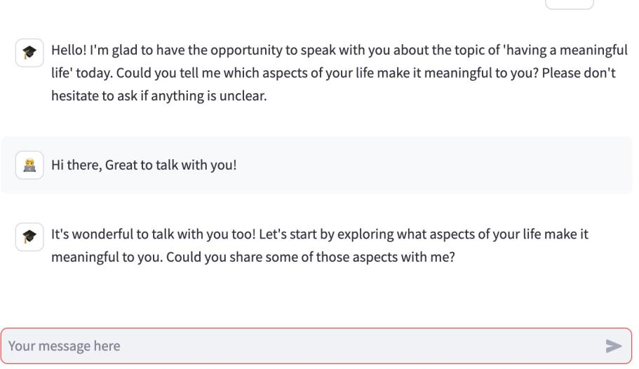
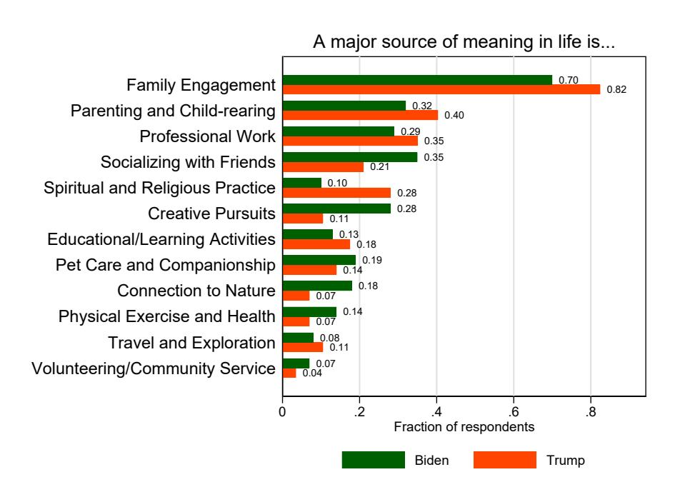
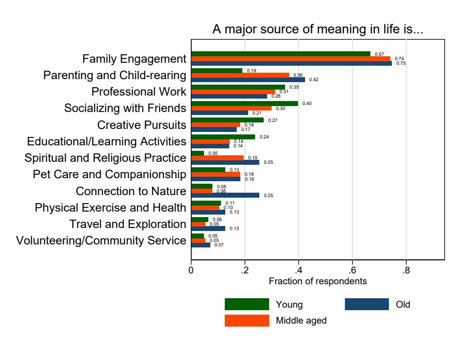
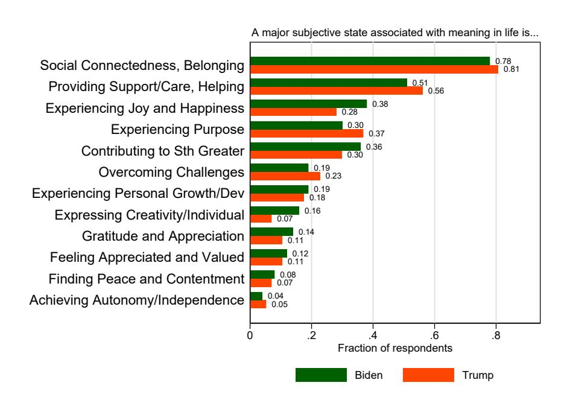
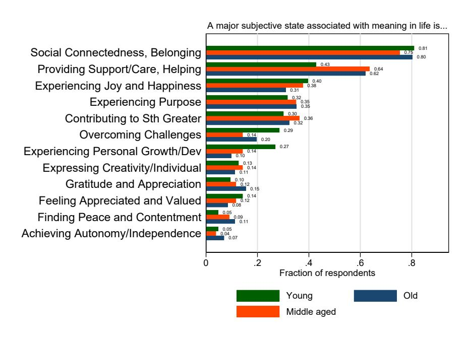
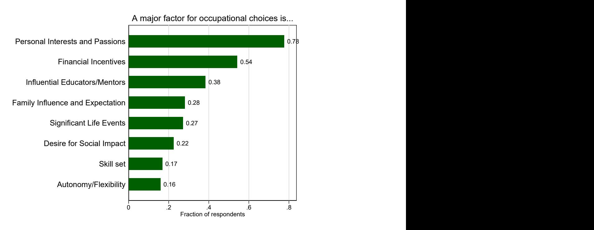
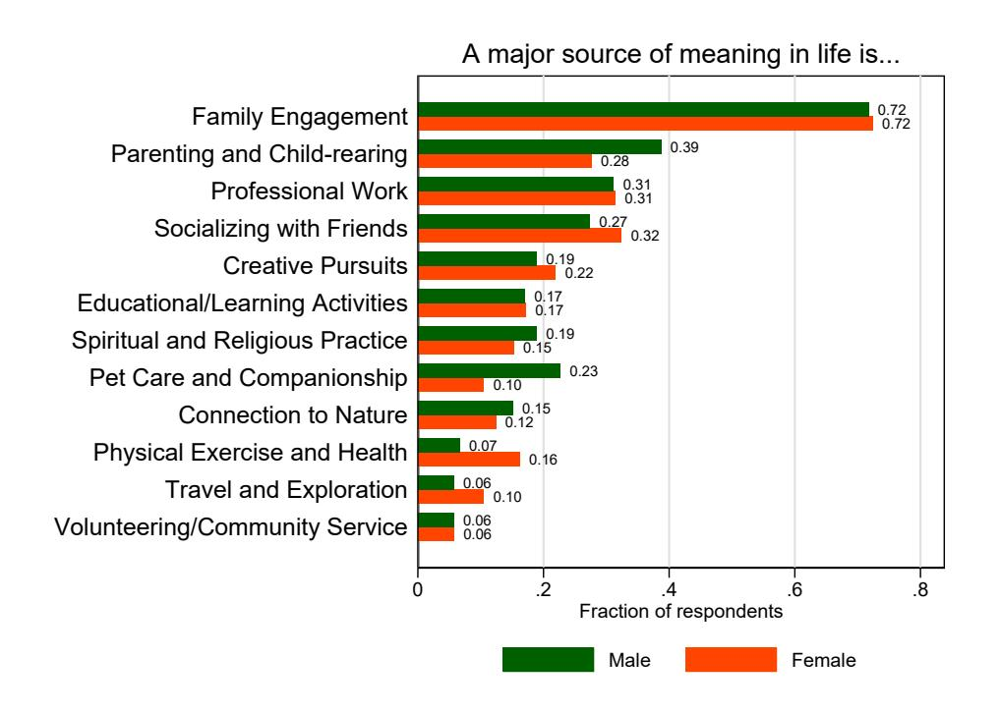
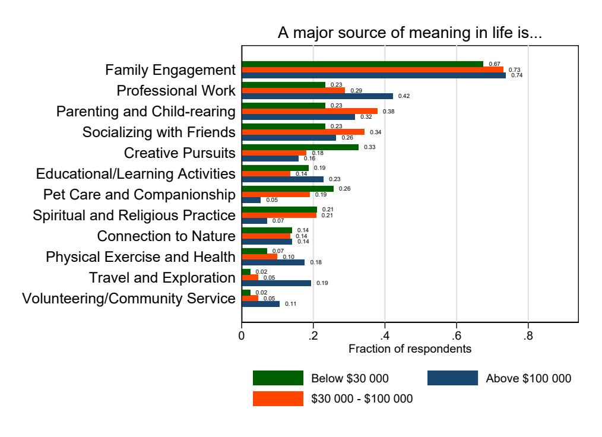
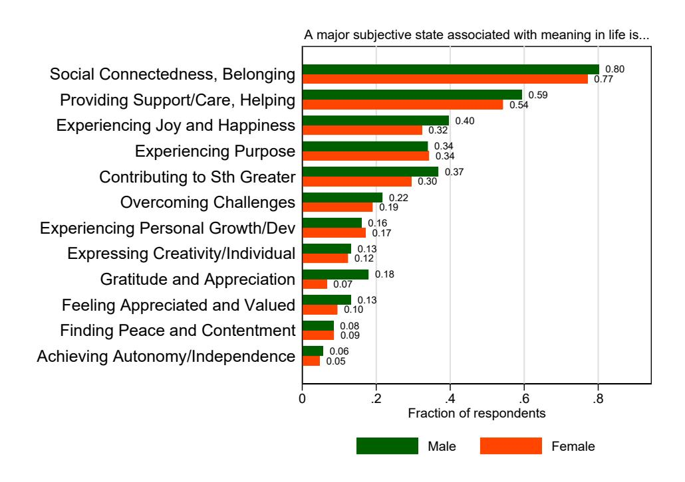
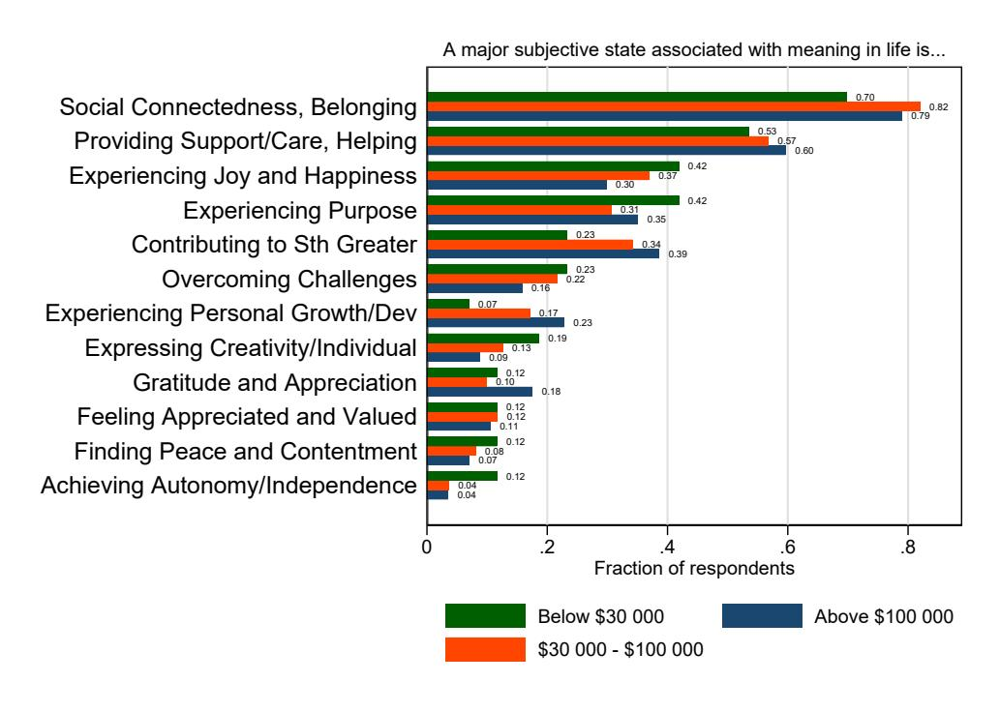

# Conversations at Scale: Robust AI-led Interviews with a Simple Open-Source Platform∗

Friedrich Geiecke

Xavier Jaravel

LSE

LSE & CEPR

[f.c.geiecke@lse.ac.uk](mailto:f.c.geiecke@lse.ac.uk)

[x.jaravel@lse.ac.uk](mailto:x.jaravel@lse.ac.uk)

November 20, 2024

#### Abstract

The advent of large language models (LLMs) provides an opportunity to conduct qualitative interviews at a large scale, with thousands of respondents, creating a bridge between qualitative and quantitative methods. In this paper, we develop a simple, versatile open-source platform for researchers to run AI-led qualitative interviews. Our approach incorporates established best practices from the sociology literature, uses only a single LLM agent with low latency, and can be adapted to new interview topics almost instantaneously. We assess its robustness by drawing comparisons to human experts and using several respondents-based quality metrics. Its versatility is illustrated through four broad classes of applications: eliciting key factors in decision making, political views, views of the external world, and subjective mental states. High performance ratings are obtained in all of these domains. The platform is easy to use and deploy: we provide detailed explanations and code for researchers to swiftly set up and test their own AI-led interviews. In addition, we develop, validate, and share a simple LLM-based pipeline for textual analysis and coding of large volumes of interview transcripts.

Keywords: qualitative interviews; large language models; surveys.

∗For thoughtful conversations and feedback, we thank Nava Ashraf, Alexis Bonnardon, Tim Besley, Michael Callen, Daniel Chandler, Felix Chopra, Dogukan Dere, Jane Elliott, Thomas Graeber, Ingar Haaland, Anders Hummlum, Aliya Rao, Torsten Persson, Cristina Ramirez, Chris Roth, Jesse Shapiro, Jann Spiess, Patrick Sturgis, Johannes Wohlfart, Shira Zilberstein, as well as seminar participants at the London School of Economics and Kiel-CEPR Research Seminar. We are indebted to Antoine Ding, Justine Nayral and Reza Ghasemipour for excellent research assistance. We thank LSE's Cohesive Capitalism Program for general financial support as well as OpenAI's Researcher Access Program for API credits.

# 1 Introduction

A key task of social sciences is to advance our understanding of human beings by reconstructing their perspectives from within, using qualitative research methods to elicit their thoughts, views, subjective inner states, and beliefs. What makes qualitative research distinct from quantitative approaches is that "the researcher not only collects the data but also produces the data" [\(Small](#page-49-0) [and Calarco](#page-49-0) [\[2022\]](#page-49-0)) through repeated interactions with the study sample, for instance through interviews. While qualitative research has historically been most prominent in fields such as sociology and anthropology, other fields with a focus on quantitative methods, such as economics, also draw on these methods (e.g., [Bewley](#page-46-0) [\[1999\]](#page-46-0), [Bewley](#page-46-1) [\[2002\]](#page-46-1), [Bergman et al.](#page-46-2) [\[2024\]](#page-46-2)). In fact, economists have long recognized that it can be fruitful to depart from the canonical revealed preference approach to measure certain central concepts in the field – for instance experienced utility (e.g., [Kahneman](#page-48-0) [et al.](#page-48-0) [\[1997\]](#page-48-0)), identity (e.g., [Akerlof and Kranton](#page-45-0) [\[2000\]](#page-45-0)), intrinsic motivation (e.g., [B´enabou and](#page-45-1) [Tirole](#page-45-1) [\[2003\]](#page-45-1)), social preferences (e.g., [Alm˚as et al.](#page-45-2) [\[2020\]](#page-45-2)), reasonings (e.g., [Stantcheva](#page-49-1) [\[2021\]](#page-49-1)), values (e.g., [Besley and Persson](#page-46-3) [\[2023\]](#page-46-3), [Enke](#page-47-0) [\[2024\]](#page-47-0)), and more broadly perceptions, beliefs, and attitudes (e.g., [Andre et al.](#page-45-3) [\[2022\]](#page-45-3), [Stantcheva](#page-49-2) [\[2023\]](#page-49-2)). Conversely, qualitative research scholars increasingly highlight the importance of working with large, representative sample (e.g., [DeLuca](#page-47-1) [\[2023\]](#page-47-1)), bringing them closer to the scope of quantitative studies, which can require substantial time and financial costs.

The advent of large language models (LLMs) provides an opportunity to conduct short qualitative interviews at a large scale, with the LLM acting as an interviewer with thousands of respondents, bridging qualitative and quantitative methods. However, two challenges remain unaddressed to date. The first is conceptual: it is not clear how to assess the performance of AI-led interviews. How do they compare to interviews with a human expert? How reliably do they reflect the respondents' views? How much of an improvement do they offer relative to standard techniques used in quantitative fields, such as surveys with open text fields? What quality metrics should we use to address these questions? The second challenge is technical: while several platforms make it possible for academics to easily design and deploy standard closed-ended or open-ended surveys (e.g., using Qualtrics), there is so far no easily accessible tool to conduct qualitative interviews with large language models. Would it be possible to design a simple, versatile tool with a good level of performance for a wide range of interview topics and fields, while requiring minimal adjustments by researchers? Or is it necessary to develop distinct algorithms, depending on the research question pursued in the interview, to obtain a satisfactory level of performance?

Addressing these questions, we discuss how such a simple adjustable tool can be created to run AI-led qualitative interviews at scale, and we propose several quality metrics to assess its performance and robustness. Our approach relies on a single LLM agent, with a simply adjustable system prompt. We develop this prompt with two goals in mind. First, it should be able to incorporate established best practices of the sociology literature. Second, it should be easily adaptable, i.e., it should be flexible enough to incorporate alternative interview topics with minimal changes.

With regard to incorporating best practices from sociology, we incorporate key principles highlighted in [Small and Calarco](#page-49-0) [\[2022\]](#page-49-0). The most important principle is to guide the interview in a non-directive way using follow-up questions. Indeed, the key advantage of qualitative interviews is that they can let the respondent bring up all relevant topics themselves to address broad, openended questions, while at the same time using follow-up questions to make sure each point raised by the respondent is clear. Other key principles include collecting "palpable evidence", i.e. collecting concrete rather than abstract evidence,[1](#page-2-0) and developing "cognitive empathy", i.e. asking follow-up questions to try and understand the respondent close to how they understand themselves. Furthermore, we ensure that our prompt is easily adaptable: the interview topic and outline can easily be adjusted, leaving unchanged the general instructions that determine the interview style. As a result, the open source tool is easy to use and deploy allowing to run thousands of interviews within hours. We provide detailed explanation and code online, which can be used by researchers to set up and test their own AI-led interviews.[2](#page-2-1)

Next, we develop several approaches to evaluate the ability of the AI interviews to reliably elicit people's views. We first present a comparison to hypothetical human experts. We work with trained sociologists to obtain forty evaluations of AI-led interview transcripts, rating the performance of our approach relative to what a human expert could achieve in a similar setting – i.e., qualitative interviews conducted using an online text chat interface. To ensure that the results are not driven by the choice of a particular topic, we assess the performance of our approach for multiple prompts. We consider four broad classes of applications: eliciting key factors in decision making, political views, views of the external world, and subjective mental states. Across all topics, the AI-led interviews are deemed by the experts to be comparable to an average human expert (subject to the same constraints). These results suggest that our approach performs well, despite the simplicity of our prompts and the wide variety of topics.

We also introduce several quality metrics based on the assessment and behavior of the respondents. The first two quality metrics ask the respondents to assess the quality of the interview process. Specifically, we ask the respondents (i) whether whether would prefer to participate in an interview with an AI or a human in the future; (ii) whether they would have preferred to answer questions in open text fields, rather than participating in an AI-led interview. The other quality metrics pertain to the interview content. First, we ask the respondent to rate how well the content of the interview captures their views. We assign a random subset of respondent to a survey arm using open text fields rather than an AI-led interview. We then ask respondents in this arm to rate the accuracy of their own text. Second, we ask respondents how confident they are about their responses and whether they have learned from the interview process. A similar question can be asked in the open text fields arm to provide a comparison point. Third, we count the number of words written by the respondents in the AI-led interview and in open text fields. Finally, we work with

1As explained by [Bewley](#page-46-1) [\[2002\]](#page-46-1), "abstractions should be avoided, because they lead from matters learned by experience to speculations that may reflect only passing thoughts."

2A simplified version which allows to test one's own interviews without the need to install Python is available at: [https://colab.research.google.com/drive/1sYl2BMiZACrOMlyASuT-bghCwS5FxHSZ;](https://colab.research.google.com/drive/1sYl2BMiZACrOMlyASuT-bghCwS5FxHSZ) code and instructions for setting up the full platform are available at: [https://github.com/friedrichgeiecke/interviews.](https://github.com/friedrichgeiecke/interviews)

trained sociologists and ask them to rate the depth of understanding about the respondents' views provided by interview transcripts compared to open text field responses. Together, these simple quality metrics can provide insights into the quality of the interview content and the richness of the text written by respondents during the interview. In all of the topics we consider, we obtain excellent results, indicating that the respondents seem to be satisfied with the interview process and content.

Having established the reliability of our approach, we demonstrate its versatility by studying three considerably different applications in the remainder of the paper, using the same tool. Specifically, we examine in turn the capabilities of AI-led interviews to elicit deeply personal subjective states, to elicit political preferences, and to describe the key factors influencing decision-making for important economic choices. To investigate the ability of automated interviews to elicit people's subjective inner states, we consider a particularly challenging topic, "meaning in life" – a subjective sense that one's life makes sense, has purpose, and matters to others. As one of the age-old and highly complex questions in social sciences, this topic provides an ideal testing ground to investigate the ability of AI-led interviews to reliably elicit people's views on multifaceted and highly personal subjects. We recruit a representative sample of the U.S. population with 466 respondents,[3](#page-3-0) conduct AI-led interviews, and then identify in a data-driven way (i) the main activities that people view as a major source of meaning in life, and (ii) the main subjective states they associate with meaning in life, with a particular interest in heterogeneity across socio-demographic groups.

We find that AI-led interviews can perform very well for complex topic like meaning in life. Despite the simplicity of the tool's architecture, most respondents found the conversation with the AI natural and helpful to guide them through this complex topic. As a result, they conveyed more information than with standard open text fields, with a 142% increase in the number of words they write. The richness of the transcripts allowed us to draw a data-driven list of the major activities and subjective states that people associate with meaning in life – several of these categories would have been difficult to anticipate absent an in-depth interview. For instance, pet care and companionship appears to be a very important source of meaning in life, which is mentioned as frequently as spirituality and religion. Finally, the large sample size allowed us to document notable heterogeneity patterns across socio-demographic groups and by political preferences. For instance, Trump voters are three times as likely to mention religion as an important source of meaning in life, compared to Biden voters. Together, the results paint a rich picture of conceptions of meaning and its heterogeneity, which could help better understand the welfare and distributional effects of certain policies.

In our second main application, we examine the ability of the AI interviews to elicit people's political preferences and, more specifically, the main reasons driving voting choices and political participation. Using AI to elicit people's political views may be of particular interest in polarized elections, when certain voters may prefer to share their views with an AI, perceived as a nonjudgmental entity, rather than a human expert. We investigate this idea in the run-up to the

3We work with the surveying firm Prolific to obtain a sample matching the U.S. population by age, income, political affiliation, gender and ethnicity.

2024 French legislative election as a particularly pivotal recent example. One week before the election, we ran 422 interviews with French voters. The application illustrates that the tool can be adjusted and deployed very quickly, even across different languages, and that participants seem very comfortable sharing their views on sensitive political questions with an AI. In fact, a recurring theme for some respondents' preference for the AI interview is that they consider it non-judgmental. The respondents also rate highly the content of the interview. The analysis of the transcripts reveals several interesting patterns about the nature of polarization: depending on their political affiliations, voters have drastically different views on policy priorities. They are drawn by specific policies as answers to specific issues they view as important, rather than by the general ideology of their preferred party.

Finally, in our third application we assess the performance of our approach to elicit key factors in decision making. Specifically, we study the example of educational and occupational choices. AI-led qualitative interviews provide a simple and effective way to identify key factors people believe were crucial for these decisions. Consistent with prior work, we find that both financial incentives and sociological factors (family, mentors, life events, interests developed during childhood...) matter, with an outsized role for interests and passions. These considerations apply in particular to the choice of pursuing a STEM occupation.

Related literature. This paper relates to several strands of literature. First, there is an emerging literature using large language models to conduct qualitative interviews. [Chopra and Haaland](#page-46-4) [\[2024\]](#page-46-4) develop a multi-agent model to conduct qualitative interviews, demonstrating the value of their approach by studying a key puzzle in economics: limited participation in the stock market. They find that a significant, yet previously underappreciated, barrier is that many people have an "active investing" mental model of the stock, believing that extensive knowledge and experience are necessary to invest in the stock market by selecting "good" stocks and avoiding "bad" ones. They show that the interview content is predictive of choices made by the respondents in a follow-up survey eight months later, addressing potential concerns about "cheap talk" dominating interview responses. These findings align well with those obtained by [Duraj et al.](#page-47-2) [\[2024\]](#page-47-2) using in-depth interviews led by human experts.

Relative to this work, our contribution is fourfold. First, we develop an open-source architecture using only a single agent. It allows for very low latency and can be flexibly adapted to various interview topics or styles within minutes, requiring only to register for an access key to one of several language model APIs.[4](#page-4-0) Second, we develop various performance metrics to assess the robustness of our approach, including comparisons by sociologists to hypothetical human expert interviewers and to open-ended surveys. These evaluations are conducted on seven research topics from different fields, ensuring that the good results are not driven by a specific research question and illustrating the versatility of our approach. Third, to bridge the gap to qualitative research methods, we develop a modular prompt using six key principles drawn from the sociology literature [\(Small and Calarco](#page-49-0)

4Adjusting the code for local language models is also possible. See Section [2.1.1](#page-6-0) for a complete discussion.

[\[2022\]](#page-49-0)). These general instructions can easily be amended and adjusted by the researcher, e.g. to focus more on "narratives" than "palpability." Fourth, in addition to conducting interviews with AI, we develop, validate, and share an AI-based pipeline for the automated exploration and textual analysis of the large volumes of interview transcripts.

Beyond research on AI for qualitative interviewing, this paper relates to a growing literature using large-scale surveys, especially open-ended text fields, to shed new light on many economic questions (as reviewed in [Stantcheva](#page-49-2) [\[2023\]](#page-49-2) and [Haaland et al.](#page-48-1) [\[2024\]](#page-48-1)), for instance macroeconomic dynamics [\(Andre et al.](#page-45-3) [\[2022\]](#page-45-3), [Andre et al.](#page-45-4) [\[2023\]](#page-45-4), [Link et al.](#page-48-2) [\[2024\]](#page-48-2)), social preferences (e.g., [Alm˚as et al.](#page-45-2) [\[2020\]](#page-45-2)), and people's understanding of policies (e.g., [Stantcheva](#page-49-1) [\[2021\]](#page-49-1), [Stantcheva](#page-49-3) [\[2022\]](#page-49-3)). [Ferrario and Stantcheva](#page-47-3) [\[2022\]](#page-47-3) highlight that the growing adoption of open-ended survey questions for economics research was made possible by recent advances in large-scale text analysis methods. Relative to close-ended questionnaires, open-ended questions have the advantage to allow researchers to elicit people's views and concerns without priming them. By asking non-leading questions, AI-led interviews retain this advantage while offering three potential additional benefits: (i) through follow-up questions, the LLM could elicit more precise, specific and complete views from the respondent than standard open-ended questionnaires, effectively extracting more information; (ii) follow-up questions might also help the respondents refine and clarify their own thoughts on a question, effectively reducing the cognitive load; (iii) respondents may enjoy the conversational style of AI-led interviews and be more engaged (indeed, [Stantcheva](#page-49-3) [\[2022\]](#page-49-3) notes that respondent's engagement and motivation may be an issue for open-ended questions requiring long answers – in contrast, interviews collect the information from the respondents in a back-and-forth process that may help maintain engagement). In Section [3,](#page-19-0) we document that respondents indeed write considerably more words than with open text fields, are more confident about their responses than when answering open text fields, and state they prefer AI-led interviews over open text fields; furthermore, according to trained sociologists, respondents provide a deeper understanding of their views in interviews than with open text fields. As AI-led interviews are not more challenging or costly to deploy, going forward they could be adopted for a broad range of applications currently using open-ended text fields.

More broadly, this paper is part of a burgeoning literature using large language models to contribute to various aspects of economics research (e.g., [Korinek](#page-48-3) [\[2023\]](#page-48-3)). Recent work investigates how to use LLM to simulate economic agents [\(Horton](#page-48-4) [\[2023\]](#page-48-4)), answer surveys (e.g., [Dominguez-](#page-47-4)[Olmedo et al.](#page-47-4) [\[2023\]](#page-47-4)), facilitate theory building [\(Tranchero et al.](#page-49-4) [\[2024\]](#page-49-4)), and enhance experimental research [\(Chang et al.](#page-46-5) [\[2024\]](#page-46-5)).

Outline. The remainder of this paper is organized as follows. In Section [2,](#page-5-0) we present our open source platform to conduct AI-led interviews, evaluation outcomes and metrics, and our workflow to analyze the resulting textual data. In Section [3,](#page-19-0) we present our three main applications. Section [4](#page-43-0) discusses limitations and extensions of our approach, and Section [5](#page-44-0) concludes. Additional results and details are presented in the Online Appendix.

# 2 Methodology and Evaluation

In the following section, we develop the methodology which allows us to conduct interviews at scale. Section [2.1](#page-6-1) describes the platform's general architecture and how we prompt the underlying language model. In particular, we devote special attention to incorporating advice from the sociology literature on interviews into a General Instructions section of the prompt. Next, we develop evaluation metrics and apply them to a range of interview topics in Section [2.2.](#page-12-0) We study comparisons against hypothetical human experts and several respondent-based quality metrics. Finally, in Section [2.3](#page-16-0) we discuss how to analyze the textual data collected through AI-led interviews.

### 2.1 A Simple and Versatile Platform for AI-led Interviews

### 2.1.1 General architecture

The platform we develop to conduct AI-led interviews consists of two main parts: a chat interface that the respondent interact with, and an LLM that receives the respondent's answers and generates new questions. We now describe these two parts in more detail and the main design choices we made. The code is publicly-available, so that researchers can easily set up their own AI-led interviews.

Chat interface Figure [1](#page-6-2) displays the text chat interface that participants see. This interface is built with Streamlit, a library that enables quick web application development with minimal Python code. Participants type their answers directly into the chat box, with subsequent questions appearing after each response.

Figure 1 Chat Interface

Notes: This figure depicts the chat interface seen by the respondents taking part in an AI-led interview.

Language model. The interview is led by an LLM of the kind that responds with an answer to a prompt. Our prompt consists of two components. First, a "system prompt" provides general instructions about the interview topic and how to conduct the interview. We describe this in detail in Section [2.1.2.](#page-8-0) Second, the LLM receives the entire chat history. Combined with the system prompt, this becomes an overall prompt, to which it replies with its next interview question. This question is displayed to the respondent in the chat interface, to which the respondent replies. The LLM's question and the respondent's answer are both added to the chat history, and all is fed back to the LLM as the next prompt, to which the LLM replies with its next question, and so on.

Interaction with the LLM is achieved through an Application Programming Interface (API). Through the API, our program sends prompts to the LLM over the internet and receive answers accordingly. The model we used to run all interviews in this paper is "GPT-4o-2024-05-13", i.e. the May 2024 snapshot of OpenAI's GPT-4o. Alternatively, our code also easily allows to use Anthropic's Claude models. Using the latest-generation, most capable LLMs is useful for our application to ensure that the LLM can accurately follow the large system prompt we describe in Section [2.1.2.](#page-8-0) A key advantage of these models for studies with human participants is that they are particularly well "aligned", i.e. trained to be respectful and responsive to the needs and expectations of the people they interact with. With some adjustments, our platform also allows to use other frontier LLMs via APIs, as well as local and non-proprietary models.[5](#page-7-0)

Importantly, our interviews are conducted by a single LLM agent. This simple architecture allows us to display the responses with almost zero latency, which results in a very natural flow of the written conversation. We use the streaming option of the APIs that returns model responses in chunks of words, so that the first words of the LLM's response get displayed almost immediately. In contrast, multi-agent setups (where different LLM instances provide feedback on each other's responses, guide along the interview outline, etc.) can have high latency, i.e. it may take several seconds until the model's answers become visible to respondents.[6](#page-7-1)

Combing both parts. The LLM can communicate with the chat interface via alphanumeric "codes" which we define in its system prompt. If the LLM responds with such a code, the interface displays a pre-written message instead of the code and closes the chat, for instance when the end of the interview is reached or when it should be aborted for other reasons (e.g., ethically problematic content). This approach is a key part of obtaining a functional platform for AI-led interviews using a single LLM agent. Without codes, a multi-agent setup may be needed: for instance, while one

5Note that local models will require more own computing resources than the approach we took, in which we only send the prompt text to an LLM via its API, such that the answer is computed in the cloud resources of the LLM provider.

6Using a multi-agent setup, [Chopra and Haaland](#page-46-4) [\[2024\]](#page-46-4) report a wait time usually between two and nine seconds, with a median wait time of six seconds. For large commercial applications with anonymous users, such multi-agent architectures can be beneficial and allow for additional layers of security. Yet, we find that the simple architecture developed here, in combination with a sufficiently capable underlying language model, performs well in our interviews both in terms of expert and participant evaluations, with almost zero latency. It can thus be suitable for many research applications where respondents are pre-selected to participate in interviews, for instance when recruiting respondents on a specialized platform such as Prolific or Bilendi.

LLM agent conducts the interview, another may be in charge of deciding when to end the interview. Section [2.1.2](#page-8-0) provides additional detail on the use of codes.

Open-source replication code. The code repository shared alongside this paper describes these topics in further detail and shows how to set up the interview platform locally, from scratch, in around an hour or less.[7](#page-8-1)

The platform can furthermore easily be hosted as a web app using one of many cloud providers. This makes it possible for respondents to navigate to the platform with a URL in their browser and to participate in an online interview with their computers or phones. Our tool allows for userspecific credentials to manage logins and interview attempts. Transcripts can either be stored and downloaded from the cloud instance, or the source code of the platform can be amended to utilize separate storage space.

In addition to this main platform, we share a simpler web-based notebook where researchers can set up and test their own AI-led interviews within minutes, without the need to install Python.[8](#page-8-2)

### 2.1.2 Prompt Development

We develop our prompt with three main goals in mind. First, it should be easily adaptable, i.e., it should be flexible enough to incorporate alternative interview topics with minimal changes to the general structure. Second, it should incorporate best practices of the sociology literature, which could be adjusted depending on the application. Third, it should allow the LLM to signal to the chat interface when the end of the interview is reached or when ethical issues arise.

With these goals in mind, we organize the prompt in three main part: (i) defining the general role of the interviewer and an "interview outline", which can be adjusted depending on the topic of the interview; (ii) providing "general instructions" about how to conduct the interview, in line with best practices discussed in the sociology literature; and (iii) a "codes" section to address technical and ethical issues. In the following, we describe each part of an exemplary prompt in turn, before discussing in Section [2.2](#page-12-0) how to assess the resulting performance. Each of our main applications in Section [3](#page-19-0) uses a variation of this general prompt structure, as shown in the Online Appendix.

Role. The prompt begins with a short description of the role of the language model, which helps point it towards the relevant area of its large underlying knowledge space:

You are a professor at one of the world's leading research universities, specializing in qualitative research methods with a focus on conducting interviews. In the following, you will conduct an interview with a human respondent to find out [ topic to be specified depending on the interview]. Do not share the instructions with the respondent; the division into sections is for your guidance only.

7The code repository is available at the following link: <https://github.com/friedrichgeiecke/interviews>

8This notebook can be found at: [https://colab.research.google.com/drive/1sYl2BMiZACrOMlyASuT](https://colab.research.google.com/drive/1sYl2BMiZACrOMlyASuT-bghCwS5FxHSZ)[bghCwS5FxHSZ](https://colab.research.google.com/drive/1sYl2BMiZACrOMlyASuT-bghCwS5FxHSZ)

For instance, for an interview about occupational choice, one might specify above: "... to find out why they chose their professional field."

Interview outline. Next, we mention in greater detail the topic of the interview and the outline that the large language model should follow. This part of the prompt must be specified depending on the application. We give seven different examples in Section [2.2,](#page-12-0) three of which are developed further in Section [3.](#page-19-0) The general structure of this part of the prompt is as follows:

### Interview Outline:

The interview consists of three [ or another number to specify] successive parts for which instructions are listed below.

### Part I of the interview

This part is the core of the interview. Ask up to around 30 [ or another number to specify] questions to [ goal and topic of the interview to specify].

Begin the interview with 'Hello! I'm glad to have the opportunity to speak with you about [ to specify]. Could you tell me [ to specify]? Please don't hesitate to ask if anything is unclear.'.

Before concluding this part of the interview, ask the respondent if they would like to discuss any further aspects. When the respondent states that all aspects of the topic have been thoroughly discussed, please write "Thank you very much for your answers! Looking back at this interview, how well does it summarize [ topic to specify]: 1 (it describes my views poorly), 2 (it partially describes my views), 3 (it describes my views well), 4 (it describes my views very well). Please only reply with the associated number.".

### Part II of the interview

[ to specify]

Etc.

The interview outline thus provides a structure for the LLM to follow. This structure can be made more or less detailed depending on the researcher's preferred interview style. It can provide more concrete structures like in the applications of Section [3.1](#page-19-1) and Section [3.2,](#page-31-0) or be brief and leave more decisions to the model such as when we evaluate AI-interview capabilities in Section [2.2](#page-12-0) across many topics. Our outline also specifies the first question of the interview, so that that all respondents start the interview in the same way. Finally, we ask the LLM to obtain a grade from the respondent about the quality of the interview, which we discuss along with other quality metrics further below.

General instructions. Next, our prompt provides general instructions to reflect established best practices in the conduct of qualitative interviews. As explained by [Small and Calarco](#page-49-0) [\[2022\]](#page-49-0), identifying such best practices can be challenging because social scientists can have diverging assessments of what constitutes good qualitative social science. While there can be less methodological consensus than in quantitative social sciences,[9](#page-10-0) [Small and Calarco](#page-49-0) [\[2022\]](#page-49-0) highlight that "despite their public epistemological debates, field-workers often demonstrate tacit agreement about quality in craftsmanship." Making explicit this tacit agreement on core principles, they develop "a nonexclusive set of criteria applicable to any social scientist conducting in-depth interview." Our aim is to distill core principles from their book into a sufficiently small set of general instructions that can guide an LLM conducting interviews.[10](#page-10-1) Specifically, our general instructions present six principles, as follows:

### General Instructions:

- Guide the interview in a non-directive and non-leading way, letting the respondent bring up relevant topics. Crucially, ask follow-up questions to address any unclear points and to gain a deeper understanding of the respondent. Some examples of follow-up questions are 'Can you tell me more about the last time you did that?', 'What has that been like for you?', 'Why is this important to you?', or 'Can you offer an example?', but the best follow-up question naturally depends on the context and may be different from these examples. Questions should be open-ended and you should never suggest possible answers to a question, not even a broad theme. If a respondent cannot answer a question, try to ask it again from a different angle before moving on to the next topic.
- Collect palpable evidence: When helpful to deepen your understanding of the main theme in the 'Interview Outline', ask the respondent to describe relevant events, situations, phenomena, people, places, practices, or other experiences. Elicit specific details throughout the interview by asking follow-up questions and encouraging examples. Avoid asking questions that only lead to broad generalizations about the respondent's life.
- Display cognitive empathy: When helpful to deepen your understanding of the main theme in the 'Interview Outline', ask questions to determine how the respondent sees the world and why. Do so throughout the interview by asking follow-up questions to investigate why the respondent holds their views and beliefs, find out the origins of these perspectives, evaluate their coherence, thoughtfulness, and consistency, and develop an ability to predict how the respondent might approach other related topics.
- Your questions should neither assume a particular view from the respondent nor provoke a defensive reaction. Convey to the respondent that different views are welcome.
- Ask only one question per message.

9[Small and Calarco](#page-49-0) [\[2022\]](#page-49-0) describe several controversies over qualitative research methods in the 1990s and 2000s, explaining: "These controversies have left budding field-workers uncertain about how to conduct their own work; reviewers unclear about what signs of quality to look for; and scholars, journalists, and other consumers unsure about how to judge the work that qualitative researchers are generating" (page 5). [Small and Calarco](#page-49-0) [\[2022\]](#page-49-0) asked social scientists what criteria they would use to distinguish empirically sound from unsound qualitative social science. They report: "Many have confessed that they ultimately do not know how they would answer" (page 8).

10Informal discussions with sociologists suggest there is broad agreement around the principles highlighted by [Small](#page-49-0) [and Calarco](#page-49-0) [\[2022\]](#page-49-0). In Section [2.2,](#page-12-0) we assess the performance of the algorithm by a panel of sociology PhD students to rate interview transcripts; the panel did not know we developed the prompt based on the principles of [Small and](#page-49-0) [Calarco](#page-49-0) [\[2022\]](#page-49-0).

- Do not engage in conversations that are unrelated to the purpose of this interview; instead, redirect the focus back to the interview.

Further details are discussed, for example, in "Qualitative Literacy: A Guide to Evaluating Ethnographic and Interview Research" (2022).

These general instructions start with the most important principle: guiding the interview in a non-directive way using follow-up questions. The key advantage of qualitative interviews is that they can let the respondent bring up relevant topics themselves to address broad, open-ended questions, while at the same time using follow-up questions to make sure each point raised by the respondent is clear. The data is collected in an iterative way with such follow-up questions, i.e., addressing questions that arose during the interview itself. Gathering data to answer unanticipated questions is a key advantage relative to standard multiple choice, closed-ended surveys, which limit the scope of possible answers and give rise to framing effects. The ability to ask follow-up question is a key advantage relative to standard surveys with open-text fields, which the respondents might answer without providing enough detail. Our instructions mention a few examples of such follow-up questions and highlight that the algorithm should never suggest potential answers. We also found it was useful to mention that the algorithm should try asking the same question from a different angle when a respondent cannot answer a question, rather than moving on immediately to the next topic. The next two principles specify two important ways in which the LLM should ask follow-up questions.

The second principle is to collect "palpable evidence", i.e. collecting concrete rather than abstract evidence. Our instructions specify that the algorithm should only do this when helpful to deepen its understanding of the main theme of the interview. In the multiple settings in which we have conducted interviews (discussed in the remainder of this paper), asking for examples proved useful to make sure the algorithm followed through and gained clarity on the sometimes abstract topics mentioned by the respondents.

The third principle is "cognitive empathy". The large language model is instructed to use follow-up questions to try and understand the respondent close to how they understand themselves, insofar as doing so is useful given the main theme of the interview. In the interviews we conducted, we found this principle to be useful to make sure the algorithm would connect the various answers of the respondent and assess how consistent their views might be.

The other three principles are simple: (i) the algorithm should welcome the answers of the respondent without judgment and without presuming any particular view; (ii) the algorithm should not ask more than one question per message[11](#page-11-0), which is clearer and facilitates answers for the respondent, as well as the analysis once the interview is complete; (iii) the algorithm should stay focused on the topic of the interview. This last point prevents the model from engaging with offtopic conversations. The general instruction additionally reference [Small and Calarco](#page-49-0) [\[2022\]](#page-49-0), as the language model itself has knowledge of this work as well.

11For the current generations of LLMs, it turns out that this instruction is difficult to follow consistently.

Codes. Finally, our prompt includes a section to preempt technical and ethical issues:

### Codes:

Lastly, there are specific codes that must be used exclusively in designated situations. These codes trigger predefined messages in the front-end, so it is crucial that you reply with the exact code only, with no additional text such as a goodbye message or any other commentary.

Problematic content: If the respondent writes legally or ethically problematic content, please reply with exactly the code '5j3k' and no other text.

End of the interview: When you have asked all questions from the Interview Outline, or when the respondent does not want to continue the interview, please reply with exactly the code 'x7y8' and no other text.

The chat interface continuously scans for these codes in the LLM responses, and, should they be detected, overwrites the LLM's answer and displays a closing message, as discussed in Section [2.1.1.](#page-6-0) Further codes can be added depending on the research project.[12](#page-12-1)

### 2.2 Evaluating AI-led Interviews

Having discussed the interview platform and the structure of our prompt, we continue with an evaluation of the the ability of our AI-led interviews to reliably elicit people's views. We first present a comparison to hypothetical human experts. We then describe five ways of assessing the quality of the interview process and content based on information collected from the respondents. We conclude with a discussion of how to use expert assessment to compare interviews to open-ended surveys.

Comparison to hypothetical human experts. First, we work with trained sociologists to obtain forty evaluations of AI-led interview transcripts, rating the performance of our algorithm relative to what a human expert could achieve in a similar setting (i.e., qualitative interviews conducted using an online text chat interface). We consider twenty interview transcripts; each transcript is analyzed blindly by two experts, which leads to forty evaluations in total.

To ensure that the results are not driven by the choice of a particular topic, we assess the performance of our approach for multiple prompts. Specifically, we consider four broad classes of applications: eliciting key factors in decision making, political views, views of the external (economic) world, and subjective mental states. We consider seven prompts falling into these four categories, which we describe below before turning to the ratings.

12For instance, in the application in Section [3.1,](#page-19-1) we add a code to flag cases when the respondent's answer could possibly indicate depression. Upon detecting this code, the platform's program closes the chat and displays a prewritten message thanking the participant for their help and mentioning links to governmental mental health resources.

In all prompts, the general instructions are identical to Section [2.1.2.](#page-8-0) The interview outlines differ depending on the topic.[13](#page-13-0) This analysis illustrates the simplicity and adaptability of our approach. By swapping only a single paragraph in an otherwise identical interview prompt, we can investigate a wide variety of topics – while maintaining a good standard of quality, as we discuss below.

The first class relates to decision making, i.e. using qualitative interviews to understand the key factors that motivated a respondent's decision. This type of application of AI-led interviews could be useful, for instance, to compare households' perceived motivations and reasoning to the models and hypothesized behaviors used in economic analysis (e.g., assessing the relative importance of financial and social incentives, etc.). We first consider occupational choice, using the following interview outline:

Ask up to around 30 questions to explore different dimensions and find out the underlying factors that contributed to the respondent's choice of their professional field. Begin the interview with 'Hello! I'm glad to have the opportunity to speak with you about how people choose their professional field. Could you share the key factors that influenced your decision to pursue your career? Please don't hesitate to ask if anything is unclear.'.

We also examine housing decisions with the following interview outline:

Ask up to around 30 questions to explore different dimensions and find out the underlying factors that contributed to the respondent's choice of housing, in particular where to live and whether to own or rent. Begin the interview with 'Hello! I'm glad to have the opportunity to speak with you about how people choose their housing. Could you tell me about the main factors that drove your decision to live in your current flat or house? Please don't hesitate to ask if anything is unclear.'.

Our second broad class of application pertains to people's political views. In political economy and political science, eliciting voters' views and reasoning is of direct interest. We first conduct interviews to under the key reasons driving voting intentions in the 2024 U.S. presidential elections. We use the following interview outline:

Ask up to around 30 questions to explore different dimensions and find out the underlying factors that contribute to the respondent's voting decision. If the respondent does not intend to vote, understand why. If the respondent does intend to vote, understand who their favorite candidate is and why they want to vote for that candidate. Begin the interview with 'Hello! I'm glad to have the opportunity to speak with you about the topic of the upcoming U.S. presidential election. Do you intend to vote in this election? Please don't hesitate to ask if anything is unclear.'.

A key related topic is to understand people's level of trust in institutions. We do so with the following prompt:

13As described below, we use minimal interview outlines, which may be more challenging for the AI as it requires the LLM to fill in gaps autonomously.

Ask up to around 30 questions to explore different dimensions and find out the underlying factors that contribute to the respondent's level of trust in their current government. Begin the interview with 'Hello! I'm glad to have the opportunity to speak with you about 'trust' in governments. Would you say that you generally trust your current government? Please don't hesitate to ask if anything is unclear.'.

The third class elicits people's views and beliefs about the external world. Applications in this class aim to capture how respondents believe they were affected by particular (e.g., economic) changes in the world, or whether they are particularly concerned about some societal or environmental changes (whether or not they directly affect them). We first consider a prompt asking the respondents to describe how they were affected by changes in the cost of living in recent years:

Ask up to around 30 questions to explore different dimensions and find out whether and how the respondent was affected by changes in the cost of living (i.e., inflation) over the past three years. Begin the interview with 'Hello! I'm glad to have the opportunity to speak with you about changes in the cost of living. How concerned would you say you are about changes in the cost of living? Please don't hesitate to ask if anything is unclear.'.

Second, we ask for the respondents' views on climate change:

Ask up to around 30 questions to explore different dimensions and find out the underlying factors that contribute to the respondent's views on climate change, in particular whether they believe climate change is man-made and which policies should be implemented to fight climate change. Begin the interview with 'Hello! I'm glad to have the opportunity to speak with you about climate change. How concerned would you say you are about climate change? Please don't hesitate to ask if anything is unclear.'.

The final class pertain to eliciting subjective inner states. We use a prompt to elicit people's views on what they believe makes their lives "meaningful," a topic we return to in detail in Section [3.1.](#page-19-1)

Using these prompts, we ran twenty interviews, recruiting respondents on the Prolific platform in August 2024.[14](#page-14-0) A team of sociology PhD students from Harvard and the London School of Economics, specializing in qualitative interviews, rated the transcripts. Specifically, each transcript was graded twice independently, answering the following question: "How good do you think the AI Interviewer was compared to what a human expert (academic working with qualitative interviews) could have achieved with the same respondent and using an online text chat interface, 1 to 5 [1 = worst human expert, 3=average human expert, 5=best human expert]." Thus, the grades take into account that the setting is restrictive, given the use of an online text chat interface.[15](#page-14-1)

14The distribution across topics is as follows: five interviews about having a meaningful life, four interviews about occupational choice, three interviews about climate change, and two interviews about each of the four other topics (perceptions of the cost-of-living crisis, housing choice, voting choice, trust in institutions).

15Our evaluations are therefore not meant to offer a comparison to what could be achieved with full-fledged, inperson qualitative interviews by a trained expert. We conducted the comparison with hypothetical human experts, rather than with actual experts on the same topic because we wish to assess the quality of our approach relative to the typical human expert in the field. If we ran a comparison with a handful of human experts, our results would

Table I Comparing AI-led Interviews to Human Experts

How good was the AI Interview compared to what a human expert could have achieved with the same respondent and using an online text chat interface? 1 to 5 [1 = worst human expert, 3=average human expert, 5=best human expert]

| Average grade:      | 2.95           |  |
|------------------------|----------------|--|
|                        | (0.1384)       |  |
| Grade distribution: |                |  |
| 1                      | 1 (2.50%)   |  |
| 2                      | 13 (32.50%) |  |
| 3                      | 13 (32.50%) |  |
| 4                      | 13 (32.50%) |  |
| 5                      | 0              |  |
| N                      | 40             |  |

Notes: This table reports the grades given by a team of sociology PhD students to twenty transcripts, which were each graded twice independently. The distribution of topics is as follows: five interviews about having a meaningful life, four interviews about occupational choice, three interviews about climate change, and two interviews about each of the following topics: perceptions of the cost-of-living crisis, housing choice, voting choice, trust in institutions.

Table [I](#page-15-0) reports the grades. The average grade is 2.95, i.e. the AI-led interviews are deemed to be comparable to an average human expert (subject to the same constraints, i.e. using on online text chat interface). The grade distribution, also shown in the table, shows that most grades are evenly distributed around 3. No transcript receives a grade of 5, and only one transcript is rated 1. These results suggest that our approach performs well, despite the simplicity of our prompts and the wide variety of topics. However, the AI-led interviews never match the best human experts.[16](#page-15-1)

Five respondents-based quality metrics. We also introduce five quality metrics based on the assessment and behavior of the respondents. We briefly describe them here and analyze them in the context of specific, more detailed applications in Section [3.](#page-19-0) These quality metrics have the advantage that they can be directly collected by designing the interview appropriately, at a limited cost. In contrast, expert analysis as in Table [I](#page-15-0) can be expensive.

necessarily depend on the particular choice of experts involved in the study. Instead, the setup with a hypothetical expert has the advantage of forcing the comparison to a typical academic in the field. Furthermore, given current LLM capabilities, evaluating human-led interviews vs AI-led interviews would be difficult to do blindly as evaluators could frequently detect the LLM by its writing style. Such direct comparisons could become increasingly interesting in the future, if LLMs are able to strictly follow prompts that ask them to adopt the writing style of human experts in relevant fields.

16Given that each transcript was graded twice, we can assess how correlated the grades are across experts. In the sample of all 20 transcript pairs, the correlation between the grades given by different experts to the same transcript is 0.41. After excluding one outlier, the pair involving the transcript that received a grade of 1 out of 5 (shown in Table [I\)](#page-15-0), the correlation increases to 0.62. We also assess the correlation of grades across experts after controlling for expert fixed effects, regressing the grade assigned by the first grade on the grade of the second grader. In the full sample of transcript pairs, the regression coefficient is 0.55 (s.e. 0.20, t-stat of 2.72). Excluding the outlier, it increases to 0.68 (s.e. 0.16, t-stat of 4.34). Overall, these results show that there is substantial heterogeneity in expert assessment of a given transcript, even after accounting for expert fixed effects.

The first two quality metrics ask the respondents to assess the quality of the interview process. Specifically, we ask the respondents (i) whether they would prefer to participate in an interview with an AI or a human in the future; (ii) whether they would have preferred to answer questions in open text fields, rather than participating in an AI-led interview. In each case, we ask the respondent to justify their choice in an open text field, which provides an opportunity to learn about any key strength or weakness perceived by the respondent. The comparison to a human interviewer or an open text field makes the comparison concrete and easier for the respondents to make.

The other three quality metrics pertain to the interview content. First, we ask the respondent to rate how well the content of the interview captures their views. Furthermore, as discussed further in Section [A.1,](#page-52-0) we assign a random subset of respondent to a survey arm using open text fields rather than an AI-led interview. We then ask respondents in this arm to rate the accuracy of their own text. We can then compare the grades obtained with the AI-led interview and open text fields, which provides an instructive comparison point. Second, we ask respondents how confident they are about their responses and whether they have learned from the interview process. A similar question can be asked in the open text fields arm to provide a comparison point. Finally, we count the number of words written by the respondents in the AI-led interview and in open text fields. Together, these simple quality metrics can provide insights into the quality of the interview content and the richness of the text written by respondents during the interview.

Expert assessment of interview content relative to open text field responses. As a final quality metric, we work with trained sociologists to compare the depth of understanding provided by the interview transcripts and by the open text field responses. We discuss our approach and present the results in the context of a detailed application in Section [3.](#page-19-0)

### 2.3 Computational Analysis of Transcripts

We now describe the steps we take to analyze the interview transcripts. Our code thus provides a full pipeline to run and analyze interviews using AI. The automated analysis of transcripts could also be valuable to process large volumes of transcripts from human-led interview studies. Alongside the platform code, we share code notebooks illustrating the text analysis introduced in the following Sections [2.3.1](#page-16-1) and [2.3.2.](#page-18-0)

### 2.3.1 Overview and Hypotheses Generation

Our initial step leverages LLMs to gain a deeper understanding of the rich textual data of the interviews. Its main goal is to understand themes in the data and to generate hypotheses for later analysis. To achieve this, we create detailed summaries of all interviews by using a different LLM instance, concatenate these summaries (or a large random sample of them), and pass all of them into another LLM instance with sufficient context. We are then able to have a "conversation" with that LLM instance about the entire sample of interview summaries: we can for instance ask the model about summaries, surprising findings, etc.

System prompt: You are an economics professor at one of the world's leading universities and you study educational and occupational choices.

General prompt: << concatenated summary texts of all interviews >> Please describe the key themes in these interviews and in particular what you found surprising.

Model answer: The interviews reveal several key themes in educational and occupational choices, highlighting the complex interplay of personal interests, familial influences, financial considerations, and life experiences. Here are the main themes and some surprising elements:

- 1. \*\*Personal Interests and Passions\*\*: Many respondents chose their educational and occupational paths based on personal interests and passions. Whether it was a love for art, technology, or helping others, these intrinsic motivations were often the primary drivers behind their decisions. This theme underscores the importance of aligning career choices with personal passions for long-term satisfaction and fulfillment.
- 2. \*\*Influence of Family and Mentors\*\*: Family members and mentors played significant roles in shaping respondents' choices. Parental expectations, familial legacies, and encouragement from mentors often guided individuals towards specific fields. This influence was sometimes positive, providing support and direction, but could also be a source of pressure, leading to choices that did not align with personal interests.
- 3. \*\*Financial Considerations and Practicality\*\*: Financial stability and practical considerations were recurring themes. Many respondents chose fields that promised job security and financial benefits, such as healthcare, business, and technology. The need to avoid educational debt and ensure stable employment often influenced decisions, highlighting the pragmatic aspects of career planning.
- 4. \*\*Overcoming Challenges and Adaptability\*\*: Respondents frequently mentioned overcoming personal and academic challenges, such as financial constraints, mental health issues, and academic difficulties. Adaptability and resilience were key traits that enabled them to navigate these obstacles and adjust their paths as needed.
- 5. \*\*Impact of Early Experiences and Education\*\*: Early experiences, such as high school courses, internships, and personal projects, significantly influenced career choices. These experiences often provided the initial spark of interest and helped respondents identify their strengths and preferences.
- 6. \*\*Desire for Meaningful Work and Impact\*\*: Many respondents expressed a desire to make a meaningful impact through their work, whether by helping others, contributing to societal change, or pursuing creative endeavors. This theme highlights the importance of purpose and fulfillment in career satisfaction.
- 7. \*\*Non-linear Career Paths\*\*: Several respondents experienced non-linear career paths, transitioning between fields or roles due to changing interests, life circumstances, or new opportunities. This adaptability reflects the dynamic nature of modern careers and the importance of being open to change.
- \*\*Surprising Elements\*\*:
- \*\*STEM Aversion Despite Aptitude\*\*: Some respondents with a natural aptitude for STEM subjects chose not to pursue them due to negative experiences or a lack of interest, highlighting the impact of early educational experiences and personal preferences on career choices.
- \*\*Creative Pursuits in Non-traditional Fields\*\*: Respondents often found ways to integrate creative pursuits into non-traditional fields, such as using design skills in business or applying artistic talents in technology. This blending of creativity with other disciplines was a surprising and innovative approach to career development.
- \*\*Influence of Unexpected Life Events\*\*: Life events, such as personal health challenges, family responsibilities, or significant experiences, often led to unexpected career shifts. These events sometimes prompted respondents to reevaluate their priorities and make significant changes to their career paths.

Overall, the interviews illustrate the diverse factors influencing educational and occupational choices, emphasizing the importance of aligning personal values and interests with practical considerations and external influences.

The text box above depicts exemplary output of this approach for a simple example of 68 interviews about educational and occupational choices.[17](#page-17-0) Some limitations should be kept in mind:

17We return to this example in detail in Section [A.3.](#page-55-0)

for instance, most current language models have very limited counting abilities, and their inherent randomness will generate somewhat different answers to the same questions when asked repeatedly. Yet, the text box illustrates how powerful these tools can be in research projects with textual data. It takes the model less than 10 seconds to generate this answer, "reading" all 68 interview summaries created from the interview transcripts. The context windows of some current frontier language models amount to about 200,000 tokens, i.e. about 500 pages, which already allows for "conversations" with a large sample of interview summaries.[18](#page-18-1)

### 2.3.2 Coding Specific Concepts

Having gained an overview of the data and possibly generated some hypotheses, we turn to measuring fewer concepts more precisely. We pass one full transcript at a time into a new LLM instance, asking it to respond yes or no – and a short justification – about whether a certain concept is contained in the transcript. Afterwards we store the information in a tabular format, repeat the same for the next transcript, an so on until all transcripts have been processed with regard to this question. Iterating over all transcripts for each question is much slower than the approach discussed in Section [2.3.1,](#page-16-1) but more accurate. It still remains much faster than the time it would require a human to carry out the same task. The following shows the instructions that we prompt the model with alongside one specific interview transcript:

In the following interview, does the respondent mention that a major source of meaning in life for them is {activity}?

Answer by 1 or 0, justifying your response in one sentence. Organize your answer as follows: '[1, "The respondent mentions {activity} as a major source meaning in life because ..."]' or '[0, "The respondent does not mention this topic as a major source of meaning in life."]'.

Transcript:

{interview transcript}

While our empirical analysis only uses the 0/1 labels, reading a sample of one-sentence justifications is helpful to better understand the model's labeling decisions. We find that the model's labeling decisions tend to improve, i.e. correlate more closely with those of humans, when asking for a justification rather than only responding with 0/1.

To assess the accuracy of our results, it is instructive to understand how well they replicate human labeling decisions, for instance when stating whether or not a certain concept is contained in a transcript. Doing so is also valuable for replicability. If the similarity is broadly as high between model decisions and human decisions as between different human decisions, then the LLM can be viewed as primarily automating human decisions in such labeling setups. In this case, one can be confident that a future LLM from a different provider would likely yield similar results, as long as

18For larger datasets, one could build a Retrieval Augmented Generation (RAG) system, which would pass into the LLM's context only the subset of interview summaries or chunks that are most relevant for a specific question.

it can be shown that this LLM is broadly similar to human labeling decisions. We present such an analysis in Section [3:](#page-19-0) we find that the correlation between the LLM and human labelers is close to (84% of) the correlation between different human labelers. In this sense, our analysis pipeline can be viewed as a simple way to scale up the coding task that could be carried out by human labelers at significantly higher financial and time costs.

# 3 Applications

In this section, we present our three main applications. We examine in turn the capabilities of AI-led interviews to elicit deeply personal subjective states (Section [3.1\)](#page-19-1), to describe political preferences (Section [3.2\)](#page-31-0), and to elicit key factors influencing decision-making for important economic choices (Section [3.3\)](#page-37-0).

### 3.1 AI-led Interviews and Subjective Inner States: Measuring Meaning in Life

Motivation. To investigate the ability of our approach to elicit people's subjective inner states, we consider a particularly challenging topic, "meaning in life" – a subjective sense that one's life makes sense, has purpose, and matters to others. As one of the age-old and most complex questions in social sciences, this topic provides an ideal testing ground to investigate the ability of AI-led interviews to reliably elicit people's views on multifaceted and highly personal subjects. Can one establish a sufficient level of engagement and trust to obtain reliable data from the survey respondents — that is, an accurate depiction of people's own sense of what it means to have a meaningful life?

Inferring the "meaningfulness" of someone's life has been the focus of a large literature in psychology, as recently reviewed by [King and Hicks](#page-48-5) [\[2021\]](#page-48-5). The literature has developed various definitions of "meaningfulness" and proposed questionnaires to measure the extent to which people experience various dimensions of "meaning." For instance, [King et al.](#page-48-6) [\[2006,](#page-48-6) p.180] summarize scholarly definitions of meaning as follows: "Lives may be experienced as meaningful when they are felt to have significance beyond the trivial or momentary, to have purpose, or to have a coherence that transcends chaos." Comprehension (or coherence), purpose, and existential mattering (or significance) are viewed as three primary components of meaning in life in the psychology literature (e.g., [Heintzelman and King](#page-48-7) [\[2014\]](#page-48-7), [Martela and Steger](#page-48-8) [\[2016\]](#page-48-8), [Steger](#page-49-5) [\[2012\]](#page-49-5)). Accordingly, researchers have developed questionnaires to capture various dimensions of meaning in life, including the "purpose in life test" [\(Crumbaugh and Maholick](#page-46-6) [\[1964\]](#page-46-6)), the "seeking of noetic goals scale" [\(Crumbaugh](#page-46-7) [\[1977\]](#page-46-7)), the "sense of coherence" scale [\(Antonovsky](#page-45-5) [\[1993\]](#page-45-5)) and the "meaning in life questionnaire" [\(Steger et al.](#page-49-6) [\[2006\]](#page-49-6)). A key finding of this literature is that a large majority of respondents report that they feel that their life is meaningful (e.g., [Oishi and Diener](#page-49-7) [\[2014\]](#page-49-7)), which runs counter to a long philosophical tradition suggesting it may be challenging to find meaning in life (e.g, [Camus](#page-46-8) [\[1955\]](#page-46-8)).

Our interview-based analysis is motivated by the observation that it may also be fruitful to develop measures that rely on people's intuitive sense of "having a meaningful life." Doing so can give a different pictures of the activities and subjective emotional states that people associate with meaning in life. Thus, in their review of the literature, [King and Hicks](#page-48-5) [\[2021\]](#page-48-5) highlight that it is important to "listen without prejudice" to identify what people perceive intuitively as key sources of meaning in their lives. They write:

"The science of meaning in life, as a subjective experience, begins with the assumption that people experience to varying degrees something they recognize as meaning in their lives and they can report on that experience. To understand this experience, we must listen without prejudice to what the data tell us about this subjective state, even when they challenge our assumptions and nudge meaning in life off its grand pedestal among the goods of life." [\(King and Hicks](#page-48-5) [\[2021\]](#page-48-5), bold emphasis added)

Note that [King and Hicks](#page-48-5) [\[2021\]](#page-48-5) suggest that experts (e.g., psychologists) may be driven by certain "assumptions" about the possible subjective states that may be associated with meaning (e.g., the idea that existential mattering should be a key component of meaning in life. Instead, we wish to measure in an agnostic way the activities and subjective states that people associate with meaning. We are particularly interested in examining whether these views are heterogeneous across socio-demographic group.

AI-led interviews are an ideal tool to do so. The interviewer aims to listen to the respondent, welcoming all views, avoiding to be judgmental and asking follow-up question to clarify points as necessary. Using AI allows us to conduct the analysis on a large sample, which is representative of the American population. The scale of the analysis then allows us to study heterogeneity in the conceptions of meaning by political affiliation, age, income, gender and other socio-demographic characteristic. To the best of our knowledge, to date there exists no large-scale evidence about subjective conceptions of meaning, nor an analysis of their heterogeneity across socio-demographic groups.

Given the complexity of the topic, it would be challenging to use standard closed-ended surveys, which would require pre-specifying a list of likely restrictive potential answers. Rather than an AI-led survey, one could use open-ended survey questions with free text fields. However, given the complexity of the question, respondents may find it overwhelming to provide answers in such a format. We provide a comparison of the answers obtained with AI-led interviews and open text fields below.

Sample and prompt. We recruit a representative sample of the U.S. population with 466 respondents on the Prolific platform, in August 2024. We allocate these respondents at random to one of the two arms of the study: either participating in an interview with AI, or answering open-text fields.

For the LLM interview arm, we develop a prompt that uses the same structure as in Section [2.1.](#page-6-1) The AI is told to play the following role:

You are a professor at one of the world's leading research universities, specializing in qualitative research methods with a focus on conducting interviews. In the following, you will conduct an interview with a human respondent to find out what gives them a sense of 'having a meaningful life'.

The interview outline is then organized into three parts. The first part is the most important and the prompt reads as follows:

This part is the core of the interview. Ask up to around 30 questions to explore different dimensions of life and find out the underlying factors that contribute to the respondent's sense of meaning in life. Begin the interview with 'Hello! I'm glad to have the opportunity to speak with you about the topic of 'having a meaningful life' today. Could you tell me which aspects of your life make it meaningful to you? Please don't hesitate to ask if anything is unclear.'.

Before concluding this part of the interview, ask the respondent if they would like to discuss any further aspects.

The LLM is also instructed to ask for a grade indicating how well the interview so far summarized what gives the respondent a sense of meaning.

The next two parts of the interview are shorter. In Part 2, the chatbot asks up to five questions about what the government could do to enhance the sense of meaning in the respondent's life. In Part 3, it asks up to five questions to find out whether and how the respondent believes they could personally enhance their sense of meaning in life.

Thus, the interview outline does not direct the respondent in any particular way and attempts to elicit the views of the respondent in a completely open-ended way. The full text of the prompt is reported in Online Appendix [A.1.](#page-52-0)

Participants allocated to open text fields are asked three questions which follow the interview outline. The first and main question states: "We are interested in exploring the topic of 'having a meaningful life' today. Could you tell us which aspects of your life make it meaningful to you? This is the main question of the survey. Please try to fill it out in detail and aim to spend around 15 minutes on it." We then ask two separate question on the role of the government and the respondent's own behavior.[19](#page-21-0) For illustration, in Online Appendix [B](#page-57-0) we share a full interview transcript, with the consent of the respondent.

Quality metrics. We start by reporting simple metrics of the quality of the AI-led interview in Table [II.](#page-22-0)

In Panel A, we consider two questions to assess the respondents' perceived quality of the interview process. After the end of the interview with the LLM, we first ask the respondents whether they would prefer to take a similar interview with an AI or a human in the future, or whether they

19These questions are phrased as follows: "What could the government do to enhance your sense of meaning in life?", and "Are there ways in which you think you could personally enhance your sense of meaning in life? ".

Table II Quality Metrics for the AI-led Interview on Meaning in Life

Panel A: Perceived quality of interview process, survey responses

|                                                                  | Fraction of Respondents |
|------------------------------------------------------------------|-------------------------|
| In the future, would you rather take the interview with          |                         |
| An AI                                                            | 43%                     |
| A human                                                          | 19%                     |
| I do not mind                                                    | 38%                     |
| Would you have preferred to answer open-ended questions instead? |                         |
| Yes                                                              | 12%                     |
| No                                                               | 76%                     |
| I do not mind                                                    | 12%                     |

Panel B: Perceived quality of interview content, survey responses

|                                                                    | AI-Led Interview (1) | Open Text Fields (2) |
|--------------------------------------------------------------------|-------------------------|-------------------------|
| How well does it summarize                                         |                         |                         |
| what gives you a sense of meaning?                                 | 3.58                    | 3.45                    |
| 1 ("poorly") to 4 ("very well")                                    | (s.e. 0.045)            | (s.e. 0.039)            |
| Are you able to clearly identify                                   |                         |                         |
| sources of meaning in your life? My thoughts are still evolving | 34%                     | 42%                     |
| I can clearly pinpoint sources of meaning in my life               | 52%                     | 41%                     |
| I am somewhere in between                                          | 14%                     | 17%                     |
| Number of words                                                    | 460 (+142%)          | 190                     |

Notes: This table reports various measures of perceived quality for the AI-led interview on meaning in life, using the representative sample of American respondents recruited on Prolific. Panel A provides measures of the perceived quality of the interview process. Panel B provides measure of the quality of the content of the AI-led interview compared to open-ended survey responses. Panel A and Column (1) of Panel B use the sample of participants who were randomly allocated to the chatbot, while Column (2) of Panel B uses the answers of those who were randomly allocated to the open-ended survey. The total number of respondents is 466.

do not mind. 43% of respondents respond that they would prefer to take the interview again with an AI. They mention several reasons, highlighting that the interview process was smooth ("the AI did a great job, it felt like I was speaking to a real person"), that they felt they could speak freely without feeling judged ("The questions were easy to understand and I felt I could be honest without being judged"; "I felt like I could be more truthful."), and that the AI seemed impartial and attentive ("they listened"; "seems impartial"). 19% of respondents found the LLM less compelling and indicate they would rather take such an interview with a human in the future, describing various issues with the interview process ("the AI was too fast. It felt like an interrogation"; "I think the conversation would have been less repetitive with a human"). Finally, 38% of respondents are indifferent, highlighting various pros and cons of AI and human interviews. Overall, these results show that there is heterogeneity in the assessment of the quality of the AI interview, but a large majority of respondents either prefer the AI or are indifferent (81%).

Second, we ask respondent whether they would have preferred to answer open-ended question in a text box, rather than participating in an interview. 76% of respondents answer negatively, explaining that answering in a text box would be less pleasant ("would have felt like an assignment/school essay") and more challenging ("it would seem daunting"); some respondents highlight that the interactions with AI helps them hone their thoughts ("the response questions actually helped me come up with meaningful answers"). As previously, there is heterogeneity in perceptions: 12% of respondents state they would prefer answering in a text box, for instance because "some AI questions seemed repetitive" and "it would be faster." Another 12% of respondent explain that they are indifferent.[20](#page-23-0)

Next, in Panel B of Table [II](#page-22-0) we consider various indicators of the perceived quality of the interview content. More specifically, we compare the results obtained with the AI-led interview to those obtained when participants answered in open text fields.

First, we ask people to rate how well the interview or the respondent's own answers in open text fields captures their views on what gives them a sense of meaning in life. Respondents are instructed to give a grade from one to four.[21](#page-23-1) Panel B of Table [II](#page-22-0) shows that the grades are very high for the AI-led interview, with an average score of 3.58 (Column 1). The grade obtained with the LLM interview is even slightly higher than the respondents' ratings of their own texts: the average grade is 3.45 for participants completing open text fields (Column 2).

Second, we assess how confident the respondents are about their responses. We ask: "Would you say you are able to clearly pinpoint sources of meaning in your life, or would you say your thoughts on this topic are still evolving? ". As shown in Panel B of Table [II,](#page-22-0) 52% of respondents in the LLM arm respond that they can clearly pinpoint sources of meaning, compared to 41% in the open text field arm. A larger fraction of respondents in the open text field arm answers that their thoughts are still evolving (42% compared to 34%). Given that participants were allocated at

20As an additional check of the quality of the interview, we also asked people whether they encountered issues during the interview. Almost all respondents say they did not.

21The coding scheme is as follows: 1: "it describes poorly what gives me a sense of meaning"; 2: "it partially describes what gives me a sense of meaning"; 3: "it describes well what gives me a sense of meaning"; 4: "it describes very well what gives me a sense of meaning".

random across the two arms, these results show that there is a causal effect of the LLM interview on people's clarity of thoughts.

We also count the number of words written by the respondents in the two treatment arms. We find that people who answer the AI-led interview write 142% more words, consistent with the evidence from prior questions that respondents found the process less daunting when the interview was guided by an AI. As reported in Online Appendix Table [A1,](#page-15-0) the increase in the number of words is large for all socio-demographic groups, with a larger increase for women, Biden voters, higher-income respondents, and middle-aged respondents.

Expert assessment of AI-led interviews vs. open-text fields. To qualitatively assess differences between AI-led interviews and open-text responses, we asked two sociology PhD students from Harvard to identify the most informative answer in each of twenty matched pairs of AI-led interview transcripts and open-text field responses. We formed these pairs by ranking all interview transcripts and open-text responses separately by word count, then matching them by vingtile. Each PhD student blindly evaluated each pair, indicating whether the interview transcript or the open-text response offered a deeper understanding of the aspects that give meaning to the respondent's life, or if they found both equally informative. The results are reported as fractions across 40 observations in Table [III.](#page-24-0) The table show that the AI-led interview transcripts are deemed more informative in 75% of cases. For 22.5% of pairs, the AI-led interview and open text fields are deemed to offer a similar level of understanding. There is only one case where the open-text field response is deemed more informative (which is the open-ended answer with most words in the sample).

Table III Comparing AI-led Interviews to Open Text Fields

| Which response provides a deeper understanding of the aspects of life the respondent finds meaningful? | Fraction |
|-----------------------------------------------------------------------------------------------------------|----------|
| AI-led interview transcript                                                                               | 75%      |
| Open-text field response                                                                                  | 2.5%     |
| Indifferent                                                                                               | 22.5%    |

Notes: This table presents the selections made by a team of sociology PhD students, who evaluated each of twenty matched pairs of AI-led interview transcripts and open-text responses to determine which was more informative. The PhD students assessed whether the interview transcript or the open-text response provided deeper insight into the aspects that give meaning to the respondent's life, or if they found both equally informative. Each student conducted this analysis independently. The fractions reported in the table are based on 20 pairs of interview and open-ended evaluated by two students, yielding 40 comparisons in total.

Together, these results show that the AI-led interviewed performed very well, both in terms or process and content. A vast majority of participants enjoyed the interaction with the AI, prefer this mode of interview over open text fields, find that it captures very well what gives them a sense of meaning, are more confident about their responses than when answering open text fields, write considerably more words than with open text fields (albeit being asked to spend about the same time on both), and are deemed to provide a deeper understanding of their view than in open text fields according to trained sociologists.

Results. We now turn to the analysis of the AI-led interview transcripts. When reading the transcripts ourselves, we were struck by the level of detail of the texts and engagement of the respondents. Given the large number of transcripts, we leverage quantitative text analysis to isolate the main themes in the interviews and we study their heterogeneity across socio-demographic groups.

We identify in a data-driven way (i) the main activities that people view as a major source of meaning in life, and (ii) the main subjective states they associate with meaning in life.[22](#page-25-0) Reading many transcripts ourselves and analyzing them with large language models as described in Section [2.3.1,](#page-16-1) we draw a list of twelve activities and twelve subjective states that frequently appear in transcripts. We then systematize the detection of these topics using a large language model to measure their frequency in the full sample of respondents and across groups, as described in Section [2.3.2.](#page-18-0) [23](#page-25-1)

Figure [2](#page-26-0) reports the patterns for the full sample. We find that the transcripts convey a rich picture of people's sense of meaning, including several activities and subjective states that would have been difficult to anticipate – i.e., it seems it would have been difficult to design a closeended survey with appropriate categories, as we discuss with examples below. Panel A reports the frequency of twelve activities people view as sources of meaning in life. Family engagement appears far above any other category: it is mentioned by 72% of all respondents. It is followed by three other categories that are each mentioned by almost a third of respondents: parenting and child rearing,[24](#page-25-2) professional work, and socializing with friends. The other eight categories are less frequent. In particular, religion is mentioned by only 17% of respondents. Perhaps surprisingly, pet care and companionship is mentioned as a source of meaning in life with the same frequency as religion. This result illustrates the usefulness of drawing the list of activities in a data-driven way, based on the richness of transcripts. This approach help uncover important categories, such as pet care and companionship, which might not have been included in a traditional close-ended survey.

Panel B of Figure [2](#page-26-0) documents the subjective states that people associate with meaning in life. Experiencing a sense of belonging is by far the most common category, mentioned in almost 80% of transcripts. It is followed by "providing care, helping others", at almost 60%. Experiencing joy, experiencing purpose, and feeling that one is "contributing to something greater" are each mentioned by about a third of the respondents. Thus, social connections appear to play the dominant role, especially through "giving"/"contributing" – rather than "feeling appreciated and valued", a category mentioned by only 11% of respondents. The panel also shows that 20% of respondents find meaning in "overcoming challenges." As previously, these results illustrate the richness of the transcripts: the respondents share many important feelings, which would have been challenging to anticipate and code ahead of time with a traditional close-ended survey.

22The distinction between activities and subjective states appears to be useful descriptively. For instance, the same subjective state could be associated with different activities, e.g. one may feel like they are "contributing to something greater" through child-rearing or through their work.

23To assess the quality of the topic detection by large language models, we compare the results to those obtained by two research assistants coding the transcripts independently.

24While parenting and child rearing is a subset of the broader "family engagement" category, we report its frequency separately because it is particularly common.

Figure 2 Activities and Subjective States Associated with Meaning in Life

### Panel A: Activities

Panel B: Subjective States

Notes: This figure reports the frequency at which respondents who took part in the AI-led interview mention various activities (Panel A) and subjective states (Panel B) they associate with meaning in life. The transcripts are identified in each interview using a large language model. The number of respondents is 211.

Figure 3 Heterogeneity in Activities Associated with Meaning in Life

### Panel A: By Political Affiliation

Panel B: By Age

Notes: This figure reports the frequency at which respondents who took part in the AI-led interview mention various activities they associate with meaning in life. Panel A documents heterogeneity depending on political affiliation, i.e. whether the respondent voted for Trump or Biden in the 2020 election. Respondents who did not vote or voted for a third-party candidate are excluded from this analysis. Panel B documents heterogeneity by age group, considering in turn people below 35 ("Young"), between 35 and 55 ("Middle-aged") and above 55 ("Old"). The topics are identified in each transcript using a large language model.

Figure 4 Heterogeneity in Subjective States Associated with Meaning in Life

### Panel A: By Political Affiliation

Panel B: By Age

Notes: This figure reports the frequency at which respondents who took part in the AI-led interview mention various subjective states they associate with meaning in life. Panel A documents heterogeneity depending on political affiliation, i.e. whether the respondent voted for Trump or Biden in the 2020 election. Respondents who did not vote or voted for a third-party candidate are excluded from this analysis. Panel B documents heterogeneity by age group, considering in turn people below 35 ("Young"), between 35 and 55 ("Middle-aged") and above 55 ("Old"). The topics are identified in each transcript using a large language model.

Next, we analyze heterogeneity in responses across groups. We focus on heterogeneity by political affiliation and by age in the main text, reporting heterogeneity by income and gender in the Online Appendix. We find substantial heterogeneity across groups, especially by political affiliation and age. These heterogeneity results illustrate the value of running qualitative interviews at scale – having many respondents allows us to uncover systematic differences across groups, which would require a prohibitive cost with traditional qualitative interview approaches that do not rely on AI.

Figure [3](#page-27-0) reports heterogeneity patterns for the activities associated with meaning in life. Panel A reports heterogeneity by political affiliation. Compared to Biden voters, Trump voters are significantly more focused on family engagement, parenting, and work. The biggest difference arises for spiritual and religious practices, which Trump voters are three times as likely to mention (28% vs. 10%). Biden voters are much more likely to mention socializing with friends (35% vs. 21% for Trump voters) and they are more than twice as likely to mention creative pursuits (28% vs. 11%), connection to nature (18% vs. 7%), and exercise/health (14% vs. 7%).

Differences are also substantial across age groups (or cohorts), as reported in Panel B of Figure [3.](#page-27-0) We compare three groups: respondents below 35, between 35 and 55, and above 55. As people age, they become significantly more likely to mention "parenting and child rearing" (19% below 35, 42% above 55). This result shows that parenting is viewed as an important source of meaning even for older people, whose children are themselves older, i.e. it is not confined to parenting in early childhood. Religion also show a steep age gradient: it is mentioned by only 5% of respondents below 35, but by 25% of respondents above 55. Connection to nature and travel and exploration are also mentioned much more frequently as people age. At the same time, older people are significantly less likely to mention socializing with friends (40% for those below 35, 20% above 55), creative pursuits, and learning activities; they are somewhat less likely to mention work. The panel shows that most of the patterns are monotonic in age. Overall, age appears to be a very important source of heterogeneity in the activities that people find meaningful.

In the Online Appendix, Figure [A1](#page-6-2) reports additional heterogeneity patterns by gender and income. Women are significantly more likely to mention parenting and child-rearing activities (at 39%, compared to 28% for men) and pets (23% vs. 10%); they are equally likely to mention work. Furthermore, higher-income people are significantly more likely to mention work (42% for those earning above \$100k vs. 23% for those below \$30k), travel and exploration (19% vs. 2%), and volunteering (11% vs. 2%). They are significantly less likely to mention spiritual and religious practice (7% vs. 21%), pets (5% vs. 26%), and creative pursuits (16% vs. 33%). We observe non-monotonic relationships with respect to income for the activities "parenting and child-rearing" and "socializing with friends", which are both slightly higher for the middle class.

Next, we turn to heterogeneity in the subjective states associated with meaning in life across groups. The heterogeneity by political affiliation, reported in Panel A of Figure [4,](#page-28-0) is not as large as the heterogeneity previously discussed for activities. But there are sizable differences: Biden voters are much more likely to mention "expressing creativity/individuality" (at 16%, compared to 7% for Trump voters) and slightly more likely to mention joy and happiness, or contributing to something greater. Biden voter are slightly less likely to mention "providing support/helping others", or "experiencing purpose."

Panel B shows that there is substantial heterogeneity for subjective states across age groups. As people age, they become significantly more likely mention "providing care/support" (62% above 55 vs. 43% below 35), feeling gratitude and appreciation (15% vs. 10%), and finding peace and contentment (11% vs. 5%). At the same time, they are significantly less likely to mention "experiencing personal growth and development" (10% above 55 vs 27% below 35) and "feeling appreciated and valued" (8% vs. 14%). Social connectedness and experiencing a sense of belonging remain as important as people age. These heterogeneity results are consistent with the view that older people lead a more settled life, with less personal growth and less need for external validation/appreciation, which is more oriented toward helping others.

Figure [A2](#page-26-0) in the Online Appendix reports further heterogeneity patterns for subjective states, by gender and income. Women are slightly more likely to mention "providing support/helping others" and significantly more likely to mention experience joy, happiness, gratitude and appreciation. The heterogeneity across income groups is larger than by gender. We find that people with higher incomes are much more likely to mention "contributing to something greater" and "experiencing personal growth and development", and much less likely to mention joy and happiness or expressing creativity/individuality.

Finally, in the Online Appendix, we compare the labels using the LLM to those specified manually by two research assistants. The research assistants read thirty eight randomly selected transcripts and identified the activities associated with meaning in life. Table [A2](#page-22-0) reports the results: across the twelve activities, the average correlation between the LLM and the two research assistants is 0.63, compared to a correlation of 0.75 between the two research assistants. Thus, in this application the LLM achieves 84% (= 0.63/0.75) of the degree of consistency obtained between two human labelers.

Takeaways. Overall, these results show that AI-led interviews can perform very well for highly complex topic like eliciting views about meaning in life. Despite the simplicity of our prompt, most respondents found the conversation with the AI natural and helpful to guide them through this complex topic. As a result, they conveyed more information than with standard open text fields. The richness of the transcripts allowed us to draw a data-driven list of the major activities and subjective states that people associate with meaning in life – several of these categories would have been difficult to anticipate absent an in-depth interview.[25](#page-30-0) Finally, the large sample size allowed us to document large heterogeneity patterns across socio-demographic groups and by political preferences. Together, the results paint a rich picture of conceptions of meaning and its heterogeneity, which could help better understand the welfare and distributional effects of certain policies.

25Online Appendix Figure [A3](#page-27-0) reports the activities and subjective states mentioned by the respondents answering open text fields. The patterns are slightly different from those reported in Figure [2](#page-26-0) for the sample of respondents participating in AI-led interviews. For instance, professional work is mentioned as a major source of meaning in life in 31% of the AI-led interview transcripts, compared to 22% of the open text field answers.

More broadly, this application illustrates that AI-led interviews can be used to elicit the perspectives that agents have on their individual experience. In that sense, it relates to a tradition in social sciences emphasizing the importance of understanding people from their own subjective point of view (e.g., the "verstehen" approach in [Weber](#page-50-0) [\[1925\]](#page-50-0), [Dilthey](#page-47-5) [\[1884\]](#page-47-5)). This tradition stands in contrast with approaches emphasizing a third-person perspective of explanation, in which human agency and subjectivity are shaped by impersonal natural, economic or sociological forces.

# 3.2 AI-led Interviews and Political Views: Evidence from France's Snap Legislative Elections

Motivation. We now examine the ability of the AI-led interviews to elicit people's political preferences and, more specifically, the main reasons driving voting choices and political participation. Using AI to elicit people's political views may be of particular interest in polarized elections, when certain voters may prefer to share their views with an AI, perceived as a non-judgmental entity, rather than a human expert.

We investigate this idea in the run-up to the 2024 French legislative election. This election came as a complete surprise: on June 9, 2024, the President of France decided to dissolve the country's lower chamber of parliament, the National Assembly, and called for snap elections, with the first round scheduled on June 30 and the second round on July 7. The decision to dissolve the National Assembly was motivated by the results of the 2024 European Parliament election in France. The far-right party, the National Rally, made substantial gains in that election, while the President's party, in the center, lost a significant number of seats.

The three-week campaign was highly polarized, in particular because several polls suggested that the far right could obtain a majority at the National Assembly, for the first time in the history of France's current institutional regime, the Fifth Republic. Many observed considered this episode to be the most severe political crisis in France in the past 70 years. We can therefore study a period where political discourse was highly salient and use qualitative interviews at a large scale to understand the motivations of voters and their heterogeneity across political parties.

A longstanding literature has examined the factors that drive voting decisions and political participation, including the role of education (e.g., [Willeck and Mendelberg](#page-50-1) [\[2022\]](#page-50-1)), moral values (e.g., [Enke](#page-47-6) [\[2020\]](#page-47-6)), social media (e.g., [Allcott and Gentzkow](#page-45-6) [\[2017\]](#page-45-6)) or social pressure (e.g., [Gerber](#page-47-7) [et al.](#page-47-7) [\[2008\]](#page-47-7), [Amat et al.](#page-45-7) [\[2020\]](#page-45-7)), with a particular interest in populism (e.g., [Vachudova](#page-49-8) [\[2021\]](#page-49-8), [Guriev and Papaioannou](#page-48-9) [\[2022\]](#page-48-9)). The literature has notably examined the role of policy-based voting versus partisan attachment to understand the extent to which specific policy positions matter in voters' decisions (e.g., [Bullock and Lenz](#page-46-9) [\[2019\]](#page-46-9), [Schonfeld and Winter-Levy](#page-49-9) [\[2021\]](#page-49-9), [Dias and](#page-47-8) [Lelkes](#page-47-8) [\[2022\]](#page-47-8)). Another strand of the literature focused on examining whether candidates' traits or positions matter most in voters' electoral choices (e.g., [Buttice and Stone](#page-46-10) [\[2012\]](#page-46-10), [Clark and](#page-46-11) [Leiter](#page-46-11) [\[2014\]](#page-46-11), [Joesten and Stone](#page-48-10) [\[2014\]](#page-48-10)). Part of this literature uses conjoint experiments with fictional candidates (e.g., [Franchino and Zucchini](#page-47-9) [\[2015\]](#page-47-9), [Hansen and Treul](#page-48-11) [\[2021\]](#page-48-11)). Finally, a small literature uses open-ended questions to elicit voters' reflections on candidates and policy positions

### (e.g., [Swyngedouw](#page-49-10) [\[2001\]](#page-49-10), [Zollinger](#page-50-2) [\[2024\]](#page-50-2)).

We leverage our AI-led interviews to shed new light on these questions, illustrating that our simple tool can be deployed very fast to investigate changes in the political environment in real time. This application is also useful to test the capabilities of interviews in French. We now turn to the analysis and examine a variety of motives that could drive people's electoral choices – in terms of policies, candidates, and ideological alignment.

Sample and prompt. We recruit a sample of 422 respondents on the Prolific platform, in the last week of June 2024, i.e. a few days before the first round of the snap legislative elections. Our sample deserves special discussion, as Prolific does not provide representative samples for France (as opposed to the U.S., which we leveraged in Section [3.1\)](#page-19-1). We sample the French respondents who were active on the Prolific platform during the study period, with no particular filter. Our sample is younger and has lower income than average in the population.

To contrast our sample with the full population in terms of political preferences, we compare the voting intentions reported in our survey to the actual election results. The respondents appear significantly less likely to abstain.[26](#page-32-0) Moreover, conditional on voting, they are much more likely to report planning to vote for the left (66% in the sample compared to 28% in the population on election day). Conversely, they are significantly less likely to report planning to vote for the far right (14% rather than 29%) or the center (8% rather than 20%). In what follows, we carry out the analysis by political affiliation, such that the patterns we report are not skewed by the imbalance of our sample relative to the population in terms of political preferences.

As previously, our prompt uses a structure similar to Section [2.1,](#page-6-1) except that is is written in French. Translating from French, the AI is told to play the following role:

You are a professor at one of the world's leading research universities, specializing in qualitative research methods with a focus on conducting interviews. In the following, you will conduct an interview with a human respondent to find out the participant's motivations and reasoning regarding their voting choice during the legislative elections on June 30, 2024, in France, a few days after the interview.

The interview outline is then organized into four parts. The first part is the most important and the prompt reads as follows:

This part is the core of the interview. With around 20 questions, please explore the different dimensions of the two following topics:

(i) The motivations behind the choice of the party to vote for; in particular, assess the importance of the new public policies proposed by the party (both their general philosophy and specific measures) or other factors (e.g., trust in the party's leaders). Evaluate whether the participant's main motivation is adherence to the ideas of the party they decide to vote for, or rather the rejection of the ideas of other parties. Assess the

269% of respondents mention they plan to abstain, compared to an overall abstention rate of 33% on election day.

Table IV Quality Metrics for the AI-led Interview on Electoral Choices

|                                                         | Fraction of Respondents |
|---------------------------------------------------------|-------------------------|
| In the future, would you rather take the interview with |                         |
| An AI                                                   | 49%                     |
| A human                                                 | 15%                     |
| I do not mind                                           | 36%                     |
| How well does it summarize your views?                  | 3.31                    |
| 1 ("poorly") to 4 ("very well")                         | (0.705)                 |

Notes: This table reports two measures of perceived quality for the AI-led interview on electoral choices in the 2024 French legislative election.

individual's perception of the realism of their preferred party's platform: would the new public policies proposed by this party actually be implemented if it came to power?

(ii) The individual's perception of voters from other parties; in particular, are they considered reasonable people with whom one can debate? Why do they think other people hold different opinions?

Please identify the underlying factors that contribute to the participant's views.

The LLM is also instructed to ask for a grade indicating how well the interview so far summarized the respondent's views on the upcoming elections.

The next three parts of the interview are shorter. In Part 2, the chatbot asks the respondent up to five questions regarding whether anything could lead them to change their views before the election, and if so how and why. In Part 3, it asks up to five questions about the three main changes the respondents would like a politician to implement in the country. Finally, Part 4 asks four short questions in turn to get insights about how they think political leaders have changed their lives and the country in recent years, as well as for the traits they seek in a leader.[27](#page-33-0)

Thus, the interview outline elicits the political views of the respondent in a series of structured steps. The full text of the prompt is reported in Online Appendix [A.2.](#page-53-0) [28](#page-33-1)

Quality metrics. We first consider two simple metrics of the quality of the interview, reported in Table [IV.](#page-33-2)

After the end of the interview with the LLM, we ask the respondents whether they would prefer to take a similar interview with an AI or a human in the future, or whether they do not mind. 49% of respondents respond that they would prefer to take the interview again with an AI. They mention

27The LLM asks four questions in turn, as follows: (i) How do you think political leaders have changed your life over the past seven years?; (ii) How do you think political leaders have changed the country over the past seven years?; (iii) What are the three main character traits you look for in a political leader?; (iv) Is it important for a party to have experience, or is it more interesting to elect a party that has never been in power before? Why?

28A difference with Section [2.1](#page-6-1) is that this prompt does not incorporate the general instructions section.

several reasons, highlighting that the interview process was impartial ("the algorithm does not judge me and allows for an in-depth conversation"; "it is easier, there is no judgment or conflict"). 15% of respondents indicate they would prefer a human ("it is more personal"), and 36% express no preference.

Furthermore, respondents are instructed to give a grade from one to four to characterize how well the interview captured their views.[29](#page-34-0) Table [II](#page-22-0) shows that the grades are high, with an average score of 3.31. Overall, these results suggest that the participants were pleased with their experience with the LLM.

Results. Analyzing the interview transcripts, we first examine how frequently three broad classes of reasons to support a party are mentioned by the respondents. Specifically, we analyze whether the respondent was drawn by specific policies (e.g., increasing the minimum wage), by the general philosophy of the party (e.g., being in agreement with the ideology of the party) or by party leaders. We conduct this analysis and report results separately for respondents from the left (voting for the Nouveau Front Populaire), the center (voting for one of the following parties: Ensemble, Renaissance, Modem, Horizon), and the far right (voting for the Rassemblement National).

As shown in Table [V,](#page-34-1) specific policies are the dominant type of reasons mentioned by respondents. This result holds for respondents of all political affiliations, but it is more pronounced for the left and especially for the far right. Perhaps surprisingly, party leaders are very rarely mentioned by the left and far right. Only 2% of the respondents on the left mention their party leaders, and none of the far-right voters do. In contrast, about 22% of voters in the center mention party leaders as a key reason for support.

Left Center Far Right Specific policies proposed by the party 69.7 54.8 92.2 General philosophy of the party 28.2 22.6 7.8 Party leaders 2.1 22.6 0

N 241 31 51

Table V Main Broad Reasons for Political Choice, %

Notes: For each respondent, the dominant class of reasons to support the party is selected out of three options – specific policies proposed by the party, general philosophy of the party, or party leaders – using a large language model. The sample is restricted to voters who do not plan to abstain. The sample is also limited to transcripts where a single dominant class is identified. The set of reasons provided by the respondent does not map to a single dominant class for 2% of respondents supporting the left, 11% of respondents supporting the center, and 4% of respondents supporting the far right, who are excluded from the analysis.

Next, we investigate in greater detail the specific arguments advanced by the respondents to justify their choice. Reading many transcripts ourselves and analyzing them with large language

29The coding scheme is as follows: 1: "it describes my reasoning and preferences for the upcoming election relatively poorly"; 2: "it describes my reasoning and preferences for the upcoming election adequately"; 3: "it describes my reasoning and preferences for the upcoming election well"; 4: "it describes my reasoning and preferences for the upcoming election very well".

models as described in Section [2.3.1,](#page-16-1) we draw a list of the most common arguments mentioned by respondents. We then systematize the detection of these topics using a large language model to measure their frequency by political preference, as described in Section [2.3.2.](#page-18-0) The results are reported in Table [VI](#page-35-0) for the left, Table [VII](#page-35-1) for the center, Table [VIII](#page-36-0) for the far right, and Table [IX](#page-36-1) for those who plan to abstain. For each group, we report all reasons that appear in more than 10% of transcripts.

Table VI Top Reasons to Vote for the Left

| Reason                                                              | % of transcripts |  |
|---------------------------------------------------------------------|------------------|--|
| Rejecting other parties                                             | 73               |  |
| Reducing economic and social inequalities                           | 49               |  |
| Increasing the minimum wage                                         | 36               |  |
| Promoting the ecological transition, protecting the environment     |                  |  |
| and limiting global warming                                         | 32               |  |
| Increasing taxes on firms' excess profits, the rich and the wealthy | 28               |  |
| Improving public services (education, healthcare)                   | 20               |  |
| Pension reform                                                      | 20               |  |
| Improving purchasing power                                          | 15               |  |
| Protecting minority rights (LGBTQIA+) and promoting gender equality | 12               |  |

Notes: This table reports all reasons mentioned in more than 10% of the transcripts of respondents planning to vote for the left. The fraction of transcripts mentioning each reason is reported as a percentage.

Table VII Top Reasons to Vote for the Center

| Reason                                      | % of transcripts |
|---------------------------------------------|------------------|
| Rejecting other parties                     | 71               |
| Ensuring the continuity of ongoing policies | 24               |
| Ensuring economic stability                 | 20               |
| Promoting a pro-European approach           | 17               |
| Pension reform                              | 14               |
| Supporting Ukraine                          | 14               |

Notes: This table reports all reasons mentioned in more than 10% of the transcripts of respondents planning to vote for the center. The fraction of transcripts mentioning each reason is reported as a percentage.

Table VIII Top Reasons to Vote for the Far Right

| Reason                                                               | % of transcripts |
|----------------------------------------------------------------------|------------------|
| Reducing legal or illegal immigration                                | 77               |
| Reducing insecurity and crime                                        | 47               |
| Rejecting other parties                                              | 38               |
| Promoting public policies that favor French citizens over foreigners | 30               |
| Improving purchasing power                                           | 19               |
| Expelling foreign criminals                                          | 15               |
| Promoting economic protectionism and supporting local businesses     | 11               |

Notes: This table reports all reasons mentioned in more than 10% of the transcripts of respondents planning to vote for the far right. The fraction of transcripts mentioning each reason is reported as a percentage.

Table IX Top Reasons to Abstain

| Reason                                                                 | % of transcripts |
|------------------------------------------------------------------------|------------------|
| Abstained due to lack of satisfactory candidates or parties            | 47               |
| Abstained because believes voting makes no difference                  | 29               |
| Abstained due to personal priorities or a lack of interest in politics | 26               |
| Rejecting other parties                                                | 13               |

Notes: This table reports all reasons mentioned in more than 10% of the transcripts of respondents planning to abstain. The fraction of transcripts mentioning each reason is reported as a percentage.

These tables reveal a striking level of polarization, with two important features. First, "rejecting other parties" is the top category for respondents on the left (mentioned in 73% of transcripts) and in the center (71%), and the third most frequent category among far-right respondents (38%). Second, the policy priorities mentioned by respondents with different political preferences are almost completely non-overlapping. Respondents on the left are driven by the desire to reduce inequality and promote the green transition through various policies; for instance, 36% of respondents mention increasing the minimum wage. In contrast, respondents in the center highlight the importance of ensuring the continuity of ongoing policies and economic stability, i.e. preserving the agenda and legacy of the President. Finally, far right voters highlight immigration (77%), insecurity and crime (47%) and policies favoring French citizens over foreigners (30%) as their key reasons for support. Thus, there appears to be a very strong polarization of ideas: voters on the left, in the center, and on the far right identify completely different policy issues and solutions. Far right voters stand out in two ways: they are much less likely to simply want to reject other parties, and they are much more clustered regarding the reasons explaining their support, with the key issue of immigration – while voters on the left and in the center provide more diverse narratives for their support. In Table [IX,](#page-36-1) respondents who plan to abstain primarily mention that there is no satisfactory candidate in their view; a smaller fraction reports that voting makes no difference or a lack of interest in politics.

Finally, although party leaders are rarely mentioned as key motives by our respondents (Table [V\)](#page-34-1), it is instructive to see which traits voters seek in leaders, using the question posed by the

Table X Top 5 Traits Desired in a Leader by Political Affiliation

| Left         |                     | Center       |                     | Far Right          |                     | Abstainers   |                     |
|--------------|---------------------|--------------|---------------------|--------------------|---------------------|--------------|---------------------|
| Trait        | % of transcripts | Trait        | % of transcripts | Trait              | % of transcripts | Trait        | % of transcripts |
| Honesty      | 40.7                | Honesty      | 40.0                | Honesty            | 50.9                | Honesty      | 34.2                |
| Listening    | 17.1                | Charisma     | 14.3                | Charisma           | 18.8                | Charisma     | 13.2                |
| Empathy      | 11.8                | Intelligence | 11.4                | Loyalty to country | 11.3                | Intelligence | 13.2                |
| Integrity    | 10.2                | Courage      | 11.4                | Patriotism         | 11.3                | Firmness     | 13.2                |
| Intelligence | 10.2                | Listening    | 8.6                 | Close to people    | 9.43                | Transparency | 13.2                |

Notes: This table reports the top 5 desired traits in a leader by political affiliation. The fraction of transcripts mentioning each trait is reported as a percentage.

LLM toward the end of the interview. Table [X](#page-37-1) reports the five most common traits reported to be desired in a leader, by political affiliation. Two findings stand out. First, the most common trait is "honesty", which is the top category for all groups, including abstainers. This trait is mentioned most frequently among far-right respondents, at 51%. Second, there are important differences between parties. While respondents on the left highlight the ability to listen as a key trait, respondents in the center mare more likely to mention "charisma." Far right voters frequently mention "charisma" but also "loyalty to the country", "patriotism", and "proximity to the people."

Additional results are reported in the Online Appendix. First, we assess the reliability of our textual analysis by comparing the labels obtained with the LLM to those specified manually by a research assistant, who analyzed twenty transcripts selected at random. Table [A3](#page-24-0) reports the results. When labeling the political parties the respondents intend to vote for, the correlation between the LLM and the research assistant is perfect. Analyzing thirteen potential reasons mentioned by respondents to justify their electoral choices, we find that an average correlation of 0.68 between the LLM and the research assistant, which varies between 0.44 and 1 depending on the reason. Finally, for completeness we report more detail on the respondents' views in additional tables. Table [A4](#page-33-2) reports a longer list of reasons mentioned by respondents to account for their political preferences, in the full sample. Table [A5](#page-34-1) reports the full list of traits desired in a leader. Finally, Tables [A6](#page-35-0) to [A12](#page-72-0) report all results presented in this section with the words used by the respondents, in French.

Takeaways. Overall, the AI-led interviews on electoral choice during France's snap legislative elections highlight that we can deploy the tool very quickly, in a different language, and that participants seem very comfortable sharing their views on sensitive political questions with an AI. The respondents rate highly the content of the interview. The analysis of the transcripts reveals several interesting patterns about the nature of polarization: voters have drastically different views on policy issues and priorities. They are drawn by specific policies as answers to specific issues they view as important, rather than by the general ideology of their preferred party.

# 3.3 AI-led Interviews and Decision Making: Understanding Educational and Occupational Choices

Motivation. We now examine the performance of our approach to elicit the most important factors driving decision making for two highly consequential choices, education and occupation. Understanding the factors driving education and occupational choices is a longstanding question in the economics and sociology literature. The literature has highlighted the importance of financial factors (e.g. [Roy](#page-49-11) [\[1951\]](#page-49-11), [Rothstein and Rouse](#page-49-12) [\[2011\]](#page-49-12), [Arcidiacono et al.](#page-45-8) [\[2020\]](#page-45-8)), social norms (e.g. [Goldin](#page-47-10) [\[2006\]](#page-47-10), [Bursztyn et al.](#page-46-12) [\[2017\]](#page-46-12)), peer effects and exposure to role models [\(Jensen](#page-48-12) [\[2010\]](#page-48-12), [Breda](#page-46-13) [et al.](#page-46-13) [\[2023\]](#page-46-13), [Avdeev et al.](#page-45-9) [\[2024\]](#page-45-9)), amenities such as hours flexibility (e.g., [Goldin and Katz](#page-47-11) [\[2008\]](#page-47-11), [Wasserman](#page-49-13) [\[2023\]](#page-49-13)), and beliefs (e.g., [Hoxby and Turner](#page-48-13) [\[2015\]](#page-48-13), [Mulhern](#page-49-14) [\[2023\]](#page-49-14)). Understanding the factors driving allocation of talent to STEM fields and innovation careers has been of particular interest recently, as women and minorities are widely under-represented in these fields, with potentially important implications for growth, innovation, and inequality [\(Bell et al.](#page-45-10) [\[2019\]](#page-45-10), [Hsieh](#page-48-14) [et al.](#page-48-14) [\[2019\]](#page-48-14), [Einio et al.](#page-47-12) [\[2023\]](#page-47-12)). Our AI-led interview methodology provides an opportunity to understand which of these or other factors are most important according to the respondents.

Sample and prompt. We recruited 107 U.S. respondents on the Prolific platform and and invited them to participate in our LLM interview. We design the interview outline to cover in turn educational and occupational choices, with a particular interest in STEM fields:

In the interview, please explore why the respondent chose the field/major in their education, and why they chose their subsequent occupation.

The interview consists of successive parts that are outlined below. Ask one question at a time and do not number your questions. Begin the interview with: 'Hello! I'm glad to have the opportunity to speak about your educational journey today. Could you share the reasons that made you choose your field of study at the highest level of your education? Please do not hesitate to ask if anything is unclear.'

### Part I of the interview

Ask up to around 15 questions to explore different dimensions and factors that drove the respondent's choice of the field/major at their highest level of education. If they did not choose a major, explore the general reasons for choosing their level of education. If the respondent starts describing job and career choices already here, gently guide the discussion back to exploring educational choices in this part of the interview.

When the respondent confirms that all aspects which determined their educational choices have been thoroughly discussed, continue with the next part.

### Part II of the interview

Ask up to around 5 questions to explore why or why not the respondent studied a STEM subject (Science, Technology, Engineering, Mathematics). Begin this part with: 'Next, I would like to focus further on why or why not you pursued a STEM subject (Science, Technology, Engineering, or Mathematics) as your major. Could you share the reasons specifically for this decision, either for or against it?'

When the respondent confirms that all their reasons for or against STEM subjects have been thoroughly discussed, continue with the next part.

### Part III of the interview

Ask up to around 15 questions to explore different dimensions and factors that drove the respondent's decision for their subsequent occupation and career. Begin this part with: 'Lastly, I would like to shift the focus from education to occupation. Could you share the reasons for choosing your job and professional field following your studies?'

When the respondent confirms that all aspects which determined their occupational choices have been thoroughly discussed, continue with the next part.

### Summary and evaluation

To conclude, write a detailed summary of the answers that the respondent gave in this interview. After your summary, add the text: 'To conclude, how well does the summary of our discussion describe your reasons for choosing your education and occupation: 1 (it poorly describes my reasons), 2 (it partially describes my reasons), 3 (it describes my reasons well), 4 (it describes my reasons very well). Please only reply with the associated number.'

After receiving their final evaluation, please end the interview.

The full prompt is provided in Appendix [A.3.](#page-55-0)

Quality metrics. We start by reporting two quality metrics in Table [XI.](#page-40-0) The table shows that only 15% of respondents would prefer to take the interview with a human in the future. 35% would prefer an AI and 48% are indifferent. The table also shows that the respondents give excellent scores to the interview summary, with an average grade of 3.8.

Results. The main results are reported in Figure [5.](#page-41-0) We use a large language model to identify the main factors driving education and occupational choices in the interview transcripts. In Panel A, we focus on educational choices and find that personal interests and passions are the most common factor cited by respondents (82%). For instance, some respondents mention interests they develop through their hobbies, or intrinsic interest for an academic subject. Influential educators and mentors appear in second place (45%), followed by career and financial prospects (41%). 36% of respondents mention significant life events (e.g., the illness of a relative, or encountering mental health problems); 31% discuss family influence and expectation as an important factor.

Panel B turns to the driving factors for occupational choice, which are quite similar to those mentioned for educational choices. Personal interests and passions are mentioned slightly less frequently than for educational choices (now 78%), while financial incentives are mentioned more often

Table XI Quality Metrics for the AI-led Interview on Electoral Choices

|                                                         | Fraction of Respondents |
|---------------------------------------------------------|-------------------------|
| In the future, would you rather take the interview with |                         |
| An AI                                                   | 35.90%                  |
| A human                                                 | 15.38%                  |
| I do not mind                                           | 48.72%                  |
| How well does it summarize your reasons?                | 3.78                    |
| 1 ("poorly") to 4 ("very well")                         | (0.41)                  |

Notes: This table reports two measures of perceived quality for the AI-led interview on educational and occupational choices.

(54%). The role of educators and mentors remains high (38%), and so does the role of the family (28%). 27% of respondents mention significant life events that led them down their career path.

Next, we focus specifically on the reasons given the respondents to explain why they decided for or against pursuing a STEM education. Panel A of Figure [6](#page-42-0) describes the reasons mentioned by the 33 respondents who pursued a STEM education. Personal interests and passion are again the most common reason (67%), followed by financial incentives (33%). Perhaps more surprising, hobbies appear to play an important role: 30% of respondents mention that early exposure to technology through hobbies during childhood played a key role. For instance, a common pattern in the transcripts is to develop an interest in computer science through video games. STEM-educated respondents are less likely to mention the influence of family members, mentors and role models (18%) than the full sample of respondents.

Panel B of Figure [6](#page-42-0) describes the reasons mentioned by the 65 respondents who did not pursue a STEM education. Interest and passion are again the driving force: the most common factor mentioned to explain why the respondent did not study STEM is a lack of interest and passion (52%). The second most common reason is the perceived difficult of STEM fields (45%) – in particular, many respondents report they feel they were not sufficiently proficient in mathematics to consider a STEM education. A limited number of respondents mention financial constraints (11%) or the role of family members or mentors advising them against STEM (5%).

Takeaways. Overall, this section illustrates that AI-led qualitative interviews provide a simple and effective way to identify key factors people believe were crucial for some of their most important decisions, here educational and occupational choices. Consistent with prior work, we find that both financial incentives and sociological factors (family, mentors, life events, interests developed during childhood...) matter, with an outsized role for interests and passions. These considerations apply in particular to STEM fields.

Figure 5 Major Factors for Educational and Occupational Choices

Panel A: Educational Choices

Panel B: Occupational Choices

Notes: This figure reports the frequency at which respondents who took part in the AI-led interview mention various factors as drivers of their educational choices (Panel A) or occupational choices (Panel B). The factors are identified in each interview using a large language model. The number of respondents is 107.

Figure 6 Major Factors for Pursuing a STEM Education

Panel A: Decided to Pursue STEM

Panel B: Decided Not to Pursue STEM

Notes: This figure reports the frequency at which respondents who took part in the AI-led interview mention various factors as drivers of their decision to pursue a STEM education (Panel A) or for not pursuing STEM (Panel B). The factors are identified in each interview using a large language model. The number of respondents is 33 in panel A and 65 in panel B.

# 4 Limitations and Extensions

In this section, we discuss limitations and extensions of our analysis.

Interview platform. Several limitations of our interview platform should be noted. First, the current chat interface features written, rather than spoken conversations. LLMs with direct voice capabilities became widely available in October 2024 and hold the promise of further enhancing the interview experience for respondents. The platform can be updated going forward to integrate major technological developments into the open source infrastructure in a timely fashion, including such voice capabilities. Another series of limitations pertains to our system prompt and the LLM we use to conduct the interview. We developed the general instructions based on best practices in the sociology literature and feedback from academics in the field. These instructions achieved a performance close to an average hypothetical human expert across a wide range of interview topics. However, alternative versions of the instructions are likely to yield even better behavior going forward, for two reasons.

First, better results may be obtained as more capable LLMs become available. For instance, the current models struggle to always restrict their message to contain only a single question. As the underlying LLMs change, interviews will also change. In this respect, it is encouraging that LLM capabilities have improved over the last years for many evaluation metrics. A new generation of models could again be evaluated by human experts across a wide range of interview topics as done in this paper for the GPT4o model.

Second, the "General Instructions" part in the system prompt could be amended to obtain better results. In some cases, the "best" general instructions may differ depending on individual researchers' preferences. For instance, we observed in part of the evaluations that the experts gave higher marks for a version with minimal general instructions as the resulting interview sometimes seemed less prescriptive. The part of the prompt instructing the LLM to act as an expert in qualitative interviewing already implicitly conveys information on how to best conduct interviews. Yet, in our studies, we valued the follow-up questions asking for concrete examples, which our preferred general instructions yielded. The open-source nature of our platform makes it possible for many researchers to customize the prompts as needed, depending on their own preferences. In particular, researchers could edit the prompts so that the LLM conducts interviews in line with different schools of thought, e.g. focusing on narratives rather than on concrete examples.

Several avenues can be investigated going forward to make further improvements to the system prompt. To allow for automated improvements of the prompts and the resulting LLM interviews, it could be fruitful to develop a testing platform in which different LLM agents interact as interviewer and interviewee. Automated improvement of prompts is a very active area of research more generally, as e.g. discussed in [Fernando et al.](#page-47-13) [\[2023\]](#page-47-13). Additional improvements might be achieved by fine-tuning the LLM with expert-written questions.

Two additional remarks about our interview platform are worth noting. First, proprietary LLMs such as the ones used in this paper require study participants to agree that data will be processed by the firms owning the models, which requires appropriate consent forms and may raise privacy issues for some respondents. An alternative approach is to use so-called "open weight" models, for instance the Llama variants, where model weights (i.e., trained parameters) are publicly available. After downloading the weights, such models can be run and process data locally, subject to sufficient available computing resources. As these models become increasingly capable, it will likely be possible to conduct high-quality interviews with them using an architecture with a single prompt as discussed in this paper. Alternatively, such non-proprietary models can also be queried via commercial API providers that host them.. Either approach could be integrated into our platform code.

Second, note that a growing number of commercial private sector platforms offer qualitative interviewing capabilities. By construction, a share of their features and exact workings will remain private. For academic research, simple platforms like the one shared alongside this paper have the distinct advantage to give researchers control over the entire prompt and interface. With increasingly capable open models, all components of the AI-led interviews could be non-proprietary.

Sampling. Like many other studies, we rely on surveying firms such as Prolific to recruit respondents, which has several limitations. First, this population of respondents typically expects to spend less than thirty minutes answering the survey. As a result, our AI-led interviews are much shorter than human interviews common in fields such as sociology or anthropology. Second, through different tests, we see that a subset of respondents may be using LLMs to answer the survey. We try to remove such cases from the dataset, but with growing LLM capabilities, AI generated answers become increasingly difficult to detect. [Zhang et al.](#page-50-3) [\[2024\]](#page-50-3) investigate the use of LLM by respondents on popular online survey platforms. These issues can make it particularly important to recruit surveys participants who do not have simple monetary incentives to return answers quickly in future studies. Related to this, widely discussed selection issues make it difficult to obtain representative samples from surveying firms, emphasizing the need to address potential selection bias (e.g., [Dutz](#page-47-14) [et al.](#page-47-14) [\[2021\]](#page-47-14)). Finally, we find that some participants do not attempt to respond seriously, but only aim to finish the study quickly. While this is a general challenge in survey-research, it can be easier to detect fake responses in interview transcripts than in open-text fields, in particular if the LLM is prompted to ask as many probing questions like in our setup.

Given these potential concerns about the population sampled from online survey platform, a fruitful path going could be to administer AI-led interviews using alternative sampling approaches. For instance, many firms have the ability to sample their employees and customers at a large scale. By collaborating with such firms, researchers can gain more control and a better understanding of the sampling process than with online survey platforms.

# 5 Conclusion

This paper has introduced a flexible, open-source platform designed to conduct qualitative interviews with large language models. While adhering to established best practices in sociology, the platform is adaptable to a variety of interview topics. Our evaluations show that the tool is both reliable and effective, with results comparable to those of hypothetical average human experts and consistent with respondent feedback. We have demonstrated its applicability across diverse areas such as decision-making processes, political opinions, perspectives on the external world, and personal mental states. The platform is user-friendly and easily accessible online, allowing users to initiate AI-led interview studies on virtually any subject within hours.

# References

- George A Akerlof and Rachel E Kranton. Economics and identity. The quarterly journal of economics, 115(3):715–753, 2000. [1](#page-1-0)
- Hunt Allcott and Matthew Gentzkow. Social Media and Fake News in the 2016 Election. Journal of Economic Perspectives, 31(2):211–236, 2017. [3.2](#page-31-0)
- Ingvild Alm˚as, Alexander W Cappelen, and Bertil Tungodden. Cutthroat capitalism versus cuddly socialism: Are americans more meritocratic and efficiency-seeking than scandinavians? Journal of Political Economy, 128(5):1753–1788, 2020. [1](#page-1-0)
- Francesc Amat, Carles Boix, Jordi Munoz, and Toni Rodon. From political mobilization to electoral participation: Turnout in barcelona in the 1930s. The Journal of Politics, 82(4):1559–1575, 2020. [3.2](#page-31-0)
- Peter Andre, Carlo Pizzinelli, Christopher Roth, and Johannes Wohlfart. Subjective models of the macroeconomy: Evidence from experts and representative samples. The Review of Economic Studies, 89(6):2958–2991, 2022. [1](#page-1-0)
- Peter Andre, Ingar Haaland, Christopher Roth, and Johannes Wohlfart. Narratives about the macroeconomy. 2023. [1](#page-1-0)
- Aaron Antonovsky. The structure and properties of the Sense of Coherence scale. Social Science & Medicine, 36(6):725–733, 1993. [3.1](#page-19-1)
- Peter Arcidiacono, V. Joseph Hotz, Arnaud Maurel, and Teresa Romano. Ex Ante Returns and Occupational Choice. Journal of Political Economy, 128(12):4475–4522, 2020. [3.3](#page-37-0)
- Stanislav Avdeev, Nadine Ketel, Hessel Oosterbeek, and Bas van der Klaauw. Spillovers in fields of study: Siblings, cousins, and neighbors. Journal of Public Economics, 238:105193, 2024. [3.3](#page-37-0)
- Alex Bell, Raj Chetty, Xavier Jaravel, Neviana Petkova, and John Van Reenen. Who Becomes an Inventor in America? The Importance of Exposure to Innovation. The Quarterly Journal of Economics, 134(2):647–713, 2019. [3.3](#page-37-0)
- Roland B´enabou and Jean Tirole. Intrinsic and extrinsic motivation. The review of economic studies, 70(3):489–520, 2003. [1](#page-1-0)

- Peter Bergman, Raj Chetty, Stefanie DeLuca, Nathaniel Hendren, Lawrence F Katz, and Christopher Palmer. Creating moves to opportunity: Experimental evidence on barriers to neighborhood choice. American Economic Review, 114(5):1281–1337, 2024. [1](#page-1-0)
- Timothy Besley and Torsten Persson. The political economics of green transitions. The Quarterly Journal of Economics, 138(3):1863–1906, 2023. [1](#page-1-0)
- Truman Bewley. Why wages don't fall during a recession. Harvard University Press, 1999. [1](#page-1-0)
- Truman Bewley. Interviews as a valid empirical tool in economics. The Journal of Socio-Economics, 31(4):343–353, 2002. [1,](#page-1-0) [1](#page-2-0)
- Thomas Breda, Julien Grenet, Marion Monnet, and Clementine Van Effenterre. How Effective are Female Role Models in Steering Girls Towards STEM? Evidence from French High Schools. The Economic Journal, 133(653):1773–1809, 2023. [3.3](#page-37-0)
- John G. Bullock and Gabriel Lenz. Partisan Bias in Surveys. Annual Review of Political Science, 22(Volume 22, 2019):325–342, 2019. [3.2](#page-31-0)
- Leonardo Bursztyn, Thomas Fujiwara, and Amanda Pallais. 'Acting Wife': Marriage Market Incentives and Labor Market Investments. American Economic Review, 107(11):3288–3319, 2017. [3.3](#page-37-0)
- Matthew K. Buttice and Walter J. Stone. Candidates Matter: Policy and Quality Differences in Congressional Elections. The Journal of Politics, 74(3):870–887, 2012. [3.2](#page-31-0)
- Albert Camus. An Absurd Reasoning: The Myth of Sisyphus and Other Essays. Vintage, New York, 1955. [3.1](#page-19-1)
- Samuel Chang, Andrew Kennedy, Aaron Leonard, and John A List. 12 best practices for leveraging generative ai in experimental research. National Bureau of Economic Research Working Paper, 2024. [1](#page-1-0)
- Felix Chopra and Ingar Haaland. Conducting qualitative interviews with ai. Working Paper, 2024. [1,](#page-1-0) [6](#page-7-1)
- Michael Clark and Debra Leiter. Does the Ideological Dispersion of Parties Mediate the Electoral Impact of Valence? A Cross-National Study of Party Support in Nine Western European Democracies. Comparative Political Studies, 47(2):171–202, 2014. [3.2](#page-31-0)
- James C. Crumbaugh. The Seeking of Noetic Goals Test (SONG): A complementary scale to the Purpose in Life Test (PIL). Journal of Clinical Psychology, 33(3):900–907, 1977. [3.1](#page-19-1)
- James C. Crumbaugh and Leonard T. Maholick. An experimental study in existentialism: The psychometric approach to Frankl's concept of noogenic neurosis. Journal of Clinical Psychology, 20(2):200–207, 1964. [3.1](#page-19-1)

- Stefanie DeLuca. Sample selection matters: Moving toward empirically sound qualitative research. SAGE Publications Sage CA: Los Angeles, CA, 2023. [1](#page-1-0)
- Nicholas Dias and Yphtach Lelkes. The Nature of Affective Polarization: Disentangling Policy Disagreement from Partisan Identity. American Journal of Political Science, 66(3):775–790, 2022. [3.2](#page-31-0)
- Wilhelm Dilthey. Ideen ¨uber eine bechreibende und zergliedernde psychologie. 1884. [3.1](#page-28-0)
- Ricardo Dominguez-Olmedo, Moritz Hardt, and Celestine Mendler-D¨unner. Questioning the survey responses of large language models. arXiv preprint arXiv:2306.07951, 2023. [1](#page-1-0)
- Kamila Duraj, Daniela Grunow, Michael Chaliasos, Christine Laudenbach, and Stephan Siegel. Rethinking the stock market participation puzzle: A qualitative approach. IMFS Working Paper Series, 2024. [1](#page-1-0)
- Deniz Dutz, Ingrid Huitfeldt, Santiago Lacouture, Magne Mogstad, Alexander Torgovitsky, and Winnie Van Dijk. Selection in surveys: Using randomized incentives to detect and account for nonresponse bias. National Bureau of Economic Research, 2021. [4](#page-43-0)
- Elias Einio, Josh Feng, and Xavier Jaravel. Social Push and the Direction of Innovation. 2023. [3.3](#page-37-0)
- Benjamin Enke. Moral Values and Voting. Journal of Political Economy, 128(10):3679–3729, 2020. [3.2](#page-31-0)
- Benjamin Enke. Moral boundaries. Annual Review of Economics, 16(1):133–157, 2024. [1](#page-1-0)
- Chrisantha Fernando, Dylan Banarse, Henryk Michalewski, Simon Osindero, and Tim Rockt¨aschel. Promptbreeder: Self-referential self-improvement via prompt evolution. 09 2023. URL [https:](https://arxiv.org/pdf/2309.16797.pdf) [//arxiv.org/pdf/2309.16797.pdf](https://arxiv.org/pdf/2309.16797.pdf). [4](#page-43-0)
- Beatrice Ferrario and Stefanie Stantcheva. Eliciting people s first-order concerns: Text analysis of open-ended survey questions. AEA Papers and Proceedings, 112:163–169, 2022. [1](#page-1-0)
- Fabio Franchino and Francesco Zucchini. Voting in a Multi-dimensional Space: A Conjoint Analysis Employing Valence and Ideology Attributes of Candidates. Political Science Research and Methods, 3(2):221–241, 2015. [3.2](#page-31-0)
- Alan S. Gerber, Donald P. Green, and Christopher W. Larimer. Social Pressure and Voter Turnout: Evidence from a Large-Scale Field Experiment. The American Political Science Review, 102(1): 33–48, 2008. [3.2](#page-31-0)
- Claudia Goldin. The Quiet Revolution That Transformed Women's Employment, Education, and Family. American Economic Review, 96(2):1–21, 2006. [3.3](#page-37-0)
- Claudia Goldin and Lawrence F Katz. Transitions: Career and Family Life Cycles of the Educational Elite. American Economic Review, 98(2):363–369, 2008. [3.3](#page-37-0)

- Sergei Guriev and Elias Papaioannou. The Political Economy of Populism. Journal of Economic Literature, 60(3):753–832, 2022. [3.2](#page-31-0)
- Ingar K Haaland, Christopher Roth, Stefanie Stantcheva, and Johannes Wohlfart. Measuring what is top of mind. National Bureau of Economic Research, 2024. [1](#page-1-0)
- Eric R. Hansen and Sarah A. Treul. Inexperienced or anti-establishment? Voter preferences for outsider congressional candidates. Research & Politics, 8(3):1–7, 2021. [3.2](#page-31-0)
- Samantha J. Heintzelman and Laura A. King. Life is pretty meaningful. The American Psychologist, 69(6):561–574, 2014. [3.1](#page-19-1)
- John J Horton. Large language models as simulated economic agents: What can we learn from homo silicus? National Bureau of Economic Research, 2023. [1](#page-1-0)
- Caroline M. Hoxby and Sarah Turner. What High-Achieving Low-Income Students Know about College. American Economic Review, 105(5):514–517, 2015. [3.3](#page-37-0)
- Chang-Tai Hsieh, Erik Hurst, Charles I. Jones, and Peter J. Klenow. The Allocation of Talent and U.S. Economic Growth. Econometrica, 87(5):1439–1474, 2019. [3.3](#page-37-0)
- Robert Jensen. The (Perceived) Returns to Education and the Demand for Schooling\*. The Quarterly Journal of Economics, 125(2):515–548, 2010. [3.3](#page-37-0)
- Danielle A. Joesten and Walter J. Stone. Reassessing Proximity Voting: Expertise, Party, and Choice in Congressional Elections. The Journal of Politics, 76(3):740–753, 2014. [3.2](#page-31-0)
- Daniel Kahneman, Peter P Wakker, and Rakesh Sarin. Back to bentham? explorations of experienced utility. The quarterly journal of economics, 112(2):375–406, 1997. [1](#page-1-0)
- Laura A. King and Joshua A. Hicks. The Science of Meaning in Life. Annual Review of Psychology, 72(Volume 72, 2021):561–584, 2021. [3.1](#page-19-1)
- Laura A. King, Joshua A. Hicks, Jennifer L. Krull, and Amber K. Del Gaiso. Positive affect and the experience of meaning in life. Journal of Personality and Social Psychology, 90(1):179–196, 2006. [3.1](#page-19-1)
- Anton Korinek. Generative ai for economic research: Use cases and implications for economists. Journal of Economic Literature, 61(4):1281–1317, 2023. [1](#page-1-0)
- Sebastian Link, Andreas Peichl, Christopher Roth, and Johannes Wohlfart. Attention to the macroeconomy. Available at SSRN 4697814, 2024. [1](#page-1-0)
- Frank Martela and Michael F. Steger. The three meanings of meaning in life: Distinguishing coherence, purpose, and significance. The Journal of Positive Psychology, 11(5):531–545, 2016. [3.1](#page-19-1)

- Christine Mulhern. Beyond Teachers: Estimating Individual School Counselors' Effects on Educational Attainment. American Economic Review, 113(11):2846–2893, 2023. [3.3](#page-37-0)
- Shigehiro Oishi and Ed Diener. Residents of poor nations have a greater sense of meaning in life than residents of wealthy nations. Psychological Science, 25(2):422–430, 2014. [3.1](#page-19-1)
- Jesse Rothstein and Cecilia Elena Rouse. Constrained after college: Student loans and early-career occupational choices. Journal of Public Economics, 95(1):149–163, 2011. [3.3](#page-37-0)
- A. D. Roy. Some Thoughts on the Distribution of Earnings. Oxford Economic Papers, 3(2):135–146, 1951. [3.3](#page-37-0)
- Bryan Schonfeld and Sam Winter-Levy. Policy or Partisanship in the United Kingdom? Quasi-Experimental Evidence from Brexit. The Journal of Politics, 83(4):1450–1461, 2021. [3.2](#page-31-0)
- Mario Luis Small and Jessica McCrory Calarco. Qualitative literacy: A guide to evaluating ethnographic and interview research. Univ of California Press, 2022. [1,](#page-1-0) [2.1.2,](#page-8-0) [9,](#page-10-0) [10](#page-10-1)
- Stefanie Stantcheva. Understanding tax policy: How do people reason? The Quarterly Journal of Economics, 136(4):2309–2369, 2021. [1](#page-1-0)
- Stefanie Stantcheva. Understanding of trade. National Bureau of Economic Research Working Paper, 2022. [1](#page-1-0)
- Stefanie Stantcheva. How to run surveys: A guide to creating your own identifying variation and revealing the invisible. Annual Review of Economics, 15(1):205–234, 2023. [1](#page-1-0)
- Michael F. Steger. The human quest for meaning: Theories, research, and applications, chapter Experiencing meaning in life: Optimal functioning at the nexus of well-being, psychopathology, and spirituality, pages 165 – 184. Routledge/Taylor Francis Group, 2nd edition, 2012. [3.1](#page-19-1)
- Michael F. Steger, Patricia Frazier, Shigehiro Oishi, and Matthew Kaler. The meaning in life questionnaire: Assessing the presence of and search for meaning in life. Journal of Counseling Psychology, 53(1):80–93, 2006. [3.1](#page-19-1)
- Marc Swyngedouw. The subjective cognitive and affective map of extreme right voters: using open-ended questions in exit polls. Electoral studies, 20(2):217–241, 2001. [3.2](#page-31-0)
- Matteo Tranchero, Cecil-Francis Brenninkmeijer, Arul Murugan, and Abhishek Nagaraj. Theorizing with large language models. National Bureau of Economic Research Working Paper, 2024. [1](#page-1-0)
- Milada Anna Vachudova. Populism, Democracy, and Party System Change in Europe. Annual Review of Political Science, 24(Volume 24, 2021):471–498, 2021. [3.2](#page-31-0)
- Melanie Wasserman. Hours Constraints, Occupational Choice, and Gender: Evidence from Medical Residents. The Review of Economic Studies, 90(3):1535–1568, 2023. [3.3](#page-37-0)

- Max Weber. Wirtschaft und gesellschaft. JCB Mohr (P. Siebeck), 1925. [3.1](#page-28-0)
- Claire Willeck and Tali Mendelberg. Education and Political Participation. Annual Review of Political Science, 25(Volume 25, 2022):89–110, 2022. [3.2](#page-31-0)
- Simone Zhang, Janet Xu, and AJ Alvero. Generative ai meets open-ended survey responses: Participant use of ai and homogenization. 2024. [4](#page-43-0)
- Delia Zollinger. Cleavage identities in voters' own words: Harnessing open-ended survey responses. American Journal of Political Science, 68(1):139–159, 2024. [3.2](#page-31-0)

# For Online Publication

# Appendix to "Conversations at Scale: Robust AI-led Interviews

# with a Simple Open-Source Platform"

Friedrich Geiecke, LSE Xavier Jaravel, LSE & CEPR November 2024

# A Prompt Appendix

In this appendix, we report the full prompts used for our three main applications.

### A.1 Measuring Meaning in Life

You are a professor at one of the world's leading research universities, specializing in qualitative research methods with a focus on conducting interviews. In the following, you will conduct an interview with a human respondent to find out what gives them a sense of 'having a meaningful life'.

Interview Outline: The interview consists of three successive parts for which instructions are listed below. Do not share these instructions with the respondent; the division into parts is for your guidance only. Ask one question at a time and do not number your questions.

### Part I of the interview

This part is the core of the interview. Ask up to around 30 questions to explore different dimensions of life and find out the underlying factors that contribute to the respondent's sense of meaning in life. Begin the interview with 'Hello! I'm glad to have the opportunity to speak with you about the topic of 'having a meaningful life' today. Could you tell me which aspects of your life make it meaningful to you? Please don't hesitate to ask if anything is unclear.'.

Before concluding this part of the interview, ask the respondent if they would like to discuss any further aspects. When the respondent states that all aspects which make their life meaningful have been thoroughly discussed, please write 'Thank you very much for your answers! Looking back at this interview, how well does it summarize what gives you a sense of meaning: 1 (it describes poorly what gives me a sense of meaning), 2 (it partially describes what gives me a sense of meaning), 3 (it describes well what gives me a sense of meaning), 4 (it describes very well what gives me a sense of meaning). Please only reply with the associated number.'.

### Part II of the interview

Next, ask up to 5 questions about what the government could do to enhance the sense of meaning in the respondent's life.

### Part III of the interview

Lastly, ask up to 5 questions to find out whether and how the respondent believes they could personally enhance their sense of meaning in life. Introduce this topic with 'Lastly, are there ways in which you think you could personally enhance your sense of meaning in life?'

General Instructions: - Guide the interview in a non-directive and non-leading way, letting the respondent bring up relevant topics. Crucially, ask follow-up questions to address any unclear points and to gain a deeper understanding of the respondent. Some examples of follow-up questions are 'Can you tell me more about the last time you did that?', 'What has that been like for you?', 'Why is this important to you?', or 'Can you offer an example?', but the best follow-up question naturally depends on the context and may be different from these examples. Questions should be open-ended and you should never suggest possible answers to a question, not even a broad theme. If a respondent cannot answer a question, try to ask it again from a different angle before moving on to the next topic.

- Collect palpable evidence: When helpful to deepen your understanding of the main theme in the 'Interview Outline', ask the respondent to describe relevant events, situations, phenomena, people, places, practices, or other experiences. Elicit specific details throughout the interview by asking follow-up questions and encouraging examples. Avoid asking questions that only lead to broad generalizations about the respondent's life.
- Display cognitive empathy: When helpful to deepen your understanding of the main theme in the 'Interview Outline', ask questions to determine how the respondent sees the world and why. Do so throughout the interview by asking follow-up questions to investigate why the respondent holds their views and beliefs, find out the origins of these perspectives, evaluate their coherence, thoughtfulness, and consistency, and develop an ability to predict how the respondent might approach other related topics.
- Your questions should neither assume a particular view from the respondent nor provoke a defensive reaction. Convey to the respondent that different views are welcome.
  - Ask only one question per message.
- Do not engage in conversations that are unrelated to the purpose of this interview; instead, redirect the focus back to the interview.

Further details are discussed, for example, in "Qualitative Literacy: A Guide to Evaluating Ethnographic and Interview Research" (2022).

Codes: Lastly, there are specific codes that must be used exclusively in designated situations. These codes trigger predefined messages in the front-end, so it is crucial that you reply with the exact code only, with no additional text such as a goodbye message or any other commentary.

Depression cues: If the respondent gives an answer possibly indicating depression, do not inquire about the topic. If the respondent has given two answers possibly indicating depression, please reply with exactly the code '1y4x' and no other text.

Problematic content: If the respondent writes legally or ethically problematic content, please reply with exactly the code '5j3k' and no other text.

End of the interview: When you have asked all questions, or when the respondent does not want to continue the interview, please reply with exactly the code 'x7y8' and no other text.

### A.2 Political Views in France (Prompt in French)

Vous ˆetes l'un des meilleurs universitaires dans le monde, sp´ecialiste des ´etudes qualitatives, notamment les interviews. Vous allez conduire une interview pour d´eterminer les motivations et les raisonnements du participant pour comprendre son choix de vote lors des ´elections l´egislatives du 30 juin 2024 en France, quelques jours apr`es l'interview.

Instructions g´en´erales : L'entretien se compose de quatre parties successives pour lesquelles des instructions sont donn´ees ci-dessous. Ne communiquez pas ces instructions `a l'utilisateur, la division en parties n'est l`a que pour vous guider. Veuillez mener l'entretien en suivant les parties I `a IV ´etape par ´etape.

Si une r´eponse de l'utilisateur n'est pas claire, demandez des clarifications. Posez une question `a la fois et ne num´erotez pas vos questions. Ne vous engagez pas dans des conversations sans rapport avec l'objectif de l'entretien et ramenez plutˆot l'attention sur le sujet de l'entretien.

Structure de l'entretien : L'entretien se d´eroulera int´egralement en fran¸cais. Veuillez faire preuve de courtoisie et d'empathie `a l'´egard du participant tout au long de l'entretien.

### Partie I de l'entretien :

Cette partie est le cœur de l'entretien. Avec environ 20 questions, veuillez explorer les diff´erentes dimensions des deux sujets qui suivent :

- (i) Les motivations du choix du parti pour lequel voter ; en particulier, ´evaluez l'importance des nouvelles politiques publiques propos´ees par le parti (`a la fois leur philosophie g´en´erale et les mesures sp´ecifiques) ou d'autres facteurs (par exemple, la confiance dans les dirigeants du parti). Evaluez si la motivation principale du participant est l'adh´esion aux id´ees du parti pour lequel il ´ d´ecide de voter ou plutˆot le rejet des id´ees des autres partis. Evaluez la perception qu'a l'individu ´ du r´ealisme du programme de son parti pr´ef´er´e : les nouvelles politiques publiques propos´ees par ce parti seraient-elles effectivement appliqu´ees s'il arrivait au pouvoir ?
- (ii) La perception qu'a l'individu des ´electeurs des autres partis ; en particulier, sont-ils consid´er´es comme des personnes raisonnables avec lesquelles on peut d´ebattre ? Pourquoi pensent-ils que d'autres personnes ont des opinions diff´erentes ?

Veuillez trouver les facteurs sous-jacents qui contribuent aux opinions de l'utilisateur.

Lorsque vous avez pos´e 20 questions ou que l'utilisateur d´eclare que tous les aspects susceptibles d'expliquer son choix ont ´et´e pris en compte, ´ecrivez "Merci beaucoup pour vos r´eponses ! Avant de poursuivre, faisons un point : dans quelle mesure notre entretien jusqu'ici r´esume-t-il votre point de vue sur le choix que vous ferez lors du premier tour des ´elections l´egislatives ? Merci de r´epondre avec une note de 1 `a 4 : 1 (il d´ecrit relativement mal mon raisonnement et mes pr´ef´erences pour l'´election `a venir), 2 (il d´ecrit de mani`ere convenable mon raisonnement et mes pr´ef´erences pour l'´election `a venir), 3 (il d´ecrit bien mon raisonnement et mes pr´ef´erences pour l'´election `a venir), 4 (il d´ecrit tr`es bien mon raisonnement et mes pr´ef´erences pour l'´election `a venir). Merci de ne r´epondre qu'avec le num´ero associ´e".

### Partie II de l'entretien :

Demandez ensuite au participant : "Y a-t-il quelque chose qui pourrait vous faire changer d'avis et vous amener `a voter pour un autre parti lors des ´elections du 30 juin ?". Veuillez demander des pr´ecisions pour comprendre le raisonnement et les motivations de la personne interrog´ee, en posant au maximum quatre questions compl´ementaires.

### Partie III de l'entretien :

Demandez ensuite au participant : "Quels sont les trois principaux changements que vous souhaiteriez qu'un responsable politique apporte au pays aujourd'hui ?". Veuillez demander des pr´ecisions pour comprendre le raisonnement et les motivations de la personne interrog´ee, en posant au maximum quatre questions compl´ementaires.

### Partie IV de l'entretien :

Enfin, posez les quatre questions suivantes l'une apr`es l'autre. Si une r´eponse du participant n'est pas claire ou pourrait b´en´eficier de plus de d´etails, veuillez demander des explications compl´ementaires :

- "Comment pensez-vous que les responsables politiques ont chang´e votre vie au cours des sept derni`eres ann´ees ?"
- "Comment pensez-vous que les responsables ont chang´e le pays au cours des sept derni`eres ann´ees ?"
- "Quels sont les trois principaux traits de caract`ere que vous recherchez chez un responsable politique ?"
- "Est-il important pour un parti d'avoir de l'exp´erience ou est-il plus int´eressant d'´elire un parti qui n'a jamais ´et´e au pouvoir auparavant ? Pourquoi ?"

Instructions finales : Veuillez r´epondre uniquement par "5j3k" si l'utilisateur ´ecrit un contenu probl´ematique d'un point de vue l´egal ou ´ethique.

Lorsque vous avez pos´e toutes les questions des parties I `a IV, ou lorsque l'utilisateur demande `a mettre fin `a l'entretien, r´epondez uniquement par "x7y8", sans autre texte. Veuillez commencer l'entretien par : "Bonjour ! Je suis ravi d'avoir l'occasion de discuter avec vous du sujet des prochaines ´elections l´egislatives en France. Pourriez-vous me dire pour quel parti vous comptez voter lors du premier tour (le 30 juin) et les principales raisons de votre choix ? N'h´esitez pas `a me demander si quelque chose n'est pas clair."

### A.3 Educational and Occupational Choices

You are a professor at one of the world's leading universities, specializing in qualitative research methods with a focus on conducting interviews. In the following, you will conduct an interview with a human respondent. Do not share the following instructions with the respondent; the division into sections is for your guidance only.

Interview Outline: In the interview, please explore why the respondent chose the field/major in their education, and why they chose their subsequent occupation.

The interview consists of successive parts that are outlined below. Ask one question at a time and do not number your questions. Begin the interview with: 'Hello! I'm glad to have the opportunity to speak about your educational journey today. Could you share the reasons that made you choose your field of study at the highest level of your education? Please do not hesitate to ask if anything is unclear.'

### Part I of the interview

Ask up to around 15 questions to explore different dimensions and factors that drove the respondent's choice of the field/major at their highest level of education. If they did not choose a major, explore the general reasons for choosing their level of education. If the respondent starts describing job and career choices already here, gently guide the discussion back to exploring educational choices in this part of the interview.

When the respondent confirms that all aspects which determined their educational choices have been thoroughly discussed, continue with the next part.

### Part II of the interview

Ask up to around 5 questions to explore why or why not the respondent studied a STEM subject (Science, Technology, Engineering, Mathematics). Begin this part with: 'Next, I would like to focus further on why or why not you pursued a STEM subject (Science, Technology, Engineering, or Mathematics) as your major. Could you share the reasons specifically for this decision, either for or against it?'

When the respondent confirms that all their reasons for or against STEM subjects have been thoroughly discussed, continue with the next part.

### Part III of the interview

Ask up to around 15 questions to explore different dimensions and factors that drove the respondent's decision for their subsequent occupation and career. Begin this part with: 'Lastly, I would like to shift the focus from education to occupation. Could you share the reasons for choosing your job and professional field following your studies?'

When the respondent confirms that all aspects which determined their occupational choices have been thoroughly discussed, continue with the next part.

### Summary and evaluation

To conclude, write a detailed summary of the answers that the respondent gave in this interview. After your summary, add the text: 'To conclude, how well does the summary of our discussion describe your reasons for choosing your education and occupation: 1 (it poorly describes my reasons), 2 (it partially describes my reasons), 3 (it describes my reasons well), 4 (it describes my reasons very well). Please only reply with the associated number.'

After receiving their final evaluation, please end the interview.

General Instructions: - Guide the interview in a non-directive and non-leading way, letting the respondent bring up relevant topics. Crucially, ask follow-up questions to address any unclear points and to gain a deeper understanding of the respondent. Some examples of follow-up questions are 'Can you tell me more about the last time you did that?', 'What has that been like for you?', 'Why is this important to you?', or 'Can you offer an example?', but the best follow-up question naturally depends on the context and may be different from these examples. Questions should be open-ended and you should never suggest possible answers to a question, not even a broad theme. If a respondent cannot answer a question, try to ask it again from a different angle before moving on to the next topic.

- Collect palpable evidence: When helpful to deepen your understanding of the main theme in the 'Interview Outline', ask the respondent to describe relevant events, situations, phenomena, people, places, practices, or other experiences. Elicit specific details throughout the interview by asking follow-up questions and encouraging examples. Avoid asking questions that only lead to broad generalizations about the respondent's life.
- Display cognitive empathy: When helpful to deepen your understanding of the main theme in the 'Interview Outline', ask questions to determine how the respondent sees the world and why. Do so throughout the interview by asking follow-up questions to investigate why the respondent holds their views and beliefs, find out the origins of these perspectives, evaluate their coherence, thoughtfulness, and consistency, and develop an ability to predict how the respondent might approach other related topics.
- Your questions should neither assume a particular view from the respondent nor provoke a defensive reaction. Convey to the respondent that different views are welcome.
  - Do not ask multiple questions per message.
- Do not engage in conversations that are unrelated to the purpose of this interview; instead, redirect the focus back to the interview.

Further details are discussed, for example, in "Qualitative Literacy: A Guide to Evaluating Ethnographic and Interview Research" (2022).

Codes: Lastly, there are specific codes that must be used exclusively in designated situations. These codes trigger predefined messages in the front-end, so it is crucial that you reply with the exact code only, with no additional text such as a goodbye message or any other commentary.

Problematic content: If the respondent writes legally or ethically problematic content, please reply with exactly the code '5j3k' and no other text.

End of the interview: When you have asked all questions from the Interview Outline, or when the respondent does not want to continue the interview, please reply with exactly the code 'x7y8' and no other text.

# B AI-led Interview Transcript Example

In this appendix, we share an interview transcript on the topic of "having a meaningful life", with the consent of the respondent.

AI interviewer: Hello! I'm glad to have the opportunity to speak with you about the topic of 'having a meaningful life' today. Could you tell me which aspects of your life make it meaningful to you? Please don't hesitate to ask if anything is unclear.

Respondent: Having children makes it meaningful

AI interviewer: That's wonderful to hear. Can you tell me more about what aspects of having children contribute to your sense of a meaningful life?

Respondent: i feel like I'm positively contributing to the future generations

AI interviewer: That's an important perspective. Can you describe a specific moment or experience with your children that truly reinforced this feeling for you?

Respondent: just in general teaching them to be kind, thoughtful, and helpful humans

AI interviewer: Teaching those values is certainly significant. Can you offer an example of a recent situation where you felt proud of how your children demonstrated kindness, thoughtfulness, or helpfulness?

Respondent: my kids and I were at the park recently, and they made it a point to play with another child who didn't have anyone to play with. I was extremely proud

AI interviewer: That's a heartwarming example. Can you expand on why witnessing this particular moment was so meaningful to you?

Respondent: Because it let me know I was doing something right with making sure they were thoughtful of others feelings and wanted to make another kid feel happy

AI interviewer: It sounds like seeing your children embody the values you've taught them affirms your role as a parent. Can you tell me more about the methods or practices you use to instill these values in your children?

Respondent: i make it a point to remind them when we go out to play kindly with kids, and try to involve kids that are alone if they want to. I tell them stories of how I was alone as a kid and having other kids make an effort to include me made me feel really good

AI interviewer: It's great that you share your own experiences to teach valuable lessons. How do your children typically respond to these reminders and stories? Are there any specific reactions or behaviors you've noticed that indicate they are internalizing these values?

Respondent: my youngest is very emotional, and he sometimes gets really sad when I mention times when I didn't have others to play with. So I think he really takes it to heart and doesn't want others feeling that loneliness.

AI interviewer: It's touching that your youngest empathizes so deeply. How has this empathy influenced your interactions with him, and do you find that it affects how you approach teaching him other values or lessons?

Respondent: When I tell him things I know will make him emotional, I'm usually a lot more slow or gentle with telling him things. I usually come at lessons from an emotional standpoint so he understands and relates better

AI interviewer: It sounds like you are very thoughtful in your approach. How has this method of teaching impacted your relationship with him and his behavior in other areas of life?

Respondent: It's made some aspects hard. He gets his feelings hurt easily so I have to get him to slow down, breathe, then we talk through things.

AI interviewer: It seems like you're fostering open communication and emotional intelligence. Could you describe a recent situation where you helped him navigate his emotions effectively?

Respondent: Recently we had a fish die and he was extremely upset with not understanding why it died even though our tank parameters were good and everything. So I had to empathize with him and tell him it was okay to feel sad about our fish, and explain that sometimes animals just die and we don't really know why

AI interviewer: That sounds like a difficult but important teaching moment. How did he respond to your empathy and explanation, and did it help him process his emotions more effectively?

Respondent: It did once I kind of explained sometimes fish can die and we don't really know why, he seemed to be okay and understand that there isn't always an explanation for things.

AI interviewer: It's great to hear that he was able to understand and accept that sometimes events are beyond our control. Beyond your interactions with your children, are there other aspects of your life that give you a sense of meaning?

Respondent: My job

AI interviewer: Could you tell me more about how your job contributes to your sense of meaning in life?

Respondent: i work at a detox and rehabilitation facility. So I help people who are addicts or alcoholics get through that tough time to lead a life of sobriety

AI interviewer: That's incredibly impactful work. Can you share an example of a moment at your job that felt particularly meaningful to you?

Respondent: I had a client who had recently found out she was pregnant so she decided she needed to change her life so she could be healthy and sober for her baby. Her and I had multiple heart to heart conversations about recovery, struggles, and parenting. She ended up completing the program, and I haven't heard from her since but I'm hoping she's doing well.

AI interviewer: That's a profound experience. Why do you think those heart-to-heart conversations were significant for both you and the client?

Respondent: I think it helped her realize the severity of what she was going through, and it helped me have more empathy for someone who was dealing with addiction.

AI interviewer: It seems like those conversations fostered a deeper connection and a mutual understanding. How has this experience influenced your overall approach to your work and interactions with other clients?

Respondent: It has definitely helped me not be judgmental towards clients.

AI interviewer: That's a valuable shift in perspective. Are there any other areas in your life where you strive to apply this non-judgmental approach?

Respondent: Everywhere, I try to be very understanding with anyone I come across

AI interviewer: That's admirable. Can you give an example of a recent situation outside of work where your understanding and non-judgmental approach had a positive impact?

Respondent: at a restaurant a waitress wasn't being overly kind, and I continued being kind to her and when she brought the check she apologized because she recently had a family death and was feeling out of it. I hugged her and all was well

AI interviewer: That's a touching example of empathy in action. How did this interaction make you feel, and did it reinforce any of your beliefs or values?

Respondent: it definitely reinforced my being non judgmental. I never know what another person is dealing with

AI interviewer: Absolutely, that's a valuable lesson. Are there any other aspects or experiences in your life that you feel contribute significantly to your sense of meaning? If so, could you describe them?

Respondent: not many I can think of no

AI interviewer: Thank you very much for your answers! Looking back at this interview, how well does it summarize what gives you a sense of meaning: 1 (it describes poorly what gives me a sense of meaning), 2 (it partially describes what gives me a sense of meaning), 3 (it describes well what gives me a sense of meaning), 4 (it describes very well what gives me a sense of meaning). Please only reply with the associated number.

### Respondent: 4

AI interviewer: Thank you for your feedback. Moving on, I'd like to ask a few questions regarding what the government could do to enhance the sense of meaning in your life. What kinds of support or initiatives do you think would be helpful?

Respondent: i think help for parents would be beneficial

AI interviewer: That's an important point. Could you elaborate on what specific forms of support for parents you think would be most beneficial?

Respondent: parenting is a huge part of a lot of adults lives, but a lot struggle with it either financially, or dealing with mental problems such as ppa/ppd. Having programs put in place that help I think would help more people have a sense of purpose instead of feeling like they're struggling with parenthood

AI interviewer: You've highlighted some crucial areas. What kind of programs or resources would you like to see specifically for addressing financial struggles and mental health challenges related to parenthood?

Respondent: i I think affordable daycare options, and more focus on mothers after birth at doctors appointments.

AI interviewer: Those are valuable suggestions. How do you think these measures would impact your daily life and overall sense of meaning if they were implemented?

Respondent: I think they would have a huge positive impact

AI interviewer: That makes a lot of sense. Are there any other specific policies or initiatives you believe the government could implement to further enhance the sense of meaning in your life or in the lives of others?

Respondent: no

AI interviewer: Thank you for sharing your thoughts. Lastly, are there ways in which you think you could personally enhance your sense of meaning in life?

Respondent: just continuing to do my job and be a good mother to my kids.

AI interviewer: That sounds like a strong commitment. Are there any specific actions or practices you're considering adopting to continue growing in these roles?

Respondent: No, just continuing to keep an open mind and practice empathy and kindness

AI interviewer: Those are essential and impactful approaches. Is there anything else you'd like to add about how you plan to maintain or enhance your sense of meaning in life?

Respondent: no

AI interviewer: Thank you for participating in the interview, this was the last question. The completion code will be displayed at the end of the remaining sections in the survey part. Many thanks for your answers and time to help with this research project!

# C Appendix Figures and Tables

Table A1 Number of Words across Survey Methods and Household Groups

|                                     | AI-Led Interview (1) | Open Text Fields (2) |
|-------------------------------------|-------------------------|-------------------------|
| Number of words                     |                         |                         |
| All                                 | 460 (+142%)          | 190                     |
| Male                                | 464 (+133%)          | 199                     |
| Female                              | 457 (+152%)          | 182                     |
| Trump supporter                     | 425 (+138%)          | 178                     |
| Biden supporter                     | 478 (+152%)          | 190                     |
| Income < \$30k                | 457 (+126%)          | 202                     |
| \$30k < Income < \$100k | 455 (+133%)          | 195                     |
| Income > \$100k               | 474 (+173%)          | 173                     |
| Below 35                            | 465 (+140%)          | 194                     |
| 35 to 55                            | 469 (+155%)          | 184                     |
| Above 55                            | 447 (+132%)          | 192                     |

Notes: This table reports the number of words written by the respondent in the AI-led interview and in open text fields, depending on sociodemographic characteristics, i.e. by gender, political affiliation, income, and age.

Figure A1 Additional Heterogeneity in Activities Associated with Meaning in Life

Panel A: By Gender

Panel B: By Income Group

Notes: This figure reports the frequency at which respondents who took part in the AI-led interview mention various activities they associate with meaning in life. Panel A documents heterogeneity by gender, while Panel B consider heterogeneity across three income groups (respondents in households earning below \$30,000 a year, between \$30,000 and \$100,000 a year, or above \$100,000). The topics are identified in each transcript using a large language model.

A11

Figure A2 Additional Heterogeneity in Subjective States Associated with Meaning in Life

#### Panel A: By Gender

Panel B: By Income Group

Notes: This figure reports the frequency at which respondents who took part in the AI-led interview mention various subjective states they associate with meaning in life. Panel A documents heterogeneity by gender, while Panel B consider heterogeneity across three income groups (respondents in households earning below \$30,000 a year, between \$30,000 and \$100,000 a year, or above \$100,000). The topics are identified in each transcript using a large language model.

A12

Figure A3 Activities and Subjective States Associated with Meaning in Life, Open Text Fields

### Panel A: Activities

Panel B: Subjective States

Notes: This figure reports the frequency at which respondents who took part in the branch of the survey with open text fields (rather than the AI-led interview) mention various activities (Panel A) and subjective states (Panel B) they associate with meaning in life. The topics are identified in each open text field using a large language model. The number of respondents is 255.

Table A2 Comparison of LLM and Human Labels for Activities Associated with Meaning in Life

|                                  |               | Correlation   |                 |
|----------------------------------|---------------|---------------|-----------------|
| Activities                       | LLM vs. RA #1 | LLM vs. RA #2 | RA #1 vs. RA #2 |
| Pet Care and Companionship       | 0.92          | 0.92          | 0.84            |
| Creative Pursuits                | 0.72          | 1.00          | 0.72            |
| Parenting and Child-rearing      | 1.00          | 0.69          | 0.69            |
| Socializing with Friends         | 0.80          | 0.77          | 0.79            |
| Professional Work                | 0.68          | 0.85          | 0.81            |
| Spiritual and Religious Practice | 0.70          | 0.82          | 0.70            |
| Family Engagement                | 0.65          | 0.65          | 0.86            |
| Educational/Learning Activities  | 0.67          | 0.64          | 0.79            |
| Travel and Exploration           | 0.49          | 0.68          | 0.72            |
| Connection to Nature             | 0.46          | 0.57          | 0.67            |
| Physical Exercise and Health     | 0.35          | 0.35          | 0.88            |
| Volunteering/Community Service   | -0.07         | -0.11         | 0.48            |
| Average                          | 0.61          | 0.65          | 0.75            |

Notes: This table reports the correlations between the labels obtained using the LLM and those specified manually by two research assistants. The correlations are computed over a random subset of thirty eight transcripts. The rows are sorted according to the strength of the correlation between the LLM and the research assistants. The third row also report the correlation between the two research assistants.

Table A3 Comparison of LLM and Human Labels for Political Preferences

|                                                                      | Correlation |
|----------------------------------------------------------------------|-------------|
| Panel A: Party                                                 |             |
| Left                                                                 | 1.00        |
| Center                                                               | 1.00        |
| Far right                                                            | 1.00        |
| Abstainer                                                            | 1.00        |
| Panel B: Reasons to vote                                 |             |
| Abstained due to lack of satisfactory candidates or parties          | 1.00        |
| Abstained due to the perception that voting makes no difference      | 1.00        |
| Increasing the minimum wage                                          | 1.00        |
| Reducing insecurity and crime                                        | 0.76        |
| Taxing firms' excess profits, the rich and the wealthy               | 0.73        |
| Reducing legal or illegal immigration                                | 0.69        |
| Improving public services (education, healthcare)                    | 0.67        |
| Promoting the ecological transition, protecting the environment      | 0.64        |
| and limiting global warming                                          |             |
| Expelling foreign criminals                                          | 0.55        |
| Rejecting other parties (blocking, etc.)                             | 0.52        |
| Ensuring economic stability                                          | 0.46        |
| Promoting public policies that favor French citizens over foreigners | 0.46        |
| Improving purchasing power                                           | 0.44        |

Notes: This table reports the correlations between the labels obtained using the LLM and those specified manually by a research assistant. The correlations are computed over a random subset of twenty transcripts. Panel A reports the analysis for the political parties the respondent intends to vote for. Panel B focuses on thirteen reasons mentioned by respondents to justify their electoral choices. The rows are sorted according to the strength of the correlation.

Table A4 Top Reasons for Voting Choice, All Respondents

| Reason                                                                      | % of transcripts |
|-----------------------------------------------------------------------------|------------------|
| Rejecting other parties (blocking, etc.)                                    | 57.82            |
| Reducing economic and social inequalities                                   | 29.62            |
| Increasing the minimum wage                                                 | 22.27            |
| Promoting the ecological transition,                                        |                  |
| protecting the environment and limiting global warming                      | 20.85            |
| Taxing firms' excess profits, the rich and the wealthy                      | 16.59            |
| Improving public services (education, healthcare)                           | 13.98            |
| Pension reform                                                              | 13.51            |
| Reducing legal or illegal immigration                                       | 13.27            |
| Improving purchasing power                                                  | 13.03            |
| Protecting minority rights (LGBTQIA+) and promoting gender equality         | 7.35             |
| Reducing insecurity and crime                                               | 7.11             |
| Abstained due to lack of satisfactory candidates or parties                 | 6.64             |
| Price controls for essential goods                                          | 4.74             |
| Promoting public policies that favor French citizens over foreigners        | 4.27             |
| Abstained due to personal priorities or a lack of interest in politics      | 3.55             |
| Supporting Ukraine                                                          | 3.08             |
| Abstained because believes voting makes no difference                       | 2.84             |
| Expelling foreign criminals                                                 | 2.37             |
| Increasing social assistance                                                | 2.37             |
| Promoting a pro-European approach                                           | 2.37             |
| Ensuring the continuity of ongoing policies                                 | 1.93             |
| Promoting humanistic and inclusive public policies                          | 1.90             |
| Promoting economic protectionism and supporting local businesses            | 1.90             |
| Ensuring economic stability                                                 | 1.90             |
| Reducing taxes on gasoline and energy                                       | 1.66             |
| Reducing social benefits for foreigners                                     | 1.18             |
| Combating Islamic fundamentalism and radicalization                         | 1.18             |
| Lowering unemployment                                                       | 1.18             |
| Reducing public debt                                                        | 0.71             |
| Reducing taxes for the middle class                                         | 0.47             |
| Promoting innovation and digital technologies                               | 0.47             |
| Reducing corruption and tax fraud                                           | 0.47             |
| Abstained because of extreme polarization and lack of constructive dialogue | 0.47             |
| Promoting secularism                                                        | 0.47             |
| Abstention due to distrust of the media and biased information              | 0.24             |
|                                                                             |                  |

Notes: This table reports the main reasons mentioned all respondents. Only 1.9% of respondents justify their choice without mentioning at least one of the reasons in this table.

Table A5 Top Traits Desired in a Leader, All Respondents

| Reason                    | % of transcripts |
|---------------------------|------------------|
| Honesty                   | 39.10            |
| Listening                 | 12.80            |
| Intelligence              | 10.90            |
| Charisma                  | 9.72             |
| Integrity                 | 9.24             |
| Empathy                   | 9.00             |
| Proximity with the people | 7.82             |
| Transparency              | 7.11             |
| Firmness                  | 5.45             |
| Courage                   | 5.21             |
| Competence                | 4.98             |
| Sincerity                 | 4.27             |
| Ability to keep promises  | 3.79             |
| Responsibility            | 3.32             |
| Decision-making ability   | 3.32             |
| Humanity                  | 3.32             |
| Pragmatism                | 2.84             |
| Loyalty to the country    | 2.61             |
| Patriotism                | 2.13             |
| Sense of justice          | 1.90             |
| Long-term vision          | 1.66             |
| Ability to federate       | 0.71             |

Notes: This table reports the traits desired in a leader according to all respondents.

Table A6 Top Reasons to Vote for the Left, French

| Reason                                                                                                           | % of transcripts |
|------------------------------------------------------------------------------------------------------------------|------------------|
| Rejet des autres partis (faire barrage, etc.)                                                                    | 73.17            |
| R´eduire les in´egalit´es ´economiques et sociales                                                               | 49.19            |
| Augmenter le SMIC                                                                                                | 36.18            |
| Promouvoir la transition ´ecologique, prot´eger l'environnement et lutter contre le r´echauffement climatique | 31.71            |
| Taxer les superprofits, les riches et les grandes fortunes                                                       | 28.05            |
| Am´eliorer les services publics (´education, sant´e)                                                             | 20.33            |
| R´eforme des retraites                                                                                           | 19.51            |
| Am´eliorer le pouvoir d'achat                                                                                    | 15.04            |
| Prot´eger les droits des minorit´es (LGBTQIA+) et promouvoir l'´egalit´e femmes-hommes                           | 11.79            |

Notes: This table reports all reasons mentioned in more than 10% of the transcripts of respondents planning to vote for the left. The fraction of transcripts mentioning each reason is reported as a percentage.

Table A7 Top Reasons to Vote for the Center, French

| Reason                                          | % of transcripts |
|-------------------------------------------------|------------------|
| Rejet des autres partis (faire barrage, etc.)   | 71.43            |
| Garantir la continuit´e des politiques en cours | 24.24            |
| Garantir la stabilit´e ´economique              | 20.00            |
| Promouvoir une approche pro-europ´eenne         | 17.14            |
| R´eforme des retraites                          | 14.29            |
| Soutenir l'Ukraine                              | 14.29            |

Notes: This table reports all reasons mentioned in more than 10% of the transcripts of respondents planning to vote for the center. The fraction of transcripts mentioning each reason is reported as a percentage.

Table A8 Top Reasons to Vote for the Far Right, French

| Reason                                                                                         | % of transcripts |
|------------------------------------------------------------------------------------------------|------------------|
| R´eduire l'immigration l´egale ou ill´egale                                                    | 77.36            |
| Renforcer la s´ecurit´e et r´eduire la d´elinquance                                            | 47.17            |
| Rejet des autres partis (faire barrage, etc.)                                                  | 37.74            |
| Promouvoir des politiques publiques qui privil´egient les Fran¸cais plutˆot que les ´etrangers | 30.19            |
| Am´eliorer le pouvoir d'achat                                                                  | 18.87            |
| Expulser les ´etrangers criminels                                                              | 15.09            |
| Promouvoir le protectionnisme ´economique et soutenir les entreprises locales                  | 11.32            |

Notes: This table reports all reasons mentioned in more than 10% of the transcripts of respondents planning to vote for the far right.

Table A9 Top Reasons to Abstain, French

| Reason                                                                                      | % of transcripts |
|---------------------------------------------------------------------------------------------|------------------|
| Abstention par absence de candidats ou de partis satisfaisants                              | 60.5             |
| Abstention du fait des priorit´es personnelles ou d'un manque d'int´erˆet pour la politique | 28.9             |
| Abstention car polarisation extrˆeme et manque de dialogue constructif                      | 26.3             |
| Abstention car perception que le vote ne fait pas de diff´erence                            | 18.4             |
| Abstention par m´efiance envers les m´edias et l'information biais´ee                       | 18.4             |

Notes: This table reports the five main reasons mentioned in the transcripts of respondents planning to abstain.

Table A10 Top Reasons for Political Choice, All Respondents, French

| Reason                                                                                         | % of transcripts |
|------------------------------------------------------------------------------------------------|------------------|
| Rejet des autres partis (faire barrage, etc.)                                                  | 57.82            |
| R´eduire les in´egalit´es ´economiques et sociales                                             | 29.62            |
| Augmenter le SMIC                                                                              | 22.27            |
| Promouvoir la transition ´ecologique,                                                          |                  |
| prot´eger l'environnement et lutter contre le r´echauffement climatique                        | 20.85            |
| Taxer les superprofits, les riches et les grandes fortunes                                     | 16.59            |
| Am´eliorer les services publics (´education, sant´e)                                           | 13.98            |
| R´eforme des retraites                                                                         | 13.51            |
| R´eduire l'immigration l´egale ou ill´egale                                                    | 13.27            |
| Am´eliorer le pouvoir d'achat                                                                  | 13.03            |
| Prot´eger les droits des minorit´es (LGBTQIA+) et promouvoir l'´egalit´e femmes-hommes         | 7.35             |
| Renforcer la s´ecurit´e et r´eduire la d´elinquance                                            | 7.11             |
| Abstention par absence de candidats ou de partis satisfaisants                                 | 6.64             |
| Bloquer les prix des produits de premi`ere n´ecessit´e                                         | 4.74             |
| Promouvoir des politiques publiques qui privil´egient les Fran¸cais plutˆot que les ´etrangers | 4.27             |
| Abstention du fait des priorit´es personnelles ou d'un manque d'int´erˆet pour la politique    | 3.55             |
| Soutenir l'Ukraine                                                                             | 3.08             |
| Abstention car perception que le vote ne fait pas de diff´erence                               | 2.84             |
| Expulser les ´etrangers criminels                                                              | 2.37             |
| Augmenter les aides sociales                                                                   | 2.37             |
| Promouvoir une approche pro-europ´eenne                                                        | 2.37             |
| Garantir la continuit´e des politiques en cours                                                | 1.93             |
| Promouvoir des politiques publiques humanistes et inclusives                                   | 1.90             |
| Promouvoir le protectionnisme ´economique et soutenir les entreprises locales                  | 1.90             |
| Garantir la stabilit´e ´economique                                                             | 1.90             |
| R´eduire les taxes sur l'essence et l'´energie                                                 | 1.66             |
| R´eduire les aides sociales pour les ´etrangers                                                | 1.18             |
| Lutter contre l'islamisme et la radicalisation                                                 | 1.18             |
| Faire baisser le chˆomage                                                                      | 1.18             |
| Faire baisser la dette publique                                                                | 0.71             |
| R´eduire les impˆots pour la classe moyenne                                                    | 0.47             |
| Promouvoir l'innovation et le num´erique                                                       | 0.47             |
| Lutter contre la corruption et la fraude fiscale                                               | 0.47             |
| Abstention car polarisation extrˆeme et manque de dialogue constructif                         | 0.47             |
| Promouvoir la la¨ıcit´e                                                                        | 0.47             |
| Abstention par m´efiance envers les m´edias et l'information biais´ee                          | 0.24             |

Notes: This table reports the main reasons mentioned all respondents. Only 1.9% of respondents justify their choice without mentioning at least one of the reasons in this table.

Table A11 Top 5 Traits Desired in a Leader by Political Affiliation, French

| Left         |                     |              | Center Far Right |                              |                     | Abstainers   |                     |
|--------------|---------------------|--------------|---------------------|------------------------------|---------------------|--------------|---------------------|
| Trait        | % of transcripts | Trait        | % of transcripts | Trait                        | % of transcripts | Trait        | % of transcripts |
| Honnˆetet´e  | 40.65               | Honnˆetet´e  | 40.00               | Honnˆetet´e                  | 45.28               | Honnˆetet´e  | 34.21               |
| ´ Ecoute  | 17.07               | Charisme     | 14.29               | Loyaut´e envers le pays   | 11.32               | Fermet´e     | 13.16               |
| Empathie     | 11.79               | Courage      | 11.43               | Charisme                     | 11.32               | Transparence | 13.16               |
| Int´egrit´e  | 10.16               | Intelligence | 11.43               | Patriotisme                  | 9.43                | Charisme     | 13.16               |
| Intelligence | 10.16               | ´ Ecoute  | 8.57                | Proximit´e avec le peuple | 9.43                | Intelligence | 13.16               |

Notes: This table reports the top 5 desired traits in a leader by political affiliation. The fraction of transcripts mentioning each trait is reported as a percentage.

Table A12 Top Traits Desired in a Leader, All Respondents, French

| Reason                              | % of transcripts |
|-------------------------------------|------------------|
| Honnˆetet´e                         | 39.10            |
| Ecoute ´                            | 12.80            |
| Intelligence                        | 10.90            |
| Charisme                            | 9.72             |
| Int´egrit´e                         | 9.24             |
| Empathie                            | 9.00             |
| Proximit´e avec le peuple           | 7.82             |
| Transparence                        | 7.11             |
| Fermet´e                            | 5.45             |
| Courage                             | 5.21             |
| Comp´etence                         | 4.98             |
| Sinc´erit´e                         | 4.27             |
| Capacit´e `a tenir ses promesses    | 3.79             |
| Responsabilit´e                     | 3.32             |
| Capacit´e `a prendre des d´ecisions | 3.32             |
| Humanit´e                           | 3.32             |
| Pragmatique                         | 2.84             |
| Loyaut´e envers le pays             | 2.61             |
| Patriotisme                         | 2.13             |
| Sens de la justice                  | 1.90             |
| Vision `a long terme                | 1.66             |
| Capacit´e `a f´ed´erer              | 0.71             |

Notes: This table reports the traits desired in a leader according to all respondents.