# Heteroscedasticity in Attention Mechanism

Anonymous Authors

Anonymous Institute

Abstract. Keywords: First keyword· Second keyword· Another keyword.

### 1 Introduction

Recent Large Language Models (LLM) are dominated by the Transformer architecture with Decoders. A stack of Transformers, each consisting of the Attention Mechanism (AM) and a Multi Layer Perceptron (MLP) receives a sequence of embeddings xi , i = 1, ..., j to make a forecast of the embedding following this sequence, i.e. xj+1. Around the transformers, there are transformations token identifiers ti , represented by a vectors with single unity and zeros otherwise, to a real-valued embedding vector xi . This transformation is done by vocabulary matrix V , so that xi = V ti . After the Transformer processing, the embedding forecasts yi (which is the forecast corresponding to the target xi+1) are inversely transformed by the transpose of the vocabulary matrix to the probability vector pi = V T yi , determining the probabilities of the individual vocabulary tokens. As the token forecast, the most probable token can be taken, although other choices are also possible.

Formally, if the Transformer stack is symbolized by the mapping yj = T(x1, ..., xj ), the token-to-token operation can be written as

$$p_j = V^T y_j = V^T T(x_1, ..., x_j) = V^T T(Vt_1, ..., Vt_j)$$
(1)

In the following, we will consider only the embedding level part of the processing, i.e., the mapping T() to be learned from the data.

The forecast equation yj = T(x1, ..., xj ) makes clear that the input argument of the mapping T() has a variable length depending on the position index j. Consequently, some forecasts (for large j) are done from a voluminous information of long token sequence while others (with small j) are supplied only a small number of predecessor tokens.

It is intuitively clear that the former forecasts can be more precise and thus their MSE (on embedding level) can be expected to be small. By contrast, the latter forecasts are not supplied sufficient information and can be expected to lead to large MSE. This justified expectation is not considered in the construction of AM.

The phenomenon of some samples having higher attainable error than others is related to the concept of heteroscedasticity. This concept describes a more specific situation: the attainable error corresponding to a random noise, with variance varying between the samples.

Discussion of this phenomenon and ways for improvement are the topic of the following sections. In section [2,](#page-1-0) the classical heteroscedasticity for linear models is reviewed. In the nonlinear case, variable attainable forecast error can affect the landscape of the loss function. The possibility of causing multiple local minima is discussed in section [3.](#page-1-1) Concrete, empirically measured dependence of the attainable error on the length of the predecessor sequence of the forecast token is illustrated in section [4.](#page-4-0) This dependence can be exploited to redefine the loss function by sample weighting, with the potential to reduce the number of local minima. Computing experiments verifying this hypothesis are the topic of section [5.](#page-5-0)

# 2 Heteroscedasticity in linear models

Classical least squares linear model y = Bx+e with input data matrix X, output data matrix Y (with data samples corresponding to columns) and random error e is estimated by

$$B = YX^T(XX^T)^{-1} (2)$$

This model is proven to be the best linear unbiased model: the expected value of the parameter estimator B corresponds to the true parameters of the model ("unbiased") and the variance of the estimator is the smallest of all linear models. These properties are attained under two assumptions about the random error vector e: (A) the expected value of e is zero and (B) its covariance matrix is sI, i.e. a diagonal matrix with identical diagonal elements.

The latter assumption is called homoscedasticity. If this is violated, the estimator eq. [\(2\)](#page-1-2) is still unbiased but not the best in the sense of the least variance. In this case, the best estimator is given, for a known covariance matrix C, by

$$B = YC^{-1}X^{T}(XC^{-1}X^{T})^{-1} (3)$$

This is the least squares model for the heteroscedastic case.

# 3 Multiple local minima through heteroscedasticity

The specific task solved by the Transformer Decoder Architecture differs from the linear heteroscedastic model in some aspects. The first of them is the inherent nonlinarity of the model which potentially implies the nonconvexity of the loss function. Even a layer of two or more tangens hyperbolicus activation functions can lead to a loss function with multiple local minima. The second difference is the inadequacy of the random noise additive to the model. Rather, the same token can follow after different sequences. This corresponds to noise additive to the inputs (variations of input tokens in the predecessor sequence).

This situation is difficult, if not impossible, to treat analytically. Nevertheless, artificial examples can illustrate the possible relationships.

During our experiments with reduced Transformer models on Wikipedia data (section [4\)](#page-4-0), we have observed that some runs get stuck in similar spurious minima while other substantially converge further. "Bad" minima were characterized by relatively good performance for forecasts from short predecessor sequences. By contrast, "good" minima exhibited similar performance in predictions of token embeddings with both long and short predecessor sequences. By contrast, . Since forecasts with short predecessor sequences have inherently large MSE (by virtue of large noise), it seems to be easy to reach a substantial improvement, at the expense of ignoring the forecasts with large predecessor sequences, where the same improvement is more difficult to reach.

This suggests the presence of multiple minima, some of which is hit randomly. These minima can differ in the balance between forecasting easy and difficult target embeddings. (The former correspond to those with long predecessor sequences and thus sufficient information, the latter to those with short predecessor sequences.)

We have investigated the potential of this hypothesis with the help of a simple artificial problems.

The following experiment has consisted of a simple model with two inputs x1 and x2. The model is the difference of two tangens hyperbolicus units:

$$f(x_1, x_2) = \tanh(x_1 + 2x_2) - \tanh(0.6x_1 + 0.3x_2)$$
(4)

The target output values have been generated with the help of input noise, by

$$y = f(x_1 + e_1, x_2 + e_2) (5)$$

Gaussian random noise terms e1 and e2 have the same variance for every sample (x1, x2) but this variance differs across the training set. The first half of training set had small noise variance of 0.01, which corresponds to patterns that are relatively easy to forecast (in the case of Transformer architecture, this would be analogical to token embeddings with long predecessor sequence). The other half had a large variance of 3.0, corresponding to difficult forecast (such as token embeddings with short predecessor sequence).

The loss function is depicted by the contour plot fig. [1.](#page-3-0) The function has two separate attractors with two different minima: the global minimum at (x1, x2) = (0.2, 0.3) with MSE=0.13145 and a secondary minimum at (x1, x2) = (1.00, 2.05) with MSE=0.13875. The individual square errors of training samples are given in fig. [2.](#page-3-1) In the first half of the training set (small noise, well predictable samples) has MSE of 0.05476 while the second (large noise, poorly predictable) has MSE of 0.17807. The ratio of both is around three, which is very different from the noise levels (0.01 and 3.0) whose ratio is 300. Consequently, the solution is biased towards poorly predictable samples at the expense of relatively high error of well predictable ones. The secondary minimum shows a more balanced MSE ratio around 16 (0.23113 to 0.01435).

#### 4 Anonymous Authors

In the second experiment, patterns of the second half of the training set have been weighted by 0.1. The specific MSE is 0.00054 and 0.50063 - a ratio of 1000 in favor of well predictable patterns.

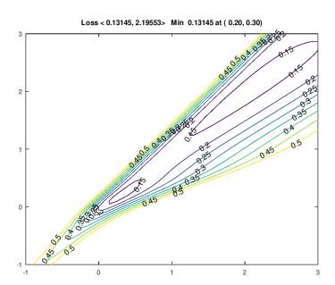

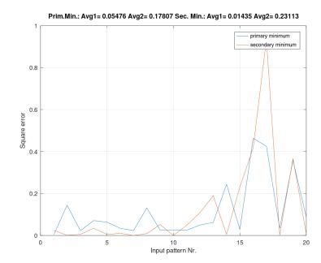

Fig. 1. Contour plot of MSE, example with non-weighted MSE. Fig. 2. MSE distribution over patterns ("important"" patterns in the left half), example with non-weighted MSE.

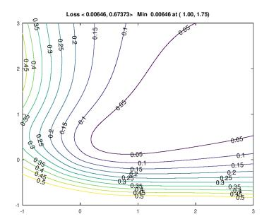

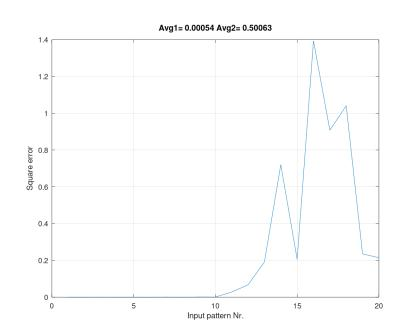

Fig. 3. Contour plot of MSE, example with weighted MSE. Fig. 4. MSE distribution over patterns ("important"" patterns in the left half), example with weighted MSE.

This experiment suggests that the loss function landscape can become smoother if strongly noisy samples in the training set become smaller weights in the MSE evaluation than less noisy ones. This is consistent with the weighting concept of heteroscedastic linear regression.

Our further hypothesis is that the better the model, the better the performance with long predecessor sequences, testifying the ability to extract the genuine information from the sequence. This may be consistent with hitting the global optimum instead of a spurious one.

### 4 Influence of predecessor sequence length

A series of experiments with several variants of reduced Transformer architecture have been performed. As training data, a subset of WikiText103 text sequences have been used. The goal has been to approach the classification performance of GPT2 model on the dataset. To reduce the number of trainable parameters, the vocabulary matrix transforming the vocabulary index of a token to its embedding vector representation has been fixed in the state trained by GPT2. The loss function to be minimized has been definied on the embedding level, i.e., the training targets have been the embedding vectors of target tokens. The error measure has been the square deviation of the target and the forecast embedding. The subsequent classification accuracy has also been measured. The models had one to two millions of parameter, about one percent of those of GPT2.

The accuracy attained by the Adam optimization has frequently been around accuracy of 0.12. However, some experiments converged better, with accuracy of 0.22. GPT2 reached, on the complete training set, the accuracy of 0.31.

Square errors of individual tokens have been sorted by their position in the sequence and are plotted in fig. [5](#page-4-1) to fig. [8.](#page-5-1) It can be observed that reduced model with inferior minimum (fig. [7](#page-5-2) and fig. [8\)](#page-5-1) attain low MSE for short predecessor sequences (i.e. forecast positions with a low position number) and high with long sequences. The accuracies follow the inverse pattern. This contradicts the intuition that short predecessor sequences provide little information for the correct forecast.

A reduced model with relatively good minimum (fig. [5](#page-4-1) and fig. [6\)](#page-4-2) shows similar performance over all positions in the sequence.

GPT2, serving as a performance benchmark for this experiment series, attains high MSE for short predecessor sequences (i.e. forecast positions with a low position number) but low with long sequences. This is consistent with the intuitive expectation of long predecessor sequences providing good information for the forecast (fig. [9](#page-5-3) and fig. [10\)](#page-5-4).

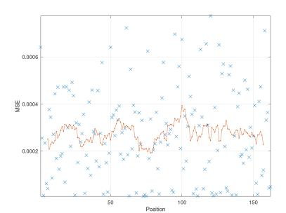

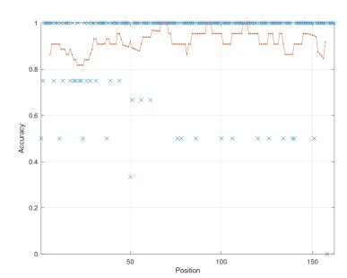

Fig. 5. Dependence of MSE on position (Reduced model, global optimum, training data set). Fig. 6. Dependence of accuracy on position (Reduced model, global optimum, training data set).

#### 6 Anonymous Authors

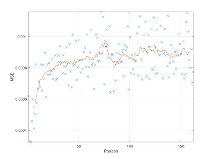

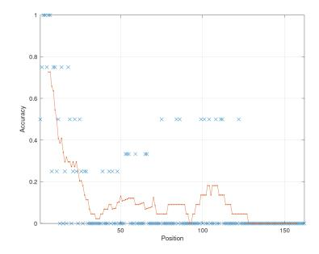

Fig. 7. Dependence of MSE on position (Reduced model, spurious optimum, training data set). Fig. 8. Dependence of accuracy on position (Reduced model, spurious optimum, training data set).

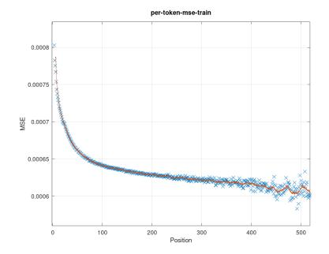

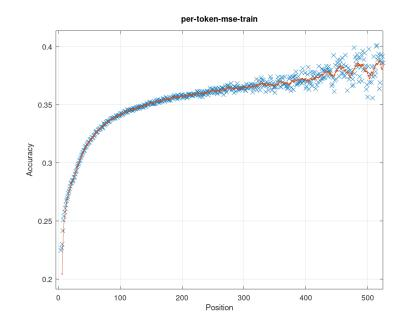

Fig. 9. Dependence of MSE on position (GPT2, training data set). Fig. 10. Dependence of accuracy on position (GPT2, training data set).

These results seem to confirm the hypothesis of multiple minima, some of which following the strategy of reducing the MSE of relatively irrelevant "easy cases" at the expense of relevant ones.

Following the example of section [3,](#page-1-1) it can be attempted to smooth the loss function landscape with the help of weighting of individual token position according to their attainable loss: low weights for short predecessor sequences and high ones for long sequences. This is the topic of the next subsection.

# 5 Weighted loss

The plots fig. [9](#page-5-3) and fig. [10](#page-5-4) do not give explicit information about the assumed noise variance of individual position. Under the assumption of the GPT2 parameter set being close to the total MSE minimum, the position specific MSE values would correspond to the corresponding noise variances, except for the basis amount corresponding to the total MSE minimum Lmin attainable by the model in absence of noise. Above this basis, there is the noise level decreasing with the increasing position, approaching some asymptotic level Vmin present even with arbitrarily long predecessor sequences.

These two minimum values are difficult (if not impossible) to separate in a justified way. We can only observe that the position specific MSE is varying between Lmin + Vmin and Lmax. The latter can be directly observed as MSE at position 1. The position specific variances can, for position p, be proportionally approximated by the term

$$(L_{max} - L_{min} - V_{min})e^{-cp} + V_{min}$$

$$\tag{6}$$

with an appropriate decay constant c.

In fig. [9,](#page-5-3) Lmin + Vmin = 0.00062 and Lmax = 0.0008 can be approximately read out. With the assessment Vmin = 0.0002, the position specific variance estimate formula can be specified.

Following the principles of the heteroscedastic linear regression incorporated in eq. [\(3\)](#page-1-3), tokens are to be weighted by the reciprocal value of the noise variances (assuming no correlations off the diagonal of C). This term normed to maximum unity is plotted in fig. [11.](#page-7-0) As a parametrized function, it is

$$W_{pos} = \frac{1}{ae^{-cp} + 1} \tag{7}$$

with constants a

$$a = \frac{L_{max} - L_{min} - V_{min}}{V_{min}} \tag{8}$$

and c (here set to 9.0 and 0.025, respectively).

# References

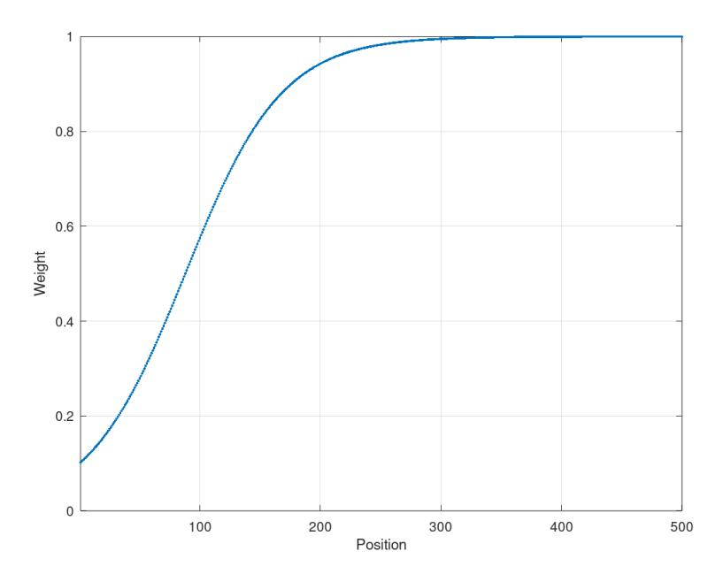

Fig. 11. Position dependent weights (based on variances of GPT2, training data set).