# HETEROSCEDASTICITY IN ATTENTION MECHANISM

#### Anonymous authors

**000**

**003 004**

**006**

**024**

**028 029 030**

**052 053** Paper under double-blind review

### ABSTRACT

A series of optimizations of reduced Transformer models has been performed, with the goal of identifying the minimum configuration with performance close to the benchmark formed by GPT2 model. The training of several reduced Transformer models has shown a common hard limit of attainable accuracy. The working hypothesis has been that the hard limit is a spurious minimum caused by violating the homoscedasticity assumption of least squares and by imbalance of tokens (viewed as classes). Analyses of the solution properties disclosed that good models are characterized by (1) low accuracy of token forecasts with a short list of predecessors in the text sequence and high accuracy of those with long and (2) high equity in forecasts of tokens with different frequencies. It has been attempted to improve the model performance with the help of training sample weighting related to the characteristics mentioned. Although these characteristics have genuinely improved, the model performance improvement lagged behind the expectations. A possible cause may have been the increased level of difficulty of transformed tasks, requiring longer convergence of numerical optimization.

# 1 INTRODUCTION INTO THE PROBLEM

Large Language Models (LLM) as well as the data used for their training experience a fast growth in size. The pace of growth seems to exceed the research capacity of their developers: the principles underlying their functionality are not thoroughly understood. Moreover, the necessary resources exceed the capacity of typical research institutions such as universities, resulting in a limited participation of broad research community in the design and understanding the models.

This is why it is desirable to intensify the research after reduced models with less parameters and consequently also reduced requirements on the training data quantity.

Recent LLMs are dominated by the Transformer architecture with Decoders. A stack of Transformers, each consisting of the Attention Mechanism (AM) and a Multi Layer Perceptron (MLP) receives a sequence of embeddings xi , i = 1, ..., j to make a forecast of the embedding following this sequence, i.e. xj+1. Around the transformers, there are transformations token identifiers ti , represented by a vectors with single unity and zeros otherwise, to a real-valued embedding vector xi . This transformation is done by vocabulary matrix V , so that xi = V ti . After the Transformer processing, the embedding forecasts yi (which is the forecast corresponding to the target xi+1) are inversely transformed by the transpose of the vocabulary matrix to the probability vector pi = V T yi , determining the probabilities of the individual vocabulary tokens. As the token forecast, the most probable token can be taken, although other choices are also possible.

Formally, if the Transformer stack is symbolized by the mapping yj = T(x1, ..., xj ), the token-totoken operation can be written as

$$p_j = V^T y_j = V^T T(x_1, ..., x_j) = V^T T(V t_1, ..., V t_j)$$
(1)

Searching for the reduction potential of transformers, it is the mapping T() which provides the most structural opportunities for the complexity saving. Various reductions of this type have been proposed and evaluated by (our paper about Transformer reduction). However, although substantial savings have been demonstrated, the performance of the model did not reach the level of predifined benchmarks: as a minimum baseline, GPT2 model has been selected.

A series of experiments with several variants of reduced Transformer architecture have been performed. As training data, a subset of WikiText103 text sequences have been used. The goal has

**059**

**061**

**072 073 074**

**079**

**094**

been to approach the classification performance of GPT2 model on the dataset. To reduce the number of trainable parameters, the vocabulary matrix transforming the vocabulary index of a token to its embedding vector representation has been fixed in the state trained by GPT2. The loss function to be minimized has been defined on the embedding level, i.e., the training targets have been the embedding vectors of target tokens. The error measure has been the square deviation of the target and the forecast embedding. The subsequent classification accuracy has also been measured. The models had one to two millions of parameters, about one percent of those of GPT2.

The evaluation of initially disappointing results disclosed that there seemed to be a barrier valid for various model variants that could not be surmounted. Interestingly, the same behaviour could by observed also with fundamentally different model architectures such as SSM.

This barrier was at about 15 per cent classification accuracy of vocabulary tokens while the basic GPT2 attained 30 per cent and GPT2 extra large 40 per cent. This barrier suggests a problem being in the task formulation. One possibility is the existence of a spurious loss minimum characterized by optimizing some secondary aspect with a high leverage on the loss.

Our analysis focused on finding candidates for such secondary aspects and means for quantifying them in the solution. Then, it may be possible to search for remedies with the help of problem reformulation.

# 2 HYPOTHESES FOR SOLUTION

Two candidate hypotheses have been investigated:

- the heterogeneity of token forecast with regard to their position in the sequence and
- the different frequency of tokens which may be inconsistent with their context importance

#### 2.1 INFLUENCE OF PREDECESSOR SEQUENCE LENGTH

The forecast of a token is based on the information contained in its predecessor tokens. It is a common sense expectation that tokens with many predecessors (i.e., voluminous context) are easier to forecast than those with few predecessors. In other words, the forecast of the former is better supported by more information (mediated by the predecessors). The absence of information can be viewed as noise. In this sense, the forecasts with short predecessors sequences are more noisy than those with long ones.

In terms of linear regression, this situation is referred to as *heteroscedasticity*. An least-squaresoptimal heteroscedastic model is different from the *homoscedastic* one (characterized by equal level of noise for all forecasts). For details, see section [A.](#page-4-0)

The specific task solved by the Transformer Decoder Architecture differs from the linear heteroscedastic model in the inherent nonlinarity of the model which potentially implies the nonconvexity of the loss function. Even a layer of two or more tangens hyperbolicus activation functions can lead to a loss function with multiple local minima (see artificial example in section [B\)](#page-4-1). This hypothesis seems to be supported by experiments. Optimizing reduced Transformer models on Wikipedia data, we have observed that some runs get stuck in similar spurious minima while other substantially converge further. "Bad" minima were characterized by relatively good performance for forecasts from short predecessor sequences. By contrast, "good" minima exhibited similar performance in predictions of token embeddings with both long and short predecessor sequences. Since forecasts with short predecessor sequences have inherently large MSE (by virtue of large noise), it seems to be easy to reach a substantial improvement, at the expense of ignoring the forecasts with large predecessor sequences, where the same improvement is more difficult to reach.

This suggests the presence of multiple minima, some of which is hit randomly. These minima can differ in the balance between forecasting easy and difficult target embeddings. (The former correspond to those with long predecessor sequences and thus sufficient information, the latter to those with short predecessor sequences.)

This hypothesis is supported by comparing the accuracy profile by position between GPT2 extra large fig. [1](#page-2-0) and a reduced transformer model fig. [2.](#page-2-1)

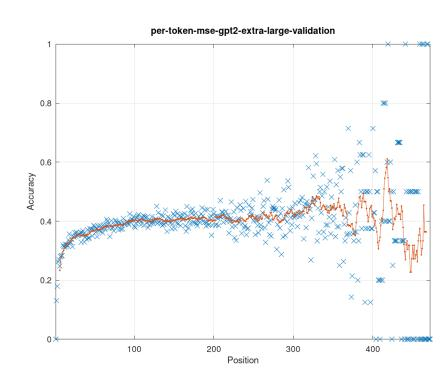

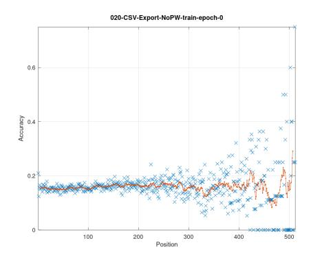

Figure 1: Dependence of accuracy on position Figure 2: Dependence of accuracy on position (GPT2 extra large). (reduced Transformer model).

Following the hypothesis of spurious minima caused by heteroscedasticity, it can be attempted to smooth the loss function landscape with the help of weighting of individual token position according to their attainable loss: low weights for short predecessor sequences and high ones for long sequences. The simplest weighting concept is a unity weight at positions beyond a certain threshold and zero otherwise.

#### 2.2 Influence of token frequency

The frequency of individual tokens in a text corpus is very unequal. It may differ by several orders of magnitude. With a conventional loss definition (e.g., MSE on the emebedding level or CCE on the token class level), frequently occurring tokens are decisive for the loss value This may be a serious problem for token forecasting as semantically meaningful but scarce tokens can be almost neglected. For a practically useful LLM, it may be helpful to reach a more homogeneous forecasting capability. The equity can be measured by the *Gini coefficient*. It has been developed in the welfare economics for measuring the income equity of the population. Its value varies between zero (perfect income equity) and one (all income for a single individual and zero for others). For n persons with incomes  $x_i$ , it is

$$G = \frac{\sum_{i}^{n} \sum_{j}^{n} |x_i - x_j|}{2n \sum_{i}^{n} x_i} \tag{2}$$

It is straightforward to apply this idea to the equity of accuracy per token, substituted for  $x_i$ . The benchmark models GPT2 and GPT2 extra large have reached Gini coefficient values of 0.77092 and 0.69481, respectively. By contrast, our initial model attained 0.99478, making correct forecast only for a couple of most frequent tokens.

This situation can be viewed as an instance of the *unbalanced classes*. The most straightforward approach to balancing is the weighting every token forecast in the loss function by  $\frac{1}{f_i}$  with  $f_i$  being the number of occurrencies of the *i*-th token in the training set. A compromising alternative is the square-root-based weight  $\frac{1}{\sqrt{f_i}}$ .

#### 3 OBSERVED OUTCOME BY COMPUTING EXPERIMENTS

Training of the reduced Transformer model has been repeated with position weights. Initial attempts with smooth weight schedule (following a sigmoid form) have not brought about a significant difference. So, a hard threshold at position 70 has been implemented. Beyond this threshold, the weights have been unity, and zero for lower positions. Considering the profile (fig. 3, magnified in fig. 4), the attempt has been successful - the profile is analogical to that of GPT2 extra large (fig. 1). However, the average accuracy for long sequences has failed to signficantly improve. In this sense, the outcome can be viewed as a half-success.

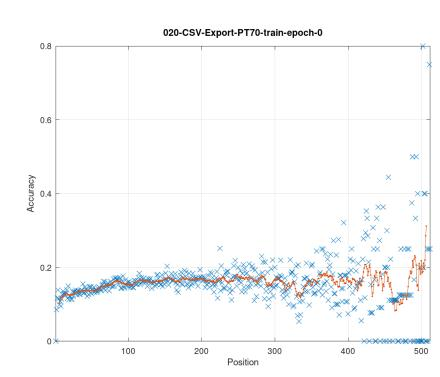

**169**

**184**

**186 187**

**204**

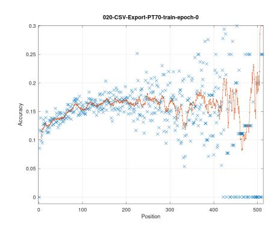

Figure 3: Dependence of accuracy on position (reduced Transformer model with hard weight threshold at position 70). Figure 4: Dependence of accuracy on position (reduced Transformer model with hard weight threshold at position 70, magnified).

The other concept, weighting by inverse frequence, has been even less successful. The optimization has not significantly lowered the Gini coefficient. It has been 0.98595, instead of 0.99543 from the non-weighted optimization.

In both cases, with both the position and token weights, the convergence curve of Adam optimization has been slightly steeper than that of the non-weighted case. Moreover, the gradient norm decrease has been more distinct, suggesting a larger extent of convexity of the loss function. These hints can suggest that longer or more efficient optimization may be helpful.

# 4 CONCLUSION AND POSSIBLE REASONS FOR FAILURE

The poor performance of the reduced model can, of course, be justified by its small size. The number of its parameters has been two orders of magnitude below the benchmark models of GPT2 family, forming a fundamental restriction of the expressiveness of the model.

However, the observed common hard limit of attainable accuracy across various models may indicate obstacles in the task formulation. The symptoms for this may be the observed characteristics of good and bad solutions: the profile of accuracy along token positions and the equity of accuracies with different frequencies in the text corpus.

The means proposed to overcome the limit have been partially successful for position distribution: the profile similar to successful models has been reached. Unfortunately, without overall accuracy improvement. The attempts to overcome the accuracy inequity have failed so far.

The first suggestion for remedy may be about the optimization procedure. It is clear that modified task formulation with the help of weights may be more difficult to treat by numerical optimization. Then, the remedy would be more computing resources. This is planned in short terms: one of the research directions is using the Conjugate Gradient (CG) algorithm whose convergence properties for convex loss functions are superior to the first-order algorithms typically used. In our case, the convexity of the problem seems to be indicated by the observed decreasing gradient norm. In face of this expectation, the larger computing expense of CG per epoch is to be accepted.

A more difficult question is that of token predictability. The position in the sequence has a wellfounded but limited effect on it. The frequency in the text corpus is less clear - scarcity is not a direct hint to contextual relevance. This is the aspect that remains to be thoroughly investigated.

## REFERENCES

**221**

**224**

**256**

### A APPENDIX: HETEROSCEDASTICITY IN LINEAR MODELS

Classical least squares linear model y = Bx + e with input data matrix X, output data matrix Y (with data samples corresponding to columns) and random error e is estimated by

$$B = YX^T(XX^T)^{-1} \tag{3}$$

This model is proven to be the best linear unbiased model: the expected value of the parameter estimator B corresponds to the true parameters of the model ("unbiased") and the variance of the estimator is the smallest of all linear models. These properties are attained under two assumptions about the random error vector e: (A) the expected value of e is zero and (B) its covariance matrix is sI, i.e. a diagonal matrix with identical diagonal elements.

The latter assumption is called *homoscedasticity*. If this is violated, the estimator eq. [\(3\)](#page-4-2) is still unbiased but not the best in the sense of the least variance. In this case, the best estimator is given, for a known covariance matrix C, by

$$B = YC^{-1}X^{T}(XC^{-1}X^{T})^{-1} (4)$$

This is the least squares model for the *heteroscedastic* case.

# B APPENDIX: MULTIPLE LOCAL MINIMA THROUGH HETEROSCEDASTICITY

The possibility of arising of multiple local minima through heteroscedasticity can be illustrated with the help of a simple artificial problems.

The following experiment has consisted of a simple model with two inputs x1 and x2. The model is the difference of two tangens hyperbolicus units:

$$f(x_1, x_2) = \tanh(x_1 + 2x_2) - \tanh(0.6x_1 + 0.3x_2)$$
(5)

The target output values have been generated with the help of input noise, by

$$y = f(x_1 + e_1, x_2 + e_2) (6)$$

Gaussian random noise terms e1 and e2 have the same variance for every sample (x1, x2) but this variance differs across the training set. The first half of training set had small noise variance of 0.01, which corresponds to patterns that are relatively easy to forecast (in the case of Transformer architecture, this would be analogical to token embeddings with long predecessor sequence). The other half had a large variance of 3.0, corresponding to difficult forecast (such as token embeddings with short predecessor sequence).

The loss function is depicted by the contour plot fig. [5.](#page-5-0) The function has two separate attractors with two different minima: the global minimum at (x1, x2) = (0.2, 0.3) with MSE=0.13145 and a secondary minimum at (x1, x2) = (1.00, 2.05) with MSE=0.13875. The individual square errors of training samples are given in fig. [6.](#page-5-1) In the first half of the training set (small noise, well predictable samples) has MSE of 0.05476 while the second (large noise, poorly predictable) has MSE of 0.17807. The ratio of both is around three, which is very different from the noise levels (0.01 and 3.0) whose ratio is 300. Consequently, the solution is biased towards poorly predictable samples at the expense of relatively high error of well predictable ones. The secondary minimum shows a more balanced MSE ratio around 16 (0.23113 to 0.01435).

In the second experiment, patterns of the second half of the training set have been weighted by 0.1. The specific MSE is 0.00054 and 0.50063 - a ratio of 1000 in favor of well predictable patterns.

This experiment suggests that the loss function landscape can become smoother if strongly noisy samples in the training set become smaller weights in the MSE evaluation than less noisy ones. This is consistent with the weighting concept of heteroscedastic linear regression.

Our further hypothesis is that the better the model, the better the performance with long predecessor sequences, testifying the ability to extract the genuine information from the sequence. This may be consistent with hitting the global optimum instead of a spurious one.

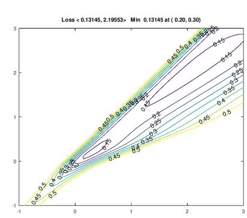

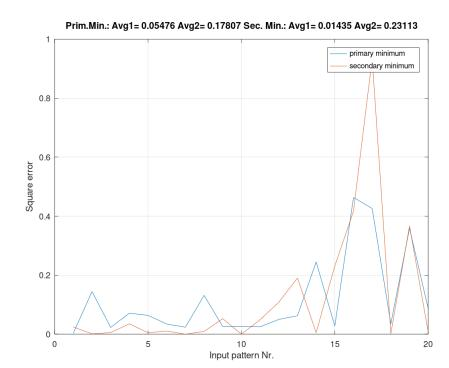

Figure 5: Contour plot of MSE, example with non-weighted MSE. Figure 6: MSE distribution over patterns ("important"" patterns in the left half), example with non-weighted MSE.

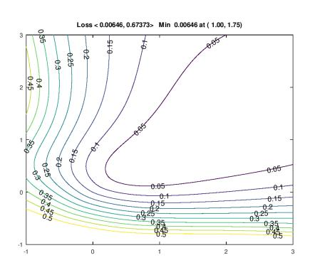

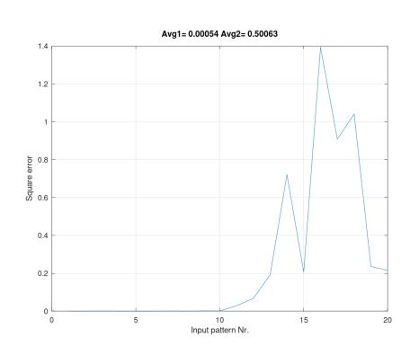

Figure 7: Contour plot of MSE, example with weighted MSE. Figure 8: MSE distribution over patterns ("important"" patterns in the left half), example with weighted MSE.

### C APPENDIX: POSSIBLE SPURIOUS LOCAL MINIMUM

An example trained by only four sequences from WikiText103 illustrates the possibility of spurious local minima suggested in section [B.](#page-4-1) Two optimizing runs have led to different terminal parameter sets. The first of them seems to reach a global optimum with loss and accuracy equally distributed over the token positions in the sequence (fig. [9,](#page-6-0) fig. [10\)](#page-6-1). The other may get stuck in spurious optimum where tokens on the low positions are better forecast than those on high positions (fig. [9,](#page-6-0) fig. [10\)](#page-6-1). This is a profile inverse to that f GPT2 (fig. [1\)](#page-2-0).

### D WEIGHTED LOSS

The plots fig. [13](#page-7-0) and ?? do not give explicit information about the assumed noise variance of individual position. Under the assumption of the GPT2 parameter set being close to the total MSE minimum, the position specific MSE values would correspond to the corresponding noise variances, except for the basis amount corresponding to the total MSE minimum Lmin attainable by the model in absence of noise. Above this basis, there is the noise level decreasing with the increasing position, approaching some asymptotic level Vmin present even with arbitrarily long predecessor sequences.

These two minimum values are difficult (if not impossible) to separate in a justified way. We can only observe that the position specific MSE is varying between Lmin + Vmin and Lmax. The latter can be directly observed as MSE at position 1. The position specific variances can, for position p,

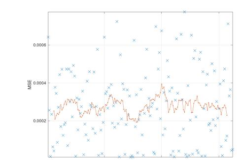

**329**

**334 335 336**

**364**

**368 369 370**

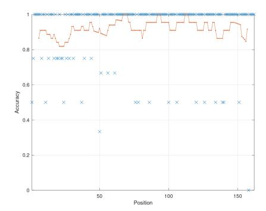

Figure 9: Dependence of MSE on position (Reduced model, global optimum, training data set). Figure 10: Dependence of accuracy on position (Reduced model, global optimum, training data set).

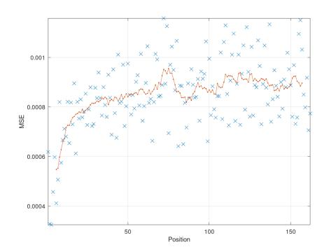

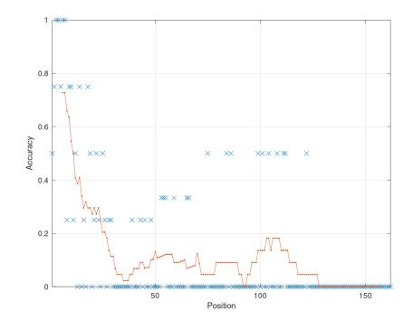

Figure 11: Dependence of MSE on position (Reduced model, spurious optimum, training data set). Figure 12: Dependence of accuracy on position (Reduced model, spurious optimum, training data set).

be proportionally approximated by the term

$$(L_{max} - L_{min} - V_{min})e^{-cp} + V_{min} \tag{7}$$

with an appropriate decay constant c.

In fig. [13,](#page-7-0) Lmin + Vmin = 0.00062 and Lmax = 0.0008 can be approximately read out. With the assessment Vmin = 0.0002, the position specific variance estimate formula can be specified.

Following the principles of the heteroscedastic linear regression incorporated in eq. [\(4\)](#page-4-3), tokens are to be weighted by the reciprocal value of the noise variances (assuming no correlations off the diagonal of C). This term normed to maximum unity is plotted in fig. [14.](#page-7-1) As a parametrized function, it is

$$W_{pos} = \frac{1}{ae^{-cp} + 1} \tag{8}$$

with constants a

$$a = \frac{L_{max} - L_{min} - V_{min}}{V_{min}} \tag{9}$$

and c (here set to 9.0 and 0.025, respectively).

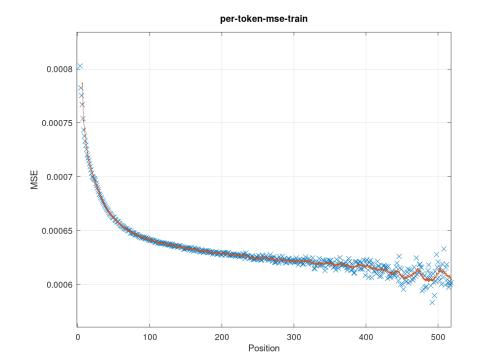

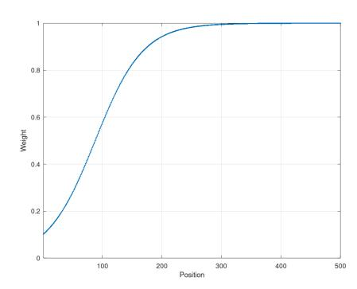

Figure 13: Dependence of MSE on position (GPT2, training data set). Figure 14: Position dependent weights (based on variances of GPT2, training data set).