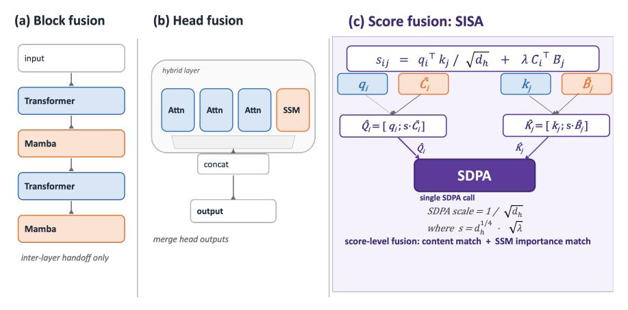
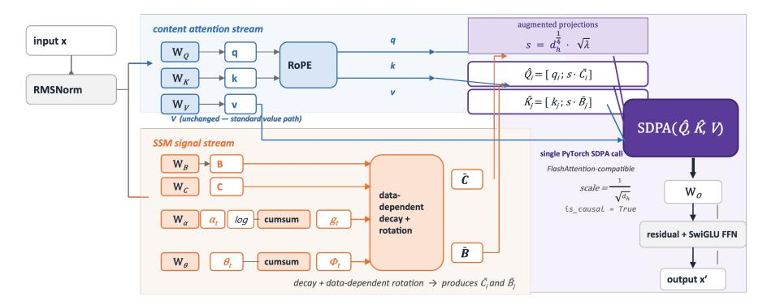
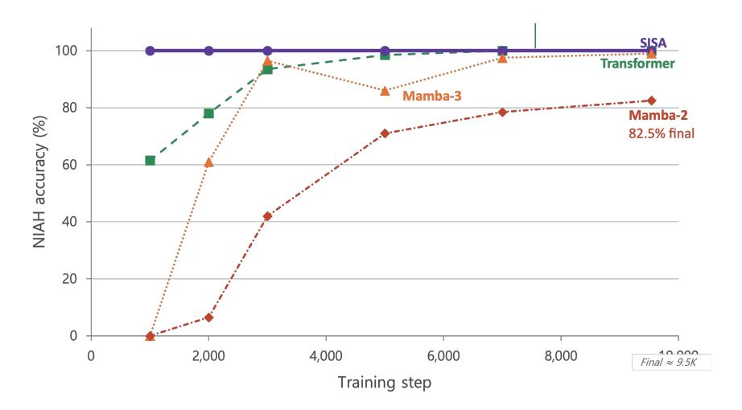
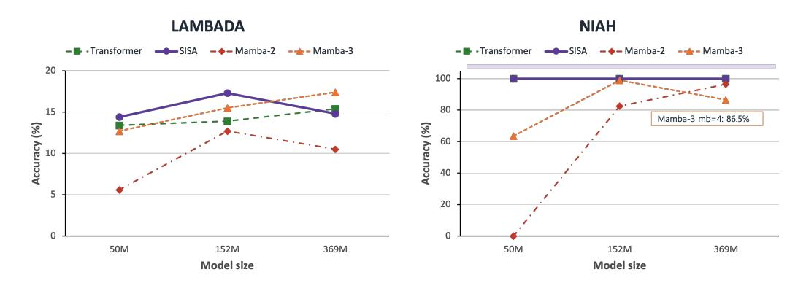
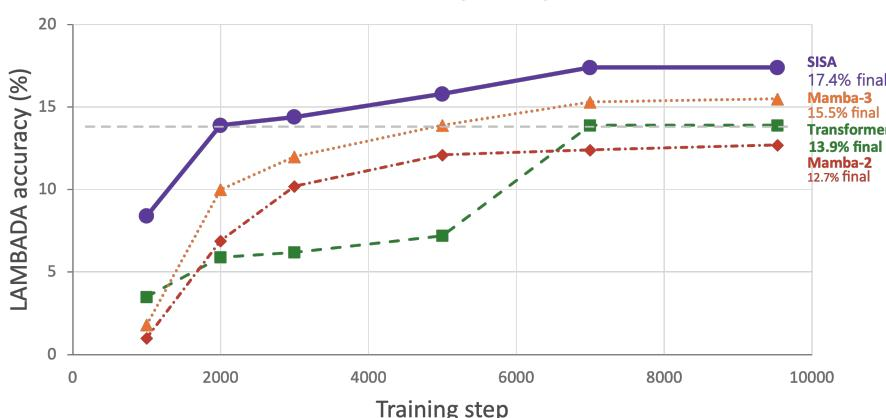
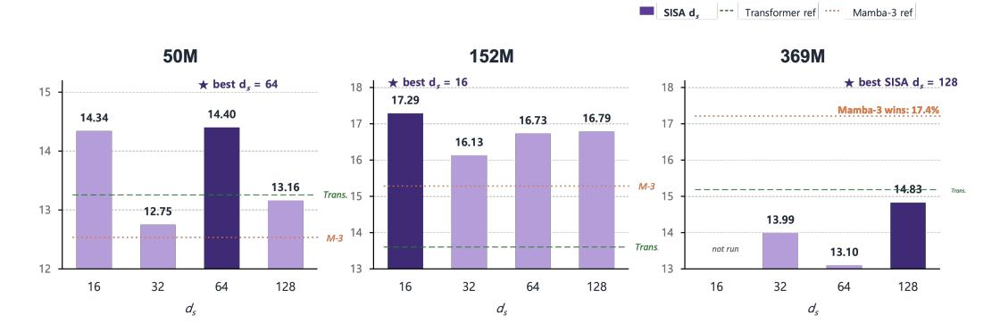

# Forget Attention: Importance-Aware Attention Is All You Need

## Soohyeong Shin

Department of Computer Engineering Kangwon National University shin0815@kangwon.ac.kr

## Yeongwook Yang∗

Department of Computer Engineering Kangwon National University yeongwook.yang@kangwon.ac.kr

## Abstract

Combining attention's global retrieval with the sequential importance signal of state space models (SSMs) is the open challenge of hybrid language modeling. Transformers see everywhere but cannot prioritize; SSMs know what matters but cannot revisit. Existing hybrids—Jamba (block level) and Hymba (head level) place the two in separate compartments, so neither informs the other during the attention computation itself. We propose SISA (SSM-Informed Softmax Attention), which adds an SSM-derived importance term *directly inside the attention score* and realizes the full operation as a single SDPA call on augmented query/key vectors—no recurrent state, no custom kernel. At 152M / 5B tokens, SISA reaches LAMBADA-greedy 17.3% (vs. Transformer 13.9 and Mamba-3 15.5) and attains NIAH 100% from step 1K, 7× faster than Transformer's retrieval convergence; at 369M, Mamba-3 leads LAMBADA while SISA preserves perfect NIAH and stock-SDPA execution. SISA thus defines a third design axis for SSM–attention hybrids—score-level fusion—beyond the block-level and head-level paradigms that have dominated the field.

## 1 Introduction

Foundation models for language are dominated by two architectural lineages with complementary strengths and complementary failures. Transformers [\[1\]](#page-8-0) let every position attend to every other, but the only criterion for relevance is query–key content similarity—the sequential dynamics in which a token appears are ignored. State space models (SSMs), notably the Mamba family [\[2–](#page-8-1)[4\]](#page-9-0), process tokens in order and selectively update a recurrent state, but once information has decayed it cannot be recovered.

We diagnose this as a *single* missing capability that neither family possesses on its own: an attention mechanism that knows *which* tokens matter from sequential structure while remaining able to revisit any of them by content. The Transformer "can look anywhere but does not know where to look"; the SSM "knows what is important but cannot revisit what is past."

Existing hybrid architectures attempt to combine the two—but the way they do so has remained essentially unchanged since the first generation. Jamba [\[5\]](#page-9-1) interleaves SSM and Transformer layers (block level); Hymba [\[7\]](#page-9-2) runs attention and SSM heads in parallel within a layer (head level). In both designs the two mechanisms remain compartmentalized: each produces its output independently and never references the other during the attention computation itself. A separate line—FoX [\[13\]](#page-9-3) and the position biases ALiBi/T5/DAPE—also adds to the score, but only as a scalar function of position or decay (Section [2.2\)](#page-2-0); we instead fuse a vector-valued SSM signal that encodes both decay and data-dependent rotation. We argue that the missing principle is fusion at the level of the attention score, where every weight is jointly determined by content similarity and SSM-derived importance.

∗Corresponding author.

Figure 1: Three levels of SSM-attention fusion. Block- and head-level hybrids combine outputs that were computed independently. SISA injects the SSM signal into the attention score itself, reducing the operation to augmented Q/K and one SDPA call.

We propose **SISA** (SSM-Informed Softmax Attention), in which the SSM signal enters the attention score directly:

$$score_{ij} = \underbrace{\frac{\mathbf{q}_i^{\top} \mathbf{k}_j}{\sqrt{d_h}}}_{\text{content match}} + \underbrace{\lambda \cdot \bar{\mathbf{C}}_i^{\top} \bar{\mathbf{B}}_j}_{\text{importance match}}$$
(1)

The first term is standard content similarity; the second, derived from Mamba-3's mathematical framework, encodes cumulative decay and data-dependent rotation. A single algebraic substitution—concatenating the SSM channels onto  $\mathbf{q}$  and  $\mathbf{k}$ —reduces the entire computation to one standard SDPA call on augmented Q/K vectors. No recurrent state, no custom kernel, and full compatibility with FlashAttention. We call this score-level fusion: a third integration point distinct from block- and head-level designs, where both mechanisms jointly determine every attention weight.

#### Contributions.

- 1. We propose **score-level fusion**, integrating an SSM signal directly inside the attention score. A broad survey of SSM-Transformer hybrids (Appendix I) finds no prior use of a *vector-valued*, *data-dependent* score bias of this kind.
- Through an augmented Q/K construction, the additive SSM bias is realized in a single SDPA call compatible with FlashAttention—eliminating the custom CUDA kernels required by Mamba variants.
- 3. Improvements over Transformer:  $+3.4 \,\mathrm{pp}$  on LAMBADA at  $152 \mathrm{M}$  (relative +24 %) and  $+1.0 \,\mathrm{pp}$  at 50M. At 369M, the mb=2 setting of SISA  $d_s$ =32 matches Transformer (both 15.4); under mb=4 fair retrain it is slightly lower (SISA  $d_s$ =128: 14.8 vs. 15.4). NIAH reaches 100% after only 10% of training, preserving retrieval.
- 4. **Trade-off with Mamba-3:** SISA wins on (a) NIAH convergence—100% throughout, vs. Mamba-3 reaching 99% only at step 8K (152M) and 86.5% at 369M (mb=4), (b) FlashAttention compatibility and +25% throughput, and (c) LAMBADA at 152M (17.3 vs. 15.5). Mamba-3's full SSM recurrence wins on LAMBADA at 369M (17.4 vs. 14.8). The two architectures have clearly separable strengths.
- 5.  $d_s$  scaling study: A systematic ablation over  $d_s \in \{16, 32, 64, 128\}$  at three scales quantifies the trade-off between SSM channel size and FFN reduction, yielding a scale-adaptive  $d_s$  guideline.

## 2 Related Work

#### 2.1 SSM–Attention Hybrids

Table [1](#page-2-1) summarizes the major hybrids. Block-level designs (Jamba, Samba, Zamba, Griffin, Nemotron-H) interleave entire layers; head-level designs (Hymba, Falcon-H1) split heads within a single layer. In both granularities the two paths are computed by separate parameter sets and combined only after each has produced its output, so the SSM signal never enters the attention score that determines which token attends to which—a structural limitation our score-level fusion proposal directly addresses.

Table 1: SSM–attention hybrids. Across the major architectures we surveyed (full list in Appendix [I\)](#page-12-0), no prior work fuses SSM and attention at the score level via a *vector-valued data-dependent score bias*.

| Model         | Fusion level | Combination          | Mid-op cross-ref |
|---------------|--------------|----------------------|------------------|
| Jamba [5]     | Block        | 1:7 layer interleave | no               |
| Samba [6]     | Block        | Mamba+SWA+MLP        | no               |
| Griffin [9]   | Block        | RG-LRU + local attn. | no               |
| Hymba [7]     | Head         | Attn ∥ SSM heads     | no               |
| Falcon-H1 [8] | Head         | Attn + Mamba-2 heads | no               |
| SISA (ours)   | Score        | Augmented Q/K → SDPA | yes              |

#### 2.2 Attention Score Biases

ALiBi [\[10\]](#page-9-7) adds a fixed distance penalty to the logits, T5 [\[11\]](#page-9-8) adds a learned position bias, and DAPE [\[12\]](#page-9-9) makes the bias content-dependent. All three are pure positional priors: they encode "how far apart are two tokens," not "what happened in the sequence between them." None can be informed by the input's sequential dynamics—precisely the signal that an SSM is built to produce.

The closest prior work is FoX [\[13\]](#page-9-3) (Forgetting Transformer), which adds a cumulative forget-gate bias to the score: A = softmax(QK⊤ +D). Here D is a per-pair scalar (decay only). SISA's bias is a ds-dimensional inner product that encodes *both* decay *and* data-dependent rotation. FoX uses a scalar forget-gate bias and avoids materializing the full bias matrix via a modified FlashAttention-style implementation; SISA differs by realizing the bias purely through augmented Q/K, so any unmodified FlashAttention/SDPA kernel works without customization.

Table 2: Comparison of attention score biases. "FlashAttn integration" indicates whether the bias works with the stock kernel as-is or needs a kernel modification (some cases are now supported by recent FlashAttention or via FlexAttention).

| Method      | Bias form          | Encodes            | FlashAttn integration             |
|-------------|--------------------|--------------------|-----------------------------------|
| ALiBi       | fixed scalar       | distance           | native (FA ≥ 2.4) / FlexAttention |
| T5 relative | learned scalar     | distance           | kernel modification               |
| DAPE        | data-dep. scalar   | distance + content | kernel modification               |
| FoX         | cumulative scalar  | decay              | modified FA implementation        |
| SISA        | ds-dim inner prod. | decay + rotation   | stock SDPA (augmented Q/K)        |

## 3 Method

## 3.1 SISA Score

An attention weight should reflect both content match and sequential importance; standard attention captures only the former. We add an SSM-derived importance term to the standard score sij =

$$\mathbf{q}_i^{\top} \mathbf{k}_j / \sqrt{d_h}$$
:

$$s_{ij}^{\text{SISA}} = \frac{\mathbf{q}_i^{\top} \mathbf{k}_j}{\sqrt{d_h}} + \lambda \cdot \bar{\mathbf{C}}_i^{\top} \bar{\mathbf{B}}_j, \quad i \ge j$$
 (2)

Here  $\lambda > 0$  is a per-head learnable positive scalar, and  $\bar{\mathbf{C}}_i, \bar{\mathbf{B}}_j$  are projection vectors carrying SSM dynamics. We enforce causality  $(i \geq j)$  using SDPA's built-in causal flag.

#### 3.2 SSM Channels

We exploit the equivalence between Mamba-3's complex-valued SSM and a data-dependent RoPE [4]. From an input  $\mathbf{x}_t$ :

**Projections.**  $\mathbf{B}_t = \mathbf{W}_B \mathbf{x}_t$ ,  $\mathbf{C}_t = \mathbf{W}_C \mathbf{x}_t \in \mathbb{R}^{d_s}$ , with  $\mathbf{W}_B, \mathbf{W}_C \in \mathbb{R}^{(h \cdot d_s) \times d}$ , where h is the number of heads and  $d_s$  the SSM channel dimension.

**Decay.**  $\alpha_t = \exp(-\operatorname{softplus}(\mathbf{w}_{\alpha}^{\top}\mathbf{x}_t + b_{\alpha})) \in (0, 1)$ . We initialize  $b_{\alpha} = -5$ , giving a half-life of about 100 tokens, and learn a per-head rate via  $\mathbf{w}_{\alpha} \in \mathbb{R}^{h \times d}$ .

**Phase.**  $\theta_t = \mathbf{W}_{\theta} \mathbf{x}_t \in \mathbb{R}^{d_s/2}$  (data-dependent rotation frequencies), with  $\mathbf{W}_{\theta} \in \mathbb{R}^{(h \cdot d_s/2) \times d}$  for per-head, per-dimension rotations.

## Cumulative quantities (FP32).

$$g_t = \sum_{k \le t} \log \alpha_k, \quad \Phi_t = \sum_{k \le t} \theta_k, \quad c = \frac{\max_t g_t + \min_t g_t}{2}$$
 (3)

 $g_t$  is the log-decay accumulated from token 1 to t. The minimax offset c keeps |g-c| small, providing numerical stability for  $e^{g-c}$ . Both sums are implemented with torch.cumsum, an O(L) operation.

#### Final channels.

$$\bar{\mathbf{C}}_i = e^{g_i - c} \cdot R(\Phi_i) \cdot \mathbf{C}_i, \qquad \bar{\mathbf{B}}_i = e^{-(g_j - c)} \cdot R(\Phi_i) \cdot \mathbf{B}_i \tag{4}$$

where  $R(\Phi)$  is the block-diagonal 2×2 rotation matrix. The two factors play complementary roles:

- **Decay**  $e^{g_i-c} \cdot e^{-(g_j-c)} = e^{g_i-g_j}$ : how much the importance from j persists to i. Larger distances or more important intermediate tokens lead to stronger decay. Unlike ALiBi's fixed slope, this depends on the content of the sequence.
- Rotation  $R(\Phi_i)^{\top}R(\Phi_j) = R(\Phi_i \Phi_j)$ : distinguishes positions that share similar decay but play different roles in the sequence. Whereas positional RoPE encodes absolute distance, the SSM rotation encodes a data-dependent relative position.

Positional RoPE is applied only to  $\mathbf{q}, \mathbf{k}$ ; the SSM channels carry the data-dependent rotation defined above.

## 3.3 Augmented Q/K: Single-SDPA Realization

**Proposition 1.** Let  $s = d_h^{1/4} \sqrt{\lambda}$ ,  $\hat{\mathbf{Q}}_i = [\mathbf{q}_i; s\bar{\mathbf{C}}_i]$ , and  $\hat{\mathbf{K}}_j = [\mathbf{k}_j; s\bar{\mathbf{B}}_j]$ . Then  $\hat{\mathbf{Q}}_i^{\top} \hat{\mathbf{K}}_j / \sqrt{d_h} = s_{ij}^{SISA}$ .

Proof.

$$\frac{\hat{\mathbf{Q}}_{i}^{\top}\hat{\mathbf{K}}_{j}}{\sqrt{d_{h}}} = \frac{\mathbf{q}_{i}^{\top}\mathbf{k}_{j} + s^{2}\bar{\mathbf{C}}_{i}^{\top}\bar{\mathbf{B}}_{j}}{\sqrt{d_{h}}} = \frac{\mathbf{q}_{i}^{\top}\mathbf{k}_{j}}{\sqrt{d_{h}}} + \frac{s^{2}}{\sqrt{d_{h}}} \cdot \bar{\mathbf{C}}_{i}^{\top}\bar{\mathbf{B}}_{j}.$$
 (5)

Since  $s^2 = \sqrt{d_h} \cdot \lambda$ , the second factor reduces to  $\lambda$ , yielding  $s_{ij}^{SISA}$ .

The whole layer is therefore  $\mathbf{Y} = \mathrm{SDPA}(\hat{\mathbf{Q}}, \hat{\mathbf{K}}, \mathbf{V}, \mathrm{scale} = 1/\sqrt{d_h}, \mathrm{causal} = \mathrm{True})$ . No  $L \times L$  bias matrix is materialized, and FlashAttention works out of the box. This single-SDPA reduction requires the bias to have a fixed low-dimensional inner-product form: a scalar cumulative bias (such as FoX's  $D_{ij}$ ) cannot be folded into bounded-dimension Q/K and must materialize the full  $L \times L$  matrix with a modified kernel. Note that the SDPA scale must be  $1/\sqrt{d_h}$ , not  $1/\sqrt{d_h} + d_s$ . Compute cost matches a standard Transformer asymptotically  $(O(L^2(d_h + d_s)))$  for SDPA plus O(L) for cumulative sums). Implementation details (SDPA scale, bf16 overflow guard,  $\lambda$  in fp32) are deferred to Appendix C.

Figure 2: Compute graph of a SISA layer. The attention path produces Q, K, V with positional RoPE; the SSM path accumulates decay and data-dependent rotations into  $\bar{C}$ ,  $\bar{B}$ . The two are merged into augmented Q/K and consumed by a single PyTorch SDPA call.

#### 3.4 Parameter Budget

SISA adds the SSM projections ( $\mathbf{W}_B$ ,  $\mathbf{W}_C$ ,  $\mathbf{w}_\alpha$ ,  $\mathbf{W}_\theta$ ,  $\lambda$ ); we offset the cost by reducing the FFN, keeping the parameter count equal to the Transformer baseline. The per-layer SSM overhead is

$$P_{\text{SSM}} = 2 \cdot d \cdot h \cdot d_s + d \cdot h + h + d \cdot h \cdot \frac{d_s}{2} + h. \tag{6}$$

We shrink  $d_{\rm ff}$  to  $d_{\rm ff}^{\rm red}$  so that  $3 \cdot d \cdot (d_{\rm ff} - d_{\rm ff}^{\rm red}) \approx P_{\rm SSM}$  per layer (SwiGLU). This FFN-vs-SSM allocation is SISA's central design trade-off; the optimal balance is regime-dependent (Sections P, Q).

## 4 Experimental Setup

#### 4.1 Models

We compare four architectures at three scales, with parameter counts matched.

Table 3: Model configurations. Common settings: GPT-NeoX tokenizer (50,277), tied embeddings, RMSNorm, sequence length 2,048.

| Model       | Setting                | 50M             | 152M              | 369M               |
|-------------|------------------------|-----------------|-------------------|--------------------|
| Transformer | $d/h/L/d_{\rm ff}$     | 512/8/6/2048    | 768/12/12/3072    | 1024/16/24/2944    |
| SISA        | $d/h/L/d_{\rm ff}/d_s$ | 512/8/6/1832/32 | 768/12/12/2748/32 | 1024/16/24/2512/32 |
| Mamba-2     | $d/L/d_{\rm state}$    | 512/14/64       | 768/31/64         | 1024/49/64         |
| Mamba-3     | $d/L/d_{\rm state}$    | 512/14/64       | 768/30/64         | 1024/48/64         |

#### 4.2 Training

All models are trained on 5B tokens of SlimPajama-6B [15], giving tokens-per-parameter ratios of  $100 \times (50 \text{M})$ ,  $33 \times (152 \text{M})$ , and  $13.5 \times (369 \text{M})$ . Compared with the Chinchilla optimum [16] of about  $20 \times$ , the 50M and 152M models are well-trained while the 369M is somewhat undertrained; since all architectures share the same token budget, the relative comparison remains fair.

Optimization: AdamW ( $\beta_1$ =0.9,  $\beta_2$ =0.95), weight decay 0.1, gradient clipping 1.0, cosine schedule with 500-step warmup, effective batch 524K tokens. Mixed precision bf16 on a single NVIDIA H100 80 GB PCIe.

**Protocol note: controlled vs. historical runs.** "mb" denotes the per-device micro-batch (effective batch fixed at 524K tokens via gradient accumulation). **Controlled (mb=4)** runs re-train all four architectures under the same micro-batch and harness and are used for primary ranking; **historical (mb=2 or mixed)** runs are kept for transparency and ablation context only. At 369M we disclose both, since the mb=4 protocol slightly favors Mamba-3 and penalizes attention-heavy SISA.

#### 4.3 Evaluation

Five benchmarks evaluate complementary abilities:

Table 4: Benchmark summary.

| Benchmark Task Ability tested                                                                                                                                                                                                                                                     |              |                      |                          |        |
|-----------------------------------------------------------------------------------------------------------------------------------------------------------------------------------------------------------------------------------------------------------------------------------------|--------------|----------------------|--------------------------|--------|
|                                                                                                                                                                                                                                                                                         |              |                      |                          | Random |
| ≈0% NIAH retrieve hidden info retrieval / retention HellaSwag [18] sentence completion (4-way) commonsense reasoning 25% ARC-Easy [19] science QA (4-way) factual knowledge 25% WinoGrande [20] pronoun resolution (2-way) coreference 50% | LAMBADA [17] | last-word prediction | long-range comprehension | ≈0%    |

NIAH (Needle-in-a-Haystack) is our 200-trial test: a sentence "The secret number is 42." is inserted at a random position inside filler text of length 200–1800, and we measure whether the model retrieves it. Five seeds (42, 123, 456, 789, 1024) are used.

## 5 Results

#### 5.1 Main Comparison at 152M

Table 5: Final results at 152M (5B tokens, step 9,536) (%). Bold: best, underline: second. Four ds values are compared. *Most numbers are our mb=4 retrain (see Section 4.2 for protocol); the* ds=32 *(mb=2) row is the historical baseline kept here for context. Other mb=2 results are in the appendix.*

|                        | LAMBADA-greedy↑ | NIAH↑ | HellaSwag↑ | ARC-E↑ | WinoG↑ |
|------------------------|-----------------|-------|------------|--------|--------|
| Transformer            | 13.9            | 100.0 | 25.4       | 33.3   | 51.2   |
| Mamba-2                | 12.7            | 82.5  | 26.5       | 36.4   | 51.4   |
| Mamba-3                | 15.5            | 99.0  | 26.0       | 34.9   | 52.7   |
| SISA ds = 16        | 17.3            | 100.0 | 26.9       | 34.7   | 52.5   |
| SISA ds = 32 (mb=2) | 16.1            | 100.0 | 26.7       | 35.8   | 51.8   |
| SISA ds = 64        | 16.8            | 100.0 | 26.6       | 35.4   | 50.8   |
| SISA ds = 128       | 16.8            | 100.0 | 26.0       | 35.0   | 51.9   |

Headline. SISA ds = 16 raises LAMBADA-greedy to 17.3 (vs. Transformer 13.9, Mamba-3 15.5) while keeping NIAH at 100%—topping three of five benchmarks at 152M and essentially tying Mamba-3 on WinoGrande. Specifically:

- vs. Transformer (LAMBADA 13.9): +3.4 pp (+24.5% relative)—a clear architectural improvement.
- vs. Mamba-3 (LAMBADA 15.5): +1.8 pp (+11.6%)—outperforming the strongest SSM baseline in our comparison.
- vs. Mamba-2 (LAMBADA 12.7): +4.6 pp (+36.2%).

NIAH convergence. SISA reaches 100% by step 1,000 (10% of training). Mamba-3 (mb=4 retrain) climbs quickly to 96.5% at step 3K but oscillates back to 86.0% at 5K and only stabilizes at 99.0% by step 8K—SISA's consistency advantage stems from preserving Transformer's attention-based retrieval.

Trade-off. Mamba-2 (36.4%) and the mb=2 ds = 32 variant (35.8%) edge out SISA ds = 16 (34.7%) on ARC-Easy, suggesting that ARC-Easy's factual reasoning benefits from SSM's cumulative pattern aggregation (Section [N\)](#page-14-0). Even so, SISA still beats Transformer (33.3%) by +1.4 pp.

## 5.2 NIAH: Perfect Retrieval From Early Training

SISA reaches NIAH 100% by step 1K—7× faster than Transformer; Mamba never gets there. At step 1K, Transformer is at 61.5% and Mamba at 0%. This suggests SISA supplies an architectural

Table 6: NIAH accuracy by training step (%); our mb=4 retrain. SISA reaches 100% from step 1K (10% of training).

|             | 1K    | 2K    | 3K    | 5K    | 7K    | Final |
|-------------|-------|-------|-------|-------|-------|-------|
| Transformer | 61.5  | 78.0  | 93.5  | 98.5  | 100.0 | 100.0 |
| SISA        | 100.0 | 100.0 | 100.0 | 100.0 | 100.0 | 100.0 |
| Mamba-2     | 0.0   | 6.5   | 42.0  | 71.0  | 78.5  | 82.5  |
| Mamba-3     | 0.0   | 61.0  | 96.5  | 86.0  | 97.5  | 99.0  |

Figure 3: NIAH convergence at 152M. SISA reaches 100% from step 1K, while Transformer and the Mamba family take much longer; SISA preserves retrieval throughout training.

retrieval bias before semantic representations fully mature: the SSM-derived score bias mirrors the sequence's positional structure and gives attention positional priorities early in training.

Transformer needs step 7,000 (73% of training) to reach 100%, while Mamba-2 plateaus at 82.5% even at the end of training: information that linear recurrence has decayed cannot be brought back. Combining attention's global access with SSM's importance tracking yields the structural advantage SISA exhibits here.

Long-context NIAH (summary). Beyond the training length of 2,048, all attention-based models fail because of RoPE extrapolation limits. At the training length itself, however, SISA reaches 91% versus Transformer's 82%: the SSM bias helps retrieval at the boundary. Full results across 50M/152M and lengths 256–16384 are in Appendix [H.](#page-12-1)

#### 5.3 Scaling Across Three Sizes

50M (100 tok/param). SISA with ds tuned to 64 achieves LAMBADA 14.4%, beating Transformer (13.4) by +1.0 pp and Mamba-3 (12.7) by +1.7 pp. WinoGrande (52.4) is also the best across all models. The earlier observation "SISA ≈ Transformer at 50M" was specific to the fixed ds = 32; with the right ds, SISA wins even at 50M.

152M (33 tok/param). SISA ds = 16 tops LAMBADA at 17.3%—first place across all models, beating Transformer (+3.4 pp), Mamba-3 (+1.8 pp), and Mamba-2 (+4.6 pp). NIAH (100%) and HellaSwag (26.9) are also best, putting SISA ahead of the strongest SSM (Mamba-3) on three benchmarks; WinoGrande (52.5) is essentially tied with Mamba-3 (52.7).

369M (13.5 tok/param). A retrain with ds extended to 128 (SSM 34%, FFN 24%) reaches LAMBADA 14.8% at step 9K. Mamba-3 leads on LAMBADA (mb=4 retrain 17.4, mb=2 17.1), +2.6 pp above SISA ds = 128 (14.8); the full SSM recurrence is more sample-efficient for long-tail

Table 7: Final results across three scales (%). The ds value of SISA is the per-scale optimum from our ablation, which follows a non-monotonic pattern (50M: ds = 64, 152M: ds = 16, 369M: ds = 128). All models trained on the same 5B tokens. *The 50M/152M block and the (mb=4) rows for 369M use our mb=4 controlled protocol (Section 4.2); (mb=2) rows at 369M are reported as historical context from the earlier setting.*

| Scale |                          | LAMBADA-greedy | NIAH  | HSwag | ARC-E | WinoG |
|-------|--------------------------|----------------|-------|-------|-------|-------|
|       | Transformer              | 13.4           | 100.0 | 25.2  | 33.1  | 51.3  |
| 50M   | SISA ds = 64 (best)   | 14.4           | 100.0 | 25.2  | 32.8  | 52.4  |
|       | Mamba-2                  | 5.6            | 0.0   | 24.8  | 33.0  | 50.8  |
|       | Mamba-3                  | 12.7           | 63.5  | 25.1  | 33.9  | 51.1  |
|       | Transformer              | 13.9           | 100.0 | 25.4  | 33.3  | 51.2  |
| 152M  | SISA ds = 16 (best)   | 17.3           | 100.0 | 26.9  | 34.7  | 52.5  |
|       | Mamba-2                  | 12.7           | 82.5  | 26.5  | 36.4  | 51.4  |
|       | Mamba-3                  | 15.5           | 99.0  | 26.0  | 34.9  | 52.7  |
|       | Transformer (mb=4)       | 15.4           | 100.0 | 26.5  | 35.1  | 53.3  |
|       | SISA ds = 32 (mb=2)   | 15.4           | 99.5  | 26.4  | 34.6  | 51.9  |
|       | SISA ds = 32 (mb=4)   | 14.0           | 100.0 | 26.0  | 33.9  | 51.4  |
| 369M  | SISA ds = 64 (mb=4/8) | 13.1           | 100.0 | 25.7  | 34.4  | 51.8  |
|       | SISA ds = 128 (mb=4)  | 14.8           | 100.0 | 25.9  | 34.7  | 51.3  |
|       | Mamba-2 (mb=4)           | 10.5           | 96.5  | 26.2  | 34.9  | 51.5  |
|       | Mamba-3 (mb=2)           | 17.1           | 100.0 | 27.9  | 35.4  | 51.5  |
|       | Mamba-3 (mb=4)           | 17.4           | 86.5  | 26.8  | 35.0  | 50.7  |

Figure 4: Scaling behavior across model sizes. SISA peaks on LAMBADA at 152M; Mamba-3 overtakes it at 369M. On NIAH, SISA and Transformer stay at 100% across all scales.

context tracking. SISA still wins on (1) NIAH (100% throughout vs. Mamba-3 mb=4 86.5%), (2) FlashAttention compatibility and +25% throughput, and (3) parity with Transformer at the mb=2 setting (SISA ds=32 and Transformer both 15.4). SISA and Mamba-3 emerge as architectural choices with complementary strengths, especially when retrieval or infrastructure compatibility matters.

#### 5.4 Throughput

Table 8: Training throughput at 152M on a single H100.

|             | tok/s  | rel.  | Core operation          |
|-------------|--------|-------|-------------------------|
| Transformer | 27,714 | 1.00× | SDPA ×1                 |
| SISA        | 16,783 | 0.61× | SDPA ×1 (augmented)     |
| Mamba-2     | 10,719 | 0.39× | SSD ×1                  |
| Mamba-3     | 13,460 | 0.49× | official Mamba-3 kernel |

SISA gives the strongest SSM-variant benchmarks while running  $1.25 \times$  faster than Mamba-3. The 39% slowdown vs. Transformer comes from the augmented inner dimension ( $d_h + d_s = 96$  vs.  $d_h = 64$ ); SDPA cost scales linearly with this dimension, with overhead independent of sequence length. Mamba-2 and Mamba-3 need bespoke CUDA kernels; SISA runs on PyTorch's stock SDPA.

## 6 Analysis

#### 6.1 The SSM Bias as an Importance Lens

The SSM channels are not memory—they are an importance lens for attention. They store no information and are recomputed from the input at every layer; their job is purely to tell attention which earlier tokens matter when weighting key-value pairs.

SISA has no recurrent state, no convolution, and no sequential processing. The name "SSM" reflects only the mathematical lineage—the actual implementation is linear projections, a cumulative sum, and SDPA. Structurally, SISA is a pure Transformer with an additive score bias.

- **Decay**  $e^{g_i-c} \cdot e^{-(g_j-c)}$ : data-dependent distance weighting between positions i and j. Unlike ALiBi's fixed slope, it varies with the input.
- Rotation  $R(\Phi_i)^{\top} R(\Phi_j)$ : distinguishes positions whose decay is similar but whose role in the sequence differs.

Together,  $\bar{\mathbf{C}}_i^{\top} \bar{\mathbf{B}}_j$  scores how strongly the sequence flow has marked token j as important to position i—a sequential prior that pure content attention cannot produce.

#### 6.2 Importance Signal Diluted by Softmax

Why is SISA  $d_s=16$ 's edge dramatic on LAMBADA (+3.4 pp) but only modest on HellaSwag (+1.5 pp)? **Softmax dilutes the additive bias more on tasks where many tokens are roughly equally relevant.** Softmax forces attention weights to sum to one, so when the content score  $\mathbf{q}^{\top}\mathbf{k}/\sqrt{d_h}$  is already strong, the additive SSM bias gets relatively diluted by normalization. The bias matters most on tasks like LAMBADA where "which token is the right answer" is decisive, and least where many tokens are roughly equally relevant. Sigmoid attention [14] would in principle remove this dilution; we offer this as a hypothesis to be verified in SISA-2.

#### 7 Conclusion

We introduced **score-level fusion**—a third integration point beyond block- and head-level—realized as SISA. To our knowledge, this *vector-valued data-dependent score bias* is novel among SSM-attention hybrids (Appendix I).

**Results.** (1) At 152M, SISA gives the strongest LAMBADA-greedy (+24% vs. Transformer, +12% vs. Mamba-3). (2) NIAH 100% from step 1K,  $7\times$  faster than Transformer; neither Mamba variant reaches 100%. (3) Single SDPA, FlashAttention-compatible, +25% throughput vs. Mamba-3. (4) At 369M, Mamba-3 leads LAMBADA while SISA preserves NIAH and stock SDPA—complementary strengths. (5)  $d_s$  ablation across three scales quantifies the SSM/FFN trade-off. **Limitations**: 369M max, 5B tokens, Chinchilla-undertrained at 369M, softmax dilution (sigmoid  $\rightarrow$  SISA-2), RoPE limit 2,048, 39% throughput overhead (see Apps. S–T). **Score-level fusion identifies the attention score itself as a natural interface between Transformers and SSMs, opening a third design axis for hybrid sequence models.** 

#### References

- [1] Vaswani, A., et al. (2017). Attention is all you need. *NeurIPS*.
- [2] Gu, A. & Dao, T. (2023). Mamba: Linear-time sequence modeling with selective state spaces. arXiv:2312.00752.
- [3] Dao, T. & Gu, A. (2024). Transformers are SSMs. ICML. arXiv:2405.21060.

- [4] Lahoti, A., Li, K. Y., Chen, B., Wang, C., Bick, A., Kolter, J. Z., Dao, T., & Gu, A. (2026). Mamba-3: Improved Sequence Modeling using State Space Principles. *ICLR*. arXiv:2603.15569.
- [5] Lieber, O., et al. (2024). Jamba. arXiv:2403.19887.
- [6] Ren, L., et al. (2024). Samba. *ICLR 2025*. arXiv:2406.07522.
- [7] Dong, X., Fu, Y., Diao, S., Byeon, W., Chen, Z., et al. (2024). Hymba: A Hybrid-head Architecture for Small Language Models. *ICLR 2025*. arXiv:2411.13676.
- [8] Zuo, J., et al. (2025). Falcon-H1: A Family of Hybrid-Head Language Models Redefining Efficiency and Performance. arXiv:2507.22448.
- [9] De, S., Smith, S. L., Fernando, A., et al. (2024). Griffin: Mixing Gated Linear Recurrences with Local Attention for Efficient Language Models. arXiv:2402.19427.
- [10] Press, O., Smith, N. A., & Lewis, M. (2022). Train Short, Test Long: Attention with Linear Biases Enables Input Length Extrapolation. *ICLR*. arXiv:2108.12409.
- [11] Raffel, C., Shazeer, N., Roberts, A., Lee, K., Narang, S., Matena, M., Zhou, Y., Li, W., & Liu, P. J. (2020). Exploring the Limits of Transfer Learning with a Unified Text-to-Text Transformer. *JMLR*, 21(140), 1–67.
- [12] Zheng, C., Gao, Y., Shi, H., Huang, M., Li, J., Xiong, J., Ren, X., Ng, M., Jiang, X., Li, Z., & Li, Y. (2024). DAPE: Data-Adaptive Positional Encoding for Length Extrapolation. *NeurIPS*. arXiv:2405.14722.
- [13] Lin, Z., Nikishin, E., He, X. O., & Courville, A. (2025). Forgetting Transformer: Softmax Attention with a Forget Gate. *ICLR*. arXiv:2503.02130.
- [14] Ramapuram, J., Danieli, F., Dhekane, E., Weers, F., Busbridge, D., Ablin, P., Likhomanenko, T., Digani, J., Gu, Z., Shidani, A., & Webb, R. (2024). Theory, Analysis, and Best Practices for Sigmoid Self-Attention. *ICLR 2025*. arXiv:2409.04431.
- [15] Soboleva, D., Al-Khateeb, F., Myers, R., Steeves, J. R., Hestness, J., & Dey, N. (2023). SlimPajama: A 627B token cleaned and deduplicated version of RedPajama. *Cerebras Systems*.
- [16] Hoffmann, J., et al. (2022). Training compute-optimal large language models. arXiv:2203.15556.
- [17] Paperno, D., Kruszewski, G., Lazaridou, A., Pham, Q. N., Bernardi, R., Pezzelle, S., Baroni, M., Boleda, G., & Fernández, R. (2016). The LAMBADA Dataset: Word Prediction Requiring a Broad Discourse Context. *ACL*.
- [18] Zellers, R., Holtzman, A., Bisk, Y., Farhadi, A., & Choi, Y. (2019). HellaSwag: Can a Machine Really Finish Your Sentence? *ACL*.
- [19] Clark, P., Cowhey, I., Etzioni, O., Khot, T., Sabharwal, A., Schoenick, C., & Tafjord, O. (2018). Think you have Solved Question Answering? Try ARC, the AI2 Reasoning Challenge. arXiv:1803.05457.
- [20] Sakaguchi, K., Le Bras, R., Bhagavatula, C., & Choi, Y. (2020). WinoGrande: An Adversarial Winograd Schema Challenge at Scale. *AAAI*.
- [21] Glorioso, P., Anthony, Q., Tokpanov, Y., Whittington, J., Pilault, J., Ibrahim, A., & Millidge, B. (2024a). Zamba: A Compact 7B SSM Hybrid Model. arXiv:2405.16712.
- [22] Glorioso, P., Anthony, Q., Tokpanov, Y., Golubeva, A., Shyam, V., Whittington, J., Pilault, J., & Millidge, B. (2024b). The Zamba2 Suite: Technical Report. arXiv:2411.15242.
- [23] NVIDIA. (2025). Nemotron-H: A Family of Accurate and Efficient Hybrid Mamba-Transformer Models. arXiv:2504.03624.
- [24] Botev, A., De, S., Smith, S. L., et al. (2024). RecurrentGemma: Moving Past Transformers for Efficient Open Language Models. arXiv:2404.07839.

- [25] Waleffe, R., Byeon, W., Riach, D., Norick, B., Korthikanti, V., et al. (2024). An Empirical Study of Mamba-based Language Models. arXiv:2406.07887.
- [26] IBM, Princeton, CMU, & UIUC. (2024). Bamba: Inference-Efficient Hybrid Mamba2 Model. Hugging Face release, December 18, 2024. https://huggingface.co/blog/bamba.

## A Per-Layer Parameter Budget

Table 9: Per-layer parameter comparison at 152M.

| Component                                                                                         | Transformer          | SISA        |
|---------------------------------------------------------------------------------------------------|----------------------|-------------|
| $\mathbf{W}_Q + \mathbf{W}_K + \mathbf{W}_V + \mathbf{W}_O$                                       | 2,359,296            | 2,359,296   |
| SSM projections $(\mathbf{W}_B, \mathbf{W}_C, \mathbf{w}_{\alpha}, \mathbf{W}_{\theta}, \lambda)$ | 0                    | 746,508     |
| SwiGLU ( $\mathbf{W}_{\text{gate}}, \mathbf{W}_{\text{up}}, \mathbf{W}_{\text{down}}$ )           | 7,077,888            | 6,331,392   |
| RMSNorm ×2                                                                                        | 1,536                | 1,536       |
| Per-layer total                                                                                   | 9,438,720            | 9,438,732   |
| Whole model (12L + Emb + Norm)                                                                    | 151,878,144          | 151,878,432 |
| Difference                                                                                        | 288 params (0.0002%) |             |

## B 369M Parameter Budget

Table 10: Parameter breakdown at 369M.

| Component                                                            | Transformer | <b>SISA</b> ( $d_s$ =32) |
|----------------------------------------------------------------------|-------------|--------------------------|
| Attention $(\mathbf{W}_Q, \mathbf{W}_K, \mathbf{W}_V, \mathbf{W}_O)$ | 100.7M      | 100.7M                   |
| SSM projections                                                      | 0           | 31.9M                    |
| FFN (SwiGLU)                                                         | 217.1M      | 185.2M                   |
| Embeddings + Norm                                                    | 51.5M       | 51.5M                    |
| Total                                                                | 369.3M      | 369.3M                   |
| FFN reduction                                                        | _           | 14.7%                    |

## C Implementation Details

This section collects three implementation details that are essential for reproducing SISA correctly.

1. SDPA scale. Even though the augmented Q/K have dimension  $d_h + d_s$ , the SDPA scale must be  $1/\sqrt{d_h}$ , not  $1/\sqrt{d_h + d_s}$ . Using PyTorch F.scaled\_dot\_product\_attention's default  $1/\sqrt{d_h + d_s}$  breaks the equivalence in the proposition of Section 3.3, and the SISA score is no longer computed correctly:

$$\begin{split} &\frac{\hat{\mathbf{Q}}_{i}^{\top}\hat{\mathbf{K}}_{j}}{\sqrt{d_{h}}} = \frac{\mathbf{q}_{i}^{\top}\mathbf{k}_{j}}{\sqrt{d_{h}}} + \lambda \cdot \bar{\mathbf{C}}_{i}^{\top}\bar{\mathbf{B}}_{j} \quad \text{(correct)}, \\ &\frac{\hat{\mathbf{Q}}_{i}^{\top}\hat{\mathbf{K}}_{j}}{\sqrt{d_{h} + d_{s}}} \neq s_{ij}^{\text{SISA}} \quad \text{(SISA score breaks)}. \end{split}$$

- **2. bf16 numerical stability.** If  $e^{g_i-c}$  exceeds the bf16 max (65,504), it produces NaN. The minimax offset  $c=(\max_t g_t+\min_t g_t)/2$  usually keeps |g-c| small, but during early-warmup spikes of  $\alpha$  it may grow temporarily. We clamp g-c to [-11,11] ( $e^{11}\approx 59,874<65,504$ ). The clamp does not activate in normal training and has no effect on optimization.
- 3.  $\lambda$  in fp32.  $\lambda_{\text{raw}}$  must be kept in fp32 to train. In bf16, the smallest representable change near -1.0 is 0.0078, far larger than the  $\sim 10^{-5}$  AdamW updates, so  $\lambda$  never moves from its initialization. Quantitative impact is reported in Appendix M.

## D Mamba-3 Implementation

We use the official Mamba-3 implementation now included in the mamba-ssm package. Earlier experiments used a two-SSD decomposition (two calls to the Mamba-2 SSD kernel) because no official version was available. The official implementation is 4.8× faster, and we observed an LAMBADA gap of +1.5 pp from the implementation switch alone, so we adopted it for all reported numbers.

## E Multi-Seed NIAH

Because NIAH is generated synthetically, we verified it with five seeds (42, 123, 456, 789, 1024):

Table 11: Multi-seed NIAH results at 152M (final).

|             | Mean   | Std.   |
|-------------|--------|--------|
| SISA        | 99.9%  | ± 0.2% |
| Transformer | 100.0% | ± 0.0% |
| Mamba-2     | 85.3%  | ± 3.4% |
| Mamba-3     | 98.5%  | ± 0.6% |

## F Full Per-Step Benchmark

Table 12: 152M, step 1K–final, full results (%); our mb=4 retrain. ∗ The mb=4 retrain of SISA ds=32 v2 was run only to step 7K, so its "Final" column reports the step-7K value. The mb=2 v2 measurement at step 9,536 (17.7) appears in Table [16.](#page-13-1)

| Step  | Model       | LAMBADA | NIAH  | HSwag | ARC-E | WinoG |
|-------|-------------|---------|-------|-------|-------|-------|
| 1K    | Transformer | 3.5     | 61.5  | 25.3  | 28.3  | 48.5  |
|       | SISA        | 8.4     | 100.0 | 24.8  | 30.2  | 50.2  |
|       | Mamba-2     | 1.0     | 0.0   | 23.5  | 31.3  | 50.0  |
|       | Mamba-3     | 1.8     | 0.0   | 24.0  | 31.0  | 50.2  |
| 3K    | Transformer | 6.2     | 93.5  | 25.6  | 29.9  | 49.2  |
|       | SISA        | 14.4    | 100.0 | 25.6  | 34.1  | 52.0  |
|       | Mamba-2     | 10.2    | 42.0  | 25.5  | 34.7  | 50.6  |
|       | Mamba-3     | 12.0    | 96.5  | 25.4  | 32.7  | 51.6  |
|       | Transformer | 7.2     | 98.5  | 26.2  | 31.3  | 50.7  |
| 5K    | SISA        | 15.8    | 100.0 | 26.2  | 35.4  | 51.5  |
|       | Mamba-2     | 12.1    | 71.0  | 26.5  | 36.0  | 50.7  |
|       | Mamba-3     | 13.9    | 86.0  | 25.8  | 34.1  | 50.8  |
| Final | Transformer | 13.9    | 100.0 | 25.4  | 33.3  | 51.2  |
|       | SISA∗       | 17.4    | 100.0 | 26.6  | 35.5  | 52.3  |
|       | Mamba-2     | 12.7    | 82.5  | 26.5  | 36.4  | 51.4  |
|       | Mamba-3     | 15.5    | 99.0  | 26.0  | 34.9  | 52.7  |

## G FLOPs Analysis

Table 13: GFLOPs per step at 152M (micro\_batch=2, seq\_len=2048).

|             | GFLOPs/step | rel.  |
|-------------|-------------|-------|
| Transformer | 1,082       | 1.00× |
| SISA        | 1,160       | 1.07× |

The FLOPs overhead of SISA is 7%, attributable to the wider inner dimension in SDPA.

## **H** Long-Context NIAH Across Scales

|      | 50M   |      |     |     | 152M  |      |     |     |
|------|-------|------|-----|-----|-------|------|-----|-----|
| L    | Trans | SISA | M-2 | M-3 | Trans | SISA | M-2 | M-3 |
| 256  | 100   | 100  | 0   | 95  | 100   | 100  | 88  | 100 |
| 512  | 100   | 100  | 0   | 68  | 100   | 100  | 81  | 94  |
| 1024 | 100   | 100  | 0   | 9   | 100   | 100  | 61  | 68  |
| 1536 | 100   | 100  | 0   | 0   | 100   | 100  | 39  | 34  |
| 2048 | 88    | 83   | 0   | 0   | 82    | 91   | 21  | 11  |

0

0

9

Table 14: NIAH (%) by context length, 50M and 152M. Training length is 2,048.

Two observations:

- SISA improves with scale at L=2048: 50M (83%) → 152M (91%). Boundary retrieval also improves with model size.
- SISA vs. Transformer at L=2048: at 50M, SISA (83%) < Transformer (88%); at 152M, SISA (91%) > Transformer (82%). The benefit of the SSM bias becomes clear with scale.

## I Survey of SSM-Attention Hybrids

3072

0

4

To make explicit how SISA's score-level fusion differs from prior hybrid paradigms, we summarize the major SSM-Transformer hybrids surveyed in this work, classified by fusion level:

- **Block level:** alternating SSM and attention layers (e.g., 1:7 ratio or sandwich structures). The two mechanisms are split *at the layer level*, and only one type runs per layer.
- **Head level:** attention heads and SSM heads in parallel within a layer; their outputs are concatenated or weighted-summed, but the two *do not cross-reference inside the head computation*.
- Score level (this work): the two mechanisms are fused additively *inside* the attention score computation, via a single SDPA call.
- Other: gated, cross-attention, and other variants not captured by the three above.

**Observation.** Existing hybrids either (a) split the mechanisms across layers/heads, or (b) add only a *scalar* bias to the score. SISA adds a  $d_s$ -dimensional inner product to the score, which encodes both decay  $(e^{g_i-g_j})$  and data-dependent rotation  $(R(\Phi_j-\Phi_i))$ . We did not find this form of fusion in our survey.

*Survey scope and limits.* The table contains representative published cases and does not enumerate every sub-version of each family; private or small-scale work is not included. "Vector bias at score level" is judged by published papers and code.

## J v1 vs. v2 Full Benchmark Comparison

The benefit of learning  $\lambda$  is largest on LAMBADA (+1.6 pp). NIAH is already at 100% in v1, so it does not change. The fact that v1 ( $\lambda$  frozen) already beats Transformer (13.9%) by reaching 16.1% indicates that the *shape* of the SSM bias is itself useful, with adaptive  $\lambda$  adding +1.6 pp on top.

## K Throughput-Performance Efficiency

On LAMBADA per 1K tok/s, SISA (1.04) is  $2.1 \times$  as efficient as Transformer (0.50). Mamba-2 (1.18) and Mamba-3 (1.15) score slightly higher in this ratio, but Mamba-2 lags badly on NIAH (82.5%) and even Mamba-3 misses 100% (99.0%). SISA gives the best efficiency achievable while fully preserving retrieval.

Table 15: Classification of major SSM–attention hybrids by fusion level (representative examples). The table shows the major cases from our survey; we found no prior use of a *vector-valued datadependent* bias at the score level.

| Model                               | Fusion level   | SSM type         | Attention type            |  |  |  |
|-------------------------------------|----------------|------------------|---------------------------|--|--|--|
| Block level (alternating layers)    |                |                  |                           |  |  |  |
| Jamba [5]                           | Block          | Mamba-1          | Full attention (1:7)      |  |  |  |
| Samba [6]                           | Block          | Mamba-1          | SWA                       |  |  |  |
| Griffin [9]                         | Block          | RG-LRU           | Local attention           |  |  |  |
| Zamba [21]                          | Block          | Mamba-1          | Shared global attention   |  |  |  |
| Zamba-2 [22]                        | Block          | Mamba-2          | Shared global attention   |  |  |  |
| Nemotron-H [23]                     | Block          | Mamba-2          | Full attention            |  |  |  |
| RecurrentGemma [24]                 | Block          | RG-LRU           | Local attention           |  |  |  |
| Mamba-2-Hybrid [25]                 | Block          | Mamba-2          | Full attention            |  |  |  |
| Bamba [26]                          | Block          | Mamba-2          | Full attention            |  |  |  |
| Head level (parallel heads)         |                |                  |                           |  |  |  |
| Hymba [7]                           | Head           | Mamba-1          | Full attention (parallel) |  |  |  |
| Falcon-H1 [8]                       | Head           | Mamba-2          | Full attention (parallel) |  |  |  |
| Score bias (scalar)                 |                |                  |                           |  |  |  |
| ALiBi [10] Score (scalar)        |                | —                | Full + scalar bias        |  |  |  |
| T5 relative [11]                    | Score (scalar) | —                | Full + scalar bias        |  |  |  |
| DAPE [12]                           | Score (scalar) | —                | Full + scalar bias        |  |  |  |
| FoX [13]                            | Score (scalar) | forget gate      | Full + scalar bias        |  |  |  |
| Score bias (vector, data-dependent) |                |                  |                           |  |  |  |
| SISA (ours)                         | Score (vector) | Mamba-3 channels | Full + vector bias        |  |  |  |

Table 16: SISA v1 (fixed λ) vs. v2 (learned λ) at 152M. *Earlier mb=2 measurements; the effect of* λ *in fp32 is analyzed under the mb=2 setting.*

|                                | LAMBADA      | NIAH           | HellaSwag    | ARC-E        | WinoG        |
|--------------------------------|--------------|----------------|--------------|--------------|--------------|
| v1 (fixed λ) v2 (learned λ) | 16.1 17.7 | 100.0 100.0 | 26.7 26.6 | 35.8 35.4 | 51.8 52.2 |
| ∆ ( pp)                        | +1.6         | 0.0            | −0.1         | −0.4         | +0.4         |

Table 17: Performance per throughput at 152M; mb=4 retrain on identical hardware. ∗ Step-7K value of SISA ds=32 v2 (mb=4).

|             | tok/s  | LAMBADA | LAMBADA / 1K tok/s | NIAH  |
|-------------|--------|---------|--------------------|-------|
| Transformer | 27,714 | 13.9    | 0.50               | 100.0 |
| SISA∗       | 16,783 | 17.4    | 1.04               | 100.0 |
| Mamba-2     | 10,719 | 12.7    | 1.18               | 82.5  |
| Mamba-3     | 13,460 | 15.5    | 1.15               | 99.0  |

## L Training Efficiency

SISA matches Transformer's final 13.9% at step 2K (21% of training)—reaching the same accuracy with about 5× fewer tokens—and exceeds it (14.4%) at step 3K.

## M Why λ Must Be Trainable

In our early experiments, λ failed to move from its initialization due to bf16 precision. The smallest representable bf16 change near −1.0 is 0.0078, while a single AdamW update is around 10−5—far below the bf16 step. We solved this by keeping λraw in fp32.

Table 18: LAMBADA (%) trajectory at 152M; mb=4 retrain. SISA uses the ds=32 v2 (fp32 λ) trajectory. ∗ Step-7K value, since the mb=4 v2 retrain ran only to 7K. Mb=2 v2 step 9,536 = 17.7 is in Table [16.](#page-13-1) SISA exceeds Transformer's final (13.9%) at step 3K (31% of training).

|             | 1K  | 2K   | 3K   | 5K   | 7K   | Final |
|-------------|-----|------|------|------|------|-------|
| Transformer | 3.5 | 5.9  | 6.2  | 7.2  | 13.9 | 13.9  |
| SISA        | 8.4 | 13.9 | 14.4 | 15.8 | 17.4 | 17.4∗ |
| Mamba-2     | 1.0 | 6.9  | 10.2 | 12.1 | 12.4 | 12.7  |
| Mamba-3     | 1.8 | 10.0 | 12.0 | 13.9 | 15.3 | 15.5  |

Figure 5: LAMBADA trajectory at 152M. SISA reaches Transformer's final accuracy by step 2K and converges roughly 24% higher.

Table 19: Effect of λ in fp32 on LAMBADA (%) at 152M. The full v1 trajectory and v2 mid-step (1K–5K) are mb=4 retrains; v2 final 17.7 is the mb=2 reference (the mb=4 v2 retrain reached only step 7K = 17.4).

|                            | Step 1K | 2K   | 3K   | 5K   | Final |
|----------------------------|---------|------|------|------|-------|
| v1 (λ bf16, fixed at 0.31) | 4.8     | 11.1 | 13.1 | 15.4 | 16.1  |
| v2 (λ fp32, learned)       | 8.4     | 13.9 | 14.4 | 15.8 | 17.7  |

The gap at step 1K is +74%. Notably, v1 (fixed λ) still improves over Transformer (13.9%) to reach 16.1%, indicating that the *structure* of the SSM bias is itself useful; learning λ adaptively adds another +1.6 pp.

## N Per-Benchmark Architectural Strengths

SISA does not top every benchmark, and the exceptions are informative.

ARC-Easy: Mamba-2 wins (36.4% vs. SISA ds=16 34.7%). ARC-Easy asks about factual relations ("what does a plant need to grow?"). The linear recurrence ht = αtht−1+Btxt accumulates distributional patterns from training data efficiently into the state. Mamba's full recurrence is the most effective at this accumulation; SISA picks up only a portion of the effect via its additive bias inside attention. Even so, SISA (34.7%) beats Transformer (33.3%) by +1.4 pp, and the mb=2 ds = 32 variant (35.8%) also beats Mamba-3 (34.9%), so the SSM bias contributes to factual tasks too.

HellaSwag: differences are small. All models cluster in 25–27%; at 152M, commonsense reasoning is barely differentiated. With a 25% random baseline, the spread is only 1–2 pp—we expect cleaner separation at larger scale.

## O Statistical Significance at 369M

To check whether the SISA vs. Transformer differences at 369M are statistically meaningful, we ran a bootstrap analysis with 10,000 iterations.

Table 20: 369M SISA vs. Transformer: bootstrap 95% confidence intervals over benchmark items (single training seed each). **LAMBADA-rank** is the perplexity-rank accuracy (whether the target token has the lowest negative log-likelihood among the candidates) and is a different metric from **LAMBADA-greedy** in Table 7 (15.4%/14.8%). Bootstrap captures item-level variance only, not training-seed variance.

| Benchmark    | Transformer [95% CI] | SISA [95% CI]      | Item-level CI overlap |
|--------------|----------------------|--------------------|-----------------------|
| LAMBADA-rank | 56.4% [55.1, 57.8]   | 56.3% [55.0, 57.6] | yes                   |
| HellaSwag    | 26.5% [25.6, 27.3]   | 26.4% [25.5, 27.3] | yes                   |
| ARC-Easy     | 36.0% [34.1, 38.0]   | 34.3% [32.4, 36.3] | yes                   |
| WinoGrande   | 53.1% [50.4, 55.9]   | 50.9% [48.1, 53.7] | yes                   |

**All four item-level CIs overlap.** Under the available runs, SISA and Transformer are within bootstrap noise on these four benchmarks at 369M; multiple training seeds would be needed to resolve small mean differences. We analyze the source of this closeness in the next section.

## P Parameter Budget Ratios

To explain why SISA's relative performance shifts with scale, we decompose the parameter budget by  $d_s$ . In each configuration we adjust  $d_f^{\text{red}}$  to keep total parameters equal to the Transformer baseline.

Table 21: Parameter ratios for three scales  $\times$  three  $d_s$  values. "FFN reduction" is the  $d_{\rm ff}$  shrinkage relative to Transformer.

| Scale | $d_s$ | SSM   | FFN    | Attn   | SSM%   | FFN%  | FFN red. |
|-------|-------|-------|--------|--------|--------|-------|----------|
|       | 16    | 1.0M  | 17.9M  | 6.3M   | 1.98%  | 35.1% | 5.3%     |
| 50M   | 32    | 2.0M  | 16.9M  | 6.3M   | 3.91%  | 33.2% | 10.5%    |
|       | 64    | 4.0M  | 14.9M  | 6.3M   | 7.77%  | 29.3% | 20.9%    |
|       | 16    | 4.5M  | 80.4M  | 28.3M  | 2.99%  | 52.9% | 5.3%     |
| 152M  | 32    | 9.0M  | 76.0M  | 28.3M  | 5.90%  | 50.0% | 10.5%    |
|       | 64    | 17.8M | 67.1M  | 28.3M  | 11.72% | 44.2% | 21.0%    |
|       | 16    | 16.1M | 200.9M | 100.7M | 4.37%  | 54.4% | 7.4%     |
| 369M  | 32    | 31.9M | 185.2M | 100.7M | 8.63%  | 50.2% | 14.7%    |
|       | 64    | 63.3M | 153.7M | 100.7M | 17.15% | 41.6% | 29.2%    |

For Transformer, the FFN share grows steeply with scale: 37.1% (50M)  $\rightarrow 55.9\%$  (152M)  $\rightarrow 58.8\%$  (369M). At larger scale, **shrinking the FFN hurts more**, which explains why a fixed  $d_s$  becomes automatically suboptimal.

Three observations:

- (1)  $d_s=16$  is a scale-invariant cost. FFN reduction is exactly 5.3% at 50M/152M and 7.4% at 369M—almost flat.  $d_s=16$  is the natural "constant cost" choice, with bounded FFN loss at any scale.
- (2)  $d_s=32$  degrades with scale. It is 10.5% at 50M/152M but rises to 14.7% at 369M, suggesting that a fixed  $d_s$  behaves differently across regimes. The reason is that SSM parameters ( $\propto L \cdot d \cdot h \cdot d_s$ ) grow faster than FFN ( $\propto L \cdot d \cdot d_{\rm ff}$ ): from 50M to 369M, h doubles, L quadruples, d doubles, so SSM grows  $16\times$  while FFN grows only  $11.5\times$ .
- (3)  $d_s=64$  is extreme at 369M. It cuts FFN by 29.2%, making the FFN share (41.6%) only  $2.4\times$  the SSM share (17.2%). At 50M (FFN cut 20.9%),  $d_s=64$  is best on LAMBADA (14.40%) and WinoGrande (52.4%)—a regime where SSM gains exceed FFN losses. At 369M, FFN reduction matters more, so  $d_s=64$  records the worst LAMBADA (13.10%, Section Q).

Figure 6: ds ablation. Best is ds = 64 at 50M, ds = 16 at 152M, and (among the retrain candidates) ds = 128 at 369M—the optimum is non-monotonic in scale.

These three ratio regimes manifest as distinct ablation behaviors in Section [Q.](#page-16-0)

Why is ds = 16 optimal at 152M but ds = 128 at 369M? FFN share alone does not explain it: 152M (55.9%) and 369M (58.8%) are similar yet have opposite optima. Two additional factors matter.

- *(i) Data-to-parameter regime.* 152M (33× tokens/param) is near Chinchilla-optimal (∼ 20×): the model uses its FFN capacity fully, so any FFN loss is paid in full and small ds wins on the cost–benefit margin. 369M (13.5×) is data-constrained: part of the FFN capacity is unused, the marginal cost of FFN reduction is smaller, and richer SSM bias from larger ds provides more useful signal.
- *(ii) Per-head SSM expressivity.* The bias capacity is set by the rank of the per-head ds-dimensional inner product. At 152M (12 heads), a small ds = 16 already provides enough "importance signal," and FFN preservation should dominate. At 369M (16 heads, 24 layers), the bias signal accumulates over a deeper stack and a richer per-head channel space helps; ds = 128 supplies it. In short, the optimal ds tracks "data/parameter ratio × per-head expressivity demand", and these two factors create the observed U-shape: small ds at 152M, larger ds at the extremes (50M and 369M; Section [Q\)](#page-16-0).

## Q ds Ablation Study

For ds ∈ {16, 32, 64, 128} at three scales (50M, 152M, 369M), we adjust the FFN as in Table [21](#page-15-1) so that total parameters match the Transformer baseline, then train on the same data.

#### Q.1 50M (5B tokens, full training)

Table 22: 50M ds ablation. Transformer and our retrains (ds ∈ {16, 64, 128}) at step 9,000; mb=2 ds = 32 at the final 5B-token step.

| Model       | ds                           | red d ff               | LAMBADA                          | NIAH                             | HSwag                        | ARC-E                        | WinoG                        |
|-------------|------------------------------|------------------------------|----------------------------------|----------------------------------|------------------------------|------------------------------|------------------------------|
| Transformer | —                            | 2048                         | 13.39                            | 100.0                            | 25.2                         | 33.4                         | 51.1                         |
| SISA        | 16 32 (mb=2) 64 128 | 1939 1832 1619 1192 | 14.34 12.75 14.40 13.16 | 100.0 100.0 100.0 100.0 | 24.9 25.1 25.2 25.4 | 33.3 33.5 32.8 33.2 | 51.5 50.7 52.4 51.6 |

Key finding. The earlier observation "SISA ≈ Transformer at 50M" was an artifact of fixing ds = 32. With ds at 16 or 64, SISA beats Transformer on LAMBADA by +0.95–1.01 pp. ds = 32 actually trails Transformer by 0.64 pp—it sits in the valley of a U-shaped curve. ds = 128 (FFN cut 41.8%) drops to LAMBADA 13.16%, slightly below ds = 64, confirming ds = 64 as the 50M optimum and showing a regime where, in small models, FFN loss eventually exceeds SSM gain.

#### Q.2 152M (5B tokens, full training)

Table 23: 152M  $d_s$  ablation. Our retrains  $(d_s \in \{16, 64, 128\})$  at step 9,000; Transformer and mb=2  $d_s = 32$  at the final 5B-token step.

| Model       | $d_s$                        | $d_{\rm ff}^{\rm red}$       | LAMBADA                          | NIAH                             | HSwag                         | ARC-E                                | WinoG                       |
|-------------|------------------------------|------------------------------|----------------------------------|----------------------------------|-------------------------------|--------------------------------------|-----------------------------|
| Transformer | _                            | 3072                         | 13.88                            | 100.0                            | 25.4                          | 33.3                                 | 51.2                        |
| SISA        | 16 32 (mb=2) 64 128 | 2908 2748 2428 1788 | 17.29 16.13 16.73 16.79 | 100.0 100.0 100.0 100.0 | 26.8 26.7 26.6 25.95 | 34.9 <b>35.8</b> 35.2 34.95 | <b>52.6</b> 51.8 51.2 51.93 |

**Key finding.** At 152M,  $d_s = 16$  **is best on LAMBADA** (17.29%), beating  $d_s = 32$  (16.13) by +1.16 pp and Transformer (13.88) by +3.41 pp (+24.6% relative).  $d_s = 16$  also tops WinoGrande and HellaSwag.  $d_s \in \{64, 128\}$  also reach LAMBADA 16.7–16.8, slightly above  $d_s = 32$ . On ARC-E (knowledge),  $d_s = 32$  leads at 35.79%—a task-dependent optimum. Small  $d_s$  ( $d_s = 16$ ) at 152M is consistently strong on retrieval/context tasks (LAMBADA, NIAH, HellaSwag).

#### Q.3 369M

Table 24: 369M  $d_s$  ablation. mb=2 variants at step 9,536 (5B tokens), mb=4 retrains at step 9,000.

| Model          | $d_s$       | $d_{\rm ff}^{\rm red}$ | step | LAMBADA | NIAH  | HSwag | ARC-E | WinoG |
|----------------|-------------|------------------------|------|---------|-------|-------|-------|-------|
| Transformer    | _           | 2944                   | 9536 | 15.40   | 100.0 | 26.5  | 35.1  | 53.3  |
| Mamba-3 (mb=2) | _           | _                      | 9536 | 17.10   | 100.0 | 27.9  | 35.4  | 51.5  |
| Mamba-3 (mb=4) | _           |                        | 9000 | 17.35   | 86.5  | 26.81 | 35.04 | 50.67 |
|                | 32 (mb=2)   | 2512                   | 9536 | 15.40   | 99.5  | 26.4  | 34.6  | 51.9  |
| SISA           | 32 (mb=4)   | 2512                   | 9000 | 13.99   | 100.0 | 26.0  | 33.9  | 51.4  |
| 515A           | 64 (mb=4/8) | 2085                   | 9000 | 13.10   | 100.0 | 25.7  | 34.4  | 51.8  |
|                | 128 (mb=4)  | 1232                   | 9000 | 14.83   | 100.0 | 25.89 | 34.69 | 51.30 |

Finding 1: Mamba-3 wins LAMBADA at 369M. Under the fair mb=4 retrain, Mamba-3 (LAMBADA 17.4) beats SISA  $d_s=128$  (14.8) by +2.6 pp—full SSM recurrence is more sample-efficient than the attention + SSM-bias hybrid for long-tail context tracking.

**Finding 2: SISA dominates NIAH.** All SISA variants reach 100%; Mamba-3 (mb=4 retrain) plateaus at 86.5%—preserving attention-based retrieval is SISA's core strength.

Finding 3: Within our mb=4 retrains,  $d_s = 128$  is best. Same-protocol comparison:  $d_s = 128$  (14.83)  $> d_s = 32$  (13.99)  $> d_s = 64$  (13.10\*). The pattern is non-monotonic;  $*d_s = 64$  used a mixed mb=4/8 schedule and contains some noise.

**Trade-off summary.** At 369M, SISA wins on retrieval (NIAH 100%) and infrastructure compatibility, while Mamba-3 wins on long-tail context (LAMBADA). They are architectural choices with complementary strengths.

#### Q.4 Convergence Speed

 $d_s$  affects not only final accuracy but also **convergence speed**.

 $d_s=16$  converges fastest early. At 50M, NIAH 100% by step 1,000. Larger  $d_s$  values learn more slowly at first.

**Larger**  $d_s$  wins late. At 50M,  $d_s = 64$ 's LAMBADA peaks at 14.63% at step 7K (the overall best, ahead of  $d_s = 16$  at 14.30%). At 369M,  $d_s = 128$  reaches LAMBADA 8.83% at step 3K—a clear lead. More SSM capacity is preferred for *long-tail* training.

#### **O.5** Choosing $d_s$ : Summary

Across three scales and four  $d_s$  values, the per-scale optima are:

Table 25: NIAH accuracy by training step (%). Smaller ds converges earlier; larger ds may dominate at the end.

|           | 50M     |         |         |         | 369M    |         |         |
|-----------|---------|---------|---------|---------|---------|---------|---------|
| ds        | step 1k | step 2k | step 3k | step 5k | step 1k | step 2k | step 3k |
| 16        | 100.0   | 100.0   | 100.0   | 100.0   | 0.0     | 75.5    | 99.5    |
| 32 (mb=2) | 73.5    | 100.0   | 100.0   | 100.0   | 0.0     | 56.5    | 84.0    |
| 64        | 9.0     | 100.0   | 100.0   | 100.0   | 0.0     | —       | 100.0   |
| 128       | 3.0     | 100.0   | 100.0   | 100.0   | 0.0     | 46.5    | 100.0   |

- 50M (d = 512): ds = 64 is best (LAMBADA 14.40). ds = 128 drops to 13.16 due to a 41.8% FFN cut.
- 152M (d = 768): ds = 16 is best (LAMBADA 17.29); small ds favors retrieval/context tasks. ds ∈ {32, 64, 128} all reach 16.1–16.8, beating the mb=2 ds = 32 baseline.
- 369M (d = 1024): among our retrains, ds = 128 is best (LAMBADA 14.83), close to the original mb=2 ds = 32 (15.40).

Take-away. There is no single "optimal ds"—it varies non-monotonically with scale and task. The ds/d ratios are roughly 12.5% at 50M (ds = 64), 2% at 152M (ds = 16), and 12.5% at 369M (ds = 128): the extremes prefer larger ds, the middle prefers smaller. A simple ds = c · dmodel rule does not fit; the trade-off between FFN reduction and SSM gain operates differently across regimes, and ARC-E (knowledge) and LAMBADA (long-range context) prefer different ds.

## R Broader Impact

SISA is a foundational study proposing an architectural improvement to language models. The general risks of language models (biased generation, misinformation, etc.) apply equally here; this work neither aggravates nor mitigates them. SISA's training-efficiency improvement (matching final accuracy with about 5× fewer tokens) may have a small positive effect by reducing training cost and energy consumption.

## S Reproducibility

- Code (provided with this submission): The full anonymized implementation—model code, training scripts, evaluation harness for all five benchmarks, and configuration files for the four architectures across three scales—is included as supplementary material, with a README specifying environment setup and exact run commands. Public release on GitHub will follow upon acceptance.
- Per-step benchmarks (provided with this submission): JSON files containing per-step results for all benchmarks.
- Checkpoints: Model checkpoints will be released after acceptance; the final hosting format (HuggingFace, etc.) is under consideration.
- Hyperparameters: Fully specified in Table [3](#page-4-0) and Appendices A–B.
- Hardware: NVIDIA H100 80 GB PCIe, mixed-precision bf16.

## T Future Work

- 1. Intermediate ds values. The U-shape was observed for ds ∈ {16, 32, 64, 128}. Intermediate values such as ds = 96 would refine the location of the 152M valley (currently ds = 16) and the 369M upward edge (currently ds = 128).
- 2. Scale-adaptive ds. Replacing the manual choice of ds with a learned mechanism (per-layer ds or sparse SSM channels).
- 3. Validation at 1B+ scale and a ds scaling law.
- 4. Long-context training (with RoPE scaling).

- 5. Per-layer / per-head distribution of λ and task-specific patterns.
- 6. SISA-2 (follow-up). Extending score-level fusion in two directions: (a) sigmoid-based SISA to address the softmax dilution observed in Section [6.2,](#page-8-2) and (b) deeper FFN–SSM integration toward a fully fused architecture without a separate block.