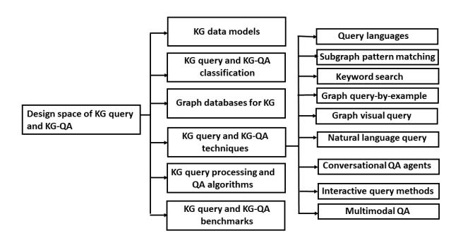

## **Knowledge Graphs Querying**

Arijit Khan Aalborg University arijitk@cs.aau.dk

#### ABSTRACT

Knowledge graphs (KGs) such as DBpedia, Freebase, YAGO, Wikidata, and NELL were constructed to store large-scale, real-world facts as⟨subject, predicate, object⟩ triples – that can also be modeled as a graph, where a node (a subject or an object) represents an entity with attributes, and a directed edge (a predicate) is a relationship between two entities. Querying KGs is critical in web search, question answering (QA), semantic search, personal assistants, fact checking, and recommendation. While significant progress has been made on KG construction and curation, thanks to deep learning recently we have seen a surge of research on KG querying and QA. The objectives of our survey are two-fold. First, research on KG querying has been conducted by several communities, such as databases, data mining, semantic web, machine learning, information retrieval, and natural language processing (NLP), with different focus and terminologies; and also in diverse topics ranging from graph databases, query languages, join algorithms, graph patterns matching, to more sophisticated KG embedding and natural language questions (NLQs). We aim at uniting different interdisciplinary topics and concepts that have been developed for KG querying. Second, many recent advances on KG and query embedding, multimodal KG, and KG-QA come from deep learning, IR, NLP, and computer vision domains. We identify important challenges of KG querying that received less attention by graph databases, and by the DB community in general, e.g., incomplete KG, semantic matching, multimodal data, and NLQs. We conclude by discussing interesting opportunities for the data management community, for instance, KG as a unified data model and vector-based query processing.

#### 1 Introduction

Knowledge graph (KG) [\[161\]](#page-11-0) is an intelligible data model to support easy integration of data from multiple heterogeneous sources, providing a formal semantic representation for inference and machine processing. One does

not require exhaustively modeling their schema; new entities and relationships can be added in human-driven, semi-automated, or fully automated manner to their existing structure without endangering the current functionality. This follows the semi-structured data paradigm, enabling more frequent and timely updates in knowledge graphs. However, schema-flexibility also introduces challenges in managing and querying KGs.

#### 1.1 Challenges in KG Querying

• Scalable and efficient querying. The problems are three-fold. First, due to storing cross-domain information and being un-normalized, KGs are massive volume. Freebase [\[18\]](#page-8-0) (Google KG is powered in part by Freebase) alone has over 22 million entities and 350 million relationships in about 100 domains. Graph-of-Things (GoT) [\[109\]](#page-10-0) which is a live knowledge graph system for Internet-of-Things added roughly more than 10 billion RDF triples per month. While some works partition the data across multiple tables, e.g., property tables in Jena2 [\[162\]](#page-11-1) and Oracle [\[31\]](#page-8-1), vertically partitioned databases in SW-Store [\[1\]](#page-8-2), etc., many databases store them as one giant table (e.g., RDF-3X [\[94\]](#page-10-1)), or a big graph with labels associated with nodes and edges [\[37,](#page-8-3) [92\]](#page-10-2). Second, KG queries (e.g., *"find the 10 most commonly followed entities by people within a given user's second-degree network in the LinkedIn economic graph"*) are different from classical relational queries [\[121,](#page-10-3) [21,](#page-8-4) [85,](#page-9-0) [20\]](#page-8-5). They are join-heavy queries over many-to-many relations (e.g., 'knows', 'follows', 'friends' relations), involving recursive joins or graph traversals, and resulting in complex query shapes, e.g., chain, tree, cycle, star, and flower. Such queries generate large intermediate results [\[10\]](#page-8-6) and query optimization is challenging with traditional binary join plans. Third, exact subgraph pattern matching via subgraph isomorphism is also NPcomplete [\[48\]](#page-9-1). For a fixed query pattern, subgraph isomorphism can be verified by enumerating all potential candidate matches. For node-labeled graphs, if the query pattern has *q* nodes *v*1, *v*2,..., *vq*, and if the number of candidate node matches (from the data graph) for each query node  $v_i$  is  $|C(v_i)|$  based on node-label matching, then the search space has size  $\Pi_{i=1}^k |C(v_i)|$ . This can be large due to massive data graphs, larger query graphs, and due to less selective query node-labels. Therefore, even with node-labeled graphs, e.g., KGs, enumerating all potential candidate matches within the search space is expensive.

Scalability and efficiency of graph query processing (including RDF, KG querying) were studied by data management, theory, and systems communities, e.g., graph and join query optimization [85, 95, 93, 123], join vs. graph queries [122, 139, 141], indexing [53, 6, 65], materialized views [57, 44], efficient (exact) subgraph pattern matching [138, 72], multi-query optimization [107, 117], distributed processing [2, 25, 64], data partitioning [103], I/O efficiency [181], caching [69, 105], modern hardware [62, 177], etc.

• Flexible schema and semantic matching. In a KG, similar relationships can be stored in diverse ways, e.g., for the query, "find all software that have been developed by organizations founded in California" on the DBPedia knowledge graph [73], a recently proposed KG querying system, AGQ [157] reports that correct answers conform to one of at least six different schemas. It is expected to retrieve all semantically correct (i.e., structurally different, yet 'relevant') answers for such queries. If users have full knowledge about DBpedia, they can construct various query patterns or write different SPARQL queries that cover all possible schemas, to obtain all software of interest. It is challenging for ordinary users to have full knowledge of the vocabulary used in a KG and the underlying schemas defined in the KG, since the schema can be large and complex due to heterogeneity, thus KG querying is difficult.

Additionally, the notion of 'relevant' or 'correct' answers could very well depend on the user's query intent, or can even be vague, thus a predefined, 'one-size-fits-all' similarity metric might not work in all scenarios. Data management, semantic web, and ML communities investigated this problem in the context of schema mapping [112], ontology and logic based approaches [110, 83], query reformulation [173, 189], schema-free query interfaces and search [144], approximate subgraph pattern matching [68, 70, 171, 185], graph simulation, homomorphism, and regular expression based pattern matching [43, 84, 42], and KG embedding based query processing [75, 156, 157, 155, 55, 51, 30].

• Incomplete KGs. Knowledge graphs are incomplete and follow the open-world assumption — information available in a KG only captures a subset of reality. To retrieve the complete set of correct answers for a given query, one must infer missing edges and relations. Incompleteness for RDF and property graph data models received fewer attention [33, 100]. Dealing with miss-

ing graph structure is more difficult than that with missing attributes on nodes and edges. Researchers studied uncertain graph data management [71], probabilistic knowledge bases [24], and commonsense KGs [58]. Recent ML approaches embed a KG and logical queries into the same vector space, to deal with missing edges in the KG [55, 51, 30, 116, 115, 182, 9].

- User-friendly querying. Non-professional users find it difficult to formulate an appropriate graph query, e.g., via SPARQL or subgraph pattern [17], thus more userfriendly approaches were developed: (1) (declarative) graph query languages [8], (2) keyword search [170], (3) query-by-example [89, 60], (4) faceted search [148], (5) visual query [16, 52], (6) natural language questions [119, 28], (7) incorporating users' feedback [19, 134], (8) query auto-completion and recommendation [77], (9) answers explanation [131, 150, 59], (10) conversational QA [176], etc. A one-time answer might not be satisfactory. Exploration-based, interactive methods such as faceted search, users' feedback, query suggestion and completion, answers explanation, conversational QA were designed, enabling users to refine their queries and obtaining personalized results.
- Multimodal data querying. Data are multimodal, consisting of texts, images, and other multimedia data. Entities as well as features of both entities and relations in a KG can have varieties of data types. However, bulk of KG querying methods only focus on the structured information in triple facts, since multimodal information are either omitted completely, or are treated as regular nodes and edges. Thus, KG queries and answers lose richer and potentially useful information, reducing their effectiveness in downstream tasks. Recently, multimodal KGs and their querying techniques are an emerging area of research [80, 49].

# 1.2 Related Work and Benefits of Our Survey

The closest to our work are surveys on heterogeneous information networks [128] and querying attributed graphs [158]. While having similarities, knowledge graphs are complex, modeling real-world facts as (subject, predicate, object) triples. Different from those surveys, we discuss diverse querying methods on KGs, neural approaches, and graph databases support to process them.

There are surveys on RDF data management and querying [2, 6, 64, 120], as well as on knowledge graphs [161, 101, 3] and its various operations separately, such as KG embedding [5], KG reasoning with logics and embedding [179], KG-QA [111, 28], conversational KG-QA [176], etc. Surveys on graph databases [76, 145, 15, 8], queries [20] and optimization [85], exact subgraph pattern matching [72] exist. We mention these important surveys in our article.

Figure 1: Design space of KG query and KG-QA problems

Additionally, our contributions are as follows.

- We unite interdisciplinary topics about KG querying with a taxonomy on KG data models, query classification, databases, querying techniques, algorithms, and benchmarks.
- We discuss recent neural methods for KG query processing such as KG embedding-based query answering, multi-modal KG embedding, KG-QA, and conversational KG-QA.
- We analyze the top-10 commercial graph databases support for KG querying, particularly focusing on query languages, user-friendly and interactive interfaces, KG embedding, and multi-modal KG storage.
- We emphasize the current challenges and highlight some future research directions.

#### 1.3 Roadmap

We stated challenges of KG querying and related surveys in [§1.1](#page-0-0) and [§1.2,](#page-1-0) respectively. Taxonomy of KG querying with an emphasis on data models, query classification, languages, technologies, and benchmarks are introduced in [§2.](#page-2-0) We highlight deep learning approaches for KG query processing and QA in [§3.](#page-4-0) We analyze current graph databases support for KG query in [§4](#page-6-0) and discuss future directions in [§5.](#page-7-0)

#### 2 Taxonomy of KG Querying

While almost all big data companies, e.g., Google, Microsoft, Facebook, Amazon, IBM, eBay have their proprietary knowledge graphs [\[101\]](#page-10-25), many public knowledge graphs are also available, e.g., cross-domain KGs (DBpedia [\[73\]](#page-9-10), Wikidata [\[151\]](#page-11-21), YAGO [\[135\]](#page-10-27), Freebase [\[18\]](#page-8-0), NELL [\[87\]](#page-9-29)), KGs for synonyms and translations in several languages (BabelNet [\[91\]](#page-10-28), ConceptNet [\[132\]](#page-10-29)), domain specific KGs [\[3\]](#page-8-19) (COVID19 KG [\[40\]](#page-8-22), ClaimsKG [\[143\]](#page-11-22)), among others.

Graph workloads are broadly classified into two categories [\[67\]](#page-9-30): (1) online graph queries consisting of adhoc graph traversal and pattern matching – exploring a small fraction of the entire graph and requiring fast response time; (2) offline graph analytics with iterative, batch processing over the entire graph, e.g., PageRank, clustering, community detection, and machine learning algorithms. Online graph queries and offline graph analytics are also called *graph OLTP* and *graph OLAP* (or, *graph algorithms*), respectively [\[145\]](#page-11-20). The focus of this article is read-only online queries without updates in the KG. KG querying is essential for web search [\[129\]](#page-10-30), QA [\[119\]](#page-10-20), semantic search [\[155\]](#page-11-12), personal assistants [\[12\]](#page-8-23), fact checking [\[143\]](#page-11-22), and recommendation [\[167\]](#page-11-23).

In this article, we unify various concepts under the broad umbrella of KG query and QA with the taxonomy in Figure [1,](#page-2-1) which shows six key design options for KG query and KG-QA problems: KG data models, KG query and QA classification, graph databases for KG, KG query and QA techniques, their processing algorithms, and benchmarks.

#### 2.1 KG Data Models

Two prominent data models are (1) RDF model consisting of ⟨subject, predicate, object⟩ triples, and (2) property graph model having nodes and edges with arbitrary number of properties, where a node (a subject or an object) represents an entity and a directed edge (a predicate) is a relationship between two entities. RDF schema (RDFS, also known as an ontology), which is the World Wide Web Consortium (W3C) proposed schema language for RDF, is another RDF (equivalently a directed graph) itself, describing classes, properties, and semantic relationships (e.g., "is-a", "part-of", "synonym-to") among them. Ontology languages such as OWL have richer vocabulary and define more expressive schema.

#### 2.2 KG Query and Question Classification

KG queries and questions can be classified based on several aspects.

Querying vs. QA. There are differences between KG query vs. question answering (QA). A query has a structure, e.g., a graph pattern, a logic query, an SQL or a SPARQL query. On the other hand, KG-QA [\[119\]](#page-10-20) deals with answering unstructured natural language questions (NLQs) over KGs – it is a natural language understanding task, that is, semantically parsing an NLQ to translate it into a query language, such as in SPARQL.

Simple vs. complex questions. A simple question involves a single triple and a single formal query pattern, e.g., *"where was Albert Einstein born?"* can be answered based on the relation 'born': ⟨Albert Einstein, born, ?place⟩. On the other hand, a complex question involves multiple KG relations and/or additional operations, e.g., *"what was the first movie of James Cameron that own an Oscar?"*

Logic vs. path queries. First-order logic queries with conjunction, disjunction, negation, and existential quantification over KGs were widely studied [\[30\]](#page-8-10). Relational algebra select-project-join (SPJ) queries and subgraph pattern matching are conjunctive queries (CQ). A regular path query (RPQ) finds all pairs of nodes connected by at least one path where the sequence of edge labels on the path follows a given regular expression [\[163\]](#page-11-24). A shortest-path query returns the path that has the minimum length between two given nodes [\[130\]](#page-10-31). A conjunctive regular path query (CRPQ) combines CQ (e.g., subgraph pattern matching) with RPQ (e.g., reachability) [\[20\]](#page-8-5).

Factoid vs. aggregate queries. The answer set to a factoid query is an enumeration of noun phrases, e.g., *"find all movies by James Cameron"*. An aggregate query retrieves the statistical result of a collection of entities in the answer set, e.g., *"what is the average length of movies by James Cameron?"* Aggregate queries can be combined with GROUP-BY [\[156\]](#page-11-11).

#### 2.3 KG Query Languages & Technologies

A number of technologies exist for KG querying, e.g., SPARQL, SQL extensions, Datalog, graph query languages, keyword query, exampler query, faceted search, visual query, query templates, natural language questions, conversational QA, multimodal QA, and interactive methods (e.g., feedback, explanation, suggestion, autocompletion, etc.).

SPARQL is the W3C recommended query language for RDF. Microsoft SQL Graph supports SQL extensions that enable creating and querying graph objects [\[86\]](#page-9-31). Graph query languages tend to be declarative like SQL. Cypher [\[46\]](#page-9-32), PGQL [\[102\]](#page-10-32), and GSQL [\[36\]](#page-8-24) are declarative graph query languages native to Neo4J, Oracle, and TigerGraph, respectively. Standardization efforts from both academia and industry led to SQL/PGQ [\[35\]](#page-8-25), G-CORE [\[7\]](#page-8-26), and GQL (<https://www.gqlstandards.org/>). Gremlin [\[118\]](#page-10-33), adopted by many graph vendors, is a graph-based programming language that supports both imperative graph traversal and declarative pattern matching. Datalog-based KG querying was explored in [\[13\]](#page-8-27). Cypher, SPARQL, SQL, and Datalog are not Turing complete. In contrast, Gremlin and GSQL are Turing complete and hence, more expressive ([https://info.tigergraph.](https://info.tigergraph.com/gsql) [com/gsql](https://info.tigergraph.com/gsql)).

In relational stores, SPARQL queries are reformulated into SQL queries, then optimized and processed by the relational database management system. On the other hand, graph-based RDF querying techniques convert the SPARQL query into a query graph, and perform graph operations (e.g., exact or approximate subgraph pattern matching, graph traversal) to evaluate the query [\[164\]](#page-11-25). Recently, [\[120\]](#page-10-24) investigated which RDF data representations are suitable for what workloads.

More user-friendly means of KG querying involve the following techniques.

(1) Keyword search over graphs [\[170\]](#page-11-14) allows users to

- provide a list of keywords, and it returns subtrees/ subgraphs containing those keywords as answers, based on various ranking criteria, e.g., sum of all edge weights in the resulting tree/ graph, sum of all path weights from root to each keyword in the tree, maximum pairwise distance among nodes, etc. While native keyword search algorithms directly evaluate a keyword query, there are also query reformulation techniques that convert the keyword query into a more structured format, e.g., SPARQL [\[187\]](#page-11-26) or query graph [\[173\]](#page-11-6). Given the set of keywords, the structured queries are identified by considering term similarity, co-occurrences, and relationships in the KG.
- (2) Graph query-by-example [\[89,](#page-10-19) [60\]](#page-9-22) enables users to input answer tuple(s) as a query, and it returns other similar tuples that are present in the knowledge graph. This follows the well-studied query-by-example paradigm in relational databases, HTML tables, and entity sets: A user might already know a few answers to the user's query. The graph query-by-example systems adopt a two-step approach. Given the input example tuple(s), they first identify the query graph that captures the user's query intent. Next, they evaluate the query graph to find other relevant answer tuples.
- (3) Faceted search [\[148\]](#page-11-15) is an explorative, interactive, and progressive refinement-based search through simple clicks, offering an overview of the result set at each iteration, thereby assisting in query formulation according to the dataset. Main techniques include faceted taxonomy generation, facet ranking, faceted interface, visualization, and navigation.
- (4) Graph visual query interfaces [\[16,](#page-8-16) [52\]](#page-9-23) allow a user to draw a graph query (e.g., a query graph pattern) interactively. Graph operations such as subgraph matching and enumeration are employed to evaluate these queries. [\[52\]](#page-9-23) reformulates graph queries into SPARQL queries.
- (5) Natural language interfaces [\[119,](#page-10-20) [189,](#page-11-7) [28\]](#page-8-17) permit users to input questions in natural languages, without requiring them to learn the underlying schema, vocabulary, or query languages. The semantic parsing of a natural language question involves question analysis, phrase mapping and disambiguation, query construction. Some systems additionally use templates to generate the SPARQL query [\[4,](#page-8-28) [184\]](#page-11-27). Neural approaches are increasingly becoming popular for these tasks.
- (6) Interactive methods include (a) *graph query suggestion, expansion, refinement, and autocompletion* aiming to retrieve more detailed and relevant answers [\[77\]](#page-9-24); (b) *a user's time-bounded search* to provide 'early' answers within the user's response time bound and incrementally improving the quality of answers with time [\[155\]](#page-11-12); (c) *incorporating a user's feedback* for personalized graph querying [\[19,](#page-8-18) [134\]](#page-10-21); (d) *answer explanation* to support 'why', 'why-not', 'why empty', and 'why so

many' questions on query results [\[131,](#page-10-22) [150,](#page-11-16) [59\]](#page-9-25).

- (7) Conversational QA agents [\[32,](#page-8-29) [176\]](#page-11-17) engage users in multi-turn QA to satisfy their information needs. Once a question is answered, the user can ask another question related to the previous QA pair. Such follow-up questions are usually incomplete, with the context not being clearly specified. A conversational agent might also ask follow-up questions to understand the user's query intent. Examples include task-oriented systems (scheduling an event), chat-oriented systems (conducting natural conversations), QA dialog systems (providing answers about a topic), virtual assistants (e.g., Microsoft Cortana is powered by Microsoft Satori KG), and knowledge grounded neural conversation [\[186,](#page-11-28) [147,](#page-11-29) [97\]](#page-10-34).
- (8) Multimodal QA [\[66\]](#page-9-33) consists of multiple user input and output modes (such as text, image, video, voice, touch, gestures, gaze, and movements) over multimodal data (including multimodal KGs), having applications in visual QA, virtual assistants, autonomous vehicles, etc.

A number of keyword search, visual graph query, and natural language query-based interfaces (till 2015) for RDF and KG querying were compared in [\[133,](#page-10-35) [41\]](#page-8-30) based on their effectiveness and usability.

• Application scenarios of KG querying technologies. Writing queries in SPARQL or in other graph query languages requires familiarity with that language, as well as knowledge of the vocabulary and predicates used in the KG. Such querying modes are generally suitable for expert programmers and data scientists. Non-expert users and domain scientists (e.g., biologists, chemists, data journalists, etc. who also use KGs) might prefer more user-friendly means of asking queries, such as using keywords, graph query-by-example, faceted search, visual interfaces, and natural language questions. Interactive methods including faceted search, users' feedback, query suggestion and completion, answers explanation, conversational QA are helpful in refining users' queries and obtaining personalized results. Conversational and multimodal QA are critical in virtual assistants.

#### 2.4 Benchmarks for KG Query & QA

Several benchmarks for KG querying and QA exist, such as for simple questions (WebQuestions [\[14\]](#page-8-31), Simple-Questions [\[22\]](#page-8-32)), complex questions (ComplexQuestions [\[142\]](#page-11-30), LC-QuAD [\[146\]](#page-11-31)), multi-hop questions (HotpotQA [\[172\]](#page-11-32)), conversational QA (ConvQuestions [\[32\]](#page-8-29)), SPARQL query logs [\[21\]](#page-8-4), benchmarks for RDF and SPARQL queries (SP2Bench [\[127\]](#page-10-36), LUBM [\[50\]](#page-9-34)), among others. QALD is not one benchmark but a series of evaluation campaigns for QA systems over KGs, the recent one being QALD10 (<https://www.nliwod.org/challenge>).

### 3 KG Query Processing & QA: Recent Neural Methods

We highlight deep learning advances for KG embeddingbased query processing, multi-modal KG embedding, KG-QA, and conversational QA over KGs.

#### 3.1 Embedding-based KG Query Processing

KG embedding represents each predicate and entity of a KG as a low-dimensional vector, such that the original structures and relations in the KG are approximately preserved in these learned vectors [\[5\]](#page-8-20). KG embeddings can be broadly classified into four categories. (1) *Geometric or translational distance models* compute the plausibility of triples based on a geometric operation such as a distance function in the embedding space, e.g., TransE [\[23\]](#page-8-33), TransH [\[160\]](#page-11-33), TransD [\[61\]](#page-9-35), RotatE [\[140\]](#page-10-37), etc. (2) *Semantic matching or tensor decomposition models* compute similarity of latent features by an inner product formulation, e.g., RESCAL [\[98\]](#page-10-38), DistMult [\[168\]](#page-11-34), Tucker [\[11\]](#page-8-34). (3) *Neural network-based models* generally use convolutional neural networks (CNNs) to predict the plausibility score of a triple, e.g., ConvE [\[34\]](#page-8-35), ConvKB [\[96\]](#page-10-39); or employ graph neural networks (GNNs) which can capture multi-hop relations in the neighborhood of a node, e.g., RGCN [\[126\]](#page-10-40), CompGCN [\[149\]](#page-11-35), KBAT [\[90\]](#page-10-41), etc. (4) *Rule-based models* consider logic rules during embedding learning, e.g., ComplEx-NNE-AER [\[38\]](#page-8-36) and IterE [\[180\]](#page-11-36).

For a simple question, if the embeddings of head entity (i.e., head vector h) and predicate (i.e., predicate vector r) are identified based on the KG embedding, link prediction can be employed to infer the tail entity, e.g., tail vector t ≈ h + r via TransE. EAQ [\[75\]](#page-9-17) applies KG embeddings and uses spatial indexes to efficiently answer top-*k* and aggregate queries.

We categorize recent deep learning techniques for KG query processing into two classes – both categories evaluate input graph query patterns and can deal with incomplete KGs and schema mismatch between the query and a KG.

(1) *Query answering methods trained on single-hop queries*, e.g., [\[75,](#page-9-17) [155,](#page-11-12) [156,](#page-11-11) [9,](#page-8-13) [47\]](#page-9-36), though trained on single-hop queries, can process multi-hop and complex input queries by first decomposing complex queries into smaller subqueries and then combining the answers of subqueries in a systematic way. For instance, [\[155,](#page-11-12) [156\]](#page-11-11) process queries having complex shapes (chain, cycle, star, and flower), aggregate functions (COUNT, SUM, AVG), FILTER and GROUP-BY operators over KG embedding. Since KG embedding techniques deal with ⟨subject, predicate, object⟩triples and are similar to training with single-hop queries, these query answering methods can directly work with KG embedding, without separate single-hop training queries and their answers.

(2) *Query answering methods trained on multi-hop queries* [\[136,](#page-10-42) [115,](#page-10-18) [182,](#page-11-13) [78,](#page-9-37) [169,](#page-11-37) [82,](#page-9-38) [56,](#page-9-39) [30,](#page-8-10) [188\]](#page-11-38) embed multi-hop queries and their answers (i.e., entities from a KG) close to each other in the same embedding space. These methods deal with logical queries, often implement logical operators in neural ways, and significantly reduce query processing time via inference. Unlike generating large intermediate results due to decomposing complex queries into smaller subqueries, these approaches reduce query answering to dense similarity matching of query and entity vectors. They can further be classified as geometry, distribution, or fuzzy logicbased methods according to generated embeddings. The former embeds entities and queries with geometric shapes. Examples include Query2box [\[115\]](#page-10-18), NewLook [\[78\]](#page-9-37), and ConE [\[182\]](#page-11-13). Distribution-based approaches encode entities and queries into probabilistic density, e.g., BetaE [\[116\]](#page-10-17), GammaE [\[169\]](#page-11-37), NMP-QEM [\[82\]](#page-9-38). Fuzzy logicbased methods (e.g., FuzzQE [\[30\]](#page-8-10), ENeSy [\[188\]](#page-11-38)) define logical operators in a learning-free manner following fuzzy logic, whereas only entity and relation embeddings require learning. Geometry and distributionbased approaches are trained with complex queries and their answers, which can be generated by crowdsourcing [\[14\]](#page-8-31), or by automatic generation from a KG as in [\[114\]](#page-10-43). Fuzzy logic-based methods can be trained on singlehop or complex queries. Different from the above approaches, kgTransformer [\[81\]](#page-9-40) uses a Transformer-based GNN architecture, models logical queries as masked prediction, and proposes a masked pre-training strategy.

#### 3.2 Multi-modal KG Embedding

Multi-modal data (e.g., text, image, multi-media) is associated as attributes of entities and relations, or treated as new entities in a KG. Multi-modal KG embeddings are critical for querying multi-modal KGs, and can be classified as follows.

KG+text. Notable methods are Extended RESCAL [\[99\]](#page-10-44), DKRL [\[165\]](#page-11-39), and KDCoE [\[29\]](#page-8-37) that embed KGs having textual descriptions of entities. These methods vary in how entity embedding from text is obtained (e.g., via CNN, LSTM, bag-of-words, etc.) and then how it is combined with structure-based representation. Recently, efforts were made to combine pre-trained language models with KG+text embedding, e.g., (1) *when KGs having textual description of entities*: SimKGC [\[152\]](#page-11-40), KE-PLER [\[154\]](#page-11-41), KnowlyBERT [\[63\]](#page-9-41), K-BERT [\[80\]](#page-9-26); (2) *when KGs and text data are stored separately*: DRAGON [\[174\]](#page-11-42), JAKET [\[175\]](#page-11-43), OREO-LM [\[54\]](#page-9-42), DRLK [\[178\]](#page-11-44).

KG+image. IKRL [\[166\]](#page-11-45), RSME [\[153\]](#page-11-46), and MuKEA [\[39\]](#page-8-38) learn KG embedding by jointly training a structurebased representation (e.g., TransE) with an image-based representation obtained via image encoder.

KG+text+image. To embed KGs having texts and images, several models were proposed, e.g., Knowledge-CLIP [\[104\]](#page-10-45), CMGNN [\[45\]](#page-9-43), MKBE [\[108\]](#page-10-46), MKGAT [\[137\]](#page-10-47), TransAE [\[159\]](#page-11-47). They employ various neural encoders for multi-modal data and combine them with existing relational models.

#### 3.3 Neural Methods for KG-QA

Answering natural language questions (NLQ) over knowledge graphs involve several subtasks including entity linking, relationships identification, identifying logical and numerical operators, query forms, intent, and finally the formal query construction [\[111\]](#page-10-26). Rule-based methods use ontologies and KG for phrase mapping and disambiguation to link entities and relations to the KG, and then employ grammars to generate formal queries. Recently, neural network-based semantic parsing algorithms have become popular for KG-QA, which are categorized as classification, ranking, and translation-based [\[28\]](#page-8-17). Classification-based parsing algorithms rely on classification models to predict the relation and entities in a simple NLQ. For more complex questions, rankingbased methods employ a search procedure to find the top few probable query candidates, followed by using a neural network-based ranking model to find the best candidate. Translation based KG-QA methods employ a sequence-to-sequence model, consisting of decoder and encoder to translate a natural question into a formal query. Based on the types of training data, their training methods can be fully supervised (consisting of NLQs and their formal queries during training) or weakly supervised (provided with NLQs and their execution results, but without their formal queries during training).

More recently, [\[55,](#page-9-18) [26,](#page-8-39) [113,](#page-10-48) [125,](#page-10-49) [79,](#page-9-44) [124\]](#page-10-50) propose methods to answer NLQs over KGs in an end-to-end manner. They can deal with incomplete KGs, semantic meaning of NLQs, and ambiguity of entity names and relations. KEQA [\[55\]](#page-9-18) jointly learns head entity, predicate, and tail entity representations of a simple NLQ in a given KG embedding space. Attention-based BiLSTM models are used for the head entity and predicate representation learning. EmbedKGQA [\[125\]](#page-10-49) learns representation of a multi-hop NLQ in the KG embedding space first by using RoBERTa (robustly optimized BERT pretraining), followed by fully connected linear layers with ReLU activation, and finally projecting onto the KG embedding space. DCRN [\[26\]](#page-8-39) identifies informative evidence from candidate entities in a multi-hop question by using their semantic information, then finds answers by performing RNN encoder-decoder-based sequential reasoning following the graph structure on the retrieved evidence. LEGO [\[113\]](#page-10-48) alternates between growing the query tree and the reasoning action in the KG embedding space. BiNet [\[79\]](#page-9-44) uses an encoder-decoder-based model that transforms multi-hop NLQs into relation paths, and jointly addresses knowledge graph completion and KGQA tasks. KGT5 [\[124\]](#page-10-50) employs an encoder-decoder Transformer model, with pretraining the model on the KG using the link prediction task, and then the model is fine-tuned for complex question answering.

#### 3.4 Conversational QA on KG

Conversational QAs are extensions to one-shot NLQs, involving a sequence of questions and answers that appear as a dialogue between the system and the user [\[119,](#page-10-20) [111\]](#page-10-26). Conversational QA systems involve dialog manager and response generator to keep track of the dialog history and for generating natural language responses, respectively. Sequence-to-sequence and pre-trained language models are used for these tasks.

Knowledge grounded neural conversation models generate more informative responses. To understand the context of follow-up questions, commonsense KG-based context expansion is useful [\[186\]](#page-11-28). DyKgChat [\[147\]](#page-11-29) zeroshot adapts to dynamically updated knowledge graphs during conversation. HiTKG [\[97\]](#page-10-34) proposes a hierarchical Transformer-based graph walker model, which learns both short-term and long-term conversation goals.

• Interaction between neural and classic approaches. We identify scenarios where neural and classic KG query processing and KG-QA can be complementary to each other. First, neural semantic parsing translates NLQs into structured queries, e.g., SPARQL queries or subgraph patterns, and classic approaches can be applied to evaluate them. Classic approaches identify intermediate results that help interpreting each step in query processing. Second, neural approaches can also assist in interactive, exploration-based query processing by automated query suggestion and completion, incorporating user's feedback, and providing personalized results.

#### 4 Graph Databases Support for KG Query

We analyze the top-10 commercial graph DBMS according to <https://db-engines.com/en/ranking/graph+dbms> (accessed on December 30, 2022), which ranks commercial database management systems based on their popularity. In the past, graph databases were benchmarked in regards to their performance, database systems offerings, data organization techniques, queries, etc. [\[76,](#page-9-28) [145,](#page-11-20) [15,](#page-8-21) [8\]](#page-8-15). Different from them and following our taxonomic discussion, we categorize which graph DBMS supports what data models, query languages, user-friendly and interactive interfaces. Given the popularity of deep learning and KG embedding that are critical for incomplete or multimodal KG querying, we also investigate if these graph databases support graph embedding and multimodal KG-QA. Our findings are summarized in Table [1.](#page-7-1)

- (1) Neo4j [\[92\]](#page-10-2) provides a native graph database with property graph data model and Cypher query language. It also supports the Apache TinkerPop ([http://tinkerpop.](http://tinkerpop.apache.org/) [apache.org/](http://tinkerpop.apache.org/)) acting as a connectivity layer to use Gremlin. Neo4J supports several graph analytic tools (e.g., Popoto.js, Neo4j Bloom) that assist in interactive, visual query building and suggestion. Neo4J's graph data science library implements three graph embedding methods (FastRP, GraphSAGE, and Node2Vec), node classification and regression, link prediction.
- (2) Microsoft Cosmos DB for Gremlin (graph) ([https://](https://learn.microsoft.com/en-us/azure/cosmos-db/gremlin/introduction) [learn.microsoft.com/en-us/azure/cosmos-db/gremlin/introduction](https://learn.microsoft.com/en-us/azure/cosmos-db/gremlin/introduction)) is a hybrid graph DB service on top of Microsoft's NoSQL Azure Cosmos DB. It follows the Apache TinkerPop specification using Gremlin as the query language. The graph data can be visualized and explored via third-party tools, e.g., Graphlytic, Graphistry, Linkurious.
- (3) Virtuoso (<https://virtuoso.openlinksw.com/>) is a hybrid database which stores KGs as RDF triples and provides a SPARQL endpoint. Besides Virtuoso faceted browsing, third-party tools (e.g., LodLive [\[27\]](#page-8-40)) exist to visualize and explore RDF data from SPARQL endpoints.
- (4) ArangoDB (https://www.arangodb.com/docs/stable/), which is a document-based hybrid graph DB, provides a declarative query language AQL (ArangoDB Query Language). It supports Apache TinkerPop Gremlin. ArangoDB has an in-built graph viewer, additionally it supports thirdparty tools (e.g., Cytoscape) for visualization and analysis. ArangoDB's graph ML tools provide several graph embedding methods (e.g., GraphSage, Metapath2Vec, GAT, DMGI) over both homogeneous and heterogeneous networks (https://github.com/arangoml/fastgraphml).
- (5) OrientDB (<https://orientdb.com>), a document-based native graph DB, offers SQL extension for graph queries, and supports Gremlin. OrientDB studio visualizes graphs and schema.
- (6) JanusGraph (<http://janusgraph.org>) uses a number of wide-column stores as backends, e.g., Apache Cassandra, HBase, Google Cloud Bigtable, Oracle BerkeleyDB, ScyllaDB, etc. It supports Apache TinkerPop Gremlin. To visualize graphs stored in JanusGraph, one can use third-party tools, e.g., Cytoscape, Gephi plugin for Apache TinkerPop, Graphexp KeyLines by Cambridge Intelligence, Linkurious, etc.
- (7) Amazon Neptune (<https://aws.amazon.com/neptune>) is part of Amazon Web Services (AWS), supporting both RDF and property graph models, as well as Gremlin, open-Cypher, and SPARQL query languages. The query results can be interactively visualized using Neptune Workbench. Neptune uses GNN methods and the Deep Graph Library (DGL) to support a number of graph ML tasks, including node and edge classification, regression, link

| meetiness, support for graph smoothing and manimoun 110 Quit of property graph, 1221 1221 tripless |                |                    |                                                                                            |                 |                  |
|----------------------------------------------------------------------------------------------------|----------------|--------------------|--------------------------------------------------------------------------------------------|-----------------|------------------|
| graph DBMS                                                                                         | KG data models | query languages    | user-friendly & interactive interfaces                                                     | graph embedding | multimodal KG-QA |
| Neo4J                                                                                              | PG             | Cypher, Gremlin    | Popoto.js: create interactive visual query; Neo4j Bloom: write patterns similar to NLQs | <b>√</b>        | ×                |
| Microsoft Cosmos DB                                                                             | PG             | Gremlin            | 3rd-party data visualization tools (e.g., Graphlytic, Graphistry, Linkurious)           | Х               | Х                |
| Virtuoso                                                                                           | RDF            | SPARQL             | faceted browsing, 3rd-party tools (e.g., LodLive)                                          | Х               | Х                |
| ArangoDB                                                                                           | PG             | AQL, Gremlin       | graph viewer, 3rd-party tools (e.g., Cytoscape)                                            | <b>√</b>        | Х                |
| OrientDB                                                                                           | PG             | SQL-like, Gremlin  | OrientDB studio: visualize graphs and schema                                               | Х               | Х                |
| JanusGraph                                                                                         | PG             | Gremlin            | 3rd-party tools (e.g., Cytoscape)                                                          | Х               | Х                |
| Amazon Neptune                                                                                  | PG, RDF     | Gremlin, SPARQL | Neptune Workbench                                                                          | <b>√</b>        | ×                |
| GraphDB                                                                                            | RDF            | SPARQL             | faceted search, 3rd-party tools (e.g., metaphactory)                                       | Х               | Х                |
| TigerGraph                                                                                         | PG             | GSQL               | TigerGraph GraphStudio                                                                     | <b>√</b>        | Х                |
| FaunaDR                                                                                            | PG             | GranhOL            | X                                                                                          | X               | X                |

Table 1: Categorization of top-10 commercial graph DBMS based on KG data models, query languages, user-friendly and interactive interfaces, support for graph embedding and multimodal KG-OA. PG: property graph, RDF: RDF triples.

prediction, graph embedding (R-GCN), and KG embedding (TransE, DistMult, RotatE).

- (8) GraphDB (https://www.ontotext.com/products/graphdb) is an RDF database using SPARQL query language. It supports faceted search and third-party tools, such as metaphactory, for interactive visualization.
- (9) TigerGraph [37] is a native graph database with property graph data model and GSQL language. Tiger-Graph GraphStudio provides a graphical interface for interactive visualization and exploration. TigerGraph's ML Workbench is a Jupyter-based Python development framework that is inter-operable with popular deep learning frameworks such as PyTorch Geometric, DGL, and supports graph embedding (Node2Vec, Fast Random Projection, and Weisfeiler-Lehman).
- (10) FaunaDB (https://fauna.com) is a document-relational database with property graph model and GraphQL API. Summary. The top-10 commercial graph databases support various languages for querying of KGs as RDF

port various languages for querying of KGs – as RDF triples or property graphs. Besides, many of them also provide interactive interfaces for visualization, querying, and exploration of KGs. Their support for in-built ML-based KG querying is limited. Only Amazon Neptune provides a few popular KG embedding methods such as TransE, DistMult, and RotatE. While many of these graph databases (e.g., AllegroGraph, ArangoDB, OrientDB) are multi-model, supporting multiple data models against a single backend, none of them has in-house system for storage and querying of multi-modal data, such as KGs with text, images, and multimedia.

#### **5** Future Directions

Knowledge graphs can support a holistic integration solution for multi-modal data arriving from heterogeneous sources. For instance, nodes and edges in a KG can have arbitrary number of properties of different types, e.g., tabular, key-value pairs, text, images, and multimedia. Therefore, KGs can be a unified data model for complex data lake problems, to model cross-domain and diverse

data. We conclude with a discussion about future work on KG querying.

- Vector data management and querying. With the prevalence of KG embedding based query processing, managing and querying of vector data is critical. Data management community can contribute in this domain with high-dimensional data indexing, join, querying, and geometric data processing.
- Scalable embedding learning. Scaling knowledge graphs embedding is challenging [88, 74, 183]. The problem gets exacerbated when combined with more complex data, such as KG+query embedding and multi-modal KG embedding. Advanced techniques are required for scalable embedding learning of multi-modal KGs, e.g., with language models, and conversational KG-QA with sequence-to-sequence models.
- Graph databases support for KG embedding. Current graph DBMS support for ML-based KG querying is limited. In future, they can incorporate more KG embedding models, vector data management and query processing techniques, as well as enable multi-modal KG storage and query, more interactive means of KG querying such as NLQs and dialogues.
- Usability of KG querying methods. Besides SPARQL, a number of KG querying approaches exist, e.g., query languages, keyword search, query-by-example, faceted search, visual query, natural language questions, and conversational QA. It would be interesting to holistically compare them, understand their user-friendliness, and categorize what is applicable in which domains.
- Suitability of KG embedding models. A number of KG embedding models exist, such as translation-based models (TransE, TransD, TransH) and semantic matching models (RESCAL, DistMult, ConvE). Different models preserve various types of relation properties, e.g., symmetry, antisymmetry, inversion, composition, complex mapping properties, etc. [140]. One can analyze which properties are important for what queries, leading to a realization of which KG embedding models are suitable for different KGs and queries.

• Explainability, interoperability, and multi-lingual KG querying. There is an increasing focus on interpretability of deep learning methods over graph-structured data. In this context, explainability in knowledge graph embeddings is also important, for instance, what is being learned in knowledge graph embedding and KG-QA with explanatory evidences. Interoperability between KGs and supporting multi-lingual KGs [\[106\]](#page-10-51) and queries are other interesting future directions.

#### 6 Acknowledgement

Arijit Khan acknowledges support from the Novo Nordisk Foundation grant NNF22OC0072415.

#### 7 References

- [1] D. J. Abadi, A. Marcus, S. Madden, and K. Hollenbach. Sw-store: a vertically partitioned DBMS for semantic web data management. *VLDB J.*, 18(2):385–406, 2009.
- [2] I. Abdelaziz, R. Harbi, Z. Khayyat, and P. Kalnis. A survey and experimental comparison of distributed SPARQL engines for very large RDF data. *PVLDB*, 10(13):2049–2060, 2017.
- [3] B. Abu-Salih. Domain-specific knowledge graphs: a survey. *J. Netw. Comput. Appl.*, 185:103076, 2021.
- [4] A. Abujabal, R. S. Roy, M. Yahya, and G. Weikum. Never-ending learning for open-domain question answering over knowledge bases. In *WWW*, 2018.
- [5] M. Ali, M. Berrendorf, C. T. Hoyt, L. Vermue, M. Galkin, S. Sharifzadeh, A. Fischer, V. Tresp, and J. Lehmann. Bringing light into the dark: a large-scale evaluation of knowledge graph embedding models under a unified framework. *IEEE Trans. Pattern Anal. Mach. Intell.*, 44(12):8825–8845, 2022.
- [6] W. Ali, M. Saleem, B. Yao, A. Hogan, and A. N. Ngomo. A survey of RDF stores & SPARQL engines for querying knowledge graphs. *VLDB J.*, 31(3):1–26, 2022.
- [7] R. Angles, M. Arenas, P. Barceló, P. A. Boncz, G. H. L. Fletcher, C. Gutierrez, T. Lindaaker, M. Paradies, S. Plantikow, J. F. Sequeda, O. van Rest, and H. Voigt. G-CORE: a core for future graph query languages. In *SIGMOD*, 2018.
- [8] R. Angles, M. Arenas, P. Barceló, A. Hogan, J. L. Reutter, and D. Vrgoc. Foundations of modern query languages for graph databases. *ACM Comput. Surv.*, 50(5):68:1–68:40, 2017.
- [9] E. Arakelyan, D. Daza, P. Minervini, and M. Cochez. Complex query answering with neural link predictors. In *ICLR*, 2021.
- [10] A. Atserias, M. Grohe, and D. Marx. Size bounds and query plans for relational joins. *CoRR*, abs/1711.03860, 2017.
- [11] I. Balazevic, C. Allen, and T. M. Hospedales. Tucker: tensor factorization for knowledge graph completion. In *EMNLP-IJCNLP*, 2019.
- [12] K. Balog and T. Kenter. Personal knowledge graphs: a research agenda. In *SIGIR*, 2019.
- [13] L. Bellomarini, E. Sallinger, and G. Gottlob. The vadalog system: datalog-based reasoning for knowledge graphs. *PVLDB*, 11(9):975–987, 2018.
- [14] J. Berant, A. Chou, R. Frostig, and P. Liang. Semantic parsing on freebase from question-answer pairs. In *EMNLP*, 2013.
- [15] M. Besta, E. Peter, R. Gerstenberger, M. Fischer, M. Podstawski, C. Barthels, G. Alonso, and T. Hoefler. Demystifying graph databases: analysis and taxonomy of data organization, system designs, and graph queries. *CoRR*, 2019.
- [16] S. S. Bhowmick and B. Choi. Data-driven visual query interfaces for graphs: past, present, and (near) future. In *SIGMOD*, 2022.
- [17] S. S. Bhowmick, B. Choi, and C. Li. Graph querying meets HCI: state of the art and future directions. In *SIGMOD*, 2017.

- [18] K. D. Bollacker, C. Evans, P. K. Paritosh, T. Sturge, and J. Taylor. Freebase: a collaboratively created graph database for structuring human knowledge. In *SIGMOD*, 2008.
- [19] A. Bonifati, R. Ciucanu, and A. Lemay. Learning path queries on graph databases. In *EDBT*, 2015.
- [20] A. Bonifati, G. H. L. Fletcher, H. Voigt, and N. Yakovets. *Querying graphs*. Synthesis Lectures on Data Management. Morgan & Claypool Publishers, 2018.
- [21] A. Bonifati, W. Martens, and T. Timm. An analytical study of large SPARQL query logs. *VLDB J.*, 29(2-3):655–679, 2020.
- [22] A. Bordes, N. Usunier, S. Chopra, and J. Weston. Large-scale simple question answering with memory networks. *CoRR*, abs/1506.02075, 2015.
- [23] A. Bordes, N. Usunier, A. García-Durán, J. Weston, and O. Yakhnenko. Translating embeddings for modeling multi-relational data. In *NeurIPS*, 2013.
- [24] S. Borgwardt, ˙I. ˙I. Ceylan, and T. Lukasiewicz. Recent advances in querying probabilistic knowledge bases. In *IJCAI*, 2018.
- [25] S. Bouhenni, S. Yahiaoui, N. Nouali-Taboudjemat, and H. Kheddouci. A survey on distributed graph pattern matching in massive graphs. *ACM Comput. Surv.*, 54(2):36:1–36:35, 2022.
- [26] J. Cai, Z. Zhang, F. Wu, and J. Wang. Deep cognitive reasoning network for multi-hop question answering over knowledge graphs. In *ACL/IJCNLP*, 2021.
- [27] D. V. Camarda, S. Mazzini, and A. Antonuccio. Lodlive, exploring the web of data. In *Semantic Systems*, 2012.
- [28] N. Chakraborty, D. Lukovnikov, G. Maheshwari, P. Trivedi, J. Lehmann, and A. Fischer. Introduction to neural network-based question answering over knowledge graphs. *WIREs Data Mining Knowl. Discov.*, 11(3), 2021.
- [29] M. Chen, Y. Tian, K. Chang, S. Skiena, and C. Zaniolo. Co-training embeddings of knowledge graphs and entity descriptions for cross-lingual entity alignment. In *IJCAI*, 2018.
- [30] X. Chen, Z. Hu, and Y. Sun. Fuzzy logic based logical query answering on knowledge graphs. In *AAAI*, 2022.
- [31] E. I. Chong, S. Das, G. Eadon, and J. Srinivasan. An efficient sql-based RDF querying scheme. In *VLDB*, 2005.
- [32] P. Christmann, R. S. Roy, A. Abujabal, J. Singh, and G. Weikum. Look before you hop: conversational question answering over knowledge graphs using judicious context expansion. In *CIKM*, 2019.
- [33] F. Darari, R. E. Prasojo, and W. Nutt. CORNER: a completeness reasoner for SPARQL queries over RDF data sources. In *The Semantic Web: ESWC Satellite Events*, 2014.
- [34] T. Dettmers, P. Minervini, P. Stenetorp, and S. Riedel. Convolutional 2d knowledge graph embeddings. In *AAAI*, 2018.
- [35] A. Deutsch, N. Francis, A. Green, K. Hare, B. Li, L. Libkin, T. Lindaaker, V. Marsault, W. Martens, J. Michels, F. Murlak, S. Plantikow, P. Selmer, O. van Rest, H. Voigt, D. Vrgoc, M. Wu, and F. Zemke. Graph pattern matching in GQL and SQL/PGQ. In *SIGMOD*, 2022.
- [36] A. Deutsch, Y. Xu, and M. Wu. Seamless syntactic and semantic integration of query primitives over relational and graph data in gsql, 2018.
- [37] A. Deutsch, Y. Xu, M. Wu, and V. E. Lee. Tigergraph: a native MPP graph database. *CoRR*, abs/1901.08248, 2019.
- [38] B. Ding, Q. Wang, B. Wang, and L. Guo. Improving knowledge graph embedding using simple constraints. In *ACL*, 2018.
- [39] Y. Ding, J. Yu, B. Liu, Y. Hu, M. Cui, and Q. Wu. Mukea: multimodal knowledge extraction and accumulation for knowledge-based visual question answering. In *CVPR*, 2022.
- [40] H. Du, Z. Le, H. Wang, Y. Chen, and J. Yu. COKG-QA: multi-hop question answering over COVID-19 knowledge graphs. *Data Intell.*, 4(3):471–492, 2022.
- [41] K. Elbedweihy, S. N. Wrigley, and F. Ciravegna. Evaluating semantic search query approaches with expert and casual users. In *ISWC*, 2012.

- [42] W. Fan, J. Li, S. Ma, N. Tang, and Y. Wu. Adding regular expressions to graph reachability and pattern queries. In *ICDE*, 2011.
- [43] W. Fan, J. Li, S. Ma, H. Wang, and Y. Wu. Graph homomorphism revisited for graph matching. *PVLDB*, 3(1):1161–1172, 2010.
- [44] W. Fan, X. Wang, and Y. Wu. Answering graph pattern queries using views. In *ICDE*, 2014.
- [45] Q. Fang, X. Zhang, J. Hu, X. Wu, , and C. Xu. Contrastive multi-modal knowledge graph representation learning. *IEEE Trans. Knowl. Data Eng.*, 2022.
- [46] N. Francis, A. Green, P. Guagliardo, L. Libkin, T. Lindaaker, V. Marsault, S. Plantikow, M. Rydberg, P. Selmer, and A. Taylor. Cypher: an evolving query language for property graphs. In *SIGMOD*, 2018.
- [47] M. Galkin, Z. Zhu, H. Ren, and J. Tang. Inductive logical query answering in knowledge graphs. In *NeurIPS*, 2022.
- [48] M. R. Garey and D. S. Johnson. *Computers and intractability: a guide to the theory of NP-completeness*. W. H. Freeman, 1979.
- [49] G. A. Gesese, R. Biswas, M. Alam, and H. Sack. A survey on knowledge graph embeddings with literals: Which model links better literal-ly? *Semantic Web*, 12(4):617–647, 2021.
- [50] Y. Guo, Z. Pan, and J. Heflin. Lubm: a benchmark for owl knowledge base systems. *J. Web Semant.*, 3(2-3):158–182, 2005.
- [51] W. L. Hamilton, P. Bajaj, M. Zitnik, D. Jurafsky, and J. Leskovec. Embedding logical queries on knowledge graphs. In *NeurIPS*, 2018.
- [52] L. Han, T. Finin, and A. Joshi. Gorelations: an intuitive query system for dbpedia. In *JIST*, 2011.
- [53] W.-S. Han, J. Lee, M.-D. Pham, and J. X. Yu. iGraph: a framework for comparisons of disk-based graph indexing techniques. *PVLDB*, 3(1–2):449–459, 2010.
- [54] Z. Hu, Y. Xu, W. Yu, S. Wang, Z. Yang, C. Zhu, K. Chang, and Y. Sun. Empowering language models with knowledge graph reasoning for open-domain question answering. In *EMNLP*, 2022.
- [55] X. Huang, J. Zhang, D. Li, and P. Li. Knowledge graph embedding based question answering. In *WSDM*, 2019.
- [56] Z. Huang, M. Chiang, and W. Lee. Line: logical query reasoning over hierarchical knowledge graphs. In *KDD*, 2022.
- [57] D. Ibragimov, K. Hose, T. B. Pedersen, and E. Zimányi. Optimizing aggregate SPARQL queries using materialized RDF views. In *ISWC*, 2016.
- [58] F. Ilievski, P. A. Szekely, and B. Zhang. CSKG: the commonsense knowledge graph. In *ESWC*, 2021.
- [59] M. S. Islam, C. Liu, and J. Li. Efficient answering of why-not questions in similar graph matching. *IEEE Trans. Knowl. Data Eng.*, 27(10):2672–2686, 2015.
- [60] N. Jayaram, A. Khan, C. Li, X. Yan, and R. Elmasri. Querying knowledge graphs by example entity tuples. *IEEE Trans. Knowl. Data Eng.*, 27(10):2797–2811, 2015.
- [61] G. Ji, S. He, L. Xu, K. Liu, and J. Zhao. Knowledge graph embedding via dynamic mapping matrix. In *ACL*, 2015.
- [62] X. Jin, Z. Yang, X. Lin, S. Yang, L. Qin, and Y. Peng. FAST: fpga-based subgraph matching on massive graphs. In *ICDE*, 2021.
- [63] J. Kalo, L. Fichtel, P. Ehler, and W. Balke. Knowlybert hybrid query answering over language models and knowledge graphs. In *ISWC*, 2020.
- [64] Z. Kaoudi and I. Manolescu. RDF in the clouds: a survey. *VLDB J.*, 24(1):67–91, 2015.
- [65] F. Katsarou, N. Ntarmos, and P. Triantafillou. Performance and scalability of indexed subgraph query processing methods. *Proc. VLDB Endow.*, 8(12):1566–1577, 2015.
- [66] V. Kepuska and G. Bohouta. Next-generation of virtual personal assistants (microsoft cortana, apple siri, amazon alexa and google home). In *CCWC*, 2018.
- [67] A. Khan and S. Elnikety. Systems for big-graphs. *Proc. VLDB Endow.*, 7(13):1709–1710, 2014.

- [68] A. Khan, N. Li, X. Yan, Z. Guan, S. Chakraborty, and S. Tao. Neighborhood based fast graph search in large networks. In *SIGMOD*, 2011.
- [69] A. Khan, G. Segovia, and D. Kossmann. On smart query routing: for distributed graph querying with decoupled storage. In *USENIX ATC*, 2018.
- [70] A. Khan, Y. Wu, C. C. Aggarwal, and X. Yan. Nema: fast graph search with label similarity. *PVLDB*, 6(3):181–192, 2013.
- [71] A. Khan, Y. Ye, and L. Chen. *On uncertain graphs*. Synthesis Lectures on Data Management. Morgan & Claypool Publishers, 2018.
- [72] J. Lee, W. Han, R. Kasperovics, and J. Lee. An in-depth comparison of subgraph isomorphism algorithms in graph databases. *Proc. VLDB Endow.*, 6(2):133–144, 2012.
- [73] J. Lehmann, R. Isele, M. Jakob, A. Jentzsch, D. Kontokostas, P. N. Mendes, S. Hellmann, M. Morsey, P. v. Kleef, S. Auer, and C. Bizer. Dbpedia - a large-scale, multilingual knowledge base extracted from wikipedia. *Semantic Web*, 6(2):167–195, 2015.
- [74] A. Lerer, L. Wu, J. Shen, T. Lacroix, L. Wehrstedt, A. Bose, and A. Peysakhovich. Pytorch-biggraph: a large scale graph embedding system. In *MLSys*, 2019.
- [75] Y. Li, T. Ge, and C. X. Chen. Online indices for predictive top-k entity and aggregate queries on knowledge graphs. In *ICDE*, 2020.
- [76] M. Lissandrini, M. Brugnara, and Y. Velegrakis. Beyond macrobenchmarks: microbenchmark-based graph database evaluation. *PVLDB*, 12(4):390–403, 2018.
- [77] M. Lissandrini, D. Mottin, T. Palpanas, and Y. Velegrakis. Graph-query suggestions for knowledge graph exploration. In *WWW*, 2020.
- [78] L. Liu, B. Du, H. Ji, C. Zhai, and H. Tong. Neural-answering logical queries on knowledge graphs. In *KDD*, 2021.
- [79] L. Liu, B. Du, J. Xu, Y. Xia, and H. Tong. Joint knowledge graph completion and question answering. In *KDD*, 2022.
- [80] W. Liu, P. Zhou, Z. Zhao, Z. Wang, Q. Ju, H. Deng, and P. Wang. K-BERT: enabling language representation with knowledge graph. In *AAAI*, 2020.
- [81] X. Liu, S. Zhao, K. Su, Y. Cen, J. Qiu, M. Zhang, W. Wu, Y. Dong, and J. Tang. Mask and reason: pre-training knowledge graph transformers for complex logical queries. In *KDD*, 2022.
- [82] X. Long, L. Zhuang, L. Aodi, S. Wang, and H. Li. Neural-based mixture probabilistic query embedding for answering FOL queries on knowledge graphs. In *EMNLP*, 2022.
- [83] H. Ma, M. A. Langouri, Y. Wu, F. Chiang, and J. Pi. Ontology-based entity matching in attributed graphs. *PVLDB*, 12(10):1195–1207, 2019.
- [84] S. Ma, Y. Cao, W. Fan, J. Huai, and T. Wo. Strong simulation: capturing topology in graph pattern matching. *ACM Trans. Database Syst.*, 39(1):4:1–4:46, 2014.
- [85] A. Mhedhbi and S. Salihoglu. Modern techniques for querying graph-structured relations: foundations, system implementations, and open challenges. *PVLDB*, 15(12):3762–3765, 2022.
- [86] Microsoft. Sql graph architecture. [https://learn.microsoft.com/en-us/sql/](https://learn.microsoft.com/en-us/sql/relational-databases/graphs/sql-graph-architecture?view=sql-server-ver16) [relational-databases/graphs/](https://learn.microsoft.com/en-us/sql/relational-databases/graphs/sql-graph-architecture?view=sql-server-ver16) [sql-graph-architecture?view=sql-server-ver16](https://learn.microsoft.com/en-us/sql/relational-databases/graphs/sql-graph-architecture?view=sql-server-ver16), 2022.
- [87] T. M. Mitchell, W. W. Cohen, E. R. H. Jr., P. P. Talukdar, B. Yang, J. Betteridge, A. Carlson, B. D. Mishra, M. Gardner, B. Kisiel, J. Krishnamurthy, N. Lao, K. Mazaitis, T. Mohamed, N. Nakashole, E. A. Platanios, A. Ritter, M. Samadi, B. Settles, R. C. Wang, D. Wijaya, A. Gupta, X. Chen, A. Saparov, M. Greaves, and J. Welling. Never-ending learning. *Commun. ACM*, 61(5):103–115, 2018.
- [88] J. Mohoney, R. Waleffe, H. Xu, T. Rekatsinas, and

- S. Venkataraman. Marius: learning massive graph embeddings on a single machine. In *OSDI*, 2021.
- [89] D. Mottin, M. Lissandrini, Y. Velegrakis, and T. Palpanas. Exemplar queries: give me an example of what you need. *PVLDB*, 7(5):365–376, 2014.
- [90] D. Nathani, J. Chauhan, C. Sharma, and M. Kaul. Learning attention-based embeddings for relation prediction in knowledge graphs. In *ACL*, 2019.
- [91] R. Navigli and S. P. Ponzetto. Babelnet: building a very large multilingual semantic network. In *ACL*, 2010.
- [92] Neo4J. Why graph databases? <https://neo4j.com/why-graph-databases/>, 2016.
- [93] T. Neumann and G. Weikum. Scalable join processing on very large RDF graphs. In *SIGMOD*, 2009.
- [94] T. Neumann and G. Weikum. The RDF-3X engine for scalable management of RDF data. *VLDB J.*, 19(1):91–113, 2010.
- [95] H. Q. Ngo. Worst-case optimal join algorithms: techniques, results, and open problems. In *PODS*, 2018.
- [96] D. Q. Nguyen, T. D. Nguyen, D. Q. Nguyen, and D. Q. Phung. A novel embedding model for knowledge base completion based on convolutional neural network. In *NAACL-HLT*, 2018.
- [97] J. Ni, V. Pandelea, T. Young, H. Zhou, and E. Cambria. Hitkg: towards goal-oriented conversations via multi-hierarchy learning. In *AAAI*, 2022.
- [98] M. Nickel, V. Tresp, and H. Kriegel. A three-way model for collective learning on multi-relational data. In *ICML*, 2011.
- [99] M. Nickel, V. Tresp, and H. Kriegel. Factorizing YAGO: scalable machine learning for linked data. In *WWW*, 2012.
- [100] C. Nikolaou and M. Koubarakis. Querying incomplete information in RDF with SPARQL. *Artif. Intell.*, 237:138–171, 2016.
- [101] N. F. Noy, Y. Gao, A. Jain, A. Narayanan, A. Patterson, and J. Taylor. Industry-scale knowledge graphs: lessons and challenges. *Commun. ACM*, 62(8):36–43, 2019.
- [102] Oracle. Pgql 1.5 specification. <https://pgql-lang.org/spec/1.5/>, 2022.
- [103] A. Pacaci and M. T. Özsu. Experimental analysis of streaming algorithms for graph partitioning. In *SIGMOD*, 2019.
- [104] X. Pan, T. Ye, D. Han, S. Song, and G. Huang. Contrastive language-image pre-training with knowledge graphs. In *NeurIPS*, 2022.
- [105] N. Papailiou, D. Tsoumakos, P. Karras, and N. Koziris. Graph-aware, workload-adaptive SPARQL query caching. In *SIGMOD*, 2015.
- [106] S. Pei, L. Yu, G. Yu, and X. Zhang. Rea: robust cross-lingual entity alignment between knowledge graphs. In *KDD*, 2020.
- [107] P. Peng, Q. Ge, L. Zou, M. T. Özsu, Z. Xu, and D. Zhao. Optimizing multi-query evaluation in federated RDF systems. *IEEE Trans. Knowl. Data Eng.*, 33(4):1692–1707, 2021.
- [108] P. Pezeshkpour, L. Chen, and S. Singh. Embedding multimodal relational data for knowledge base completion. In *EMNLP*, 2018.
- [109] D. L. Phuoc, H. N. M. Quoc, Q. H. Ngo, T. T. Nhat, and M. Hauswirth. The graph of things: a step towards the live knowledge graph of connected things. *J. Web Semant.*, 37-38:25–35, 2016.
- [110] A. Poggi, D. Lembo, D. Calvanese, G. D. Giacomo, M. Lenzerini, and R. Rosati. Linking data to ontologies. *J. Data Semant.*, 10:133–173, 2008.
- [111] A. Quamar, V. Efthymiou, C. Lei, and F. Özcan. Natural language interfaces to data. *Found. Trends Databases*, 11(4):319–414, 2022.
- [112] E. Rahm and P. A. Bernstein. A survey of approaches to automatic schema matching. *VLDB J.*, 10(4):334–350, 2001.
- [113] H. Ren, H. Dai, B. Dai, X. Chen, M. Yasunaga, H. Sun, D. Schuurmans, J. Leskovec, and D. Zhou. LEGO: latent execution-guided reasoning for multi-hop question answering on knowledge graphs. In *ICML*, 2021.
- [114] H. Ren, H. Dai, B. Dai, X. Chen, D. Zhou, J. Leskovec, and D. Schuurmans. SMORE: knowledge graph completion and multi-hop reasoning in massive knowledge graphs. In *KDD*,

- 2022.
- [115] H. Ren, W. Hu, and J. Leskovec. Query2box: reasoning over knowledge graphs in vector space using box embeddings. In *ICLR*, 2020.
- [116] H. Ren and J. Leskovec. Beta embeddings for multi-hop logical reasoning in knowledge graphs. In *NeurIPS*, 2020.
- [117] X. Ren and J. Wang. Multi-query optimization for subgraph isomorphism search. *PVLDB*, 10(3):121–132, 2016.
- [118] M. A. Rodriguez. The gremlin graph traversal machine and language (invited talk). In *DBPL*, 2015.
- [119] R. S. Roy and A. Anand. Question answering over curated and open web sources. In *SIGIR*, 2020.
- [120] T. Sagi, M. Lissandrini, T. B. Pedersen, and K. Hose. A design space for RDF data representations. *VLDB J.*, 31(2):347–373, 2022.
- [121] S. Sahu, A. Mhedhbi, S. Salihoglu, J. Lin, and M. T. Özsu. The ubiquity of large graphs and surprising challenges of graph processing: extended survey. *VLDB J.*, 29(2-3):595–618, 2020.
- [122] S. Sakr, S. Elnikety, and Y. He. G-SPARQL: a hybrid engine for querying large attributed graphs. In *CIKM*, 2012.
- [123] M. Sarwat, S. Elnikety, Y. He, and M. F. Mokbel. Horton+: a distributed system for processing declarative reachability queries over partitioned graphs. *PVLDB*, 6(14):1918–1929, 2013.
- [124] A. Saxena, A. Kochsiek, and R. Gemulla. Sequence-to-sequence knowledge graph completion and question answering. In *ACL*, 2022.
- [125] A. Saxena, A. Tripathi, and P. P. Talukdar. Improving multi-hop question answering over knowledge graphs using knowledge base embeddings. In *ACL*, 2020.
- [126] M. S. Schlichtkrull, T. N. Kipf, P. Bloem, R. v. d. Berg, I. Titov, and M. Welling. Modeling relational data with graph convolutional networks. In *ESWC*, 2018.
- [127] M. Schmidt, T. Hornung, G. Lausen, and C. Pinkel. Sp2bench: a sparql performance benchmark. In *ICDE*, 2009.
- [128] C. Shi, Y. Li, J. Zhang, Y. Sun, and P. S. Yu. A survey of heterogeneous information network analysis. *IEEE Trans. Knowl. Data Eng.*, 29(1):17–37, 2017.
- [129] A. Singhal. Introducing the knowledge graph: things, not strings. [https://blog.google/products/search/](https://blog.google/products/search/introducing-knowledge-graph-things-not/) [introducing-knowledge-graph-things-not/](https://blog.google/products/search/introducing-knowledge-graph-things-not/), 2012.
- [130] C. Sommer. Shortest-path queries in static networks. *ACM Comput. Surv.*, 46(4):45:1–45:31, 2014.
- [131] Q. Song, M. H. Namaki, P. Lin, and Y. Wu. Answering why-questions for subgraph queries. *IEEE Trans. Knowl. Data Eng.*, 34(10):4636–4649, 2022.
- [132] R. Speer and C. Havasi. Representing general relational knowledge in ConceptNet 5. In *LREC*, 2012.
- [133] A. Styperek, M. Ciesielczyk, A. Szwabe, and P. Misiorek. Evaluation of sparql-compliant semantic search user interfaces. *Vietnam. J. Comput. Sci.*, 2(3):191–199, 2015.
- [134] Y. Su, S. Yang, H. Sun, M. Srivatsa, S. Kase, M. Vanni, and X. Yan. Exploiting relevance feedback in knowledge graph search. In *KDD*, 2015.
- [135] F. M. Suchanek, G. Kasneci, and G. Weikum. Yago: a core of semantic knowledge. In *WWW*, 2007.
- [136] H. Sun, A. O. Arnold, T. Bedrax-Weiss, F. Pereira, and W. W. Cohen. Faithful embeddings for knowledge base queries. In *NeurIPS*, 2020.
- [137] R. Sun, X. Cao, Y. Zhao, J. Wan, K. Zhou, F. Zhang, Z. Wang, and K. Zheng. Multi-modal knowledge graphs for recommender systems. In *CIKM*, 2020.
- [138] S. Sun and Q. Luo. In-memory subgraph matching: an in-depth study. In *SIGMOD*, page 1083–1098, 2020.
- [139] W. Sun, A. Fokoue, K. Srinivas, A. Kementsietsidis, G. Hu, and G. T. Xie. Sqlgraph: an efficient relational-based property graph store. In *SIGMOD*, 2015.
- [140] Z. Sun, Z. Deng, J. Nie, and J. Tang. Rotate: knowledge graph embedding by relational rotation in complex space. In *ICLR*, 2019.

- [141] G. Szárnyas, A. Prat-Pérez, A. Averbuch, J. Marton, M. Paradies, M. Kaufmann, O. Erling, P. A. Boncz, V. Haprian, and J. B. Antal. An early look at the LDBC social network benchmark's business intelligence workload. In *GRADES and NDA*, 2018.
- [142] A. Talmor and J. Berant. The web as a knowledge-base for answering complex questions. In *NAACL-HLT*, 2018.
- [143] A. Tchechmedjiev, P. Fafalios, K. Boland, M. Gasquet, M. Zloch, B. Zapilko, S. Dietze, and K. Todorov. Claimskg: a knowledge graph of fact-checked claims. In *ISWC*, 2019.
- [144] A. Termehchy, M. Winslett, Y. Chodpathumwan, and A. Gibbons. Design independent query interfaces. *IEEE Trans. Knowl. Data Eng.*, 24(10):1819–1832, 2012.
- [145] Y. Tian. The world of graph databases from an industry perspective. *SIGMOD Rec.*, 51(4):60–67, 2022.
- [146] P. Trivedi, G. Maheshwari, M. Dubey, and J. Lehmann. Lc-quad: a corpus for complex question answering over knowledge graphs. In *ISWC*, 2017.
- [147] Y. Tuan, Y. Chen, and H. Lee. Dykgchat: benchmarking dialogue generation grounding on dynamic knowledge graphs. In *EMNLP-IJCNLP*, 2019.
- [148] Y. Tzitzikas, N. Manolis, and P. Papadakos. Faceted exploration of RDF/S datasets: a survey. *J. Intell. Inf. Syst.*, 48(2):329–364, 2017.
- [149] S. Vashishth, S. Sanyal, V. Nitin, and P. P. Talukdar. Composition-based multi-relational graph convolutional networks. In *ICLR*, 2020.
- [150] E. Vasilyeva, M. Thiele, C. Bornhövd, and W. Lehner. Answering "why empty?" and "why so many?" queries in graph databases. *J. Comput. Syst. Sci.*, 82(1):3–22, 2016.
- [151] D. Vrandeciˇ c and M. Krötzsch. Wikidata: a free collaborative ´ knowledgebase. *Commun. ACM*, 57(10):78–85, 2014.
- [152] L. Wang, W. Zhao, Z. Wei, and J. Liu. Simkgc: simple contrastive knowledge graph completion with pre-trained language models. In *ACL*, 2022.
- [153] M. Wang, S. Wang, H. Yang, Z. Zhang, X. Chen, and G. Qi. Is visual context really helpful for knowledge graph? a representation learning perspective. In *MM*, 2021.
- [154] X. Wang, T. Gao, Z. Zhu, Z. Zhang, Z. Liu, J. Li, and J. Tang. Kepler: a unified model for knowledge embedding and pre-trained language representation. *Trans. Assoc. Comput. Linguistics*, 9:176–194, 2021.
- [155] Y. Wang, A. Khan, T. Wu, J. Jin, and H. Yan. Semantic guided and response times bounded top-k similarity search over knowledge graphs. In *ICDE*, 2020.
- [156] Y. Wang, A. Khan, X. Xu, J. Jin, Q. Hong, and T. Fu. Aggregate queries on knowledge graphs: fast approximation with semantic-aware sampling. In *ICDE*, 2022.
- [157] Y. Wang, A. Khan, X. Xu, S. Ye, S. Pan, and Y. Zhou. Approximate and interactive processing of aggregate queries on knowledge graphs: a demonstration. In *CIKM*, 2022.
- [158] Y. Wang, Y. Li, J. Fan, C. Ye, and M. Chai. A survey of typical attributed graph queries. *World Wide Web*, 24(1):297–346, 2021.
- [159] Z. Wang, L. Li, Q. Li, and D. Zeng. Multimodal data enhanced representation learning for knowledge graphs. In *IJCNN*, 2019.
- [160] Z. Wang, J. Zhang, J. Feng, and Z. Chen. Knowledge graph embedding by translating on hyperplanes. In *AAAI*, 2014.
- [161] G. Weikum, X. L. Dong, S. Razniewski, and F. M. Suchanek. Machine knowledge: creation and curation of comprehensive knowledge bases. *Found. Trends Databases*, 10(2-4):108–490, 2021.
- [162] K. Wilkinson, C. Sayers, H. A. Kuno, and D. Reynolds. Efficient RDF storage and retrieval in jena2. In *SWDB*, 2003.
- [163] P. T. Wood. Query languages for graph databases. *SIGMOD Rec.*, 41(1):50–60, 2012.
- [164] M. Wylot, M. Hauswirth, P. Cudré-Mauroux, and S. Sakr. Rdf data storage and query processing schemes: a survey. *ACM Comput. Surv.*, 51(4), 2018.
- [165] R. Xie, Z. Liu, J. Jia, H. Luan, and M. Sun. Representation learning of knowledge graphs with entity descriptions. In

- *AAAI*, 2016.
- [166] R. Xie, Z. Liu, H. Luan, and M. Sun. Image-embodied knowledge representation learning. In *IJCAI*, 2017.
- [167] D. Xu, C. Ruan, E. Körpeoglu, S. Kumar, and K. Achan. Product knowledge graph embedding for e-commerce. In *WSDM*, 2020.
- [168] B. Yang, W. Yih, X. He, J. Gao, and L. Deng. Embedding entities and relations for learning and inference in knowledge bases. In *ICLR*, 2015.
- [169] D. Yang, P. Qing, Y. Li, H. Lu, and X. Lin. Gammae: gamma embeddings for logical queries on knowledge graphs. In *EMNLP*, 2022.
- [170] J. Yang, W. Yao, and W. Zhang. Keyword search on large graphs: a survey. *Data Sci. Eng.*, 6(2):142–162, 2021.
- [171] S. Yang, Y. Wu, H. Sun, and X. Yan. Schemaless and structureless graph querying. *PVLDB*, 7(7):565–576, 2014.
- [172] Z. Yang, P. Qi, S. Zhang, Y. Bengio, W. W. Cohen, R. Salakhutdinov, and C. D. Manning. Hotpotqa: a dataset for diverse, explainable multi-hop question answering. In *EMNLP*, 2018.
- [173] J. Yao, B. Cui, L. Hua, and Y. Huang. Keyword query reformulation on structured data. In *ICDE*, 2012.
- [174] M. Yasunaga, A. Bosselut, H. Ren, X. Zhang, C. D. Manning, P. Liang, and J. Leskovec. Deep bidirectional language-knowledge graph pretraining. In *NeurIPS*, 2022.
- [175] D. Yu, C. Zhu, Y. Yang, and M. Zeng. Jaket: joint pre-training of knowledge graph and language understanding. In *AAAI*, 2022.
- [176] M. Zaib, W. E. Zhang, Q. Z. Sheng, A. Mahmood, and Y. Zhang. Conversational question answering: a survey. *Knowl. Inf. Syst.*, 64(12):3151–3195, 2022.
- [177] L. Zeng, L. Zou, M. T. Özsu, L. Hu, and F. Zhang. GSI: gpu-friendly subgraph isomorphism. In *ICDE*, 2020.
- [178] M. Zhang, R. Dai, M. Dong, and T. He. Drlk: dynamic hierarchical reasoning with language model and knowledge graph for question answering. In *EMNLP*, 2022.
- [179] W. Zhang, J. Chen, J. Li, Z. Xu, J. Z. Pan, and H. Chen. Knowledge graph reasoning with logics and embeddings: survey and perspective. *CoRR*, abs/2202.07412, 2022.
- [180] W. Zhang, B. Paudel, L. Wang, J. Chen, H. Zhu, W. Zhang, A. Bernstein, and H. Chen. Iteratively learning embeddings and rules for knowledge graph reasoning. In *WWW*, 2019.
- [181] X. Zhang, L. Chen, Y. Tong, and M. Wang. EAGRE: towards scalable I/O efficient SPARQL query evaluation on the cloud. In *ICDE*, 2013.
- [182] Z. Zhang, J. Wang, J. Chen, S. Ji, and F. Wu. Cone: cone embeddings for multi-hop reasoning over knowledge graphs. In *NeurIPS*, 2021.
- [183] D. Zheng, X. Song, C. Ma, Z. Tan, Z. Ye, J. Dong, H. Xiong, Z. Zhang, and G. Karypis. Dgl-ke: training knowledge graph embeddings at scale. In *SIGIR*, 2020.
- [184] W. Zheng, J. X. Yu, L. Zou, and H. Cheng. Question answering over knowledge graphs: question understanding via template decomposition. *Proc. VLDB Endow.*, 11(11):1373–1386, 2018.
- [185] W. Zheng, L. Zou, W. Peng, X. Yan, S. Song, and D. Zhao. Semantic SPARQL similarity search over RDF knowledge graphs. *PVLDB*, 9(11):840–851, 2016.
- [186] H. Zhou, T. Young, M. Huang, H. Zhao, J. Xu, and X. Zhu. Commonsense knowledge aware conversation generation with graph attention. In *IJCAI*, 2018.
- [187] Q. Zhou, C. Wang, M. Xiong, H. Wang, and Y. Yu. SPARK: adapting keyword query to semantic search. In *ISWC*. Springer, 2007.
- [188] Z. Zhu, M. Galkin, Z. Zhang, and J. Tang. Neural-symbolic models for logical queries on knowledge graphs. In *ICML*, 2022.
- [189] L. Zou, R. Huang, H. Wang, J. X. Yu, W. He, and D. Zhao. Natural language question answering over RDF: a graph data driven approach. In *SIGMOD*, 2014.