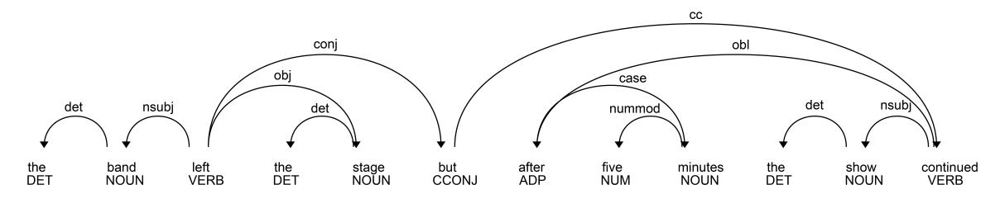
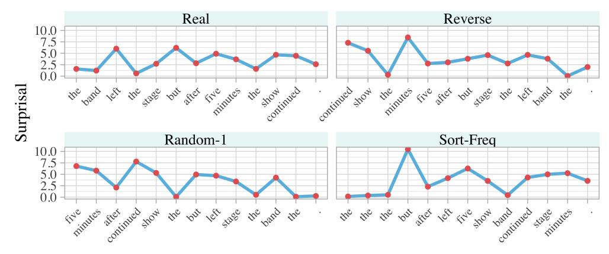
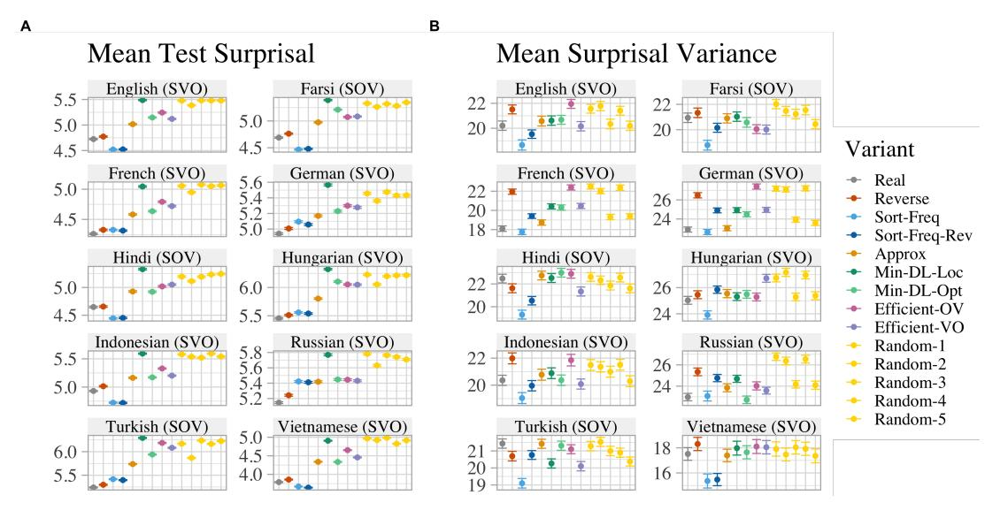
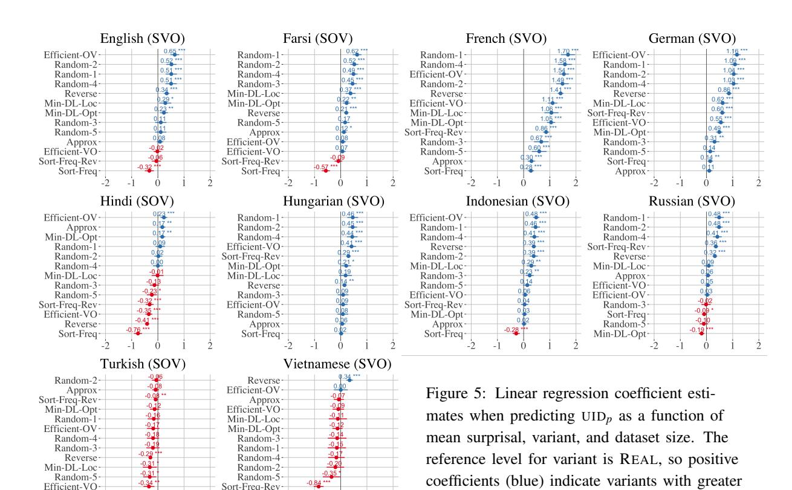
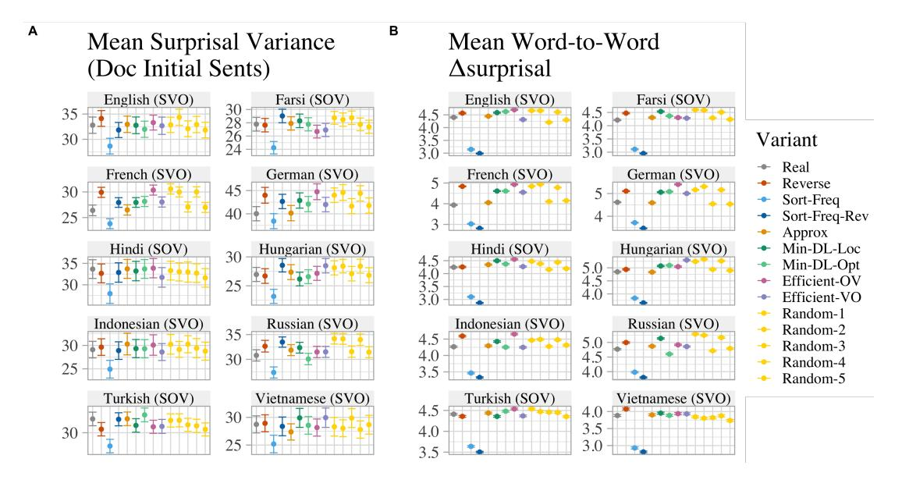
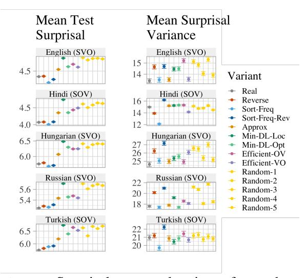

# A Cross-Linguistic Pressure for Uniform Information Density in Word Order

Thomas Hikaru Clark1 Clara Meister2 Tiago Pimentel3 Michael Hahn4 Ryan Cotterell2 Richard Futrell5 Roger Levy1

1MIT 2ETH Zürich 3University of Cambridge 4Saarland University 5UC Irvine [thclark@mit.edu](mailto:thclark@mit.edu) [meistecl@inf.ethz.ch](mailto:meistecl@inf.ethz.ch) [tp472@cam.ac.uk](mailto:tp472@cam.ac.uk) [mhahn@lst.uni-saarland.de](mailto:mhahn@lst.uni-saarland.de) [ryan.cotterell@inf.ethz.ch](mailto:ryan.cotterell@inf.ethz.ch) [rfutrell@uci.edu](mailto:rfutrell@uci.edu) [rplevy@mit.edu](mailto:rplevy@mit.edu)

# Abstract

While natural languages differ widely in both canonical word order and word order flexibility, their word orders still follow shared cross-linguistic statistical patterns, often attributed to functional pressures. In the effort to identify these pressures, prior work has compared real and counterfactual word orders. Yet one functional pressure has been overlooked in such investigations: the uniform information density (UID) hypothesis, which holds that information should be spread evenly throughout an utterance. Here, we ask whether a pressure for UID may have influenced word order patterns cross-linguistically. To this end, we use computational models to test whether real orders lead to greater information uniformity than counterfactual orders. In our empirical study of 10 typologically diverse languages, we find that: (i) among SVO languages, real word orders consistently have greater uniformity than reverse word orders, and (ii) only linguistically implausible counterfactual orders consistently exceed the uniformity of real orders. These findings are compatible with a pressure for information uniformity in the development and usage of natural languages.[1](#page-0-0)

## 1 Introduction

Human languages differ widely in many respects, yet there are patterns that appear to hold consistently across languages. Identifying explanations for these patterns is a fundamental goal of linguistic typology. Furthermore, such explanations may shed light on the cognitive pressures underlying and shaping human communication.

This work studies the *uniform information density* (UID) hypothesis as an explanatory principle for word order patterns [\(Fenk and Fenk,](#page-12-0) [1980;](#page-12-0) [Genzel and Charniak,](#page-12-1) [2002;](#page-12-1) [Aylett and Turk,](#page-11-0) [2004;](#page-11-0) [Jaeger,](#page-14-0) [2010;](#page-14-0) [Meister et al.,](#page-14-1) [2021\)](#page-14-1). The UID hypothesis posits a communicative pressure to avoid spikes in information within an utterance, thereby keeping the information profile of an utterance relatively close to uniform over time. While the UID hypothesis has been proposed as an explanatory principle for many linguistic phenomena, e.g., speakers' choices when faced with lexical and syntactic alternations [\(Levy and Jaeger,](#page-14-2) [2006\)](#page-14-2), its relationship to word order patterns has received limited attention, with the notable exception of [Maurits et al.](#page-14-3) [\(2010\)](#page-14-3) and [Jain et al.](#page-14-4) [\(2018\)](#page-14-4).

Our work investigates the relationship between UID and word order patterns, differing from prior work in several ways. We (i) use Transformer language models (LMs) [\(Vaswani et al.,](#page-15-0) [2017\)](#page-15-0) to estimate information-theoretic operationalizations of information uniformity; (ii) analyze large-scale naturalistic datasets of 10 typologically diverse languages; and (iii) compare a range of theoretically motivated counterfactual grammar variants.

Experimentally, we find that among SVO languages, the real word order has a more uniform information density than nearly all counterfactual word orders; the only orders that consistently exceed real orders in uniformity are generated using an implausibly strong bias for uniformity, at the cost of expressivity. Further, we find that counterfactual word orders that place verbs before objects are more uniform than ones that place objects before verbs in nearly every language.

Our findings suggest that a tendency for uniform information density may exist in human language, with two potential sources: (i) word order rules, with SVO order generally being more uniform than SOV; and (ii) choices made by speakers, who use the flexibility present in real languages to structure information more uniformly at a global level (and not only in a small number of isolated constructions).

1Code for reproducing our experiments is available at <https://github.com/thomashikaru/word-order-uid>.

#### 2 Functional Pressures in Language

#### 2.1 Linguistic Optimizations

A number of linguistic theories link crosslinguistic patterns to functional pressures. For example, both the grammatical rules of a language and speakers' choices (within the space of grammatically acceptable utterances) are posited to reflect a trade-off between effort and robustness: shorter and simpler structures are easier to produce and comprehend, but longer and more complex utterances can encode more information (Gabelentz, 1901; Zipf, 1935; Hawkins, 1994, 2004, 2014; Haspelmath, 2008). Another such functional pressure follows from the principle of dependency length minimization (DLM), which holds that, in order to minimize working memory load during comprehension, word orders should place words in direct dependency relations close to each other (Rijkhoff, 1986, 1990; Hawkins, 1990, 1994, 2004, 2014; Grodner and Gibson, 2005; Gibson, 1998, 2000; Bartek et al., 2011; Temperley and Gildea, 2018; Futrell et al., 2020). A growing body of work has turned to information theory, the mathematical theory of communication (Shannon, 1948), to formalize principles that explain linguistic phenomena (Jaeger and Tily, 2011; Gibson et al., 2019; Pimentel et al., 2021c). One such principle is that of uniform information density.

#### 2.2 Uniform Information Density

According to the uniform information density (UID) hypothesis, speakers tend to spread information evenly throughout an utterance; large fluctuations in the per-unit information content of an utterance can impede communication by increasing the processing load on the listener. Speakers may modulate the information profile of an utterance by selectively producing linguistic units such as optional complementizers in English (Levy and Jaeger, 2006; Jaeger, 2010). A pressure for UID in speaker choices has also been studied in specific constructions in other languages, though with mixed conclusions (Zhan and Levy, 2018; Clark et al., 2022).

Formally, the information conveyed by a linguistic signal  $\boldsymbol{y}$ , e.g., an utterance or piece of text, is quantified in terms of its surprisal  $s(\cdot)$ , which is defined as  $\boldsymbol{y}$ 's negative log-probability:  $s(\boldsymbol{y}) \stackrel{\text{def}}{=} -\log p_{\ell}(\boldsymbol{y})$ . Here,  $p_{\ell}$  is the underlying probability distribution over sentences  $\boldsymbol{y}$  for a language  $\ell$ . Note that we do not have access to the

true distribution  $p_{\ell}$ , and typically rely on a language model with learned parameters  $\theta$  to estimate surprisal values with a second distribution  $p_{\theta}$ .

Surprisal can be additively decomposed over the units that comprise a signal. Explicitly, for a signal u that can be expressed as a series of linguistic units  $\langle y_1, \dots, y_N \rangle$ , where  $y_n \in \mathcal{V}$  and  $\mathcal{V}$  is a set vocabulary of words or morphemes, the surprisal of a unit  $y_n$  is its negative log-probability given prior context:  $s(y_n) = -\log p_{\ell}(y_n \mid \boldsymbol{y}_{\leq n}).$ Note that the distribution  $p_{\ell}(\cdot \mid \boldsymbol{y}_{< n})$  has support  $\overline{\mathcal{V}} \stackrel{\text{def}}{=} \mathcal{V} \cup \{\text{EOS}\}, \text{ where EOS is a designated symbol}$ indicating the end of a sequence;2 a valid, complete signal  $y = \langle y_1, \dots, y_N \rangle$  has  $y_N = \text{EOS}$ . The quantity s(y) can thus likewise be expressed as  $s(y) = \sum_{n=1}^{N} s(y_n)$ . Assuming that we have a fixed amount of information to convey and that high-surprisal items are disproportionately difficult to process,3 it can be shown mathematically that spreading information evenly throughout a signal optimizes ease of processing for the comprehender (Levy and Jaeger, 2006; Smith and Levy, 2013; Levy, 2018; Meister et al., 2021).

While the UID hypothesis is often discussed in the context of speaker choices, it has also been presented as a general cognitive constraint that might influence reading times (Meister et al., 2021), speech duration (Pimentel et al., 2021b), and word lengths (Piantadosi et al., 2011). Selection for UID has also been discussed as a potential evolutionary pressure on language that can explain typological differences (Jaeger and Tily, 2011). Within this literature, there is not a consensus on how to formally operationalize UID. For example, Frank and Jaeger (2008) measure regression of surprisal towards a language-wide mean; Collins (2014) and Bloem (2016) consider more local changes in surprisal in their quantification of UID.

In this work, we consider three metrics for operationalizing UID (Meister et al., 2021):

$$UID_{\nu}(\boldsymbol{y}) \stackrel{\text{def}}{=} \frac{1}{N} \sum_{n=1}^{N} (s(y_n) - \mu)^2$$
 (1)

&lt;sup>2This symbol allows for the global normalization of  $p_{\ell}$ , i.e., a valid probability distribution over finite-length sequences  $\mathcal{V}^*$  (see Du et al., 2023, for a discussion).

&lt;sup>3Most empirical results (Hale, 2001; Levy, 2008; Shain et al., 2022) suggest that a word's processing effort is directly proportional to its surprisal. Yet there is also evidence of a superlinear relationship, which would imply a preference by the comprehender for UID (Meister et al., 2021; Hoover et al., 2022).

In Equation (1), UID $\nu$  is the mean withinsentence variance of word surprisals, where  $\mu = \frac{1}{N} \sum_{n=1}^{N} s(y_n)$  is a sentence-level mean.

$$UID_{lv}(\boldsymbol{y}) \stackrel{\text{def}}{=} \frac{1}{N-1} \sum_{n=2}^{N} (s(y_n) - s(y_{n-1}))^2 \quad (2)$$

In Equation (2),  $UID_{lv}$  quantifies the average word-to-word change in surprisal, a more localized measure (Collins, 2014). Intuitively, this is maximized when high-surprisal words alternate with low-surprisal words, and minimized when words appear in sorted order by information content.

$$UID_p(\boldsymbol{y}) \stackrel{\text{def}}{=} \frac{1}{N} \sum_{n=1}^{N} s(y_n)^k$$
 (3)

In Equation (3),  $\mathrm{UID}_p$  is a power mean with k>1, which disproportionately increases in the presence of larger surprisal values.4 Note that for all of these operationalizations, lower values correspond to greater uniformity.5

#### 3 Counterfactual Language Paradigm

Following prior work that has used counterfactual languages to study the functional pressures at play in word order patterns, we investigate to what degree a language's word order shows signs of optimization for UID. In this approach, a corpus of natural language is compared against a counterfactual corpus containing minimally changed versions of the same sentences, where the changes target an attribute of interest, e.g., the language's word order. For example, several studies of DLM have compared syntactic dependency lengths in real and counterfactual corpora, generated by permuting the sentences' word order either randomly (Ferrer-i-Cancho, 2004; Liu, 2008) or deterministically by applying a counterfactual grammar (Gildea and Temperley, 2010; Gildea and Jaeger, 2015; Futrell et al., 2015b, 2020). Similarly, we will compare measures of UID in real and counterfactual corpora to investigate whether real languages' word orders exhibit more uniform information density than alternative realizations.

#### 3.1 Formal Definition

We build on the counterfactual generation procedure introduced by Hahn et al. (2020) to create parallel corpora. This procedure operates on sentences' dependency parses. Formally, a dependency parse  $\clubsuit$  of a sentence y is a directed tree with one node for every word, where each word in y, with the exception of a designated root word, is the child of its (unique) syntactic head; see Zmigrod et al. (2020) for a discussion of the role of the root constraint in dependency tree annotation. Each edge in the tree is annotated with the syntactic relationship between the words connected by that edge; see Fig. 1 for an example. Here we use the set of dependency relations defined by the Universal Dependencies (UD) paradigm (de Marneffe et al., 2021), though we follow Hahn et al. (2020) in transforming dependency trees such that function words are treated as heads, leading to representations closer to those of standard syntactic theories; see also Gerdes et al. (2018).

Tree linearization. While syntactic relationships are naturally described hierarchically, sentences are produced and processed as linear strings of words. Importantly, there are many ways to linearize a dependency parse \( \bigai\) 's nodes into a string y. Concretely, a grammar under our formalism is defined by an ordering function (see Kuhlmann, 2010)  $g(\cdot, \cdot)$  which takes as arguments a dependency parse and a specific node in it, and returns an ordering of the node and its dependents. For each node, its dependents are arranged from left to right according to this ordering; any node without dependents is trivially an ordered set on its own. This process proceeds recursively to arrive at a final ordering of all nodes in a dependency tree, yielding the final string y. Pseudo-code for the linearization of a tree  $\clubsuit$  based on an ordering function g is given in Fig. 2.

Simplifying assumptions. One consequence of this formalism is that all counterfactual orders correspond to projective trees, i.e., trees with no crossing dependencies. While projectivity is a well-attested cross-linguistic tendency, human languages do not obey it absolutely (Ferreri-Cancho et al., 2018; Yadav et al., 2021). Within the space of projective word order interventions allowed by this formalism, the grammars which we borrow from Hahn et al. (2020) enforce two additional simplifying constraints. First, the relative

&lt;sup>4This metric suggests a super-linear processing cost for surprisal.

&lt;sup>5We note that, while a fully uniform language would have value 0 for  $UID_{\nu}$  and  $UID_{l\nu}$ , it would not for  $UID_{p}(\boldsymbol{y})$ , so the metrics are not directly comparable.

Figure 1: An example dependency tree showing syntactic relationships according UD, transformed so that function words are heads ([§3.2\)](#page-3-2). Arrows point from heads to dependents.

positioning (left or right) between the head and dependent of a particular relation is fixed. Second, the relative ordering of different relations on the same side of a head is also fixed. We denote grammars which satisfy both constraints as *consistent*. Notably, natural languages violate both of these assumptions to varying degrees. For example, even in English – a language with relatively strict word order – adverbs can generally appear before or after their head. While these simplifications mean that the formalism cannot perfectly describe natural languages, it provides a computationally well-defined method for intervening on many features of word order. In particular, the consistent grammars of [Hahn et al.](#page-13-13) [\(2020\)](#page-13-13) are parameterized by a set of scalar weights corresponding to each possible syntactic relation; the ordering function thus reduces to sorting each head's dependents based on their weight values. Notably, [Hahn et al.](#page-13-13) [\(2020\)](#page-13-13) also introduced a method for optimizing these grammars for various objective functions by performing stochastic gradient descent on a probabilistic relaxation of the grammar formalism; we use several of these grammars (described in [§3.2\)](#page-3-2) in our subsequent analysis.

Creating counterfactual word orderings. The above paradigm equips us with the tools necessary for systematically altering sentences' word orderings, which in turn, enables us to create counterfactual corpora. Notably, the large corpora we use in this study contain sentences as strings, not as their dependency parses. We therefore define our counterfactual grammar intervention as the output of a (deterministic) word re-ordering function f : Y → Y, where Y def = V ∗ is the set of all possible sentences that can be constructed using a language's vocabulary V. [6](#page-3-3) This function takes as input a sentence from our original language and outputs a sentence with the counterfactual word order

Figure 2: Pseudo-code to linearize a dependency tree according to a grammar's ordering function g. In this code, each node contains a word and its syntactic dependents.

defined by a given ordering function g. We decompose this function into two steps:

$$f(y) = linearize(parse(y), g)$$
 (4)

We use a state-of-the-art parser [\(Straka and](#page-15-12) [Straková,](#page-15-12) [2017\)](#page-15-12) to implement parse : Y → T where T is the set of all dependency parses. Specifically, we define parse(y) = argmax ∈T p( | y) for a learned conditional probability distribution over possible parses p(· | y). We then obtain the linearized form of the resulting tree by supplying it and the ordering function g to linearize , as defined above. Collectively, the outputs of this process (parallel datasets differing only in word order) are referred to as *variants*. Importantly, f here is a deterministic function; one could instead consider f to be probabilistic in nature, with each sentence y having a distribution over tree structures . We discuss the implications of this choice in [§4.](#page-6-0)

## 3.2 Counterfactual Grammar Specifications

In addition to the original REAL word order, we explore the following theoretically motivated

6 For notational brevity, we leave the dependency of V on ℓ implicit as it should be clear from context.

counterfactual grammars for each language.

Consistent approximation to real order. AP-PROX is a consistent approximation to the real word order within our formalism; it uses an ordering function parameterized by weights that were fitted to maximize the likelihood of observed word orders for each language, as reported by [Hahn et al.](#page-13-13) [\(2020\)](#page-13-13). This variant captures most of the word order features of a real language while allowing for a fair comparison to deterministic counterfactual grammars that do not model the flexibility of real language. From the perspective of the UID hypothesis, we expect this variant to be less uniform that REAL because it has less flexibility to accommodate speakers' choices that optimize for UID.

Consistent random grammars. We include variants RANDOM1 through RANDOM5, which use ordering functions parameterized by randomly assigned weights. This means that for a given random grammar, each dependency relation has a fixed direction (left or right), but that the directions of these relations lack the correlations observed in natural language [\(Greenberg,](#page-13-15) [1963\)](#page-13-15). Random grammars with the same numerical index share weights across languages.

#### Consistent grammars optimized for efficiency.

We include two consistent grammars that are optimized for the joint objective of parseability (how much information an utterance provides about its underlying syntactic structure) and sentenceinternal predictability, as reported by [Hahn et al.](#page-13-13) [\(2020\)](#page-13-13), one with OV order (EFFICIENT-OV) and one with VO order (EFFICIENT-VO). For example, the EFFICIENT-OV grammar for English would give a plausible version of a consistent and efficient grammar in the counterfactual world where English has verbs after objects.

Grammars optimized for dependency length minimization. From the same work we also take consistent grammars that are optimized for DLM, denoted as MIN-DL-OPT. While linearizations produced by these grammars are not guaranteed to minimize dependency length for any particular sentence, they minimize the expected average dependency length of a large sample of sentences in a language. In addition, we include MIN-DL-LOC, an inconsistent grammar that applies the projective dependency-length minimization algorithm of [Gildea and Temperley](#page-13-16) [\(2007\)](#page-13-16) at the sentence level, leading to sentences with minimal DL but without the constraint of consistency.

Frequency-sorted grammars. SORT-FREQ is an inconsistent grammar which orders words in a sentence from highest to lowest frequency, ignoring dependency structure altogether. We use this ordering as a heuristic baseline for which we expect UID to hold relatively strongly: lowfrequency elements, which tend to have higher surprisal even if solely from their less frequent usage [\(Ellis,](#page-12-13) [2002\)](#page-12-13), are given more context, and thus should have smaller surprisals than if they occurred early; more conditioning context tends to reduce the surprisal of the next word [\(Luke and](#page-14-13) [Christianson,](#page-14-13) [2016\)](#page-14-13). We also test SORT-FREQ-REV, ordering words from least to most frequent, which for analogous reasons we expect to perform poorly in terms of UID. However, both of these orderings lead to massive syntactic ambiguity by introducing many string collisions – any two sentences containing the same words in different orders would be linearized identically. This eliminates word order as a mechanism for expressing distinctions in meaning, so these orders are implausible as alternatives to natural languages [\(Ma](#page-14-14)[howald et al.,](#page-14-14) [2022\)](#page-14-14).

Reverse grammar. Finally, we also include the REVERSE variant, where the words in each sentence appear in the reverse order of the original. This variant preserves all pairwise distances between words within sentences and has identical dependency lengths as the original order, thus isolating the effect of linear order on information density from other potential influences. Notably, if the original language happens to be perfectly consistent, then REVERSE will also satisfy consistency; in practice, this is unlikely to hold with natural languages.

#### 3.3 UID and Counterfactual Grammars

Let pℓ(y) be the probability distribution over sentences y for a language of interest ℓ. We can define a language's UID score as the expected value of its sentences' UID scores, where we overload the UID function to take either a sentence y or an entire language ℓ:

$$UID(\ell) \stackrel{\text{def}}{=} \sum_{\boldsymbol{y} \in \mathcal{Y}} p_{\ell}(\boldsymbol{y}) \, UID(\boldsymbol{y}) \tag{5}$$

Figure 3: The same source sentence according to 4 real and counterfactual orderings.

where sentence-level UID can be  $UID_{\nu}(y)$ ,  $UID_{l\nu}(y)$ , or  $UID_{p}(y)$ . In practice, we estimate this language-level UID score using a Monte-Carlo estimator, taking the mean sentence-level UID score across a held-out test set  $S_{\ell}$  of sentences y in language  $\ell$ , where we assume  $y \sim p_{\ell}$ :

$$\widehat{\text{UID}}(\ell) \stackrel{\text{def}}{=} \frac{1}{|S_{\ell}|} \sum_{\boldsymbol{y} \in S_{\ell}} \text{UID}(\boldsymbol{y})$$
 (6)

Similarly, the expected surprisal (or Shannon entropy, H) of this language is computed as:

$$H(\ell) \stackrel{\text{def}}{=} -\sum_{\boldsymbol{y} \in \mathcal{V}} p_{\ell}(\boldsymbol{y}) \log p_{\ell}(\boldsymbol{y})$$
 (7)

We evaluate how well a language model  $p_{\theta}$  approximates  $p_{\ell}$  by its cross-entropy:

$$H(p_{\ell}, p_{\theta}) = -\sum_{\boldsymbol{y} \in \mathcal{Y}} p_{\ell}(\boldsymbol{y}) \log p_{\theta}(\boldsymbol{y})$$
(8)

where a smaller value of H implies a better model. Again using a Monte Carlo estimator, we measure cross-entropy using the held-out test set  $S_{\ell}$ :

$$\widehat{H}(p_{\ell}, p_{\theta}) = -\frac{1}{|S_{\ell}|} \sum_{\boldsymbol{y} \in S_{\ell}} \log p_{\theta}(\boldsymbol{y})$$
 (9)

This is simply the *mean surprisal* that the model assigns to a corpus of naturalistic data.

These computations can also be applied to counterfactual variants of a language. Let  $\ell_f$  stand for a language identical to  $\ell$ , but where its strings have been transformed by f; this language's distribution over sentences would be  $p_{\ell_f}(y) = \sum_{y' \in \mathcal{Y}} p_{\ell}(y') \mathbb{1}\{y = f(y')\}$ . Since entropy is non-increasing over function transformations (by Jensen's inequality), it follows that:

$$H(\ell) > H(\ell_f) \tag{10}$$

Further, if our counterfactual generation function f is a bijection – meaning that each input string gets mapped to a distinct output string and each output string has an input that maps to it – then we can create a second function  $f^{-1}: \mathcal{Y} \to \mathcal{Y}$ , which would generate  $\ell$  from  $\ell_f$ . Then, the following holds:

$$H(\ell) \ge H(\ell_f) \ge H(\ell_{f^{-1} \circ f}) = H(\ell) \tag{11}$$

i.e., it must be that  $H(\ell) = H(\ell_f)$ . Reversing a sentence is an example of a bijective function, and thus Equation (11) holds necessarily for the pair of REAL and REVERSE variants; the counterfactual generation procedure thus should not produce differences in mean surprisal between these variants. At the same time, bijectivity does not necessarily hold for our other counterfactual transformations and is violated to a large degree when mapping to SORT-FREQ and SORT-FREQ-REV. Thus in general, we can only guarantee Inequality (10).

Crucially, however, the transformation f might change the UID score of such a language, allowing us to evaluate the impact of word order on information uniformity. As a simple example, consider the language  $\ell_1$  that places a uniform distribution over only four strings: aw, ax, by, and bz. In this language, the first and second symbols always have 1 bit of surprisal, and the end of the string has 0 bits of surprisal. If the counterfactual language  $\ell_2$  is the reverse of  $\ell_1$ , we have a uniform distribution over the strings wa, xa, yb, and zb. Here, the first symbol always has 2 bits of surprisal, and the second symbol and end of sentence always have zero bits, as their values are deterministic for a given initial symbol. While the mean surprisal per symbol is the same for  $\ell_1$  and  $\ell_2$ ,  $\ell_1$ has more uniform information density than  $\ell_2$ .

## 4 Limitations

#### 4.1 Use of Counterfactual Grammars

Real word orders are not consistent. The consistent grammars borrowed from [Hahn et al.](#page-13-13) [\(2020\)](#page-13-13) assume that the direction of each syntactic relation, as well as the relative ordering of dependents on the same side of a head, are fixed. This is not generally true of natural languages. We address this difference by including the variant AP-PROX as a comparison to the counterfactual variants, which are constrained by consistency, and by including REVERSE as a comparison to REAL, both of which are not constrained by consistency.

Automatic parsing errors. Another issue is that the dependency parses extracted for each original sentence as part of the counterfactual generation pipeline may contain parsing errors. These errors may introduce noise into the counterfactual datasets that is not present in the original sentences, and may cause deviations from the characteristics that we assume our counterfactual grammars should induce. For example, MIN-DL-LOC only produces sentences with minimized dependency length if the automatic parse is correct.

Deterministic parsing. Finally, our counterfactual generation procedure assumes a deterministic mapping from sentences to dependency trees as one of its steps. However, multiple valid parses of sentences are possible in the presence of syntactic ambiguity. In such cases, we always select the most likely structure according to the parser, which learns these probabilities based on its training data. Therefore, this design choice could lead to underrepresentation of certain syntactic structures when applying a transformation. However, we note that the variants REAL, REVERSE, SORT-FREQ, and SORT-FREQ-REV do not depend on dependency parses and so are unaffected by this design choice.

## 4.2 Choice of Dataset

Properties of language can vary across genres and domains. When drawing conclusions about human language in general, no single dataset will be completely representative. Due to the amount of data required to train LMs, we use written corpora in this work, and use the term *speaker* loosely to refer to any language producer regardless of modality. To address potential concerns about the choice of dataset in this study, we conducted a supplementary analysis on a subset of languages using a different web corpus, which we report in [§7.5.](#page-11-1)

#### 4.3 Errors and Inductive Biases

Model Errors. Language model quality could impact the estimated values of our UID metrics UID*v*, UID*p*, and UID*lv*. To see why, consider a model pθ that – rather than providing unbiased estimates of pℓ – is a smoothed interpolation between pℓ and the uniform distribution:

$$p_{\theta}(y_n \mid \boldsymbol{y}_{< n}) = \lambda p_{\ell}(y_n \mid \boldsymbol{y}_{< n}) + \frac{1 - \lambda}{|\overline{\mathcal{V}}|}$$
 (12)

for λ ∈ [0, 1]. Here, an increase in 1 − λ would lead to an increase in H(pℓ , pθ), since the cross-entropy is only minimized when pθ(· | y<n) = pℓ(· | y<n). This change, however, would be reflected as an *increase* in uniformity, e.g., a decrease in UID*v*: surprisals would be closer to uniform for smaller values of λ. Alternatively, consider the situation where a language ℓ has perfect information uniformity, i.e., where UID*v*, UID*p*, and UID*lv* are their minimum possible values. The interpolation of pℓ with any non-uniform distribution should instead *decrease* the measured uniformity, at least with respect to UID*v* and UID*lv*.

In summary, our UID metrics could be biased either positively or negatively by the quality of our models. However, since our analysis focuses on the comparison of UID metrics between word order variants rather than their absolute value, this bias should not be a major concern. We use the same model architecture for all language–variant combinations, and so a bias in the UID metric corresponding to one combination should likewise be reflected in all of the metrics that it is compared to. Further, our results hold even when controlling for mean surprisal, as described in [§6.](#page-7-0)

Inductive Biases. Because modern LMs have been developed to model natural language, they may contain subtle biases towards the properties of real word orders or of highly resourced languages. Based on [Inequality \(10\),](#page-5-1) if two probabilistic models mℓ and mℓf were to perfectly learn the true and counterfactual distributions pℓ and pℓf , respectively, then mℓ should assign approximately the same or higher mean surprisal to a corpus {y (m)}M m=1 from ℓ than mℓf assigns to the counterfactual corpus from ℓf. This implies that previous results of [Gildea and Jaeger](#page-13-12) [\(2015\)](#page-13-12), [Ravfogel et al.](#page-15-13) [\(2019\)](#page-15-13), [Hahn et al.](#page-13-13) [\(2020\)](#page-13-13) and [White and Cotterell](#page-15-14) [\(2021\)](#page-15-14), which found that real corpora tend to have lower average per-word surprisal than deterministically generated counterfactual versions of the same corpora, were in fact due to the inductive bias of the learning algorithms used to estimate surprisals. There is a clear reason why the trigram model of [Gildea and Jaeger](#page-13-12) [\(2015\)](#page-13-12) would yield higher mean surprisals for counterfactual corpora: the transformation functions f tended to increase dependency lengths, and words in a dependent–head relation tend to have higher mutual information than other pairs of words [\(Futrell and Levy,](#page-12-14) [2017;](#page-12-14) [Futrell et al.,](#page-12-15) [2019,](#page-12-15) [2020\)](#page-12-4). Hence the transformations tended to push words that are predictive of each other outside of the conditioning window of the model (see also [Hahn and Xu,](#page-13-17) [2022,](#page-13-17) for similar effects). The Transformer architecture we use in this work could thus also contain biases favoring features of real language, which we attempt to control for (see [§6\)](#page-7-0).

## 5 Experimental Setup

#### 5.1 Data

This work uses the publicly available Wiki40b dataset [\(Guo et al.,](#page-13-18) [2020\)](#page-13-18), a large text corpus derived from Wikipedia articles. We use subsets of the Wiki40b dataset in 10 languages: English, Russian, French, German, Hindi, Farsi, Vietnamese, Indonesian, Hungarian, and Turkish. The first six represent the Germanic, Slavic, Romance, Indo-Aryan, and Iranian sub-families of the Indo-European language family. The latter four belong to the Austroasiatic, Austronesian, Uralic, and Turkic language families, respectively. Turkish, Hindi, and Farsi have basic SOV word order, while the other languages have SVO order with Hungarian being mixed [\(Dryer,](#page-12-16) [2013\)](#page-12-16). Languages were chosen based on the amount of available data in the Wiki40b dataset, their typological properties (covering a range of families, canonical word orders, and morphological complexity), and availability of automatic dependency parsing models.

The datasets are subsampled to yield approximately 20M words in the training set of each language and approximately 1M words in the test and validation sets. We automatically generate dependency parses for all sentences using the UD-Pipe parser [\(Straka and Straková,](#page-15-12) [2017\)](#page-15-12), yielding syntactic representations in the UD paradigm. We then apply each of the counterfactual orderings introduced in [§3.2](#page-3-2) to the original data to create parallel corpora for each language. Sentences are stripped of punctuation (as determined by the dependency parser's PUNCT label) and are lowercased. Periods are added back in to mark the end of sentences, regardless of what the original final punctuation was. Sub-word tokenization is then applied to the corpora using a byte-pair encoding (BPE) model, trained with a fixed vocabulary size of 30K tokens and using the algorithm of [Sennrich et al.](#page-15-15) [\(2016\)](#page-15-15). [7](#page-7-1)

## 5.2 Language Modeling

For each variant of each language, we train a Transformer language model [\(Vaswani et al.,](#page-15-0) [2017\)](#page-15-0) using fairseq [\(Ott et al.,](#page-14-15) [2019\)](#page-14-15). Models are trained on document-level inputs, with a maximum length of 512 tokens; this means that each token is predicted with the preceding material of the entire document as context. Each model is trained with early stopping, halting training after no improvement in validation loss for three epochs. The Adam optimizer was used [\(Kingma and Ba,](#page-14-16) [2017\)](#page-14-16), with a learning rate of 0.0005, weight decay of 0.01, and dropout of 0.1. Training scripts are available in the project's GitHub repository.[1](#page-0-0) In all of our analyses, we use the word-by-word surprisals estimated using our trained models on their corresponding held-out test sets. Note that we do not consider the designated EOS symbol in the computation of any of our UID-related metrics. In the case that a word is comprised of multiple sub-word tokens, we aggregate their surprisals by summation, since surprisal decomposes additively.

## 6 Results

Estimates of mean per-word surprisal on the test set are in [Fig. 4A](#page-8-0). Consistent with the results of [Hahn et al.](#page-13-13) [\(2020\)](#page-13-13), our trained models for nearly all counterfactual variants assign higher per-word surprisal to their respective test sets than the REAL models assign to theirs. Across all 10 languages, REVERSE has mean surprisal close to, but consistently slightly higher than, that of the real ordering. SORT-FREQ and SORT-FREQ-REV have mean surprisals close to or below those of REAL.

Estimates of mean surprisal variance (UID*v*) over sentences are shown in [Fig. 4B](#page-8-0). Notably,

7All variants of the same language are tokenized using the same BPE model, trained on a sample of 100K documents from all variants; BPE tokens could not cross word boundaries for compatibility with different word orders.

Figure 4: Mean test-set surprisal and surprisal variance of language models across real and counterfactual grammars in 10 languages. Error bars denote the 95% CI of the mean.

there is a dissociation between the rank order of variants according to mean surprisal and according to UID*v*: variants with similar mean surprisals did not necessarily have similar UID*v* scores, and vice versa, suggesting that information uniformity and mean surprisal can vary independently of each other. Our main observations are as follows: (i) In all languages except Turkish and Hindi, our estimates of UID*v* for REAL are lower than those for REVERSE, despite the variants' similarities in mean surprisal. (ii) As predicted, the SORT-FREQ baseline has UID*v* equal to or lower than that of REAL. (iii) The other counterfactual variants typically exhibit higher UID*v* than REAL, with the exception of mixed results for SORT-FREQ-REV. (iv) The EFFICIENT-VO variants typically have lower UID*v* than EFFICIENT-OV (with Hungarian being a noteworthy exception), which supports findings based on toy grammars showing that SVO orders are more uniform than SOV orders [\(Maurits](#page-14-3) [et al.,](#page-14-3) [2010\)](#page-14-3). Crucially, these results are qualitatively similar using the UID*lv* metric [\(Fig. 6B](#page-10-0)).

To fairly compare variants using the UID*p* metric, we first need to account for the fact that, unlike surprisal variance, the metric is sensitive to shifts in mean surprisal. To control for this, we fit a regression model predicting the UID*p* score based on three variables: the mean surprisal, the grammar variant, and the dataset size (20M, 6.6M, and 3.3M words). We train multiple language models for each language-variant combination (3 dataset sizes and 2 random seeds), resulting in 84 data points per language. We apply treatment coding to the variants, with REAL as the reference level. [Fig. 5](#page-9-0) shows the resulting estimates of the coefficients for each variant, where a coefficient should be positive if that variant is less uniform than REAL. Qualitatively, the regression results match the results given by UID*v* and UID*lv*: REAL is more uniform than REVERSE in SOV languages, SORT-FREQ is the only counterfactual variant that is consistently more uniform than REAL, and EFFICIENT-VO is more uniform than EFFICIENT-OV in most languages; the opposite is true in Hungarian and the difference is negligible in Russian.

## 7 Discussion

We offer a discussion of the results observed in [§6,](#page-7-0) including their implications for the role of functional pressures in language.

#### 7.1 Differences in mean surprisal

Across 10 typologically diverse languages, we find that Transformer LMs learn to predict data from real word orders better than data from counterfactual orders, with the exception of the SORT-FREQ and SORT-FREQ-REV variants. This suggests that these LMs' inductive biases somehow favor properties of real languages, in line with previous work on other modeling architectures [\(Gildea and Jaeger,](#page-13-12) [2015;](#page-13-12) [Ravfogel](#page-15-13) [et al.,](#page-15-13) [2019\)](#page-15-13). This is not surprising, given that commonly used architectures and hyperparameters have been selected specifically based on their good performance on real language tasks. Unlike

in n-gram models, the precise inductive bias of Transformer models that favors real word orders is not transparent and merits further study.[8](#page-9-1)

## 7.2 Differences between REAL and APPROX

We observe that despite the similarities between the REAL and APPROX variants of a given language, the latter are consistently assigned higher mean surprisal by their respective LMs. Meanwhile, the various UID metrics show similar results for REAL and APPROX, suggesting that the greater flexibility of REAL is not responsible for UID differences in our results. This is somewhat surprising, since it may appear that such flexibility is what enables speakers' choices, which have been previously discussed as contributing to UID. However, many speaker choices that potentially impact UID, such as word choice, active versus passive voice, and optional words, are not captured by this difference in flexibility between REAL and APPROX.

## 7.3 Greater uniformity of REAL over REVERSE in SVO languages

UID*p*, i.e., less uniformity, than real language.

While mean surprisal is always very close for REAL and REVERSE grammars, REVERSE is less uniform in 8 out of 10 languages, including all SVO languages. This held across multiple operationalizations of UID, with the exception of mixed results for Hungarian, a language with considerable flexibility in word order. Thus, while both REAL and REVERSE orders are learned approximately equally well by language models, they differ in how uniformly they distribute information.

One key difference between REAL and RE-VERSE is that insofar as REAL sentences exhibit a tendency to mention entities from the end of a given sentence close to the beginning of the next one, REVERSE does not preserve this property. For example, the pair of sentences "I like dogs. They are friendly." would become "Dogs like I. Friendly are they."; note that the distance between antecedent and pronoun is significantly increased. This feature of the REVERSE raises the possibility that the uniformity patterns we observe are due to speaker choices taking cross-sentence dependencies into consideration. To minimize the influence of cross-sentence dependencies, we can consider only sentences occur-

8Notably, [White and Cotterell](#page-15-14) [\(2021\)](#page-15-14) show that there is a large variation in how Transformer language models perform in toy languages with diverse word orders; they, however, do not find evidence that Transformers perform better on the most frequently occurring orders (as opposed to, e.g., OVS and VOS word orders, which are found in few languages).

Figure 6: A. Surprisal variance (UID*v*(y)) for document-initial sentences only. B. Mean squared word-to-word change (UID*lv*(y)) in surprisal. Error bars denote 95% CI of the mean.

ring at the start of a document, which cannot refer to previous sentences. [Fig. 6A](#page-10-0) shows that the tendency for REAL to have lower surprisal variance than REVERSE still holds in this setting across most languages. This suggests that cross-sentence dependencies alone cannot fully explain the observed differences in information uniformity.

Notably, our results show that the UID preference for REAL over REVERSE is not consistently present in languages with basic SOV order (Turkish, Hindi, and Farsi). We propose the following explanation for this result: As argued in [Mau](#page-14-3)[rits et al.](#page-14-3) [\(2010\)](#page-14-3), SVO languages tend to have more uniform information density profiles than SOV languages – a finding supported by our empirical results in which EFFICIENT-VO had lower surprisal variance than EFFICIENT-OV in 9 out of 10 languages. Unlike the short, simple sentences of [Maurits et al.,](#page-14-3) however, the present study considers long and complex sentences where speaker choices have considerable opportunity to influence information uniformity, in addition to the role of basic word order. These choices include whether to use a pronoun, whether to use an active or passive construction, and what order to present a conjunction or list of items, among others. Importantly, speakers make choices conditional on the forward ordering of real language, so we expect that the choices made in an attempt to increase UID – which constitutes a non-trivial percentage of utterances [\(Levy and Jaeger,](#page-14-17) [2007\)](#page-14-17) – would have a greater effect on UID in REAL than in RE-

VERSE. In SVO languages, the effects upon UID of basic word order and speaker choices both go in the same direction – towards more uniformity. In SOV languages, these effects conflict – the basic word order is non-optimal in terms of UID, and so uniformity can theoretically be increased by a transformation to REVERSE, while speaker choices are presumably already mostly optimal in REAL. This may explain the heterogeneous patterning among the three SOV languages.

Furthermore, these results can potentially shed light on an important question in linguistic typology: Why are some basic word orders more common than others? According to some theories, SOV order (the most typologically common) is the most natural for expressing events with subjects and objects [\(Goldin-Meadow et al.,](#page-13-19) [2008;](#page-13-19) [Gibson](#page-13-20) [et al.,](#page-13-20) [2013;](#page-13-20) [Futrell et al.,](#page-12-17) [2015a\)](#page-12-17). If these theories are correct, an evolutionary pressure on languages to shift from SOV to SVO could help account for the prevalence of SVO languages, which are nearly as common as SOV ones. A pressure for information uniformity offers one such account.

Finally, [Pimentel et al.](#page-14-18) [\(2021a\)](#page-14-18) has recently shown that the distribution of per-phone information *within words* is more uniform when analysed in reverse order than in forward order – the opposite of what we observe on our sentence-level analysis. This difference may suggest qualitatively distinct information-theoretic pressures being present at the lexical and sentential levels and is a potential topic for further study.

## 7.4 Other Variants

The variants designed to minimize dependency length, MIN-DL-LOC and MIN-DL-OPT, showed mixed results in terms of information uniformity compared to REAL. The random grammars fell into two groups: RANDOM1, RANDOM2, and RANDOM4 tended to be less uniform than REAL, while RANDOM3 and RANDOM5 tended to be similar in uniformity to REAL. Since random grammars have fixed but uncorrelated directions of syntactic relations, these cross-linguistically consistent patterns suggest that some settings of the parameterized grammar are inherently more favorable from the perspective of UID than others.

The only counterfactual word order to consistently have a higher degree of information uniformity than the real orders was the highly constrained SORT-FREQ, which turns sentences into sorted word lists. Thus, while it appears possible to improve on real word orders' information uniformity, this comes at the cost of massive syntactic ambiguity and reduced expressivity.

#### 7.5 Robustness to Dataset Choice

In this study, the chosen dataset (Wiki40b) contains formal writing that may not exhibit the same communicative pressures as spoken language. It is largely devoid of first and second person pronouns, interrogatives, and other features common in everyday speech; further, it may have disproportionate amounts of translationese [\(Koppel](#page-14-19) [and Ordan,](#page-14-19) [2011\)](#page-14-19). As a supplementary analysis, we repeated the experiments on the CC100 dataset [\(Conneau et al.,](#page-12-18) [2020\)](#page-12-18), using only a subset of languages due to computational constraints. This dataset is sourced from a web crawl and therefore contains a wider range of genres and styles than Wiki40b. UID*v* scores for these experiments are shown in [Fig. 7.](#page-11-2) The results qualitatively match the patterns from the Wiki40b experiments in the following ways: (i) better UID*v* scores for REAL than for REVERSE among SVO languages, (ii) better UID*v* scores for EFFICIENT-VO than EFFICIENT-OV in most languages (with Hungarian again being an exception), and (iii) the only variant that has higher uniformity that REAL across a majority of languages is SORT-FREQ.

#### 8 Conclusion

In conclusion, we have empirically demonstrated that in many languages, real word orders distribute

Figure 7: Surprisal mean and variance for a subset of languages on the CC100 dataset. Error bars denote 95% CI.

information more uniformly than a range of counterfactual orders. The fact that this pattern holds in every SVO languages but is mixed among SOV languages lends support to the view that SVO basic word order is preferable to SOV order from the perspective of maximizing UID. We posit that there are two potential sources of optimization within a language for greater UID: language evolution favoring word orders that produce less variance in information content, and speaker choices in favor of constructions that smooth the information profile of utterances. Our results are consistent with the UID hypothesis, and support the idea that communicative pressures (operationalized in terms of information theory) influence the structure of human language.

#### Acknowledgements

We thank our action editor, Mark-Jan Nederhof, and the anonymous reviewers for their detailed feedback on this paper. CM was supported by the Google PhD Fellowship. TP was supported by a Facebook PhD Fellowship. This work was supported by NSF grant BCS-2121074 to RPL.

## References

Matthew Aylett and Alice Turk. 2004. [The smooth](https://doi.org/10.1177/00238309040470010201) [signal redundancy hypothesis: A functional ex](https://doi.org/10.1177/00238309040470010201)[planation for relationships between redundancy,](https://doi.org/10.1177/00238309040470010201) [prosodic prominence, and duration in sponta-](https://doi.org/10.1177/00238309040470010201)

- [neous speech.](https://doi.org/10.1177/00238309040470010201) *Language and Speech*, 47(1):31– 56. PMID: 15298329.
- Brian Bartek, Richard L. Lewis, Shravan Vasishth, and Mason R. Smith. 2011. [In search of on](https://doi.org/10.1037/a0024194)[line locality effects in sentence comprehension.](https://doi.org/10.1037/a0024194) *Journal of Experimental Psychology: Learning, Memory, and Cognition*, 37(5):1178–1198.
- Jelke Bloem. 2016. [Testing the processing hy](https://aclanthology.org/W16-4120)[pothesis of word order variation using a prob](https://aclanthology.org/W16-4120)[abilistic language model.](https://aclanthology.org/W16-4120) In *Proceedings of the Workshop on Computational Linguistics for Linguistic Complexity*, pages 174–185, Osaka, Japan. The COLING 2016 Organizing Committee.
- Thomas Hikaru Clark, Ethan Gotlieb Wilcox, Edward Gibson, and Roger P. Levy. 2022. [Evi](https://escholarship.org/uc/item/1q19f8vt)[dence for availability effects on speaker choice](https://escholarship.org/uc/item/1q19f8vt) [in the Russian comparative alternation.](https://escholarship.org/uc/item/1q19f8vt) In *Proceedings of the 44th Annual Meeting of the Cognitive Science Society*.
- Michael Xavier Collins. 2014. [Information den](https://doi.org/10.1007/s10936-013-9273-3)[sity and dependency length as complementary](https://doi.org/10.1007/s10936-013-9273-3) [cognitive models.](https://doi.org/10.1007/s10936-013-9273-3) *Journal of Psycholinguistic Research*, 43(5):651–681.
- Alexis Conneau, Kartikay Khandelwal, Naman Goyal, Vishrav Chaudhary, Guillaume Wenzek, Francisco Guzmán, Edouard Grave, Myle Ott, Luke Zettlemoyer, and Veselin Stoyanov. 2020. [Unsupervised cross-lingual representa](https://doi.org/10.18653/v1/2020.acl-main.747)[tion learning at scale.](https://doi.org/10.18653/v1/2020.acl-main.747) In *Proceedings of the 58th Annual Meeting of the Association for Computational Linguistics*, page 8440–8451, Online. Association for Computational Linguistics.
- Matthew S. Dryer. 2013. [Order of subject, object](https://doi.org/10.5281/zenodo.7385533) [and verb \(v2020.3\).](https://doi.org/10.5281/zenodo.7385533) In Matthew S. Dryer and Martin Haspelmath, editors, *The World Atlas of Language Structures Online*.
- Li Du, Lucas Torroba Hennigen, Tiago Pimentel, Clara Meister, Jason Eisner, and Ryan Cotterell. 2023. [A measure-theoretic characteriza](https://doi.org/10.48550/arXiv.2212.10502)[tion of tight language models.](https://doi.org/10.48550/arXiv.2212.10502) In *Proceedings of the 61st Annual Meeting of the Association for Computational Linguistics*. Association for Computational Linguistics.
- Nick Ellis. 2002. [Frequency effects in language](https://doi.org/10.1017/S0272263102002024) [processing.](https://doi.org/10.1017/S0272263102002024) *Studies in second language acquisition*, 24(2):143–188.
- August Fenk and Gertrud Fenk. 1980. [Kon](http://wwwg.uni-klu.ac.at/mk0/personal/bedienst/Kurzzeitgedaechtnis1980.pdf)[stanz im Kurzzeitgedächtnis—Konstanz im](http://wwwg.uni-klu.ac.at/mk0/personal/bedienst/Kurzzeitgedaechtnis1980.pdf)

- [sprachlichen Informationsfluß.](http://wwwg.uni-klu.ac.at/mk0/personal/bedienst/Kurzzeitgedaechtnis1980.pdf) *Zeitschrift für experimentelle und angewandte Psychologie*, 27(3):400–414.
- Ramon Ferrer-i-Cancho. 2004. [Euclidean dis](https://doi.org/10.1103/PhysRevE.70.056135)[tance between syntactically linked words.](https://doi.org/10.1103/PhysRevE.70.056135) *Physical Review E*, 70:056135.
- Ramon Ferrer-i-Cancho, Carlos Gómez-Rodríguez, and Juan Luis Esteban. 2018. [Are crossing dependencies really scarce?](https://doi.org/10.1016/j.physa.2017.10.048) *Physica A: Statistical Mechanics and its Applications*, 493:311–329.
- A. Frank and T.F. Jaeger. 2008. [Speaking ratio](https://escholarship.org/uc/item/7d08h6j4)[nally: Uniform information density as an opti](https://escholarship.org/uc/item/7d08h6j4)[mal strategy for language production.](https://escholarship.org/uc/item/7d08h6j4) In *Proceedings of the Cognitive Science Society*.
- Richard Futrell, Tina Hickey, Aldrin Lee, Eunice Lim, Elena Luchkina, and Edward Gibson. 2015a. [Cross-linguistic gestures reflect typo](https://doi.org/10.1016/j.cognition.2014.11.022)[logical universals: A subject-initial, verb-final](https://doi.org/10.1016/j.cognition.2014.11.022) [bias in speakers of diverse languages.](https://doi.org/10.1016/j.cognition.2014.11.022) *Cognition*, 136:215–221.
- Richard Futrell and Roger Levy. 2017. [Noisy](https://aclanthology.org/E17-1065)[context surprisal as a human sentence process](https://aclanthology.org/E17-1065)[ing cost model.](https://aclanthology.org/E17-1065) In *Proceedings of the 15th Conference of the European Chapter of the Association for Computational Linguistics: Volume 1, Long Papers*, pages 688–698, Valencia, Spain. Association for Computational Linguistics.
- Richard Futrell, Roger P. Levy, and Edward Gibson. 2020. [Dependency locality as an ex](https://doi.org/10.1353/lan.2020.0019)[planatory principle for word order.](https://doi.org/10.1353/lan.2020.0019) *Language*, 96(2):371–413.
- Richard Futrell, Kyle Mahowald, and Edward Gibson. 2015b. [Large-scale evidence of de](https://doi.org/10.1073/pnas.1502134112)[pendency length minimization in 37 languages.](https://doi.org/10.1073/pnas.1502134112) *Proceedings of the National Academy of Sciences*, 112(33):10336–10341.
- Richard Futrell, Peng Qian, Edward Gibson, Evelina Fedorenko, and Idan Blank. 2019. [Syn](https://doi.org/10.18653/v1/W19-7703)[tactic dependencies correspond to word pairs](https://doi.org/10.18653/v1/W19-7703) [with high mutual information.](https://doi.org/10.18653/v1/W19-7703) In *Proceedings of the Fifth International Conference on Dependency Linguistics (Depling, SyntaxFest 2019)*, pages 3–13, Paris, France. Association for Computational Linguistics.
- Georg von der Gabelentz. 1901. *[Die Sprachwis](https://langsci-press.org/catalog/book/97)[senschaft, ihre Aufgaben, Methoden, und bish](https://langsci-press.org/catalog/book/97)[erigen Ergebnisse](https://langsci-press.org/catalog/book/97)*, 2nd edition. C. H. Tauchnitz, Leipzig.
- Dmitriy Genzel and Eugene Charniak. 2002. [En-](https://doi.org/10.3115/1073083.1073117)

- [tropy rate constancy in text.](https://doi.org/10.3115/1073083.1073117) In *Proceedings of the 40th Annual Meeting of the Association for Computational Linguistics*, pages 199–206, Philadelphia, Pennsylvania, USA. Association for Computational Linguistics.
- Kim Gerdes, Bruno Guillaume, Sylvain Kahane, and Guy Perrier. 2018. [SUD or surface](https://doi.org/10.18653/v1/w18-6008)[syntactic universal dependencies: An annota](https://doi.org/10.18653/v1/w18-6008)[tion scheme near-isomorphic to UD.](https://doi.org/10.18653/v1/w18-6008) In *Proceedings of the Second Workshop on Universal Dependencies, UDW@EMNLP 2018, Brussels, Belgium, November 1, 2018*, pages 66–74. Association for Computational Linguistics.
- Edward Gibson. 1998. [Linguistic complexity: Lo](https://doi.org/10.1016/S0010-0277(98)00034-1)[cality of syntactic dependencies.](https://doi.org/10.1016/S0010-0277(98)00034-1) *Cognition*, 68(1):1–76.
- Edward Gibson. 2000. [The dependency locality](https://tedlab.mit.edu/tedlab_website/researchpapers/Gibson_2000_DLT.pdf) [theory: A distance-based theory of linguistic](https://tedlab.mit.edu/tedlab_website/researchpapers/Gibson_2000_DLT.pdf) [complexity.](https://tedlab.mit.edu/tedlab_website/researchpapers/Gibson_2000_DLT.pdf) In *Image, Language, Brain: Papers from the First Mind Articulation Project Symposium*, pages 95–126, Cambridge, MA. MIT Press.
- Edward Gibson, Richard Futrell, Steven P. Piantadosi, Isabelle Dautriche, Kyle Mahowald, Leon Bergen, and Roger Levy. 2019. [How efficiency](https://doi.org/https://doi.org/10.1016/j.tics.2019.02.003) [shapes human language.](https://doi.org/https://doi.org/10.1016/j.tics.2019.02.003) *Trends in Cognitive Sciences*, 23(5):389–407.
- Edward Gibson, Steven T. Piantadosi, Kimberly Brink, Leon Bergen, Eunice Lim, and Rebecca Saxe. 2013. [A noisy-channel account of](https://doi.org/10.1177/0956797612463705) [crosslinguistic word-order variation.](https://doi.org/10.1177/0956797612463705) *Psychological Science*, 24(7):1079–1088.
- Daniel Gildea and T. Florian Jaeger. 2015. [Human](https://doi.org/10.48550/arXiv.1510.02823) [languages order information efficiently.](https://doi.org/10.48550/arXiv.1510.02823) *arXiv preprint arXiv:1510.02823*.
- Daniel Gildea and David Temperley. 2007. [Op](https://aclanthology.org/P07-1024)[timizing grammars for minimum dependency](https://aclanthology.org/P07-1024) [length.](https://aclanthology.org/P07-1024) In *Proceedings of the 45th Annual Meeting of the Association of Computational Linguistics*, page 184–191, Prague, Czech Republic. Association for Computational Linguistics.
- Daniel Gildea and David Temperley. 2010. [Do](https://doi.org/10.1111/j.1551-6709.2009.01073.x) [grammars minimize dependency length?](https://doi.org/10.1111/j.1551-6709.2009.01073.x) *Cognitive Science*, 34(2):286–310.
- Susan Goldin-Meadow, Wing Chee So, Aslı Özyürek, and Carolyn Mylander. 2008. [The](https://doi.org/10.1073/pnas.0710060105) [natural order of events: How speakers of dif](https://doi.org/10.1073/pnas.0710060105)[ferent languages represent events nonverbally.](https://doi.org/10.1073/pnas.0710060105) *Proceedings of the National Academy of Sci-*

- *ences*, 105(27):9163–9168.
- Joseph H. Greenberg. 1963. *Some universals of grammar with particular reference to the order of meaningful elements*. MIT Press, Cambridge, MA.
- Daniel Grodner and Edward Gibson. 2005. [Con](https://doi.org/10.1207/s15516709cog0000_7)[sequences of the serial nature of linguistic input](https://doi.org/10.1207/s15516709cog0000_7) [for sentential complexity.](https://doi.org/10.1207/s15516709cog0000_7) *Cognitive Science*, 29(2):261–290.
- Mandy Guo, Zihang Dai, Denny Vrandeciˇ c, and ´ Rami Al-Rfou. 2020. [Wiki-40b: Multilingual](https://aclanthology.org/2020.lrec-1.297) [language model dataset.](https://aclanthology.org/2020.lrec-1.297) In *Proceedings of the 12th Language Resources and Evaluation Conference*, page 2440–2452, Marseille, France. European Language Resources Association.
- Michael Hahn, Dan Jurafsky, and Richard Futrell. 2020. [Universals of word order reflect opti](https://doi.org/10.1073/pnas.1910923117)[mization of grammars for efficient communica](https://doi.org/10.1073/pnas.1910923117)[tion.](https://doi.org/10.1073/pnas.1910923117) *Proceedings of the National Academy of Sciences*, 117(5):2347–2353.
- Michael Hahn and Yang Xu. 2022. [Crosslinguistic](https://doi.org/10.1073/pnas.2122604119) [word order variation reflects evolutionary pres](https://doi.org/10.1073/pnas.2122604119)[sures of dependency and information locality.](https://doi.org/10.1073/pnas.2122604119) *Proceedings of the National Academy of Sciences*, 119(24):e2122604119.
- John Hale. 2001. [A probabilistic Earley parser as](https://aclanthology.org/N01-1021) [a psycholinguistic model.](https://aclanthology.org/N01-1021) In *Second Meeting of the North American Chapter of the Association for Computational Linguistics*.
- Martin Haspelmath. 2008. [Parametric versus](https://doi.org/10.1075/la.132.04has) [functional explanations of syntactic universals.](https://doi.org/10.1075/la.132.04has) In T. Biberauer, editor, *The limits of syntactic variation*, pages 75–107. John Benjamins, Amsterdam.
- John A. Hawkins. 1990. [A parsing theory of word](https://www.jstor.org/stable/4178670) [order universals.](https://www.jstor.org/stable/4178670) *Linguistic Inquiry*, 21(2):223– 261.
- John A. Hawkins. 1994. *[A Performance Theory of](https://psycnet.apa.org/record/1995-97959-000) [Order and Constituency](https://psycnet.apa.org/record/1995-97959-000)*. Cambridge University Press, Cambridge.
- John A. Hawkins. 2004. *[Efficiency and Complex](https://doi.org/10.1093/acprof:oso/9780199252695.001.0001)[ity in Grammars](https://doi.org/10.1093/acprof:oso/9780199252695.001.0001)*. Oxford University Press, Oxford.
- John A. Hawkins. 2014. *[Cross-linguistic Varia](https://linguistics.ucdavis.edu/research/featured-faculty-publications/cross-linguistic-variation)[tion and Efficiency](https://linguistics.ucdavis.edu/research/featured-faculty-publications/cross-linguistic-variation)*. Oxford University Press, Oxford.
- Jacob L. Hoover, Morgan Sonderegger, Steven T. Piantadosi, and Timothy J. O'Donnell. 2022. [The plausibility of sampling as an algorith](https://doi.org/10.31234/osf.io/qjnpv)[mic theory of sentence processing.](https://doi.org/10.31234/osf.io/qjnpv) *PsyArXiv*

- *preprint PsyArXiv:qjnpv*.
- T. Florian Jaeger. 2010. [Redundancy and reduc](https://doi.org/10.1016/j.cogpsych.2010.02.002)[tion: Speakers manage syntactic information](https://doi.org/10.1016/j.cogpsych.2010.02.002) [density.](https://doi.org/10.1016/j.cogpsych.2010.02.002) *Cognitive Psychology*, 61(1):23–62.
- T. Florian Jaeger and Harry Tily. 2011. [On](https://doi.org/10.1002/wcs.126) [language 'utility': Processing complexity and](https://doi.org/10.1002/wcs.126) [communicative efficiency.](https://doi.org/10.1002/wcs.126) *Wiley Interdisciplinary Reviews: Cognitive Science*, 2(3):323– 335.
- Ayush Jain, Vishal Singh, Sidharth Ranjan, Rajakrishnan Rajkumar, and Sumeet Agarwal. 2018. [Uniform Information Density effects](https://aclanthology.org/W18-4605) [on syntactic choice in Hindi.](https://aclanthology.org/W18-4605) In *Proceedings of the Workshop on Linguistic Complexity and Natural Language Processing*, pages 38–48, Santa Fe, New-Mexico. Association for Computational Linguistics.
- Diederik P. Kingma and Jimmy Ba. 2017. [Adam:](https://doi.org/10.48550/arXiv.1412.6980) [A method for stochastic optimization.](https://doi.org/10.48550/arXiv.1412.6980)
- Moshe Koppel and Noam Ordan. 2011. [Trans](https://aclanthology.org/P11-1132)[lationese and its dialects.](https://aclanthology.org/P11-1132) In *Proceedings of the 49th Annual Meeting of the Association for Computational Linguistics: Human Language Technologies*, page 1318–1326, Portland, Oregon, USA. Association for Computational Linguistics.
- Marco Kuhlmann. 2010. *[Projective Dependency](https://doi.org/10.1007/978-3-642-14568-1_3) [Structures](https://doi.org/10.1007/978-3-642-14568-1_3)*, Lecture Notes in Computer Science. Springer, Berlin, Heidelberg.
- Roger Levy. 2008. [Expectation-based syntactic](https://doi.org/https://doi.org/10.1016/j.cognition.2007.05.006) [comprehension.](https://doi.org/https://doi.org/10.1016/j.cognition.2007.05.006) *Cognition*, 106(3):1126–1177.
- Roger Levy. 2018. [Communicative efficiency,](https://doi.org/10.31234/osf.io/4cgxh) [uniform information density, and the rational](https://doi.org/10.31234/osf.io/4cgxh) [speech act theory.](https://doi.org/10.31234/osf.io/4cgxh) In *Proceedings for the 40th Annual Meeting of the Cognitive Science Society*, pages 684–689.
- Roger Levy and T. Florian Jaeger. 2006. [Speakers](https://proceedings.neurips.cc/paper/2006/file/c6a01432c8138d46ba39957a8250e027-Paper.pdf) [optimize information density through syntactic](https://proceedings.neurips.cc/paper/2006/file/c6a01432c8138d46ba39957a8250e027-Paper.pdf) [reduction.](https://proceedings.neurips.cc/paper/2006/file/c6a01432c8138d46ba39957a8250e027-Paper.pdf) In *Advances in Neural Information Processing Systems*, volume 19. MIT Press.
- Roger Levy and T. Florian Jaeger. 2007. Speakers optimize information density through syntactic reduction. *Advances in neural information processing systems*, 19:849–856.
- Haitao Liu. 2008. [Dependency distance as a met](https://doi.org/10.17791/jcs.2008.9.2.159)[ric of language comprehension difficulty.](https://doi.org/10.17791/jcs.2008.9.2.159) *Journal of Cognitive Science*, 9(2):159–191.
- Steven G. Luke and Kiel Christianson. 2016. [Lim](https://doi.org/10.1016/j.cogpsych.2016.06.002)[its on lexical prediction during reading.](https://doi.org/10.1016/j.cogpsych.2016.06.002) *Cognitive Psychology*, 88:22–60.

- Kyle Mahowald, Evgeniia Diachek, Edward Gibson, Evelina Fedorenko, and Richard Futrell. 2022. [Experimentally measuring the redun](https://doi.org/10.48550/arXiv.2201.12911)[dancy of grammatical cues in transitive clauses.](https://doi.org/10.48550/arXiv.2201.12911) *arXiv preprint arXiv:2201.12911*.
- Marie-Catherine de Marneffe, Christopher D. Manning, Joakim Nivre, and Daniel Zeman. 2021. [Universal Dependencies.](https://doi.org/10.1162/coli_a_00402) *Computational Linguistics*, 47(2):255–308.
- Luke Maurits, Dan Navarro, and Amy Perfors. 2010. [Why are some word orders more com](https://papers.nips.cc/paper_files/paper/2010/file/0c74b7f78409a4022a2c4c5a5ca3ee19-Paper.pdf)[mon than others? A Uniform Information Den](https://papers.nips.cc/paper_files/paper/2010/file/0c74b7f78409a4022a2c4c5a5ca3ee19-Paper.pdf)[sity account.](https://papers.nips.cc/paper_files/paper/2010/file/0c74b7f78409a4022a2c4c5a5ca3ee19-Paper.pdf) In *Advances in Neural Information Processing Systems*, pages 1585–1593.
- Clara Meister, Tiago Pimentel, Patrick Haller, Lena Jäger, Ryan Cotterell, and Roger Levy. 2021. [Revisiting the Uniform Information Den](https://doi.org/10.18653/v1/2021.emnlp-main.74)[sity hypothesis.](https://doi.org/10.18653/v1/2021.emnlp-main.74) In *Proceedings of the 2021 Conference on Empirical Methods in Natural Language Processing*, pages 963–980, Online and Punta Cana, Dominican Republic. Association for Computational Linguistics.
- Myle Ott, Sergey Edunov, Alexei Baevski, Angela Fan, Sam Gross, Nathan Ng, David Grangier, and Michael Auli. 2019. [fairseq: A fast, ex](https://doi.org/10.18653/v1/N19-4009)[tensible toolkit for sequence modeling.](https://doi.org/10.18653/v1/N19-4009) In *Proceedings of the 2019 Conference of the North American Chapter of the Association for Computational Linguistics (Demonstrations)*, pages 48–53, Minneapolis, Minnesota. Association for Computational Linguistics.
- Steven T. Piantadosi, Harry Tily, and Edward Gibson. 2011. [Word lengths are optimized for ef](https://doi.org/10.1073/pnas.1012551108)[ficient communication.](https://doi.org/10.1073/pnas.1012551108) *Proceedings of the National Academy of Sciences*, 108(9):3526–3529.
- Tiago Pimentel, Ryan Cotterell, and Brian Roark. 2021a. [Disambiguatory signals are stronger in](https://doi.org/10.18653/v1/2021.eacl-main.3) [word-initial positions.](https://doi.org/10.18653/v1/2021.eacl-main.3) In *Proceedings of the 16th Conference of the European Chapter of the Association for Computational Linguistics: Main Volume*, pages 31–41, Online. Association for Computational Linguistics.
- Tiago Pimentel, Clara Meister, Elizabeth Salesky, Simone Teufel, Damián Blasi, and Ryan Cotterell. 2021b. [A surprisal–duration trade-off](https://doi.org/10.18653/v1/2021.emnlp-main.73) [across and within the world's languages.](https://doi.org/10.18653/v1/2021.emnlp-main.73) In *Proceedings of the 2021 Conference on Empirical Methods in Natural Language Processing*, page 949–962, Online and Punta Cana, Dominican Republic. Association for Computational

Linguistics.

- Tiago Pimentel, Irene Nikkarinen, Kyle Mahowald, Ryan Cotterell, and Damián Blasi. 2021c. [How \(non-\)optimal is the lexicon?](https://doi.org/10.18653/v1/2021.naacl-main.350) In *Proceedings of the 2021 Conference of the North American Chapter of the Association for Computational Linguistics: Human Language Technologies*, pages 4426–4438, Online. Association for Computational Linguistics.
- Shauli Ravfogel, Yoav Goldberg, and Tal Linzen. 2019. [Studying the inductive biases of RNNs](https://doi.org/10.18653/v1/N19-1356) [with synthetic variations of natural languages.](https://doi.org/10.18653/v1/N19-1356) In *Proceedings of the 2019 Conference of the North American Chapter of the Association for Computational Linguistics: Human Language Technologies, Volume 1 (Long and Short Papers)*, pages 3532–3542, Minneapolis, Minnesota. Association for Computational Linguistics.
- Jan Rijkhoff. 1986. [Word order universals revis](https://doi.org/10.1075/bjl.1.05rij)[ited: The principle of head proximity.](https://doi.org/10.1075/bjl.1.05rij) *Belgian Journal of Linguistics*, 1:95–125.
- Jan Rijkhoff. 1990. [Explaining word order in the](https://doi.org/10.1515/ling.1990.28.1.5) [noun phrase.](https://doi.org/10.1515/ling.1990.28.1.5) *Linguistics*, 28(1):5–42.
- Rico Sennrich, Barry Haddow, and Alexandra Birch. 2016. [Neural machine translation of rare](https://doi.org/10.18653/v1/P16-1162) [words with subword units.](https://doi.org/10.18653/v1/P16-1162) In *Proceedings of the 54th Annual Meeting of the Association for Computational Linguistics (Volume 1: Long Papers)*, pages 1715–1725, Berlin, Germany. Association for Computational Linguistics.
- Cory Shain, Clara Meister, Tiago Pimentel, Ryan Cotterell, and Roger P. Levy. 2022. [Large-scale](https://doi.org/10.31234/osf.io/4hyna) [evidence for logarithmic effects of word pre](https://doi.org/10.31234/osf.io/4hyna)[dictability on reading time.](https://doi.org/10.31234/osf.io/4hyna) *PsyArXiv preprint PsyArXiv:4hyna*.
- Claude E. Shannon. 1948. [A mathematical theory](https://doi.org/10.1002/j.1538-7305.1948.tb01338.x) [of communication.](https://doi.org/10.1002/j.1538-7305.1948.tb01338.x) *Bell System Technical Journal*, 27(3):379–423.
- Nathaniel J. Smith and Roger Levy. 2013. [The](https://doi.org/10.1016/j.cognition.2013.02.013) [effect of word predictability on reading time is](https://doi.org/10.1016/j.cognition.2013.02.013) [logarithmic.](https://doi.org/10.1016/j.cognition.2013.02.013) *Cognition*, 128(3):302–319.
- Milan Straka and Jana Straková. 2017. [Tokeniz](https://doi.org/10.18653/v1/K17-3009)[ing, POS tagging, lemmatizing and parsing UD](https://doi.org/10.18653/v1/K17-3009) [2.0 with UDPipe.](https://doi.org/10.18653/v1/K17-3009) In *Proceedings of the CoNLL 2017 Shared Task: Multilingual Parsing from Raw Text to Universal Dependencies*, pages 88– 99, Vancouver, Canada. Association for Computational Linguistics.
- David Temperley and Daniel Gildea. 2018. [Mini-](https://doi.org/10.1146/annurev-linguistics-011817-045617)

- [mizing syntactic dependency lengths: Typolog](https://doi.org/10.1146/annurev-linguistics-011817-045617)[ical/cognitive universal?](https://doi.org/10.1146/annurev-linguistics-011817-045617) *Annual Review of Linguistics*, 4:1–15.
- Ashish Vaswani, Noam Shazeer, Niki Parmar, Jakob Uszkoreit, Llion Jones, Aidan N. Gomez, Łukasz Kaiser, and Illia Polosukhin. 2017. [At](https://doi.org/10.48550/arXiv.1706.03762)[tention is all you need.](https://doi.org/10.48550/arXiv.1706.03762) In *Advances in Neural Information Processing Systems*, volume 30. Curran Associates, Inc.
- Jennifer C. White and Ryan Cotterell. 2021. [Ex](https://doi.org/10.18653/v1/2021.acl-long.38)[amining the inductive bias of neural language](https://doi.org/10.18653/v1/2021.acl-long.38) [models with artificial languages.](https://doi.org/10.18653/v1/2021.acl-long.38) In *Proceedings of the 59th Annual Meeting of the Association for Computational Linguistics and the 11th International Joint Conference on Natural Language Processing (Volume 1: Long Papers)*, pages 454–463, Online. Association for Computational Linguistics.
- Himanshu Yadav, Samar Husain, and Richard Futrell. 2021. [Do dependency lengths explain](https://doi.org/10.1515/lingvan-2019-0070) [constraints on crossing dependencies?](https://doi.org/10.1515/lingvan-2019-0070) *Linguistics Vanguard*, 7(s3).
- Meilin Zhan and Roger Levy. 2018. [Comparing](https://doi.org/10.18653/v1/N18-1181) [theories of speaker choice using a model of clas](https://doi.org/10.18653/v1/N18-1181)[sifier production in Mandarin Chinese.](https://doi.org/10.18653/v1/N18-1181) In *Proceedings of the 2018 Conference of the North American Chapter of the Association for Computational Linguistics: Human Language Technologies, Volume 1 (Long Papers)*, pages 1997– 2005, New Orleans, Louisiana. Association for Computational Linguistics.
- George Kingsley Zipf. 1935. *[The psycho-biology](https://mitpress.mit.edu/9780262740029/the-psycho-biology-of-language/) [of language: An introduction to dynamic philol](https://mitpress.mit.edu/9780262740029/the-psycho-biology-of-language/)[ogy](https://mitpress.mit.edu/9780262740029/the-psycho-biology-of-language/)*. Houghton-Mifflin, Boston.
- Ran Zmigrod, Tim Vieira, and Ryan Cotterell. 2020. [Please mind the root: Decoding arbores](https://doi.org/10.18653/v1/2020.emnlp-main.390)[cences for dependency parsing.](https://doi.org/10.18653/v1/2020.emnlp-main.390) In *Proceedings of the 2020 Conference on Empirical Methods in Natural Language Processing (EMNLP)*, page 4809–4819, Online. Association for Computational Linguistics.